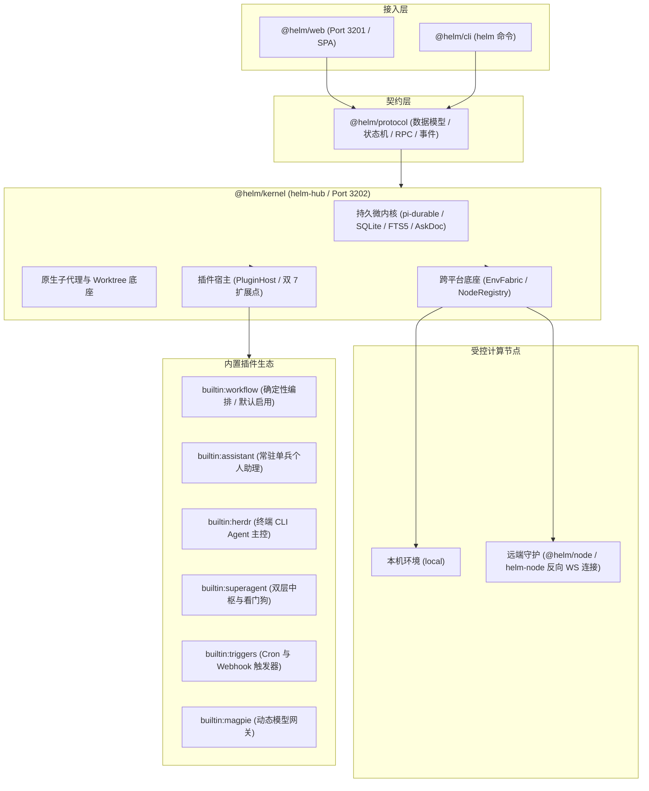

# Helm

> 极简持久微内核个人助理 · 多智能体确定性编排 · 跨平台终端协同主控台

[](https://nodejs.org)
[](https://www.typescriptlang.org)
[](https://pnpm.io)
[](docs/architecture/overview.md)
[](docs/architecture/envfabric.md)
[](docs/cli/reference.md)
[](LICENSE)

Helm 是面向复杂工程任务的轻量持久微内核系统。
系统集成状态机、确定性编排引擎与跨平台节点底座。
内核采用前后端对称双 7 扩展点架构。
所有业务角色由配置定义，内核零硬编码。

### 代码库包结构

Helm 采用 Monorepo 架构，五包单向依赖：

| 包名 | 职责说明 | 交付产物 |
| :--- | :--- | :--- |
| `@helm/protocol` | 共享契约与数据结构，零重依赖 | 核心类型、状态机、RPC 与事件契约 |
| `@helm/kernel` | 持久微内核与插件宿主 | Hub 服务（`helm-hub`） |
| `@helm/cli` | 命令行客户端，与 API 完全同权 | 控制命令（`helm`） |
| `@helm/node` | 受控节点守护进程，反向连接 Hub | 节点服务（`helm-node`） |
| `@helm/web` | 响应式前端外壳，驱动工作台与画布 | Web 界面（Vite SPA） |

---

## 为什么选择 Helm

Helm 解决多智能体协作不可控、跨机运维繁重与终端工具脱节的问题。

| 维度 | 套壳对话应用 | 常见 Python Agent 框架 | Helm 架构 |
| :--- | :--- | :--- | :--- |
| 会话持久化 | 内存暂存或本地缓存，重启丢失状态 | 进程内存易失状态，中断无法精准续接 | `pi-durable` 五态状态机，SQLite 与 FTS5 全量落盘 |
| 编排确定性 | 黑盒提示词循环，结果不可重现 | 图编排 DSL 抽象重，调试排障链路长 | 原生 JavaScript 编排，状态流水精准记录与安全断点续跑 |
| 跨机调度 | 依赖开放入站 SSH 端口与密钥分发 | 依赖容器集群或虚拟网络，环境配置重 | `EnvFabric` 零 SSH 依赖，WebSocket 反向连接 |
| 终端协同 | 无法连接物理终端，仅支持模型输出 | 仅支持本地单向子进程，无窗格交互 | Herdr 协同主控，原生调度终端 CLI 并结构化交接与自愈 |
| 控制同权 | 仅提供 Web 界面，缺乏完整自动化接口 | Python 优先，CLI 覆盖不全 | 接口与 CLI 严格同权，全命令支持 `--json` 管道流转 |
| 代码隔离 | 无独立沙箱，直接污染当前工作区 | 容器镜像构建慢，资源开销高 | Git Worktree 毫秒级隔离，内置自动化代码门禁 |

---

## 全景架构拓扑

微内核通过前后端对称双 7 扩展点驱动生态，所有外部通信经由统一契约。



---

## 5 分钟快速上手

### 1. 环境准备与编译

需要 Node.js 24.12 或更新版本，以及 pnpm。

```bash
git clone https://github.com/helm/helm.git
cd /root/code/helm
pnpm install
pnpm build
```

### 2. 启动前后端服务

```bash
# 启动前后端联合开发环境
HELM_PORT=3202 pnpm dev
```

Web 管理界面监听 `http://127.0.0.1:3201`。
内核 Hub 服务监听 `http://127.0.0.1:3202`。

### 3. 初始化管理员账户

首次启动需要初始化管理员密码：

```bash
pnpm helm setup --password 'your-admin-password'
```

### 4. 登录 CLI 客户端

```bash
pnpm helm login
```

CLI 自动将访问凭据写入 `~/.helm/cli-token`，权限为 `0600`。

### 5. 单兵会话对话

直接向根会话发送输入并等待输出：

```bash
pnpm helm send "请列出当前项目的所有核心包" --wait
```

### 6. 执行首个确定性工作流

```bash
pnpm helm workflows run demo/hello-orchestra.workflow.js --args '{"word":"开源"}' --wait
```

---

## 四大核心特性演示

### 1. 原生 JavaScript 确定性编排

Helm 抛弃沉重的配置 DSL。开发者使用标准 JavaScript 编写工作流。
运行时精准记录每一步骤调用流水（Journaling）。
执行遇到意外中断后，系统自动跳过已完成步骤，恢复未完成任务。

```javascript
// demo/hello-orchestra.workflow.js
export const meta = {
  name: "hello-orchestra",
  description: "最小编排演示：并行两路 + 汇总",
  phases: [{ title: "并行打招呼" }, { title: "汇总" }],
}

log(`参数 word = ${args.word}`)
phase("并行打招呼")
const replies = await parallel([
  () => agent(`把「${args.word}」翻译成英文，只回翻译结果，不要多余内容。`, { label: "翻译英文" }),
  () => agent(`把「${args.word}」翻译成日语，只回翻译结果，不要多余内容。`, { label: "翻译日语" }),
])

phase("汇总")
const joined = replies.filter(r => r !== null).join(" / ")
const summary = await agent(`把「${joined}」合成一句话介绍，只回这一句话。`, { label: "汇总" })

return { replies, summary }
```

执行工作流命令：

```bash
pnpm helm workflows run demo/hello-orchestra.workflow.js --args '{"word":"创新"}' --wait --json
```

### 2. 跨平台执行底座 `EnvFabric`

`EnvFabric` 统一调度本地与远程受控节点。
受控机器启动 `helm-node` 守护进程，主动连接 Hub 的 `/ws/node` 接口。
无需目标机器开放入站 SSH 端口。

```bash
# 步骤 1：在 Hub 签发受控节点令牌
pnpm helm nodes issue build-server --json

# 步骤 2：在目标机器绑定身份并建立连接
pnpm helm-node connect http://hub.example.com:3202 --token '<nodeId:secret>'
pnpm helm-node start -d

# 步骤 3：在指定目标节点流式执行命令
pnpm helm env exec --node build-server --cwd /workspace --stream -- git status

# 步骤 4：在指定节点会话中执行工作流，或通过 agent({ isolation: 'worktree', gate: 'pnpm test' }) 隔离执行
pnpm helm workflows run demo/hello-orchestra.workflow.js --args '{"word":"集群"}' --current --wait
```

### 3. Herdr 终端 CLI Agent 深度协同

Helm 通过 Herdr 插件驱动真实的终端 CLI Agent（Claude Code、Pi、Codex 等）。
Agent 在终端窗格中工作，任务完成后将产物写入 `.helm/wf-out-*` 文件。
若产物缺失或格式错误，Helm 自动在原窗格原地追问自愈。
内置 `AskDoc` 采用 CAS 乐观锁，人类在终端按键后 Web 端自动销单。

```bash
# 启用 Herdr 插件
pnpm helm plugins enable builtin:herdr --json

# 创建绑定终端 Agent 的 Profile
pnpm helm profiles create --input '{"id":"terminal-coder","runtime":{"kind":"herdr","agent":"pi"}}' --json

# 查看本机所有窗格状态
pnpm helm plugins doc builtin:herdr overview --json
```

### 4. API 与 CLI 严格同权

Hub 提供的每一个功能均具备完全一致的 CLI 命令映射。
所有命令支持 `--json` 输出，便于脚本串联与持续集成。
受管 Shell 自动注入当前上下文凭据与会话标识。

```bash
# 结合 jq 过滤活跃会话
pnpm helm conversations list --json | jq '.[] | select(.status == "working")'

# 获取当前会话最近消息
pnpm helm conversations get --current --limit 5 --json

# 导出工作流执行结果
pnpm helm workflows inspect <runId> --json > workflow-result.json
```

---

## 内置插件生态一览

Helm 采用微内核设计，所有扩展能力均通过插件实现：

| 插件标识 | 插件名称 | 核心职责 | 启用状态 |
| :--- | :--- | :--- | :--- |
| `builtin:workflow` | 确定性编排引擎 | 提供 `subagent` / `SubagentWorkflow` / `cleanup_worktree` 工具、编排引擎与 `helm workflows` / `helm worktrees cleanup` 动态命令 | 默认启用（可停用） |
| `builtin:assistant` | 常驻个人助理 | 守护根会话 `#1`，注入独立系统提示词与记忆文件，管理产物 | 常驻启用（系统核心） |
| `builtin:herdr` | 终端 Agent 主控 | 连接 Herdr 终端 IPC，调度 23 种终端 CLI，负责结构化交接与追问自愈 | 默认停用，按需启用 |
| `builtin:superagent` | 双层中枢与看门狗 | 提供零阻塞路由中枢，派生后台驻留 Worker，提供两层巡检与状态自愈 | 默认停用，按需启用 |
| `builtin:triggers` | 自动化触发器 | 提供 Cron 定时调度与 Webhook 入站，验证签名并防逃逸投递 | 默认停用，按需启用 |
| `builtin:magpie` | 动态模型网关 | 连接动态模型网关，原生协议分发，提供目录热重载与配额路由视图 | 默认停用，按需启用 |

### 编写自定义插件

插件导出 `definePlugin(ctx)`。
声明动作自动映射为 HTTP 接口、CLI 命令、Agent Tool 与前端界面：

```javascript
// ~/.helm/plugins/custom-checker/index.mjs
export default {
  id: "custom-checker",
  name: "代码质量检查插件",
  definePlugin(ctx) {
    // 声明动作：系统自动注册多端调用入口
    ctx.action({
      id: "lint",
      description: "执行代码规范检查",
      inputSchema: {
        type: "object",
        properties: { targetDir: { type: "string" } },
        required: ["targetDir"],
      },
      outputSchema: {
        type: "object",
        properties: { passed: { type: "boolean" } },
        required: ["passed"],
      },
      async handler(input) {
        // 执行检查逻辑并返回结构化结果
        return { passed: true }
      },
    })
  },
}
```

启用并调用该插件动作：

```bash
# 启用新插件
pnpm helm plugins enable custom-checker --json

# 通过 CLI 直接调用动作
pnpm helm custom-checker lint --input '{"targetDir":"/workspace"}' --json
```

---

## CLI 核心命令速查

| 分类 | 命令 | 功能说明 |
| :--- | :--- | :--- |
| **系统与鉴权** | `helm setup --password <pwd>` | 首次初始化管理员账户 |
| | `helm login` | 登录 Hub 并保存本地凭据 |
| | `helm status --json` | 查询 Hub 与组件服务状态 |
| **会话管理** | `helm conversations list --json` | 查看会话列表，支持筛选过滤 |
| | `helm conversations create --node <id> --cwd <path>` | 创建指定节点与目录的持久会话 |
| | `helm conversations get <id> --json` | 查看会话详情与最新时间线 |
| | `helm send "<prompt>" --wait` | 向会话投递输入并等待完成 |
| **确定性编排** | `helm workflows list --json` | 查看已注册工作流列表（`builtin:workflow` 插件动态命令） |
| | `helm workflows run <file> --args '<json>' --wait` | 执行确定性多智能体工作流 |
| | `helm workflows inspect <runId> --json` | 查看工作流阶段状态与执行流水 |
| | `helm workflows abort <runId>` | 中止在途工作流任务 |
| **受控节点** | `helm nodes list --json` | 查看所有节点在线与离线状态 |
| | `helm nodes issue <nodeId> --json` | 为新受控节点签发连接令牌 |
| | `helm env exec --node <id> -- <cmd>` | 在目标节点受管环境中执行命令 |
| | `helm worktrees cleanup --conversation-id <id>` | 清理已完成任务的 Git Worktree |
| **插件生态** | `helm plugins list --json` | 查看所有插件状态与信息 |
| | `helm plugins enable <id> --json` | 启用指定插件并加载前后端扩展 |
| | `helm plugins disable <id> --json` | 安全停用插件并核查在途任务 |
| | `helm plugins doc <plugin> <doc> --json` | 读取插件公开文档与状态总览 |
| **节点守护进程** | `helm-node connect <hubUrl> --token <token>` | 受控机器初始化并配置连接信息 |
| | `helm-node start -d` | 后台守护进程模式启动节点 |
| | `helm-node status --json` | 查看本机守护进程服务状态 |
| | `helm-node service install` | 安装为系统开机服务 |

---

## 深度文档中心导航

完整架构剖析、工作流开发与 API 手册请参阅技术文档：

- **新手指南**
  - [安装与部署配置](docs/getting-started/installation.md)：环境准备、安装流程、端口与数据隔离
  - [编写首个工作流](docs/getting-started/first-workflow.md)：从零编写并执行确定性多智能体编排
- **架构与原理**
  - [极简微内核哲学](docs/architecture/overview.md)：零业务角色硬编码与单向依赖设计
  - [前后端对称双 7 扩展点](docs/architecture/extension-points.md)：后端 7 大 Hook 与前端 7 大扩展视图
  - [EnvFabric 分布式执行底座](docs/architecture/envfabric.md)：反向 WebSocket、安全升级与 Worktree 隔离
  - [pi-durable 持久会话状态机](docs/architecture/pi-durable.md)：五态状态机、FTS5 全文搜索与 AskDoc 乐观锁
- **确定性多智能体编排**
  - [原生 JavaScript DSL 手册](docs/workflows/dsl-guide.md)：`agent`, `parallel`, `pipeline`, `phase` 语法规范
  - [Git Worktree 与自动化门禁](docs/workflows/worktree-and-gate.md)：代码沙箱隔离与测试门禁验收
  - [状态流水与意外恢复](docs/workflows/journaling-recovery.md)：执行流水记录、调用复用与断点续跑
- **插件系统与内置生态**
  - [插件系统设计与契约](docs/plugins/overview.md)：`definePlugin(ctx)` 强类型规范与安全生命周期
  - [常驻个人助理 (Assistant)](docs/plugins/assistant.md)：根会话守护、动态记忆注入与产物管理
  - [Herdr 终端协同主控 (Herdr)](docs/plugins/herdr.md)：终端 CLI 调度、结构化交接与追问自愈
  - [SuperAgent 双层中枢 (SuperAgent)](docs/plugins/superagent.md)：零阻塞路由、驻留 Worker 与两层看门狗
  - [自动化触发器 (Triggers)](docs/plugins/triggers.md)：Cron 定时任务与 Webhook 签名入站
  - [动态模型网关 (Magpie)](docs/plugins/magpie.md)：原生协议分发、动态模型目录与配额诊断
  - [自定义插件开发实战](docs/plugins/plugin-development.md)：前后端全栈插件开发与发布交付
- **参考手册与历史归档**
  - [CLI 全量命令参考手册](docs/cli/reference.md)：`helm` 与 `helm-node` 命令字典
  - [Web 导航与 URL Hash 约定](docs/conventions/web-navigation.md)：界面深链与状态同步规范
  - [历史设计与开发交接归档](docs/archive/README.md)：早期架构演进与阶段验收记录

---

## 开源许可证

本项目基于 [MIT 许可证](LICENSE) 发布。
