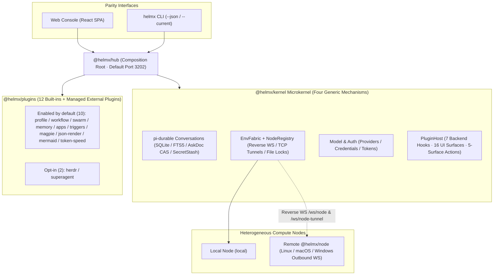

# Helmx

> Durable microkernel · Zero-SSH multi-node execution · Human-safe multi-agent control plane

**English** | [简体中文](README.zh-CN.md)

[](https://nodejs.org)
[](https://www.npmjs.com/package/@helmx/cli)
[](https://www.typescriptlang.org)
[](docs/architecture/overview.md)
[](LICENSE)

**Helmx** is a durable microkernel control plane for real-world multi-agent engineering. One always-on **Hub** unifies heterogeneous machines—cloud servers, private-network GPU boxes, and personal Windows / macOS workstations—while coordinating native LLM sessions alongside **23 real terminal CLI agents** (Claude Code, Codex, pi, Gemini CLI, and more). Depending on the job, you move fluidly between **peer Swarm squads**, **deterministic JS workflows**, and **24/7 autonomous routing**.

The kernel (`@helmx/kernel`) enforces only four orthogonal primitives—a **durable conversation state machine**, **EnvFabric** cross-node execution, **Model / Auth**, and a **strongly typed PluginHost**. Zero business roles are hardcoded in the core. Orchestration, memory, terminal bridging, and full-stack micro-apps all live in plugins; disable a plugin and its tools, CLI commands, skills, and UI vanish cleanly with no phantom prompts left behind.

---

## 60-Second Quick Start

Helmx ships as three focused npm packages: `@helmx/cli` (`helmx` control CLI), `@helmx/hub` (Hub runtime, managed automatically by `helmx update`), and `@helmx/node` (`helmx-node` remote daemon). Prerequisites: Node.js `>= 24.12.0` and Git.

### 1. Install and start a local Hub

```bash
npm install -g @helmx/cli
helmx update --watch
```

On first run this downloads and verifies `@helmx/hub`, starts the Hub on `http://127.0.0.1:3202` (serving both the API and full Web Console), and watches for updates during idle windows.

### 2. Initialize admin credentials and configure a model

```bash
# Initialize admin password and sign in (writes 0600 credentials to ~/.helmx/cli-token)
helmx setup --password '<your-admin-password>'

# Add any model provider API key and choose a default model
helmx models providers --json
helmx credentials set <provider-id> --value '<api-key>'
helmx models refresh --json
helmx models default --set '<provider>/<model>' --json

# Open http://127.0.0.1:3202 in your browser, or send a message from the terminal
helmx send 1 "Inspect this repository's layout and test entry points" --wait
```

> Prefer running **Hub in Docker + a host node** or **developing from source**? See the [Installation & Configuration Guide](docs/getting-started/installation.md) (Chinese docs; all CLI flags and schemas are in English).

---

## Why Helmx

Most agent frameworks and local harnesses optimize for a single conversation on a single laptop. The moment you run **multi-machine engineering**, **long-running multi-agent deliveries**, or **automated agents sharing terminals with humans**, cracks appear: ephemeral state, brittle SSH glue, agents trampling each other's working tree, and watchdogs accidentally aborting or typing into human sessions. Helmx is engineered specifically for those boundaries:

| Dimension | Single-Machine Chat / Local Agent Harness | Helmx Multi-Node Control Plane |
| :--- | :--- | :--- |
| **Dynamic Multi-Agent Teamwork** | Heavy always-on roles or noisy prompt loops that drop handoffs | **Peer Swarm Blackboard**: zero always-on sessions, on-demand dynamic roles (read/write + read-only verifier), `#seq` references, orthogonal `wake` doorbells, pure `turn_settled` event self-healing |
| **Long-Running Deterministic Flows** | Unreproducible runs; rate limits or network blips burn tokens restarting from scratch | **Native JS Workflows**: call-level JSONL journal prefix replay (zero-token resume), seamless in-place recovery across Hub restarts, 6-check managed Git worktrees + shell gates |
| **Cross-Machine Execution** | Local-first; remote machines need open inbound SSH ports and key distribution, painful for NAT / Windows | **EnvFabric Reverse WebSockets**: nodes connect outbound through NAT, unifying Linux / macOS / Windows with arbitrary TCP tunnels and explicit offline failures |
| **Real Terminal CLI Agents** | Opaque subprocess wrappers or race conditions between humans and automation | **Herdr + Human Ownership Red Line**: bridges 23 real terminal CLIs with schema-checked file handoffs; kernel-enforced `ownedBy: 'human'` no-keystroke guard + CAS `AskDoc` superseding |
| **Extensibility & Apps** | Duplicate definitions across HTTP, CLI, tools, and UI; ad-hoc scripts rot quickly | **One-Source `ctx.action` + `builtin:apps`**: declare one schema to get HTTP / CLI / Tool / Workflow / UI; conversational full-stack micro-apps gated by 4-stage `doctor` validation |
| **Control Plane & Safety** | In-memory state or silent fallbacks that hide failures | **Honest Microkernel**: SQLite + FTS5 persistence, in-memory `SecretStash` with zero implicit secret inheritance for external panes, explicit errors everywhere |

---

## Six Core Highlights

### 1. Peer Swarm Blackboard: Coordinate Agents Like a Real Engineering Squad

For complex refactors, parallel feature work, or multi-round writer/verifier reviews, type `/skill:swarm <task>` in any top-level human conversation (or ask your assistant in plain language) to spin up an **on-demand, zero-idle-cost peer squad**:

- **Dynamic roles & read-only cross-verification**: the coordinator recruits named read/write workers and read-only verifiers tailored to the task, assigns per-member profiles or models, and can **abort in place** (`swarm_abort_worker`) or **hot-swap models** (`swarm_switch_worker_model`) mid-flight without losing context;
- **Conflict-free parallel coding**: concurrent writers reuse `builtin:workflow`'s managed Git worktrees with durable holds; posting `handoff` or `done` automatically attaches a live branch and diff snapshot;
- **`#seq` pointers + orthogonal `wake` doorbells**: every handoff lands on an indexed blackboard so peers cite `refs: [seq]` instead of copy-pasting essays; `wake` is decoupled from addressing (`to`), waking only the next responsible owner with cursor-batched delivery;
- **Pure event-driven self-healing (zero polling timers)**: failed turns automatically post a `[blocker]` to the board; silent exits after a wakeup trigger one deterministic nudge; stalled squads trigger 6-condition zero-token `[stall]` attribution;
- **In-conversation observability**: compact 26px natural-language tool rows in the timeline, a coordinator-only Composer active tray, and a right-hand Workbench panel to inspect any worker in a drawer—closing cleanly once merged, or preserving branches via `keepWorktree: true`.

Deep dive: [Swarm Plugin](docs/plugins/swarm.md) · [Orchestration Selection & Playbook](docs/getting-started/orchestration-guide.md)

### 2. Deterministic JS Workflows, Zero-Token Resume & Managed Worktrees

When a multi-step pipeline should be auditable and repeatable, write standard JavaScript—no custom YAML or visual graph DSL:

```javascript
// Fan out into isolated Git worktrees and require passing tests before merging
phase("Parallel implementation & gated verification")
const deliveries = await parallel([
  () => agent("Implement payment webhook signature verification with unit tests", {
    label: "payment-verify",
    isolation: "worktree",
    gate: "pnpm test:unit",
  }),
  () => agent("Implement billing reconciliation export endpoint with unit tests", {
    label: "billing-export",
    isolation: "worktree",
    gate: "pnpm test:unit",
  }),
])
```

- **Prefix replay for zero-token resume**: every call appends to a per-run JSONL journal. Re-running with `--resume-from-run-id <runId>` replays every matching succeeded prefix at zero token cost and resumes live from the first failure. Non-idempotent `action()` calls write an `fsync`'d intent record first and explicitly halt with `workflow_action_uncertain` rather than blindly re-executing side effects;
- **Seamless recovery across Hub restarts**: healthy in-flight subagents and workflows reattach in place after graceful or crash restarts, with `helmx workflows resume-failed` for batch recovery of failed runs;
- **Six-check Worktree safety**: isolated worktrees live alongside the main repo on managed `helmx/spawn-*` branches and enforce active-occupancy, main-root, realpath-ownership, live OS process-usage, dirty-tree, and unmerged-commit checks before cleanup.

Deep dive: [JS DSL Guide](docs/workflows/dsl-guide.md) · [Journaling & Recovery](docs/workflows/journaling-recovery.md) · [Worktrees & Gates](docs/workflows/worktree-and-gate.md)

### 3. EnvFabric: Zero-SSH Multi-Node Execution & TCP Tunnels

Install the lightweight `helmx-node` daemon on any target machine and point it outbound to your Hub over WebSocket (`/ws/node`). Cloud VMs, home Windows desktops, and NAT-bound GPU hosts join with **zero inbound SSH ports and zero key distribution**:

```bash
# 1. Issue a one-time join token on the Hub (stored server-side as SHA-256 only)
helmx nodes issue dev-win --json

# 2. Install and connect on the target machine (Linux / macOS / Windows)
npm install -g @helmx/node
helmx-node start -d --hub http://<hub-host>:3202 --token 'dev-win:<secret>'

# 3. Stream remote commands, bind conversations to remote repos, or forward TCP ports
helmx env exec --node dev-win --cwd "C:\Users\alice\repo" --stream -- git status
helmx conversations create --node dev-win --cwd "C:\Users\alice\repo" --title "Windows debug"
helmx nodes forward dev-win 127.0.0.1:8080 127.0.0.1:8000
```

- **Physical coordinates**: conversations and profiles bind directly to `(nodeId, cwd)`. File tools, shells, gates, and `(nodeId, canonicalPath)` file mutation locks route transparently to the bound node;
- **Never falls back silently to local**: an offline node explicitly fails with `409 node_offline` instead of running remote commands on the Hub host;
- **Atomic self-upgrades**: `helmx nodes upgrade` drains in-flight work (`node_draining`), verifies SHA-512 integrity, commits via canary handshake, and rolls back automatically on failure.

Deep dive: [EnvFabric Execution Fabric](docs/architecture/envfabric.md)

### 4. Herdr Terminal Synergy & Human-Safety Invariants

Enable `builtin:herdr` and set `agentType` to `herdr:claude`, `herdr:codex`, `herdr:pi` (23 terminal CLIs supported, optionally pinned to a remote node via `herdr:claude@dev-win`) to orchestrate real interactive terminal agents:

- **Process in the terminal, contract in a file**: watch live output or take over the terminal at any time. Results hand off through `.helmx/wf-out-*` validated against your JSON Schema (with one automatic self-heal); failures attach a 40-line redacted terminal snapshot rather than scraping dirty screen text as success;
- **Kernel-enforced human ownership red line**: conversations distinguish `ownedBy: 'human'` from `bot` / `helmx`. All automated aborts and input injections pass through `abortConversationGuarded` / `submitInputGuarded` inside the conversation serial domain—automation is strictly forbidden from sending keys or aborting human-owned sessions or panes;
- **CAS optimistic-lock approval bridge**: when a terminal CLI blocks on a prompt, Helmx surfaces an `AskDoc` card in the Web Console pinned to `expectedStateSeq`. If a human answers directly in the terminal first, the Web card automatically transitions to `superseded` with zero duplicate keystrokes.

Deep dive: [Herdr Plugin](docs/plugins/herdr.md) · [pi-durable Sessions & CAS Approvals](docs/architecture/pi-durable.md)

### 5. Five-Surface Plugin Architecture & Full-Stack Micro-Apps

- **Declare once, get five surfaces**: a single `ctx.action({ id, inputSchema, outputSchema })` declaration automatically exposes an **HTTP endpoint**, a **`helmx` CLI subcommand**, an **Agent tool / `run_action` entry**, a **Workflow `action()` primitive**, and a **Web UI action**;
- **Conversational full-stack micro-apps (`builtin:apps`)**: turn recurring dashboards, reconciliation desks, or ops tools into persistent apps. Each app is a standard managed plugin (backend actions + persistent `ctx.doc` + React `client.tsx`) that must pass 4-stage `apps_validate` (`manifest -> backend -> register -> client` export checks) before publishing to the App Center;
- **Clean lifecycle governance**: `helmx plugins doctor / rescan / reload / install` with hard `409 plugin_has_live_tasks` blocking during active runs and immediate teardown when disabled.

Deep dive: [Plugin System Contract](docs/plugins/overview.md) · [Plugin Development Guide](docs/plugins/plugin-development.md) · [App Center](docs/plugins/apps.md)

### 6. Built for 24/7 Unattended Automation & Explicit Secret Boundaries

- **Cron & HMAC Webhooks (`builtin:triggers`)**: inbound events pass through `defang` wrapping before routing; webhook secrets are strictly blocked inside conversation tool contexts (`403 webhook_secret_context_forbidden`);
- **SuperAgent dual-layer hub (`builtin:superagent`, opt-in)**: non-blocking router + resident background workers + RecallGraph + self-managed two-layer watchdog with backoff auto-resume for failed workflows;
- **In-memory `SecretStash`**: secrets never hit SQLite or model context and are scrubbed across streaming chunks; external terminal panes inherit zero parent secrets by default and require explicit per-call `secretNames` grants.

---

## Choosing the Right Orchestration Primitive

All four primitives are orthogonal and freely compose with **Git Worktrees**, **remote EnvFabric nodes**, and **Herdr terminal CLIs**:

| Need | Primitive | Plugin | Highlights |
| :--- | :--- | :--- | :--- |
| Delegate one focused subtask (investigate, write tests, review) | **`subagent`** | `builtin:workflow` | Background-by-default in human sessions, `fork`, Schema, `worktree`, `gate`, live `steer` |
| Dynamic division of labor, peer handoffs, writer ↔ read-only verifier loops | **Peer Swarm** | `builtin:swarm` | Zero idle sessions, `#seq` blackboard, orthogonal `wake`, event self-healing, mid-flight model swap |
| Repeatable multi-phase pipelines with auditability and zero-token resume | **JS Workflow** | `builtin:workflow` | Standard JS, JSONL prefix replay, nested workflows (`cross-review` / `module-dev` / `arch-master` templates included) |
| 24/7 inbound triage, resident background workers, automatic failure recovery | **SuperAgent** | `builtin:superagent` | Non-blocking router, RecallGraph, two-layer watchdog obeying `ownedBy: 'human'` |

---

## Architecture & 12 Built-in Plugins



| Plugin ID | Responsibility | Default | Docs |
| :--- | :--- | :--- | :--- |
| `builtin:profile` | Per-profile `SYSTEM.md`, workspace `AGENTS.md`, skill catalog & `load_skill` | Locked (always on) | [profile](docs/plugins/profile.md) |
| `builtin:workflow` | `subagent` / `SubagentWorkflow` / `cleanup_worktree`, JS DSL engine & worktree leases | Enabled | [workflow](docs/plugins/workflow.md) |
| `builtin:swarm` | Flat peer `#seq` blackboard, orthogonal `wake`, `turn_settled` self-healing & in-session board | Enabled | [swarm](docs/plugins/swarm.md) |
| `builtin:memory` | Per-profile `MEMORY.md` (64k lock-guarded) with toggle & `update_memory` | Enabled | [memory](docs/plugins/memory.md) |
| `builtin:apps` | Full-stack micro-app catalog, 4-stage `validate/publish` & `app-builder` skill | Enabled | [apps](docs/plugins/apps.md) |
| `builtin:triggers` | Cron scheduler & HMAC-SHA256 webhook inbound endpoints | Enabled | [triggers](docs/plugins/triggers.md) |
| `builtin:magpie` | Dynamic model gateway provider, hot catalog refresh & quota/routing diagnostics | Enabled | [magpie](docs/plugins/magpie.md) |
| `builtin:json-render` | Interactive ```ui cards inside replies & `generative-ui` skill | Enabled | [json-render](docs/plugins/json-render.md) |
| `builtin:mermaid` | Inline ```mermaid SVG diagram rendering (graceful code-block fallback when disabled) | Enabled | [mermaid](docs/plugins/mermaid.md) |
| `builtin:token-speed` | Real-time composer decoding speed (tok/s), TTFT & final reconciliation | Enabled | [token-speed](docs/plugins/token-speed.md) |
| `builtin:herdr` | Bridge 23 terminal CLI agents, file handoff self-heal, CAS approval bridge & `$helmx` tokens | Opt-in | [herdr](docs/plugins/herdr.md) |
| `builtin:superagent` | Dual-layer router, resident workers, RecallGraph & self-managed two-layer watchdog | Opt-in | [superagent](docs/plugins/superagent.md) |

---

## Essential CLI Cheat Sheet

HTTP API and `helmx` CLI have strict parity. Every command supports `--json` for scripting and `--current` for automatic session/node context:

```bash
# Hub lifecycle (npm distribution)
helmx update --watch                      # Start Hub and auto-update during idle windows
helmx update --status --json              # Inspect installed & running versions

# Conversations, full-text search & approvals
helmx send 1 "Review the latest commit for edge cases" --wait
helmx search "worktree"                   # FTS5 full-text search across conversations
helmx asks list                           # View pending approvals

# Peer Swarm & deterministic Workflows
helmx swarm board-status --group-id <id>  # Inspect live squad status
helmx workflows run demo/hello-orchestra.workflow.js --args '{"word":"open-source"}' --conversation-id 1 --wait
helmx workflows resume-failed --all       # Batch-resume recoverable failed runs
helmx worktrees list                      # Inspect managed Git worktrees

# Multi-node execution & TCP forwarding
helmx nodes list                          # Online status & health snapshots
helmx env exec --node <id> --cwd <dir> --stream -- <cmd>
helmx nodes forward <id> 127.0.0.1:8080 127.0.0.1:8000

# Plugins & micro-apps
helmx plugins enable builtin:herdr        # Enable terminal CLI orchestration
helmx plugins init my-app --template app  # Scaffold a full-stack micro-app
helmx apps validate ./my-app && helmx apps publish ./my-app
```

Full reference: [CLI Command Reference](docs/cli/reference.md).

---

## Developing from Source

```bash
git clone https://github.com/team4u/helmx.git && cd helmx
pnpm install
pnpm build
HELMX_PORT=3202 pnpm dev   # Web dev 3201 -> Hub 3202
```

Full verification gate: `pnpm build && pnpm typecheck && pnpm lint && pnpm check:hygiene && pnpm test:all`. Incremental gate: `pnpm check:changed`. See [AGENTS.md](AGENTS.md) for contributor conventions and [Microkernel Architecture Overview](docs/architecture/overview.md) for the package dependency graph.

---

## Documentation Map

Browse the full [Documentation Hub](docs/README.md) (detailed architecture and plugin manuals are currently written in Chinese with English identifiers and schemas):

- **Getting Started**: [Quick Tour](docs/getting-started/index.md) · [Installation & Config](docs/getting-started/installation.md) · [Orchestration Selection & Playbook](docs/getting-started/orchestration-guide.md) · [First Workflow](docs/getting-started/first-workflow.md)
- **Kernel Architecture**: [Microkernel Overview](docs/architecture/overview.md) · [Hooks & UI Extension Points](docs/architecture/extension-points.md) · [EnvFabric](docs/architecture/envfabric.md) · [pi-durable & CAS Approvals](docs/architecture/pi-durable.md)
- **Orchestration & Reliability**: [JS DSL Guide](docs/workflows/dsl-guide.md) · [Worktrees & Gates](docs/workflows/worktree-and-gate.md) · [Journaling & Recovery](docs/workflows/journaling-recovery.md)
- **Plugins & Micro-Apps**: [Plugin Contract](docs/plugins/overview.md) · [Plugin Development](docs/plugins/plugin-development.md) · 12 built-in plugin docs (linked in the table above)
- **Reference & Operations**: [CLI Reference](docs/cli/reference.md) · [Web Frontend Conventions](docs/conventions/web-frontend.md) · [Web Navigation Conventions](docs/conventions/web-navigation.md) · [Release Process](docs/releasing.md)

---

## Honest Boundaries

We prefer explicit engineering contracts over vague promises:

- **Active development**: APIs, config, and storage schemas may evolve incompatibly without migration layers or backward-compat shims.
- **Single-admin security model**: Authentication uses an admin password and bearer tokens without multi-tenant RBAC; place Hub behind a reverse proxy or private network before exposing it beyond localhost.
- **Trusted-code secret boundary**: `SecretStash` guarantees secrets never land in SQLite, logs, or model context and are scrubbed from output streams—but arbitrary shell commands and in-process plugins (including micro-apps) are trusted code with host privileges and can read process memory or environment variables.
- **Zero silent fallbacks**: Offline nodes (`409 node_offline`), disabling plugins with in-flight work (`409 plugin_has_live_tasks`), and broken handoff contracts always fail explicitly with diagnostics.
- **Human session protection**: For any `ownedBy: 'human'` conversation or terminal pane, automation and watchdogs are strictly restricted to read-only diagnostics and notifications—never keystrokes or aborts.

## License

Released under the [MIT License](LICENSE). See [THIRD_PARTY_NOTICES.md](THIRD_PARTY_NOTICES.md) for third-party attributions.
