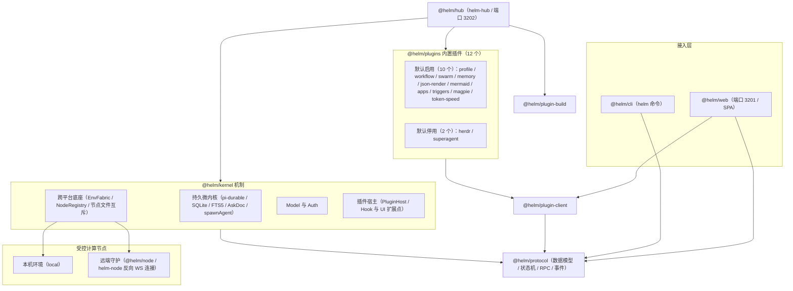

# Helm

> 极简持久微内核个人助理 · 多智能体确定性编排 · 跨平台终端协同主控台

[](https://nodejs.org)
[](https://pnpm.io)
[](https://www.typescriptlang.org)
[](docs/architecture/overview.md)
[](LICENSE)

Helm 是面向复杂工程任务的轻量持久微内核系统，用于解决多智能体协作不可控、跨机运维繁重与终端工具脱节三类问题。内核（`@helm/kernel`）只保留四块通用机制：基于 `pi-durable` 的持久会话状态机（SQLite 全量落盘、FTS5 全文检索、`AskDoc` 审批与原生 `spawnAgent` 子会话派生）、跨平台执行编排底座 `EnvFabric` 与 `NodeRegistry`（WebSocket 反向连接，统一驱动本地与远端节点的 `bash / read / write / edit / gate` 与文件互斥）、Model 与 Auth（模型供应商接入、凭据与令牌管理），以及唯一强类型插件宿主 `PluginHost`（`definePlugin(ctx)`，提供后端生命周期 Hook 与前端全界面扩展点）。业务角色一律通过 `profileId` 与 `tags` 表达，内核零硬编码；`subagent`、`SubagentWorkflow`、Git Worktree 租约等编排能力全部由 `builtin:workflow` 等插件承载，停用即整体消失。

项目处于活跃开发阶段：接口与存储结构可能发生不兼容变更，当前未发布安装制品，以源代码模式运行（见下方「5 分钟源代码启动」）。

## 为什么选择 Helm

| 维度 | 套壳对话应用 | 常见 Python Agent 框架 | Helm 架构 |
| :--- | :--- | :--- | :--- |
| 会话持久化 | 内存暂存或本地缓存，重启丢失状态 | 进程内存易失状态，中断无法精准续接 | `pi-durable` 五态状态机，SQLite 与 FTS5 全量落盘 |
| 编排确定性 | 黑盒提示词循环，结果不可重现 | 图编排 DSL 抽象重，调试排障链路长 | 原生 JavaScript 编排，状态流水精准记录与安全断点续跑 |
| 跨机调度 | 依赖开放入站 SSH 端口与密钥分发 | 依赖容器集群或虚拟网络，环境配置重 | `EnvFabric` 零 SSH 依赖，受控节点 WebSocket 反向连接 |
| 终端协同 | 无法连接物理终端，仅支持模型输出 | 仅支持本地单向子进程，无窗格交互 | Herdr 协同主控，原生调度终端 CLI 并结构化交接与自愈 |
| 控制同权 | 仅提供 Web 界面，缺乏自动化接口 | Python 优先，CLI 覆盖不全 | HTTP API 与 CLI 严格同权，全命令支持 `--json` 管道流转 |
| 代码隔离 | 无独立沙箱，直接污染当前工作区 | 容器镜像构建慢，资源开销高 | Git Worktree 毫秒级隔离，内置自动化代码门禁 |

## 全景架构

微内核通过生命周期 Hook 与全界面扩展点驱动插件生态，所有外部通信经由统一契约。



## 包边界与单向依赖

Helm 按机制、插件和产品组合分包。`@helm/hub` 是产品组合根：连接 `@helm/kernel`、`@helm/plugins` 与构建实现，并提供 `helm-hub` 命令；内核可以独立使用，不依赖内置插件与组合根。`@helm/plugin-client` 是可独立构建的浏览器 SDK，由 Web 应用注入数据与导航能力，不反向依赖 Web 应用。通用契约放在 `@helm/protocol`（零运行时重依赖），插件业务契约归属插件包。

| 包名 | 职责说明 | 交付产物 |
| :--- | :--- | :--- |
| `@helm/protocol` | 共享契约与数据结构，零重依赖 | 核心类型、状态机、RPC 与事件契约 |
| `@helm/kernel` | 持久微内核与插件宿主 | 可嵌入的运行时与 HTTP 服务机制 |
| `@helm/hub` | 产品组合根与进程入口 | Hub 服务（`helm-hub`） |
| `@helm/plugins` | 内置插件、业务契约、客户端视图与技能资产 | 官方插件集合（12 个内置插件） |
| `@helm/plugin-client` | 共享 UI 原语、上下文与宿主能力端口 | 浏览器 SDK |
| `@helm/plugin-build` | 插件前后端源码构建 | 注入式构建实现 |
| `@helm/env-io` | Hub 与节点共享的执行侧 I/O 与自更新引擎实现 | 路径进程占用扫描、共享更新引擎（`src/update/`） |
| `@helm/cli` | 命令行客户端，与 API 完全同权 | 控制命令（`helm`，含 `src/launcher/` 的 `helm update` 生命周期面） |
| `@helm/node` | 受控节点守护进程，反向连接 Hub | 节点服务（`helm-node`） |
| `@helm/web` | 响应式 Web 主控台 | Web 界面（Vite SPA） |
| `@helm/payload` | npm 三制品组装器：Hub payload、CLI bundle 与 node 守护进程 bundle | npm 制品（`@team4u/helm-hub` / `@team4u/helm-cli` / `@team4u/helm-node`） |
| `@helm/test-kit` | 测试共享基座（仅限 `devDependencies` 与 `test/`，不进生产依赖） | 测试工具库 |

## 内置插件生态（12 个）

Helm 采用微内核设计，所有扩展能力均由插件提供。停用插件后，其工具、动作、CLI 命令、受管技能与 UI 贡献即时消失，不留幻影提示词。

| 插件标识 | 插件名称 | 核心职责 | 默认状态 |
| :--- | :--- | :--- | :--- |
| `builtin:profile` | 角色与技能底座 | 为全部 Profile 注入 SYSTEM.md 与可用技能目录，提供 `load_skill` 工具与默认助理角色 | 常驻（locked，不可停用） |
| `builtin:workflow` | 确定性编排引擎 | 提供 `subagent` / `SubagentWorkflow` / `cleanup_worktree` 工具、DSL 编排引擎、Git Worktree 租约与 `helm workflows` / `helm worktrees` 动态命令 | 默认启用 |
| `builtin:swarm` | 多智能体协同黑板 | 扁平对等序号黑板、正交唤醒与 `turn_settled` 纯事件自愈；零常驻会话，按需复用 workflow 的 Worktree | 默认启用 |
| `builtin:memory` | 长期记忆 | 自管各 Profile 的 MEMORY.md 注入、单角色记忆启停（`helm memory`）与 `update_memory` 工具 | 默认启用 |
| `builtin:apps` | 应用中心与微应用工坊 | 全栈微应用目录（`catalog`）、`validate/publish/list/update_meta/remove` 动作（`helm apps`）与 `app-builder` 技能 | 默认启用 |
| `builtin:json-render` | 声明式渲染 | 聊天 `ui` 代码围栏的 JSON DSL、求值器与界面原语，并维护 `generative-ui` 技能 | 默认启用 |
| `builtin:mermaid` | 图表渲染 | 接管 Markdown 中 Mermaid 代码块渲染；停用后回退普通代码块 | 默认启用 |
| `builtin:triggers` | 自动化触发器 | 提供 Cron 定时调度与 Webhook 入站，HMAC 验签并防逃逸投递 | 默认启用 |
| `builtin:herdr` | 终端 Agent 主控 | 连接 Herdr 终端 IPC，调度 23 种终端 CLI，负责结构化交接、追问自愈与 CAS 审批桥 | 默认停用 |
| `builtin:superagent` | 双层中枢与看门狗 | 零阻塞路由中枢、后台驻留 Worker、两层巡检与状态自愈（巡检周期由插件服务自管） | 默认停用 |
| `builtin:magpie` | 动态模型网关 | 连接动态模型网关，原生协议分发，提供目录热重载与配额路由视图 | 默认启用 |
| `builtin:token-speed` | Token 速率徽标 | 输入区状态行实时解码速率；滑动窗口 / TTFT / 终态对账全在插件，内核只透传通用流式事实 | 默认启用 |

插件通过 `ctx.action({ id, inputSchema, outputSchema })` 单点声明动作，自动获得五端映射：HTTP 端点（`POST /api/actions/<pluginId>/<actionId>`）、CLI 顶层命令、Agent Tool、Workflow `action()` 原语与 Web UI。编写自定义插件的完整流程（脚手架、四阶段自检、增量发现、受控热重载）见[自定义插件开发实战](docs/plugins/plugin-development.md)。

## 5 分钟源代码启动

前置条件：Node.js `>= 24.12.0`、pnpm 12.x、Git；Linux / macOS / WSL2。数据目录固定 `~/.helm`（可用 `HELM_DATA_DIR` 覆盖），与旧系统数据完全隔离。

```bash
# 1. 获取源码并安装依赖
git clone https://github.com/team4u/helm.git && cd helm
pnpm install
pnpm build

# 2. 启动前后端（Web 3201 + Hub 3202）
HELM_PORT=3202 pnpm dev

# 3. 初始化管理员并登录（setup 自动完成登录，凭据写入 ~/.helm/cli-token，权限 0600）
pnpm helm setup --password '<your-admin-password>'
# 后续登录（凭据丢失或换机时）
pnpm helm login --password '<your-admin-password>'

# 4. 验证：与入口会话 #1 对话
pnpm helm send 1 "请列出当前项目的核心包" --wait

# 5. 运行首个确定性工作流（必须显式指定目标会话）
pnpm helm workflows run demo/hello-orchestra.workflow.js \
  --args '{"word":"开源"}' --conversation-id 1 --wait
```

启动后 Web 主控台在 `http://127.0.0.1:3201`，Hub API 在 `http://127.0.0.1:3202`。端口固定约束：`3000/3001/3002/3101/3102` 为外部与历史系统保留，Helm 任何组件永不占用。

工作流没有私有配置 DSL，就是标准 JavaScript 模块。上面运行的 demo 全文：

```javascript
// demo/hello-orchestra.workflow.js
export const meta = {
  name: "hello-orchestra",
  description: "最小编排演示：并行两路 + 汇总",
  phases: [{ title: "并行打招呼" }, { title: "汇总" }],
}

log(`参数 word = ${args.word}`)
phase("并行打招呼")
const replies = await parallel([
  () => agent(`把「${args.word}」翻译成英文，只回翻译结果，不要多余内容。`, { label: "翻译英文" }),
  () => agent(`把「${args.word}」翻译成日语，只回翻译结果，不要多余内容。`, { label: "翻译日语" }),
])

phase("汇总")
const joined = replies.filter(r => r !== null).join(" / ")
const summary = await agent(`把「${joined}」合成一句话介绍，只回这一句话。`, { label: "汇总" })

return { replies, summary }
```

运行时为每一步记录可重放的调用流水（Journaling）：某步因模型限流或环境问题失败后，携带 `--resume-from-run-id <runId>` 重新启动，已成功的前缀节点零 Token 复用，自首个失配点起转为实时执行。需要代码隔离时，声明 `agent(prompt, { isolation: 'worktree', gate: 'pnpm test' })`：子会话在独立 Git Worktree 中执行，门禁通过后才汇入结果。完整语义见[编写首个工作流](docs/getting-started/first-workflow.md)与[状态流水与故障恢复](docs/workflows/journaling-recovery.md)。

## 远端节点接入速览

`EnvFabric` 统一调度本地与远端受控节点：目标机器运行 `helm-node` 守护进程并主动反向连接 Hub 的 `/ws/node` 接口，全程无需开放任何入站 SSH 端口或分发密钥。

```bash
# 1. 在 Hub 签发受控节点接入令牌（明文 token 仅返回一次）
pnpm helm nodes issue build-server --json

# 2. 在目标机器绑定身份并启动后台守护进程
pnpm helm-node connect http://<hub-host>:3202 --token 'build-server:<secret>'
pnpm helm-node start -d

# 3. 在指定节点流式执行命令，或创建绑定远端节点的会话
pnpm helm env exec --node build-server --cwd /workspace --stream -- git status
pnpm helm conversations create --node build-server --cwd /workspace --title "远程构建"
```

终端 CLI Agent 深度协同（`pi` / `claude` / `codex` 等 23 种，经 `builtin:herdr` 插件按需启用）、Docker 容器部署 Hub 等场景见[安装与配置指南](docs/getting-started/installation.md)与[Herdr 终端协同主控](docs/plugins/herdr.md)。

## 开发与测试

```bash
HELM_PORT=3202 pnpm dev        # 前后端一起（Web 3201 -> Hub 3202）
HELM_PORT=3202 pnpm dev:kernel # 只起内核
pnpm dev:web                   # 只起前端（需内核已在 3202）
pnpm link:bins                 # 可选：在 /usr/local/bin 挂载 helm / helm-node / helm-hub 源码命令
pnpm unlink:bins               # 撤销挂载

pnpm build && pnpm typecheck && pnpm lint && pnpm check:hygiene && pnpm test:all  # 全量验收
```

测试分两档：`pnpm test:unit`（protocol / env-io / test-kit / cli / web / plugin-client，纯内存与 happy-dom，不起真实服务）与 `pnpm test:integration`（kernel / plugins / hub / plugin-build / node / payload，真实进程、SQLite、Git、WS 与构建；另含两个路径级条目——`packages/cli/test/launcher/` 与 `packages/env-io/test/update/` 的真实进程测试归属 integration 档）；合并前跑 `pnpm test:all`。增量反馈用 `pnpm check:changed`（按变更集选反向闭包受影响包，先 typecheck 再跑测试），配合 `pnpm check:hygiene`（AST 门禁：显式超时、skip 附理由等红线）。参与开发前先阅读 [AGENTS.md](AGENTS.md) 的环境隔离、端口铁律与破坏性变更授权约定。

## CLI 核心命令速查

所有命令支持 `--json`（成功输出到 stdout，失败输出错误信封到 stderr 并返回非零退出码）。插件动作经 `GET /api/actions` 动态生成为顶层命令（如 `helm workflows run`）。

| 分类 | 命令 | 功能说明 |
| :--- | :--- | :--- |
| **系统与鉴权** | `helm setup / login --password <pwd>` | 初始化管理员并登录、后续登录 |
| | `helm status --json` | 查看鉴权与管理员配置状态 |
| **模型与角色** | `helm models list / providers / default / refresh / filter` | 模型目录、供应商、默认模型、刷新与禁用过滤 |
| | `helm profiles list / get / create / update / delete` | 角色配置管理 |
| | `helm providers list / set`、`helm credentials list / set / delete` | 供应商与模型密钥凭据管理 |
| | `helm skills list / read` | 可用技能目录 |
| **会话管理** | `helm conversations list / get / entry / create / update / delete` | 会话 CRUD 与筛选 |
| | `helm send <id> "<text>" --wait` | 向会话投递输入并等待回答（`--current` 读 `HELM_CONVERSATION_ID`） |
| | `helm conversations reset / compact / fork / withdraw` | 重置、压缩、分叉与撤回输入 |
| | `helm abort <id>`、`helm asks list / answer / cancel` | 中止回合与审批单处理 |
| | `helm events watch`、`helm search "<关键词>"` | 全局 SSE 订阅与 FTS5 全文检索 |
| **确定性编排** | `helm workflows list / runs` | 已保存工作流与运行记录 |
| | `helm workflows run <file> --args '<json>' --conversation-id <id> --wait` | 启动工作流（`--current` / `--resume-from-run-id`） |
| | `helm workflows inspect / abort <runId>` | 查看运行详情与中止在途任务 |
| | `helm worktrees list / inspect / cleanup` | 受管 Git Worktree 检视与清理 |
| **受控节点** | `helm nodes list / issue / remove / upgrade / forward` | 节点清单、令牌签发、移除、升级与端口转发 |
| | `helm env exec --node <id> --cwd <path> --stream -- <cmd>` | 跨节点流式执行命令 |
| **插件治理** | `helm plugins list / enable / disable` | 插件状态与启停（停用遇在途任务返回 `409`） |
| | `helm plugins init / doctor / rescan / reload` | 脚手架、四阶段静态自检、增量发现、受控热重载 |
| | `helm plugins install / update / remove` | npm / git / 本地路径的受管安装生命周期 |
| | `helm actions list`、`helm api <method> <path>` | 全部插件动作清单与原始 HTTP 逃生舱 |
| **产物** | `helm artifacts list / put / get` | 会话产物登记与读取 |

## 文档地图

完整文档体系见 [docs/README.md](docs/README.md)，按读者分组导航。常用入口：

- **新手入门**：[新手起步导览](docs/getting-started/index.md) · [安装与配置指南](docs/getting-started/installation.md) · [编写首个工作流](docs/getting-started/first-workflow.md)
- **架构与原理**：[极简微内核哲学](docs/architecture/overview.md) · [生命周期 Hook 与全界面扩展点](docs/architecture/extension-points.md) · [EnvFabric 分布式执行底座](docs/architecture/envfabric.md) · [pi-durable 持久会话状态机](docs/architecture/pi-durable.md)
- **确定性多智能体编排**：[原生 JavaScript DSL 手册](docs/workflows/dsl-guide.md) · [Git Worktree 与自动化门禁](docs/workflows/worktree-and-gate.md) · [状态流水与意外恢复](docs/workflows/journaling-recovery.md)
- **插件系统与内置生态**：[插件系统设计与契约](docs/plugins/overview.md) · [自定义插件开发实战](docs/plugins/plugin-development.md) 及 12 个内置插件同名文档（[workflow](docs/plugins/workflow.md) / [profile](docs/plugins/profile.md) / [swarm](docs/plugins/swarm.md) / [memory](docs/plugins/memory.md) / [apps](docs/plugins/apps.md) / [herdr](docs/plugins/herdr.md) / [superagent](docs/plugins/superagent.md) / [triggers](docs/plugins/triggers.md) / [magpie](docs/plugins/magpie.md) / [json-render](docs/plugins/json-render.md) / [mermaid](docs/plugins/mermaid.md) / [token-speed](docs/plugins/token-speed.md)）
- **Web 开发约定**：[Web 前端设计系统](docs/conventions/web-frontend.md) · [Web 导航与 URL Hash 约定](docs/conventions/web-navigation.md)
- **参考与归档**：[CLI 全量命令参考手册](docs/cli/reference.md) · [发布流程](docs/releasing.md) · [历史设计与开发交接归档](docs/archive/README.md)（只读）

## 诚实边界

- **活跃开发阶段**：接口、配置与存储结构可能不兼容变更，不做向后兼容层与数据迁移；升级前请自行确认变更内容。
- **单管理员账户模型**：当前为管理员密码 + 令牌的访问控制，不提供多租户或多用户权限隔离，不适合直接暴露公网。
- **机密边界如实**：`SecretStash` 承诺「不落库、不进模型上下文」；但任意 shell 命令与进程内插件（含全栈微应用，属可信代码、拥有宿主权限）天然可读环境变量与内存，不承诺对可信代码的零泄漏。
- **失败显式报错**：节点离线（`409 node_offline`）、插件停用遇在途任务（`409 plugin_has_live_tasks`）、交接文件缺失或校验失败等一律显式报错并附诊断，绝不静默回退本机或编造 fallback 数据。
- **人类会话保护**：对 `ownedBy: 'human'` 的会话与终端窗格，看门狗类自动化仅允许只读诊断与通知，严禁发送按键或中止指令；一切自动化中止/提交统一走内核 guarded 端口原子复核归属与状态序。

## 开源许可证

本项目基于 [MIT 许可证](LICENSE) 发布，第三方组件声明见 [THIRD_PARTY_NOTICES.md](THIRD_PARTY_NOTICES.md)。
