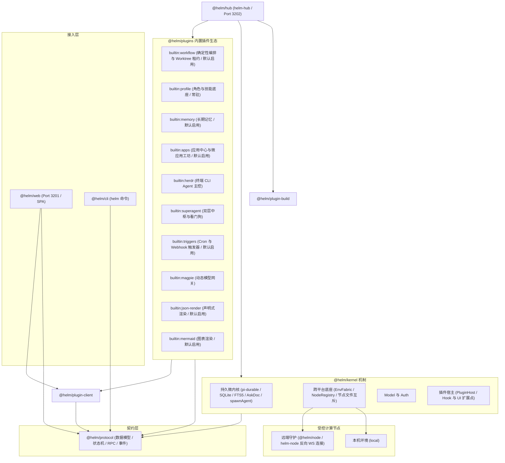

# Helm

> 极简持久微内核个人助理 · 多智能体确定性编排 · 跨平台终端协同主控台

[](https://nodejs.org)
[](https://www.typescriptlang.org)
[](https://pnpm.io)
[](docs/architecture/overview.md)
[](docs/architecture/envfabric.md)
[](docs/cli/reference.md)
[](LICENSE)

Helm 是面向复杂工程任务的轻量持久微内核系统，用于解决多智能体协作不可控、跨机运维繁重与终端工具脱节三类问题。内核（`@helm/kernel`）只保留四块通用机制：基于 `pi-durable` 的持久会话状态机（SQLite 全量落盘、FTS5 全文检索、`AskDoc` 审批与原生 `spawnAgent` 子会话派生）、跨平台执行编排底座 `EnvFabric` 与 `NodeRegistry`（WebSocket 反向连接，统一驱动本地与远端节点的 `bash / read / write / edit / gate` 与文件互斥）、Model 与 Auth（模型供应商接入、凭据与令牌管理），以及唯一强类型插件宿主 `PluginHost`（`definePlugin(ctx)`，提供后端生命周期 Hook 与前端全界面扩展点）。业务角色一律通过 `profileId` 与 `tags` 表达，内核零硬编码；`subagent`、`SubagentWorkflow`、Git Worktree 租约等编排能力全部由 `builtin:workflow` 等插件承载，停用即整体消失。

### 代码库包结构

Helm 按机制、插件和产品组合分包。`@helm/hub` 连接 `@helm/kernel`、`@helm/plugins` 与构建实现；内核可以独立使用，不依赖内置插件。`@helm/plugin-client` 提供可独立构建的浏览器 SDK，由 Web 应用注入数据与导航能力。通用契约放在 `@helm/protocol`，插件业务契约归属插件包。

| 包名 | 职责说明 | 交付产物 |
| :--- | :--- | :--- |
| `@helm/protocol` | 共享契约与数据结构，零重依赖 | 核心类型、状态机、RPC 与事件契约 |
| `@helm/kernel` | 持久微内核与插件宿主 | 可嵌入的运行时与 HTTP 服务机制 |
| `@helm/hub` | 产品组合根与进程入口 | Hub 服务（`helm-hub`） |
| `@helm/plugins` | 内置插件、业务契约、客户端视图与技能资产 | 官方插件集合 |
| `@helm/plugin-client` | 共享 UI 原语、上下文与宿主能力端口 | 浏览器 SDK |
| `@helm/plugin-build` | 插件前后端源码构建 | 注入式构建实现 |
| `@helm/cli` | 命令行客户端，与 API 完全同权 | 控制命令（`helm`） |
| `@helm/node` | 受控节点守护进程，反向连接 Hub | 节点服务（`helm-node`） |
| `@helm/web` | 响应式 Web 主控台 | Web 界面（Vite SPA） |

---

## 为什么选择 Helm

| 维度 | 套壳对话应用 | 常见 Python Agent 框架 | Helm 架构 |
| :--- | :--- | :--- | :--- |
| 会话持久化 | 内存暂存或本地缓存，重启丢失状态 | 进程内存易失状态，中断无法精准续接 | `pi-durable` 五态状态机，SQLite 与 FTS5 全量落盘 |
| 编排确定性 | 黑盒提示词循环，结果不可重现 | 图编排 DSL 抽象重，调试排障链路长 | 原生 JavaScript 编排，状态流水精准记录与安全断点续跑 |
| 跨机调度 | 依赖开放入站 SSH 端口与密钥分发 | 依赖容器集群或虚拟网络，环境配置重 | `EnvFabric` 零 SSH 依赖，受控节点 WebSocket 反向连接 |
| 终端协同 | 无法连接物理终端，仅支持模型输出 | 仅支持本地单向子进程，无窗格交互 | Herdr 协同主控，原生调度终端 CLI 并结构化交接与自愈 |
| 控制同权 | 仅提供 Web 界面，缺乏自动化接口 | Python 优先，CLI 覆盖不全 | HTTP API 与 CLI 严格同权，全命令支持 `--json` 管道流转 |
| 代码隔离 | 无独立沙箱，直接污染当前工作区 | 容器镜像构建慢，资源开销高 | Git Worktree 毫秒级隔离，内置自动化代码门禁 |

---

## 全景架构拓扑

微内核通过生命周期 Hook 与全界面扩展点驱动插件生态，所有外部通信经由统一契约。



---

## 5 分钟快速上手

### 1. 环境准备与编译

需要 Node.js 24.12 或更新版本与 pnpm 12.x。从仓库根目录执行：

```bash
git clone https://github.com/helm/helm.git
cd helm
pnpm install
pnpm build
```

### 2. 启动前后端服务

```bash
# 启动前后端联合开发环境（Web 3201 + Hub 3202）
HELM_PORT=3202 pnpm dev
```

Web 主控台监听 `http://127.0.0.1:3201`，内核 Hub 监听 `http://127.0.0.1:3202`。端口固定约束：`3000/3001/3002/3101/3102` 为外部与历史系统保留，Helm 永不占用。

### 3. 初始化管理员并登录

```bash
# 首次初始化管理员密码；setup 会自动完成登录并把凭据写入 ~/.helm/cli-token（0600）
pnpm helm setup --password 'your-admin-password'

# 后续登录（如凭据丢失或换机）
pnpm helm login --password 'your-admin-password'
```

### 4. 单兵会话对话

向入口会话 `#1` 发送输入并等待回答：

```bash
pnpm helm send 1 "请列出当前项目的所有核心包" --wait
```

会话目标也可以用 `--current`（读取环境变量 `HELM_CONVERSATION_ID`）指定，适用于受管环境与脚本串联。

### 5. 执行首个确定性工作流

```bash
pnpm helm workflows run demo/hello-orchestra.workflow.js --args '{"word":"开源"}' --conversation-id 1 --wait
```

新工作流必须显式指定目标会话：`--conversation-id <id>`，或在设置了 `HELM_CONVERSATION_ID` 的环境下使用 `--current`；二者缺省时 Hub 以 `400 validation_error` 拒绝。执行中断后可用 `--resume-from-run-id <runId>` 从断点恢复。

---

## 四大核心能力演示

### 1. 原生 JavaScript 确定性编排

Helm 不使用私有配置 DSL，工作流就是标准 JavaScript 模块：`agent()` 派生子会话、`parallel()` 并发、`phase()` 分阶段汇报。运行时为每一步记录可重放的调用流水（Journaling），意外中断后自动跳过已完成步骤、安全续跑未完成部分。

```javascript
// demo/hello-orchestra.workflow.js
export const meta = {
  name: "hello-orchestra",
  description: "最小编排演示：并行两路 + 汇总",
  phases: [{ title: "并行打招呼" }, { title: "汇总" }],
}

log(`参数 word = ${args.word}`)
phase("并行打招呼")
const replies = await parallel([
  () => agent(`把「${args.word}」翻译成英文，只回翻译结果，不要多余内容。`, { label: "翻译英文" }),
  () => agent(`把「${args.word}」翻译成日语，只回翻译结果，不要多余内容。`, { label: "翻译日语" }),
])

phase("汇总")
const joined = replies.filter(r => r !== null).join(" / ")
const summary = await agent(`把「${joined}」合成一句话介绍，只回这一句话。`, { label: "汇总" })

return { replies, summary }
```

执行并查看结果：

```bash
pnpm helm workflows run demo/hello-orchestra.workflow.js --args '{"word":"创新"}' --conversation-id 1 --wait --json
pnpm helm workflows inspect <runId> --json
```

需要代码隔离时，在节点上声明 `agent(prompt, { isolation: 'worktree', gate: 'pnpm test' })`：子会话在独立 Git Worktree 中执行，门禁通过后才汇入结果。

### 2. 跨平台执行底座 EnvFabric

`EnvFabric` 统一调度本地与远端受控节点。目标机器运行 `helm-node` 守护进程并主动反向连接 Hub 的 `/ws/node` 接口，全程无需开放任何入站 SSH 端口或分发密钥。

```bash
# 步骤 1：在 Hub 签发受控节点接入令牌（明文 token 仅返回一次）
pnpm helm nodes issue build-server --json

# 步骤 2：在目标机器绑定身份并启动后台守护进程
pnpm helm-node connect http://<hub-host>:3202 --token 'build-server:<secret>'
pnpm helm-node start -d

# 步骤 3：在指定节点流式执行命令
pnpm helm env exec --node build-server --cwd /workspace --stream -- git status

# 步骤 4：把会话绑定到远端节点后照常投递输入
pnpm helm conversations create --node build-server --cwd /workspace --title "远程构建"
```

### 3. Herdr 终端 CLI Agent 深度协同

通过 `builtin:herdr` 插件，Helm 可以驱动真实终端窗格中的 CLI Agent（`pi`、`claude`、`codex`、`agy` 等 23 种）。Agent 在终端窗格中工作，任务产物经 `.helm/wf-out-*` 文件结构化交接；产物缺失或校验失败时自动在原窗格原地追问自愈，绝不截取脏屏幕文本冒充结果。`AskDoc` 审批桥采用 `expectedStateSeq` CAS 乐观锁：人类已在终端按键处理后，Web 端对应的待审批单自动流转为 `superseded`，避免重复发送回车。

```bash
# 启用 Herdr 插件（默认停用）
pnpm helm plugins enable builtin:herdr --json

# 创建绑定终端 Agent 的 Profile
pnpm helm profiles create terminal-coder --name "终端编码代理" \
  --input '{"id":"terminal-coder","name":"终端编码代理","runtime":{"kind":"herdr","agent":"pi"}}' --json

# 读取 Herdr 节点状态总览（窗格、Agent 状态与待审批单）
pnpm helm plugins doc builtin:herdr overview --json
```

创建完成后，在工作流或会话中点名 `terminal-coder` 即经 `agent_spawn` 调度终端 Agent。

### 4. 外部插件全栈开发与热重载

外部插件是独立目录：后端 `index.ts` 导出 `PluginDefinition`，前端 `client/index.tsx` 使用 `@helm/plugin-client` 共享 SDK 编写 React 组件。脚手架、静态自检、增量发现、启用与受控热重载构成完整开发闭环，全程无需重启 Hub：

```bash
# 1. 脚手架：生成 ~/.helm/plugins/my-plugin/（full 模板含 increment 动作与前端示例面板；
#    app 模板生成可直接 helm apps validate/publish 的全栈微应用骨架）
pnpm helm plugins init my-plugin

# 2. 静态自检：真实加载 + 真实注册 + client.tsx 真实编译，四阶段预检
pnpm helm plugins doctor ~/.helm/plugins/my-plugin

# 3. 增量发现并启用（rescan 只注册新目录，默认停用）
pnpm helm plugins rescan
pnpm helm plugins enable my-plugin

# 4. 调用插件动作（动作自动映射为顶层 CLI 命令）
pnpm helm my-plugin increment --json

# 5. 修改代码后受控热重载：预检失败时旧实例保持不动
pnpm helm plugins reload my-plugin
```

插件通过 `ctx.action({ id, inputSchema, outputSchema })` 声明的动作会自动映射为 HTTP 端点（`POST /api/actions/<pluginId>/<actionId>`）、顶层 CLI 命令、Agent Tool、`SubagentWorkflow` 的 `action()` 原语与 Web UI 动作，五端同权。

---

## 内置插件生态一览

Helm 采用微内核设计，所有扩展能力均由插件提供，停用后其动作、CLI 命令与 UI 贡献即时消失：

| 插件标识 | 插件名称 | 核心职责 | 启用状态 |
| :--- | :--- | :--- | :--- |
| `builtin:workflow` | 确定性编排引擎 | 提供 `subagent` / `SubagentWorkflow` / `cleanup_worktree` 工具、编排引擎、Git Worktree 租约与 `helm workflows` / `helm worktrees cleanup` 动态命令 | 默认启用（可停用） |
| `builtin:profile` | 角色与技能底座 | 为全部 Profile 注入 SYSTEM.md 与可用技能目录，提供 `load_skill` 工具与默认助理角色 | 常驻启用（不可卸载） |
| `builtin:memory` | 长期记忆 | 自管各 Profile 的 MEMORY.md 注入、单角色记忆启停（`helm memory`）与 `update_memory` 工具 | 默认启用（可停用） |
| `builtin:apps` | 应用中心与微应用工坊 | 全栈微应用目录（`catalog`）、`validate/publish/list/update_meta/remove` 动作（`helm apps`）与 `app-builder` 技能 | 默认启用（可停用） |
| `builtin:herdr` | 终端 Agent 主控 | 连接 Herdr 终端 IPC，调度 23 种终端 CLI，负责结构化交接、追问自愈与 CAS 审批桥 | 默认停用，按需启用 |
| `builtin:superagent` | 双层中枢与看门狗 | 零阻塞路由中枢、后台驻留 Worker、两层巡检与状态自愈（巡检周期由插件服务自管） | 默认停用（实验性） |
| `builtin:triggers` | 自动化触发器 | 提供 Cron 定时调度与 Webhook 入站，验证签名并防逃逸投递 | 默认启用（可停用） |
| `builtin:magpie` | 动态模型网关 | 连接动态模型网关，原生协议分发，提供目录热重载与配额路由视图 | 默认停用，按需启用 |
| `builtin:json-render` | 声明式渲染 | 聊天 `ui` 代码围栏的 JSON DSL、求值器与界面原语，并维护 `generative-ui` 技能 | 默认启用（可停用） |
| `builtin:mermaid` | 图表渲染 | 接管 Markdown 中 Mermaid 代码块渲染；停用后回退普通代码块 | 默认启用（可停用） |

### 编写自定义插件

插件导出 `definePlugin(ctx)`，声明动作即获得五端调用入口。以下是最小后端插件：

```javascript
// ~/.helm/plugins/custom-checker/index.ts
import type { PluginDefinition } from '@helm/protocol'

export default {
  id: 'custom-checker',
  version: '0.1.0',
  description: '代码质量检查插件',
  definePlugin(ctx) {
    ctx.action({
      id: 'lint',
      description: '执行代码规范检查',
      inputSchema: {
        type: 'object',
        properties: { targetDir: { type: 'string' } },
        required: ['targetDir'],
        additionalProperties: false,
      },
      outputSchema: {
        type: 'object',
        properties: { passed: { type: 'boolean' } },
        required: ['passed'],
        additionalProperties: false,
      },
      async handler(input) {
        // 经 ctx.host.execEnv 在目标节点执行检查并返回结构化结果
        return { passed: true }
      },
    })
  },
} satisfies PluginDefinition
```

注册并调用（`plugin.json` 清单与目录结构由 `helm plugins init` 生成）：

```bash
pnpm helm plugins rescan
pnpm helm plugins enable custom-checker --json
pnpm helm custom-checker lint --input '{"targetDir":"/workspace"}' --json
```

完整契约（生命周期 Hook、UI 扩展点、`ctx.doc` 持久化与 `client.tsx` 前端）见 [自定义插件开发实战](docs/plugins/plugin-development.md)。

---

## CLI 核心命令速查

所有命令支持 `--json`（成功输出到 stdout，失败输出错误信封到 stderr 并返回非零退出码）。插件动作经 `GET /api/actions` 动态生成为顶层命令（如 `helm workflows run`、`helm my-plugin increment`）。

| 分类 | 命令 | 功能说明 |
| :--- | :--- | :--- |
| **系统与鉴权** | `helm setup --password <pwd>` | 首次初始化管理员并完成登录 |
| | `helm login --password <pwd>` | 登录并保存凭据到 `~/.helm/cli-token` |
| | `helm status --json` | 查看鉴权与管理员配置状态 |
| **模型与角色** | `helm models list / providers / default / refresh / filter` | 模型目录、供应商清单、默认模型、刷新与禁用过滤 |
| | `helm profiles list / create / update / delete` | 角色配置管理（语义化 flag 或 `--input`） |
| | `helm skills list` | 当前可用技能目录 |
| | `helm providers set` / `helm credentials set / delete` | 供应商与密钥凭据管理 |
| **会话管理** | `helm conversations list / get / create / update / delete` | 会话 CRUD 与筛选过滤 |
| | `helm send <id> "<text>" --wait` | 向会话投递输入并等待回答 |
| | `helm conversations fork / reset / compact / withdraw` | 分叉、重置、压缩与撤回输入 |
| | `helm abort <id>` | 中止会话当前回合 |
| | `helm events watch` / `helm search "<关键词>"` | 全局 SSE 订阅与全文检索 |
| **确定性编排** | `helm workflows list / runs` | 已保存工作流与运行记录 |
| | `helm workflows run <file> --args '<json>' --conversation-id <id> --wait` | 启动工作流（`--current` / `--resume-from-run-id`） |
| | `helm workflows inspect / abort <runId>` | 查看运行详情与中止在途任务 |
| | `helm worktrees cleanup --conversation-id <id>` | 清理受管 Git Worktree |
| **受控节点** | `helm nodes list / issue / remove / upgrade / forward` | 节点清单、令牌签发、移除、升级与端口转发 |
| | `helm env exec --node <id> --cwd <path> --stream -- <cmd>` | 跨节点流式执行命令 |
| **插件治理与热重载** | `helm plugins list / enable / disable` | 插件状态与启停（停用遇在途任务返回 `409`） |
| | `helm plugins init / doctor / rescan / reload` | 脚手架、四阶段静态自检、增量发现、受控热重载 |
| | `helm plugins install / update / remove` | npm / git / 本地路径的受管安装生命周期 |
| | `helm plugins config / doc / client` | 配置读写、公共文档与前端编译产物 |
| | `helm actions list` | 全部插件动作清单 |
| | `helm api <method> <path>` | 原始 HTTP 逃生舱 |
| **节点守护进程** | `helm-node connect <hubUrl> --token <token>` | 绑定 JOIN 令牌并注册（`--once` 单次尝试） |
| | `helm-node start -d` / `stop` / `restart` / `status` | 后台守护进程生命周期 |
| | `helm-node upgrade [--check]` / `doctor` | 自升级与零副作用自检 |
| | `helm-node service install / uninstall / status` | 开机自启服务管理 |

---

## 深度文档中心导航

完整架构剖析、工作流开发与 API 手册请参阅 `docs/` 技术文档体系：

- **新手指南**
  - [新手起步导览](docs/getting-started/index.md)：学习目标与核心概念
  - [安装与部署配置](docs/getting-started/installation.md)：环境准备、安装流程、端口与数据隔离
  - [编写首个工作流](docs/getting-started/first-workflow.md)：从零编写并执行确定性多智能体编排
- **架构与原理**
  - [极简微内核哲学](docs/architecture/overview.md)：零业务角色硬编码与单向依赖设计
  - [生命周期 Hook 与全界面扩展点](docs/architecture/extension-points.md)：后端生命周期 Hook 与前端界面扩展详解
  - [EnvFabric 分布式执行底座](docs/architecture/envfabric.md)：反向 WebSocket、安全升级与节点文件互斥
  - [pi-durable 持久会话状态机](docs/architecture/pi-durable.md)：五态状态机、FTS5 全文搜索与 AskDoc 乐观锁
- **确定性多智能体编排**
  - [原生 JavaScript DSL 手册](docs/workflows/dsl-guide.md)：`agent`、`parallel`、`pipeline`、`phase` 语法规范
  - [Git Worktree 与自动化门禁](docs/workflows/worktree-and-gate.md)：代码沙箱隔离与测试门禁验收
  - [状态流水与意外恢复](docs/workflows/journaling-recovery.md)：执行流水记录、调用复用与断点续跑
- **插件系统与内置生态**
  - [插件系统设计与契约](docs/plugins/overview.md)：`definePlugin(ctx)` 强类型规范与安全生命周期
  - [自定义插件开发实战](docs/plugins/plugin-development.md)：前后端全栈插件开发、自检与热重载
  - [角色与技能底座](docs/plugins/profile.md)：SYSTEM.md 注入、技能目录与默认助理角色
  - [长期记忆](docs/plugins/memory.md)：MEMORY.md 注入、单角色记忆启停与 `update_memory` 工具
  - [应用中心与微应用工坊](docs/plugins/apps.md)：全栈微应用目录、预检发布与 `app-builder` 技能
  - [确定性编排引擎](docs/plugins/workflow.md)：编排引擎、Worktree 租约与运行记录分片
  - [Herdr 终端协同主控](docs/plugins/herdr.md)：终端 CLI 调度、结构化交接与追问自愈
  - [SuperAgent 双层中枢](docs/plugins/superagent.md)：零阻塞路由、驻留 Worker 与两层看门狗
  - [自动化触发器](docs/plugins/triggers.md)：Cron 定时任务与 Webhook 签名入站
  - [动态模型网关](docs/plugins/magpie.md)：原生协议分发、动态模型目录与配额诊断
  - [声明式渲染](docs/plugins/json-render.md)：JSON DSL、界面原语与 `generative-ui` 技能
  - [图表渲染](docs/plugins/mermaid.md)：Mermaid 围栏渲染与停用回退
- **Web 开发约定**
  - [Web 前端设计系统与开发约定](docs/conventions/web-frontend.md)：视图形态分级、Radix 原语底座与移动端规范
  - [Web 导航与 URL Hash 约定](docs/conventions/web-navigation.md)：深链、分屏参数与前进后退语义
- **参考手册与历史归档**
  - [CLI 全量命令参考手册](docs/cli/reference.md)：`helm` 与 `helm-node` 命令字典
  - [历史设计与开发交接归档](docs/archive/README.md)：早期架构演进与阶段验收记录索引

---

## 开源许可证

本项目基于 [MIT 许可证](LICENSE) 发布，第三方组件声明见 [THIRD_PARTY_NOTICES.md](THIRD_PARTY_NOTICES.md)。
