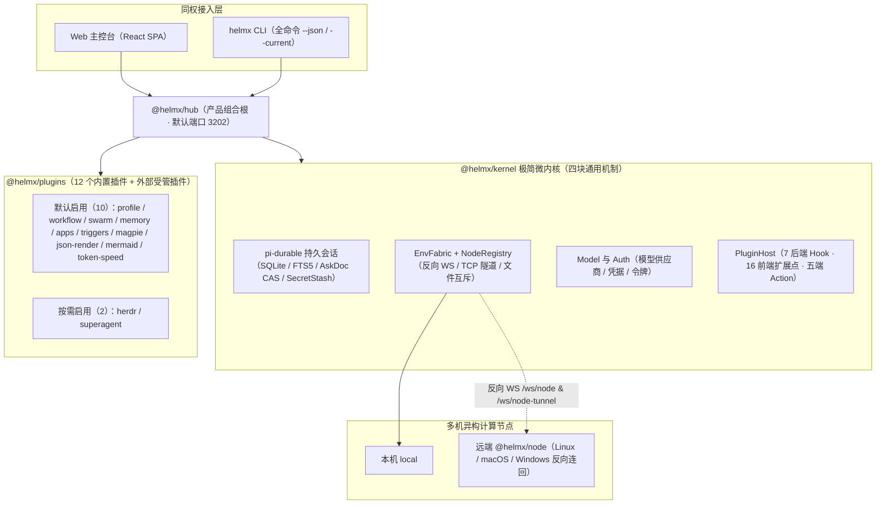

# Helmx

> 极简持久微内核 · 多机零 SSH 协同 · 人机共治的多智能体主控台

[English](README.md) | **简体中文**

[](https://nodejs.org)
[](https://www.npmjs.com/package/@helmx/cli)
[](https://www.typescriptlang.org)
[](docs/architecture/overview.md)
[](LICENSE)

**Helmx** 是一个面向真实工程生产的持久微内核主控台：用一台常驻中心 **Hub** 统一纳管多台异构机器（云服务器、内网 GPU 机、个人 Windows / macOS 电脑），同时指挥原生大模型会话与 **Claude Code / Codex / pi** 等 23 种真实终端 CLI，并按任务形态自由切换 **Swarm 对等协同**、**确定性 JS 工作流** 与 **7×24 自治中枢**。

内核（`@helmx/kernel`）只守住四块不可破坏的通用机制——**持久会话状态机**、**EnvFabric 跨节点底座**、**Model / Auth** 与 **强类型插件宿主**；零业务角色硬编码，一切上层编排、记忆、终端协同与应用能力全部通过插件装配，停用即彻底消失，不留幻影提示词。

---

## 60 秒上手

Helmx 已在 npm 发布三个分工明确的制品：`@helmx/cli`（控制 CLI `helmx`）、`@helmx/hub`（Hub 运行时，由 `helmx update` 自动管理）与 `@helmx/node`（远端节点守护进程 `helmx-node`）。前置要求：Node.js `>= 24.12.0` 与 Git。

### 1. 安装并拉起本机 Hub

```bash
npm install -g @helmx/cli
helmx update --watch
```

首次运行会自动拉取并校验 `@helmx/hub` 发行包、启动 Hub（默认 `http://127.0.0.1:3202`，同时托管完整 Web 主控台），并开启后台版本检查与空闲窗口自动更新。

### 2. 初始化管理员并配置模型

```bash
# 初始化管理员并自动登录（凭据以 0600 写入 ~/.helmx/cli-token）
helmx setup --password '<your-admin-password>'

# 配置任意模型供应商 API Key 并选定默认模型
helmx models providers --json
helmx credentials set <provider-id> --value '<api-key>'
helmx models refresh --json
helmx models default --set '<provider>/<model>' --json

# 在浏览器打开 http://127.0.0.1:3202，或直接在命令行发起对话
helmx send 1 "分析当前仓库的目录结构与测试入口" --wait
```

> 偏好 **Docker 容器运行 Hub + 宿主机节点** 或 **源代码开发模式**？直接看[安装与配置指南](docs/getting-started/installation.md)。

---

## 为什么选择 Helmx

多数 Agent 框架或本地 Harness 聚焦在「单机跑通一次对话或代码修改」；一旦进入**多机协作、长周期工程交付、人类与后台代理共处同一终端**的真实场景，就会遇到状态易失、SSH 运维脆弱、多代理互相踩代码、后台看门狗误伤人类终端等深水区问题。Helmx 的架构就是为解决这些问题而生：

| 维度 | 单机对话工具 / 本地 Agent 底座 | Helmx 多机人机共治主控台 |
| :--- | :--- | :--- |
| **多代理动态协作** | 常驻角色沉重，或靠黑盒提示词轮询，易丢棒与刷屏 | **Swarm 对等黑板**：零常驻会话，按需动态拆角（读写 + 只读 Verifier），`#seq` 指针与正交 `wake` 门铃，`turn_settled` 纯事件自愈 |
| **长周期确定性编排** | 流程不可重现，中途限流/断网只能整条重跑烧 Token | **原生 JS 工作流**：调用级 JSONL 账本前缀重放（零 Token 续跑）、Hub 重启无感原位恢复、6 道防线受管 Git Worktree + Gate 门禁 |
| **跨机异构执行** | 单机优先，远程依赖开放入站 SSH 与公钥分发，内网/Windows 难接入 | **EnvFabric 反向 WebSocket**：节点主动出站连回天然穿透 NAT，统管 Linux / macOS / Windows，内置任意 TCP 透传隧道与离线显式拒绝 |
| **真实终端 CLI 协同** | 仅子进程黑盒封装，或人类与自动化抢占同一终端引发误操作 | **Herdr + 人机共治红线**：桥接 23 种真实终端 CLI，文件 + Schema 强校验交接；内核强制 `ownedBy: 'human'` 禁发键与 AskDoc CAS 销单 |
| **扩展与应用化** | 工具/HTTP/CLI/UI 各自重复定义，脚本堆积后风格割裂、失控 | **五端一源 `ctx.action` + `builtin:apps`**：单点 Schema 声明自动生成 HTTP/CLI/Tool/Workflow/UI，对话沉淀全栈微应用强制四阶段 `doctor` 预检 |
| **控制面与安全边界** | 内存易失或边界模糊，错误常静默回退掩盖真实故障 | **诚实契约微内核**：SQLite/FTS5 全量落盘，`SecretStash` 零落库且外置窗格零隐式继承密钥，能力不支持/节点离线一律显式报错 |

---

## 六大核心亮点

### 1. Swarm 对等协同黑板：像带一支真实工程小队一样协作

遇到复杂开发、架构重构或需要多轮交叉审改的任务时，在任意顶层会话输入 `/skill:swarm <任务>`（或直接用自然语言让助理开组），即可拉起一个**按需存在、零常驻开销**的横向协同小队：

- **动态拆角与只读交叉验收**：主控按任务边界现场招募读写成员与只读 Verifier，按需为不同成员指定不同 Profile 或模型，中途随时原地**换模型续跑**（`swarm_switch_worker_model`）或**原地刹停**（`swarm_abort_worker`）；
- **并发写代码零冲突**：并发修改同一仓库时直接复用 `builtin:workflow` 的受管 Git Worktree（持持久租约防误删），成员发 `handoff / done` 时自动内联分支与变更快照；
- **`#seq` 指针引用 + 正交 `wake` 门铃**：成员交接不用反复复制几千字背景，直接 `refs: [seq]` 引用黑板 `#seq`；`wake: true` 只叫醒下一跳责任人，不抄送闲人、双向游标批合并防消息风暴；
- **纯事件自愈、零轮询成本**：成员回合失败自动上板 `[blocker]`、被唤醒却零发帖退场自动触发单次确定性续催、全组静默自动触发 6 条件 0-Token `[stall]` 归因；
- **无感会话内协同体验**：时间线内 26px 自然语言轨迹行 + 主控专属 Composer「进行中」活动托盘 + 右侧 Workbench 编排面板，点任一成员直接抽屉查看其完整思考与代码改动；结单支持合入全清或 `keepWorktree` 保留待合入分支。

详见：[Swarm 对等协同插件](docs/plugins/swarm.md) · [多智能体编排选型与实战指南](docs/getting-started/orchestration-guide.md)

### 2. 确定性 JS 工作流、断点续跑与受管 Worktree

当流程结构明确、需要可审计与可复用时，直接用标准 JavaScript 编写编排脚本（无私有 YAML/图 DSL）：

```javascript
// 并行派发至独立 Git Worktree，各自跑通测试门禁后汇总
phase("并发实现与门禁验收")
const deliveries = await parallel([
  () => agent("实现支付回调签名校验并补齐单测", {
    label: "payment-verify",
    isolation: "worktree",
    gate: "pnpm test:unit",
  }),
  () => agent("实现账单对账导出接口并补齐单测", {
    label: "billing-export",
    isolation: "worktree",
    gate: "pnpm test:unit",
  }),
])
```

- **前缀重放，零 Token 断点续跑**：每步调用写入 JSONL 流水账本；某步因模型限流或环境异常失败后，携带 `--resume-from-run-id <runId>` 续跑，已成功的前缀节点零 Token 复用，从首个失配点实时接续；对非幂等 `action()` 执行意图先行 + `fsync`，状态不确定时以 `workflow_action_uncertain` 显式阻断，绝不盲目重放副作用；
- **Hub 重启无感原位恢复**：优雅重启或崩溃重启后，健康在途子代理与工作流自动原位重挂继续跑完，支持 `helmx workflows resume-failed` 一键批量续跑；
- **六道清理防线的 Worktree 租约**：在主仓同级自动派生隔离工作树，清理前强制校验运行占用、主根保护、realpath 归属、目标节点进程句柄占用、脏工作区与未合入提交——绝不误删人类目录或未合入代码。

详见：[原生 JS DSL 手册](docs/workflows/dsl-guide.md) · [状态流水与故障恢复](docs/workflows/journaling-recovery.md) · [Git Worktree 与代码门禁](docs/workflows/worktree-and-gate.md)

### 3. EnvFabric：零入站 SSH 的跨机多节点执行与 TCP 透传隧道

只需在目标机器上装一个轻量守护进程 `helmx-node`，它通过出站 WebSocket（`/ws/node`）主动连回 Hub——无论机器在公有云、公司内网 NAT 后，还是家里的 Windows 电脑，**零 SSH 端口开放、零公钥分发**：

```bash
# 1. 在 Hub 签发一次性接入令牌（Hub 仅存 SHA-256 哈希）
helmx nodes issue dev-win --json

# 2. 在目标机器一步安装并后台接入（Linux / macOS / Windows 通用）
npm install -g @helmx/node
helmx-node start -d --hub http://<hub-host>:3202 --token 'dev-win:<secret>'

# 3. 像操作本机一样跨节点流式执行、创建远端会话或透传任意 TCP 端口
helmx env exec --node dev-win --cwd "C:\Users\alice\repo" --stream -- git status
helmx conversations create --node dev-win --cwd "C:\Users\alice\repo" --title "Windows 联调"
helmx nodes forward dev-win 127.0.0.1:8080 127.0.0.1:8000
```

- **物理坐标直绑**：会话与 Profile 直接绑定 `(nodeId, cwd)`，内核文件工具、Shell、Gate、按 `nodeId + canonicalPath` 的文件互斥全部透明路由到真实目标节点；
- **绝不静默回退本机**：节点离线显式返回 `409 node_offline`，绝不会悄悄把远端命令跑到 Hub 本机上；
- **内置安全自升级**：`helmx nodes upgrade` 驱动远端守护进程排空在途任务（`node_draining`）、双阶段 SHA-512 校验、金丝雀握手提交、失败自动回滚。

详见：[EnvFabric 分布式执行底座](docs/architecture/envfabric.md)

### 4. Herdr 终端协同与「人机共治」安全红线

启用 `builtin:herdr` 后，在 `subagent` 或工作流中把 `agentType` 写成 `herdr:claude`、`herdr:codex`、`herdr:pi`（支持 23 种终端 CLI，还可指定 `@<nodeId>` 跑到远端节点），即可调度真实终端窗格里的 CLI Agent：

- **终端跑过程、文件交结果**：人类随时能在物理终端里看实时输出、亲自接管；结果严格通过 `.helmx/wf-out-*` 文件 + JSON Schema 校验交接（支持单次自愈），失败附终端尾部 40 行脱敏快照，绝不截取脏屏幕文本冒充成功；
- **内核级归属权红线**：明确区分 `ownedBy: 'human'` 与 `bot / helmx`，所有自动化中止与注入统一经过 `abortConversationGuarded` / `submitInputGuarded` 串行域原子复核——对人类直连会话或终端窗格**硬禁止**看门狗发键或中止；
- **CAS 乐观锁审批桥**：终端 CLI 阻塞等待确认时，自动在 Web 端生成携带 `expectedStateSeq` 的 `AskDoc` 审批卡；一旦人类先在终端里按了键，Web 审批卡自动 `superseded` 销单，杜绝双端竞态重复发键。

详见：[Herdr 终端协同](docs/plugins/herdr.md) · [pi-durable 持久会话与 CAS 审批](docs/architecture/pi-durable.md)

### 5. 五端一源插件体系与全栈微应用工坊

- **写一次 Schema，五端同时就绪**：插件调用一次 `ctx.action({ id, inputSchema, outputSchema })`，自动获得 **HTTP API**、**`helmx` 动态 CLI 命令**、**Agent Tool / `run_action`**、**Workflow `action()`** 与 **Web UI** 五端同权映射；
- **对话式构建全栈微应用（`builtin:apps`）**：需要把常用工作流沉淀为看板、对账台或运维工具台时，AI 可直接生成标准全栈外部插件（后端逻辑 + 持久化 `ctx.doc` + React `client.tsx`），强制经 `apps_validate` 四阶段静态自检（manifest → backend → register → client 导出校验）后再一键发布进「应用中心」，不造第二套失控宿主；
- **干净热治理**：支持 `helmx plugins doctor / rescan / reload / install`，遇在途任务硬阻断（`409 plugin_has_live_tasks`），停用后工具、命令、技能与 UI 即时彻底摘除。

详见：[插件系统设计与契约](docs/plugins/overview.md) · [插件开发实战](docs/plugins/plugin-development.md) · [应用中心与微应用工坊](docs/plugins/apps.md)

### 6. 面向 7×24 无人值守的触发器、中枢与机密边界

- **Cron 与 HMAC Webhook（`builtin:triggers`）**：定时投递与外部事件入站统一 `defang` 防逃逸包裹；服务端硬性禁止在对话上下文中创建或回显 Webhook Secret（`403 webhook_secret_context_forbidden`）；
- **SuperAgent 双层自治中枢（`builtin:superagent`，按需启用）**：零阻塞路由中枢 + 驻留后台 Worker + RecallGraph 记忆图谱 + 两层自管巡检看门狗（支持失败工作流冷却退避自动续跑）；
- **严格机密隔离（`SecretStash`）**：机密不落库、不进模型上下文，输出流跨 chunk 全局脱敏；外置终端窗格默认零继承父会话密钥，必须按次显式 `secretNames` 授予。

---

## 四种编排形态，怎么选？

Helmx 的多智能体能力不是功能堆叠，而是按「任务确定性」与「生命周期」正交切分的完整光谱，且全部可叠加 **Worktree**、**远端节点** 与 **Herdr 终端 CLI**：

| 场景诉求 | 推荐原语 | 所属插件 | 核心特征 |
| :--- | :--- | :--- | :--- |
| 委派一个聚焦子任务（查代码、写单测、给审查意见） | **`subagent`** | `builtin:workflow` | 人类会话默认后台执行自动回传，支持 `fork`、Schema、`worktree`、`gate` 与运行中 `steer` |
| 复杂任务需要动态分工、多轮对等交接、Writer ↔ 只读 Verifier 交叉审改 | **Swarm 对等协同** | `builtin:swarm` | 零常驻会话，序号黑板 + 正交 `wake` 门铃 + 纯事件自愈 + 中途换模/刹停，复用 Worktree |
| 多阶段、可复用、需严格审计与零 Token 断点续跑的流水线 | **JS Workflow** | `builtin:workflow` | 原生 JS 脚本、JSONL 前缀重放、嵌套子工作流（仓内附 `cross-review` / `module-dev` / `arch-master` 实战模板） |
| 7×24 路由分诊、长期驻留 Worker 与定时巡检自动续跑 | **SuperAgent 中枢** | `builtin:superagent` | 零阻塞路由 + RecallGraph + 两层看门狗，严守 `ownedBy: 'human'` 红线 |

完整选型心法与端到端实战见：[多智能体编排选型与实战指南](docs/getting-started/orchestration-guide.md)。

---

## 全景架构与 12 个内置插件



| 插件 ID | 核心职责 | 默认状态 | 文档 |
| :--- | :--- | :--- | :--- |
| `builtin:profile` | 角色 `SYSTEM.md`、工作区 `AGENTS.md`、技能目录与 `load_skill` | 常驻（locked） | [profile](docs/plugins/profile.md) |
| `builtin:workflow` | `subagent` / `SubagentWorkflow` / `cleanup_worktree`、DSL 引擎与 Worktree 租约 | 默认启用 | [workflow](docs/plugins/workflow.md) |
| `builtin:swarm` | 扁平对等序号黑板、正交唤醒、`turn_settled` 纯事件自愈与会话内协同看板 | 默认启用 | [swarm](docs/plugins/swarm.md) |
| `builtin:memory` | 按 Profile 管理的 `MEMORY.md` 注入、开关与 `update_memory` 工具 | 默认启用 | [memory](docs/plugins/memory.md) |
| `builtin:apps` | 全栈微应用目录（`catalog`）、四阶段 `validate/publish` 与 `app-builder` 技能 | 默认启用 | [apps](docs/plugins/apps.md) |
| `builtin:triggers` | Cron 定时调度与 HMAC-SHA256 Webhook 入站连接器 | 默认启用 | [triggers](docs/plugins/triggers.md) |
| `builtin:magpie` | 动态模型网关接入、目录热重载与配额/路由组诊断 | 默认启用 | [magpie](docs/plugins/magpie.md) |
| `builtin:json-render` | 回复内 ```ui 交互卡片声明式渲染与 `generative-ui` 技能 | 默认启用 | [json-render](docs/plugins/json-render.md) |
| `builtin:mermaid` | 回复内 ```mermaid 矢量图表渲染（停用回退代码块） | 默认启用 | [mermaid](docs/plugins/mermaid.md) |
| `builtin:token-speed` | 输入区实时解码速率（tok/s）、TTFT 与终态对账 | 默认启用 | [token-speed](docs/plugins/token-speed.md) |
| `builtin:herdr` | 桥接 23 种终端 CLI Agent、文件交接自愈、CAS 审批桥与 `$helmx` 状态投射 | 按需启用 | [herdr](docs/plugins/herdr.md) |
| `builtin:superagent` | 双层中枢路由、驻留 Worker、RecallGraph 与两层自管巡检看门狗 | 按需启用 | [superagent](docs/plugins/superagent.md) |

---

## CLI 高频命令速查

HTTP API 与 `helmx` CLI 严格同权，全部命令支持 `--json`（便于脚本与管道集成）与 `--current`（自动感知当前会话与节点）。插件声明的动作自动映射为顶层命令：

```bash
# Hub 生命周期（npm 制品模式）
helmx update --watch                      # 启动并监听更新
helmx update --status --json              # 查看版本与运行状态

# 会话、检索与审批
helmx send 1 "检查最新提交并给出评审意见" --wait
helmx search "worktree"                   # FTS5 全文检索历史会话
helmx asks list                           # 查看待审批项

# Swarm 对等协同与 Workflow 编排
helmx swarm board-status --group-id <id>  # 查看协作组实时态势
helmx workflows run demo/hello-orchestra.workflow.js --args '{"word":"开源"}' --conversation-id 1 --wait
helmx workflows resume-failed --all       # 一键批量续跑可恢复的失败任务
helmx worktrees list                      # 查看受管 Git Worktree 清单

# 跨节点执行与 TCP 端口透传
helmx nodes list                          # 查看全部受控节点在线与负载
helmx env exec --node <id> --cwd <dir> --stream -- <cmd>
helmx nodes forward <id> 127.0.0.1:8080 127.0.0.1:8000

# 插件与微应用治理
helmx plugins enable builtin:herdr        # 按需启用终端协同
helmx plugins init my-app --template app  # 生成全栈微应用骨架
helmx apps validate ./my-app && helmx apps publish ./my-app
```

完整命令字典见 [CLI 全量命令参考手册](docs/cli/reference.md)。

---

## 参与源码开发

```bash
git clone https://github.com/team4u/helmx.git && cd helmx
pnpm install
pnpm build
HELMX_PORT=3202 pnpm dev   # Web dev 3201 -> Hub 3202
```

全量门禁：`pnpm build && pnpm typecheck && pnpm lint && pnpm check:hygiene && pnpm test:all`；增量快速反馈：`pnpm check:changed`。参与贡献前请先阅读 [AGENTS.md](AGENTS.md)（工作区隔离、架构边界、测试分层与提交约定）和[微内核架构总览](docs/architecture/overview.md)（完整包依赖拓扑）。

---

## 文档地图

按阅读目标进入 [文档中心](docs/README.md)：

- **入门与选型**：[新手起步导览](docs/getting-started/index.md) · [安装与配置指南](docs/getting-started/installation.md) · [多智能体编排选型与实战指南](docs/getting-started/orchestration-guide.md) · [编写首个工作流](docs/getting-started/first-workflow.md)
- **架构与内核机制**：[微内核架构总览](docs/architecture/overview.md) · [生命周期 Hook 与前端扩展点](docs/architecture/extension-points.md) · [EnvFabric 分布式执行底座](docs/architecture/envfabric.md) · [pi-durable 持久会话与 CAS 审批](docs/architecture/pi-durable.md)
- **编排与可靠性**：[原生 JS DSL 手册](docs/workflows/dsl-guide.md) · [Git Worktree 与代码门禁](docs/workflows/worktree-and-gate.md) · [状态流水与故障恢复](docs/workflows/journaling-recovery.md)
- **插件与微应用**：[插件系统设计与契约](docs/plugins/overview.md) · [自定义插件开发实战](docs/plugins/plugin-development.md) · 12 个内置插件深度文档（见上表）
- **开发规范与运维**：[CLI 全量命令参考](docs/cli/reference.md) · [Web 前端设计系统](docs/conventions/web-frontend.md) · [Web 导航约定](docs/conventions/web-navigation.md) · [发布流程](docs/releasing.md)

---

## 诚实边界

我们相信清晰的边界比模糊的承诺更有价值：

- **活跃演进期**：当前处于快速迭代阶段，接口与存储结构可能存在不兼容演进，暂不承诺向后兼容层或自动迁移脚本。
- **单管理员访问模型**：当前采用管理员密码 + 令牌鉴权，不含多租户/多用户权限隔离；面向公网部署请置于反向代理与零信任网络之后。
- **可信代码机密边界**：`SecretStash` 保证机密「不落库、不进模型上下文、输出流自动脱敏」；但任意 Shell 命令与进程内插件（含全栈微应用）属于可信代码、天然拥有宿主权限，不承诺对可信代码的内存/环境变量零泄漏。
- **零静默降级**：节点离线（`409 node_offline`）、在途任务热停用（`409 plugin_has_live_tasks`）、终端交接失败或 Schema 违约一律显式报错并附诊断快照，绝不静默回退本机或伪造成功结果。
- **人类会话保护**：对 `ownedBy: 'human'` 的会话与终端窗格，自动化与看门狗仅允许只读诊断与通知，严禁发送按键或中止指令。

## 开源许可证

本项目基于 [MIT 许可证](LICENSE) 开源，第三方组件声明见 [THIRD_PARTY_NOTICES.md](THIRD_PARTY_NOTICES.md)。
