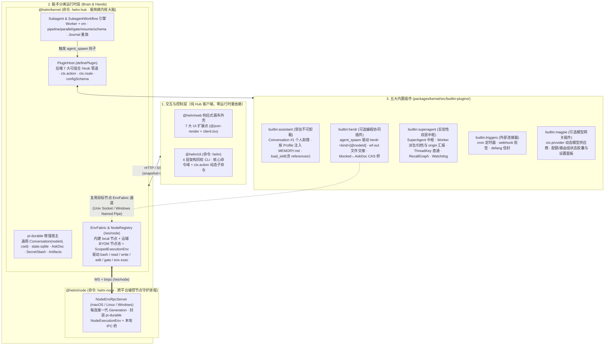
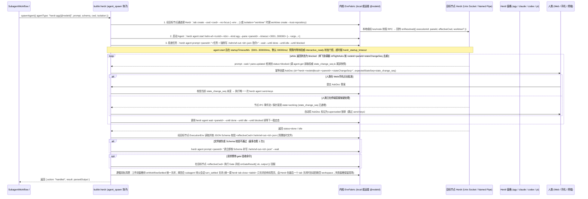

# helm 极简微内核、双 7 扩展点与 Herdr/Super-agent 插件化架构设计文档

## 背景

### 现状与问题

前身系统 `botx`（`/root/code/botx`，本次重写的参考基线与问题来源，只读）基于 `@earendil-works/pi-durable` 构建了持久化 Agent 会话、基础服务（`packages/kernel/src/services/`）与跨节点执行编排底座 `EnvFabric`（`packages/kernel/src/env/`），但在向「日常结对编程工作台 + 7×24 全天候个人助理与中枢 + 跨平台多节点协同」演进时，暴露出五个结构性问题。本次在全新仓库 `/root/code/helm` 中重构：

1. **内核耦合实验性业务策略**：`botx` 的 `packages/protocol/src/conversation.ts` 与 `packages/kernel/src/runtime/` 将会话硬编码为 `'router' | 'worker' | 'watchdog'` 三种固定角色，把尚处快速试错阶段的 DeepSeek Super-agent 双层路由、事件四步流水线（`automation/pipeline.ts`）、`RecallGraph` 召回图谱与看门狗巡检策略（`runtime/watchdog.ts`）直接焊死在内核中，导致策略调整必须改动核心运行时。
2. **跨节点执行底座与可选 Herdr 插件主次关系错位**：
   - 在 `botx` 中，`EnvFabric` + `@botx/node` 守护进程提供了良好的跨平台脑手分离底座，但绑定了冗余的 `Space` 中间注册表（要求每次换目录前先 CRUD 注册 `spaceId`）与自建 `.botx-worktrees` 三键合入状态机，且无法调度用户机器上已登录订阅的 23 种终端 CLI Agent（**Herdr**，`/root/code/herdr`）；
   - 而在 `helm` 初版探索中，为接入 `builtin:herdr` 误删了内核级 `EnvFabric` 与 `@helm/node` 守护进程，改在 `packages/kernel/src/builtin-plugins/herdr/transport.ts` 中硬编码 600 行 `ssh <machine> python3 -u -` 脚本。这导致主次彻底颠倒：**① 跨节点执行退化为 `herdr` 插件私有功能**（停用 `herdr` 时，会话内置 `bash / read / write / edit` 与工作流 `gate` 只能在 Hub 本机运行）；**② 丧失跨平台与内网穿透能力**（强依赖入站 SSH、Python3 与 Unix Socket，Windows 机器与 NAT 内网设备无法接入，远端也无法维持 `events.subscribe` 实时事件流）。
3. **CLI 客户端与节点守护进程混装导致职责粘连**：`botx` 将「控制 Hub 的 HTTP 客户端 CLI」与「跑在受控节点上的后台守护进程」塞进同一个 `@botx/node` 包与同一个命令入口中（导致 `nodes` 复数管理命令与 `node` 单数守护进程命令极易混淆、`--token` 与 `--api-token` 参数冲突、纯 HTTP 客户端被迫携带 `pi-durable / ws / birpc` 等重依赖）；而 `helm` 初版删掉 daemon 后，`packages/node` 沦为名不副实的空壳（包名叫 `@helm/node` 却只有 `src/cli/`，且所有 40+ 个核心命令硬塞在 `src/cli/commands.ts` 单文件 1,166 行中，多处命令生硬要求手敲 `--input '<json>'`）。
4. **前后端扩展能力不对称**：旧 `PluginHost` 缺少像 Pi `ExtensionAPI` 那样可拦截、可改写、可短路的生命周期管道，插件无法在不修改内核代码的前提下接管事件路由、子代理派生或回合结算；同时前端写死了左栏导航与纯聊天窗口主视图，无法由插件定制全屏视图（Screen）、时间线渲染器与左栏分组。
5. **缺少确定性多智能体编排引擎**：Herdr 擅长单窗格 CLI 生命周期管理，但没有跨异构 Agent 的确定性多阶段编排能力（如 `pipeline`、`parallel`、JSON Schema 结构化校验、Shell `gate` 门禁与断点重放）。

### 目标与边界

本次采用**全新架构（不保留历史兼容包袱）**，将系统构建为**「五包单向分层 + `pi-durable` 持久底座与 `EnvFabric` 跨平台脑手分离引擎 + `Subagent / SubagentWorkflow` 确定性编排 + 前后端双 7 扩展点 + 五大内置插件」**的正交架构：

1. **五包单向依赖与三命令一包一责**：
   - `@helm/protocol`：唯一零运行时依赖共享契约包；
   - `@helm/kernel`（命令 `helm-hub`）：中心微内核大脑（`pi-durable` 持久会话、`EnvFabric` 跨节点执行编排、`SubagentWorkflow` 引擎、`PluginHost`）；
   - `@helm/node`（命令 `helm-node`）：跑在各台受控机器（macOS / Linux / Windows）上的轻量跨平台节点守护进程（Hands），通过 WebSocket + `birpc`（`/ws/node`）主动连回 Hub；
   - `@helm/cli`（命令 `helm`）：100% 纯粹控制 Hub 的同权 HTTP/SSE 客户端（零运行时重依赖，供人类与子进程 Agent 调用）；
   - `@helm/web`：提供前端 **7 大全界面扩展点** 的响应式 Web 画布外壳。
2. **内核级跨平台节点底座 `EnvFabric`（去 `Space` 表，所有指令天然跨节点执行）**：
   - 借鉴 `botx` 的 `EnvFabric` + `NodeRegistry` + `ScopedExecutionEnv` 设计并去除冗余 `Space` CRUD 表：任何 `Conversation`、`Profile`、`subagent` 与工作流节点直接绑定 `(nodeId, cwd)` 物理坐标（默认 `nodeId: 'local'`）；
   - `local` 节点在 Hub 进程内直调 `NodeExecutionEnv`（单机 All-in-One 零配置开箱即用）；远端节点通过 `helm-node connect` 接入；
   - 内核内置的 **`bash`、`read`、`write`、`edit` 四大基础工具**、工作流 `gate` 门禁以及 `POST /api/env/exec`（`helm env exec`）全部在目标 `nodeId` 的 `ScopedExecutionEnv` 上跨平台执行，**与任何插件是否启用完全正交**。
3. **常驻个人助理主入口 `builtin:assistant`（内置锁定开启、不可卸载）**：塑造根会话 `Conversation #1` 为开箱即用的全能个人助理，按会话 `profileId` 注入独立的 `SYSTEM.md`、`MEMORY.md` 与支持按需加载 `references/*.md` 子文件的 `Skill` 体系。
4. **可选编程协同插件 `builtin:herdr`（复用内核节点通道，零自建 SSH）**：`builtin:herdr` 作为可选内置插件挂载于 `agent_spawn` 钩子；当启用并调度 `herdr:<kind>[@<nodeId>]`（`agy / claude / codex / pi` 等 23 种 CLI Agent）时，直接借用内核 `EnvFabric` 在目标 `nodeId` 上连接当地 Herdr（Unix Socket 或 Windows Named Pipe）、读写 `<effectiveCwd>/.helm/wf-out-*` 交接文件并执行 `gate`，将终端 `blocked` 状态实时桥接为带 `stateChangeSeq` CAS 乐观锁的 `AskDoc` 远程审批卡。
5. **实验性中枢插件化 `builtin:superagent` 与 `builtin:triggers`**：保留 `#1` 纯粹的单兵个人助理体验与多角色 `Profile`（专家 Bot）自由直聊能力；启用 `builtin:superagent` 后，插件动态创建并托管专属常驻会话 **「SuperAgent 中枢」**（`routerConversationId`，`profileId: 'superagent'`）与 **「巡检看门狗」**（`watchdogConversationId`，`profileId: 'watchdog'`），通过挂载 `trigger`、`before_turn`、`turn_settled`、`watchdog_tick` 钩子与前端 7 大 UI 扩展点，实现 0 阻塞总控路由、点名调用任意 `Profile` 专家 Bot 派生后台驻留 Worker（`tags: ['worker']`，支持指定目标 `nodeId` 与 `cwd`）、按 `origin` 自动向中枢汇报、`ThreadKey` 0ms 直通、`RecallGraph` 召回图谱与基于 `Skill(references/)` 的两层 Watchdog 巡检。

### 明确砍掉的历史包袱（非目标）

| 砍掉的旧模块 | 裁剪依据 |
| :--- | :--- |
| **`PiExtensionAdapter`（形态 B/C 兼容层）** | 真正的 `pi` CLI 已直接在 Herdr 终端窗格中运行；`helm` 仅保留唯一、纯粹的 `definePlugin(ctx)` 协议，彻底删除服务端模拟 Pi TUI 的适配胶水。 |
| **独立 `Space` CRUD 中间表与 `builtin:herdr` 内嵌 SSH/Python 脚本** | 移除 `botx` 中要求前置建表登记的 `Space` 实体，会话与 Profile 直接使用自包含的 `(nodeId, cwd)` 物理坐标；彻底删除 `builtin:herdr/transport.ts` 中 600 行 `ssh <machine> python3` 脚本，跨节点执行统一由内核 `EnvFabric` + `@helm/node` 跨平台守护进程承载。 |
| **将 CLI 客户端与节点守护进程混装的复合包/复合命令** | 按第一性原理与 UNIX 原则，将控制 Hub 的客户端拆分为 `@helm/cli`（`helm`），将被控节点守护进程拆分为 `@helm/node`（`helm-node`），消除 `nodes` / `node` 混淆与 `--token` 参数冲突。 |
| **自建 `.botx-worktrees` 与 Web `Worktree Diff` 三键合入面板（旧系统已有实现）** | 编程与 Git Worktree 隔离统一由 Herdr（`herdr worktree`）与节点上的标准 `git` 工具承担，Web 端不再重复实现 Git 客户端状态机。 |
| **推测执行（`Speculative Worker`）** | 移除群聊未艾特时后台盲猜拉起 Worker 的冗余复杂度。 |
| **跨窗格 RecallGraph / FTS5 终端屏幕归档与 Mermaid 伴侣副屏** | Herdr 人类自用窗格历史留在终端本地，不抽入 `helm` 数据库；不在 Web 端为终端窗格做被动富媒体副屏。 |

建议分支：`feature/microkernel-hooks-and-plugins`（建议新建分支名，当前尚未创建）。

---

## 整体设计

### 系统分层、五包拓扑与单向依赖边界

系统严格维持单向依赖：`@helm/web` / `@helm/cli` → `@helm/protocol` ← `@helm/kernel` / `@helm/node`。`@helm/protocol` 是唯一共享契约包（零运行时重依赖）；三个可执行命令遵循「一包一事、一令一责」：**`helm`**（`@helm/cli`，只控制 Hub）、**`helm-node`**（`@helm/node`，只做被控节点守护进程）、**`helm-hub`**（`@helm/kernel`，只跑中心 Hub 服务端）。



### 存储边界：纯文件静态资产与单一 `state.sqlite`

数据目录默认位于 `~/.helm`（可通过 `HELM_DATA_DIR` 覆盖，与 `botd`、`botx` 的数据目录完全隔离）。所有静态认知资产采用纯文本文件存储并由 `AssetWatcher` 监听父目录（`150ms` 防抖，兼容 `tmp + fsync + rename` 原子写），所有动态运行态收敛于唯一的 `~/.helm/state.sqlite`：

```text
~/.helm/
├── config.json                 # [Hub 侧] 管理员密码哈希 (scrypt)、Token 摘要表、nodes[] 节点令牌哈希表、插件启停与非机密配置
├── providers.json              # [Hub 侧] 自定义 OpenAI/Anthropic 兼容模型网关（严禁包含密钥字段）
├── credentials.json            # [Hub 侧] 恒 0600：模型 API Key / OAuth 令牌 + 插件 secret 配置项 (pluginSecrets)
├── cli-token                   # [CLI 侧] 恒 0600：`helm` CLI 登录凭据 JSON（hubUrl 与 token），与模型密钥分离
├── node.json                   # [Node 侧] 恒 0600：`helm-node` 守护进程身份 JSON（nodeId、token、hubUrl），由守护进程独占读写
├── profiles/<id>/              # [Hub 侧] profile.json + SYSTEM.md + MEMORY.md
├── skills/<id>/                # [Hub 侧] SKILL.md + references/*.md（支持按需子文件读取）
├── workflows/<name>.js         # [Hub 侧] 可复用 SubagentWorkflow 编排脚本
├── plugins/<id>/               # [Hub 侧] 外部第三方插件目录（含 plugin.json/入口文件时被扫描注册，兼作各插件 ctx.dataDir）
├── artifacts/<convId>/         # [Hub 侧] 会话产物、超 32KiB 工具输出 Spill 与 workflow-<runId>.jsonl 工作流账本
├── cache/                      # [Hub 侧] 运行期缓存目录（plugin-staging/<pluginId>/：client.tsx 编译产物按源内容 hash 缓存）
└── state.sqlite                # [Hub 侧] 唯一数据库：pi-durable 原生表 + 插件 Doc + FTS5 派生索引 + artifacts 元数据表
```

**插件资产归属与外部插件加载**：`Profile` 与 `SkillSummary` 契约携带可选 `managedByPlugin?: string`。插件自举的专属 Profile/Skill 以此声明归属，所属插件未启用时前端隐藏对应条目。Profile 的 `humanSelectable?: boolean` 缺省为 `true`，插件常驻会话的专属 Profile 设为 `false`，不出现在新建对话的角色列表。显示规则只使用明确的元数据，不根据角色名称或标签猜测归属，也不改写既有用户资产。`plugins/<id>/` 兼作外部插件源目录与各插件 `ctx.dataDir`：Hub 启动时自动扫描其下含 `plugin.json` 或 `index.mjs / index.js / plugin.mjs / plugin.js` 入口的子目录并注册（纯数据目录跳过）。外部插件只接受 `definePlugin(ctx)` 契约，默认停用并遵循 `config.json.pluginEnabled`。插件模块是可信的进程内代码，导入时即可执行顶层代码；停用状态控制能力挂载，不是代码沙箱。

### 后端 7 大可组合生命周期 Hook（Kernel Hook Pipeline）

借鉴 Pi `ExtensionAPI` 的处理器组合设计，内核自身只执行最简单的默认直通路径，将全链路关键节点开放为 **7 条按优先级（`priority`，默认 `0`）顺序执行的异步可组合 Hook 管道**。每个 Hook 处理器可返回 `continue`（放行）、`transform`（原地改写参数交由后续处理器）、`handled`（短路接管，终止默认行为）或 `block`（门控拦截）：

| 扩展点 | 组合模式 | 内核默认直通行为（无插件拦截时） | 内置插件挂载行为 |
| :--- | :--- | :--- | :--- |
| **1. `trigger`** | `continue \| transform \| handled` | 经 `defang` 安全包裹后，默认投递至常驻入口 `Conversation #1` | `superagent`：① 噪音事件直接 `handled` 0-Token 丢弃；② 命中 `ThreadSubscriptionDoc` 时 `transform` 改写 `targetConversationId: workerId` 0ms 直通；③ 其余新事件改写 `targetConversationId: routerConversationId` 投递至「SuperAgent 中枢」。 |
| **2. `input`** | `continue \| transform \| handled` | 写入 `helm.input` entry 并提交目标 `Conversation` 执行 | 拦截斜杠命令、附加输入 `origin`（`human \| agent \| trigger`）元数据或改写输入文本。 |
| **3. `before_turn`** | 原地修改（`tools / sections / messages`） | 使用会话 Profile 声明的默认工具集与系统提示词 | `assistant` 按会话 `profileId` 注入对应 `SYSTEM.md`、`MEMORY.md` 与 `<available_skills>`；`superagent` 仅对 `profileId: 'superagent'` 的中枢会话注入 `dispatch_worker` 等工具与 `<active_workers>` 态势，并剥离重度阻塞工具确保中枢 0 阻塞秒回。 |
| **4. `tool_call` / `tool_result`** | `tool_call` 支持 `block` 或改参；`tool_result` 支持改写结果 | 通过 `EnvFabric` 在会话绑定的目标节点（`nodeId`，默认 `'local'`）执行工具；输出超 `32 KiB` 自动 Spill 落盘至 `Artifacts` 并返回 `4 KiB` 预览 | 敏感操作调 `api.ask()` 弹窗确认；对特定工具注入上下文或转换输出。 |
| **5. `agent_spawn`** | `continue \| handled` | 在 `pi-durable` 中创建原生子 `Conversation`（继承或指定 `nodeId` 与 `cwd`）执行并返回结果 | `herdr`（可选插件）拦截 `agentType: "herdr:<kind>[@<nodeId>]"`（或绑定 Herdr 的 Profile）：借用目标节点 `EnvFabric` 通道在 Herdr 后台标签页创建窗格 + `.helm/wf-out-*` 文件交接 + `blocked` 挂起续等，完成后返回 `{ action: "handled", result }`。 |
| **6. `turn_settled`** | 通知与追加动作（**统一覆盖 `completed \| failed \| aborted` 三态**） | 递增 `stateChangeSeq` / `completionSeq`，更新 `unread` 并推送 SSE | 彻底补齐 `pi-durable` `afterRun` 不覆盖失败/中止的缺口；`superagent` 按 Worker 回合消费输入的 `origin` 决定是否写 `RecallGraph` 并向「SuperAgent 中枢」(`routerConversationId`) 汇报。 |
| **7. `watchdog_tick`** | 探针采集 + `continue \| transform \| handled` | 内核单飞定时器（默认 `15s`，上一轮未 settle 则跳过）采集在途会话 `LiveDoc` 停滞时长与连续报错次数 | `herdr` 以高优先级（`priority: 100`）追加终端窗格 `blocked / stalled` 探针并返回 `transform`；`superagent`（`priority: 0`）在下游汇总执行 0-Token 规则表与 Watchdog 排障。 |

### 前端 7 大全界面扩展点（Web UI Extension Surfaces）

呼应 DeepSeek Super-agent 论文 8.2 节“超越单一聊天窗口”的开放界面理念与 Paseo 插件模型，`@helm/web` 本身仅作为响应式布局外壳，开放 **7 个全栈 UI 扩展点**。所有扩展点统一支持 **声明式 `@json-render` JSON Spec（零前端构建）** 与 **`client.tsx` 原生 React 组件** 双轨渲染，基类 `UiSpecBase` 统一支持可选会话作用域 `scope?: { conversationIds?: number[]; tags?: string[]; profileIds?: string[]; modelProviders?: string[] }`（仅在匹配会话中挂载渲染，`modelProviders` 按会话当前模型的供应商段筛选）。**视觉设计遵循极简无 Emoji 规范：所有界面文案、导航标题、状态标签与按钮严禁使用 Emoji 表情字符，统一采用纯文本或 `lucide-react` 线性矢量图标名（如 `icon: 'terminal'`）**：

1. **`sidebar.item` & `sidebar.section`（左栏导航项与动态列表分组）**：左栏默认仅固定常驻入口「个人助理 (`#1`)」与支持多角色 `Profile` 的「我的对话」列表；`target` 支持 `'conversation:<id>'`、`'conversation:profile:<profileId>'`（按角色 `Profile` 寻址插件动态托管的常驻会话）、`'conversation:tag:<tag>'`（按标签寻址最新会话）与 `'screen:<pluginId>/<screenId>'`；凡被已启用插件的 `sidebar.item(conversation:profile:*)` 或 `sidebar.section(filterTag)` 接管的会话，**按插件声明从底部默认「我的对话」列表中去重隐藏**；「我的对话」严格仅展示 `ownedBy === 'human'` 且无 `parentConversationId` 的人类自由对话，插件停用后其托管会话绝不掉入「我的对话」（无 `sidebar.section` 接管的托管会话也不回落展示）。`superagent` 插件挂载「SuperAgent 中枢」、「巡检看门狗」、「记忆与订阅图谱」入口与「后台 Worker」分组；`herdr` 插件挂载底部「Herdr 终端」状态入口。
2. **`screen`（全屏主画布视图 —— 支持左右 Split View 并排打开）**：主画布（及分屏的任一侧）既可打开会话 `<ConversationPane id={...} />`，也可打开任意插件注册的全屏视图 `screen:<pluginId>/<screenId>`（如 `screen:builtin:superagent/recall-graph` 记忆图谱视图、`screen:builtin:herdr/overview` 终端窗格矩阵视图）。
3. **`timeline.renderer`（时间线自定义消息渲染器）**：支持按 `kinds?: string[]` 或 `matchMeta?: { renderer: string }`（匹配 `helm.input` entry 的 `meta.renderer`）精确接管聊天流条目渲染（如 `superagent` 将投递至中枢的 Worker 汇报渲染为可一键右屏并排查看详情的任务卡片，不误伤人类普通输入）。
4. **`tool.view`（工具调用内联卡片）**：按 `toolNames` 接管工具执行过程与结果展示（如 `superagent` 的 `dispatch_worker` 派工状态卡、`herdr` 子代理实时终端预览卡）。
5. **`composer.pill` & `composer.widget`（输入框胶囊开关与上方状态挂件）**：按 `scope` 在匹配的会话输入框挂载快捷胶囊或状态条（如仅在 `profileIds: ['superagent']` 的 SuperAgent 中枢窗口显示活跃 Worker 态势条与 `[中枢路由]` 开关）。
6. **`workbench.panel`（会话感知的右栏上下文抽屉）**：随当前激活的 `conversationId` 与 `scope` 动态解析，承载 `子任务与工作流`、`产物` 及插件自定义面板。
7. **`commandPalette`（`⌘K` 全局命令中心）与 `settings.panel`（设置页面板）**：汇总所有插件命令、快捷 `ctx.action` 与基于 `configSchema` 自动生成的配置/密钥脱敏表单。

---

## 详细设计

### 1. 内核底座与持久会话增强（`@helm/kernel` Core）

#### 1.1 通用 `Conversation` 契约与五态状态机

废除硬编码角色枚举，所有会话统一采用通用 `ConversationSummary` 模型，借鉴 Herdr 的单调递增序列号与活动摘要设计：

```ts
// packages/protocol/src/conversation.ts
export type ConversationStatus =
  | 'working'   // 正在执行推理、工具调用或等待子代理
  | 'blocked'   // 等待人类审批 (pending AskDoc) 或子代理终端确认
  | 'done'      // 本轮任务已完成，尚待人类查看 (unread = true)
  | 'idle'      // 空闲且已读
  | 'error'     // 最近一轮因未捕获异常终止

export interface ConversationSummary {
  id: number
  title: string
  profileId: string                  // 角色定义（Bot），如 'assistant'、'superagent'、'watchdog'、'finance'、'coder'
  tags: string[]                     // 内部运行态生命周期标记，如后台派工 ['worker'] 或归档 ['worker-archived']
  parentConversationId?: number      // 派生来源会话 ID
  ownedBy?: 'human' | 'helm' | 'bot' // 会话归属权（缺省 'human'；插件/内核创建的托管与后台会话标 'helm' | 'bot'）
  nodeId: string                     // 绑定计算节点 ID（默认 'local'，或已接入的 BYOM 远端节点 ID）
  cwd: string                        // 目标节点视角下的工作目录绝对路径
  model: string                      // 当前生效模型 'provider/model'
  status: ConversationStatus
  doing?: string                     // 零 Token 实时动作摘要，如 'bash: pnpm test' 或 'thinking…'
  stateChangeSeq: number             // 任何状态/doing/Ask 变化均单调递增（用于 SSE 水位线与 CAS 校验）
  completionSeq: number              // 每次回合结束单调递增
  unread: boolean                    // 仅人类在 Web/CLI 显式聚焦或 PATCH 时清零，API 读取不清零
  pinned: boolean
  pendingAskCount: number
  createdAt: number
  updatedAt: number
}
```

- **去 `Space` 表的直接 `(nodeId, cwd)` 物理坐标继承**：新建会话未显式传入 `nodeId` 或 `cwd` 时，依次按 `ConversationInit.nodeId/cwd` > `所绑定 Profile (profiles/<profileId>/profile.json) 的 nodeId/cwd` > `'local' / defaultCwd` 解析，无需预先注册 `Space` 中间实体；支持通过 `PATCH /api/conversations/:id { nodeId, cwd }` 动态切换执行靶点。
- **常驻根会话 `#1` 与插件托管常驻会话保护**：系统初始化时利用 `pi-durable` 的 `ROOT_CONVERSATION_ID = 1` 自动创建主入口会话，绑定 `builtin:assistant` 的默认 Profile，`DELETE /api/conversations/1` 直接返回 `403 root_conversation_protected`；由已启用插件注册托管的常驻会话（如 `superagent` 的 `routerConversationId` 与 `watchdogConversationId`）同样受删除保护，调用 `DELETE` 返回 `409 conversation_managed_by_plugin`（仅在插件停用后允许清理）。插件通过 `ctx.host.manageConversation(id)` 登记保护，宿主自动绑定声明插件的身份；返回的释放函数、插件停用或注册失败回滚都会解除本插件的登记。删除路径先检查保护，再执行中止和清理，避免拒绝删除时已经产生副作用。
- **会话模型三级解析优先级**：`创建/PATCH 显式指定的 model` > `所绑定 Profile (profiles/<profileId>/profile.json) 的 model` > `系统全局默认模型 (config.json 的 model / HELM_MODEL)`；全局默认自身按嵌入调用参数、`HELM_MODEL`、`config.json.model` 顺序解析。会话单独记录显式覆盖与当前生效模型，`PATCH { model: '' }` 清除覆盖并恢复继承；未显式覆盖时，切换 Profile 或下一次提交输入会重新解析，并同步更新 SDK 配置与会话摘要。若三级均未配置，在 `submitInput` 时显式返回 `model_not_configured` 错误，绝不静默伪造默认模型。
- **首轮零 Token 自动标题**：新建会话若未指定标题，在首次收到输入时截取前 36 个有效字符（剥离代码块与换行）自动填充 `title`。
- **级联删除（`DELETE /api/conversations/:id`）**：按顺序执行：① 中止在途运行与挂起的 `AskDoc`；② 清理 `~/.helm/artifacts/<id>/` 物理文件与元数据行；③ 清理 `conversation_fts` 索引行；④ 通知 `PluginHost` 释放会话级上下文；⑤ 从索引移除并推送 `conversation.deleted` SSE 事件。`pi-durable 1.5.0` 的公开 `Harness`、`Conversation` 与 `Storage` 接口没有会话物理删除操作；本阶段以 Helm 自有持久删除标记阻止访问和重启重新导入，保留 SDK 内部历史记录，不绕过 SDK 直接删除 `pi_*` 表。该接口不表示已从 SQLite 物理擦除历史数据。

#### 1.2 全局 `GET /api/events` SSE（`snapshot + stateChangeSeq` 水位线引导）

彻底消除前端定时轮询。客户端连接 `GET /api/events` 时：
1. 服务端先挂起该连接的增量事件缓冲队列，再原子读取当前全量快照，发送首帧 `event: snapshot`（携带 `{ seq, conversations, pendingAsks, plugins, ui, workflowRuns, nodes }`，其中 `ui` 为已启用插件注册的 7 大 UI 扩展点清单，`workflowRuns` 为当前工作流运行摘要列表，`nodes` 为已知计算节点列表）；
2. 随后冲刷缓冲区中 `seq > snapshot.seq` 的事件，转入实时流式推送（`conversation.upsert`、`conversation.entry`、`conversation.live`、`conversation.deleted`、`ask.upsert`、`ask.resolved`、`plugin.changed`、`plugin.doc.updated`、`models.changed`、`workflow.updated`、`node.changed`、`notification`，其中 `conversation.entry` 推送新落库的时间线条目，`conversation.live` 按 `50~100ms` 节流推送流式生成文本与在途工具状态，`plugin.doc.updated` 推送声明为 `public: true` 的插件文档状态变更，`plugin.changed` 同时携带变更插件的当前 `ui` 贡献列表，停用或卸载时为空列表，使客户端直接替换该插件贡献）。客户端断线重连后凭首帧 `snapshot` 自动对齐当前状态。

#### 1.3 `AskDoc`（支持 CAS 乐观锁与机密自动入库）与 `Artifacts` 自动 Spill

- **`AskDoc` 契约与 CAS 校验**：
  ```ts
  export interface AskSpec {
    id: string
    conversationId: number
    ownerPluginId?: string
    title: string
    description?: string
    fields: Array<{
      name: string
      label: string
      type: 'text' | 'select' | 'confirm'
      options?: Array<{ label: string; value: string }>
      secret?: boolean               // true 时答案写入内存 SecretStash，持久层与上下文仅存 [REDACTED:stash:<uuid>]
      required?: boolean
    }>
    expectedStateSeq?: number        // 可选 CAS 水位线（供 herdr 终端状态同步防竞态）
    status: 'pending' | 'answered' | 'cancelled' | 'superseded'
    createdAt: number
  }
  ```
  当人类提交答案时，若 `AskDoc` 携带 `expectedStateSeq` 且目标对象状态已推进（例如用户在终端里已经手动按了 `y`），服务端自动将该 `AskDoc` 标记为 `superseded` 并提示“已在终端处理”，防止向终端重复注入按键。`AskCreateSpec` 支持调用方预分配可选 `id?: string`（便于在挂起等待前绑定 `herdr.sock` 状态监听与 CAS 解析器），且 `ctx.host.createAsk` 结算时返回 `{ id, status: 'answered' | 'cancelled' | 'superseded', answers }`，使调用方能严格区分“Web 端批准（发送按键）”、“终端已处理（跳过按键直接续等）”与“用户取消（发送中断信号）”。
- **双层机密生命周期边界（`credentials.json` vs `SecretStash`）**：长期机密（模型 API Key 与插件 `configSchema` 的 `secret: true` 配置项）持久化于恒 `0600` 的 `~/.helm/credentials.json` 跨重启保留；`AskDoc` 的 `secret: true` 答案属**会话级纯内存临时机密**（仅存于 `SecretStash`，绝不写入磁盘），随会话删除或进程退出立即销毁——进程重启后若旧会话需再次使用临时机密，须重新发起 `AskDoc` 授权，绝不静默注入空串。
- **工具超长输出自动 Spill、多模态附件与跨节点 `Artifact` 流转边界**：
  - **超长输出 Spill**：任何工具返回的文本超过 `32 KiB` 时，内核自动将完整输出（经 `SecretStash.redact` 脱敏）写入 `~/.helm/artifacts/<convId>/tool-spill-<callId>.txt` 并登记至 `artifacts` 表，向模型上下文仅返回前 `4 KiB` 头部预览 + 尾部摘要 + `Artifact ID` 与文件路径指引。
  - **跨平台 HTTP 产物上传与下载（`list / get / put`）**：`POST /api/conversations/:id/artifacts`（对应 `helm artifacts put <filePath> [id] [--current]`）支持 `application/octet-stream` 二进制流（配 `x-artifact-filename` 头）或 JSON `{ name, mimeType?, contentBase64 }` 上传，施加 `MAX_ARTIFACT_BYTES = 15 MiB` 流式体积门禁（超限返回 `413 artifact_too_large`）与文件名净化（拒绝含 `/`、`\`、`..`、`\0` 的名称）；文本类 MIME 落盘前同样经过 `SecretStash.redact` 脱敏并以 `0600` 原子写入，二进制原样以 `0600` 写入；读取/下载统一走 `GET /api/artifacts/:id/content`（对应 `helm artifacts get <id> [--output <path>]`）。
  - **消息附件 SQLite 零膨胀与多模态双通道**：`submitInput`（及 `POST /api/conversations/:id/input`）支持可选 `attachments?: string[]`（传入已上传的 `artifactId` 数组），提交时强制通过 `isArtifactAuthorized(conversationId, artifact.conversationId)` 校验（仅允许引用当前会话或其父会话链的产物）；SQLite `helm.input` entry 仅保存轻量元数据指针 `{ id, name, mimeType, size }`（零 Base64 膨胀）；图片类产物（`image/png | jpeg | gif | webp`）由内核从磁盘读出字节组装为 `pi-durable` `UserInput` 的多模态 `ImageContent` 块直通模型视觉接口，同时为所有附件在输入文本末尾追加 `[Attached Files]` 清单（含本机路径、`artifactId` 与 `helm artifacts get <id> --output ./<name>` 命令）。
- **跨节点执行环境注入与 CLI 双轨鉴权**：所有内置 Shell / 工具子进程通过 `ScopedExecutionEnv` 自动合并 `SecretStash.envFor(conversationId)`，并注入环境变量 `HELM_ENV=1`、`HELM_HUB_URL`、`HELM_CONVERSATION_ID`、`HELM_CWD`、内核受管子进程 `HELM_TOKEN`（该内部 Token 自动加入出站脱敏器，不进入模型上下文与持久层），同时自动将当前节点上 `helm` CLI 所在 bin 目录前置注入 `PATH`。CLI 所有支持指定会话的命令均支持 `--current` 标志（自动读取 `$HELM_CONVERSATION_ID`），鉴权按 `HELM_TOKEN` 环境变量 > `~/.helm/cli-token`（人类执行 `helm setup / login` 后以 `0600` 权限落盘）顺序读取，确保 Agent 在本机或任意远端节点的 `bash` 中调用 `helm ... --current` 开箱即通。

#### 1.4 跨平台脑手分离底座：`EnvFabric`、`NodeRegistry` 与 `@helm/node` 守护进程（`helm-node`）

借鉴 `botx` 的 `EnvFabric`（`packages/kernel/src/env/`）与 `@botx/node` 守护进程架构，将跨平台节点控制作为**内核一等公民能力**（与 `builtin:herdr` 等上层插件彻底解耦）：

1. **协议契约（`@helm/protocol/src/env-rpc.ts`）**：
   - **节点信息 `NodeInfo` 与轻量健康快照 `NodeHealthSnapshot`**：`{ id: string; kind: 'local' | 'byom'; online: boolean; hostname?: string; platform?: 'darwin' | 'linux' | 'win32' | string; lastSeenAt?: number; connectedAt?: number; hubUrl?: string; health?: NodeHealthSnapshot }`，其中 `NodeHealthSnapshot` 包含 `{ collectedAt: number; uptimeSec: number; loadAvg: [number, number, number]; memFreeBytes: number; memTotalBytes: number; diskFreeBytes?: number; diskTotalBytes?: number }`（由节点在 `register` 与 `heartbeat` 时通过 Node.js 原生 `os` 与 `fs.statfs` 零子进程开销采集捎带；遵循机制与策略分离，内核仅在 `NodeInfo` 中透传客观指标，不硬编码资源告警阈值，无需新增独立 RPC 方法）；
   - **远端执行环境 RPC `NodeEnvRpcFunctions`**：对齐 `@earendil-works/pi-durable/env` 的 `ExecutionEnv` 接口（文件读写、目录遍历、路径解析、流式 `envExec` 与进程树终止 `envAbortExec`），并额外提供节点本地跨平台 IPC 桥接原语 `ipcCall` / `ipcSubscribe`（Unix 下连接 Unix Domain Socket，Windows 下连接 Named Pipe，供 `builtin:herdr` 等插件按需连接节点本地服务）。
2. **Hub 侧 `EnvFabric` 与 `/ws/node` 网关（`@helm/kernel/src/env/`）**：
   - **按靶点 `(conversationId, nodeId, cwd)` 隔离底座**：
     - `nodeId === 'local'`：Hub 进程内直接使用 `pi-durable` 的 `NodeExecutionEnv`（单机 All-in-One 零配置开箱即用，无需额外交握守护进程）；
     - `nodeId !== 'local'`：使用 `RemoteExecutionEnv`（完整实现 `pi-durable` `ExecutionEnv`）经 `/ws/node` 单一 `birpc` WebSocket 连接调用远端守护进程的 `NodeEnvRpcFunctions`。**远端节点离线时支持可取消等待重连，严禁静默回退至 `local` 节点误读写 Hub 本机磁盘**。
   - **单一 `birpc` 握手与心跳安全语义**：
     - 节点连接 `<hubUrl>/ws/node?nodeId=<id>`（Token 绝不进 URL），连接建立后调用 `register({ nodeId, token, hostname, platform, hubUrl, health })`（10s 未注册立即以 `4001` 关闭），后续心跳帧 `heartbeat({ health })` 同步刷新 `lastSeenAt` 与 `NodeInfo.health`；
     - Hub 校验 `config.json` 中 `nodes[]` 持久化的令牌摘要（timing-safe 比对，fail-closed）：通过后原子发布连接并唤醒离线等待者，返回 `{ ok: true, heartbeatMs: 15000 }`；未通过返回原因并以 `4003` 关闭；
     - 同 `nodeId` 新连接顶替旧连接时，显式关闭旧 socket 与旧 `birpc` 实例；`DELETE /api/nodes/:id` 移除节点时立即调用 `registry.disconnect(nodeId)` 掐断在途连接。
   - **取消传播、管道 Drain 硬超时上界与断线未知（Unknown）诚实语义**：
     - 当 `Context` / `AbortSignal` 取消或命令超时时，立即调用 `envAbortExec(execId)` 让节点杀死该命令的**整棵子进程树**（Unix detached 进程组 `SIGKILL` / Windows `taskkill /T /F`）；针对孤儿孙进程继承 `stdout/stderr` 文件描述符导致进程退出后流 `close` 事件迟迟不触发的经典死锁场景，节点侧施加 **`500ms` stdio 管道 Drain 硬超时上界**（超时后强制 `destroy()` 管道流并结算 RPC Promise，杜绝挂死工作流或会话）；
     - 若 `envExec` 已启动后 WS 连接意外断开，命令在远端是否产生外部副作用属于**结果未知**——显式返回 `ExecutionError('unknown', '节点连接中断，操作结果未知（不自动重试）')`，**绝不静默重放可能含外部副作用的 Shell 命令**。
   - **每次 `exec` 现场合成会话作用域环境（`createScopedExecutionEnv`）**：
     - 同一 `(nodeId, cwd)` 下多个会话并发时，共享底层单条 WS 连接，但每条命令的环境变量在 `exec` 入口按 `conversationId` 现场合成（不缓存上一会话快照，杜绝跨会话机密泄漏）；
     - **远端回连地址守恒**：仅当 `nodeId === 'local'` 时注入 Hub 本机视角 `HELM_HUB_URL`；当 `nodeId !== 'local'` 时，保留远端 `helm-node` 守护进程自身连接 Hub 所用的真实对外 `hubUrl`（除非显式覆盖），**绝不用 `127.0.0.1` 覆盖远端回连地址**。
   - **内核基础工具与跨节点执行 API 全量走 `EnvFabric`**：
     - 会话内置工具 **`bash`、`read`、`write`、`edit`** 以及工作流/子代理的 **`runGate`** 全部通过 `fabric.envForTarget({ conversationId, nodeId, cwd })` 执行；
     - 开放管理面端点 `POST /api/env/exec`（对应 `helm env exec [--node <nodeId>] [--cwd <dir>] [--stream] -- <cmd...>`），支持在任意在线节点执行命令并流式回传 `stdout/stderr`。
3. **受控节点守护进程 `@helm/node`（独立命令 `helm-node`）**：
   - **连接代（Generation）隔离与无状态执行器边界**：每条成功建立的 WS 连接创建独立的 `NodeEnvRpcServer` 实例（内部按 `cwd` 封装 `@earendil-works/pi-durable/env/node` 的 `NodeExecutionEnv`）；连接断开或报错时立即 `dispose()` 当前代（关闭该代打开的全部文件/目录 `reader` 句柄、杀死该代发起的全部在途子进程），旧代输出绝不外泄至新代；随后按指数退避（`500ms ~ 30s`）无限重连并重新走完整 `register`。节点保持纯粹的**无状态执行器（Hands）**，局域网设备或特定机器能力统一通过 Hub 侧绑定该 `nodeId` 的 `Profile` 与薄 Markdown `Skill`（`skills/<id>/SKILL.md`）集中表达，不在节点侧维护分散的能力描述配置；
   - **平台与客户端前提**：文件操作使用目标节点的原生路径规则；字符串 Shell 命令交给 SDK 选择 Bash，Windows 需安装 Git Bash 或在 `PATH` 中提供 Bash，缺失时显式返回 `shell_unavailable`。受控机器同时部署独立的 `helm` 客户端，守护进程将该机器上的客户端 bin 目录加入受管 Shell 的 `PATH`；节点身份 Token 不经后台子进程 argv 传递，后台启动从本机 `node.json` 读取。
   - **JOIN 令牌与身份持久化**：Hub 通过 `POST /api/nodes/issue`（`helm nodes issue <name>`）签发 `${nodeId}:${randomSecret}` 令牌；受控机器执行 `helm-node connect <hubUrl> --token <token>` 解析并原子写入 `~/.helm/node.json`（`0600`），后续可直接通过 `helm-node start [-d|--daemon]`、`helm-node stop`、`helm-node status` 或 `helm-node service install|uninstall|status`（支持 macOS `launchd`、Linux `systemd --user`、Windows `schtasks`）常驻运行；
   - **零副作用只读自检与权限边界诚实告警（`helm-node doctor [--json]`）**：提供一键只读诊断命令，依次检查：① `~/.helm/node.json` 存在性与 `0600` 权限；② 当前运行账户是否为 `root` 或具备免密 `sudo`（若是则输出显式 `warn`，诚实告知 Agent 执行 `bash` 将拥有整机权限，建议生产/边缘环境以受限账户运行）；③ 向 `hubUrl` 发起一次 `/ws/node` 握手与鉴权连通性探测（含往返 RTT）；④ 探测本机可选 `herdr` IPC 套接字可达性（未安装仅标为 `info`，不阻断基础节点功能）。

---

### 2. `Subagent` 与 `SubagentWorkflow` 确定性编排引擎

内核直接内建两个一等公民编排工具，供个人助理 `#1` 及任意会话调用：
1. **`subagent` 工具**：派生单个子智能体执行独立任务（入参完整覆盖 `prompt`、`agentType`、`cwd`、`isolation`、`schema` 结构化输出校验、`gate` Shell 验收命令、`resume` 续接、`model` 与 `effort`，原样转发至 `spawnAgent` 管道）。
2. **`SubagentWorkflow` 工具**：以 `@tintinweb/pi-subagents` v0.23.1 的真实工作流实现为基础移植（`runtime.ts`、`worker-source.ts`、`meta.ts`、`journal.ts`、`json-schema.ts`、`progress.ts`），保留上游 MIT 许可与来源说明。入参完整支持 `script`、`scriptPath`、`name`、`args` 与 `resumeFromRunId`。使用 `node:worker_threads` 隔离执行线程并支持强制终止，使用 `node:vm` 与确定性 Prelude 限制脚本能力，禁用动态代码生成、`Date.now()`、`Math.random()` 与无参 `new Date()`；这属于可终止与确定性执行边界，不承诺对恶意代码的安全隔离。`meta` 通过字面量扫描与受限求值校验；Schema 结构化输出与宿主适配层按 helm 工具契约接入。新增 `action(actionId, input)` 原语，以零 Token 直接调用任何 `ctx.action`，并将成功完成的动作调用及其参数、结果纳入前缀重放账本，恢复时复用已确认结果。外部副作用与账本落盘之间不具备跨系统事务保证；若进程在动作执行中崩溃、无法确认动作是否完成，恢复必须显式报告不确定状态，避免自动重复执行。

**通过 `agent_spawn` 钩子实现底层驱动完全解耦**：
`WorkflowHost.spawnAgent(opts)` 不硬编码执行方式，而是构造 `AgentSpawnRequest` 投入内核 **`agent_spawn` Hook 管道**：
- 若 `agentType` 为普通 Profile ID（无插件拦截），内核默认在 `pi-durable` 中创建原生子会话运行；
- 若 `agentType` 为 `"herdr:agy"`、`"herdr:claude"`、`"herdr:codex"` 或绑定了 Herdr runtime 的 Profile，`builtin:herdr` 插件拦截该 Hook 并接管完整执行生命周期，对上层工作流脚本 `pipeline()` / `parallel()` 100% 透明。

---

### 3. `PluginHost` 扩展契约与单点 Schema 五端复用

#### 3.1 唯一强类型插件接口 `definePlugin(ctx)`

废弃多形态兼容猜测，所有内置与外部插件统一使用 `definePlugin(ctx)`。内置插件由组合层（`createHelm`）显式注册；外部第三方插件由 Hub 启动时的 `loadExternalPlugins` 自动扫描 `~/.helm/plugins/<id>/` 下含 `plugin.json` 或 `index.mjs / index.js / plugin.mjs / plugin.js` 入口的目录并注册（纯 `ctx.dataDir` 数据目录静默跳过，默认 `enabled: false` 注册并遵循 `config.json.pluginEnabled`）：

```ts
// packages/protocol/src/plugin.ts
export interface HelmPluginContext<TConfig = Record<string, unknown>> {
  readonly pluginId: string
  readonly dataDir: string
  getConfig(): TConfig

  // 1. 声明式配置 Schema（secret: true 自动分离至 credentials.json）
  configSchema(schema: Record<string, PluginConfigFieldSchema>): void

  // 2. 后端 7 大可组合生命周期 Hook
  hook: {
    onTrigger(fn: TriggerHookHandler, opts?: { priority?: number }): void
    onInput(fn: InputHookHandler, opts?: { priority?: number }): void
    onBeforeTurn(fn: BeforeTurnHookHandler, opts?: { priority?: number }): void
    onToolCall(fn: ToolCallHookHandler, opts?: { priority?: number }): void
    onToolResult(fn: ToolResultHookHandler, opts?: { priority?: number }): void
    onAgentSpawn(fn: AgentSpawnHookHandler, opts?: { priority?: number }): void
    onTurnSettled(fn: TurnSettledHookHandler, opts?: { priority?: number }): void
    onWatchdogTick(fn: WatchdogTickHookHandler, opts?: { priority?: number }): void
  }

  // 3. 单点 Schema 动作总线（一次声明，HTTP / CLI / Tool / Workflow / Web 五端复用）
  action<TIn, TOut>(spec: PluginActionSpec<TIn, TOut>): void

  // 4. 模型专用工具、Web Standard 原始路由与动态模型供应商
  tool<TIn>(spec: PluginToolSpec<TIn>): void
  route(spec: { method: 'GET' | 'POST' | 'PUT' | 'DELETE'; path: string; public?: boolean; handler: (req: Request) => Promise<Response> | Response }): void
  provider(provider: Provider): void   // Provider 来自 pi-ai（仅类型依赖），随插件启停自动挂载/卸载

  // 5. 持久状态与后台服务（opts.public = true 时开放给前端 usePluginDoc 实时订阅）
  doc<TState>(name: string, initial: TState, opts?: { public?: boolean }): PluginDocHandle<TState>
  service(spec: { id: string; start: () => Promise<void> | void; stop: () => Promise<void> | void }): void

  // 6. 前端 7 大全界面扩展点
  ui: {
    sidebarItem(spec: SidebarItemSpec): void
    sidebarSection(spec: SidebarSectionSpec): void
    screen(spec: ScreenSpec): void
    timelineRenderer(spec: TimelineRendererSpec): void
    toolView(spec: ToolViewSpec): void
    composerPill(spec: ComposerPillSpec): void
    composerWidget(spec: ComposerWidgetSpec): void
    workbenchPanel(spec: WorkbenchPanelSpec): void
    command(spec: CommandSpec): void
    settingsPanel(spec: SettingsPanelSpec): void
  }

  // 7. 宿主运行时能力调用
  host: {
    dispatchTrigger(event: ExternalTriggerEnvelope): Promise<void>
    submitInput(conversationId: number, text: string, opts?: { origin?: 'human' | 'agent' | 'trigger'; whenBusy?: 'steer' | 'followUp' | 'reject'; meta?: Record<string, unknown> }): Promise<void>
    createConversation(init: ConversationInit): Promise<ConversationSummary> // 含 nodeId、cwd 与 model
    updateConversation(conversationId: number, patch: ConversationPatch): Promise<ConversationSummary>
    manageConversation(conversationId: number): () => void
    markConversationOwnership(conversationId: number, owner: 'helm' | 'bot' | 'human'): void
    listConversations(filter?: { tag?: string; status?: ConversationStatus }): ConversationSummary[]
    createAsk(spec: Omit<AskSpec, 'id' | 'status' | 'createdAt'> & { id?: string }): Promise<{ id: string; status: 'answered' | 'cancelled' | 'superseded'; answers: Record<string, string> }>
    cancelAsk(askId: string, reason?: 'cancelled' | 'superseded'): Promise<void>
    registerAskSeqResolver(resolver: (askId: string) => number | undefined): () => void
    onWorkflowSettled(listener: (run: WorkflowRunSummary) => Promise<void> | void): () => void
    emitEvent(type: string, payload: unknown): void
  }
}
```

#### 3.2 `ctx.action` 单点 Schema 五端自动映射与 `ctx.route` 相对路径命名空间

插件通过 `ctx.action({ id, description, inputSchema, outputSchema, cli?, exposeAsTool?, handler })` 注册动作后（`id` 使用无点号合法标识符），内核自动完成五端绑定；插件通过 `ctx.route({ method, path, public?, handler })` 声明**以 `/` 开头的插件内相对路径**（如 `/webhook/:id`），由宿主统一挂载至 `/api/plugins/:pluginId/routes/...` 专属命名空间下：

| 消费端 | 自动映射机制 |
| :--- | :--- |
| **1. HTTP API** | 自动挂载 `POST /api/actions/:pluginId/:actionId`，并在 `GET /api/actions` 中公开完整 JSON Schema 清单。 |
| **2. 同权 CLI** | `packages/cli`（`@helm/cli`）读取动作清单：若声明 `cli.command`（如 `['cron', 'create']`）则直接按该路径挂载为 `helm cron create`；缺省剥离 `builtin:` 前缀后挂载为 `helm <plugin> <action>`（如 `helm herdr list`），将 `inputSchema.properties` 自动转换为 `--flag` 参数并支持 `--json`。 |
| **3. Agent Tool** | `exposeAsTool: true` 时（与 `ctx.tool` 一同）支持可选会话作用域 `scope?: { conversationIds?: number[]; tags?: string[]; profileIds?: string[]; modelProviders?: string[] }`，在 `before_turn` 工具组装与 `executeTool` 入口双重过滤；其余动作通过内置元工具 `run_action({ action, input })` 按需调用。 |
| **4. Workflow 脚本** | 在 `SubagentWorkflow` 沙箱中直接通过 `await action("pluginId.actionId", input)` 零 Token 确定性调用。 |
| **5. Web UI 交互** | `@json-render` 声明式卡片的 `helm:action` 指令直接复用同一端点与校验器；`client.tsx` 轨道的 `usePluginContext().callAction` 已接入同一动作总线（真实 HTTP 调用，无独立通道）。 |

作用域中不同字段同时满足，同一字段的多个值满足任一即可；缺省字段不限制，显式空数组不匹配任何会话。`run_action`、工作流及带 `conversationId` 的动作调用沿用同一校验；不带会话上下文的人工 HTTP/CLI 动作仍由用户鉴权控制，作用域不作为用户权限边界。插件的公开文档仅在显式 `public: true` 时可读取；其读取接口沿用 Hub 鉴权，`public` 表示允许前端消费，不表示匿名访问。

---

### 4. 五大内置插件详细设计（`packages/kernel/src/builtin-plugins/`）

#### 4.1 `builtin:assistant`（常驻不可卸载 —— 全会话认知底座与个人助理主入口）

- **职责**：为系统中所有会话按其绑定的 `profileId` 提供独立的长期记忆与技能按需加载底座，并守护常驻根会话 `Conversation #1` 作为开箱即用的全能个人助理。
- **核心机制**：
  1. **按 `Profile` 隔离的认知注入（`before_turn` 钩子）**：对任意会话实时读取其绑定 `~/.helm/profiles/<profileId>/` 下的 `SYSTEM.md` 与 `MEMORY.md` 注入系统提示词，并拼装当前可用技能目录 `<available_skills>`（含每个技能下的子文件路径摘要）。
  2. **按 `Profile` 归属的长期记忆工具 `update_memory`**：允许当前会话的模型以 `append` 或 `replace` 模式原子更新其所属 `~/.helm/profiles/<profileId>/MEMORY.md`（使 `#1` 个人助理、各专业角色 Bot、SuperAgent 中枢与 Watchdog 各自维护独立长期记忆，互不串味），由 `AssetWatcher` 实时同步。
  3. **支持子文件按需读取的 `load_skill({ skillId, path? })`**：
     - `path` 缺省时读取 `<skillDir>/SKILL.md`；
     - 传入 `path: "references/xxx.md"` 时，通过 `SkillService.readFile(skillId, path)` 安全读取技能包内的参考手册或规则表（严格拦截 `../`、绝对路径与软链越界）。
  4. **左栏常驻导航（`ui.sidebarItem`）**：在左栏顶部固定渲染「个人助理 (`#1`)」入口。

#### 4.2 `builtin:herdr`（可选编程协同插件 —— 复用内核 `EnvFabric` 节点通道、异构 CLI 编排与终端远程审批桥）

`builtin:herdr` 是挂载于 `PluginHost` 的**可选内置插件**（停用该插件完全不影响内核在任意节点上执行原生会话工具与工作流）。启用时，它将 `helm` 的跨阶段编排能力与本机或远端节点上的 23 种 Herdr CLI Agent 无缝结合：不在 `Conversation` 底层伪装终端 TUI，也不自建 SSH 通道，而是**直接复用内核 `EnvFabric` 的目标节点通道**连接当地 Herdr（Unix Socket 或 Windows Named Pipe）、读写 `.helm/wf-out-*` 交接文件并运行 `gate`。插件沿用工厂模式，通过 `createHerdrPlugin({ defaultCwd, profiles, envFabric, buildSpawnEnv, redact, runLocalGate, transport? })` 注入明确依赖。



- **双模式寻址、两步建窗与基于 `EnvFabric` 的跨节点传输层（`HerdrTransport`）**：
  1. **显式前缀直调（支持 `@<nodeId>` 跨节点简写）**：在 `subagent` 或 `SubagentWorkflow` 中直接指定 `agentType: "herdr:<kind>"`（如 `"herdr:agy"`、`"herdr:claude"`、`"herdr:codex"`、`"herdr:pi"`）或 `"herdr:<kind>@<nodeId>"`：
     - **本机与远端节点同构执行通道**：未指定 `@<nodeId>` 时默认使用当前会话绑定的 `nodeId`（缺省 `'local'`）；当目标为 `'local'` 时直接进程内连接本机 Herdr IPC 与文件系统；当目标为远端 BYOM 节点 `<nodeId>` 时，直接通过内核 `EnvFabric`（`/ws/node`）交由该节点的 `helm-node` 守护进程连接当地 Herdr（Unix Socket 或 Windows Named Pipe）、读写当地 `<effectiveCwd>/.helm/wf-out-<id>.json` 并在当地 `<effectiveCwd>` 执行 `gate`（彻底废弃自建 `ssh <machine> python3` 脚本）；
     - **远端窗格回连与附件流转**：因为远端节点已通过 `helm-node` 守护进程接入 Hub，守护进程天然持有可达的 `hubUrl`，派发远端 Herdr 窗格时自动注入该节点的真实 `HELM_HUB_URL`、会话受管 `HELM_TOKEN` 与 `HELM_CONVERSATION_ID`（环境变量仅通过 Herdr RPC `tab.create({ env })` JSON 结构传递，绝不进入进程命令行参数），远端窗格内的 Agent 可直接调用 `helm artifacts get <id> --output ./<name>` 拉取附件或 `helm artifacts put` 回传产物。
     - **两步窗格准备与 Worktree 环境注入**：普通模式下调用 `tab.create`（`--cwd <cwd> --no-focus [--env KEY=VALUE ...]`）获取 `tab_id` 与 `root_pane.pane_id`；`isolation: "worktree"` 模式下先调用 `worktree.create`（`--branch helm/wf-<runId>-<idx> --cwd <cwd> --no-focus --trust-repository`）获取 `workspace_id` 与 `worktree.path`（因 `worktree.create` 不接受 `--env`，若存在需注入的环境变量，则在该 `workspace_id` 下追加调用 `tab.create` 并关闭初始空窗格），立即通过 `request.onResolved({ executionId: paneId, effectiveCwd, worktree })` 回传元数据，再调用 `agent.start`（`startupTimeoutMs` 严格约束在 `3001 ~ 300_000` 毫秒范围内，默认 `30_000`）。
  2. **Profile 绑定寻址（承载底层 CLI 参数与 Herdr 拓扑配置）**：`Profile` 配置支持 `runtime?: { kind: "herdr"; agent: string; args?: string[]; nodeId?: string; workspace?: string; env?: Record<string, string> }`。该字段专用于将该 Profile 作为 `subagent({ agentType: "<profileId>" })` 或 `SubagentWorkflow` 节点经 `agent_spawn` 钩子调用时的终端执行配置（持久 `Conversation` 会话层本身统一由 `pi-durable` 承载，不在 `Conversation` 底层伪装终端 TUI；驻留 Worker 会话可在回合内调用 `subagent("herdr:<kind>")` 驱动终端窗格）。底层 CLI 专属参数统一通过 `args`（原样透传至 `herdr agent start ... -- <args...>`）显式声明，内核与插件不做 `model / effort` 到 23 种 CLI 私有 flag 的隐式猜测映射。
- **「终端跑过程，文件交结果」契约、单飞 `AskDoc` 审批桥与双轨清理（严守诚实性纪律，禁止静默降级）**：
  - **文件交接与原地自愈**：`builtin:herdr` 注入给 CLI Agent 的提示词末尾强制追加落盘指令（有 `schema` 写 `<effectiveCwd>/.helm/wf-out-<agentId>.json`，无 `schema` 写 `.md`）。当窗格进入 `done / idle` 后经目标节点 `ExecutionEnv` 读取并校验该文件（读取后清理临时交接文件）；若文件缺失或 Schema 校验失败，向原窗格自动发送 1 次 `agent prompt --wait` 追问要求修正重写；若仍失败，**绝不静默回退截取终端脏文本充当返回值**，显式抛出 `herdr_output_contract_violation`（附 `herdr agent read <paneId> --source recent-unwrapped --lines 40` 脱敏快照）并保留该窗格供人工排查。
  - **单飞幂等 `blocked ↔ AskDoc` 审批桥**：目标节点 Herdr IPC（Unix 下 `${XDG_CONFIG_HOME ?? ~/.config}/herdr/[sessions/<session>/]herdr.sock`，Windows 下对应 `%APPDATA%\herdr\...\herdr.sock` Named Pipe）通过 `events.subscribe` 订阅全局事件 `pane.created / pane.updated / pane.closed / pane.exited`；当节点事件流或 `agent_spawn` 的 `prompt --wait` 循环检测到 `agent_status === "blocked"` 时，先调 `agent.get` 读取权威 `state_change_seq`，再统一进入以 `herdr:${nodeId ?? 'local'}:${paneId}:${stateChangeSeq}` 为键的单飞协调器 `inFlightAsks`，确保同一阻塞状态全局仅创建一次 `AskDoc` 且在 `answered` 时仅执行一次 `herdr agent send-keys`。
  - **门禁回报、取消中断与双轨保活清理**：若 `AgentSpawnRequest` 含 `gate` 命令，插件在文件校验通过后于目标节点的实际 `<effectiveCwd>` 运行一次门禁并通过 `onGateResult({ ok, output })` 回报（外部运行时未回报 Gate 结果时宿主显式报 `gate_result_missing`）。当 `request.signal` 触发 abort 时，立即取消关联 `AskDoc` 并关闭受管窗格以终止底层 PTY 进程。成功窗格遵循双轨保活以支持同阶段/同回合 `resume`：带 `workflowRunId` 的工作流窗格由 `ctx.host.onWorkflowSettled` 统一关闭，无 `workflowRunId` 的单回合 `subagent` 窗格在父会话 `turn_settled` 时关闭；关闭时统一调 `herdr tab close <tabId>` 只关闭本插件创建的自有标签页（先经 `agent.get` 校验窗格归属未变，避免误关人类后来加入同 workspace 的窗格），由 Herdr 在最后一个 tab 关闭时自动回收空 workspace，并完整保留磁盘上的 Git Worktree 目录与分支。
- **双向态势感知与孤儿窗格对账**：
  - **向 Herdr 侧栏反向投射 `$helm` 状态 Token**：当 `helm` 执行后台工作流或存在待答 `AskDoc` 时，通过 `pane.report_metadata`（单调递增 `seq`）向对应窗格推送 `tokens: { helm: "..." }`（`ttl_ms: 30000`），在开发者终端侧栏实时显示进展；
  - **孤儿窗格对账回收**：插件启动时扫描名称匹配 `helm-wf-*` 的存量 Herdr 窗格，对不属于任何在途工作流的已结束窗格自动回收；
  - **前端界面扩展**：注册底部导航项 `Herdr 终端`（`icon: 'terminal'`）与全屏视图 `screen:builtin:herdr/overview`（实时展示本机与在线节点 Herdr 窗格的五态状态、所属目录与一键远程聚焦/审批入口）。

#### 4.3 `builtin:superagent`（实验性 —— 独立 SuperAgent 中枢 Router Bot、多角色 Worker 调度与可扩展 Watchdog）

保留 `Conversation #1` 作为纯粹的单兵全能助理，保留人类在「我的对话」中任选 `Profile`（专家角色 Bot）1v1 直聊的能力；当启用 `builtin:superagent` 时，将 DeepSeek Super-agent 论文中的双层架构、事件流水线与巡检看门狗完全封装在插件内，自动生成专属的 **「SuperAgent 中枢」**（Router Bot）与 **「巡检看门狗」**（Watchdog Bot）。插件同样采用工厂依赖注入 `createSuperAgentPlugin({ profiles, skills, getConversationDetail, listArtifacts, abortConversation })`，在服务启动时幂等自举 `superagent` 与 `watchdog` 两个默认 Profile 及 `watchdog-playbooks` 默认技能包（确保 `createConversation` 不会因 Profile 未创建报错）：

1. **插件自有持久化文档（`ctx.doc(..., { public: true })`）**：
   - `SuperAgentIndexDoc`：记录动态分配并持久化的两个专属常驻会话 ID —— **`routerConversationId`**（绑定 `profileId: 'superagent'`）与 **`watchdogConversationId`**（绑定 `profileId: 'watchdog'`，均不硬编码数字 ID，角色身份直接由 `profileId` 表达，不重复打角色 Tag），以及当前活跃后台 Worker 列表与派生关系；
   - `ThreadSubscriptionDoc`：维护外部事件源 `threadKey -> workerConversationId` 的路由订阅映射；
   - `RecallGraphDoc`：记录后台任务完成后的结构化摘要节点（`summary`、`artifacts`、`keywords`、`conversationId`、`profileId`）。
2. **两层路由架构：L0 确定性拦截（`trigger` 钩子）+ L1 认知总控（`SuperAgent 中枢`）**：
   - **L0 确定性路由（`trigger` 钩子，0-Token）**：收到 `ExternalTriggerEnvelope` 后：① 匹配静默过滤规则的噪音事件直接返回 `{ action: "handled" }`（0-Token 丢弃）；② 命中 `ThreadSubscriptionDoc` 活跃订阅的事件，先校验目标 `workerId` 会话是否仍存活——若存活则返回 `{ action: "transform", value: { ...envelope, targetConversationId: workerId } }`（0ms 绕过中枢直投对应 Worker），若目标会话已被删除则自动清理残留订阅并回退投递至 `routerConversationId`；③ 其余新事件改写 `targetConversationId: routerConversationId`，统一进入 **「SuperAgent 中枢」** 批处理（不打扰 `#1` 日常助理）。
   - **L1 认知路由与工具收敛（`before_turn` 钩子）**：仅当 `conversation.id === routerConversationId`（`profileId === 'superagent'`）且开启路由收敛模式时，`before_turn` 自动从本回合 `tools` 中**剥离重度阻塞工具（`edit / write / bash / subagent / SubagentWorkflow`）**，仅保留轻量只读/记忆工具并注入中枢工具集（`dispatch_worker`、`inspect_worker`、`recall_context`、`subscribe_thread` 通过 `ctx.tool` 注册为精确短名以匹配 `ui.toolView` 且均声明 `scope: { profileIds: ['superagent'] }`；`archive_worker` 通过 `ctx.action` 注册供 Web/CLI/模型共用）与 `<active_workers>` 态势，从物理机制上保证中枢永远 0 阻塞秒回人类（不影响 `#1` 与其他单聊 Bot 的完整工具集）。
3. **多角色专家 Worker 派生、归档与按 `origin` 自动汇报（挂载 `before_turn` 与 `turn_settled` 钩子）**：
   - **明确 `subagent` 与 `dispatch_worker` 的正交边界**：`subagent` / `SubagentWorkflow` 为阻塞/编排原语（当前回合内同步等待结构化返回值，经 `agent_spawn` 钩子执行）；`dispatch_worker({ prompt, profileId?, title?, threadKey?, nodeId?, cwd? })` 为**非阻塞驻留会话原语**——支持指定目标 `nodeId` 与跨平台绝对路径 `cwd`，支持「SuperAgent 中枢」从用户的多角色 `Profile` 库中点将（如派 `profileId: "finance"` 对账、派 `"writer"` 写稿、派 `"coder"` 领队在回合内调 `subagent("herdr:claude")` 修代码），创建带 `tags: ['worker']` 的独立持久会话（用 `tags: ['worker']` 区分于人类直接开启的同 `Profile` 1v1 单聊会话，标记 `ownedBy: 'helm'`）并异步提交 `origin: 'agent'` 输入，立即返回 `{ workerConversationId }` 不阻塞中枢当前回合，支持持续绑定 `ThreadKey` 与人类分屏介入结对；`inspect_worker` 通过注入的 `getConversationDetail` 读取 Worker 最近时间线摘要；
   - **已完成 Worker 一键归档（`archive_worker` 动作）**：通过 `ctx.action` 注册 `archive_worker({ workerConversationId })`（中枢可调、Web 左栏 Worker 项可一键触发），自动解绑该会话关联的 `ThreadKey` 订阅并将其标签由 `'worker'` 替换为 `'worker-archived'`，使左栏「后台 Worker」分组始终只展示活跃/值守中的任务，归档任务仍完整保留在数据库中并可随时从 `RecallGraph` 记忆图谱点击跳回；
   - **按 `origin` 自动向中枢汇报**：在 `turn_settled` 钩子中检查已完成/失败/中止的会话：先执行**防自汇报死循环守卫**（仅当 `conversation.id !== routerConversationId && conversation.id !== watchdogConversationId && conversation.tags.includes('worker')` 时生效）；再遍历本回合消费的所有 `helm.input` entry，**只要含任一 `origin: 'agent' | 'trigger'` 的输入**，即通过注入的 `listArtifacts(conversation.id)` 读取产物列表并提取结构化摘要写入 `RecallGraphDoc`，随后通过 `submitInput(routerConversationId, reportCard, { origin: 'agent', whenBusy: 'followUp', meta: { renderer: 'superagent:worker-report', workerId: conversation.id, profileId: conversation.profileId, summary, artifacts } })` 向 **「SuperAgent 中枢」** 投递汇报卡片；若本回合仅包含 `origin: 'human'`（人类正在该 Worker 右分屏直连结对），则仅静默更新 `RecallGraphDoc`，不打扰中枢。
4. **可扩展两层 Watchdog 巡检（挂载 `watchdog_tick` 钩子 + `Skill(references/)` 认知层）**：
   - **探针豁免防自激**：采集巡检探针时**显式排除 Watchdog 自身会话**（`id === watchdogConversationId` 或 `profileId === 'watchdog'`），防止 Watchdog 排障耗时或报错时触发自巡检死循环（Watchdog 自身异常直接降级为发送系统 `notification`）。
   - **第一层：0-Token 确定性规则表**：插件对比各会话/窗格的 `(targetId, stateChangeSeq)`（同一序号不重复触发，天然幂等防抖）。对已知确定性异常直接执行预设动作：`bridge_to_ask`（转 `AskDoc`）、`notify_only`（发通知）、`auto_abort_and_notify`（对 `ownedBy !== 'human'` 的超时会话调用注入的 `abortConversation` 自动中止并通知）或 `wake_watchdog`（唤醒 Watchdog 会话）。
   - **第二层：基于 `Skill(references/)` 的模型认知排障**：当触发 `wake_watchdog` 时，将异常事实列表投递给独立的 Watchdog 会话。Watchdog 会话遵守两条铁律：
     - **归属权红线（`SYSTEM.md` 与执行层双重强约束）**：对 `ownedBy: 'helm'` 的后台 Worker 允许重试、注入恢复提示或调用中止工具；对 `ownedBy: 'human'` 的人类直连会话/Herdr 窗格**严禁发送任何按键或中止指令**，仅允许只读诊断并向人类发通知。
     - **按需加载排障手册**：用户通过编辑 Watchdog 的 `MEMORY.md`（值班偏好表）和 `~/.helm/skills/watchdog-playbooks/references/*.md`（如 `herdr-stalled.md`、`ci-failure.md`），让 Watchdog 按需调用 `load_skill({ skillId: "watchdog-playbooks", path: "references/..." })` 扩展排障策略，无需修改代码。
5. **中枢专属前端扩展（`ctx.ui` 6 处联动挂载，纯文本与 `lucide-react` 极简图标）**：
   - 左栏通过 `ui.sidebarItem` 注入「SuperAgent 中枢」（`target: 'conversation:profile:superagent'`）、「巡检看门狗」（`target: 'conversation:profile:watchdog'`）与「记忆与订阅图谱」（`target: 'screen:builtin:superagent/recall-graph'`）；
   - 左栏通过 `ui.sidebarSection` 注入「后台 Worker」（`filterTag: 'worker'`，显示专家 Profile 徽章、五态状态点与实时 `doing`）；
   - 通过 `ui.composerWidget` 与 `ui.composerPill`（均限定 `scope: { profileIds: ['superagent'] }`）在中枢输入框上方渲染活跃 Worker / 事件订阅态势条与 `[中枢路由: 开]` 开关；
   - 通过 `ui.toolView`（`toolNames: ['dispatch_worker']`）与 `ui.timelineRenderer`（`matchMeta: { renderer: 'superagent:worker-report' }`）渲染带状态徽章、耗时与「在右屏并排打开」按钮的交互式派工/汇报卡片；
   - 注册全屏视图 `screen:builtin:superagent/recall-graph`（基于 `usePluginDoc('recall-graph' | 'subscriptions')` 可视化检索历史任务图谱与事件订阅流）。

#### 4.4 `builtin:triggers`（外部事件连接器）

- 通过 `createTriggersPlugin({ credentials, stash })` 注入凭据与机密服务，提供 `cron`（持久化定时任务，记录 `lastRunAt / nextRunAt` 并支持进程重启后的 `catchUp` 幂等补跑策略）与 `webhook`（通过 `ctx.route({ method: 'POST', path: '/webhook/:id', public: true })` 声明相对路径，宿主挂载至 `/api/plugins/builtin%3Atriggers/routes/webhook/:id` 接收原始请求并执行 HMAC-SHA256 签名校验）两类入站连接器。
- **Webhook 签名密钥物理分离**：`ctx.doc('webhooks')` 仅存储非机密元数据（`id / description / targetProfileId / threadKey / hasSecret`）；Webhook 的 HMAC `secret` 严禁落入 SQLite，统一写入 `credentials.json`（键名 `plugin:builtin:triggers:webhook:<id>`，权限 `0600`）并登记至 `SecretStash`。
- 所有外部载荷统一经过 `defang` 防逃逸信封包裹（`<external_event id="..." source="..." untrusted="true">...</external_event>`）后调用 `ctx.host.dispatchTrigger(envelope)` 进入内核 `trigger` 钩子管道。
- 通过 `ctx.action` 注册无点号动作 ID（`cron_list / cron_create / cron_delete / cron_trigger` 与 `webhook_list / webhook_create / webhook_delete`），并通过 `cli: { command: ['cron', '<subcmd>'] }` / `['webhook', '<subcmd>']` 显式声明命令路径，自动映射为顶层 `helm cron ...` 与 `helm webhook ...` CLI 命令。

#### 4.5 `builtin:magpie`（可选模型网关插件 —— 动态模型目录、配额监控与路由组扩展）

`builtin:magpie` 是接入 Magpie 模型网关的**可选内置插件**（默认停用注册，`enabled: false`），启用后提供：

- **动态模型供应商**：经 `ctx.provider` 声明 pi-ai 动态目录 Provider（service 启动前由宿主挂载、停用后卸载，不在插件内绕宿主手动挂卸），将网关模型纳入全局模型目录，会话可直接选用 `magpie/<model>`；`provider.refreshModels` 网络失败一律显式抛错（通用目录刷新可见 `errors['magpie']`），绝不冒充刷新成功。
- **配额与路由组可见性**：公开 `status` doc（经 `helm magpie status` CLI 读取）提供模型数、路由组数、配额行与路由轨迹诊断；`turn_settled` 后台静默刷新配额与路由（不问供应商、不阻塞回合）；手动 `refresh` 动作在网关不可达时显式抛 `magpie_gateway_unreachable`。
- **前端扩展**：经 `ctx.ui.composerPill` 挂载配额胶囊（`scope: { modelProviders: ['magpie'] }`，仅在当前会话使用 magpie 模型时展示）与 `ctx.ui.settingsPanel` 网关设置面板（网关地址、可达性、模型/路由组数与刷新入口）。
- **诚实性纪律**：所有网关读取以「读取时刻冻结的快照」执行，配置切换后绝不把旧网关数据发布到新网关名下；`reachable: false` 时模型数标注为缓存计数；非 loopback 网关不读本机 magpie CLI 数据；apiKey 绝不进 doc、动作输出或错误文本。

---

### 5. Web 画布外壳（`@helm/web`）、同权客户端 CLI（`@helm/cli`）与节点守护进程（`@helm/node`）

#### 5.1 响应式三栏画布与分屏（Split View）

```text
+-----------------------+-----------------------------------+-----------------------------------+----------------------+
| 左栏 (Sidebar)         | 主画布左屏 (Primary Pane)          | 主画布右屏 (Split Pane, 可选)      | 右栏抽屉 (Workbench)  |
|                       |                                   |                                   |                      |
| [个人助理 #1]          | SuperAgent 中枢 (Router) *        | Worker #12 [编程Bot] *            | [工作流] [产物]       |
| [SuperAgent 中枢] *    | 或 Conversation #1 (单兵助理)      | 或                                | (随当前聚焦会话切换)  |
| [巡检看门狗] *         | 或                                | screen:builtin:superagent/        |                      |
| [记忆与订阅图谱] *     | screen:builtin:superagent/        |        recall-graph               | <WorkflowInspector/> |
|                       |        recall-graph               | 或 screen:builtin:herdr/overview  | <ArtifactList/>      |
| 后台 Worker (2) *     |                                   |                                   |                      |
| 我的对话 (多 Bot)      | [Timeline + 汇报卡 / 工作流内联卡] | [Timeline / 插件全屏 React 组件]   |                      |
|                       | [ComposerWidget + Pills (按scope)]|                                   |                      |
| [Herdr 终端] *         | [Composer + ModelPicker]          |                                   |                      |
+-----------------------+-----------------------------------+-----------------------------------+----------------------+
(* 号项均由对应内置插件通过 ui.* 扩展点动态挂载，未启用插件时不显示；被插件接管的 superagent/watchdog 常驻会话及 worker/worker-archived 会话自动从「我的对话」去重隐藏)
```

- **Hub 内置静态托管（同源单端口部署）**：`helm-hub` 自动探测（或显式指定）`packages/web/dist` 目录，对非 `/api/*` 的 `GET/HEAD` 请求直接提供前端静态资源并回退 SPA `index.html`；生产环境可单端口同源部署（开发模式仍用 Vite `3201` 代理 `/api` 至 `3202`）。

- **会话画布（`ConversationPane`）内部元素分层布局与渐进披露（零干扰 + 零丢细节）**：
  ```text
  +----------------------------------------------------------------------------------+
  | 顶栏 (42px 单行):  标题 · [Profile 徽章] · ● running: bash          [分屏] [工作台] |
  +----------------------------------------------------------------------------------+
  |                                         +--------------------------------------+ |
  |                                         | 帮我排查 auth 模块单测失败原因并修复 | | <- 1. 人类输入 (右对齐轻胶囊)
  |                                         +--------------------------------------+ |
  |  ▸ 思考与执行过程 (3 步 · read ×2, bash ×1 · 2.1s)                      [展开]   | <- 2. 过程静音轨 (Call+Result二合一)
  |    ├─ ✓ read   packages/kernel/src/auth.ts                              120ms    |    (点击单行原地展开完整入参JSON、
  |    ├─ ✓ bash   $ pnpm test packages/kernel/test/auth.test.ts            1.8s     |     原始输出与 Spill 产物预览)
  |    └─ × bash   $ git diff --exit-code  · 退出码 1 (失败步骤默认不折叠)   90ms     |
  |                                                                                  |
  |  定位到原因：`verifyToken` 在过期边界未处理毫秒级时间戳。已派发修复任务：        | <- 3. AI 正文 (无外框文档流)
  |  +----------------------------------------------------------------------------+  |
  |  | ● Worker #12 [编程Bot]  修复 verifyToken 边界并补齐单测     [在右屏打开]   |  | <- 4. 关键业务卡 (tool.view / 汇报卡)
  |  +----------------------------------------------------------------------------+  |
  |  +----------------------------------------------------------------------------+  |
  |  | [待确认] Herdr 终端 #pane_3 请求执行: rm -rf dist/                         |  | <- 5. 待处理 AskDoc (置底悬停，
  |  | > 终端快照 (最后 40 行，点击展开)                        [取消] [批准执行] |  |       回答或 superseded 后坍缩为单行)
  |  +----------------------------------------------------------------------------+  |
  +----------------------------------------------------------------------------------+
  | [活跃 Worker: 1 运行中]  [中枢路由: 开]                                          | <- 6. Composer 按 scope 挂件
  | +------------------------------------------------------------------------------+ |
  | | 输入指令... (忙时自动排队 Follow-up，或切换 Steer 插入)                      | |
  | | [claude-sonnet-4-6 ▾]                                               [发送 ↵] | |
  | +------------------------------------------------------------------------------+ |
  +----------------------------------------------------------------------------------+
  ```
  1. **AI 正文「去气泡外框」，人类消息「轻胶囊」与 `entry` 去重归一化**：AI 回复正文不画外层边框卡片，直接作为干净的 Markdown 文档流铺在画布底色上（段落保持 `68~76ch` 舒适阅读行宽，代码块、表格和 Mermaid 图表自然撑满），彻底消除「聊天气泡套代码块套表格」的多重边框干扰；人类消息采用右对齐 `--pill` 浅灰胶囊，`agent / trigger` 自动输入在顶部带 `11px` 静音来源行。时间线渲染以 `kind === 'helm.input'`（`entry.data` 含 `origin`、`text`、`meta`、`attachments`）为准渲染输入气泡，自动忽略同一提交产生的原生 `pi.user` 重复块；Assistant 的 `thinking`、`text`、`toolCall` 与 `toolResult` 从 `entry.model` 消息数组中提取；遇到 `kind === 'pi.reset'` 渲染 `── 上下文已重置 ──`，遇到 `kind === 'pi.compaction'` 渲染 `── 上下文已精简 ──`。
  2. **工具调用「Call + Result 二合一」为 `26px` 无框单行（Single-line Quiet Trace）**：遍历 `entry.model` 中的 `toolCall`（`id, name, arguments`）与后续 `toolResult`（按 `toolCallId === id` 配对，取 `content, isError`）以及流式 `conversation.live.tools`，将同一 `callId` 的调用与结果永远合并在同一行（不再拆成两个独立边框块）。默认折叠态仅占 `26px` 单行（`状态图标` + `等宽工具名` + `单行核心参数摘要` + 右对齐 `tabular-nums 耗时`）；点击该行原地展开（左侧带 `1px` 缩进导引线），完整展示入参 JSON 与原始输出文本，若输出超 `32 KiB` 触发了内核 Spill，底部直接内联提供 **`[打开完整产物 #art_xx]`** 按钮调起 `<ArtifactPreviewModal />`，确保零丢失原始细节。
  3. **连续步骤「按回合自动收拢」与「异常/业务卡豁免折叠」铁律**：回合完成后，连续的常规 `thinking` 与成功工具行收拢为一行静音摘要轨 `▸ 思考与执行过程 (N 步 · 耗时)`；但 **任何 `isError: true` 的失败工具行** 以及 **命中插件 `tool.view` / `timeline.renderer` 的业务卡片**（如 `dispatch_worker` 派工卡、`superagent:worker-report` 汇报卡、`<WorkflowRunCard />`）永远豁免折叠、保持直接露出。
  4. **工作流三级渐进披露与右栏分流**：① 聊天流内联 `<WorkflowRunCard />` 仅显示紧凑阶段（Phase）进度、活跃节点数、Token 与耗时；② 几十个子代理的并发树、Prompt、Schema 校验与 Gate 输出收纳在右栏双栏检查器 `<WorkflowInspector />`；③ 点击任意子会话或后台 Worker，直接在右侧分屏（Split Pane）并排打开。
  5. **`AskDoc` 审批卡置底悬停与完成后坍缩**：处于 `pending` 状态的 `AskDoc`（含附带终端最后 40 行可展开快照的 Herdr 远程审批）固定在时间线最底部紧贴输入框上方，防止随流式滚动漏看；一旦完成回答、取消或经终端 `expectedStateSeq` CAS 转为 `superseded`，大卡片立即坍缩为一条 `26px` 静音单行记录，归还阅读空间；当全局 `pendingAsks` 存在非当前聚焦会话的待审批项时，左栏顶部显示琥珀色胶囊 `[待确认 (N)]` 支持浮层免切屏快速审批或一键右屏并排打开。
- **继承自第一版 `botd` 的高频交互微操与配置体验（只做 100% 有真实后端契约支撑的交互）**：
  1. **Composer 底栏模型快切、快捷浮层与多模态附件上传**：
     - 左下角提供 **`ModelPicker`（模型搜索秒切 +「恢复跟随 Profile 默认」，调用 `PATCH /api/conversations/:id { model }`）**；
     - 输入框支持 **`/` 斜杠菜单**（内置 `/new` 与 `/clear` 调用 `reset`、`/compact` 调用 `compact` + 已安装 `skills` 快捷插入 `/skill:<id>`）与 **`@` 角色/会话产物提及**（直接读取 `GET /api/conversations/:id/artifacts` 展开引用）；
     - 支持 **`⌘V` 粘贴截图 / 拖拽文件上传**（调用 `POST /api/conversations/:id/artifacts` 落盘为会话产物并暂存于输入框上方待发送区；发出后图片渲染缩略图支持大图预览并作为多模态视觉块送入模型，普通文件渲染为带大小的可预览/下载芯片）；支持 **空输入框按 `↑` 上箭头或点击消息铅笔** 直接回填编辑上一条人类消息并重新生成。
  2. **常驻会话的「上下文重置（`reset`）」、「上下文精简（`compact`）」与历史会话多选批量删除**：
     - 针对不可删除的常驻会话（`#1` 个人助理、`SuperAgent 中枢`、`Watchdog`），直接对齐 `pi-durable` 原生方法提供 `POST /api/conversations/:id/reset`（调用 `conversation.reset(handoff?)` 写入 `pi.reset` 节点开启全新模型上下文，保留会话 ID、绑定配置与历史归档；Web 输入框 `/clear` 与 `/new` 均映射至此）与 `POST /api/conversations/:id/compact`（调用 `conversation.compact(instructions?)` 原生压缩并在时间线留下一条 `26px` 静音分割线 `── 上下文已精简 ──`）；
     - 左栏「我的对话」与历史话题列表支持 **多选勾选一键批量删除**，高效清理临时会话。
  3. **会话顶栏（行内重命名 + `cwd` 工作目录展示 + 上下文动作按钮）与零任务自动收敛**：
     - 点击顶栏标题直接行内重命名（Enter 保存，Esc 取消）；标题下方以 `10px` 等宽副标题展示当前 `cwd` 尾段，支持点击修改绑定目录（`PATCH /api/conversations/:id { cwd }`）；
     - 顶栏更多菜单提供一键 **「精简上下文（`/compact`）」** 与 **「重置上下文（`/reset`）」** 动作；当普通会话无后台任务与产物时，顶栏自动隐藏工程角标（零任务不占位，有产物或子任务时才浮现计数徽标）。
  4. **消息级悬停操作条与全文搜索（`⌘K`）跳转定位高亮**：
     - 每条消息悬停提供极简操作：**复制 Markdown 原文**、**编辑并重发**、**从此消息分叉新会话（`POST /api/conversations/:id/fork`，调用 `conversation.fork(atEntryId)`）**；
     - `⌘K` 全文检索（FTS5）点击命中条目后，自动切换至对应会话并滚动至目标 `entryId` 闪烁高亮。
  5. **Profile 三栏可视化编辑器、Provider 凭据与 Skill 在线只读查看弹窗**：
     - 内置 `<ProfileEditorModal />` 三栏 Tab 可视化编辑器：① 基础信息、默认模型与 Herdr Runtime 参数（`profile.json`，仅在 `builtin:herdr` 启用时展示 Herdr 运行时配置）；② `SYSTEM.md` 角色提示词在线编辑；③ `MEMORY.md` 长期记忆在线查看与编辑（`GET /api/profiles/:id` 直接附带 `system` 与 `memory` 全文，`POST/PUT /api/profiles/:id` 接受可选 `system?: string` 与 `memory?: string` 原子写盘，无需额外路由）；
     - 配套提供 `<ProviderAuthModal />`（模型服务商与 API Key 掩码配置）及 **`<SkillViewerModal />`**（在线只读浏览 `SKILL.md` 及切换查看 `references/*.md` 子文件，不造网页端多文件编辑器）。
- **开箱即用富媒体能力与 `@json-render` 声明式交互协议（20 个内置原语组件 + 类型保持求值器）**：
  - `Markdown.tsx`：代码块一键复制、Mermaid 图表 `250ms` 流式防抖渲染 + `<MermaidPreviewModal />`（支持适屏、`0.2x~5x` 缩放与源码复制）、拦截 ````ui` / ````json-render` 代码块（同时兼容树状 `{ component, children, ...props }` 与扁平 `{ root, elements }` 双形态自动归一化）内联渲染交互式 `<HelmSpecView />`；
  - **表达式求值与原始类型保持（Type Preservation）**：`<HelmSpecView />` 属性求值器统一兼容三种路径语法——① 花括号点路径（`{$docs.index.workers}`、`{$data.entry.data.meta.summary}`、`{$row.conversationId}`、`{$value}`）；② 花括号带连字符键名的方括号路径（`{$docs["recall-graph"].nodes}`）；③ 斜杠 JSON Pointer 路径（`/$docs/index/routerConversationId`）。当属性值**整个字符串**为单个 `{...}` 表达式时，求值器必须原样返回底层 **原始 JS 类型**（数组 `rows`、布尔 `value`、数字 `workerConversationId`），严禁强转为字符串（确保 `helm:action` 传入数字/布尔参数通过后端 AJV `inputSchema` 校验）；仅当 `{...}` 嵌于长文本中时才执行字符串插值拼接；
  - `<HelmSpecView />` 内置 **20 个标准原语组件**（零 `client.tsx` 即可拼装所有内置插件卡片与管理面板）：
    - **布局与展示（13 个）**：`Stack`、`Card`、`Text`（支持 `variant: 'body' | 'muted' | 'mono' | 'title'` 与 `lineClamp`）、`Badge`（支持 `tone: 'neutral' | 'accent' | 'ok' | 'warn' | 'err'` 与 `lucide` `icon` 名，用于五态状态与 Profile 角色徽章）、`Markdown`（卡片内嵌富文本与代码片段）、`MetricGrid`、`MetricCard`、`KeyValueList`、`Callout`、`Steps`、`BarList`、`Table`（支持 `rowActions` 行尾操作按钮，参数可通过 `{$row.<field>}` 引用当前行字段）、`Accordion`；
    - **表单与交互（7 个）**：`TextInput`（含 `secret: true` 掩码输入）、`Select`、`Switch`、`CheckboxGroup`、`Button`、`ActionBar`、`Tabs`；
  - `<HelmSpecView />` 内置 **3 个宿主标准声明式动作指令**：① `helm:action`（调用 `POST /api/actions/:pluginId/:actionId`）；② `helm:open`（在主屏或右侧分屏打开 `conversation:<id>`、`conversation:profile:<profileId>` 或 `screen:<pluginId>/<screenId>`）；③ `helm:send`（向指定会话发送文本输入）；
  - 右栏 `产物` 与 `<ArtifactPreviewModal />`：支持 Markdown 富文本/源码切换、代码高亮、图片/音视频/PDF 在线预览（`GET /api/artifacts/:id/content?inline=1`）。
- **内置插件零编译同构映射与 `usePluginDoc` / `$docs` 响应式状态（诚实状态：单轨 `@json-render`）**：
  - 当前五大内置插件与宿主统一采用纯 JSON 的 `@json-render` 声明式轨道：轻量扩展点（导航、时间线汇报卡、工具卡、输入框胶囊/挂件、列表管理表）均为 JSON Spec；全屏视图 `screen:builtin:superagent/recall-graph` 与 `screen:builtin:triggers/manager` 均走插件声明的 `ScreenSpec.json`（`json` 字段），`screen:builtin:herdr/overview` 直接在 `@helm/web` 内置组件表中同构映射至 **`<HerdrOverviewScreen />`**（通过 `usePluginDoc<OverviewDoc>('builtin:herdr', 'overview')` 订阅实时窗格列表与 `stale / error` 诊断状态，行尾直接调用 `builtin:herdr` 的 `focus` 与 `read` 动作实现一键终端聚焦与最后 40 行脱敏快照弹窗预览）——内置插件运行期 0 `esbuild` 编译开销；
  - **`client.tsx` 第二轨道已落地（小闭环）**：插件定义提供 `clientRoot`（绝对目录）后即可在 `UiSpecBase.client` 声明 `{ module, export }` 组件引用。内核 `PluginClientCompiler` 用 esbuild 编译为浏览器 ESM（React/react-dom/lucide-react 等 external，重写为 `globalThis.__helm_shared_*` 命名空间访问，**绝不打包第二份 React**），按源闭包（入口 + 本地依赖）内容 hash 缓存到 `cache/plugin-staging/<pluginId>/`；产物经 `GET /api/plugins/:id/client.mjs?module=<相对路径>` 提供（Bearer 鉴权，`x-helm-client-hash` 头，停用/未注册 409、越根 400、编译失败 422 显式诊断）。Web 端 `<PluginUiView />` 统一双轨渲染（client 优先、json 回落），Bearer fetch → Blob URL 动态 import → 释放 URL，按 contentHash 缓存模块并在插件停用/登出时失效；`usePluginContext()` 提供真实宿主能力（`callAction`/`openScreen`/`openSplitScreen`/`getPluginDoc`/`conversationId`/`theme`）。加载失败、导出缺失、渲染异常均显式报错（ViewBoundary 隔离），**绝不静默空白**；CLI 同权提供 `helm plugins client <id> [--module --output --json]`。
  - 各扩展槽的标准 Props 契约（`ScreenProps = { pluginId, screenId }`、`TimelineRendererProps = { entry, conversationId }`、`ToolViewProps = { callId, toolName, input, status, result, conversationId }`、`ComposerScopeProps = { conversation }`、`WorkbenchPanelProps = { conversation }`）已在 `@helm/protocol` 预定义，供未来 `client.tsx` 轨道使用；在 `@json-render` 声明式模式下，插槽 Props 自动挂载至状态树 `/$data`，且 `UiSpecBase` 支持声明可选 `docs?: string[]`，由 `<HelmSpecView />` 自动通过 `usePluginDoc` 订阅该插件对应的公开文档并响应式挂载至 `/$docs/<docName>`。
- **视觉与组件设计基准（Quiet Surface 极简风格，借皮不借骨）**：
  - **全视口多栏骨架 + 中性表面皮肤**：布局骨架保持全视口响应式三栏与左右分屏（不使用居中窄版单列布局），主时间线保持宽松阅读行高；视觉表面与 `@json-render` 20 个原语的默认样式吸收 `magpie` 的 **Quiet Surface** 设计语言（零 Emoji、纯文本配 `lucide-react` 线性矢量图标）：
    1. **中性纸张/石墨双主题色板（Light / Dark）**：摒弃高饱和赛博深蓝底色，浅色模式采用微灰纸张底（`--bg: #f4f4f6`、`--card: #ffffff`、`--pill: #f1f1f4`、`--line: #e3e3e8`），深色模式采用纯中性石墨灰（`--bg: #1a1a1e`、`--card: #232327`、`--pill: #2d2d33`、`--line: #333339`）；
    2. **侧栏石墨无彩条选中态（The accent is kept for what acts）**：左栏导航选中项不使用刺眼彩色背景条，而是采用微凸起的 `--card` 表面色配 `0.5px` 细边阴影（`--seg-edge`），图标与文字加深为正文色 `--fg`，将主题高亮色（`--accent: #4f46e5` / 深色 `#a5b4fc`）严格留给真正触发动作的按钮与开关；
    3. **低噪胶囊按钮与细边 Badge（So no card shouts over its neighbours）**：卡片与列表内的行级操作按钮默认采用半透明柔和胶囊（`--accent-soft` 底 + `--accent` 字，或 `--pill` 底 + `--fg-2` 字），悬停时才填满实心主色；常规角色/元数据 `Badge` 默认不铺彩色底框（仅 `1px` `--line` 细描边或状态小圆点），仅运行中/告警/错误状态着色，从宿主机制上防止多插件卡片同屏时喧宾夺主；
    4. **单框细线列表与等宽数字防抖**：左栏分组、Composer 态势条、右栏产物与 `Table` 原语统一采用圆角单框容器（`border: 1px solid var(--line)`）配 `1px` `--line-2` 行间细线分隔；所有数字指标（耗时、Token、`seq`、计数）全局启用 `font-variant-numeric: tabular-nums`，折叠区固定预留滚动条槽位，并严格分离正文/代码/报错 `user-select: text` 与控件 `user-select: none`。

#### 5.2 `@helm/cli`（`helm`）与 `@helm/node`（`helm-node`）职责分离与四层架构

遵循第一性原理、UNIX 原则（一个工具只做好一件事）与最小惊讶原则，严格分离**控制 Hub 的客户端 CLI**与**跑在受控机器上的节点守护进程**：

1. **三命令正交分工（一包一事，一令一责）**：
   - **`helm`（`packages/cli`，`@helm/cli`）**：100% 纯粹控制 Hub 的 HTTP/SSE 客户端（零运行时重依赖，仅依赖 `@helm/protocol`），供人类开发者与子进程 Agent 调用，读取用户凭据 `~/.helm/cli-token` 或环境变量 `HELM_TOKEN`；
   - **`helm-node`（`packages/node`，`@helm/node`）**：跑在各台受控机器（macOS / Linux / Windows）后台的节点守护进程（Hands），维护 `/ws/node` WebSocket + `birpc` 长连接并向 Hub 提供跨平台 `NodeExecutionEnv` 与本地 IPC 桥，读取节点机器身份 `~/.helm/node.json`；
   - **`helm-hub`（`packages/kernel`，`@helm/kernel`）**：启动中心 Hub 服务端（Brain）。
2. **`@helm/cli` 内部自底向上四层单向架构（`packages/cli/src/`）**：
   ```text
   packages/cli/                       # @helm/cli（bin: helm，仅依赖 @helm/protocol）
     src/
       index.ts                        # [第 4 层：故障隔离分发入口层]
       actions.ts                      # [第 3 层 B：动态插件命令编译器（GET /api/actions -> CommandSpec）]
       commands/                       # [第 3 层 A：静态核心命令层（按 REST 资源域分文件，零大泥球）]
         index.ts                      #   汇总导出 coreCommands()
         auth.ts                       #   setup / login / status
         conversations.ts              #   conversations ... / send / abort / events
         asks.ts                       #   asks list / answer / cancel
         profiles.ts                   #   profiles list / get / create / update / delete
         providers.ts                  #   providers list / set & credentials list / set / delete
         nodes.ts                      #   nodes list / issue / remove (纯 Hub 节点管理 API)
         env.ts                        #   env exec [--node <id>] [--cwd <dir>] [--stream] -- <cmd...>
         plugins.ts                    #   plugins list / enable / disable / config / doc / client & actions list
         workflows.ts                  #   workflows list / run / runs / inspect / abort
         artifacts.ts                  #   artifacts list / put / get
         skills.ts                     #   skills list / read
         models.ts                     #   models list / providers / refresh
         search.ts                     #   search <query>
         api.ts                        #   api <method> <path> (原始 HTTP 逃生舱)
       args.ts                         # [第 2 层：参数与输出协议层] FlagSpec 强类型声明式解析
       output.ts                       #   --json 机器输出 vs 人类对齐表格 / KV 渲染
       errors.ts                       #   CliError 与 { error: { code, message, details? } } 统一信封
       options.ts                      #   Io 注入接口（支持单测内存无进程验证）
       hub-client.ts                   # [第 1 层：传输与凭据层] 唯一 fetch / SSE 出口
       credentials.ts                  #   ~/.helm/cli-token (0600) 读写与同源 hubUrl 校验
   ```
   - **管理面故障隔离原则**：`index.ts` 分发时**优先精确匹配静态核心命令，仅在未命中核心命令时才拉取 `GET /api/actions` 构建动态插件命令**。即使外部或内置插件因 manifest 异常导致 `/api/actions` 报错或路径冲突，核心管理命令（如 `helm plugins disable <id>`、`helm nodes list`）依然 100% 可用。
   - **语义化参数与 `api` 逃生舱**：核心命令（如 `profiles create/update`、`plugins config`）提供直观的语义化 `--flag`（同时保留 `--input <json>` 兜底），并提供 `helm api <method> <path>` 原始请求逃生舱。
3. **`@helm/node` 守护进程结构（`packages/node/src/`）**：
   ```text
   packages/node/                      # @helm/node（bin: helm-node）
     src/
       index.ts                        # 编程出口（导出 createNodeDaemon / runNodeDaemon / createNodeEnvRpcServer）
       cli.ts                          # helm-node 命令行入口（connect / start / stop / restart / status / doctor / service）
       daemon/
         index.ts                      # WS + birpc 连接 Hub (/ws/node)、注册、心跳捎带 health、指数退避重连、~/.helm/node.json (0600)
         env-rpc-server.ts             # 每连接一代 Generation，封装 @earendil-works/pi-durable/env/node、500ms stdio Drain 保护与本地 IPC 桥
         doctor.ts                     # 零副作用只读自检（node.json 0600、root/免密 sudo 权限边界告警、/ws/node 握手 RTT、可选 herdr IPC）
         service.ts                    # 跨平台开机自启服务生成（macOS launchd / Linux systemd --user / Windows schtasks）
   ```

#### 5.3 HTTP API、同权 CLI（`helm`）与节点守护进程（`helm-node`）映射总表

所有面向用户的 Hub HTTP 接口均在 `packages/cli/src/commands/` 提供同权 `helm` 命令并支持 `--json` 输出；受控节点进程生命周期由独立的 `helm-node` 命令承载；`helm-hub` 同时内置静态文件托管（自动探测或指定 `packages/web/dist`，非 `/api/*` 的 `GET/HEAD` 请求提供前端静态资源与 SPA `index.html` 回退，生产可单端口同源部署）：

| 领域 | HTTP / WS 端点 | 同权命令 | 说明 |
| :--- | :--- | :--- | :--- |
| **鉴权与状态** | `POST /api/auth/setup` · `POST /api/auth/login` · `GET /api/auth/status` | `helm setup` · `helm login` · `helm status [--json]` | 单用户 `scrypt` 鉴权；CLI 凭据存 `~/.helm/cli-token` (`0600`) |
| **全局事件流** | `GET /api/events` | `helm events watch [--json]` | 首帧 `snapshot + seq` 水位线 SSE（含 `ui`、`nodes` 与 `workflowRuns`） |
| **计算节点管理（Hub 侧）** | `GET /api/nodes` · `POST /api/nodes/issue` · `DELETE /api/nodes/:id`<br/>`POST /api/env/exec` | `helm nodes list [--json]` · `helm nodes issue <name>` · `helm nodes remove <nodeId>`<br/>`helm env exec [--node <id>] [--cwd <dir>] [--stream] -- <cmd...>` | 列出 `local` 与 BYOM 节点在线状态及 `health` 快照；签发 `${nodeId}:${secret}` 接入令牌；移除节点立即掐断 WS 连接；跨节点直接执行命令 |
| **受控节点守护进程（Node 侧）** | `WS /ws/node`（`birpc`：`register` / `heartbeat` / `NodeEnvRpcFunctions`） | `helm-node connect <hubUrl> --token <token>`<br/>`helm-node start [-d] \| stop \| restart \| status`<br/>`helm-node doctor [--json]`<br/>`helm-node service install \| uninstall \| status` | 节点身份存 `~/.helm/node.json` (`0600`)；心跳捎带 `NodeHealthSnapshot`；每连接一代 `NodeEnvRpcServer`（含 `500ms` 管道 Drain 硬超时保护）；`doctor` 提供只读连通性与权限边界自检；支持 macOS / Linux / Windows 开机自启 |
| **会话全生命周期** | `GET/POST /api/conversations`<br/>`GET/PATCH/DELETE /api/conversations/:id`<br/>`POST /api/conversations/:id/input[?wait=1]`<br/>`POST /api/conversations/:id/abort`<br/>`POST /api/conversations/:id/reset`<br/>`POST /api/conversations/:id/compact`<br/>`POST /api/conversations/:id/fork` | `helm conversations list [--profile <id>] [--tag <tag>] [--status <st>]`<br/>`helm conversations create [--node <id>] [--cwd <dir>]`<br/>`helm conversations get/update/delete <id>`<br/>`helm send [id] <text> [--current] [--wait]`<br/>`helm abort [id] [--current]`<br/>`helm conversations reset/compact/fork <id> [--current]` | 支持按 `(nodeId, cwd)` 创建或切换会话靶点；`send --wait` 等待本回合完成并输出结果；`list` 支持按 `--tag` 过滤；支持常驻会话 `reset`、`compact` 与 `fork`；`#1` 与插件常驻会话受删除保护 |
| **提问与审批 (`AskDoc`)** | `GET /api/asks` · `POST /api/asks/:id/answer` · `POST /api/asks/:id/cancel` | `helm asks list [--json]` · `helm asks answer <id>` · `helm asks cancel <id>` | 含 `expectedStateSeq` CAS 校验与机密入库 |
| **工作流编排** | `GET /api/workflows` · `POST /api/workflows/run[?wait=1]`<br/>`GET /api/workflows/runs` · `GET /api/workflows/runs/:runId`<br/>`POST /api/workflows/runs/:runId/abort` | `helm workflows list` · `helm workflows run <nameOrFile> [--wait]`<br/>`helm workflows runs` · `helm workflows inspect <runId>`<br/>`helm workflows abort <runId>` | 支持断点 `resumeFromRunId`、`--wait` 阻塞等待终态与运行中止 |
| **配置与认知资产** | `GET/POST/PUT/DELETE /api/profiles`<br/>`GET/PUT /api/providers` · `GET/PUT/DELETE /api/credentials`<br/>`GET /api/models` · `GET /api/models/providers` · `POST /api/models/refresh` · `GET /api/skills` | `helm profiles ...`<br/>`helm providers ...` · `helm credentials ...`<br/>`helm models list` · `helm models providers` · `helm models refresh` · `helm skills list/read` | `profiles` 详情/保存附带 `system` 与 `memory` 全文及默认 `nodeId/cwd`；`models providers` 列出供应商与认证方式，`models refresh` 刷新动态供应商目录；`skills read` 支持 `--path references/xxx.md` |
| **产物与全文检索** | `GET/POST /api/conversations/:id/artifacts`<br/>`GET /api/artifacts/:id/content`<br/>`GET /api/search?q=...` | `helm artifacts list/get/put`<br/>`helm search <query> [--json]` | 支持跨节点流式上传/下载会话产物（`list/get/put`）与多模态图片附件；FTS5 增量全文索引 |
| **插件管理与动作总线** | `GET /api/plugins` · `POST /api/plugins/:id/enable\|disable`<br/>`GET/PUT /api/plugins/:id/config` · `GET /api/plugins/:id/docs/:name`<br/>`GET /api/plugins/:id/client.mjs`<br/>`GET /api/actions` · `POST /api/actions/:pluginId/:actionId` | `helm plugins list/enable/disable/config` · `helm plugins doc <id> <name>`<br/>`helm plugins client <id> [--module --output --json]`<br/>`helm actions list`<br/>**`helm <plugin> <action> [--flags] [--json]`**<br/>`helm api <method> <path>` | `ctx.action` 自动生成顶层语义化子命令（支持 `cli.command` 映射 `helm cron ...` 等）；`client.mjs` 提供 `client.tsx` 编译产物（`--module` 缺省 `client.tsx`，越根 400、编译失败 422 显式诊断）；`helm api` 提供原始 HTTP 逃生舱 |

---

## 发布与恢复

### 全新重写实施顺序

本次改造不保留旧运行时兼容层，按五包单向依赖分四个阶段推进：

1. **阶段一（`@helm/protocol` 契约层）**：落定通用 `ConversationSummary`（含 `nodeId` + `cwd`、五态状态机 + `stateChangeSeq` / `completionSeq` + `doing`）、跨平台节点执行协议 `env-rpc.ts`（`NodeInfo`、`NodeEnvRpcFunctions`、`NodeRegisterInput`）、后端 7 大 Hook 类型、前端 7 大 UI 扩展点类型、`PluginActionSpec` 与 `AskSpec`（含 `expectedStateSeq`）。
2. **阶段二（`@helm/kernel` 核心、跨节点 `EnvFabric` 与 `@helm/node` 守护进程）**：实现 `services/`（文件资产、鉴权、`SecretStash`、`ModelService`、`SkillService`）、`env/`（`createEnvFabric`、`NodeRegistry`、`attachNodeWsGateway` (`/ws/node`)、`RemoteExecutionEnv`、`createScopedExecutionEnv`）与 `@helm/node`（`helm-node` 守护进程与 `NodeEnvRpcServer`）；将内核内置工具（`bash`、`read`、`write`、`edit`）与 `runGate` 全量接入 `EnvFabric`；实现通用 `ConversationRuntime`、`GET /api/events` 水位线 SSE、`SubagentWorkflow` 引擎与 `PluginHost`。
3. **阶段三（五大内置插件落地）**：依次实现 `builtin:assistant`（常驻绑定 `#1`）、`builtin:herdr`（可选插件，复用内核 `EnvFabric` 节点通道 + `.helm/wf-out-*` 协议 + `blocked ↔ AskDoc` CAS 审批桥，彻底移除自建 SSH/Python 脚本）、`builtin:superagent`（事件路由、Worker 派生/归档与汇报、`RecallGraph`、Watchdog 两层巡检）、`builtin:triggers`（`cron` + `webhook`）与 `builtin:magpie`（模型网关动态目录、配额监控与路由组扩展）。
4. **阶段四（`@helm/cli` 四层同权 CLI 与 `@helm/web` 外壳）**：将原 `packages/node/src/cli` 拆出为独立 `@helm/cli`（`packages/cli`，按领域拆分 `commands/*.ts` + `/api/actions` 动态子命令生成），以及支持 7 大 UI 扩展点、左右 Split View、`<WorkflowInspector />` 和富媒体预览的 Web 外壳。

### 开发期结构变更与数据重建

项目当前处于开发阶段，不考虑向后兼容，不编写旧接口适配、旧格式读取或数据迁移代码。代码、配置、数据库结构和开发数据可以直接删除或重建，以本设计的新契约为准；结构变更后使用新的数据目录或清理开发数据再初始化。

`@helm/cli` 只读写独立 `cli-token`，`@helm/node` 只读写独立 `node.json`，模型与插件机密独立保存在 `credentials.json`。会话分别记录显式模型覆盖与当前生效模型。上述开发约定不改变现行结构下的持久化保证：正常重启仍恢复会话、节点令牌摘要、记忆、审批状态和工作流账本。

### 异常隔离与恢复机制

- **插件故障隔离与启停恢复**：除 `builtin:assistant` 外，任一内置或外部插件（包括 `builtin:herdr`）在 Hook 执行中抛出未捕获异常或被停用时，可通过 `helm plugins disable <id>`（或修改 `~/.helm/config.json`）立即停用，内核自动回退至默认直通路径，所有节点的原生工具（`bash / read / write / edit`）与工作流继续正常工作。
- **远端节点断线隔离与连接代清理**：当远端 `helm-node` 守护进程与 Hub 断开连接时，节点侧立即 `dispose` 当前连接代（关闭全部打开的文件 `reader` 句柄并杀死该代发起的在途子进程），Hub 侧将正在执行的远端 `envExec` 显式标记为 `unknown` 错误（绝不自动重放可能含外部副作用的命令，也绝不静默回退至 `local` 节点执行）；守护进程按指数退避自动重连注册后即可恢复后续调度。
- **插件卸载在途任务保护**：调用插件停用或重载时，`PluginHost` 检查该插件是否仍有在途自定义任务、正在执行的工具调用或挂起的 `agent_spawn` 子代理；若存在则拒绝卸载并返回 `409 plugin_has_live_tasks`，防止产生悬空状态。
- **Herdr 窗格崩溃与重启对账**：`helm` 进程重启后，`SubagentWorkflow` 可凭 `~/.helm/artifacts/<convId>/workflow-<runId>.jsonl` 账本通过 `resumeFromRunId` 跳过已完成的 `agent()` 节点；`builtin:herdr` 启动时自动对账 `helm-wf-*` 窗格，清理无主已结束窗格，保留报错窗格供人工检查。

---

## 测试

所有测试统一在 `/root/code/helm` 下使用 `tsx --test` 运行，单测显式声明 `{ timeout: 60_000 }`，整套测试命令施加硬超时保护。

| 编号 | 验证模块 | 前置条件与输入 | 目标路径 | 预期可观察结果 |
| :--- | :--- | :--- | :--- | :--- |
| **T1** | **常驻入口 `#1` 与 `builtin:assistant` 自举** | 全新空 `~/.helm` 目录启动内核；调用 `GET /api/conversations`、尝试 `DELETE /api/conversations/1`、在 `#1` 中调用 `update_memory` 与 `load_skill({ skillId, path: "references/guide.md" })` | `ConversationRuntime` 初始化 + `builtin:assistant` `before_turn` 钩子 + `SkillService.readFile` | 自动创建 `Conversation #1`；删除 `#1` 返回 `403 root_conversation_protected`；`MEMORY.md` 原子更新并实时注入下一轮提示词；成功读取 `references/guide.md` 且拦截 `../` 路径穿越。 |
| **T2** | **后端 7 大 Hook 组合管道语义** | 注册测试插件分别在 `trigger`、`input`、`tool_call`、`agent_spawn`、`turn_settled` 返回 `continue`、`transform`、`handled` 与 `block` | `PluginHost` Hook 执行管道 | `transform` 修改后的载荷被下游处理器和内核消费；`handled` 立即短路默认行为；`tool_call` 返回 `block: true` 时工具不执行并向模型返回阻断原因；`turn_settled` 在正常完成、异常失败和手动 `abort` 三种终态下均准确触发。 |
| **T3** | **`SubagentWorkflow` + `builtin:herdr` 文件交接与自愈** | 启动 `SubagentWorkflow` 调用 `agent(prompt, { agentType: "herdr:agy", schema })`；模拟场景 A（正常写出 `.helm/wf-out-<id>.json`）、场景 B（首次未写文件，追问后补写）、场景 C（连续两次未写合法 JSON） | `WorkflowHost` → `agent_spawn` 钩子 → `builtin:herdr` | 场景 A 校验通过并自动关闭临时窗格；场景 B 自动触发 1 次 `herdr agent prompt` 原地自愈并成功返回结构化对象；场景 C 显式报 `herdr_output_contract_violation` 错误（附终端最后 40 行诊断）且保留故障窗格，**绝不静默返回终端屏幕文本**。 |
| **T4** | **Herdr `blocked` ↔ `AskDoc` CAS 远程审批防竞态** | Herdr 窗格进入 `blocked` 状态（`state_change_seq = 10`），`builtin:herdr` 生成带 `expectedStateSeq: 10` 的 `AskDoc` | 场景 A：Web 端回答 `AskDoc` 时窗格 seq 仍为 `10`；场景 B：用户在终端先按了回车使窗格进入 `working`（`seq = 11`），随后 Web 端再提交答案 | 场景 A 成功向窗格发送批准指令；场景 B 检测到 `seq` 已变，自动将 `AskDoc` 标记为 `superseded` 销单，**不向终端重复发送回车**。 |
| **T5** | **`builtin:superagent` 专属中枢、事件路由与按 `origin` 汇报** | 启用 `builtin:superagent`（自动创建 `routerConversationId` 与 `watchdogConversationId`）；中枢指定 `profileId` 派生 Worker，向该 Worker 先后发送 `origin: 'agent'`（中枢委派）与纯 `origin: 'human'`（人类直连输入）回合；触发已订阅 `threadKey` 的入站事件 | `trigger` 钩子 + `before_turn` 钩子 + `turn_settled` 钩子 | `#1` 保持完整单兵工具集，而中枢 `routerConversationId` 自动剥离重度阻塞工具并拥有 `dispatch_worker`；命中 `threadKey` 的事件 0ms 直投对应 Worker（若 Worker 已删则回退至中枢）；含 `origin: 'agent'` 的回合结束后自动写 `RecallGraph` 并向中枢投递汇报卡；纯 `origin: 'human'` 回合仅静默更新 `RecallGraph`。 |
| **T6** | **Watchdog 两层巡检与归属权红线** | 构造 `ownedBy: 'helm'` 的停滞 Worker 与 `ownedBy: 'human'` 的停滞终端窗格，触发 `watchdog_tick` | `builtin:superagent` 0-Token 规则表 + Watchdog 会话 `load_skill(references/)` | 同一 `(targetId, stateChangeSeq)` 仅触发一次（幂等防抖）；Watchdog 按需读取 `references/` 排障手册，可恢复或中止 `ownedBy: 'helm'` 会话，但对 `ownedBy: 'human'` 窗格严格只读并仅发送通知。 |
| **T7** | **`ctx.action` 五端复用与 `@helm/cli` 四层架构同权** | 插件通过 `ctx.action` 注册带 `inputSchema` 的动作；分别通过 HTTP `POST /api/actions/...`、CLI `helm <plugin> <action> --json`、Agent `run_action` 与 Workflow `action()` 调用；同时构造坏插件 manifest 验证核心命令可用性 | `PluginHost` 动作总线 + `packages/cli` 动态命令编译器与故障隔离分发层 | 五端共享同一套 Schema 校验；非法入参在边界处返回 `400 validation_error`；CLI 自动生成顶层子命令与 `--flag` 帮助信息并输出合法 JSON；当 `/api/actions` 异常时 `helm plugins disable` 等静态核心命令仍正常执行。 |
| **T8** | **全局 SSE `snapshot + seq` 与 Web 7 大 UI 扩展点** | 浏览器打开 Web 工作台（前端 3201 / 内核 3202），观察首帧 SSE、左栏插件导航、分屏打开 `screen:superagent/recall-graph`、内联 `<WorkflowRunCard />`、Mermaid 缩放弹窗与 `<ArtifactPreviewModal />` | `GET /api/events` + `@helm/web` 扩展槽渲染器 | 连接即收首帧 `snapshot` 并按 `seq` 增量同步（零定时轮询）；启用/停用 `superagent` 或 `herdr` 插件时左栏导航与 `Screen` 实时动态增减；支持左屏聊天、右屏并排打开插件全屏 `Screen` 或子会话。 |
| **T9** | **原生工作流执行边界与动作重放** | 分别运行死循环脚本、调用非确定 API 的脚本、已完成动作后恢复的脚本，以及只有动作开始记录而无完成记录的账本 | Worker 终止、`vm` 确定性约束与 agent/action 前缀账本 | 中止可终止死循环 Worker 且宿主仍能响应；非确定 API 显式报错；已完成且参数一致的动作复用结果、不重复调用 handler；无法确认是否完成的动作显式报错并停止自动重放。 |
| **T10** | **模型继承与重启** | 设置不同的全局、Profile 与会话模型，依次切换 Profile、清除覆盖、重启 | 模型解析与 SDK configure / SQLite 持久化 | 显式值优先；无覆盖时跟随 Profile；清除覆盖恢复继承；重启后摘要与实际请求一致。 |
| **T11** | **审批同步结算与预分配 ID** | 预分配 Ask ID；创建事件订阅者中立即回答或 supersede；再重复创建同一 ID | Ask waiter 注册与 CAS 结算 | 三态返回值明确，Promise 必须结束；重复 ID 被拒绝且不覆盖历史；secret 只以 marker 流转。 |
| **T12** | **受管 Token 与独立 CLI / Node 凭据隔离** | 未登录磁盘凭据时从受管 Shell 调 `helm`；回显 Token；执行 `helm setup/login` 与 `helm-node connect`；显式环境 Token 配合损坏磁盘文件 | 子进程环境、鉴权、统一脱敏与 `cli-token` / `node.json` / `credentials.json` 隔离读写 | 内部 `helm` 可访问真实 Hub 且 `PATH` 已自动注入；Token 不出现在工具结果、模型请求、SSE 或 SQLite；`cli-token` 与 `node.json` 权限均为 `0600`，与 `credentials.json` 互不干扰；环境 Token 优先且不触发磁盘错误。 |
| **T13** | **作用域、托管保护与公开文档** | 不同标签/Profile 会话调用作用域工具；插件登记常驻会话并声明公私两种 Doc；停用插件 | PluginHost 与通用宿主端口 | 工具声明及执行双重筛选；拒绝删除发生在中止副作用之前；归档可更新标签；仅公开 Doc 可经已鉴权读取及接收更新；停用解除保护和监听。 |
| **T14** | **时间线、输入元数据与执行元数据** | 提交含 renderer 的输入并运行流式工具回合；分页读取历史；外部 spawn 回报 worktree、Gate 及执行标识 | SDK observer、SSE、详情 HTTP/CLI、Workflow inspector 契约 | 输入元数据跨落库和结算保留；增量条目不重复；流式状态有界节流且终态冲刷；分页不丢 model 内容；Gate 恰一次且执行目录不猜测，Run 结算等待插件清理。 |
| **T15** | **跨平台节点 `EnvFabric` 与 `@helm/node`（`helm-node`）守护进程生命周期** | 停用 `builtin:herdr`；通过 `helm nodes issue` 签发令牌并启动 `helm-node` 连接 `/ws/node`；运行 `helm-node doctor --json`；创建绑定该 `nodeId` 的会话并依次执行 `bash`、`read`、`write`、`edit` 与 `helm env exec --node <id> --stream`；模拟含后台孙进程继承 `stdout` fd 的命令超时/取消、连接断开与 `helm nodes remove` | `EnvFabric` + `NodeRegistry` + `RemoteExecutionEnv` + `ScopedExecutionEnv` + `@helm/node` `NodeEnvRpcServer` & `doctor` | 在无 `builtin:herdr` 下所有工具与流式命令均在目标节点准确执行且同一节点并发会话的 `SecretStash` / `HELM_CONVERSATION_ID` 严格隔离；`GET /api/nodes` 准确返回节点心跳捎带的 `health` 快照；`doctor` 校验 `0600` 权限、连通性并给出高权限账户 `warn`；孤儿孙进程拽住 stdio fd 时经 `500ms` Drain 保护正常结算不挂死；在途断线显式报 `unknown` 错误（绝不重放或回退 `local`）；移除节点立即断开 WS 连接。 |
| **T16** | **外部插件目录发现与启停恢复** | 临时数据目录中放入合法模块、指定 main 的 plugin.json、无入口的纯数据目录，以及损坏清单、越界入口 | createHelm → 外部加载器 → PluginHost | 合法插件默认停用，启用后动作、公开文档和 client.tsx 可用；已持久启用的插件重启后恢复；纯数据目录跳过；损坏与越界显式报错，不以空插件清单冒充成功。 |
| **T17** | **生产静态托管** | 构建 Web 后启动 Hub；另指定临时静态目录或禁用托管，发送 GET/HEAD、SPA 路由、缺失资源、越界请求与未知 API 请求 | startHub → createHubHandler → 静态文件服务 | 自动或显式提供 index.html 与静态资源；HEAD 无正文；SPA 路由回退，缺失资源返回 404；拒绝路径与软链逃逸；API 仍遵循鉴权及 JSON 错误契约。 |
| **T18** | **插件停用后的界面隔离与资产保留** | 启停 Herdr、SuperAgent，保留其自举资产与托管会话；预置用户自建同名资产和普通会话 | Profile/Skill 列表、Composer、Sidebar、ownership SSE | 未启用 Herdr 时普通 Profile 无 Herdr 表单；带 managedByPlugin 的资产随所属插件显示，常驻专用 Profile 不进入新建对话；托管会话不混入“我的对话”；不按名称或标签猜归属，不改写用户文件；已删除会话的迟到摘要不再发 upsert。 |
