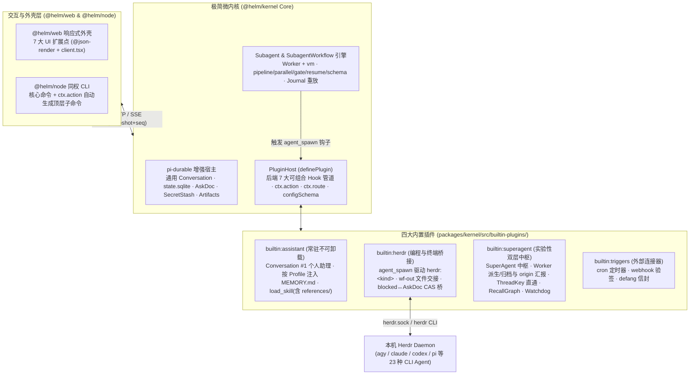
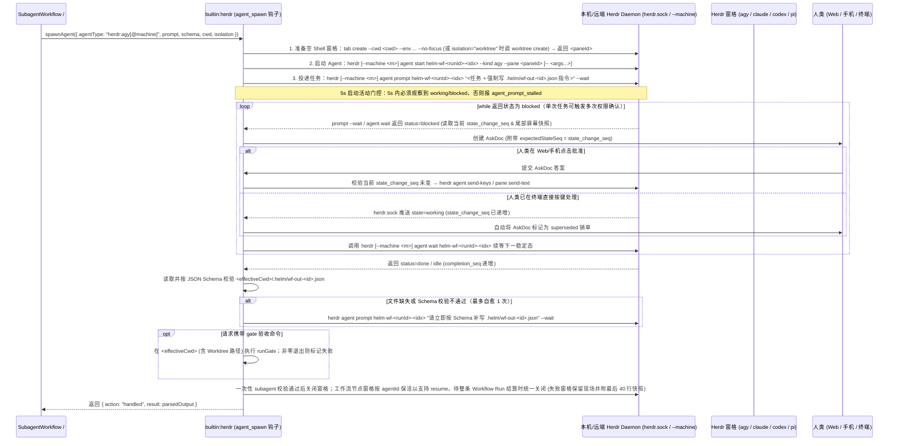

# helm 极简微内核、双 7 扩展点与 Herdr/Super-agent 插件化架构设计文档

## 背景

### 现状与问题

前身系统 `botx`（`/root/code/botx`，本次重写的唯一参考基线与问题来源，只读）基于 `@earendil-works/pi-durable` 构建了持久化 Agent 会话与基础服务（`packages/kernel/src/services/`），但在向「日常结对编程工作台 + 7×24 全天候个人助理与中枢」演进时，暴露出四个结构性问题。本次在全新仓库 `/root/code/helm` 中重写，不复用其运行时代码：

1. **内核耦合实验性业务策略**：现有 `packages/protocol/src/conversation.ts` 与 `packages/kernel/src/runtime/` 将会话硬编码为 `'router' | 'worker' | 'watchdog'` 三种固定角色，把尚处快速试错阶段的 DeepSeek Super-agent 双层路由、事件四步流水线（`automation/pipeline.ts`）、`RecallGraph` 召回图谱与看门狗巡检策略（`runtime/watchdog.ts`）直接焊死在内核中，导致策略调整必须改动核心运行时。
2. **与 Herdr 终端 Agent 生态职责重叠**：用户本机已部署成熟的终端复用器与编码 Agent 宿主 **Herdr**（`/root/code/herdr`，原生管理 `agy`、`claude`、`codex`、`pi` 等 23 种 CLI Agent、Git Worktree 隔离、SSH 远端机器连接与 `herdr.sock` 五态状态机）。而 `botx` 仍在平行建设 BYOM 远端节点守护进程（`NodeRegistry`）、Web 端 `Worktree Diff` 三键合入状态机，以及高复杂度的服务端 Pi TUI 兼容层（`PiExtensionAdapter`），既造成重复造轮子，也无法直接调用用户本机已登录订阅的异构 CLI 工具。
3. **前后端扩展能力不对称**：现有 `PluginHost` 缺少像 Pi `ExtensionAPI` 那样可拦截、可改写、可短路的生命周期管道，插件无法在不修改内核代码的前提下接管事件路由、子代理派生或回合结算；同时前端 `@botx/web` 写死了左栏导航与纯聊天窗口主视图，无法像 DeepSeek Harness（DSH）/ Paseo 那样由插件定制全屏视图（Screen）、时间线渲染器与左栏分组。
4. **缺少确定性多智能体编排引擎**：Herdr 擅长单窗格 CLI 生命周期管理，但没有跨异构 Agent 的确定性多阶段编排能力（如 `pipeline`、`parallel`、JSON Schema 结构化校验、Shell `gate` 门禁与断点重放）。

### 目标与边界

本次采用**全新重写模式（不保留历史兼容包袱）**，将系统重写为**「增强版 `pi-durable` 持久底座 + `Subagent / SubagentWorkflow` 确定性编排引擎 + 前后端双 7 扩展点 + 四大内置插件」**的正交架构：

1. **内核极度收敛，只做通用机制**：`@helm/kernel` 仅保留四项核心能力——① `pi-durable` 持久会话增强（通用 `Conversation`、`state.sqlite` + FTS5、`AskDoc`、`SecretStash`、`Artifacts`、纯文件资产热重载）；② 原生 `subagent` 与 `SubagentWorkflow` 确定性编排引擎；③ 唯一强类型插件宿主 `PluginHost`（提供后端 **7 大可组合生命周期 Hook** 与单点 Schema 五端复用 `ctx.action`）；④ Web 画布外壳（提供前端 **7 大全界面扩展点**）与同权 CLI。内核零业务角色硬编码。
2. **常驻个人助理主入口 `builtin:assistant`（内置锁定开启、不可卸载）**：塑造根会话 `Conversation #1` 为开箱即用的全能个人助理，管理 `MEMORY.md` 与支持按需加载 `references/*.md` 子文件的 `Skill` 体系。
3. **编程能力全面委派 `builtin:herdr`**：通过拦截内核 `agent_spawn` 钩子，让 `subagent` 与 `SubagentWorkflow` 直接调度本机 Herdr 中的 23 种 CLI Agent（`herdr:agy`、`herdr:claude`、`herdr:codex`、`herdr:pi` 等），以「终端跑过程、`.helm/wf-out-*` 文件交结果、缺失原地追问自愈」完成确定性交接；通过监听 `herdr.sock` 将终端 `blocked` 权限确认实时桥接为带 `stateChangeSeq` CAS 乐观锁的 `AskDoc` 远程审批卡。
4. **实验性中枢插件化 `builtin:superagent` 与 `builtin:triggers`**：保留 `#1` 纯粹的单兵个人助理体验与多角色 `Profile`（专家 Bot）自由直聊能力；启用 `builtin:superagent` 后，插件动态创建并托管专属常驻会话 **「SuperAgent 中枢」**（`routerConversationId`，`tags: ['router']`）与 **「巡检看门狗」**（`watchdogConversationId`，`tags: ['watchdog']`），通过挂载 `trigger`、`before_turn`、`turn_settled`、`watchdog_tick` 钩子与前端 7 大 UI 扩展点，实现 0 阻塞总控路由、点名调用任意 `Profile` 专家 Bot 派生后台驻留 Worker、按 `origin` 自动向中枢汇报、`ThreadKey` 0ms 直通、`RecallGraph` 召回图谱与基于 `Skill(references/)` 的两层 Watchdog 巡检。

### 明确砍掉的历史包袱（非目标）

| 砍掉的旧模块 | 裁剪依据 |
| :--- | :--- |
| **`PiExtensionAdapter`（形态 B/C 兼容层）** | 真正的 `pi` CLI 已直接在 Herdr 终端窗格中运行；`helm` 仅保留唯一、纯粹的 `definePlugin(ctx)` 协议，彻底删除服务端模拟 Pi TUI 的适配胶水。 |
| **BYOM 远端节点守护进程与 `Space` 管理** | 本机直连无需远端守护进程；跨机器场景直接复用 Herdr 原生 SSH `--machine` 能力，移除 `NodeRegistry`、`Space` CRUD 与双 Scope 子进程 Token 鉴权矩阵。 |
| **自建 `.botx-worktrees` 与 Web `Worktree Diff` 三键合入面板（旧系统已有实现）** | 编程与 Git Worktree 隔离统一由 Herdr（`herdr worktree`）与终端工具承担，Web 端不再重复实现 Git 客户端状态机。 |
| **推测执行（`Speculative Worker`）** | 移除群聊未艾特时后台盲猜拉起 Worker 的冗余复杂度。 |
| **跨窗格 RecallGraph / FTS5 终端屏幕归档与 Mermaid 伴侣副屏** | Herdr 人类自用窗格历史留在终端本地，不抽入 `helm` 数据库；不在 Web 端为终端窗格做被动富媒体副屏。 |

建议分支：`feature/microkernel-hooks-and-plugins`（建议新建分支名，当前尚未创建）。

---

## 整体设计

### 系统分层与单向依赖边界

系统严格維持单向依赖：`@helm/web` / `@helm/node` → `@helm/protocol` ← `@helm/kernel`。`@helm/protocol` 是唯一共享契约包（零运行时重依赖）。



### 存储边界：纯文件静态资产与单一 `state.sqlite`

数据目录默认位于 `~/.helm`（可通过 `HELM_DATA_DIR` 覆盖，与 `botd`、`botx` 的数据目录完全隔离）。所有静态认知资产采用纯文本文件存储并由 `AssetWatcher` 监听父目录（`150ms` 防抖，兼容 `tmp + fsync + rename` 原子写），所有动态运行态收敛于唯一的 `~/.helm/state.sqlite`：

```text
~/.helm/
├── config.json                 # 管理员密码哈希 (scrypt)、Token 摘要表、插件启停与非机密配置
├── providers.json              # 自定义 OpenAI/Anthropic 兼容模型网关（严禁包含密钥字段）
├── credentials.json            # 恒 0600：模型 API Key / OAuth 令牌 + 插件 secret 配置项 (pluginSecrets)
├── profiles/<id>/              # profile.json + SYSTEM.md + MEMORY.md
├── skills/<id>/                # SKILL.md + references/*.md（支持按需子文件读取）
├── workflows/<name>.js         # 可复用 SubagentWorkflow 编排脚本
├── plugins/<id>/               # 外部安装的第三方插件目录
├── artifacts/<convId>/         # 会话产出文件与超 32KiB 工具输出 Spill 文件
├── cache/plugin-staging/       # 插件 client.tsx 的 esbuild 单次编译缓存（按内容 hash 命中）
└── state.sqlite                # 唯一数据库：pi-durable 原生表 + 插件 Doc + FTS5 派生索引 + artifacts 元数据表
```

### 后端 7 大可组合生命周期 Hook（Kernel Hook Pipeline）

借鉴 Pi `ExtensionAPI` 的处理器组合设计，内核自身只执行最简单的默认直通路径，将全链路关键节点开放为 **7 条按优先级（`priority`，默认 `0`）顺序执行的异步可组合 Hook 管道**。每个 Hook 处理器可返回 `continue`（放行）、`transform`（原地改写参数交由后续处理器）、`handled`（短路接管，终止默认行为）或 `block`（门控拦截）：

| 扩展点 | 组合模式 | 内核默认直通行为（无插件拦截时） | 内置插件挂载行为 |
| :--- | :--- | :--- | :--- |
| **1. `trigger`** | `continue \| transform \| handled` | 经 `defang` 安全包裹后，默认投递至常驻入口 `Conversation #1` | `superagent`：① 噪音事件直接 `handled` 0-Token 丢弃；② 命中 `ThreadSubscriptionDoc` 时 `transform` 改写 `targetConversationId: workerId` 0ms 直通；③ 其余新事件改写 `targetConversationId: routerConversationId` 投递至「SuperAgent 中枢」。 |
| **2. `input`** | `continue \| transform \| handled` | 写入 `helm.input` entry 并提交目标 `Conversation` 执行 | 拦截斜杠命令、附加输入 `origin`（`human \| agent \| trigger`）元数据或改写输入文本。 |
| **3. `before_turn`** | 原地修改（`tools / sections / messages`） | 使用会话 Profile 声明的默认工具集与系统提示词 | `assistant` 按会话 `profileId` 注入对应 `SYSTEM.md`、`MEMORY.md` 与 `<available_skills>`；`superagent` 仅对 `tags: ['router']` 的中枢会话注入 `dispatch_worker` 等工具与 `<active_workers>` 态势，并剥离重度阻塞工具确保中枢 0 阻塞秒回。 |
| **4. `tool_call` / `tool_result`** | `tool_call` 支持 `block` 或改参；`tool_result` 支持改写结果 | 在本机环境执行工具；输出超 `32 KiB` 自动 Spill 落盘至 `Artifacts` 并返回 `4 KiB` 预览 | 敏感操作调 `api.ask()` 弹窗确认；对特定工具注入上下文或转换输出。 |
| **5. `agent_spawn`** | `continue \| handled` | 在 `pi-durable` 中创建原生子 `Conversation` 执行并返回结果 | `herdr` 拦截 `agentType: "herdr:<kind>"`（或绑定 Herdr 的 Profile）：在 Herdr 后台标签页创建窗格 + `.helm/wf-out-*` 文件交接 + `blocked` 挂起续等，完成后返回 `{ action: "handled", result }`。 |
| **6. `turn_settled`** | 通知与追加动作（**统一覆盖 `completed \| failed \| aborted` 三态**） | 递增 `stateChangeSeq` / `completionSeq`，更新 `unread` 并推送 SSE | 彻底补齐 `pi-durable` `afterRun` 不覆盖失败/中止的缺口；`superagent` 按 Worker 回合消费输入的 `origin` 决定是否写 `RecallGraph` 并向「SuperAgent 中枢」(`routerConversationId`) 汇报。 |
| **7. `watchdog_tick`** | 探针采集 + `continue \| transform \| handled` | 内核单飞定时器（默认 `15s`，上一轮未 settle 则跳过）采集在途会话 `LiveDoc` 停滞时长与连续报错次数 | `herdr` 以高优先级（`priority: 100`）追加终端窗格 `blocked / stalled` 探针并返回 `transform`；`superagent`（`priority: 0`）在下游汇总执行 0-Token 规则表与 Watchdog 排障。 |

### 前端 7 大全界面扩展点（Web UI Extension Surfaces）

呼应 DeepSeek Super-agent 论文 8.2 节“超越单一聊天窗口”的开放界面理念与 Paseo 插件模型，`@helm/web` 本身仅作为响应式布局外壳，开放 **7 个全栈 UI 扩展点**。所有扩展点统一支持 **声明式 `@json-render` JSON Spec（零前端构建）** 与 **`client.tsx` 原生 React 组件** 双轨渲染，基类 `UiSpecBase` 统一支持可选会话作用域 `scope?: { conversationIds?: number[]; tags?: string[]; profileIds?: string[] }`（仅在匹配会话中挂载渲染）。**视觉设计遵循极简无 Emoji 规范：所有界面文案、导航标题、状态标签与按钮严禁使用 Emoji 表情字符，统一采用纯文本或 `lucide-react` 线性矢量图标名（如 `icon: 'terminal'`）**：

1. **`sidebar.item` & `sidebar.section`（左栏导航项与动态列表分组）**：左栏默认仅固定常驻入口「个人助理 (`#1`)」与支持多角色 `Profile` 的「我的对话」列表；`target` 支持 `'conversation:<id>'`、`'conversation:tag:<tag>'`（按标签寻址插件动态托管会话）与 `'screen:<pluginId>/<screenId>'`；凡被已启用插件的 `sidebar.item(conversation:tag:*)` 或 `sidebar.section(filterTag)` 接管的会话（以及带 `'worker-archived'` 归档标签的会话），**自动从底部默认「我的对话」列表中去重隐藏**。`superagent` 插件挂载「SuperAgent 中枢」、「巡检看门狗」、「记忆与订阅图谱」入口与「后台 Worker」分组；`herdr` 插件挂载底部「Herdr 终端」状态入口。
2. **`screen`（全屏主画布视图 —— 支持左右 Split View 并排打开）**：主画布（及分屏的任一侧）既可打开会话 `<ConversationPane id={...} />`，也可打开任意插件注册的全屏视图 `screen:<pluginId>/<screenId>`（如 `screen:builtin:superagent/recall-graph` 记忆图谱视图、`screen:builtin:herdr/overview` 终端窗格矩阵视图）。
3. **`timeline.renderer`（时间线自定义消息渲染器）**：支持按 `kinds?: string[]` 或 `matchMeta?: { renderer: string }`（匹配 `helm.input` entry 的 `meta.renderer`）精确接管聊天流条目渲染（如 `superagent` 将投递至中枢的 Worker 汇报渲染为可一键右屏并排查看详情的任务卡片，不误伤人类普通输入）。
4. **`tool.view`（工具调用内联卡片）**：按 `toolNames` 接管工具执行过程与结果展示（如 `superagent` 的 `dispatch_worker` 派工状态卡、`herdr` 子代理实时终端预览卡）。
5. **`composer.pill` & `composer.widget`（输入框胶囊开关与上方状态挂件）**：按 `scope` 在匹配的会话输入框挂载快捷胶囊或状态条（如仅在 `tags: ['router']` 的 SuperAgent 中枢窗口显示活跃 Worker 态势条与 `[中枢路由]` 开关）。
6. **`workbench.panel`（会话感知的右栏上下文抽屉）**：随当前激活的 `conversationId` 与 `scope` 动态解析，承载 `子任务与工作流`、`产物` 及插件自定义面板。
7. **`commandPalette`（`⌘K` 全局命令中心）与 `settings.panel`（设置页面板）**：汇总所有插件命令、快捷 `ctx.action` 与基于 `configSchema` 自动生成的配置/密钥脱敏表单。

---

## 详细设计

### 1. 内核底座与持久会话增强（`@helm/kernel` Core）

#### 1.1 通用 `Conversation` 契约与五态状态机

废除硬编码角色枚举，所有会话统一采用通用 `ConversationSummary` 模型，借鉴 Herdr 的单调递增序列号与活动摘要设计：

```ts
// packages/protocol/src/conversation.ts
export type ConversationStatus =
  | 'working'   // 正在执行推理、工具调用或等待子代理
  | 'blocked'   // 等待人类审批 (pending AskDoc) 或子代理终端确认
  | 'done'      // 本轮任务已完成，尚待人类查看 (unread = true)
  | 'idle'      // 空闲且已读
  | 'error'     // 最近一轮因未捕获异常终止

export interface ConversationSummary {
  id: number
  title: string
  profileId: string
  tags: string[]                     // 如 ['assistant']、['worker']、['watchdog']，由插件自由打标
  parentConversationId?: number      // 派生来源会话 ID
  cwd: string                        // 本机工作目录绝对路径
  model: string                      // 当前生效模型 'provider/model'
  status: ConversationStatus
  doing?: string                     // 零 Token 实时动作摘要，如 'bash: pnpm test' 或 'thinking…'
  stateChangeSeq: number             // 任何状态/doing/Ask 变化均单调递增（用于 SSE 水位线与 CAS 校验）
  completionSeq: number              // 每次回合结束单调递增
  unread: boolean                    // 仅人类在 Web/CLI 显式聚焦或 PATCH 时清零，API 读取不清零
  pinned: boolean
  pendingAskCount: number
  createdAt: number
  updatedAt: number
}
```

- **常驻根会话 `#1` 与插件托管常驻会话保护**：系统初始化时利用 `pi-durable` 的 `ROOT_CONVERSATION_ID = 1` 自动创建主入口会话，绑定 `builtin:assistant` 的默认 Profile，`DELETE /api/conversations/1` 直接返回 `403 root_conversation_protected`；由已启用插件注册托管的常驻会话（如 `superagent` 的 `routerConversationId` 与 `watchdogConversationId`）同样受删除保护，调用 `DELETE` 返回 `409 conversation_managed_by_plugin`（仅在插件停用后允许清理）。
- **会话模型三级解析优先级**：`创建/PATCH 显式指定的 model` > `所绑定 Profile (profiles/<profileId>/profile.json) 的 model` > `系统全局默认模型 (config.json / HELM_MODEL)`；若三级均未配置，在 `submitInput` 时显式返回 `model_not_configured` 错误，绝不静默伪造默认模型。
- **首轮零 Token 自动标题**：新建会话若未指定标题，在首次收到输入时截取前 36 个有效字符（剥离代码块与换行）自动填充 `title`。
- **级联删除（`DELETE /api/conversations/:id`）**：按顺序执行：① 中止在途运行与挂起的 `AskDoc`；② 清理 `~/.helm/artifacts/<id>/` 物理文件与元数据行；③ 清理 `conversation_fts` 索引行；④ 通知 `PluginHost` 释放会话级上下文；⑤ 从索引移除并推送 `conversation.deleted` SSE 事件。`pi-durable 1.5.0` 的公开 `Harness`、`Conversation` 与 `Storage` 接口没有会话物理删除操作；本阶段以 Helm 自有持久删除标记阻止访问和重启重新导入，保留 SDK 内部历史记录，不绕过 SDK 直接删除 `pi_*` 表。该接口不表示已从 SQLite 物理擦除历史数据。

#### 1.2 全局 `GET /api/events` SSE（`snapshot + stateChangeSeq` 水位线引导）

彻底消除前端定时轮询。客户端连接 `GET /api/events` 时：
1. 服务端先挂起该连接的增量事件缓冲队列，再原子读取当前全量快照，发送首帧 `event: snapshot`（携带 `{ seq, conversations, pendingAsks, plugins, ui, workflowRuns }`，其中 `ui` 为已启用插件注册的 7 大 UI 扩展点清单，`workflowRuns` 为当前工作流运行摘要列表）；
2. 随后冲刷缓冲区中 `seq > snapshot.seq` 的事件，转入实时流式推送（`conversation.upsert`、`conversation.entry`、`conversation.live`、`conversation.deleted`、`ask.upsert`、`ask.resolved`、`plugin.changed`、`plugin.doc.updated`、`workflow.updated`、`notification`，其中 `conversation.entry` 推送新落库的时间线条目，`conversation.live` 按 `50~100ms` 节流推送流式生成文本与在途工具状态，`plugin.doc.updated` 推送声明为 `public: true` 的插件文档状态变更）。客户端断线重连后凭首帧 `snapshot` 自动对齐状态，绝不丢帧。

#### 1.3 `AskDoc`（支持 CAS 乐观锁与机密自动入库）与 `Artifacts` 自动 Spill

- **`AskDoc` 契约与 CAS 校验**：
  ```ts
  export interface AskSpec {
    id: string
    conversationId: number
    ownerPluginId?: string
    title: string
    description?: string
    fields: Array<{
      name: string
      label: string
      type: 'text' | 'select' | 'confirm'
      options?: Array<{ label: string; value: string }>
      secret?: boolean               // true 时答案写入内存 SecretStash，持久层与上下文仅存 [REDACTED:stash:<uuid>]
      required?: boolean
    }>
    expectedStateSeq?: number        // 可选 CAS 水位线（供 herdr 终端状态同步防竞态）
    status: 'pending' | 'answered' | 'cancelled' | 'superseded'
    createdAt: number
  }
  ```
  当人类提交答案时，若 `AskDoc` 携带 `expectedStateSeq` 且目标对象状态已推进（例如用户在终端里已经手动按了 `y`），服务端自动将该 `AskDoc` 标记为 `superseded` 并提示“已在终端处理”，防止向终端重复注入按键。`AskCreateSpec` 支持调用方预分配可选 `id?: string`（便于在挂起等待前绑定 `herdr.sock` 状态监听与 CAS 解析器），且 `ctx.host.createAsk` 结算时返回 `{ id, status: 'answered' | 'cancelled' | 'superseded', answers }`，使调用方能严格区分“Web 端批准（发送按键）”、“终端已处理（跳过按键直接续等）”与“用户取消（发送中断信号）”。
- **双层机密生命周期边界（`credentials.json` vs `SecretStash`）**：长期机密（模型 API Key 与插件 `configSchema` 的 `secret: true` 配置项）持久化于恒 `0600` 的 `~/.helm/credentials.json` 跨重启保留；`AskDoc` 的 `secret: true` 答案属**会话级纯内存临时机密**（仅存于 `SecretStash`，绝不写入磁盘），随会话删除或进程退出立即销毁——进程重启后若旧会话需再次使用临时机密，须重新发起 `AskDoc` 授权，绝不静默注入空串。
- **工具超长输出自动 Spill**：任何工具返回的文本超过 `32 KiB` 时，内核自动将完整输出写入 `~/.helm/artifacts/<convId>/tool-spill-<callId>.txt` 并登记至 `artifacts` 表，向模型上下文仅返回前 `4 KiB` 头部预览 + 尾部摘要 + `Artifact ID` 与文件路径指引，防止撑爆上下文窗口。
- **本机执行环境注入与 CLI 双轨鉴权**：所有内置 Shell / 工具子进程自动合并 `SecretStash.envFor(conversationId)`，并注入环境变量 `HELM_ENV=1`、`HELM_HUB_URL`、`HELM_CONVERSATION_ID`、`HELM_CWD` 以及内核受管子进程 `HELM_TOKEN`（该内部 Token 自动加入出站脱敏器，不进入模型上下文与持久层）。CLI 所有支持指定会话的命令均支持 `--current` 标志（自动读取 `$HELM_CONVERSATION_ID`），鉴权按 `HELM_TOKEN` 环境变量 > `~/.helm/cli-token`（人类执行 `helm setup / login` 后以 `0600` 权限落盘）顺序读取，确保 Agent 在 `bash` 中调用 `helm ... --current` 开箱即通。

---

### 2. `Subagent` 与 `SubagentWorkflow` 确定性编排引擎

内核直接内建两个一等公民编排工具，供个人助理 `#1` 及任意会话调用：
1. **`subagent` 工具**：派生单个子智能体执行独立任务（支持 `agentType`、`schema` 结构化输出校验、`gate` Shell 验收命令与 `resume` 续接）。
2. **`SubagentWorkflow` 工具**：以 `@tintinweb/pi-subagents` v0.23.1 的真实工作流实现为基础移植（`runtime.ts`、`worker-source.ts`、`meta.ts`、`journal.ts`、`json-schema.ts`、`progress.ts`），保留上游 MIT 许可与来源说明。使用 `node:worker_threads` 隔离执行线程并支持强制终止，使用 `node:vm` 与确定性 Prelude 限制脚本能力，禁用动态代码生成、`Date.now()`、`Math.random()` 与无参 `new Date()`；这属于可终止与确定性执行边界，不承诺对恶意代码的安全隔离。`meta` 通过字面量扫描与受限求值校验；Schema 结构化输出与宿主适配层按 helm 工具契约接入。新增 `action(actionId, input)` 原语，以零 Token 直接调用任何 `ctx.action`，并将成功完成的动作调用及其参数、结果纳入前缀重放账本，恢复时复用已确认结果。外部副作用与账本落盘之间不具备跨系统事务保证；若进程在动作执行中崩溃、无法确认动作是否完成，恢复必须显式报告不确定状态，避免自动重复执行。

**通过 `agent_spawn` 钩子实现底层驱动完全解耦**：
`WorkflowHost.spawnAgent(opts)` 不硬编码执行方式，而是构造 `AgentSpawnRequest` 投入内核 **`agent_spawn` Hook 管道**：
- 若 `agentType` 为普通 Profile ID（无插件拦截），内核默认在 `pi-durable` 中创建原生子会话运行；
- 若 `agentType` 为 `"herdr:agy"`、`"herdr:claude"`、`"herdr:codex"` 或绑定了 Herdr runtime 的 Profile，`builtin:herdr` 插件拦截该 Hook 并接管完整执行生命周期，对上层工作流脚本 `pipeline()` / `parallel()` 100% 透明。

---

### 3. `PluginHost` 扩展契约与单点 Schema 五端复用

#### 3.1 唯一强类型插件接口 `definePlugin(ctx)`

废弃多形态兼容猜测，所有内置与外部插件统一使用 `definePlugin(ctx)`：

```ts
// packages/protocol/src/plugin.ts
export interface HelmPluginContext<TConfig = Record<string, unknown>> {
  readonly pluginId: string
  readonly dataDir: string
  getConfig(): TConfig

  // 1. 声明式配置 Schema（secret: true 自动分离至 credentials.json）
  configSchema(schema: Record<string, PluginConfigFieldSchema>): void

  // 2. 后端 7 大可组合生命周期 Hook
  hook: {
    onTrigger(fn: TriggerHookHandler, opts?: { priority?: number }): void
    onInput(fn: InputHookHandler, opts?: { priority?: number }): void
    onBeforeTurn(fn: BeforeTurnHookHandler, opts?: { priority?: number }): void
    onToolCall(fn: ToolCallHookHandler, opts?: { priority?: number }): void
    onToolResult(fn: ToolResultHookHandler, opts?: { priority?: number }): void
    onAgentSpawn(fn: AgentSpawnHookHandler, opts?: { priority?: number }): void
    onTurnSettled(fn: TurnSettledHookHandler, opts?: { priority?: number }): void
    onWatchdogTick(fn: WatchdogTickHookHandler, opts?: { priority?: number }): void
  }

  // 3. 单点 Schema 动作总线（一次声明，HTTP / CLI / Tool / Workflow / Web 五端复用）
  action<TIn, TOut>(spec: PluginActionSpec<TIn, TOut>): void

  // 4. 模型専用工具与 Web Standard 原始路由
  tool<TIn>(spec: PluginToolSpec<TIn>): void
  route(spec: { method: 'GET' | 'POST' | 'PUT' | 'DELETE'; path: string; public?: boolean; handler: (req: Request) => Promise<Response> | Response }): void

  // 5. 持久状态与后台服务（opts.public = true 时开放给前端 usePluginDoc 实时订阅）
  doc<TState>(name: string, initial: TState, opts?: { public?: boolean }): PluginDocHandle<TState>
  service(spec: { id: string; start: () => Promise<void> | void; stop: () => Promise<void> | void }): void

  // 6. 前端 7 大全界面扩展点
  ui: {
    sidebarItem(spec: SidebarItemSpec): void
    sidebarSection(spec: SidebarSectionSpec): void
    screen(spec: ScreenSpec): void
    timelineRenderer(spec: TimelineRendererSpec): void
    toolView(spec: ToolViewSpec): void
    composerPill(spec: ComposerPillSpec): void
    composerWidget(spec: ComposerWidgetSpec): void
    workbenchPanel(spec: WorkbenchPanelSpec): void
    command(spec: CommandSpec): void
    settingsPanel(spec: SettingsPanelSpec): void
  }

  // 7. 宿主运行时能力调用
  host: {
    dispatchTrigger(event: ExternalTriggerEnvelope): Promise<void>
    submitInput(conversationId: number, text: string, opts?: { origin?: 'human' | 'agent' | 'trigger'; whenBusy?: 'steer' | 'followUp' | 'reject'; meta?: Record<string, unknown> }): Promise<void>
    createConversation(init: { title?: string; profileId?: string; tags?: string[]; parentConversationId?: number; cwd?: string }): Promise<ConversationSummary>
    listConversations(filter?: { tag?: string; status?: ConversationStatus }): ConversationSummary[]
    createAsk(spec: Omit<AskSpec, 'id' | 'status' | 'createdAt'> & { id?: string }): Promise<{ id: string; status: 'answered' | 'cancelled' | 'superseded'; answers: Record<string, string> }>
    cancelAsk(askId: string, reason?: 'cancelled' | 'superseded'): Promise<void>
    emitEvent(type: string, payload: unknown): void
  }
}
```

#### 3.2 `ctx.action` 单点 Schema 五端自动映射与 `ctx.route` 相对路径命名空间

插件通过 `ctx.action({ id, description, inputSchema, outputSchema, cli?, exposeAsTool?, handler })` 注册动作后（`id` 使用无点号合法标识符），内核自动完成五端绑定；插件通过 `ctx.route({ method, path, public?, handler })` 声明**以 `/` 开头的插件内相对路径**（如 `/webhook/:id`），由宿主统一挂载至 `/api/plugins/:pluginId/routes/...` 专属命名空间下：

| 消费端 | 自动映射机制 |
| :--- | :--- |
| **1. HTTP API** | 自动挂载 `POST /api/actions/:pluginId/:actionId`，并在 `GET /api/actions` 中公开完整 JSON Schema 清单。 |
| **2. 同权 CLI** | `packages/node` 读取动作清单：若声明 `cli.command`（如 `['cron', 'create']`）则直接按该路径挂载为 `helm cron create`；缺省剥离 `builtin:` 前缀后挂载为 `helm <plugin> <action>`（如 `helm herdr list`），将 `inputSchema.properties` 自动转换为 `--flag` 参数并支持 `--json`。 |
| **3. Agent Tool** | `exposeAsTool: true` 时（与 `ctx.tool` 一同）支持可选会话作用域 `scope?: { conversationIds?: number[]; tags?: string[]; profileIds?: string[] }`，在 `before_turn` 工具组装与 `executeTool` 入口双重过滤；其余动作通过内置元工具 `run_action({ action, input })` 按需调用。 |
| **4. Workflow 脚本** | 在 `SubagentWorkflow` 沙箱中直接通过 `await action("pluginId.actionId", input)` 零 Token 确定性调用。 |
| **5. Web UI 交互** | `@json-render` 声明式卡片与 `client.tsx` 中的 `usePluginContext().callAction(actionId, input)` 直接复用同一端点与校验器。 |

---

### 4. 四大内置插件详细设计（`packages/kernel/src/builtin-plugins/`）

#### 4.1 `builtin:assistant`（常驻不可卸载 —— 全会话认知底座与个人助理主入口）

- **职责**：为系统中所有会话按其绑定的 `profileId` 提供独立的长期记忆与技能按需加载底座，并守护常驻根会话 `Conversation #1` 作为开箱即用的全能个人助理。
- **核心机制**：
  1. **按 `Profile` 隔离的认知注入（`before_turn` 钩子）**：对任意会话实时读取其绑定 `~/.helm/profiles/<profileId>/` 下的 `SYSTEM.md` 与 `MEMORY.md` 注入系统提示词，并拼装当前可用技能目录 `<available_skills>`（含每个技能下的子文件路径摘要）。
  2. **按 `Profile` 归属的长期记忆工具 `update_memory`**：允许当前会话的模型以 `append` 或 `replace` 模式原子更新其所属 `~/.helm/profiles/<profileId>/MEMORY.md`（使 `#1` 个人助理、各专业角色 Bot、SuperAgent 中枢与 Watchdog 各自维护独立长期记忆，互不串味），由 `AssetWatcher` 实时同步。
  3. **支持子文件按需读取的 `load_skill({ skillId, path? })`**：
     - `path` 缺省时读取 `<skillDir>/SKILL.md`；
     - 传入 `path: "references/xxx.md"` 时，通过 `SkillService.readFile(skillId, path)` 安全读取技能包内的参考手册或规则表（严格拦截 `../`、绝对路径与软链越界）。
  4. **左栏常驻导航（`ui.sidebarItem`）**：在左栏顶部固定渲染「个人助理 (`#1`)」入口。

#### 4.2 `builtin:herdr`（编程委派、异构 CLI 编排与终端远程审批桥）

將 `helm` 的跨阶段编排能力与 Herdr 的本机 23 种 CLI Agent 无缝结合，不在 `Conversation` 底层伪装终端 TUI，而是通过 `agent_spawn` 与 `herdr.sock` 协同。



- **双模式寻址与参数分层**：
  1. **显式前缀直调（支持 `@<machine>` 跨机器简写）**：在 `subagent` 或 `SubagentWorkflow` 中直接指定 `agentType: "herdr:<kind>"`（如 `"herdr:agy"`、`"herdr:claude"`、`"herdr:codex"`、`"herdr:pi"`）或 `"herdr:<kind>@<machine>"`（映射为 `herdr --machine <machine> ...`）。`AgentSpawnRequest` 的标准字段由插件自动翻译为两步窗格准备命令：`cwd` 与会话 `SecretStash` 映射为 `herdr tab create --cwd <cwd> --env KEY=VALUE --no-focus`；`isolation: "worktree"` 映射为先执行 `herdr worktree create --branch helm/wf-<runId>-<idx> --cwd <cwd> --no-focus` 获取隔离目录 `<worktreePath>` 与 `<paneId>`，再在该 `<paneId>` 上执行 `herdr agent start <name> --kind <kind> --pane <paneId>`，并将 `{ path: worktreePath, branch }` 记录至 `WorkflowNodeState.worktree` 供 `<WorkflowInspector />` 与主会话直接检视或合并。
  2. **Profile 绑定寻址（承载底层 CLI 参数与 Herdr 拓扑配置）**：`Profile` 配置支持 `runtime?: { kind: "herdr"; agent: string; args?: string[]; machine?: string; workspace?: string; env?: Record<string, string> }`。该字段专用于将该 Profile 作为 `subagent({ agentType: "<profileId>" })` 或 `SubagentWorkflow` 节点经 `agent_spawn` 钩子调用时的终端执行配置（持久 `Conversation` 会话层本身统一由 `pi-durable` 承载，不在 `Conversation` 底层伪装终端 TUI；驻留 Worker 会话可在回合内调用 `subagent("herdr:<kind>")` 驱动终端窗格）。底层 CLI 专属参数统一通过 `args`（原样透传至 `herdr agent start ... -- <args...>`）显式声明，内核与插件不做 `model / effort` 到 23 种 CLI 私有 flag 的隐式猜测映射。
- **「终端跑过程，文件交结果」契约与 `gate / resume` 生命周期（严守诚实性纪律，禁止静默降级）**：
  - `builtin:herdr` 注入给 CLI Agent 的提示词末尾强制追加落盘指令：有 `schema` 时要求将合法 JSON 写入 `<effectiveCwd>/.helm/wf-out-<agentId>.json`；无 `schema` 时要求将最终 Markdown 结论写入 `<effectiveCwd>/.helm/wf-out-<agentId>.md`。
  - 当 Herdr 窗格进入 `done / idle` 状态后，插件读取该文件并执行 Schema 校验。若文件缺失或校验失败，向原窗格自动发送 1 次追问指令要求修正重写；若仍失败，**绝不静默回退截取终端脏文本充当返回值**，而是显式抛出 `herdr_output_contract_violation` 错误（附带 `herdr agent read <target> --source recent-unwrapped --lines 40` 终端快照诊断）并保留该窗格供人工排查。
  - **门禁与续接保活**：若 `AgentSpawnRequest` 含 `gate` 命令，插件在文件校验通过后直接于子代理实际 `<effectiveCwd>`（含 Worktree 目录）执行 `runGate`。工作流内带 `agentId` 的窗格在单步完成后保活，供后续 `resume: '<label>'` 在同一窗格直接续接上下文，待整个工作流 Run 到达终态后统一关闭回收。
- **双向态势感知与孤儿窗格对账**：
  - **向 Herdr 侧栏反向投射 `$helm` 状态 Token**：当 `helm` 执行后台工作流或存在待答 `AskDoc` 时，调用 `herdr pane report-metadata <paneId> --source helm --token helm="..." --ttl-ms 30000` 在开发者终端侧栏实时显示进展；
  - **孤儿窗格对账回收**：插件启动时扫描名称匹配 `helm-wf-*` 的存量 Herdr 窗格，对不属于任何在途工作流的已结束窗格自动回收；
  - **前端界面扩展**：注册底部导航项 `Herdr 终端`（`icon: 'terminal'`）与全屏视图 `screen:builtin:herdr/overview`（实时展示本机所有 Herdr 窗格的五态状态、所属目录与一键远程聚焦/审批入口）。

#### 4.3 `builtin:superagent`（实验性 —— 独立 SuperAgent 中枢 Router Bot、多角色 Worker 调度与可扩展 Watchdog）

保留 `Conversation #1` 作为纯粹的单兵全能助理，保留人类在「我的对话」中任选 `Profile`（专家角色 Bot）1v1 直聊的能力；当启用 `builtin:superagent` 时，将 DeepSeek Super-agent 论文中的双层架构、事件流水线与巡检看门狗完全封装在插件内，自动生成专属的 **「SuperAgent 中枢」**（Router Bot）与 **「巡检看门狗」**（Watchdog Bot）：

1. **插件自有持久化文档（`ctx.doc(..., { public: true })`）**：
   - `SuperAgentIndexDoc`：记录动态分配并持久化的两个专属常驻会话 ID —— **`routerConversationId`**（`tags: ['router']`，绑定 `superagent-router` Profile）与 **`watchdogConversationId`**（`tags: ['watchdog']`，绑定 `superagent-watchdog` Profile，均不硬编码数字 ID），以及当前活跃后台 Worker 列表与派生关系；
   - `ThreadSubscriptionDoc`：维护外部事件源 `threadKey -> workerConversationId` 的路由订阅映射；
   - `RecallGraphDoc`：记录后台任务完成后的结构化摘要节点（`summary`、`artifacts`、`keywords`、`conversationId`、`profileId`）。
2. **两层路由架构：L0 确定性拦截（`trigger` 钩子）+ L1 认知总控（`SuperAgent 中枢`）**：
   - **L0 确定性路由（`trigger` 钩子，0-Token）**：收到 `ExternalTriggerEnvelope` 后：① 匹配静默过滤规则的噪音事件直接返回 `{ action: "handled" }`（0-Token 丢弃）；② 命中 `ThreadSubscriptionDoc` 活跃订阅的事件，先校验目标 `workerId` 会话是否仍存活——若存活则返回 `{ action: "transform", value: { ...envelope, targetConversationId: workerId } }`（0ms 绕过中枢直投对应 Worker），若目标会话已被删除则自动清理残留订阅并回退投递至 `routerConversationId`；③ 其余新事件改写 `targetConversationId: routerConversationId`，统一进入 **「SuperAgent 中枢」** 批处理（不打扰 `#1` 日常助理）。
   - **L1 认知路由与工具收敛（`before_turn` 钩子）**：仅当 `conversation.tags.includes('router')`（即 `SuperAgent 中枢`）且开启路由收敛模式时，`before_turn` 自动从本回合 `tools` 中**剥离重度阻塞工具（`edit / write / bash / subagent / SubagentWorkflow`）**，仅保留轻量只读/记忆工具并注入中枢工具集（`dispatch_worker`、`archive_worker`、`inspect_worker`、`recall_context`、`subscribe_thread`，均声明 `scope: { tags: ['router'] }`）与 `<active_workers>` 态势，从物理机制上保证中枢永远 0 阻塞秒回人类（不影响 `#1` 与其他单聊 Bot 的完整工具集）。
3. **多角色专家 Worker 派生、归档与按 `origin` 自动汇报（挂载 `before_turn` 与 `turn_settled` 钩子）**：
   - **明确 `subagent` 与 `dispatch_worker` 的正交边界**：`subagent` / `SubagentWorkflow` 为阻塞/编排原语（当前回合内同步等待结构化返回值，经 `agent_spawn` 钩子执行）；`dispatch_worker({ prompt, profileId?, title?, threadKey?, cwd? })` 为**非阻塞驻留会话原语**——支持「SuperAgent 中枢」从用户的多角色 `Profile` 库中点将（如派 `profileId: "finance"` 对账、派 `"writer"` 写稿、派 `"coder"` 领队在回合内调 `subagent("herdr:claude")` 修代码），创建带 `tags: ['worker']` 的独立持久会话（拥有完整重武器工具集）并异步提交 `origin: 'agent'` 输入，立即返回 `{ workerConversationId }` 不阻塞中枢当前回合，支持持续绑定 `ThreadKey` 与人类分屏介入结对；
   - **已完成 Worker 一键归档（`archive_worker` 动作）**：通过 `ctx.action` 注册 `archive_worker({ workerConversationId })`（中枢可调、Web 左栏 Worker 项可一键触发），自动解绑该会话关联的 `ThreadKey` 订阅并将其标签由 `'worker'` 替换为 `'worker-archived'`，使左栏「后台 Worker」分组始终只展示活跃/值守中的任务，归档任务仍完整保留在数据库中并可随时从 `RecallGraph` 记忆图谱点击跳回；
   - **按 `origin` 自动向中枢汇报**：在 `turn_settled` 钩子中检查已完成/失败/中止的会话：先执行**防自汇报死循环守卫**（仅当 `conversation.id !== routerConversationId && conversation.id !== watchdogConversationId && conversation.tags.includes('worker')` 时生效）；再遍历本回合消费的所有 `helm.input` entry，**只要含任一 `origin: 'agent' | 'trigger'` 的输入**，即自动提取结构化摘要写入 `RecallGraphDoc`，并通过 `submitInput(routerConversationId, reportCard, { origin: 'agent', whenBusy: 'followUp', meta: { renderer: 'superagent:worker-report', workerId: conversation.id, profileId: conversation.profileId, summary, artifacts } })` 向 **「SuperAgent 中枢」** 投递汇报卡片；若本回合仅包含 `origin: 'human'`（人类正在该 Worker 右分屏直连结对），则仅静默更新 `RecallGraphDoc`，不打扰中枢。
4. **可扩展两层 Watchdog 巡检（挂载 `watchdog_tick` 钩子 + `Skill(references/)` 认知层）**：
   - **探针豁免防自激**：采集巡检探针时**显式排除 Watchdog 自身会话**（`id === watchdogConversationId` 或 `tags.includes('watchdog')`），防止 Watchdog 排障耗时或报错时触发自巡检死循环（Watchdog 自身异常直接降级为发送系统 `notification`）。
   - **第一层：0-Token 确定性规则表**：插件对比各会话/窗格的 `(targetId, stateChangeSeq)`（同一序号不重复触发，天然幂等防抖）。对已知确定性异常直接执行预设动作：`bridge_to_ask`（转 `AskDoc`）、`notify_only`（发通知）、`auto_abort_and_notify`（超时自动中止并通知）或 `wake_watchdog`（唤醒 Watchdog 会话）。
   - **第二层：基于 `Skill(references/)` 的模型认知排障**：当触发 `wake_watchdog` 时，将异常事实列表投递给独立的 Watchdog 会话。Watchdog 会话遵守两条铁律：
     - **归属权红线（`SYSTEM.md` 强约束）**：对 `ownedBy: 'helm'` 的后台 Worker 允许重试、注入恢复提示或中止；对 `ownedBy: 'human'` 的人类直连会话/Herdr 窗格**严禁发送任何按键或中止指令**，仅允许只读诊断并向人类发通知。
     - **按需加载排障手册**：用户通过编辑 Watchdog 的 `MEMORY.md`（值班偏好表）和 `~/.helm/skills/watchdog-playbooks/references/*.md`（如 `herdr-stalled.md`、`ci-failure.md`），让 Watchdog 按需调用 `load_skill({ skillId: "watchdog-playbooks", path: "references/..." })` 扩展排障策略，无需修改代码。
5. **中枢专属前端扩展（`ctx.ui` 6 处联动挂载，纯文本与 `lucide-react` 极简图标）**：
   - 左栏通过 `ui.sidebarItem` 注入「SuperAgent 中枢」（`target: 'conversation:tag:router'`）、「巡检看门狗」（`target: 'conversation:tag:watchdog'`）与「记忆与订阅图谱」（`target: 'screen:builtin:superagent/recall-graph'`）；
   - 左栏通过 `ui.sidebarSection` 注入「后台 Worker」（`filterTag: 'worker'`，显示专家 Profile 徽章、五态状态点与实时 `doing`）；
   - 通过 `ui.composerWidget` 与 `ui.composerPill`（均限定 `scope: { tags: ['router'] }`）在中枢输入框上方渲染活跃 Worker / 事件订阅态势条与 `[中枢路由: 开]` 开关；
   - 通过 `ui.toolView`（`toolNames: ['dispatch_worker']`）与 `ui.timelineRenderer`（`matchMeta: { renderer: 'superagent:worker-report' }`）渲染带状态徽章、耗时与「在右屏并排打开」按钮的交互式派工/汇报卡片；
   - 注册全屏视图 `screen:builtin:superagent/recall-graph`（基于 `usePluginDoc('recall-graph' | 'subscriptions')` 可视化检索历史任务图谱与事件订阅流）。

#### 4.4 `builtin:triggers`（外部事件连接器）

- 提供 `cron`（持久化定时任务，支持启动补跑策略）与 `webhook`（通过 `ctx.route({ method: 'POST', path: '/webhook/:id', public: true })` 声明相对路径，宿主挂载至 `/api/plugins/builtin%3Atriggers/routes/webhook/:id` 接收原始请求并执行 HMAC-SHA256 签名校验）两类入站连接器。
- 所有外部载荷统一经过 `defang` 防逃逸信封包裹（`<external_event id="..." source="..." untrusted="true">...</external_event>`）后调用 `ctx.host.dispatchTrigger(envelope)` 进入内核 `trigger` 钩子管道。
- 通过 `ctx.action` 注册无点号动作 ID（`cron_list / cron_create / cron_delete / cron_trigger` 与 `webhook_list / webhook_create / webhook_delete`），并通过 `cli: { command: ['cron', '<subcmd>'] }` / `['webhook', '<subcmd>']` 显式声明命令路径，自动映射为顶层 `helm cron ...` 与 `helm webhook ...` CLI 命令。

---

### 5. Web 画布外壳（`@helm/web`）与同权 CLI（`@helm/node`）

#### 5.1 响应式三栏画布与分屏（Split View）

```text
+-----------------------+-----------------------------------+-----------------------------------+----------------------+
| 左栏 (Sidebar)         | 主画布左屏 (Primary Pane)          | 主画布右屏 (Split Pane, 可选)      | 右栏抽屉 (Workbench)  |
|                       |                                   |                                   |                      |
| [个人助理 #1]          | SuperAgent 中枢 (Router) *        | Worker #12 [编程Bot] *            | [工作流] [产物]       |
| [SuperAgent 中枢] *    | 或 Conversation #1 (单兵助理)      | 或                                | (随当前聚焦会话切换)  |
| [巡检看门狗] *         | 或                                | screen:builtin:superagent/        |                      |
| [记忆与订阅图谱] *     | screen:builtin:superagent/        |        recall-graph               | <WorkflowInspector/> |
|                       |        recall-graph               | 或 screen:builtin:herdr/overview  | <ArtifactList/>      |
| 后台 Worker (2) *     |                                   |                                   |                      |
| 我的对话 (多 Bot)      | [Timeline + 汇报卡 / 工作流内联卡] | [Timeline / 插件全屏 React 组件]   |                      |
|                       | [ComposerWidget + Pills (按scope)]|                                   |                      |
| [Herdr 终端] *         | [Composer + ModelPicker]          |                                   |                      |
+-----------------------+-----------------------------------+-----------------------------------+----------------------+
(* 号项均由对应内置插件通过 ui.* 扩展点动态挂载，未启用插件时不显示；被插件接管的 router/watchdog/worker/worker-archived 会话自动从「我的对话」去重隐藏)
```

- **工作流三级渐进披露视图**：
  1. **聊天流内联 `<WorkflowRunCard />`**：实时显示当前阶段（Phase）、完成进度、Token 消耗与耗时；
  2. **右栏双栏检查器 `<WorkflowInspector />`**：左侧为按阶段分组的 DAG 节点树（显示 `herdr:agy` 或子会话状态），右侧为选中节点的 Prompt、Schema 校验结果、Gate 输出与一键「在右屏打开子会话」按钮；
  3. **左右分屏钻取**：点击任意子会话或后台 Worker，直接在右侧分屏并排打开。
- **开箱即用富媒体能力与 `@json-render` 声明式交互协议**：
  - `Markdown.tsx`：代码块一键复制、Mermaid 图表 `250ms` 流式防抖渲染 + `<MermaidPreviewModal />`（支持适屏、`0.2x~5x` 缩放与源码复制）、拦截 ````ui` / ````json-render` 代码块（含简写树自动归一化）内联渲染交互式 `<HelmSpecView />`；
  - `<HelmSpecView />` 内置 3 个宿主标准声明式动作指令（零 `client.tsx` 即可完成交互闭环）：① `helm:action`（调用 `POST /api/actions/:pluginId/:actionId`）；② `helm:open`（在主屏或右侧分屏打开 `conversation:<id>`、`conversation:tag:<tag>` 或 `screen:<pluginId>/<screenId>`）；③ `helm:send`（向指定会话发送文本输入）；
  - 右栏 `产物` 与 `<ArtifactPreviewModal />`：支持 Markdown 富文本/源码切换、代码高亮、图片/音视频/PDF 在线预览（`GET /api/artifacts/:id/content?inline=1`）。
- **插件前端单次编译、标准组件 Props 与 `usePluginDoc` 响应式状态**：
  - 内核 `PluginClientCompiler` 将插件的 `client.tsx` 单次编译至 `<dataDir>/cache/plugin-staging/<id>-<hash>.mjs`，通过 `window.__HELM_SHARED__` 共享宿主 `React`、`lucide-react` 与 `usePluginContext()`（提供 `callAction`、`openSplitScreen`、`usePluginDoc<T>(name)`、`conversationId`、`theme`）；
  - 各扩展槽向 `client.tsx` 组件注入标准 Props（并在 `@json-render` 中映射为 `$data`）：`ScreenProps = { pluginId, screenId }`、`TimelineRendererProps = { entry, conversationId }`、`ToolViewProps = { callId, toolName, input, status, result, conversationId }`、`ComposerScopeProps = { conversation }`、`WorkbenchPanelProps = { conversation }`。

#### 5.2 HTTP API 与同权 CLI 映射总表

所有面向用户的 HTTP 接口均在 `packages/node/src/cli/` 提供同权 CLI 命令并支持 `--json` 输出：

| 领域 | HTTP 端点 | 同权 CLI 命令 | 说明 |
| :--- | :--- | :--- | :--- |
| **鉴权与状态** | `POST /api/auth/setup` · `POST /api/auth/login` · `GET /api/auth/status` | `helm setup` · `helm login` · `helm status [--json]` | 单用户 `scrypt` 鉴权；CLI 凭据存 `~/.helm/cli-token` (`0600`) |
| **全局事件流** | `GET /api/events` | `helm events watch [--json]` | 首帧 `snapshot + seq` 水位线 SSE（含 `ui` 与 `workflowRuns`） |
| **会话全生命周期** | `GET/POST /api/conversations`<br/>`GET/PATCH/DELETE /api/conversations/:id`<br/>`POST /api/conversations/:id/input`<br/>`POST /api/conversations/:id/abort` | `helm conversations list/create`<br/>`helm conversations get/update/delete <id>`<br/>`helm send [id] <text> [--current]`<br/>`helm abort [id] [--current]` | `GET /:id` 返回会话详情与时间线 `entries`；支持 `--current`；`#1` 不可删除 |
| **提问与审批 (`AskDoc`)** | `GET /api/asks` · `POST /api/asks/:id/answer` · `POST /api/asks/:id/cancel` | `helm asks list [--json]` · `helm asks answer <id>` · `helm asks cancel <id>` | 含 `expectedStateSeq` CAS 校验与机密入库 |
| **工作流编排** | `GET /api/workflows` · `POST /api/workflows/run`<br/>`GET /api/workflows/runs` · `GET /api/workflows/runs/:runId`<br/>`POST /api/workflows/runs/:runId/abort` | `helm workflows list` · `helm workflows run <nameOrFile>`<br/>`helm workflows runs` · `helm workflows inspect <runId>`<br/>`helm workflows abort <runId>` | 支持断点 `resumeFromRunId` 与运行中止 |
| **配置与认知资产** | `GET/POST/PUT/DELETE /api/profiles`<br/>`GET/PUT /api/providers` · `GET/PUT/DELETE /api/credentials`<br/>`GET /api/models` · `GET /api/skills` | `helm profiles ...`<br/>`helm providers ...` · `helm credentials ...`<br/>`helm models list` · `helm skills list/read` | `skills read` 支持 `--path references/xxx.md` |
| **产物与全文检索** | `GET /api/conversations/:id/artifacts` · `GET /api/artifacts/:id/content`<br/>`GET /api/search?q=...` | `helm artifacts list/get`<br/>`helm search <query> [--json]` | FTS5 增量全文索引 |
| **插件管理与动作总线** | `GET /api/plugins` · `POST /api/plugins/:id/enable\|disable`<br/>`GET/PUT /api/plugins/:id/config` · `GET /api/plugins/:id/docs/:name`<br/>`GET /api/plugins/:id/client.mjs`<br/>`GET /api/actions` · `POST /api/actions/:pluginId/:actionId` | `helm plugins list/enable/disable/config`<br/>`helm actions list`<br/>**`helm <plugin> <action> [--flags] [--json]`** | `ctx.action` 自动生成顶层语义化子命令（支持 `cli.command` 映射 `helm cron ...` 等） |

---

## 发布与恢复

### 全新重写实施顺序

本次改造不保留旧运行时兼容层，按单向依赖分四个阶段推进：

1. **阶段一（`@helm/protocol` 契约重写）**：落定通用 `ConversationSummary`（五态状态机 + `stateChangeSeq` / `completionSeq` + `doing`）、后端 7 大 Hook 类型、前端 7 大 UI 扩展点类型、`PluginActionSpec` 与 `AskSpec`（含 `expectedStateSeq`）。
2. **阶段二（`@helm/kernel` 核心与编排引擎）**：按既有问题与 SDK 真实接口全新实现 `services/`（文件资产、鉴权、`SecretStash`、`ModelService`、`SkillService`），不复制旧项目运行时代码；实现通用 `ConversationRuntime`、`GET /api/events` 水位线 SSE、`SubagentWorkflow` 引擎与 `PluginHost`（7 大 Hook 管道 + `ctx.action` + 单次 `esbuild` 编译器）。
3. **阶段三（四大内置插件落地）**：依次实现 `builtin:assistant`（常驻绑定 `#1`）、`builtin:herdr`（`agent_spawn` 驱动 + `.helm/wf-out-*` 协议 + `herdr.sock` CAS 审批桥）、`builtin:superagent`（事件路由、Worker 汇报、`RecallGraph`、Watchdog 两层巡检）与 `builtin:triggers`（`cron` + `webhook`）。
4. **阶段四（`@helm/node` CLI 与 `@helm/web` 外壳）**：实现基于 `/api/actions` Schema 自动挂载顶层子命令的 CLI，以及支持 7 大 UI 扩展点、左右 Split View、`<WorkflowInspector />` 和富媒体预览的 Web 外壳。

### 异常隔离与恢复机制

- **插件故障隔离与启停恢复**：除 `builtin:assistant` 外，任一内置或外部插件在 Hook 执行中抛出未捕获异常或导致行为异常时，可通过 `helm plugins disable <id>`（或修改 `~/.helm/config.json`）立即停用，内核自动回退至默认直通路径，无需迁移数据库。
- **插件卸载在途任务保护**：调用插件停用或重载时，`PluginHost` 检查该插件是否仍有在途自定义任务、正在执行的工具调用或挂起的 `agent_spawn` 子代理；若存在则拒绝卸载并返回 `409 plugin_has_live_tasks`，防止产生悬空状态。
- **Herdr 窗格崩溃与重启对账**：`helm` 进程重启后，`SubagentWorkflow` 可凭 `<runId>.workflow.jsonl` 账本通过 `resumeFromRunId` 跳过已完成的 `agent()` 节点；`builtin:herdr` 启动时自动对账 `helm-wf-*` 窗格，清理无主已结束窗格，保留报错窗格供人工检查。

---

## 测试

所有测试统一在 `/root/code/helm` 下使用 `tsx --test` 运行，单测显式声明 `{ timeout: 60_000 }`，整套测试命令施加硬超时保护。

| 编号 | 验证模块 | 前置条件与输入 | 目标路径 | 预期可观察结果 |
| :--- | :--- | :--- | :--- | :--- |
| **T1** | **常驻入口 `#1` 与 `builtin:assistant` 自举** | 全新空 `~/.helm` 目录启动内核；调用 `GET /api/conversations`、尝试 `DELETE /api/conversations/1`、在 `#1` 中调用 `update_memory` 与 `load_skill({ skillId, path: "references/guide.md" })` | `ConversationRuntime` 初始化 + `builtin:assistant` `before_turn` 钩子 + `SkillService.readFile` | 自动创建 `Conversation #1`；删除 `#1` 返回 `403 root_conversation_protected`；`MEMORY.md` 原子更新并实时注入下一轮提示词；成功读取 `references/guide.md` 且拦截 `../` 路径穿越。 |
| **T2** | **后端 7 大 Hook 组合管道语义** | 注册测试插件分别在 `trigger`、`input`、`tool_call`、`agent_spawn`、`turn_settled` 返回 `continue`、`transform`、`handled` 与 `block` | `PluginHost` Hook 执行管道 | `transform` 修改后的载荷被下游处理器和内核消费；`handled` 立即短路默认行为；`tool_call` 返回 `block: true` 时工具不执行并向模型返回阻断原因；`turn_settled` 在正常完成、异常失败和手动 `abort` 三种终态下均准确触发。 |
| **T3** | **`SubagentWorkflow` + `builtin:herdr` 文件交接与自愈** | 启动 `SubagentWorkflow` 调用 `agent(prompt, { agentType: "herdr:agy", schema })`；模拟场景 A（正常写出 `.helm/wf-out-<id>.json`）、场景 B（首次未写文件，追问后补写）、场景 C（连续两次未写合法 JSON） | `WorkflowHost` → `agent_spawn` 钩子 → `builtin:herdr` | 场景 A 校验通过并自动关闭临时窗格；场景 B 自动触发 1 次 `herdr agent prompt` 原地自愈并成功返回结构化对象；场景 C 显式报 `herdr_output_contract_violation` 错误（附终端最后 40 行诊断）且保留故障窗格，**绝不静默返回终端屏幕文本**。 |
| **T4** | **Herdr `blocked` ↔ `AskDoc` CAS 远程审批防竞态** | Herdr 窗格进入 `blocked` 状态（`state_change_seq = 10`），`builtin:herdr` 生成带 `expectedStateSeq: 10` 的 `AskDoc` | 场景 A：Web 端回答 `AskDoc` 时窗格 seq 仍为 `10`；场景 B：用户在终端先按了回车使窗格进入 `working`（`seq = 11`），随后 Web 端再提交答案 | 场景 A 成功向窗格发送批准指令；场景 B 检测到 `seq` 已变，自动将 `AskDoc` 标记为 `superseded` 销单，**不向终端重复发送回车**。 |
| **T5** | **`builtin:superagent` 专属中枢、事件路由与按 `origin` 汇报** | 启用 `builtin:superagent`（自动创建 `routerConversationId` 与 `watchdogConversationId`）；中枢指定 `profileId` 派生 Worker，向该 Worker 先后发送 `origin: 'agent'`（中枢委派）与纯 `origin: 'human'`（人类直连输入）回合；触发已订阅 `threadKey` 的入站事件 | `trigger` 钩子 + `before_turn` 钩子 + `turn_settled` 钩子 | `#1` 保持完整单兵工具集，而中枢 `routerConversationId` 自动剥离重度阻塞工具并拥有 `dispatch_worker`；命中 `threadKey` 的事件 0ms 直投对应 Worker（若 Worker 已删则回退至中枢）；含 `origin: 'agent'` 的回合结束后自动写 `RecallGraph` 并向中枢投递汇报卡；纯 `origin: 'human'` 回合仅静默更新 `RecallGraph`。 |
| **T6** | **Watchdog 两层巡检与归属权红线** | 构造 `ownedBy: 'helm'` 的停滞 Worker 与 `ownedBy: 'human'` 的停滞终端窗格，触发 `watchdog_tick` | `builtin:superagent` 0-Token 规则表 + Watchdog 会话 `load_skill(references/)` | 同一 `(targetId, stateChangeSeq)` 仅触发一次（幂等防抖）；Watchdog 按需读取 `references/` 排障手册，可恢复或中止 `ownedBy: 'helm'` 会话，但对 `ownedBy: 'human'` 窗格严格只读并仅发送通知。 |
| **T7** | **`ctx.action` 五端复用与 CLI 同权** | 插件通过 `ctx.action` 注册带 `inputSchema` 的动作；分别通过 HTTP `POST /api/actions/...`、CLI `helm <plugin> <action> --json`、Agent `run_action` 与 Workflow `action()` 调用 | `PluginHost` 动作总线 + `packages/node` 动态命令生成器 | 五端共享同一套 Schema 校验；非法入参在边界处返回 `400 validation_error`；CLI 自动生成顶层子命令与 `--flag` 帮助信息并输出合法 JSON。 |
| **T8** | **全局 SSE `snapshot + seq` 与 Web 7 大 UI 扩展点** | 浏览器打开 Web 工作台（前端 3201 / 内核 3202），观察首帧 SSE、左栏插件导航、分屏打开 `screen:superagent/recall-graph`、内联 `<WorkflowRunCard />`、Mermaid 缩放弹窗与 `<ArtifactPreviewModal />` | `GET /api/events` + `@helm/web` 扩展槽渲染器 | 连接即收首帧 `snapshot` 并按 `seq` 增量同步（零定时轮询）；启用/停用 `superagent` 或 `herdr` 插件时左栏导航与 `Screen` 实时动态增减；支持左屏聊天、右屏并排打开插件全屏 `Screen` 或子会话。 |
| **T9** | **原生工作流执行边界与动作重放** | 分别运行死循环脚本、调用非确定 API 的脚本、已完成动作后恢复的脚本，以及只有动作开始记录而无完成记录的账本 | Worker 终止、`vm` 确定性约束与 agent/action 前缀账本 | 中止可终止死循环 Worker 且宿主仍能响应；非确定 API 显式报错；已完成且参数一致的动作复用结果、不重复调用 handler；无法确认是否完成的动作显式报错并停止自动重放。 |
