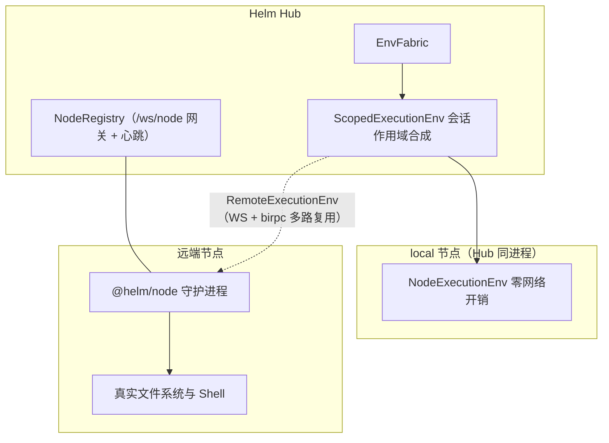
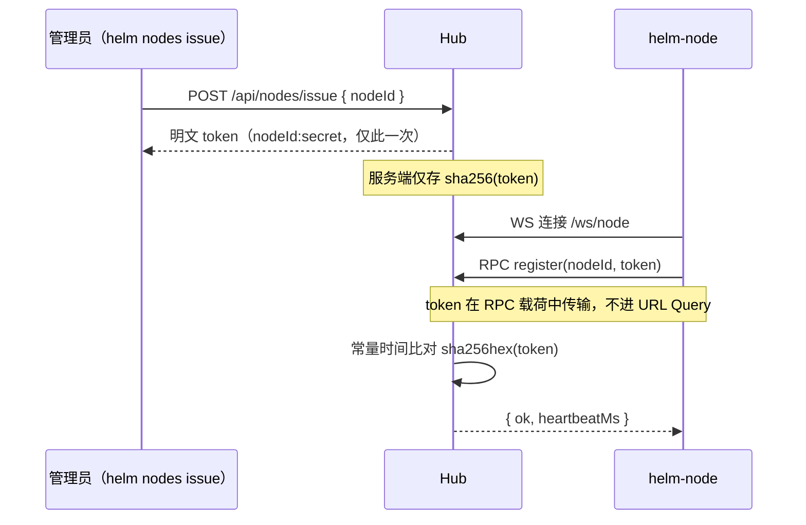
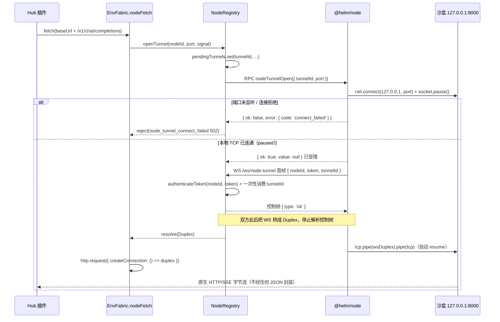
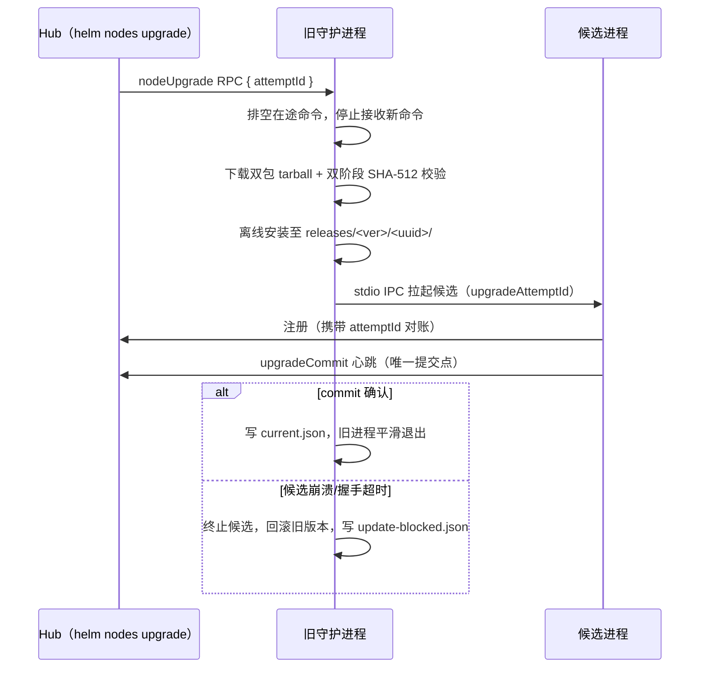

# EnvFabric 跨平台执行底座

EnvFabric 是微内核的跨平台执行基础设施：对上以 pi-durable 的 `ExecutionEnv`（FileSystem + Shell）接口统一呈现，对下抹平本机进程与远端节点的物理差异。内核的 `bash / read / write / edit / gate / env exec` 工具、插件的受管执行、文件互斥、节点任意 TCP 透传隧道（`openTunnel` 原语 + `nodeFetch` HTTP/HTTPS 适配层 + Hub 侧前台端口转发）全部经由 EnvFabric 调度，与任何插件是否启用正交。本文覆盖其架构分层、反向连接与令牌认证、受管 Shell 流控、文件互斥、IPC 桥、节点透传隧道与安全自升级。

## 架构定位与执行环境分层



两条执行路径的分工：`local` 节点直接复用 pi-durable 的 `NodeExecutionEnv`（进程内调用，无 RPC 开销）；远端节点经 `RemoteExecutionEnv` 走 `NodeRegistry` 的 WebSocket + birpc 通道。缓存生命周期有明确边界——**有会话靶点**（`envForTarget` 且带 `conversationId`）按 `(conversationId, nodeId, cwd)` 缓存底座，会话删除或修改 nodeId/cwd 时驱逐（驱逐只移除缓存条目、绝不杀在途命令）；**无会话靶点**（`envFor`，如 herdr 文件交接、gate、无会话 HTTP exec）每次创建全新短生命周期实例，用后即弃，绝不进缓存。未知节点返回 Remote env（操作时等待重连），**绝不静默回落 local**——远端节点离线时操作显式抛 `409 node_offline` 或挂起等待重连（可取消）。

`ScopedExecutionEnv` 负责每条命令的环境变量现场合成（fail-closed）：继承宿主 `process.env` 的真实 `PATH/HOME` 工具链，但受管 `HELM_*` 变量（`HELM_ENV / HELM_HUB_URL / HELM_CONVERSATION_ID / HELM_CWD / HELM_DATA_DIR / HELM_NODE_ID / HELM_TOKEN`，含大小写变体）一律先剥除，再由 `envOptions` 回调注入权威值——`HELM_HUB_URL`、`HELM_CONVERSATION_ID`、受管 `HELM_TOKEN` 与 `SecretStash` 解密后的 `HELM_SECRET_*` 机密。composer 返回的绑定身份键不可被逐调用 `options.env` 同名覆盖（防伪造作用域）；无 `conversationId` 的调用不注入任何机密——没有可信作用域就不注入，而非借用别的会话。机密服务在 fabric 外部，fabric 只消费回调结果，自身不持有机密。`ctx.host.buildSpawnEnv(conversationId, cwd, nodeId)` 把同一合成规则暴露给插件的外部 spawn。

## 零入站 SSH 依赖与反向 WebSocket

传统跨机器编排依赖 SSH 端口开放与公钥分发，配置繁琐且扩大公网暴露面。Helm 采用全反向连接架构：受控节点主动向 Hub 发起出站 WebSocket（`/ws/node`），NAT 内网或防火墙后的机器无需任何入站端口。单连接经 birpc 多路复用双向 RPC；节点通过心跳定期上报健康快照（负载均值、内存余量、磁盘空间），Hub 据此判定在线状态。

### Join Token 签发与认证



认证设计的三条要点：Hub 仅存储令牌的 SHA-256 哈希，明文只在签发响应中返回一次；令牌在 WebSocket 建立后的 RPC 载荷中传输，禁止拼接在 URL 中（防代理与访问日志泄露）；比对使用常量时间算法防时序侧信道。节点离线时系统显式报错或挂起等待重连，绝不自动降级回本机执行——「静默换靶点」在多机场景等于在错误的机器上执行命令。

## 受管 Shell：流式输出、溢出落盘与精准取消

远端执行的长时任务需要流式可观测性与资源保护。`EnvExecInput` 提供四个正交的控制选项：

```typescript
export interface EnvExecInput {
  execId: string
  command: string | readonly string[]
  cwd?: string
  env?: Record<string, string>
  timeout?: number              // 秒
  spill?: { afterBytes: number; afterLines: number }   // 溢出落盘阈值
  window?: {                    // 输出窗口流控
    maxBytes: number
    maxLines: number
    minIntervalMs: number
    bytesPerSecond: number
  }
}
```

- **行级流式推送**：stdout/stderr 按行经 `onEnvExecOutput` 事件实时回传（`EnvExecOutputEvent { execId, text, stream, skipped? }`），`ExecOutputHub` 按 execId 分发到对应 handler，exec 结束后自动注销。
- **溢出落盘（spill）**：输出超过 `afterBytes/afterLines` 阈值后转存磁盘文件，命令结果返回 `spillPath`——长输出不撑爆内存与传输通道，完整内容仍在磁盘可查。
- **窗口流控（window）**：限制单秒最大字节数与行数，被丢弃的帧在 `skipped` 中如实标注字节数与行数（`endsWithNewline` 标记边界），防止前端与 SSE 通道被刷爆。
- **精准取消**：`envAbortExec(execId)` 只终止目标在途进程，不影响同节点的其他执行；取消 propagate 为 `aborted` 错误码。

输出出站前统一过全局脱敏（`SecretStash` 登记的明文自动替换 `[REDACTED]`），跨 chunk 拼接的机密不因分片遗漏脱敏。HTTP 侧的对应入口是 `POST /api/env/exec`：`stream: false` 返回一次性 `EnvExecResponse { ok, exitCode, output, timedOut }`；`stream: true` 返回 NDJSON 帧（`output / exit / error` 三型，必须以终态帧结束）。命令失败时 exitCode 透传为 CLI 退出码，HTTP 200 但命令非零退出仍是显式失败而非成功。

## 文件操作、节点文件互斥与 IPC 桥

`NodeEnvRpcFunctions` 提供完整的文件系统操作集，本机与远端同构：文本/二进制读写与追加、截断、重命名；`envListFiles` 递归发现（带 truncated 标记）；行迭代器与二进制分块 reader（`envOpenTextLineReader / envOpenBinaryReader` + 按句柄 read/close）；目录遍历 reader；临时文件/目录创建；`envCanonicalPath / envExists / envFileInfo` 等探测原语。错误以 `RpcEnvError { code, message, spillPath? }` 结构化返回而非裸抛。

### 节点文件互斥

内核 `write`/`edit` 工具与插件自定义文件读改写在同一 Hub 进程内并发时，「读同一旧内容后各自写回」会丢更新。文件互斥队列以 `文件系统 id + canonical 路径` 为 key 做进程级串行化：

- local 底座 key 前缀恒为 `node:local`，远端为 `remote:<nodeId>`——不同节点同形路径天然不同 key，互不阻塞；
- canonical 经 realpath 解析软链别名（不同写法指向同一文件共享一把锁）；新文件取「最近存在祖先的 canonical + 剩余段」，保证创建 write 与后续 edit 同 key；
- 只锁读-改-写窗口，不锁无关文件、不阻塞纯读；同一异步链（AsyncLocalStorage 传播）对同一 key 嵌套入队立即显式报错 `file_mutation_queue_reentrant`，绝不静默挂死；
- 插件经 `ctx.host.withFileMutationQueue({ nodeId, cwd, path }, fn)` 进入同一队列，与内核 write/edit 共享串行化——同一文件不丢更新。

诚实边界：该互斥**只约束经过本队列的受管操作**。同步 Shell 命令与外部编辑器直接写文件不受它保证；它也不是跨进程/跨 Hub 的分布式锁（当前部署模型一个节点只接一个 Hub）；可信插件仍可直接 `node:fs` 或 bash 绕过。并发场景中不要假设文件互斥能阻止进程外的写入。

### 原生本机 IPC 桥

`ipcCall / ipcSubscribe` 让插件（如 `builtin:herdr`）经节点通道直连目标机器上的 Unix Domain Socket 或 Windows Named Pipe，传输单行 JSON 行协议：

```typescript
// 单次调用（可带 timeoutMs 与取消）
ipcCall({ endpoint?, session?, line, timeoutMs? }): Promise<RpcResult<string>>
// 流式订阅（初始握手行 + 持续 onLine 回调，返回停止函数）
ipcSubscribe({ endpoint?, session?, line }, onLine, onClosed): Promise<() => void>
```

`endpoint` 显式指定 socket/pipe 路径，缺省按 `session` 解析节点本机默认路径；`ipcAbortCall(callId)` 取消在途调用。这一机制彻底消除了「在目标机器上写 Python 桥接脚本 + SSH 端口转发」的传统方案——跨节点统一走 EnvFabric 通道。插件侧的对应宿主端口是 `ctx.host.nodeIpc`（`call / subscribe / isOnline`），节点不支持或离线时显式报错，不静默回退本机。

## 节点透传隧道

远端节点上常驻着推理或业务服务（本机 loopback 或节点可达的任意 TCP 目标）。这类服务往往不对外开端口、所在机器的 IP 还会漂移，Hub 无法按地址直连。**节点透传隧道**复用既有反向连接拓扑，按需建立 Hub 到目标节点视角 `host:port` 的任意 TCP 字节通道：

- **`EnvFabric.openTunnel(nodeId, target)` / `ctx.host.openTunnel(...)` 是一等公民原语**：返回原始 Node.js `Duplex`（任意协议字节流，host 由目标节点解析与连接，省略默认 `127.0.0.1`；`local` 节点为 Hub 进程内 `net.connect` 直连）；
- **`EnvFabric.nodeFetch(nodeId)` / `ctx.host.nodeFetch(nodeId)` 是其上的 HTTP/HTTPS 适配层**：支持任意 host 与 `http`/`https`（HTTPS 在隧道 Duplex 上叠 `tls.connect`，`servername`/证书校验遵循 Node 默认链），保留 Response streaming、SSE、取消传播与状态码语义；
- **Hub 侧前台端口转发**（`helm nodes forward`）在命令运行期于 Hub 主机按需监听，把本地端口逐连接转发到目标节点视角的 `host:port`，退出即关闭。

本次实现仅覆盖核心隧道、节点生命周期与插件宿主端口，不修改 `ProviderConfig`、模型认证、Magpie 配置或 Web 模型表单。下文的 Provider 绑定是后续接入设计，不是现有可用配置。隧道不感知 OpenAI/Anthropic 语义，也不生成或替换 API Key。

### 问题与目标

要解决的核心矛盾是**地址不可依赖，但连接必须真实**：

- 沙盒/容器的 IP 每次重建都变，写死地址必然失效；
- 第三方隧道（`frp` / `chisel` / `ssh -R`）能在 Hub 上开一个固定端口，但要求用户在两台机器上分别下载二进制、写配置、保活进程——对一个要推广的框架，这是显著采用阻力，且 Windows Hub 的首装体验尤其差；
- 沙盒可以直连外网、可以常驻任意进程，但已经被 Helm 的反向连接架构统一管理，不应该再引入第二套账号/令牌/端口体系。

调用方在 Hub 侧使用 `ctx.host.nodeFetch(nodeId)` 访问节点本机服务；节点侧由已有的 `helm-node` 承担传输，不需要安装配套插件。判据如下：

| 目标 | 判据 |
| :--- | :--- |
| 零额外依赖 | 不引入外部二进制、不需要用户配置第二个端口或第二套凭据 |
| 字节保真 | SSE 分片、`chunked` 编码、任意多字节字符边界必须原样通过 |
| 原生背压 | 下游读得慢时背压一路传回沙盒里的推理进程，不在 Hub 内存里堆积 |
| 取消可传播 | 前端「停止生成」或 `AbortSignal` 触发时，沙盒侧立刻断开连接、停止推理 |
| 失败显式 | 节点离线返回 `409 node_offline`，绝不静默回退本机直连 |

### 为什么不是「把 HTTP 请求序列化后走 RPC」

最直觉的做法是给 birpc 加一组 `httpRequest` / `onHttpChunk` 方法：Hub 发头与体，节点转成 `fetch`，响应按 chunk 经 Base64 回推。它能跑通，但把一条本可以透明的字节通道拆成了有状态协议机，代价不可逆：

- **无原生背压**：事件推送是单向的，没有 TCP 滑动窗口，慢消费者只能靠丢弃或阻塞控制面；
- **队头阻塞**：模型 token 流与节点心跳、`env exec` 输出挤在同一条 WebSocket 上；
- **33% 编码损耗**：每个分片 Base64 再封 JSON，两侧反复序列化；
- **协议细节复刻**：状态码、多值响应头、`Content-Length`、半关闭、`101` 之外的升级语义都要自己补齐。

结论是：**要么不碰协议，要么就别做**。隧道只搬运字节，HTTP 语义交给两个端点各自的 Node 运行时。

### 架构与握手时序

隧道是 `/ws/node` 之外的一条独立 WebSocket（`/ws/node-tunnel`），专用于一条 TCP 连接：一条隧道对应一次 HTTP 请求，用完即关。节点始终是发起方，因此 NAT、防火墙、IP 漂移全部无关。



两个关键时序不变量：

1. **本地 TCP 先连通并 `pause()`，再发起隧道 WS**：节点收到 `nodeTunnelOpen({ tunnelId, port })` 时，先在本地对 `127.0.0.1:<port>` 执行 `net.connect` 并立即 `socket.pause()`（由内核 TCP 接收窗口暂存可能到达的首包字节）。若端口未监听（如 `ECONNREFUSED`），RPC 直接同步返回 `{ ok: false, error: { code: 'connect_failed', message } }`——连 `/ws/node-tunnel` 都不必建立，Hub 0ms 拿到精确的 `502 node_tunnel_connect_failed`，省去废 WS 握手与反向错误帧。
2. **握手与数据分离**：认证帧与确认帧在双方创建 `Duplex` 之前完成交换，此后这条 WebSocket 上不再出现任何控制帧，因此不存在「控制帧被当成流数据」或「流数据早于 `Duplex` 创建而丢失」的竞态。时序上必须满足：Hub 先发 `{ type: 'ok' }` 再创建 `Duplex`，节点收到 `{ type: 'ok' }` 后才创建 `Duplex` 并开始 `pipe`（`pipe` 自动触发 `tcp.resume()`）。

数据通路是 `ws` 库内置的 `createWebSocketStream(ws)` 得到的标准 `Duplex`：节点侧 `tcp.pipe(duplex).pipe(tcp)`，Hub 侧该 `Duplex` 直接作为 socket 交给 `node:http`。二进制帧、背压、`FIN` 全部由库与内核处理，Helm 不写一行编解码。

### 协议契约

新增集中在 `@helm/protocol` 的 `env-rpc.ts`，与既有 `ipcCall / ipcSubscribe` 同构：

```typescript
/** 隧道目标（host+port）：host 由节点解析与连接（省略默认 127.0.0.1）。 */
export interface NodeTunnelTarget {
  host?: string
  port: number
}

/** 隧道打开请求：任意 TCP 目标（host 缺省为本机回环）。 */
export interface NodeTunnelOpenInput extends NodeTunnelTarget {
  tunnelId: string
  port: number
  /** 建连预算，超时后 Hub 侧回收 pending 并拒绝本次请求。 */
  timeoutMs?: number
}

/** 隧道 WS 首帧（文本 JSON，限长 4096 字节）；Hub 侧校验后一次性消费 tunnelId。 */
export interface NodeTunnelHello {
  nodeId: string
  token: string
  tunnelId: string
}

/** 隧道 WS 控制帧（仅存在于首帧交换阶段）。 */
export type NodeTunnelControl =
  | { type: 'ok' }
  | { type: 'error'; code: NodeTunnelErrorCode; message: string }

export type NodeTunnelErrorCode =
  | 'invalid_hello'      // 首帧结构非法或超长
  | 'unauthorized'       // token 不匹配
  | 'tunnel_unknown'     // tunnelId 不存在、已消费或已超时
  | 'tunnel_mismatch'    // tunnelId 属于别的 nodeId 或旧连接代
  | 'port_rejected'      // port 越界
  | 'connect_failed'     // 节点侧 net.connect 失败
```

`NodeEnvRpcFunctions` 增加一个可选方法（可选保证与既有可选 RPC 一致，旧节点返回 `501 node_tunnel_not_supported` 而非崩溃）：

```typescript
/** 请求节点向目标 host:port 打开一条透传隧道（数据经 /ws/node-tunnel）。 */
nodeTunnelOpen?(input: NodeTunnelOpenInput): Promise<RpcResult<null>>
```

`nodeTunnelOpen` 返回 `{ ok: true, value: null }` 表示「节点本地 TCP 已连通并开始回连 `/ws/node-tunnel`」，**不代表隧道端到端就绪**——就绪由 Hub 侧 `pendingTunnels` 在收到 `/ws/node-tunnel` 首帧认证通过后 resolve `Duplex` 决定。

### Hub 侧实现

四处接线，全部复用既有机制，不新增监听端口：

1. **`NodeRegistry`**：
   - 新增 `#pendingTunnels: Map<string, PendingTunnel>`（按 `tunnelId`，含 `nodeId / epoch / port / resolve / reject / timer`）与 `#activeTunnels: Map<string, Set<Duplex>>`（按 `nodeId` 追踪已建立的在途隧道流）；
   - `#evict(nodeId, conn)` 与 `revoke(nodeId)` 时，一并拒绝该节点全部 pending 隧道，并 `destroy()` 该节点全部在途 `activeTunnels`，确保节点断连或令牌吊销后在途隧道立即切断；
   - 新增公开方法 `authenticateToken(nodeId, token)` 委托内部 `#authenticate`（隧道网关与控制网关共享同一常量时间令牌比对逻辑）；`close()` 时清空全部 pending 与 active 隧道。
2. **隧道网关**（`packages/kernel/src/env/ws-tunnel-gateway.ts`，与 `ws-gateway.ts` 平行的 `attachNodeTunnelGateway(server, { registry, path = '/ws/node-tunnel' })`）：
   - 握手阶段限制首帧大小（> 4096 字节直接 `1009` 关闭，防未认证连接打爆内存）；
   - 首帧用一次性的 `ws.once('message', handler)` 读取并立即消费 `tunnelId`（无论成功或失败均单次删除，防重放）；
   - 校验通过且 `NodeRegistry` 中该 `nodeId` 的连接代（`epoch`）未变更后，先发送 `{ type: 'ok' }`，再调用 `createWebSocketStream(ws)` 登记入 `#activeTunnels` 并 resolve 给调用方。
3. **`EnvFabric.nodeFetch(nodeId)`**：
   返回一个符合 Web Standard 的 `typeof fetch`。`local` 节点直接返回 `globalThis.fetch`；远端节点先 `const duplex = await registry.openTunnel(nodeId, port, signal)` 拿到就绪的 `Duplex`，再把 `host / port / path / method / headers / body` 交给 `node:http`：
   ```typescript
   const duplex = await registry.openTunnel(nodeId, port, init?.signal ?? undefined)
   const reqHeaders = normalizeOutgoingHeaders(init?.headers)
   // 强制禁用传输压缩：node:http 不自动解压 gzip/br，loopback 走 identity 保证
   // Readable.toWeb(res) 交还给调用方（如 pi-ai SSE 解析器）的是原始明文字节流。
   reqHeaders['accept-encoding'] = 'identity'

   const req = http.request({
     host: url.hostname,
     port: url.port === '' ? 80 : Number(url.port),
     path: `${url.pathname}${url.search}`,
     method: init?.method ?? 'GET',
     headers: reqHeaders,
     agent: null,                            // 配合 createConnection 绕过 Agent；裸 Duplex 不具备 net.Socket 方法
     createConnection: () => duplex,          // 唯一的「透传」桥接点
     signal: init?.signal ?? undefined,
   }, (res) => {
     const headers = new Headers()
     for (const [k, v] of Object.entries(res.headers)) {
       if (Array.isArray(v)) { for (const item of v) headers.append(k, item) }
       else if (typeof v === 'string') headers.set(k, v)
     }
     resolve(new Response(Readable.toWeb(res) as ReadableStream<Uint8Array>, {
       status: res.statusCode ?? 502,
       statusText: res.statusMessage ?? '',
       headers,
     }))
   })
   ```
   两处细节必须显式处理：
   - **不挂载 Agent**：`agent: false` 会新建一个 Agent，仍可能走 Agent 的 socket 安装逻辑（如 `setNoDelay`）；使用 `agent: null` 并提供 `createConnection`，Node 24 会绕过 Agent，直接把 `createConnection` 返回的裸 `Duplex` 交给 `ClientRequest`，无需伪造 `net.Socket` 垫片；
   - **4xx/5xx 不是传输失败**：上游返回 `400 / 401 / 429 / 500` 说明隧道链路完全正常。`nodeFetch` 必须原样构造该 `Response`（含真实 JSON 错误体），让 SDK 的 `retryProviderRequest` 与 `normalizeProviderError` 按既有策略处理。只有建隧道失败、socket 异常中断、超时才抛错。
4. **`ctx.host.nodeFetch(nodeId)`（插件同权复用）**：
   `HelmHostApi` 同步暴露 `openTunnel(nodeId, target)`（原始 Duplex；活动隧道计入在途任务跟踪——`close/error/destroy` 结束计数，插件停用预检可见）与 `nodeFetch(nodeId): typeof fetch`（HTTP/HTTPS 适配层；流生命周期受在途追踪保护）。任何安装在 Hub 上的插件（如 `builtin:magpie`、微应用或自定义业务插件）无需在节点端额外部署代码：`ctx.host.nodeFetch(nodeId)('http://127.0.0.1:8188/...')` 访问目标节点视角的 HTTP(S) 服务，`ctx.host.openTunnel(nodeId, { host, port })` 获得任意 TCP 双工流。

### 节点侧实现

节点侧职责切分遵循既有 `daemon/index.ts`（持有 `hubUrl`、`identity` 与连接代）与 `daemon/env-rpc-server.ts`（纯本地执行与资源生命周期）的分层：

1. **`NodeEnvRpcServerOptions` 注入 `openTunnelStream?: (tunnelId: string) => Promise<Duplex>`**：
   `daemon/index.ts` 实现该回调——将 `hubUrl` 的路径替换为 `/ws/node-tunnel`，发起 WebSocket 连接并发送 `NodeTunnelHello { nodeId, token, tunnelId }`，等待首帧 `{ type: 'ok' }` 后返回 `createWebSocketStream(ws)`。
2. **入参边界校验与目标连接**：
   `env-rpc-server.ts` 实现 `nodeTunnelOpen`：校验 `tunnelId` 为 `1..128` 字符非空字符串，`port` 为 `1..65535` 的安全整数，`host` 缺省 `127.0.0.1` 且必须为非空/≤255 字符/无控制字符与空白的字符串（拒绝未知字段；绝不静默改写目标）。`net.connect({ host, port })` 使用入参目标——目标主机由节点解析与连接（这是「任意 TCP」的语义来源），Hub 不代解也不限制为回环。信任边界随之明确：**该节点被授权访问的目标（含其可达的内网服务与云元数据端点）都可经隧道触达**，节点准入与令牌管理即该能力的准入控制。
3. **排空联动与世代销毁**：
   `setDraining(true)`（自升级排空、候选待激活）期间拒绝新的 `nodeTunnelOpen`，返回 `{ ok: false, error: { code: 'aborted', message: '...' } }`，与 `envExec` 的排空行为一致。在途隧道记入 `activeTunnels`，新增 `getActiveTunnelCount()` 并入升级排空判据（`getActiveExecCount() === 0 && getActiveTunnelCount() === 0`），防止长耗时流式回答被节点自升级生硬切断；连接代 `dispose()` 时一并销毁全部在途隧道的 WS 流与本地 TCP socket。

### 安全边界

| 面向 | 边界 |
| :--- | :--- |
| 目标范围 | 只能连目标节点**自身**的 `127.0.0.1:<port>`。节点侧主机名是常量，端口无法携带 `host`，无法被用来横向访问同网段其他机器或云元数据服务 |
| 认证 | 首帧携带既有 `nodeId + token`，Hub 复用 `NodeRegistry.authenticateToken`（常量时间比对）。`tunnelId` 不承担鉴权职责，只做请求配对 |
| `tunnelId` 生命周期 | 由 Hub 生成（UUIDv4，122 位随机），**一次性消费**：无论是认证成功、失败还是超时，取出即删除，不可重放 |
| token 位置 | 在 WebSocket 建立后的首帧载荷中传输，**不进 URL Query**，与 `/ws/node` 同一条纪律（防代理与访问日志泄露） |
| 首帧限长 | 握手阶段限制首帧载荷不超过 4096 字节，超限立即关闭连接，防止未认证客户端发送超大帧耗尽 Hub 内存 |
| 端口暴露 | Hub 不新增任何监听端口：隧道挂在既有 HTTP server 的 `upgrade` 事件上，与 `/ws/node` 共用同一端口与 TLS 配置 |
| 明文范围 | 隧道两端之间的载荷由 WebSocket 承载（`wss://` 时即为 TLS）；节点到目标服务段是节点视角的明文 TCP，与「在节点上直连该服务」的安全等级相同，不额外夸大承诺 |

### Hub 侧前台端口转发（helm nodes forward）

CLI 一等公民映射（API/CLI 同权）：

```bash
helm nodes forward <nodeId> <listenHost:listenPort> [<targetHost>:]<targetPort>
# 例：helm nodes forward gpu-a 127.0.0.1:8080 127.0.0.1:8000
#   监听目标省略 host 时默认 127.0.0.1（节点视角）；IPv6 监听写 [::1]:8080。
```

生命周期与语义：
- **监听器只在命令运行期间存在**：Hub 侧按需 `net.Server` 监听 `listenHost:listenPort`（显式端口，不随机分配），不新增任何永久 Hub 监听端口；
- **逐连接开隧道**：每个入站连接经 `EnvFabric.openTunnel(nodeId, { host, port })` 建立任意 TCP 隧道并双向 pipe（背压原生传播）；
- **前台退出即关闭**：CLI 前台运行并消费 NDJSON 事件流（started/connection/error）；Ctrl-C/SIGTERM 或流断开时显式 `DELETE` 停止，Hub 关闭监听器与全部隧道；宿主 close 时统一销毁；
- **HTTP 同权端点**：`POST /api/nodes/:id/forward`（创建，body：`listenHost/listenPort/targetHost?/targetPort`）、`GET /api/nodes/forward`（清单）、`GET /api/nodes/forward/:id`（详情）、`GET /api/nodes/forward/:id/events`（NDJSON 事件流）、`DELETE /api/nodes/forward/:id`（停止）；
- **严格校验**：监听/目标 host 非空/≤255 字符/无控制字符与空白，端口 1..65535；监听冲突（EADDRINUSE）显式 `409 node_forward_listen_failed`，不静默换端口。

### 后续接入：Provider 配置契约（本次不实现）

以下保留原草稿中的目标契约，当前 `ProviderConfig` 尚不支持 `nodeId`，不能据此直接配置或调用。未来接入时拟增加可选字段 `nodeId?: string`，保持其余字段形态不变：

```json
{
  "id": "openclaw",
  "label": "OpenClaw Sandbox",
  "protocol": "openai",
  "nodeId": "openclaw-sbx",
  "baseUrl": "http://127.0.0.1:8000/v1",
  "models": ["deepseek-v3", "qwen-2.5-coder"],
  "enabled": true
}
```

语义与边界约定：

- **`nodeId` 省略或为 `'local'`**：保持现有行为，`baseUrl` 是什么就连什么；
- **`nodeId` 为远端节点**：`baseUrl` 表达的是**该节点视角**的地址，因此必须为 `http://` 协议、指向 loopback（`127.0.0.1` / `localhost` / `[::1]`）且带显式端口（`1..65535`）。该约束在 `validateProviderConfig` **配置保存边界**即刻校验，非法返回 `400 validation_error`，不等到发消息时才失败；
- **请求流注入**：`runtime/models.ts` 在 `buildCompatProvider` 构造 provider 时，对带远端 `nodeId` 的配置包装 `stream / streamSimple`，当调用方未显式传入 `options.fetch` 时注入 `envFabric.nodeFetch(nodeId)`；
- **凭据照常配置**：远端 loopback 服务的 API Key 仍由现有 `credentials.json` / 凭据 API 管理；隧道只改变请求的传输路径，不改变 pi-ai 认证流程、不生成占位密钥，也不把密钥写入 `providers.json`。调用者必须为需要鉴权的 Provider 配置真实凭据；服务端不校验密钥时，也不由隧道层伪造认证值；
- **离线即不可用与实时目录联动**：远端节点的 `auth.apiKey.check()` 同时判断 `envFabric.isOnline(nodeId)`——节点离线时 `check()` 返回 `undefined`，模型目录如实展示 `available: false`；`auth.apiKey.resolve()` 在节点离线时直接抛出 `409 node_offline`，绝不回退 `local`。当 `NodeRegistry.onNodeChanged` 触发节点上下线时，若存在绑定该 `nodeId` 的 Provider，内核同步发布 `models.changed` SSE 事件，前端模型选择器实时亮起或置灰。

### 错误码

| 场景 | 错误码 | HTTP |
| :--- | :--- | :--- |
| 节点未连接 | `node_offline` | 409 |
| 节点守护进程版本不支持隧道 | `node_tunnel_not_supported` | 501 |
| 建隧道超时（默认 10s） | `node_tunnel_timeout` | 504 |
| 节点侧 `net.connect` 失败（端口未监听） | `node_tunnel_connect_failed` | 502 |
| 节点已断连导致在途流中断 | `node_tunnel_closed` | 502 |
| `nodeId` 与 loopback `baseUrl` 约束不符 | `validation_error` | 400 |

### 诚实边界与测试分层

- **单请求生命周期**：隧道只在**一次 HTTP 请求**的生命周期内存在；当前不做连接池复用，每次调用有一次 WebSocket 握手开销（约 1–2 RTT），池化位置留在 `nodeFetch` 内部，不改变对外契约。
- **分层定位**：`openTunnel` 是任意 TCP 原语（字节流，不感知协议）；`nodeFetch` 是其上的 HTTP/HTTPS 适配层（`http` 经 `createConnection` 直用隧道流，`https` 在隧道流上叠 `tls.connect`——`servername` 驱动 SNI、证书校验遵循 Node 默认信任链，绝不把裸 Duplex 伪装成 TLS）。隧道不校验应用层内容，也不经 `SecretStash` 脱敏；调用方负责管理业务凭据与输出展示，传输层不对载荷做文本替换。
- **测试分层**：按仓库分层纪律，隧道涉及 `kernel` + `node`，全部归入 `integration` 套件，覆盖任意 TCP 二进制大 payload 双向保真、host 透传、连接关闭链路完整 flush、daemon 断连 duplex 销毁、`AbortSignal` 取消清理、真实 HTTPS（本地 TLS fixture + 子进程注入测试 CA）、上游 `400` JSON 错误体透传、`tunnelId` 重放拒绝、非法端口/host 拦截、draining 期间拒绝新隧道，以及 Hub 侧端口转发（`helm nodes forward`）的创建/事件/停止生命周期。模型目录可用性与 Magpie 目标绑定的测试留待后续接入实现。

## 安全原子自升级

分布式节点的人工维护成本随机器数线性增长，`@helm/node` 内置双包协同自升级引擎，全程具备强原子性与失败自动回滚能力。



四个关键设计：

1. **双包同版本绑定**：一次升级同时固定 `@helm/node` 与 `@helm/cli` 的精确版本（节点上的 `helm` 客户端与守护进程必须同代）。对两个包的 registry 元数据 `dist.integrity`（SHA-512）与下载后的 tarball 哈希做双阶段校验，再以本地 tgz 离线安装到同一 staging 目录——安装过程不依赖网络可用性。
2. **不可变候选目录**：staging 原子改名为 `releases/<ver>/<uuid>/`，永不复用、永不删除（含正在运行的同版本目录）；版本根 `.complete` 标记指向完整候选。正在执行的旧版本文件永不被覆写。
3. **金丝雀握手与唯一提交点**：候选进程以 `upgradeAttemptId` 启动并向 Hub 注册对账；仅「候选收到 activate 并向 Hub 提交 `upgradeCommit` 心跳成功」才是提交点——`prepareReplacement` 返回的「已注册未激活」状态不算提交。`commit()` 写 pid、发 activate 并等新 daemon 回报；本地 ACK 超时但 Hub 可能已收到 commit 时（`UpgradeCommitUnconfirmedError`）保持新 current 并让旧宿主退出，绝不反向回滚一个已在 Hub 侧成功的升级。
4. **失败隔离与回滚**：候选崩溃、握手超时或 activate 校验失败（previousVersion/targetVersion 与升级上下文不一致即拒提交）时，立即终止候选、恢复原版本执行，并把失败版本写入 `<dataDir>/update-blocked.json`——排查完成前该版本的重试请求被自动阻断。`--force` 可越过金丝雀隔离与冷却期强制升级，防降级/同版本限制同样可被显式覆盖。

升级检查（`helm nodes upgrade <id> --check`）只读查询远端可用版本与被隔离版本；执行升级时客户端禁用默认 30 秒超时（升级含排空与进程替换）。节点侧的本地入口 `helm-node upgrade` 走同一引擎，经 stdio IPC 拉起候选进程完成交接。
