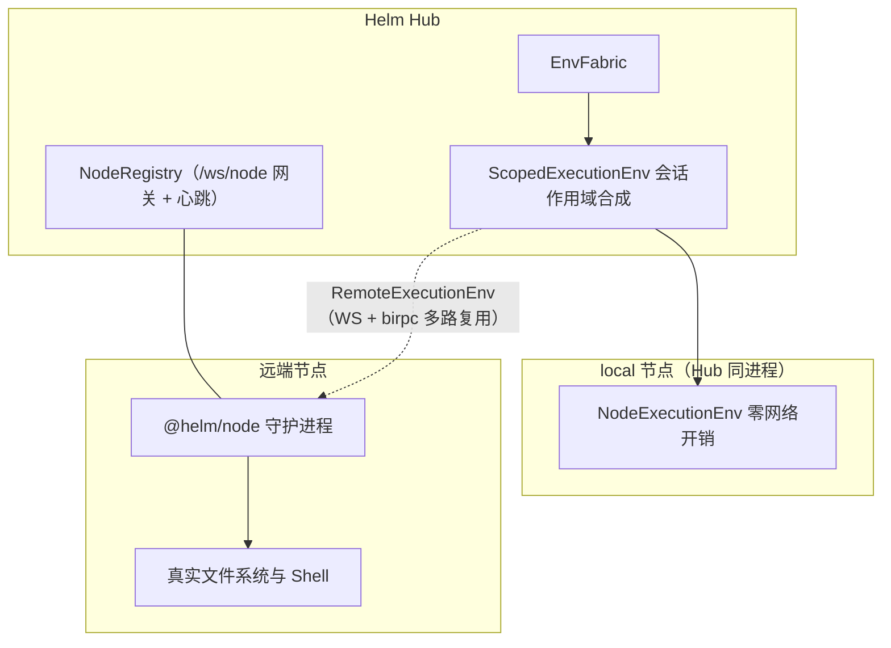
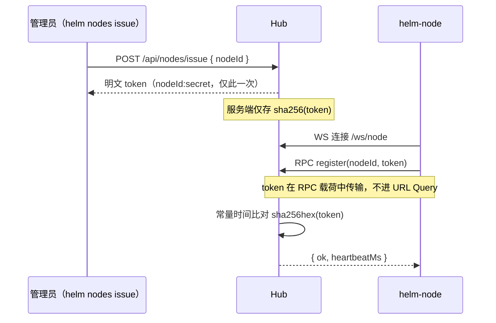
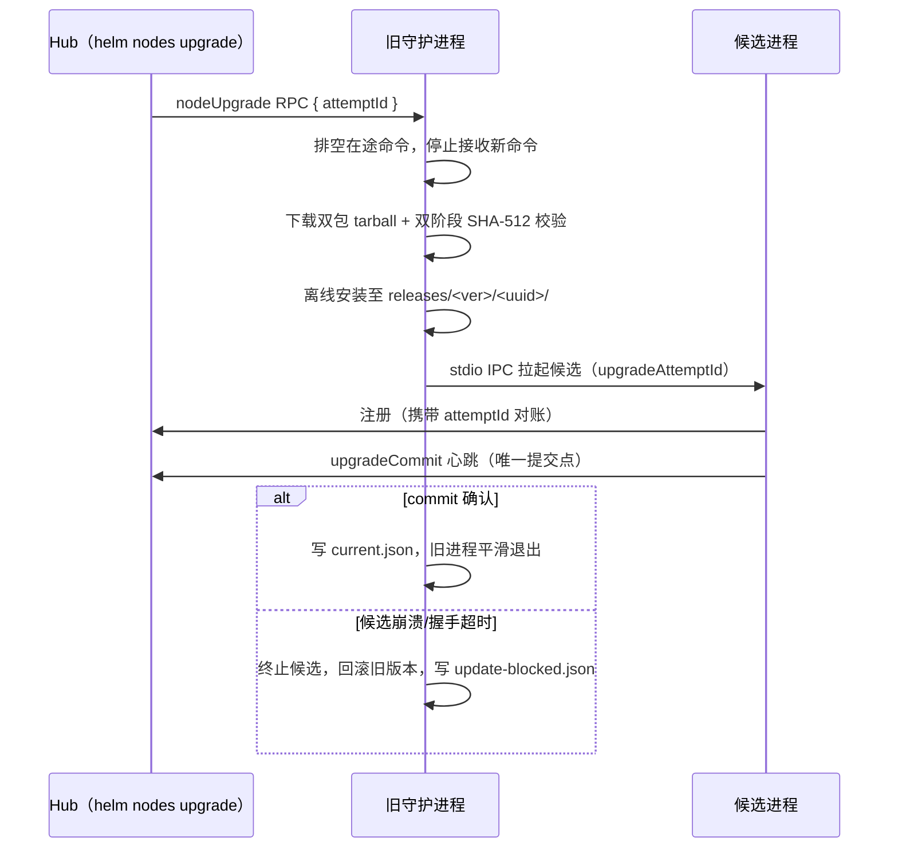

# EnvFabric 跨平台执行底座

EnvFabric 是微内核的跨平台执行基础设施：对上以 pi-durable 的 `ExecutionEnv`（FileSystem + Shell）接口统一呈现，对下抹平本机进程与远端节点的物理差异。内核的 `bash / read / write / edit / gate / env exec` 工具、插件的受管执行与文件互斥全部经由 EnvFabric 调度，与任何插件是否启用正交。本文覆盖其架构分层、反向连接与令牌认证、受管 Shell 流控、文件互斥、IPC 桥与安全自升级。

## 架构定位与执行环境分层



两条执行路径的分工：`local` 节点直接复用 pi-durable 的 `NodeExecutionEnv`（进程内调用，无 RPC 开销）；远端节点经 `RemoteExecutionEnv` 走 `NodeRegistry` 的 WebSocket + birpc 通道。缓存生命周期有明确边界——**有会话靶点**（`envForTarget` 且带 `conversationId`）按 `(conversationId, nodeId, cwd)` 缓存底座，会话删除或修改 nodeId/cwd 时驱逐（驱逐只移除缓存条目、绝不杀在途命令）；**无会话靶点**（`envFor`，如 herdr 文件交接、gate、无会话 HTTP exec）每次创建全新短生命周期实例，用后即弃，绝不进缓存。未知节点返回 Remote env（操作时等待重连），**绝不静默回落 local**——远端节点离线时操作显式抛 `409 node_offline` 或挂起等待重连（可取消）。

`ScopedExecutionEnv` 负责每条命令的环境变量现场合成（fail-closed）：继承宿主 `process.env` 的真实 `PATH/HOME` 工具链，但受管 `HELM_*` 变量（`HELM_ENV / HELM_HUB_URL / HELM_CONVERSATION_ID / HELM_CWD / HELM_DATA_DIR / HELM_NODE_ID / HELM_TOKEN`，含大小写变体）一律先剥除，再由 `envOptions` 回调注入权威值——`HELM_HUB_URL`、`HELM_CONVERSATION_ID`、受管 `HELM_TOKEN` 与 `SecretStash` 解密后的 `HELM_SECRET_*` 机密。composer 返回的绑定身份键不可被逐调用 `options.env` 同名覆盖（防伪造作用域）；无 `conversationId` 的调用不注入任何机密——没有可信作用域就不注入，而非借用别的会话。机密服务在 fabric 外部，fabric 只消费回调结果，自身不持有机密。`ctx.host.buildSpawnEnv(conversationId, cwd, nodeId)` 把同一合成规则暴露给插件的外部 spawn。

## 零入站 SSH 依赖与反向 WebSocket

传统跨机器编排依赖 SSH 端口开放与公钥分发，配置繁琐且扩大公网暴露面。Helm 采用全反向连接架构：受控节点主动向 Hub 发起出站 WebSocket（`/ws/node`），NAT 内网或防火墙后的机器无需任何入站端口。单连接经 birpc 多路复用双向 RPC；节点通过心跳定期上报健康快照（负载均值、内存余量、磁盘空间），Hub 据此判定在线状态。

### Join Token 签发与认证



认证设计的三条要点：Hub 仅存储令牌的 SHA-256 哈希，明文只在签发响应中返回一次；令牌在 WebSocket 建立后的 RPC 载荷中传输，禁止拼接在 URL 中（防代理与访问日志泄露）；比对使用常量时间算法防时序侧信道。节点离线时系统显式报错或挂起等待重连，绝不自动降级回本机执行——「静默换靶点」在多机场景等于在错误的机器上执行命令。

## 受管 Shell：流式输出、溢出落盘与精准取消

远端执行的长时任务需要流式可观测性与资源保护。`EnvExecInput` 提供四个正交的控制选项：

```typescript
export interface EnvExecInput {
  execId: string
  command: string | readonly string[]
  cwd?: string
  env?: Record<string, string>
  timeout?: number              // 秒
  spill?: { afterBytes: number; afterLines: number }   // 溢出落盘阈值
  window?: {                    // 输出窗口流控
    maxBytes: number
    maxLines: number
    minIntervalMs: number
    bytesPerSecond: number
  }
}
```

- **行级流式推送**：stdout/stderr 按行经 `onEnvExecOutput` 事件实时回传（`EnvExecOutputEvent { execId, text, stream, skipped? }`），`ExecOutputHub` 按 execId 分发到对应 handler，exec 结束后自动注销。
- **溢出落盘（spill）**：输出超过 `afterBytes/afterLines` 阈值后转存磁盘文件，命令结果返回 `spillPath`——长输出不撑爆内存与传输通道，完整内容仍在磁盘可查。
- **窗口流控（window）**：限制单秒最大字节数与行数，被丢弃的帧在 `skipped` 中如实标注字节数与行数（`endsWithNewline` 标记边界），防止前端与 SSE 通道被刷爆。
- **精准取消**：`envAbortExec(execId)` 只终止目标在途进程，不影响同节点的其他执行；取消 propagate 为 `aborted` 错误码。

输出出站前统一过全局脱敏（`SecretStash` 登记的明文自动替换 `[REDACTED]`），跨 chunk 拼接的机密不因分片遗漏脱敏。HTTP 侧的对应入口是 `POST /api/env/exec`：`stream: false` 返回一次性 `EnvExecResponse { ok, exitCode, output, timedOut }`；`stream: true` 返回 NDJSON 帧（`output / exit / error` 三型，必须以终态帧结束）。命令失败时 exitCode 透传为 CLI 退出码，HTTP 200 但命令非零退出仍是显式失败而非成功。

## 文件操作、节点文件互斥与 IPC 桥

`NodeEnvRpcFunctions` 提供完整的文件系统操作集，本机与远端同构：文本/二进制读写与追加、截断、重命名；`envListFiles` 递归发现（带 truncated 标记）；行迭代器与二进制分块 reader（`envOpenTextLineReader / envOpenBinaryReader` + 按句柄 read/close）；目录遍历 reader；临时文件/目录创建；`envCanonicalPath / envExists / envFileInfo` 等探测原语。错误以 `RpcEnvError { code, message, spillPath? }` 结构化返回而非裸抛。

### 节点文件互斥

内核 `write`/`edit` 工具与插件自定义文件读改写在同一 Hub 进程内并发时，「读同一旧内容后各自写回」会丢更新。文件互斥队列以 `文件系统 id + canonical 路径` 为 key 做进程级串行化：

- local 底座 key 前缀恒为 `node:local`，远端为 `remote:<nodeId>`——不同节点同形路径天然不同 key，互不阻塞；
- canonical 经 realpath 解析软链别名（不同写法指向同一文件共享一把锁）；新文件取「最近存在祖先的 canonical + 剩余段」，保证创建 write 与后续 edit 同 key；
- 只锁读-改-写窗口，不锁无关文件、不阻塞纯读；同一异步链（AsyncLocalStorage 传播）对同一 key 嵌套入队立即显式报错 `file_mutation_queue_reentrant`，绝不静默挂死；
- 插件经 `ctx.host.withFileMutationQueue({ nodeId, cwd, path }, fn)` 进入同一队列，与内核 write/edit 共享串行化——同一文件不丢更新。

诚实边界：该互斥**只约束经过本队列的受管操作**。同步 Shell 命令与外部编辑器直接写文件不受它保证；它也不是跨进程/跨 Hub 的分布式锁（当前部署模型一个节点只接一个 Hub）；可信插件仍可直接 `node:fs` 或 bash 绕过。并发场景中不要假设文件互斥能阻止进程外的写入。

### 原生本机 IPC 桥

`ipcCall / ipcSubscribe` 让插件（如 `builtin:herdr`）经节点通道直连目标机器上的 Unix Domain Socket 或 Windows Named Pipe，传输单行 JSON 行协议：

```typescript
// 单次调用（可带 timeoutMs 与取消）
ipcCall({ endpoint?, session?, line, timeoutMs? }): Promise<RpcResult<string>>
// 流式订阅（初始握手行 + 持续 onLine 回调，返回停止函数）
ipcSubscribe({ endpoint?, session?, line }, onLine, onClosed): Promise<() => void>
```

`endpoint` 显式指定 socket/pipe 路径，缺省按 `session` 解析节点本机默认路径；`ipcAbortCall(callId)` 取消在途调用。这一机制彻底消除了「在目标机器上写 Python 桥接脚本 + SSH 端口转发」的传统方案——跨节点统一走 EnvFabric 通道。插件侧的对应宿主端口是 `ctx.host.nodeIpc`（`call / subscribe / isOnline`），节点不支持或离线时显式报错，不静默回退本机。

## 安全原子自升级

分布式节点的人工维护成本随机器数线性增长，`@helm/node` 内置双包协同自升级引擎，全程具备强原子性与失败自动回滚能力。



四个关键设计：

1. **双包同版本绑定**：一次升级同时固定 `@helm/node` 与 `@helm/cli` 的精确版本（节点上的 `helm` 客户端与守护进程必须同代）。对两个包的 registry 元数据 `dist.integrity`（SHA-512）与下载后的 tarball 哈希做双阶段校验，再以本地 tgz 离线安装到同一 staging 目录——安装过程不依赖网络可用性。
2. **不可变候选目录**：staging 原子改名为 `releases/<ver>/<uuid>/`，永不复用、永不删除（含正在运行的同版本目录）；版本根 `.complete` 标记指向完整候选。正在执行的旧版本文件永不被覆写。
3. **金丝雀握手与唯一提交点**：候选进程以 `upgradeAttemptId` 启动并向 Hub 注册对账；仅「候选收到 activate 并向 Hub 提交 `upgradeCommit` 心跳成功」才是提交点——`prepareReplacement` 返回的「已注册未激活」状态不算提交。`commit()` 写 pid、发 activate 并等新 daemon 回报；本地 ACK 超时但 Hub 可能已收到 commit 时（`UpgradeCommitUnconfirmedError`）保持新 current 并让旧宿主退出，绝不反向回滚一个已在 Hub 侧成功的升级。
4. **失败隔离与回滚**：候选崩溃、握手超时或 activate 校验失败（previousVersion/targetVersion 与升级上下文不一致即拒提交）时，立即终止候选、恢复原版本执行，并把失败版本写入 `<dataDir>/update-blocked.json`——排查完成前该版本的重试请求被自动阻断。`--force` 可越过金丝雀隔离与冷却期强制升级，防降级/同版本限制同样可被显式覆盖。

升级检查（`helm nodes upgrade <id> --check`）只读查询远端可用版本与被隔离版本；执行升级时客户端禁用默认 30 秒超时（升级含排空与进程替换）。节点侧的本地入口 `helm-node upgrade` 走同一引擎，经 stdio IPC 拉起候选进程完成交接。
