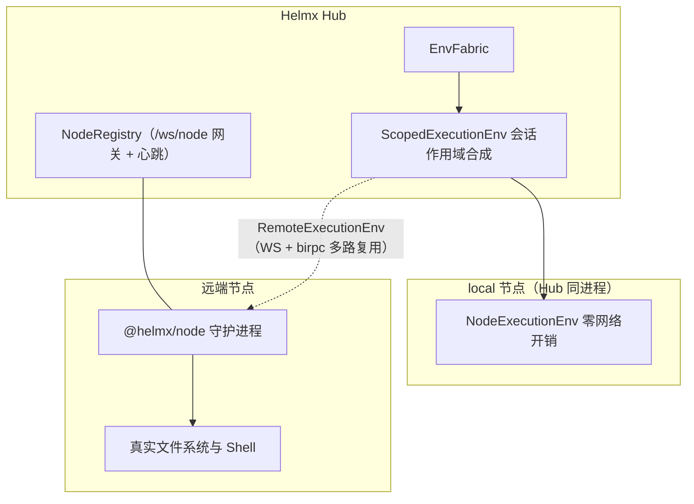
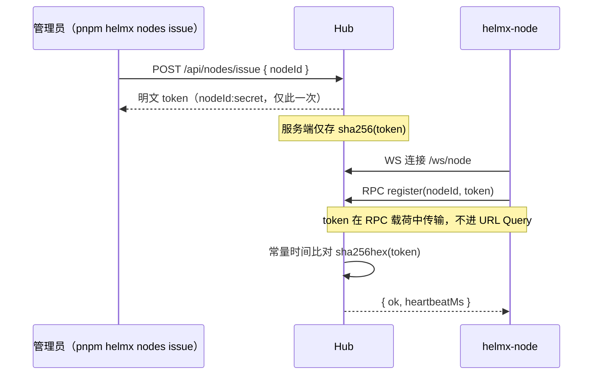
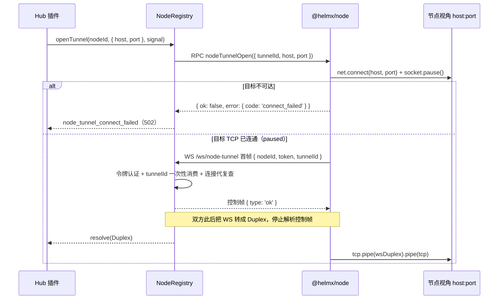
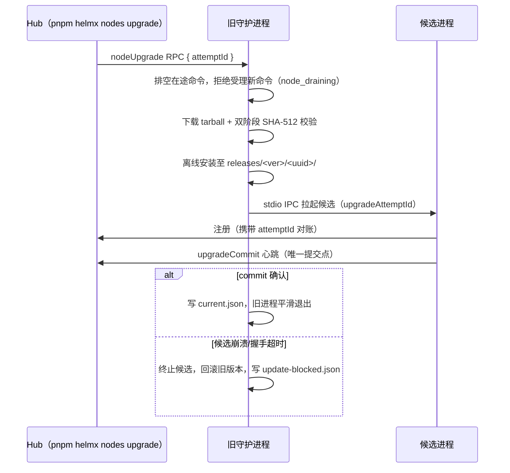

# EnvFabric 跨平台执行底座

本文面向需要理解或调试跨节点执行的读者：插件开发者（经 `ctx.host.execEnv / runGate / nodeIpc / nodeFetch / openTunnel` 使用底座）、节点运维者（部署 `helmx-node`、管理令牌与升级）、以及排查「命令到底在哪台机器上执行」的工程师。EnvFabric 负责会话绑定节点上的命令、文件、产物登记、验收门禁、插件受管执行、文件互斥、本机 IPC 桥与节点透传隧道；Hub 产物读取和插件动作调用保留在 Hub 内，不会伪装成节点执行。会话如何绑定 `(nodeId, cwd)` 见 [pi-durable 集成](pi-durable.md)；工作流如何消费这些端口见 [DSL 手册](../workflows/dsl-guide.md)。

## 架构定位与执行环境分层

EnvFabric 对上以 pi-durable 的 `ExecutionEnv`（FileSystem + Shell）接口统一呈现，对下抹平本机进程与远端节点的物理差异：



两条执行路径的分工：`local` 节点（`DEFAULT_NODE_ID = 'local'`）直接复用 pi-durable 的 `NodeExecutionEnv`（进程内调用，无 RPC 开销）；远端节点经 `RemoteExecutionEnv` 走 `NodeRegistry` 的 WebSocket + birpc 通道。

缓存生命周期有明确边界——**有会话靶点**（带 `conversationId` 的 `envForTarget`）按 `(conversationId, nodeId, cwd)` 缓存底座，会话删除或修改 nodeId/cwd 时驱逐（驱逐只移除缓存条目、绝不杀在途命令，在途操作仍持有旧实例引用并自然完成）；**无会话靶点**（herdr 文件交接、gate、无会话 HTTP exec）每次创建全新短生命周期实例，用后即弃，绝不进缓存。未知节点返回 Remote env（操作时等待重连），**绝不静默回落 local**——远端节点离线时操作显式抛 `409 node_offline` 或挂起等待重连（可取消）。

`ScopedExecutionEnv` 负责每条命令的环境变量现场合成（fail-closed）：继承宿主 `process.env` 的真实 `PATH/HOME` 工具链，但受管 `HELMX_*` 变量（含 `HELMX_HUB_URL / HELMX_CONVERSATION_ID / HELMX_CWD / HELMX_DATA_DIR / HELMX_NODE_ID / HELMX_TOKEN / HELMX_EXECUTION_SCOPE` 等及大小写变体）一律先剥除，再由 `envOptions` 回调注入权威值。机密服务在 fabric 外部，fabric 只消费回调结果，自身不持有机密。`ctx.host.buildSpawnEnv(conversationId, cwd, nodeId, options?)` 把同一受管合成规则暴露给插件的外部 spawn，但外部窗格采用最小授权：缺省不携带任何父会话 stash 机密，仅显式 `options.secretNames` 逐名注入（需现存，缺失显式报错）。

`HELMX_EXECUTION_SCOPE` 是由数据目录、会话 ID、节点与工作目录计算的稳定资源命名锚点（不含令牌或机密）：同一坐标下多次命令得到相同值，供外部工具命名会话使用；它不自动配置外部工具，也不承诺隔离其常驻进程。文件工具在结果中返回解析后的绝对路径和实际节点；shell 命令自行 `cd` 不会改写会话绑定目录。

## 内核工具与宿主端口

内核提供文件与命令工具，以及 `read_artifact`、`register_artifact`、`run_action` 等通用模型工具（清单见 `packages/kernel/src/runtime/tool-registry.ts`）。`bash / read / write / edit` 与 `register_artifact` 的节点文件读取使用 EnvFabric 和会话绑定的 `(nodeId, cwd)`；`read_artifact` 读取 Hub 产物存储，`run_action` 经插件动作总线执行，不经过节点通道。`register_artifact` 对离线节点、非普通文件或超过 15 MiB 的文件显式失败。

插件侧的两个宿主端口：`ctx.host.runGate(command, options)` 在目标节点/会话工作目录执行验证门禁命令（返回 `ok / output / exitCode / timedOut`）；`ctx.host.execEnv(req)` 经同一通道执行命令（复用 SecretStash 注入与脱敏，靶点解析优先级：显式 nodeId/cwd > conversationId 绑定坐标 > `local`/Hub cwd）。`subagent` 等编排工具不在内核——它们由 `builtin:workflow` 提供。

## 零入站 SSH 依赖与反向 WebSocket

传统跨机器编排依赖 SSH 端口开放与公钥分发。Helmx 采用全反向连接架构：受控节点主动向 Hub 发起出站 WebSocket（`/ws/node`），NAT 内网或防火墙后的机器无需任何入站端口。单连接经 birpc 多路复用双向 RPC；节点通过心跳定期上报健康快照（负载均值、内存余量、磁盘空间），Hub 据此判定在线状态。

### Join Token 签发与认证



认证设计要点：Hub 仅存储令牌的 SHA-256 哈希，明文只在签发响应中返回一次；令牌在 WebSocket 建立后的 RPC 载荷中传输，禁止拼接在 URL 中（防代理与访问日志泄露）；比对使用常量时间算法防时序侧信道。`NodeRegistry` 的安全语义：未提供 authenticate 回调时拒绝一切注册（fail-closed 缺省拒绝）；连接对象完全就绪（鉴权通过 + rpc 绑定）后才登记并唤醒等待者；同 nodeId 新连接顶掉旧连接时真正断开旧 socket 与 rpc（不只删 Map，防半开连接继续发事件）；心跳与输出事件只接受已注册连接，未注册连接不能保活别人的节点或伪造其他节点的输出。

**SSH 边界**：Helmx 不在任何节点上部署 SSH 桥接脚本。需要在目标机器上连接本机 Unix Socket 或 Windows Named Pipe 的插件（如 `builtin:herdr`）经下文的 IPC 桥走同一节点通道，跨节点统一拓扑。

## 受管 Shell：流式输出、溢出落盘与精准取消

远端执行的长时任务需要流式可观测性与资源保护。`EnvExecInput` 提供四个正交控制选项：

- **行级流式推送**：stdout/stderr 按行经 `onEnvExecOutput` 事件实时回传（`EnvExecOutputEvent { execId, text, stream, skipped? }`），`ExecOutputHub` 按 execId 分发到对应 handler，exec 结束后自动注销。
- **溢出落盘（spill）**：输出超过 `afterBytes/afterLines` 阈值后转存磁盘文件，命令结果返回 `spillPath`——长输出不撑爆内存与传输通道，完整内容仍在磁盘可查。
- **窗口流控（window）**：限制单秒最大字节数与行数，被丢弃的帧在 `skipped` 中如实标注字节数与行数，防止前端与 SSE 通道被刷爆。
- **精准取消**：`envAbortExec(execId)` 只终止目标在途进程，不影响同节点的其他执行；取消以 `aborted` 错误码返回，与节点升级排空的 `node_draining` 严格区分。

输出出站前统一过全局脱敏（`SecretStash` 登记的明文自动替换 `[REDACTED]`），跨 chunk 拼接的机密不因分片遗漏脱敏。HTTP 侧的对应入口是 `POST /api/env/exec`（CLI `pnpm helmx env exec`）：非流式返回 `EnvExecResponse { ok, exitCode, output, timedOut }`；流式返回 NDJSON 帧（`output / exit / error` 三型，必须以终态帧结束）。命令失败时 exitCode 透传为 CLI 退出码——HTTP 层成功但命令非零退出仍是显式失败。

## 文件操作、节点文件互斥与进程占用快照

`NodeEnvRpcFunctions` 提供完整的文件系统操作集，本机与远端同构：文本/二进制读写与追加、截断、重命名；`envListFiles` 递归发现（带 truncated 标记）；行迭代器与二进制分块 reader（按句柄 read/close）；目录遍历 reader；临时文件/目录创建；`envCanonicalPath / envExists / envFileInfo` 等探测原语。错误以 `RpcEnvError { code, message, spillPath? }` 结构化返回而非裸抛。

### 目标节点进程占用快照

`ctx.host.inspectNodePathUsage({ nodeId, path, signal? })` 查询绝对路径是否被进程 cwd 或打开的文件句柄引用。local 在 Hub 进程内执行，远端经节点 `envPathUsage` RPC 执行；两侧共用 `@helmx/env-io` 的扫描实现。结果提供 PID、进程名、引用来源和路径，以及扫描完整性（`complete`）、真实命中进程数（`matchedTotal`）、权限盲区计数（`unobservable`）与报告截断标记。

完整性语义：可观测集合内的非权限类读取异常（如 EIO）或扫描上限触发时 `complete: false`，消费方不能把不完整结果当作零占用；持久的权限拒绝（跨 uid 或 non-dumpable 进程，如 `systemd --user`——属主自己也读不了）计入 `unobservable` 并在诊断中如实呈现，不影响完整性判定——与 Hub 同 uid 的普通可转储进程（helmx 派生的子代理/git/shell）永远可观测。旧版守护进程无此方法时显式失败，绝不静默回退本机扫描。当前只支持 Linux 的可见 `/proc` 视图，不读取命令行和环境变量，不自动终止进程；扫描是一次性快照，不是跨进程互斥。`builtin:worktree` 在删除 worktree 前使用该端口，详见[Worktree 清理规则](../workflows/worktree-and-gate.md)。

### 节点文件互斥

内核 `write`/`edit` 工具与插件自定义文件读改写在同一 Hub 进程内并发时，「读同一旧内容后各自写回」会丢更新。文件互斥队列（`packages/kernel/src/env/file-mutation-queue.ts`）以 `文件系统 id + canonical 路径` 为 key 做进程级串行化：

- local 底座 key 前缀恒为 `node:local`，远端为 `remote:<nodeId>`——不同节点同形路径天然不同 key，互不阻塞；
- canonical 经 realpath 解析软链别名（不同写法指向同一文件共享一把锁）；新文件取「最近存在祖先的 canonical + 剩余段」，保证创建 write 与后续 edit 同 key；
- 只锁读-改-写窗口，不锁无关文件、不阻塞纯读；同一异步链（AsyncLocalStorage 传播）对同一 key 嵌套入队立即显式报错 `file_mutation_queue_reentrant`，绝不静默挂死；
- 插件经 `ctx.host.withFileMutationQueue({ nodeId, cwd, path }, fn)` 进入同一队列，与内核 write/edit 共享串行化——同一文件不丢更新。

诚实边界：该互斥**只约束经过本队列的受管操作**。同步 Shell 命令与外部编辑器直接写文件不受它保证；它不是跨进程/跨 Hub 的分布式锁（当前部署模型一个节点只接一个 Hub）；可信插件仍可直接 `node:fs` 或 bash 绕过。并发场景中不要假设文件互斥能阻止进程外的写入。

### 原生本机 IPC 桥

`ipcCall / ipcSubscribe` 让插件经节点通道直连目标机器上的 Unix Domain Socket 或 Windows Named Pipe，传输单行 JSON 行协议：

```typescript
// 单次调用（可带 timeoutMs 与取消）
ipcCall({ endpoint?, session?, line, timeoutMs? }): Promise<RpcResult<string>>
// 流式订阅（初始握手行 + 持续 onLine 回调，返回停止函数）
ipcSubscribe({ endpoint?, session?, line }, onLine, onClosed): Promise<() => void>
```

`endpoint` 显式指定 socket/pipe 路径，缺省按 `session` 解析节点本机默认路径；`ipcAbortCall(callId)` 取消在途调用。插件侧的宿主端口是 `ctx.host.nodeIpc`（`call / subscribe / isOnline`），节点不支持或离线时显式报错，不静默回退本机。这一机制替代了「在目标机器上写 Python 桥接脚本 + SSH 端口转发」的传统方案。

## 节点透传隧道

远端节点上常驻着推理或业务服务（本机 loopback 或节点可达的任意 TCP 目标）。这类服务往往不对外开端口、所在机器的 IP 还会漂移，Hub 无法按地址直连。节点透传隧道复用既有反向连接拓扑，按需建立 Hub 到目标节点视角 `host:port` 的任意 TCP 字节通道：

- **`ctx.host.openTunnel(nodeId, { host?, port })` 是一等公民原语**：返回原始 Node.js `Duplex`（任意协议字节流；host 由目标节点解析与连接，省略默认 `127.0.0.1`；`local` 节点为 Hub 进程内 `net.connect` 直连）。活动隧道纳入插件在途任务跟踪（停用预检可见；停用/dispose 统一销毁不泄漏）；
- **`ctx.host.nodeFetch(nodeId)` 是其上的 HTTP/HTTPS 适配层**：支持任意 host 与 `http`/`https`（HTTPS 在隧道 Duplex 上叠 `tls.connect`，`servername`/证书校验遵循 Node 默认链），保留 Response streaming、SSE、取消传播与状态码语义。4xx/5xx 是上游正常响应，原样构造 `Response` 交还调用方；只有建隧道失败、socket 异常中断、超时才抛错；
- **Hub 侧前台端口转发**（`pnpm helmx nodes forward`）在命令运行期于 Hub 主机按需监听，把本地端口逐连接转发到目标节点视角的 `host:port`，退出即关闭。

### 握手时序

隧道是 `/ws/node` 之外的一条独立 WebSocket（`/ws/node-tunnel`），一条隧道对应一条 TCP 连接，寿命由调用方持有的 Duplex 决定：



两个关键时序不变量：

1. **目标 TCP 先连通并 `pause()`，再发起隧道 WS**：目标不可达（如 `ECONNREFUSED`）时 RPC 直接同步返回 `connect_failed`，不必建立隧道 WS，Hub 取得精确错误。
2. **握手与数据分离**：认证帧与确认帧在双方创建 `Duplex` 之前完成交换，此后这条 WebSocket 上不再出现任何控制帧，不存在「控制帧被当成流数据」或「流数据早于 Duplex 创建而丢失」的竞态。

数据通路使用 `ws.createWebSocketStream(ws)` 的标准 Duplex：节点侧双向 pipe 到 TCP，Hub 调用方直接读写字节或在其上叠加 HTTP/TLS。数据不经 Base64/JSON 封装，背压由流传递。远端隧道不保留 TCP 单向半关闭语义：结束 WS 写侧会关闭整条 WS，不能依赖「先发送 EOF、再继续读响应」的协议。

### 错误码

| 场景 | 错误码 | HTTP |
| :--- | :--- | :--- |
| 节点未连接 | `node_offline` | 409 |
| 节点正在升级排空，拒绝受理新命令/IPC/隧道 | `node_draining` | 503 |
| 节点守护进程版本不支持隧道 | `node_tunnel_not_supported` | 501 |
| 建隧道超时（缺省 10s） | `node_tunnel_timeout` | 504 |
| 节点侧 `net.connect` 失败（端口未监听） | `node_tunnel_connect_failed` | 502 |
| 节点已断连导致在途流中断 | `node_tunnel_closed` | 502 |
| 目标 host/port 非法 | `validation_error` | 400 |

### 安全边界

| 面向 | 边界 |
| :--- | :--- |
| 目标范围 | 目标节点可达的任意 `host:port`，包括节点本机、内网和元数据端点。Hub 已获该节点任意 bash 执行权，隧道不额外声称网络隔离；访问仍受节点操作系统、网络和目标服务权限约束。节点准入与令牌管理即该能力的准入控制 |
| 认证 | 首帧携带既有 `nodeId + token`，Hub 复用常量时间令牌比对。`tunnelId` 不承担鉴权职责，只做请求配对；成功交棒或超时/失败后删除 pending，已交付请求不能重放 |
| token 位置 | 在 WebSocket 建立后的首帧载荷中传输，不进 URL Query，与 `/ws/node` 同一条纪律 |
| 首帧限长 | 握手阶段首帧载荷不超过 4096 字节，超限立即关闭，防未认证客户端发送超大帧耗尽 Hub 内存；数据期单消息上限由 WS 服务端配置界定 |
| 端口暴露 | 隧道传输复用 Hub 原有 HTTP server；只有显式使用 CLI 转发时才创建额外监听器，且监听位于 Hub 主机、仅在命令运行期间存在。绑定 `0.0.0.0` 等非回环地址会将目标服务暴露给相应网络，应用协议认证不由隧道补充 |
| 加密范围 | Hub 与节点之间仅 `wss://` 提供该段 TLS。TCP 原语不自动加密应用载荷；调用方可叠加 TLS。`nodeFetch` 的 HTTPS 在 Hub 与目标服务之间建立 TLS |

### Hub 侧前台端口转发

```bash
# 监听 Hub 主机 127.0.0.1:8080，转发到节点 gpu-a 视角 127.0.0.1:8000
pnpm helmx nodes forward gpu-a 127.0.0.1:8080 127.0.0.1:8000
# 目标省略 host 时默认 127.0.0.1（节点视角）；IPv6 监听写 [::1]:8080
pnpm helmx nodes forward gpu-a "[::1]:8080" 8000
```

生命周期与语义：监听器只在命令运行期间存在（Hub 侧按需 `net.Server`，显式端口，不随机分配）；每个入站连接经 `openTunnel` 建立隧道并双向 pipe（背压原生传播）；CLI 前台运行并消费 NDJSON 事件流（started/connection/error），Ctrl-C/SIGTERM 或流断开时显式停止，Hub 关闭监听器与全部隧道。同权端点：`pnpm helmx nodes forwards`（清单）、`pnpm helmx nodes forward-inspect <id>`（详情）、`pnpm helmx nodes forward-stop <id>`（停止）。监听冲突（EADDRINUSE）显式 `409 node_forward_listen_failed`，不静默换端口。

## 节点自升级与升级排空

`@helmx/node` 内置独立自升级引擎（npm 制品 `@helmx/node`；远端机器首次安装走 `npm install -g @helmx/node`，此后由升级机制接管），全程原子提交、失败自动回滚：



关键设计：

1. **版本精确校验**：对 registry 元数据 `dist.integrity`（SHA-512）与下载后的 tarball 哈希做双阶段校验，再以本地 tgz 离线安装到 staging 目录——安装过程不依赖网络可用性。
2. **不可变候选目录**：staging 原子改名为 `releases/<ver>/<uuid>/`，永不复用、永不删除；正在执行的旧版本文件永不被覆写。
3. **金丝雀握手与唯一提交点**：仅「候选收到 activate 并向 Hub 提交 `upgradeCommit` 心跳成功」才算升级完成——「已注册未激活」不算提交。失败时终止候选、回滚旧版本，并把该版本写入 `update-blocked.json` 隔离（后续 `upgrade/check` 会携带 blocked 记录）。
4. **排空判据**：在途命令、IPC 调用与隧道都归零后才切换（包括 IPC call 与 subscription），防止长耗时操作被自升级生硬切断。

**排空语义**：`node_draining` 表示节点正在升级排空、拒绝受理**新**命令/IPC/隧道（守护进程仍在运行、连接仍在，只是让位升级）——与 `aborted`（用户或宿主主动取消/终止在途操作）严格区分，上层不得将其归并为取消。文件操作不排空（只读探测与文件读写继续可用）。执行升级时客户端应禁用默认超时（升级含排空与进程替换，耗时较长）。

## 错误显式性总则

EnvFabric 的每条路径都遵循同一纪律：**不能兑现就显式失败，绝不静默换靶点**。

- 远端节点离线：`409 node_offline` 或挂起等待重连（可取消），绝不回退本机执行——「静默换靶点」在多机场景等于在错误的机器上执行命令；
- 节点升级排空：新命令/IPC/隧道以 `node_draining` 拒绝，在途操作自然完成或被排空等待；
- 旧版守护进程缺少新 RPC（如 `envPathUsage`、`nodeTunnelOpen`）：`501` 显式报不支持，绝不客户端模拟；
- 未知节点：返回等待重连的 Remote env，操作时显式失败，绝不把未知节点当 local；
- 节点探测失败（如 worktree 目录存在性检查）不当作目录缺失；状态命令失败不当作成功。

排查跨节点问题的第一步永远是确认靶点：`pnpm helmx nodes list` 查看节点在线状态与健康快照，`bash` 工具的结构化结果附带执行节点与启动 cwd。
