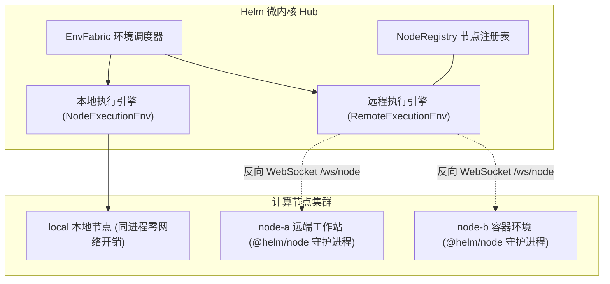
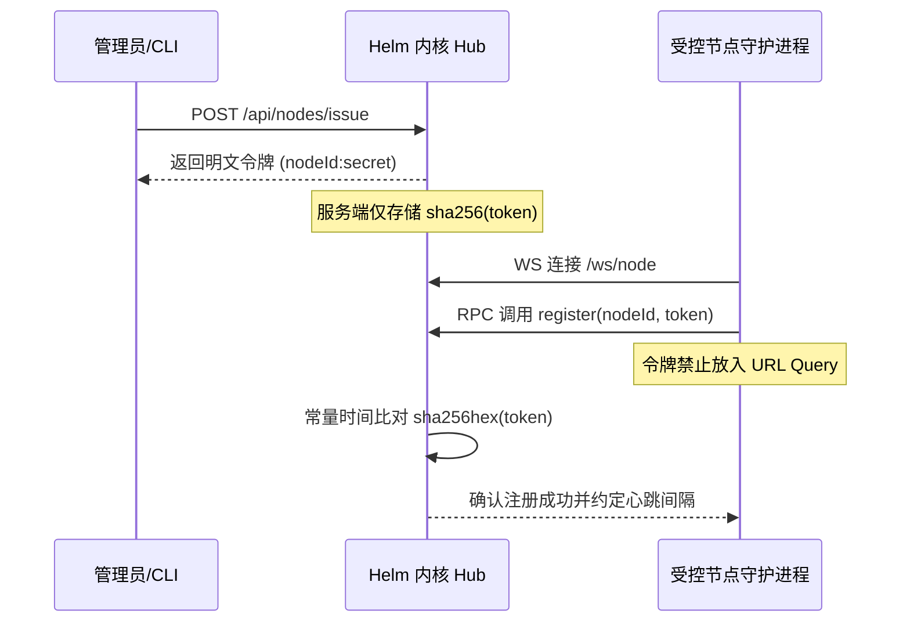
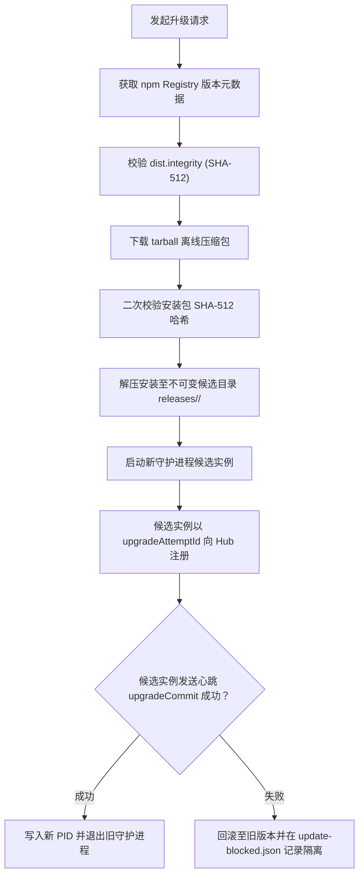

# EnvFabric 分布式执行底座

本文介绍 Helm 的跨平台分布式执行底座 EnvFabric、反向连接机制、远程命令流与安全自升级设计。

---

## 架构定位与执行织网

EnvFabric 是微内核的跨平台执行基础设施。
系统在执行命令时抹平本地进程与远程节点的物理差异。
所有工具调用、文件读写与自动化门禁均经由 EnvFabric 调度。

---

## 零入站 SSH 依赖与反向连接

传统跨机器编排高度依赖 SSH 端口开放与公钥部署。
这种模式存在配置繁琐与公网暴露风险。
Helm 采用全反向连接架构解决该问题。

### 反向 WebSocket 连接（`/ws/node`）

1. **出站单向连接**：受控节点主动向中心 Hub 发起反向 WebSocket 连接。
2. **穿透复杂网络**：节点位于 NAT 内网或防火墙后方即可正常通信。
3. **双向 RPC 复用**：基于 WebSocket 与 `birpc` 协议实现单连接多路复用。
4. **实时健康监控**：节点通过心跳定期上报系统负载、内存剩余与磁盘空间。

### 令牌签发与节点认证

- **凭据只存哈希**：Hub 仅存储令牌的 SHA-256 哈希值，明文仅在签发时返回一次。
- **防止日志泄露**：认证令牌在 WebSocket 连接完成后的 RPC 载荷中传输，禁止拼接在 URL 中。
- **拒绝自动降级**：当远程节点离线时，系统挂起等待重连，严禁自动回退到本地节点执行。

---

## 受管 Shell 流式输出与命令控制

EnvFabric 提供受管 Shell 执行抽象。
系统支持长时间任务的流式输出、溢出截断与优雅中止。

### 实时流式传输与速率控制

1. **行级流式推送**：标准输出与标准错误按行通过 `onEnvExecOutput` 实时推送。
2. **溢出落盘保护**：配置 `spill` 选项。超限输出自动转存为磁盘文件并返回路径。
3. **窗口流控防雪崩**：配置 `window` 限制单秒最大字节数与最大行数，防止前端卡死。
4. **精准取消控制**：调用 `envAbortExec(execId)` 发送中止信号，精准终止在途进程。

### 会话隔离执行环境（ScopedExecutionEnv）

每个会话获取独立作用域的执行环境：
- 动态合成环境变量：注入 `HELM_HUB_URL` 与 `HELM_CONVERSATION_ID`。
- 注入受管访问凭据：自动注入当前会话授权的 `HELM_TOKEN`。
- 注入解密凭据：从 `SecretStash` 中动态提取解密后的密钥并注入进程环境。

---

## 双向文件流与本地 IPC 桥

除了执行命令，EnvFabric 提供完整的文件操作与底层 IPC 管道。

### 文件系统操作集

- **基础读写操作**：支持文本与二进制文件读取、追加写入与截断操作。
- **流式分块读取**：提供行迭代器与二进制块读取器，支持读取大文件。
- **目录遍历巡检**：支持高效的递归文件发现与临时文件创建。

### 本机 IPC 桥接能力

EnvFabric 为上层插件提供原生 IPC 桥接功能（`ipcCall` 与 `ipcSubscribe`）：
- **直接连通机器套接字**：支持直连远端机器的 Unix Domain Socket 或 Windows Named Pipe。
- **消除外部桥接脚本**：无需在目标机器编写额外的 Python 脚本或 SSH 端口转发。
- **跨平台一致契约**：插件通过统一的 RPC 接口与节点本地的守护进程通信。

---

## 安全原子自升级与 SHA-512 校验

分布式环境下的节点维护成本极高。
`@helm/node` 内置双包协同自升级引擎。
升级全过程具备强原子性与失败自动回滚能力。

### 1. 双包同版本协同绑定

升级时严格协同安装 `@helm/node` 与 `@helm/cli`。
两个包必须保持版本号完全一致。
安装前对两个包的 tarball 均执行 SHA-512 完整性哈希校验。

### 2. 不可变候选目录

所有版本下载并解压到独立不可变路径：
`releases/<version>/<uuid>/`。
系统永不覆写正在执行的旧版本文件。

### 3. 金丝雀握手与唯一提交点

- **排空在途命令**：触发升级后，当前守护进程停止接收新命令，等待已有任务排空。
- **启动候选进程**：以临时进程方式启动新版本守护进程。
- **候选重连对账**：新进程携带 `upgradeAttemptId` 向 Hub 发起注册。
- **唯一提交确认**：新进程向 Hub 提交 `upgradeCommit` 心跳。Hub 确认后旧进程退出。

### 4. 升级失败自动隔离与回滚

若新版本启动崩溃或握手超时：
系统立刻终止候选进程并恢复原版本执行。
失败的版本信息自动写入 `<dataDir>/update-blocked.json`。
系统在原因排查完成前自动阻断该版本的重试请求。
