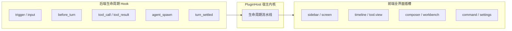
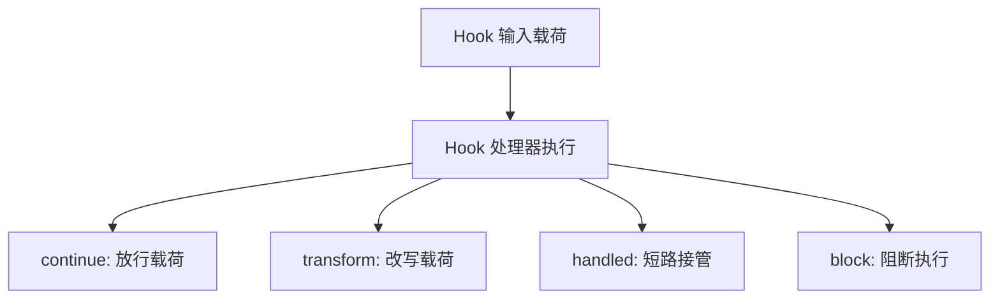
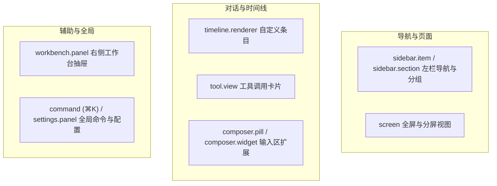

# 生命周期 Hook 与全界面扩展点

本文详解 Helm 的插件扩展机制：后端可组合生命周期 Hook 与前端全界面插槽。

---

## 扩展机制架构设计

Helm 坚持机制与策略分离原则。
系统拒绝在内核中堆砌业务特判代码。
插件通过生命周期 Hook 与界面插槽接入系统。

`PluginHost` 协调启停、服务屏障和 epoch 守卫。动作、工具与路由交给 `CapabilityRegistry`，全局与会话文档交给 `PluginDocRegistry`，界面声明校验、跨插件冲突裁决和客户端编译交给 `UiRegistry`。会话文档复用宿主提供的生命周期守卫与持久层端口；界面注册表由宿主在启用提交点传入当前启用插件集合，避免注册表另存一份启停状态。运行时继续通过 `RuntimeToolRegistry` 装配工具、通过 `AssetReloader` 协调资产热重载。



---

## 后端生命周期 Hook

后端 Hook 覆盖从外部事件触发到回合终态结算的完整调用链路。

### Hook 挂载点列表

| Hook 名称 | 触发时机 | 典型应用场景 |
| :--- | :--- | :--- |
| **`trigger`** | 外部事件入站时触发 | 定时任务调度、Webhook 验签与定向直投 |
| **`input`** | 用户或智能体提交输入时触发 | 输入过滤、审计埋点与上下文预处理 |
| **`before_turn`** | 大模型回合推理前触发 | 动态注入提示词片段、记忆文件与工具集合 |
| **`tool_call`** | 工具开始执行前触发 | 权限鉴权、敏感参数脱敏与二次确认 |
| **`tool_result`** | 工具执行返回后触发 | 产物登记、结果格式化与执行审计 |
| **`agent_spawn`** | 派生子智能体时触发 | 接管终端工具调度或初始化执行环境 |
| **`turn_settled`** | 回合结束达到终态时触发 | 状态统计、生成总结卡片与向中枢汇报 |

内核不内置巡检定时器，也不存在 `watchdog_tick` Hook：周期性巡检、探针采集与定时自愈由需要它们的插件用自有后台服务（`ctx.service`）自行调度；终端侧诊断由 `builtin:herdr` 通过通用进程内事件采集。

### 4 种控制流动作

每个 Hook 处理器可以返回 4 种控制流动作之一：



1. **`continue`（放行）**：
   放行当前载荷。
   控制权传递给下一个处理器或内核默认逻辑。
2. **`transform`（改写）**：
   原地修改载荷内容。
   改写后的数据继续向下游传递并由内核消费。
3. **`handled`（接管）**：
   短路拦截默认行为。
   直接返回处理结果，后续处理器不再调用。
4. **`block`（阻断）**：
   阻断当前调用并抛出显式错误原因。
   不同 Hook 允许的控制流集合由宿主在运行时校验。

---

## 前端全界面插槽

前端扩展点允许插件重塑界面交互。视图类扩展点统一采用 `client.tsx` React 组件单轨（宿主核心不再内置声明式 JSON 渲染；JSON 渲染能力由 `builtin:json-render` 插件提供）。除核心视图面外，宿主还提供微操作、Markdown 代码块接管、Profile 运行时元数据、插件子插槽、产物预览与输入补全等组合面。它们按职责分组，不要求每个局部容器各有一个顶层方法；详情区优先复用 `slot`。

### 扩展插槽分类



### 插槽职责与渲染规则

| 插槽名称 | 注册方法 | 说明 |
| :--- | :--- | :--- |
| **导航区** | `ctx.ui.sidebarItem()`<br/>`ctx.ui.sidebarSection()` | 注册左栏导航项与可折叠分组。支持通过 `filterTag` 过滤会话 |
| **主屏幕** | `ctx.ui.screen()` | 注册独立主视图。支持通过 URL Hash 开启左右 Split View 并排分屏 |
| **时间线** | `ctx.ui.timelineRenderer()` | 接管特定 `entry.kind` 或特定元数据的消息条目排版 |
| **工具卡** | `ctx.ui.toolView()` | 接管特定工具的调用参数卡片与执行结果展示 |
| **输入区** | `ctx.ui.composerPill()`<br/>`ctx.ui.composerWidget()` | 注册输入框下方快捷药丸按钮或展开式面板小部件 |
| **工作台** | `ctx.ui.workbenchPanel()` | 注册会话右侧抽屉面板。支持按当前会话上下文动态展示 |
| **全局项** | `ctx.ui.command()`<br/>`ctx.ui.settingsPanel()` | 注册全局命令（⌘K）、可选 `/slash` 补全与配置面板；同一插件可以声明多个配置面板 |
| **微操作** | `ctx.ui.action({ target })` | 以 `target: 'conversation:header' | 'conversation:row' | 'timeline:entry'` 统一向会话顶栏、左栏会话行菜单与消息操作栏追加操作 |
| **代码块接管** | `ctx.ui.markdownCodeBlock({ id, languages, priority?, client })` | 按代码块语言接管 Markdown 内代码块渲染；`client` 指定组件模块与导出名 |
| **运行时元数据** | `ctx.ui.profileRuntime()` | 声明 Profile 外部运行时的名称、图标、说明与 Agent 候选；宿主按通用 ProfileRuntime 结构编辑 |
| **插件子插槽** | `ctx.ui.slot()` | 向 `<ownerPluginId>/<slotName>` 注入客户端组件 |
| **产物预览** | `ctx.ui.artifactPreviewer()` | 按 MIME 或文件后缀匹配预览内容，保留宿主默认视图与下载 |
| **输入补全** | `ctx.ui.composerCompleter()` | 声明 `@ / # / :` 的候选数据源，宿主统一查询、校验与插入文本 |

微操作由统一方法 `ctx.ui.action()` 以 `target` 字段区分挂载容器，取代早期按容器分别命名的多个方法；三者职责与能力不变：

- `conversation:header`：会话顶栏与更多菜单；
- `conversation:row`：左栏会话行菜单；
- `timeline:entry`：消息操作栏，支持按条目类型、角色和会话 scope 过滤。

微操作可以直接声明 `actionId`，宿主负责按钮、pending 状态与失败通知；也可以声明 `client` 渲染内容。调用上下文固定为实际会话，`input` 不得覆盖宿主注入的 `conversationId` / `entryId`。`actionPluginId` 可显式指向另一个插件。

`timelineRenderer` 与 `toolView` 支持 `priority`：数值较大者优先，缺省为 `0`，同优先级保持贡献顺序。多个插件接管同一工具时可以显式裁决；高优先级插件停用后由剩余候选接管。`markdownCodeBlock` 同样按 `priority` 降序选择接管者；同一插件声明同 `id` 贡献时以最后一次声明为准。

### 参数化视图与输入区控制

Screen 组件接收 `ScreenProps`：`pluginId / screenId / isSplit / params / setParams`。主屏参数在 URL Hash 中编码为 `sp.<key>`，分屏参数编码为 `ssp.<key>`；两边展示同一 Screen 时仍互相独立。`setParams(patch)` 默认替换历史记录，值为 `undefined` 时删除对应键，`{ push: true }` 则新增历史记录。组件不得直接操作 `history` 或自建路由。

输入区组件接收 `ComposerScopeProps.composer`，可以读取草稿、附件与发送状态，调用 `setDraft / insertText / submit`。省略 `submit` 的文本参数时发送当前草稿及附件；显式提供文本时不消费已有草稿。失败通过 Promise 拒绝并展示诊断，不得视作发送成功。输入区子插槽继承同一个控制器。

`ctx.ui.command({ slash: 'archive', actionId: 'archive', ... })` 同时派生 ⌘K 与输入框 `/archive` 菜单。斜杠词不能覆盖宿主保留命令或 `skill:` 命名空间，也不能与其他启用插件重名。

### 插件间组合

插件视图可以从 `@helm/plugin-client` 导入 `<PluginSlot name="cards" />`，供其他插件用 `ctx.ui.slot({ id: 'card', target: 'owner-plugin/cards', ... })` 注入内容。短名称相对当前插件，全限定名显式指定所属插件。

`mode="list"` 渲染全部命中贡献，`mode="single"` 只选第一项；按 `priority` 降序、`order` 升序稳定排序。每个子项重新绑定贡献者的插件上下文，并有独立错误边界。循环引用与过深嵌套显示错误提示，不继续递归。

---

### 宿主详情子插槽与静态引导

- `PROFILE_DETAIL_SECTION_SLOT`：`builtin:profile/detail-section`，传入 `ProfileDetailSlotProps`。
- `NODE_DETAIL_SECTION_SLOT`：`builtin:node/detail-section`，仅已有节点挂载，传入 `NodeDetailSlotProps`（`nodeId / isLocal / isOnline / isNew: false`）。`builtin:node` 在此是宿主保留命名空间，不代表节点底座依赖一个同名插件。插槽不传接入令牌，也不隐式借用当前打开的会话。
- 空白会话引导是 `Profile.starters` 静态配置，不增加 UI 扩展点。最多六项，每项 `label` 去首尾空白后最多 24 个 Unicode 码点，`prompt` 非纯空白且最多 4000 个码点、保留原文。点击仅回填草稿；已有草稿、附件、历史编辑或在途输入操作时拒绝覆盖。

### 产物预览与引用补全

`artifact.previewer` 的 `mimeTypes` 支持精确值或 `type/*`，不支持任意前缀与全匹配 `*/*`；`extensions` 使用含点号的小写后缀，可声明 `.topo.json`。两类条件取 OR，至少声明一类。命中当前会话 `scope` 后按 `priority` 降序稳定排列。组件收到 `ArtifactPreviewerProps`，`size` 来自真实 Blob，名称元数据未获得时省略 `name`；`text` 仅提供最多 1 MiB 的文本内容，二进制或超限为 `null`。插件不得撤销宿主管理的 `blobUrl`。

插件预览保留宿主默认视图与下载。插件失败显示诊断，不悄悄改用其他内容冒充成功。`client.tsx` 是可信代码，不因进入产物预览而成为沙箱；插件展示不可信 HTML 时应使用 `iframe sandbox`，默认不授予脚本、同源、表单或导航权限。禁止把产物 HTML 直接注入宿主 DOM；若确需脚本，必须另行评估网络外传与交互能力，而不能只以“没有 allow-same-origin”声称绝对安全。

`composer.completer` 是可序列化的数据源声明，不是视图扩展，不接受 `client / docs / sessionDocs`。`source` 显式选择：

- `{ kind: 'action', actionId, actionPluginId? }`：绑定声明为 `idempotent: true` 的查询动作。输入 `{ query, conversationId }`，输出 `{ items: ComposerCompletionItem[] }`。目标节点和目录应由服务端读取真实会话，不信任浏览器自报坐标。幂等标记不等于宿主能证明插件没有副作用。
- `{ kind: 'doc', name, itemsField }` 或 `{ kind: 'sessionDoc', name, itemsField }`：读取贡献插件自己的公开文档中的顶层数组字段，不用 `docs[0]` 推断来源。会话文档按需订阅，不旁路进入全局广播。

每个候选提供 `id / label / insertText`，可选 `hint / icon`。选中仅替换光标前的触发词，不提交输入或执行候选命令。`/` 保留原有命令与技能路径；`@ / # / :` 均通过注册的插件源提供候选，宿主不内置产物引用。异步查询防抖并防止旧请求覆盖新会话、草稿或已停用源。动作源通过已有 Action HTTP、CLI、Agent 与 Workflow 路径同权访问，不新增补全专用 RPC。

## client.tsx 单轨渲染机制

视图类扩展点统一采用 `client.tsx` React 组件单轨。`UiSpecBase` 不再同时接受 `json / docs / sessionDocs` 与 `client` 双轨声明；需要声明式 JSON 渲染时使用 `builtin:json-render` 插件提供的能力。运行时元数据和输入补全是纯数据声明，不涉及组件。

- **组件共享**：复用宿主环境的 React 与组件库底座。宿主把 `@helm/plugin-client` 共享模块虚拟化为全局命名空间，插件编译产物不打包第二份 React。
- **可信代码而非安全沙箱**：`client.tsx` 在浏览器中运行，与宿主页面共享 JavaScript 环境；它不是隔离的安全沙箱，也不因此获得后端进程权限。
- **状态管理**：支持复杂的局部交互、自定义动画与实时状态监听。
- **插件自有样式**：本地 CSS 及根内 `@import` 由 esbuild 合并，通过保留导出 `__helmClientCss` 内联为插件 JS 的文本数据；宿主确认导入成功且加载仍有效后才注入 `<style data-helm-plugin-css>`，入口更新时替换，停用/卸载或登出时回收。宿主样式表不承载插件业务类。资源 URL 支持 `data:` 与显式 HTTP(S)/协议相对地址；当前不提供插件静态资源端点，本地资源 URL 与远程 `@import` 显式拒绝。
- **具名导出规范**：通过 `ClientComponentRef` 声明导出模块（`module`）与组件导出名（`export`）。

客户端编译、导出校验或加载失败时，宿主显示明确错误与重试入口，不把空白静默冒充客户端组件加载成功。

## 声明式 JSON 渲染与图表插件

声明式 JSON 渲染能力从宿主核心剥离为两个默认启用的可选插件：

- **`builtin:json-render`**：承载 JSON DSL、求值器与界面原语，以及基于 JSON Spec 的生成式技能。停用后宿主不再解析插件 JSON Spec，相关界面回退为不可用或基础展示。
- **`builtin:mermaid`**：通过 `ctx.ui.markdownCodeBlock({ id, languages: ['mermaid'], client })` 接管 Markdown 中 `mermaid` 代码块的渲染。停用后 ```mermaid 围栏回退为普通代码块展示，不影响其他插件。

两个插件遵循统一的停用语义：动作、工具与 UI 贡献即时消失，不使用内存降级或宿主内置替代渲染。

## 公开数据与会话投影

`ctx.doc(name, initial, { public: true })` 适合全局设置或紧凑导航摘要，进入全局 SSE 首帧 `pluginDocs`，更新时广播完整文档。私有文档不公开。

`ctx.sessionDoc(name, initial, { public: true })` 按 `conversationId` 持久化分片，不进入全局首帧，也不向普通 `/api/events` 发送会话文档事件。读写句柄使用 `get / set / update / delete(conversationId, ...)`，`flush()` 等待真实持久化；会话删除清理其文档，过期句柄或删除后的写入报错。

客户端 `usePluginSessionDoc('runs')` 使用当前槽位的会话，也可通过第二参显式指定 `conversationId / pluginId`。同一文档的多个挂载组件共享订阅，引用归零时断开。专用 SSE 首帧提供当前值与水位，后续只传该元组的更新，重连重新取首帧。`usePluginDoc(name, pluginId?)` 和 `ctx.callAction(actionId, input, { pluginId?, conversationId? })` 支持显式跨插件寻址；只能读取公开文档，动作仍由后端校验。

HTTP 与 CLI 同权：

- 一次读取：`GET /api/plugins/:id/docs/:name?conversationId=N`；`helm plugins doc <id> <name> --conversation N --json`。
- 当前会话：`helm plugins doc <id> <name> --current --json`。
- 持续订阅：`GET /api/plugins/:id/docs/:name/events?conversationId=N`；`helm plugins doc <id> <name> --conversation N --watch --json`。

`builtin:workflow` 将完整运行摘要放入会话文档 `runs`。全局 `run-badges` 仅保留计数、色调和底部短文案，不包含节点或输出；摘要没有变化时不重复发布。全局 `workflow.updated` 只包含 `id / conversationId / status` 提示，不旁路广播完整摘要；`workflow.settled` 通过 `ctx.host.emitEvent(..., { broadcast: false })` 仅交给进程内监听器，继续等待终态清理完成。
