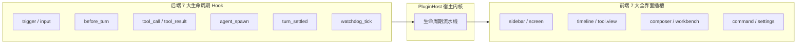
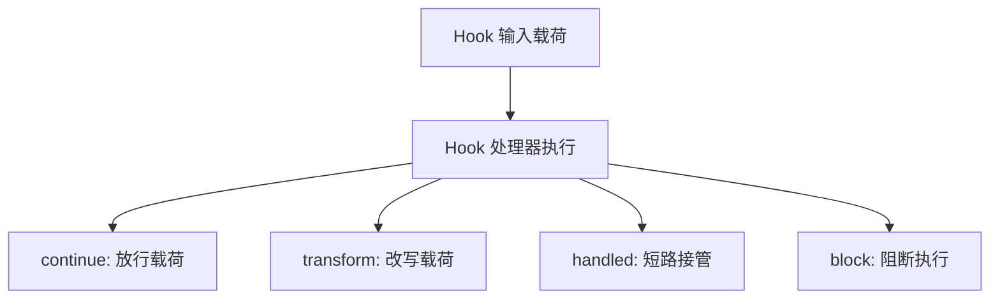
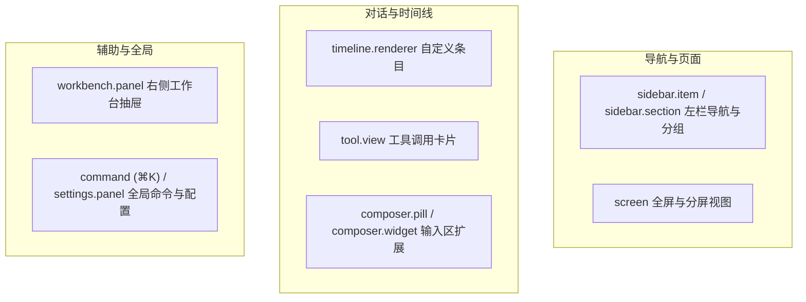
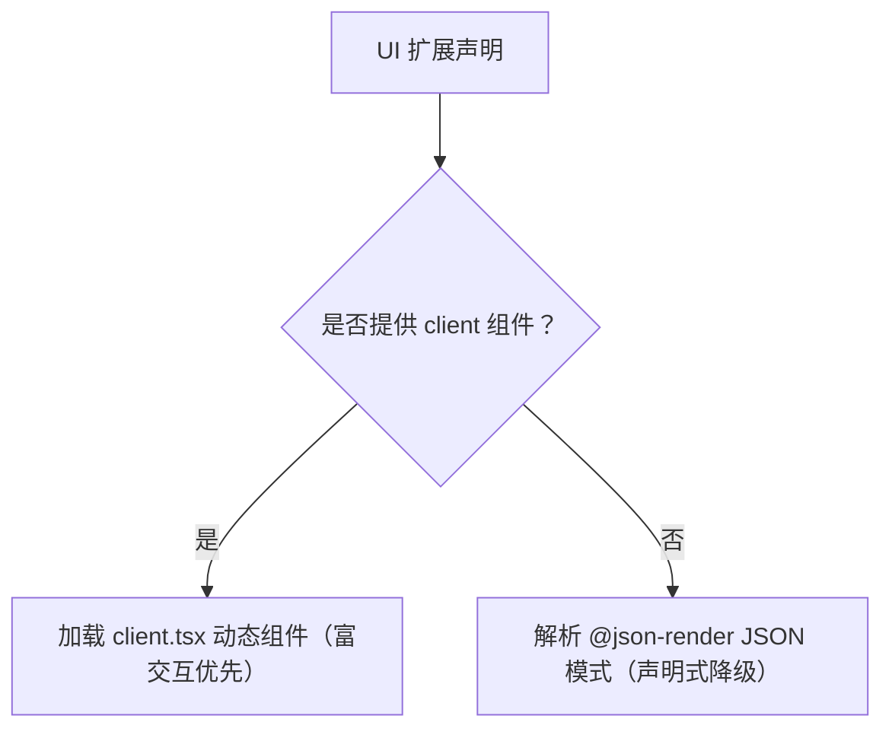

# 前后端对称双 7 扩展点

本文详解 Helm 的前后端对称扩展机制，包含后端 7 大生命周期 Hook 与前端 7 大界面插槽。

---

## 扩展机制架构设计

Helm 坚持机制与策略分离原则。
系统拒绝在内核中堆砌业务特判代码。
插件通过对称的双 7 扩展点接入系统。

---

## 后端 7 大生命周期 Hook

后端 Hook 覆盖从外部事件触发到回合终态结算的完整调用链路。

### Hook 挂载点列表

| Hook 名称 | 触发时机 | 典型应用场景 |
| :--- | :--- | :--- |
| **`trigger`** | 外部事件入站时触发 | 定时任务调度、Webhook 验签与定向直投 |
| **`input`** | 用户或智能体提交输入时触发 | 输入过滤、审计埋点与上下文预处理 |
| **`before_turn`** | 大模型回合推理前触发 | 动态注入提示词片段、记忆文件与工具集合 |
| **`tool_call`** | 工具开始执行前触发 | 权限鉴权、敏感参数脱敏与二次确认 |
| **`tool_result`** | 工具执行返回后触发 | 产物登记、结果格式化与执行审计 |
| **`agent_spawn`** | 派生子智能体时触发 | 接管终端工具调度或初始化原生工作树 |
| **`turn_settled`** | 回合结束达到终态时触发 | 状态统计、生成总结卡片与向中枢汇报 |
| **`watchdog_tick`** | 巡检周期脉冲触发 | 会话心跳探针采集、死锁检测与健康预警 |

### 4 种控制流动作

每个 Hook 处理器可以返回 4 种控制流动作之一：

1. **`continue`（放行）**：
   放行当前载荷。
   控制权传递给下一个处理器或内核默认逻辑。
2. **`transform`（改写）**：
   原地修改载荷内容。
   改写后的数据继续向下游传递并由内核消费。
3. **`handled`（接管）**：
   短路拦截默认行为。
   直接返回处理结果，后续处理器不再调用。
4. **`block`（阻断）**：
   阻断当前调用并抛出显式错误原因。
   系统在运行时校验合法性（例如 `watchdog_tick` 严禁阻断）。

---

## 前端 7 大全界面插槽

前端扩展点允许插件重塑界面交互。
基础 7 类界面扩展面继续保留。宿主另外提供微操作、Profile 运行时元数据与插件子插槽，总计 15 个注册方法。

### 扩展插槽分类

### 插槽职责与渲染规则

| 插槽名称 | 注册方法 | 说明 |
| :--- | :--- | :--- |
| **导航区** | `ctx.ui.sidebarItem()` `ctx.ui.sidebarSection()` | 注册左栏导航项与可折叠分组。支持通过 `filterTag` 过滤会话 |
| **主屏幕** | `ctx.ui.screen()` | 注册独立主视图。支持通过 URL Hash 开启左右 Split View 并排分屏 |
| **时间线** | `ctx.ui.timelineRenderer()` | 接管特定 `entry.kind` 或特定元数据的消息条目排版 |
| **工具卡** | `ctx.ui.toolView()` | 接管特定工具的调用参数卡片与执行结果展示 |
| **输入区** | `ctx.ui.composerPill()` `ctx.ui.composerWidget()` | 注册输入框下方快捷药丸按钮或展开式面板小部件 |
| **工作台** | `ctx.ui.workbenchPanel()` | 注册会话右侧抽屉面板。支持按当前会话上下文动态展示 |
| **全局项** | `ctx.ui.command()` `ctx.ui.settingsPanel()` | 注册全局命令（⌘K）、可选 `/slash` 补全与配置面板；同一插件可以声明多个配置面板 |
| **会话微操作** | `ctx.ui.conversationHeaderAction()` `ctx.ui.conversationRowAction()` | 向会话顶栏、更多菜单与左栏会话行菜单追加操作 |
| **消息微操作** | `ctx.ui.timelineEntryAction()` | 向消息操作栏追加操作，支持按条目类型、角色和会话 scope 过滤 |
| **运行时元数据** | `ctx.ui.profileRuntime()` | 声明 Profile 外部运行时的名称、图标、说明与 Agent 候选；宿主按通用 ProfileRuntime 结构编辑 |
| **插件子插槽** | `ctx.ui.slot()` | 向 `<ownerPluginId>/<slotName>` 注入 JSON 或客户端组件 |

`timelineRenderer` 与 `toolView` 支持 `priority`：数值较大者优先，缺省为 `0`，同优先级保持贡献顺序。多个插件接管同一工具时可以显式裁决；高优先级插件停用后由剩余候选接管。

微操作可以直接声明 `actionId`，宿主负责按钮、pending 状态与失败通知；也可以声明 `json` / `client` 渲染内容。调用上下文固定为实际会话，`input` 不得覆盖宿主注入的 `conversationId` / `entryId`。`actionPluginId` 可显式指向另一个插件。

### 参数化视图与输入区控制

Screen 组件接收 `ScreenProps`：`pluginId / screenId / isSplit / params / setParams`。主屏参数在 URL Hash 中编码为 `sp.<key>`，分屏参数编码为 `ssp.<key>`；两边展示同一 Screen 时仍互相独立。`setParams(patch)` 默认替换历史记录，值为 `undefined` 时删除对应键，`{ push: true }` 则新增历史记录。组件不得直接操作 `history` 或自建路由。

输入区组件接收 `ComposerScopeProps.composer`，可以读取草稿、附件与发送状态，调用 `setDraft / insertText / submit`。省略 `submit` 的文本参数时发送当前草稿及附件；显式提供文本时不消费已有草稿。失败通过 Promise 拒绝并展示诊断，不得视作发送成功。输入区子插槽继承同一个控制器。

`ctx.ui.command({ slash: 'archive', actionId: 'archive', ... })` 同时派生 ⌘K 与输入框 `/archive` 菜单。斜杠词不能覆盖宿主保留命令或 `skill:` 命名空间，也不能与其他启用插件重名。

### 插件间组合

插件视图可以从 `@helm/plugin-client` 导入 `<PluginSlot name="cards" />`，供其他插件用 `ctx.ui.slot({ id: 'card', target: 'owner-plugin/cards', ... })` 注入内容。声明式 JSON 使用 `Slot` 原语。短名称相对当前插件，全限定名显式指定所属插件。

`mode="list"` 渲染全部命中贡献，`mode="single"` 只选第一项；按 `priority` 降序、`order` 升序稳定排序。每个子项重新绑定贡献者的插件上下文，并有独立错误边界。循环引用与过深嵌套显示错误提示，不继续递归。

---

## 双轨渲染机制

每个前端扩展点均支持双轨声明。
插件可以按需选择声明式 JSON 或 React 原生组件。

### 1. 声明式 `@json-render` 轨道

- **纯数据驱动**：无需前端编译打包环节。
- **安全约束**：纯 JSON 模式描述表单与布局，避免执行任意脚本。
- **文档联动**：`docs: [...]` 订阅本插件公开全局文档并注入 `$docs`；`sessionDocs: [...]` 按当前会话订阅公开会话文档并注入 `$sessionDocs`。

### 2. 原生组件 `client.tsx` 轨道

- **组件共享**：复用宿主环境的 React 与组件库底座。宿主把 `@helm/plugin-client` 共享模块虚拟化为全局命名空间，插件编译产物不打包第二份 React。
- **可信代码而非安全沙箱**：`client.tsx` 在浏览器中运行，与宿主页面共享 JavaScript 环境；它不是隔离的安全沙箱，也不因此获得后端进程权限。声明式 `@json-render` 则是纯数据轨道。
- **状态管理**：支持复杂的局部交互、自定义动画与实时状态监听。
- **插件自有样式**：本地 CSS 及根内 `@import` 由 esbuild 合并，通过保留导出 `__helmClientCss` 内联为插件 JS 的文本数据；宿主确认导入成功且加载仍有效后才注入 `<style data-helm-plugin-css>`，入口更新时替换，停用/卸载或登出时回收。宿主样式表不承载插件业务类。资源 URL 支持 `data:` 与显式 HTTP(S)/协议相对地址；当前不提供插件静态资源端点，本地资源 URL 与远程 `@import` 显式拒绝。
- **具名导出规范**：通过 `ClientComponentRef` 声明导出模块（`module`）与组件导出名（`export`）。

### 双轨优先级纪律

当插件同时声明 `client` 与 `json` 时，宿主优先渲染 `client` 组件。
客户端编译、导出校验或加载失败时，宿主显示明确错误与重试入口，不把 JSON 描述或空白静默冒充客户端组件加载成功。

## 公开数据与会话投影

`ctx.doc(name, initial, { public: true })` 适合全局设置或紧凑导航摘要，进入全局 SSE 首帧 `pluginDocs`，更新时广播完整文档。私有文档不公开。

`ctx.sessionDoc(name, initial, { public: true })` 按 `conversationId` 持久化分片，不进入全局首帧，也不向普通 `/api/events` 发送会话文档事件。读写句柄使用 `get / set / update / delete(conversationId, ...)`，`flush()` 等待真实持久化；会话删除清理其文档，过期句柄或删除后的写入报错。

客户端 `usePluginSessionDoc('runs')` 使用当前槽位的会话，也可通过第二参显式指定 `conversationId / pluginId`。同一文档的多个挂载组件共享订阅，引用归零时断开。专用 SSE 首帧提供当前值与水位，后续只传该元组的更新，重连重新取首帧。`usePluginDoc(name, pluginId?)` 和 `ctx.callAction(actionId, input, { pluginId?, conversationId? })` 支持显式跨插件寻址；只能读取公开文档，动作仍由后端校验。

HTTP 与 CLI 同权：

- 一次读取：`GET /api/plugins/:id/docs/:name?conversationId=N`；`helm plugins doc <id> <name> --conversation N --json`。
- 当前会话：`helm plugins doc <id> <name> --current --json`。
- 持续订阅：`GET /api/plugins/:id/docs/:name/events?conversationId=N`；`helm plugins doc <id> <name> --conversation N --watch --json`。

`builtin:workflow` 将完整运行摘要放入会话文档 `runs`。全局 `run-badges` 仅保留计数、色调和底部短文案，不包含节点或输出；摘要没有变化时不重复发布。全局 `workflow.updated` 只包含 `id / conversationId / status` 提示，不旁路广播完整摘要；`workflow.settled` 通过 `ctx.host.emitEvent(..., { broadcast: false })` 仅交给进程内监听器，继续等待终态清理完成。
