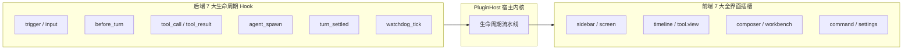
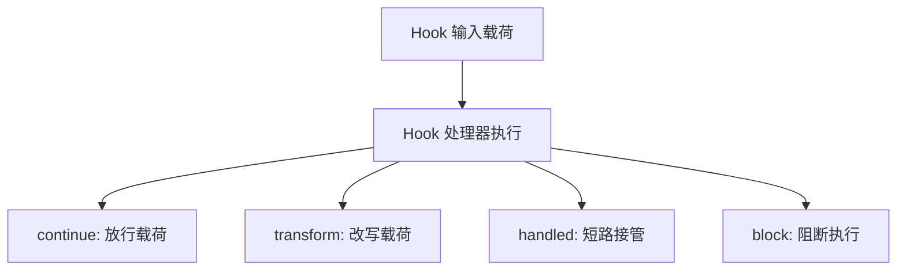
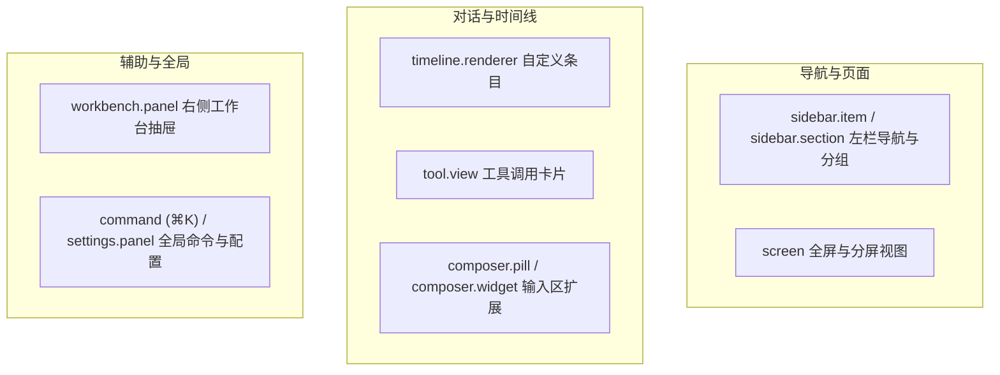
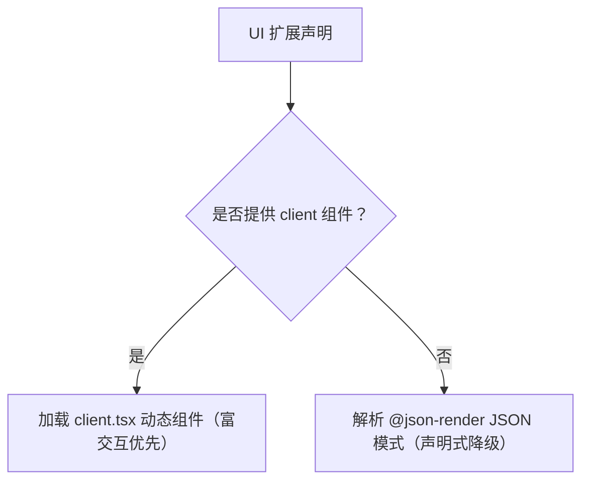

# 前后端对称双 7 扩展点

本文详解 Helm 的前后端对称扩展机制，包含后端 7 大生命周期 Hook 与前端 7 大界面插槽。

---

## 扩展机制架构设计

Helm 坚持机制与策略分离原则。
系统拒绝在内核中堆砌业务特判代码。
插件通过对称的双 7 扩展点接入系统。

---

## 后端 7 大生命周期 Hook

后端 Hook 覆盖从外部事件触发到回合终态结算的完整调用链路。

### Hook 挂载点列表

| Hook 名称 | 触发时机 | 典型应用场景 |
| :--- | :--- | :--- |
| **`trigger`** | 外部事件入站时触发 | 定时任务调度、Webhook 验签与定向直投 |
| **`input`** | 用户或智能体提交输入时触发 | 输入过滤、审计埋点与上下文预处理 |
| **`before_turn`** | 大模型回合推理前触发 | 动态注入提示词片段、记忆文件与工具集合 |
| **`tool_call`** | 工具开始执行前触发 | 权限鉴权、敏感参数脱敏与二次确认 |
| **`tool_result`** | 工具执行返回后触发 | 产物登记、结果格式化与执行审计 |
| **`agent_spawn`** | 派生子智能体时触发 | 接管终端工具调度或初始化原生工作树 |
| **`turn_settled`** | 回合结束达到终态时触发 | 状态统计、生成总结卡片与向中枢汇报 |
| **`watchdog_tick`** | 巡检周期脉冲触发 | 会话心跳探针采集、死锁检测与健康预警 |

### 4 种控制流动作

每个 Hook 处理器可以返回 4 种控制流动作之一：

1. **`continue`（放行）**：
   放行当前载荷。
   控制权传递给下一个处理器或内核默认逻辑。
2. **`transform`（改写）**：
   原地修改载荷内容。
   改写后的数据继续向下游传递并由内核消费。
3. **`handled`（接管）**：
   短路拦截默认行为。
   直接返回处理结果，后续处理器不再调用。
4. **`block`（阻断）**：
   阻断当前调用并抛出显式错误原因。
   系统在运行时校验合法性（例如 `watchdog_tick` 严禁阻断）。

---

## 前端 7 大全界面插槽

前端扩展点允许插件重塑界面交互。
宿主为插件提供 10 个精确的注册方法。

### 扩展插槽分类

### 插槽职责与渲染规则

| 插槽名称 | 注册方法 | 说明 |
| :--- | :--- | :--- |
| **导航区** | `ctx.ui.sidebarItem()` `ctx.ui.sidebarSection()` | 注册左栏导航项与可折叠分组。支持通过 `filterTag` 过滤会话 |
| **主屏幕** | `ctx.ui.screen()` | 注册独立主视图。支持通过 URL Hash 开启左右 Split View 并排分屏 |
| **时间线** | `ctx.ui.timelineRenderer()` | 接管特定 `entry.kind` 或特定元数据的消息条目排版 |
| **工具卡** | `ctx.ui.toolView()` | 接管特定工具的调用参数卡片与执行结果展示 |
| **输入区** | `ctx.ui.composerPill()` `ctx.ui.composerWidget()` | 注册输入框下方快捷药丸按钮或展开式面板小部件 |
| **工作台** | `ctx.ui.workbenchPanel()` | 注册会话右侧抽屉面板。支持按当前会话上下文动态展示 |
| **全局项** | `ctx.ui.command()` `ctx.ui.settingsPanel()` | 注册全局快捷键命令面板（⌘K）动作与系统配置面板标签页 |

---

## 双轨渲染机制

每个前端扩展点均支持双轨声明。
插件可以按需选择声明式 JSON 或 React 原生组件。

### 1. 声明式 `@json-render` 轨道

- **纯数据驱动**：无需前端编译打包环节。
- **安全约束**：纯 JSON 模式描述表单与布局，避免执行任意脚本。
- **文档联动**：可以通过 `docs: [...]` 字段直接订阅插件公开文档。

### 2. 原生组件 `client.tsx` 轨道

- **组件共享**：复用宿主环境的 React 与组件库底座。宿主把 `@helm/plugin-client` 共享模块虚拟化为全局命名空间，插件编译产物不打包第二份 React。
- **可信代码而非安全沙箱**：`client.tsx` 是进程内可信代码，拥有宿主权限；沙箱隔离不是该轨道的目标，声明式 `@json-render` 才是纯数据轨道。
- **状态管理**：支持复杂的局部交互、自定义动画与实时状态监听。
- **具名导出规范**：通过 `ClientComponentRef` 声明导出模块（`module`）与组件导出名（`export`）。

### 双轨优先级纪律

当插件同时声明 `client` 与 `json` 时，宿主优先渲染 `client` 组件。
若宿主环境未开启动态加载，系统自动回退至 `json` 视图。
系统严禁静默丢弃未适配的插件界面。
