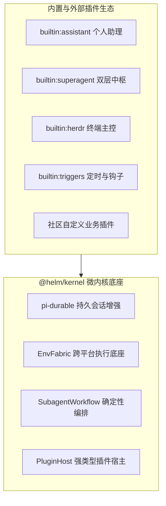
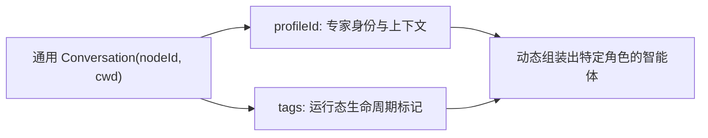
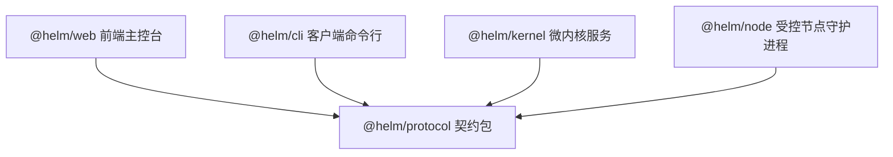
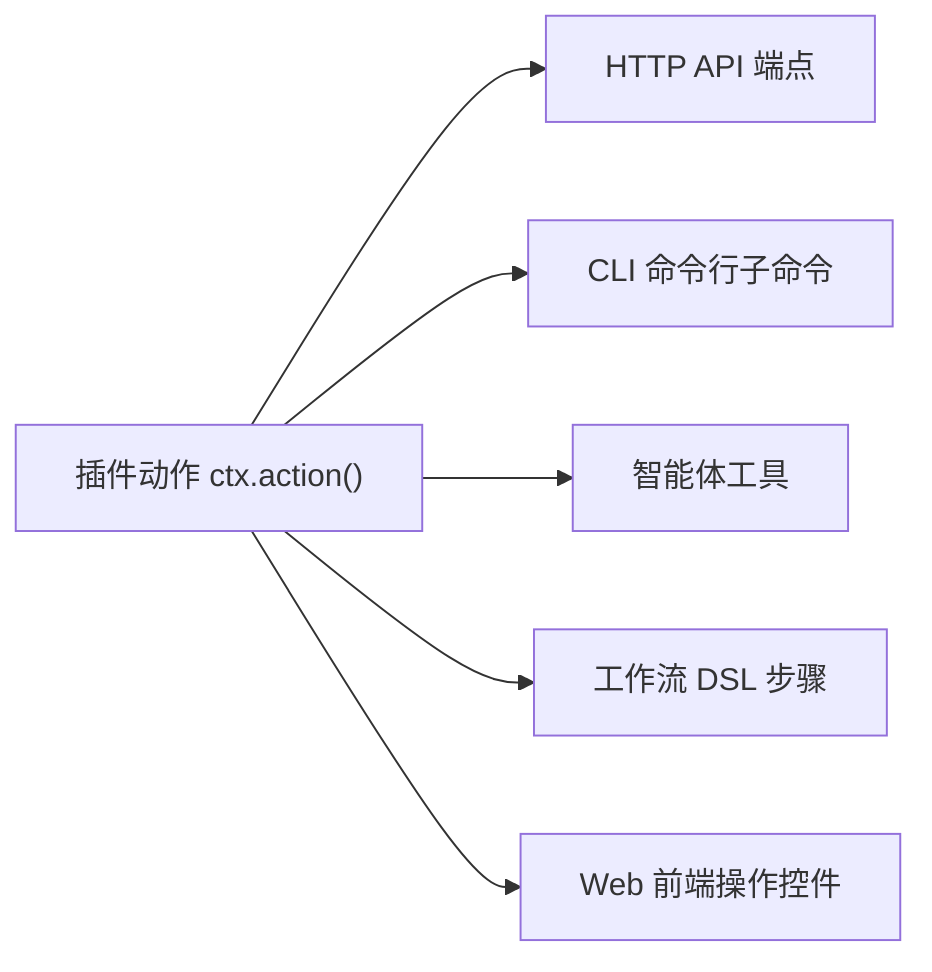

# 极简微内核哲学

本文介绍 Helm 的微内核设计哲学、零业务角色硬编码机制与五包单向依赖架构。

---

## 架构总览与微内核设计

Helm 采用机制与策略分离的微内核架构。
内核只保留极简的核心抽象。
具体的智能体角色、工作流拓扑与业务流程全部由插件定义。

内核专注于四项通用核心机制：

1. **持久会话状态机与增强存储**：提供五态通用会话模型。集成 `state.sqlite` 单库、FTS5 全文检索、`AskDoc` 审批流与 `SecretStash` 机密隔离。
2. **跨平台执行编排底座 `EnvFabric`**：提供反向 WebSocket 网关与令牌鉴权。支持受管命令执行、实时流传输与节点自升级。
3. **确定性多智能体编排引擎**：提供 `subagent` 派生与 `SubagentWorkflow` 流程图调度。
4. **强类型插件宿主 `PluginHost`**：提供基于 `definePlugin(ctx)` 的统一插件生命周期与多端复用机制。

---

## 零业务角色硬编码

内核严禁硬编码具体的业务角色枚举。
代码中不存在 `'router' | 'worker' | 'watchdog'` 等硬编码类型。

### 为什么坚守零硬编码

硬编码业务角色会带来三大缺陷：

1. **破坏通用性**：将特定编排模式绑定到内核，导致系统无法支撑其他拓扑。
2. **污染核心模型**：导致数据表字段膨胀，产生大量仅特定角色使用的空字段。
3. **阻碍动态演进**：新增业务角色需要修改内核代码与数据库定义。

### 基于 ProfileId 与 Tags 的角色表达

Helm 将智能体的职责完全下放给元数据：

- **`profileId` 表达身份职责**：绑定独立的提示词模板、记忆存储与工具集合。
- **`tags` 表达生命周期标记**：标记会话生命周期与分组特性，例如 `worker`、`archived` 或 `ephemeral`。

### 内置双层中枢的实践

以 `builtin:superagent` 插件为例：
插件首次启用时动态创建两个常驻会话：
1. 路由中枢会话：配置 `profileId: 'superagent'`。
2. 巡检看门狗会话：配置 `profileId: 'watchdog'`。

内核将它们视为普通会话。
内核只负责分发事件钩子与调度工具执行。
业务层面的路由、派生与巡检完全由插件逻辑驱动。

---

## 五包单向依赖拓扑

Helm 采用严格分层的 Monorepo 架构。
整个系统划分为五个核心包。
所有包之间遵循严格的单向依赖规则。

### 包职责划分

| 包名 | 职责定位 | 核心依赖 |
| :--- | :--- | :--- |
| **`@helm/protocol`** | 契约包。定义全系统共享的类型、Schema 与错误码 | 零运行时重依赖 |
| **`@helm/kernel`** | 微内核服务包（`helm-hub`）。提供持久化、编排与插件宿主 | 依赖 `@helm/protocol` |
| **`@helm/node`** | 节点守护进程包（`helm-node`）。执行远程宿主操作 | 依赖 `@helm/protocol` |
| **`@helm/cli`** | 命令行客户端包（`helm`）。提供终端控制与管理操作 | 依赖 `@helm/protocol` |
| **`@helm/web`** | 前端控制台。提供会话交互、监控看板与视图扩展 | 依赖 `@helm/protocol` |

### 边界契约与演进纪律

1. **唯一共享契约**：`@helm/protocol` 是所有包的公共交汇点。公共接口修改必须先更新契约包。
2. **物理隔离部署**：控制端的 `@helm/cli` 与受控端的 `@helm/node` 独立发包，禁止混装在同一进程中。
3. **边界处类型校验**：所有外部输入、网络通信载荷与插件交互均在入口处执行模式校验。

---

## 接口与命令行同权

Helm 坚持 API 与 CLI 同权原则。
系统拒绝存在仅 Web 界面可用或仅 CLI 可用的私有接口。

1. **动作自动映射**：通过 `ctx.action()` 声明的动作，系统会自动注册为五个维度的执行入口。
2. **双模操作体验**：人类操作员可以在浏览器点击操作，也可以在终端执行等价的命令行。
3. **自动化编排复用**：智能体与工作流可以直接调用相同的底层动作。
