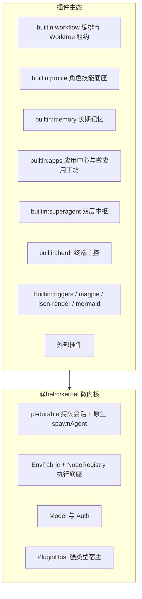
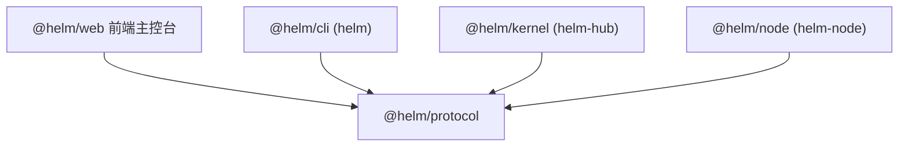
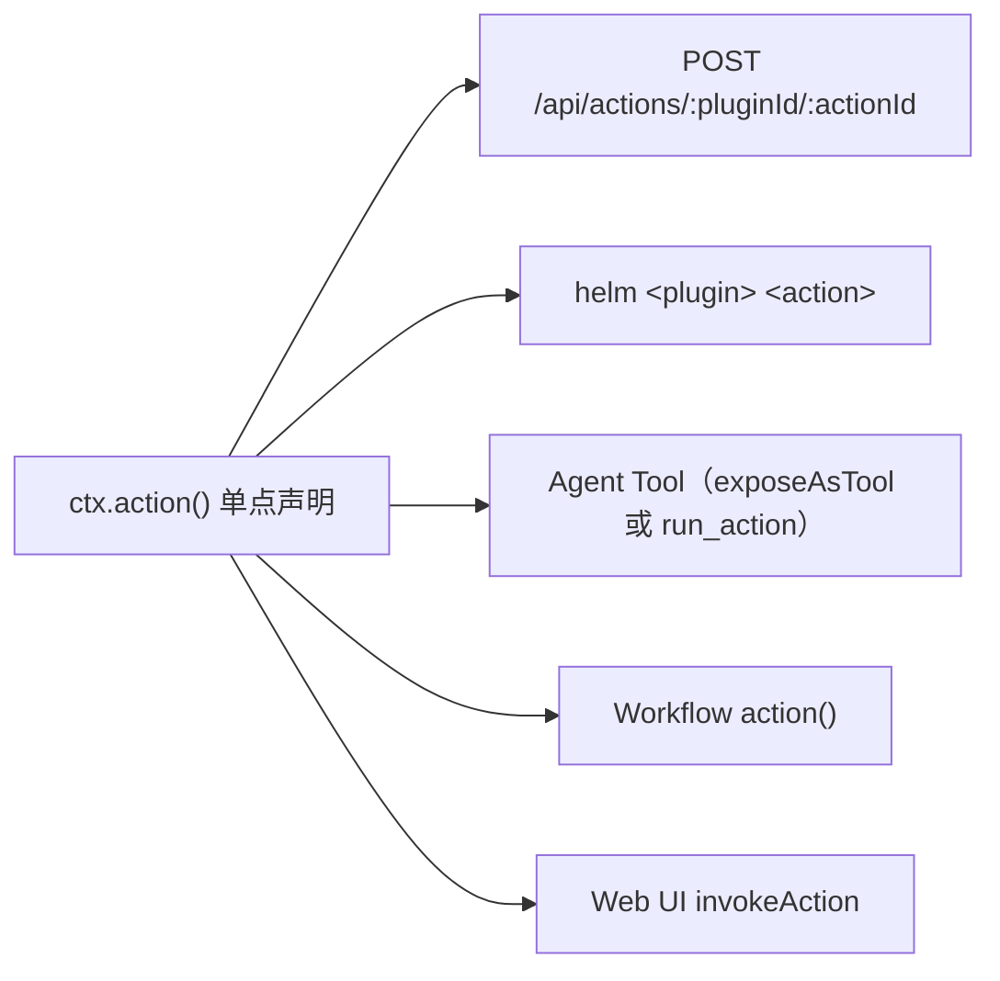

# 微内核架构总览

Helm 是极简持久微内核的多智能体编排系统。内核只提供四块通用机制——持久会话状态机、跨平台执行底座、模型接入与插件宿主；角色、编排、记忆、巡检等一切策略性能力全部由插件在机制之上组合实现。本文给出内核的职责边界、零角色硬编码原则、五包依赖拓扑与 API/CLI 同权契约；后端 Hook 与前端扩展点的完整定义见[扩展点详解](extension-points.md)，跨节点执行底座见 [EnvFabric](envfabric.md)，会话与存储见 [pi-durable 集成](pi-durable.md)。

## 微内核四块通用机制

`@helm/kernel`（可执行包名 `helm-hub`）的全部职责收敛为四块机制，每块都与具体业务正交：

| 机制 | 核心内容 | 明确不包含 |
| :--- | :--- | :--- |
| `pi-durable` 持久会话增强 | 通用 `Conversation(nodeId, cwd)` 五态状态机、`state.sqlite` + FTS5、`AskDoc` 审批流、`SecretStash` 机密隔离、纯文件资产热重载、原生 `spawnAgent` 子会话派生（`agent_spawn` Hook 管道 + 原生子会话默认执行行） | 编排引擎、Worktree 租约（均在 `builtin:workflow`） |
| `EnvFabric` + `NodeRegistry` | `/ws/node` 反向 WebSocket 网关、`/ws/node-tunnel` 节点任意 TCP 透传隧道（`openTunnel` 原语 + `nodeFetch` HTTP/HTTPS 适配层）、`local` 内建节点 + 远端 `@helm/node` 守护进程、`bash / read / write / edit / gate / env exec` 受管执行、按 `nodeId + canonicalPath` 的文件互斥 | 终端主控逻辑（`builtin:herdr`） |
| Model 与 Auth | 模型供应商接入、Provider 配置、凭据与令牌管理（`credentials.json` + `cli-token`） | 业务级模型路由策略；Provider 远端节点绑定不在本次核心隧道实现范围 |
| `PluginHost` | 唯一强类型插件宿主 `definePlugin(ctx)`：生命周期 Hook、动作/工具/路由注册、doc 持久化、服务协调 | 任何具体插件的功能实现 |



以下能力**不在内核**，这是架构红线而非实现现状的描述：

- **编排引擎与 `WorktreeAllocator`**：`subagent` / `SubagentWorkflow` / `cleanup_worktree` 三个模型工具、DSL 编排引擎（`builtin-plugins/workflow/engine`）与受管 Git Worktree 的租约分配、断点续接、安全清理，全部由 `builtin:workflow` 插件承载。内核对 Git 零语义——`AgentSpawnRequest.isolation` 等执行环境要求由插件层经 `agent_spawn` continuation 改写请求兑现，无插件兑现而原样到达原生执行行时显式返回 `unsupported_runtime`。
- **角色与技能**：`SYSTEM.md` 注入、技能目录与 `load_skill` 工具由 `builtin:profile`（常驻不可卸载）提供；`builtin:memory` 自管 `profiles/<id>/MEMORY.md`。内核对「角色」这个概念零感知。
- **巡检定时器**：内核不提供 `watchdog` 定时器，也不存在 `watchdog_tick` Hook。周期性任务一律由插件自管服务调度——`builtin:superagent` 用自有 `ctx.service` 驱动巡检周期，`builtin:herdr` 通过通用进程内事件采集终端诊断。
- **声明式 JSON 渲染与 Mermaid**：已分别剥离为 `builtin:json-render` 与 `builtin:mermaid` 插件，停用后相关围栏回退普通代码块。

## 零业务角色硬编码

内核类型系统中不存在 `'router' | 'worker' | 'watchdog'` 之类的业务角色枚举。会话职责完全由两个正交的元数据维度表达，`ConversationSummary` 中仅有 `profileId` 与 `tags`：

- **`profileId` 表达身份**：绑定独立的 `SYSTEM.md` 提示词、`MEMORY.md` 记忆、技能白名单、默认模型与工作目录，决定「这个会话是谁」。
- **`tags` 表达运行态**：由插件或用户声明的生命周期标记（如 `worker`、`worker-archived`、`archived`、`ephemeral`），决定「这个会话处于什么编排阶段」，且可随时增删。

```typescript
// packages/protocol/src/conversation.ts（节选）
export interface ConversationSummary {
  id: number
  title: string
  profileId: string        // 身份：提示词 / 记忆 / 技能 / 模型
  tags: string[]           // 运行态：生命周期与分组标记
  ownedBy?: 'human' | 'helm' | 'bot'  // 归属权（Watchdog 红线判定依据）
  nodeId?: string          // 绑定计算节点（缺省 'local'）
  cwd: string              // 目标节点视角工作目录
  status: ConversationStatus
  // ...
}
```

这一原则的工程收益是直接的：新增一种智能体角色只需创建 Profile 与（可选的）插件，内核代码与数据库结构零改动；反之，若把角色枚举硬编码进内核，每种编排模式都会污染核心数据表并阻碍动态演进。`builtin:superagent` 是最好的实践样本——它首次启用时动态创建 `SuperAgent 中枢`（`profileId: 'superagent'`）与 `巡检看门狗`（`profileId: 'watchdog'`）两个常驻会话，ID 持久化于插件自有 doc（`SuperAgentIndexDoc`），内核将它们视为普通会话，路由、派生与巡检逻辑完全由插件 Hook 与自有服务驱动。

## 五包单向依赖拓扑



`@helm/protocol` 是唯一的共享契约包，定义全部跨包类型、Schema 与错误码，零运行时重依赖；其余四个包彼此不直接依赖，公共接口变更必须先改 `protocol` 再同步所有消费方。

| 包 | 可执行 | 职责 |
| :--- | :--- | :--- |
| `@helm/protocol` | — | 契约包：类型、JSON Schema、错误码、`CORE_CLI_COMMAND_PATHS` |
| `@helm/kernel` | `helm-hub` | 微内核服务：持久化、EnvFabric、Model/Auth、PluginHost 与全部内置插件 |
| `@helm/node` | `helm-node` | 受控节点守护进程：承载远端执行、文件系统操作与自升级 |
| `@helm/cli` | `helm` | 控制端 CLI：静态核心命令表 + 动作清单动态命令 |
| `@helm/web` | — | 前端主控台（Vite dev 端口 3201，代理至 Hub 3202） |

三条边界纪律需要严格遵守。第一，**CLI 与 Node 物理分包**：控制 Hub 的客户端（`helm`）与被控节点守护进程（`helm-node`）不得混装在同一包或同一命令中，二者的信任模型与部署位置完全不同。第二，**边界处校验**：所有外部输入——HTTP body、插件产物、工作流 DSL、事件载荷、Herdr `.helm/wf-out-*` 交接文件——在入口处执行类型/Schema 校验，非法输入显式拒绝而非静默降级。第三，**公共接口消费方普查**：改动任何导出符号前先全仓搜索引用（`kernel/node/cli/web/测试`），漏改即事故；`CORE_CLI_COMMAND_PATHS` 与 `coreCommands()` 的双向锁定校验就是这一纪律的机制化体现。

## API 与 CLI 同权

Hub 不存在仅 Web 可用或仅 CLI 可用的私有接口。每个面向用户的 HTTP 端点在同一次改动中必须补齐 CLI 映射；插件通过 `ctx.action({ id, inputSchema, outputSchema })` 声明的动作，经单一 Schema 自动映射为五个执行入口：



五端映射的关键规则：`pluginId` 含 `:` 时按 URI 编码；内置插件自动剥离 `builtin:` 前缀生成 CLI 命令路径，`cli.command` 可整体覆写（如 `builtin:workflow` 的 `cleanup_worktree` 动作注册为 `helm worktrees cleanup`）；`cli.positional` 声明位置参数到 input 字段的映射，`readFileInto` 支持把本地文件内容读入目标字段（`workflows run <file.js>` 写入 `script`）；`cli.timeoutMs = 0` 表示无超时，供 `workflow run --wait` 类长耗时动作使用；`idempotent: true` 的动作在工作流中断后允许从该步安全重跑。人工 HTTP/CLI 调用可无 `conversationId`，模型路径（`run_action`）与 Workflow 路径必须携带 `conversationId` 供宿主校验会话作用域（`scope`），防止绕过会话边界。
