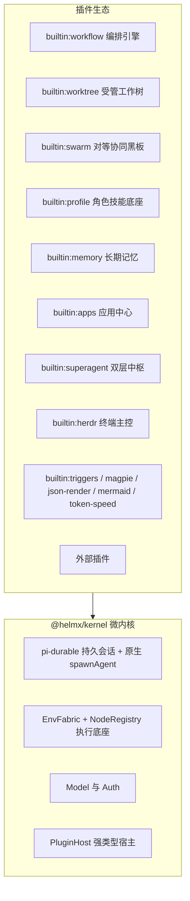
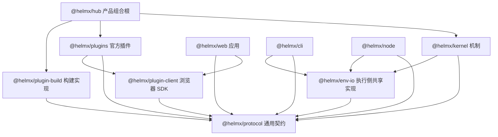
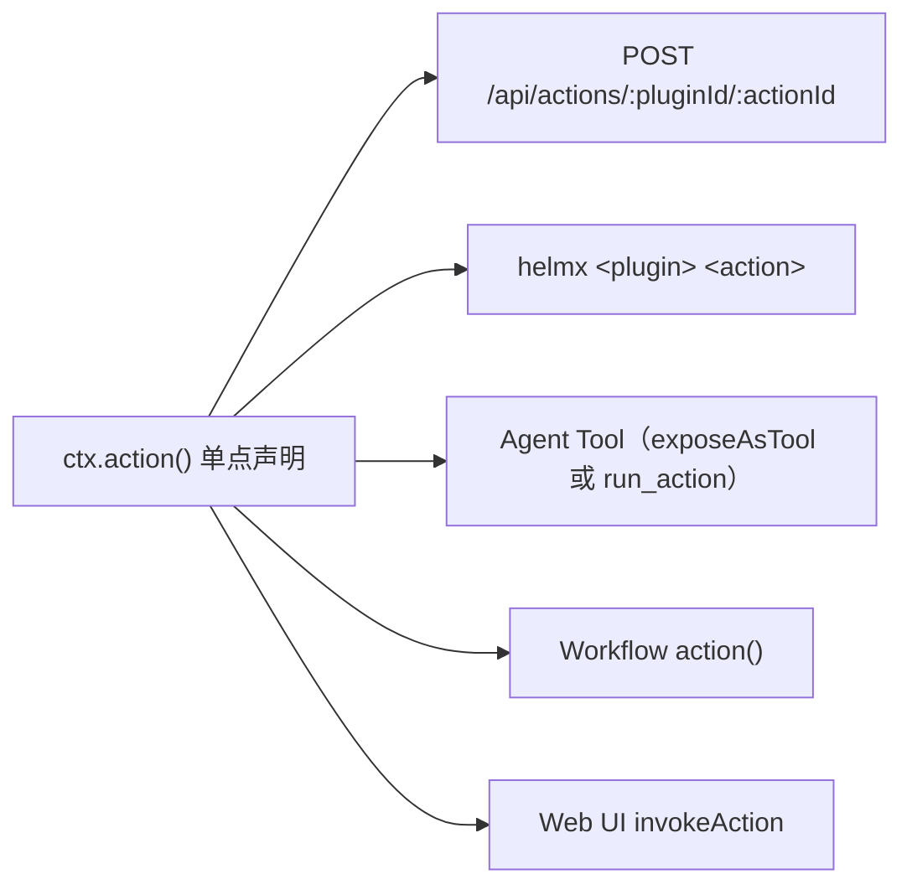

# 微内核架构总览

Hub 负责把产品接起来。`@helmx/kernel` 管理会话、节点执行、模型与鉴权，以及插件的加载和运行。`@helmx/hub` 选择要加载的插件，并提供 Web 服务入口。子代理和工作流由 Workflow 管理，成员之间的派工和交接由 Swarm 管理。两者都使用内核提供的会话与执行端口。 [插件契约](../plugins/overview.md) · [扩展点](extension-points.md)

## 微内核四块通用机制

`@helmx/kernel` 的职责收敛为四块机制，每块都与具体业务正交。`helmx-hub` 进程入口属于 `@helmx/hub`，由它选择插件、注入构建实现并启动内核：

| 机制 | 核心内容 | 明确不包含 |
| :--- | :--- | :--- |
| `pi-durable` 持久会话 | 通用 `Conversation(nodeId, cwd)` 五态状态机、`state.sqlite` + FTS5 派生索引、`AskDoc` 审批流、`SecretStash` 机密隔离、纯文件资产热重载、原生 `spawnAgent` 子会话派生（`agent_spawn` Hook 管道 + 默认执行行） | 编排引擎（`builtin:workflow`）、Worktree 租约（`builtin:worktree`） |
| `EnvFabric` + `NodeRegistry` | `/ws/node` 反向 WebSocket 网关、`/ws/node-tunnel` 节点任意 TCP 透传隧道（`openTunnel` 原语 + `nodeFetch` 适配层）、内建 `local` 节点 + 远端 `@helmx/node` 守护进程、`bash / read / write / edit` 内核工具与 `runGate` / `env exec` 宿主端口、按 `nodeId + canonicalPath` 的文件互斥 | 终端主控逻辑（`builtin:herdr`） |
| Model 与 Auth | 模型供应商接入、模型禁用过滤、凭据（`credentials.json`）与令牌管理 | 业务级模型路由策略（`builtin:magpie`） |
| `PluginHost` | 唯一强类型插件宿主 `definePlugin(ctx)`：生命周期 Hook、动作/工具/路由注册、doc 持久化、服务协调 | 任何具体插件的功能实现 |



以下能力**不在内核**，这是架构红线而非实现现状的描述：

- **编排引擎**：`subagent` / `SubagentWorkflow` 两个模型工具与 DSL 编排引擎（`packages/plugins/src/workflow/engine`）由 `builtin:workflow` 插件承载。
- **Worktree 管理**：受管 Git Worktree 的分配、租约、持有锁与安全清理由 `builtin:worktree` 插件承载（与 `builtin:workflow` 零静态依赖，仅经共享契约与 execution meta 命名空间协作）。内核对 Git 零语义——`AgentSpawnRequest.isolation` 等执行环境要求由插件层经 `agent_spawn` continuation 改写请求兑现，无插件兑现而原样到达原生执行行时显式返回 `unsupported_runtime`。
- **角色与技能**：`SYSTEM.md` 注入、技能目录与 `load_skill` 工具由 `builtin:profile`（常驻不可卸载）提供；`builtin:memory` 自管 `profiles/<id>/MEMORY.md`。内核对「角色」这个概念零感知。
- **巡检定时器**：内核不提供 `watchdog` 定时器，也不存在 `watchdog_tick` Hook。周期性任务一律由插件自管服务调度——`builtin:superagent` 用自有 `ctx.service` 驱动巡检周期，`builtin:herdr` 通过通用进程内事件采集终端诊断。
- **声明式 JSON 渲染与 Mermaid**：分别由 `builtin:json-render` 与 `builtin:mermaid` 插件提供，停用后相关围栏回退普通代码块。

## 零业务角色硬编码

内核类型系统中不存在 `'router' | 'worker' | 'watchdog'` 之类的业务角色枚举。会话职责由两个正交的元数据维度表达，`ConversationSummary`（`packages/protocol/src/conversation.ts`）中只有 `profileId` 与 `tags`：

- **`profileId` 表达身份**：绑定独立的 `SYSTEM.md` 提示词、`MEMORY.md` 记忆、技能白名单、默认模型与工作目录，决定「这个会话是谁」。
- **`tags` 表达运行态**：由插件或用户声明的生命周期标记（如 `worker`、`archived`），决定「这个会话处于什么编排阶段」，可随时增删。

```typescript
// packages/protocol/src/conversation.ts（节选）
export interface ConversationSummary {
  id: number
  title: string
  profileId: string        // 身份：提示词 / 记忆 / 技能 / 模型
  tags: string[]           // 运行态：生命周期与分组标记
  ownedBy?: 'human' | 'helmx' | 'bot'  // 归属权（自动化红线的判定依据）
  nodeId?: string          // 绑定计算节点（缺省 'local'）
  cwd: string              // 目标节点视角工作目录
  status: ConversationStatus
  // ...
}
```

工程收益是直接的：新增一种智能体角色只需创建 Profile 与（可选的）插件，内核代码与数据库结构零改动。`builtin:superagent` 是典型实践——它首次启用时动态创建中枢与巡检两个常驻会话，ID 持久化于插件自有 doc，内核将它们视为普通会话，路由、派生与巡检逻辑完全由插件 Hook 与自有服务驱动。

## 单向包依赖拓扑



- `@helmx/protocol` 只放通用跨包契约（会话、RPC、插件契约类型、错误码与 `CORE_CLI_COMMAND_PATHS`），零运行时重依赖；工作流、工作树等插件业务契约归属 `@helmx/plugins`。
- 内核不得依赖插件或组合根；生产源码不得通过相对路径跨包或导入其他包的私有 `src`；新增依赖必须声明，包依赖图必须无环。
- `@helmx/plugin-client` 是独立浏览器 SDK，不反向依赖 Web 应用；插件 client.tsx 与宿主共享同一份 React 运行时。
- `@helmx/plugin-build` 提供构建实现，由产品层通过端口注入宿主；内核自身不携带 esbuild，未注入端口时对 client UI 与 TS 插件显式拒绝。

| 包 | 可执行 | 职责 |
| :--- | :--- | :--- |
| `@helmx/protocol` | — | 通用类型、Schema、错误码与 `CORE_CLI_COMMAND_PATHS` |
| `@helmx/kernel` | — | 持久会话、EnvFabric、Model/Auth、PluginHost 与 HTTP 服务机制 |
| `@helmx/plugins` | — | 官方插件、插件业务契约、客户端视图与技能资产 |
| `@helmx/plugin-client` | — | 共享 UI 原语、上下文、Hooks 与宿主接入端口 |
| `@helmx/plugin-build` | — | 插件源码构建实现，由产品组合根注入宿主 |
| `@helmx/env-io` | — | 执行侧共享 I/O 与共享自更新引擎（路径进程占用扫描；更新引擎位于 `src/update/`；控制通道与 OS 服务安装从包根导出；payload staging 经 `./hub-payload` 子路径导出，`tar` 依赖不进 node bundle 四外部契约） |
| `@helmx/hub` | `helmx-hub` | 默认插件注册、构建实现接线、服务进程启动与关闭、进程内控制通道（`hub-control.json`）与后台更新检查器（静默备包 + `/api/hub-update` 一键切换） |
| `@helmx/node` | `helmx-node` | 远端执行、文件系统操作与自升级 |
| `@helmx/cli` | `helmx` | 静态核心命令表 + 动作清单动态命令（含 `src/launcher/` 的本机 Hub 生命周期面：`helmx start/stop/restart/service` 与主动更新 `helmx update`） |
| `@helmx/web` | — | Web 应用（开发端口 3201，代理至 Hub 3202） |
| `@helmx/payload` | — | npm 三制品组装器（Hub payload / CLI bundle / node 守护进程 bundle） |

`helmx`（控制 CLI）与 `helmx-node`（节点守护进程）不得混装在同一包或同一命令中：二者的信任模型与部署位置完全不同。

## Hub 组合根：唯一选择默认插件的地方

`@helmx/hub` 的 `createHelmx()`（`packages/hub/src/app.ts`）只做三件事：

1. **注入构建实现**：默认注入 `@helmx/plugin-build` 的 provider（client.tsx 编译 + 外部 TS 转译），调用方可整体替换；内核机制与构建工具分离。
2. **注册内置插件并设定启停**：`builtin:profile`（locked 常驻）、`builtin:workflow`、`builtin:worktree`、`builtin:swarm`、`builtin:memory`、`builtin:json-render`、`builtin:mermaid`、`builtin:apps`、`builtin:triggers`、`builtin:magpie`、`builtin:token-speed`、`builtin:tasks` 十二个默认启用；`builtin:herdr`、`builtin:superagent` 两个默认停用。其中 `builtin:workflow` 固定先于 `builtin:worktree` 注册：`runtime.started` 监听器按注册顺序执行，先收敛遗留子会话再回收崩溃租约。随后从数据目录加载外部插件。启停规则和各插件的用途见 [内置插件清单](../plugins/overview.md#当前状态)。
3. **统一启动**：全部插件注册后执行 `kernel.start()`——先按依赖拓扑对全体服务 `prepare()`，再依次 `start()`，最后恢复 SDK 调度器。

直接使用 `KernelRuntime.open()` 时不隐式注册任何内置插件，可独立验证内核机制；使用 `createHelmx()` 得到完整产品。Web 静态目录托管属于产品层：直接使用内核 HTTP handler 时缺省只服务 API，提供 `webDistDir` 才启用静态托管。

插件的 `dependencies` 字段声明插件间依赖（仅 ID，不做版本解析）：启用时逐项校验依赖必须已注册且已启用，否则 `409 plugin_dependency_missing` / `plugin_dependency_not_enabled`；注册边界检测环路（含自依赖）返回 `409 plugin_dependency_cycle`；全局启动屏障按依赖拓扑序 prepare/start，stop/dispose 按逆拓扑序。

## 插件宿主生命周期与停止/重载边界

`PluginHost` 管理每个插件的注册（register）、启用（enable）、停用（disable）、注销（unregister）状态机。同插件的启停操作经 per-plugin 队列串行，不同插件之间并行。

**启停的原子性**：停用先把 phase 置为 `deactivating` 再进入 await，期间新的 `invokeAction / executeTool / runHook` 一律拒绝，任务不会进入正在拆毁的注册表；`inUse()` 是异步 IO，返回后二次门禁再置 `deactivating`，消除与新任务的竞态窗口。每个启用周期递增 epoch：旧 `definePlugin` 上下文（含 doc 句柄与宿主生命周期资源）在新周期或停用后立即失效，防止异步残留注册污染新周期。

**停用与卸载的拒绝边界**（三个错误码语义不同，不可混用）：

| 拒绝原因 | 错误码 | force 可否越过 |
| :--- | :--- | :--- |
| locked 常驻插件（`builtin:profile`） | `403` | 否 |
| 在途任务：服务 `liveTasks()` 非空、在途动作/工具/路由请求、活动隧道 | `409 plugin_has_live_tasks` | 否（不可 force） |
| 持久生效资源：`inUse()` 非空（如受管会话、未清理工作树）、被其他启用插件依赖 | `409 plugin_in_use` | 是（`--force`；被依赖时依赖方标记 broken） |

`liveTasks` 阻断保护的是运行中的执行——在途回调可能持有旧周期句柄，强制拆除会留下不可回收的资源；`inUse` 阻断保护的是持久状态——force 停用不删除数据，重新启用后资源仍在，但相关功能在停用期间不可用。`inUse()` 函数抛错时按「未知即占用」原则拒绝停用，绝不静默当空放行。

**停用即时消失**：插件停用后其工具、动作、CLI 命令、受管技能与 UI 贡献即时消失，不留幻影提示词——动作目录、工具注册表与 UI 清单都只投影当前已启用插件。外部插件的热重载（`reload`）走 doctor 预检 + 原子替换，同样受在途任务硬阻断。

## API 与 CLI 同权

Hub 不存在仅 Web 可用或仅 CLI 可用的私有接口。新增面向用户的 HTTP 接口必须在同一次改动补齐 CLI 映射（`packages/cli/src/commands/`，含 `--json` 与 `--current` 会话/节点自动感知），并同步 `@helmx/protocol` 的 `CORE_CLI_COMMAND_PATHS` 与 `builtin:profile` 的 `helmx-cli` 技能文档（测试双向锁定校验）。

插件通过 `ctx.action({ id, inputSchema, outputSchema })` 单点声明动作，自动获得五端映射：



关键规则：`pluginId` 含 `:` 时按 URI 编码；内置插件自动剥离 `builtin:` 前缀生成 CLI 命令路径，`cli.command` 可整体覆写（如 `builtin:worktree` 的 `cleanup_worktree` 动作注册为 `helmx worktrees cleanup`）；`cli.positional` 声明位置参数映射，`readFileInto` 支持把本地文件内容读入目标字段；`cli.timeoutMs = 0` 表示无超时，供长耗时动作使用；`idempotent: true` 的动作在工作流中断后允许从该步安全重跑。人工 HTTP/CLI 调用可无 `conversationId`，模型路径（`run_action`）与 Workflow 路径必须携带 `conversationId` 供宿主校验会话作用域（`scope`），防止绕过会话边界。

## 边界纪律

三条纪律贯穿所有改动：

1. **边界处强校验**：所有外部输入——HTTP body、插件产物、工作流 DSL、事件载荷、外部交接文件——在入口处执行类型/Schema 校验，非法输入显式拒绝而非静默降级；能力不支持、节点离线、交接失败必须显式报错并附诊断，绝不静默回退本机或编造数据。
2. **公共接口消费方普查**：改动跨包类型或导出符号前先改契约所属包，再全仓搜索全部消费方并同步，漏改即事故。
3. **活跃开发阶段不兼容、不迁移**：允许对 helmx 代码、公共接口、配置、数据库结构和开发数据直接做破坏性修改；严禁编写向后兼容层、旧格式读取、迁移脚本或双写。旧开发数据按新结构重建，运行数据固定位于 `~/.helmx`（或 `HELMX_DATA_DIR`）。

验证覆盖两条路径：无默认插件打开 `KernelRuntime` 确认会话与节点机制可用、缺少构建端口时相关请求显式失败；使用 `createHelmx` 注册官方插件确认工具、动作、UI 与技能生效且停用后贡献消失。全量验收命令见根 [AGENTS.md](../../AGENTS.md)。
