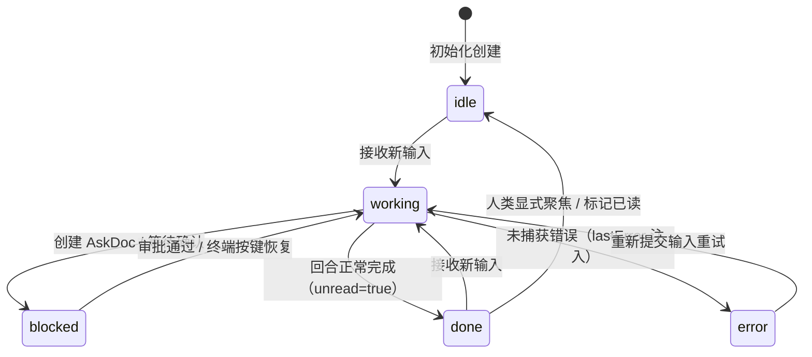
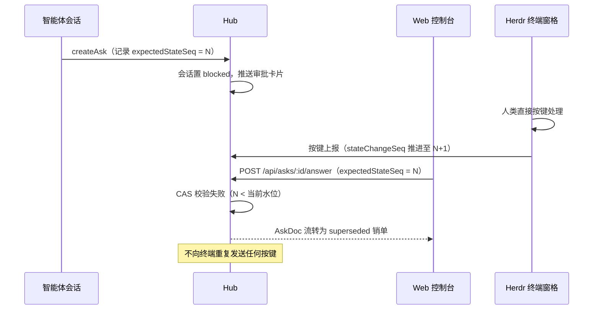

# 持久会话、存储、机密隔离与 CAS 审批

Helm 的会话层构建在 `pi-durable` 之上：每个智能体执行上下文抽象为通用 `Conversation(nodeId, cwd)`，配合五态状态机、单一 SQLite 持久层、纯内存机密保险箱与 CAS 乐观锁审批流。这一层与业务正交——内核没有任何角色枚举，会话职责由 `profileId` 与 `tags` 表达（见[架构总览](overview.md)）。

## 五态状态机



| 状态 | 含义 |
| :--- | :--- |
| `idle` | 空闲且历史已读 |
| `working` | 正在执行推理、工具调用或等待子代理 |
| `blocked` | 挂起等待人类审批（pending AskDoc）或子代理终端确认 |
| `done` | 本回合完毕待人类查阅（`unread = true`） |
| `error` | 最近一轮因未捕获异常终止（`lastError` 携带诊断，下回合开始自动清除） |

### 序列号水位线与并发策略

两条单调递增序列号支撑前端同步与调度对账：`stateChangeSeq` 在任何状态跃迁、实时动作（`doing` 零 Token 摘要）或审批项更新时递增，既是 SSE 推送的水位线也是 AskDoc CAS 乐观锁基准；`completionSeq` 在每次回合终态（正常或出错）递增，供工作流调度器对账「回合是否真正结束」。`unread` 守恒：普通 API 读取不清零，仅人类在 Web/CLI 显式聚焦或显式 PATCH 时清零——自动化探针不会吞掉未读标记。

会话正忙（`working`）时新输入的三种策略由 `WhenBusy` 表达：`steer`（内核默认）中止当前步骤并注入新指令；`followUp` 排队至当前回合结束后作为下轮输入；`reject` 直接拒绝并返回冲突。无第三种隐式行为，批处理投递请显式 `followUp`。

### 输入来源、归属权与插件管理权

每次提交的 `helm.input` entry 附着输入来源 `origin: 'human' | 'agent' | 'trigger'`，从 CLI/HTTP 一路透传到 `turn_settled` 钩子。后台 Worker 本回合消费的输入只要含任一 `agent / trigger` 来源，即向 `routerConversationId`（SuperAgent 中枢）投递汇报卡片；纯 `human` 回合仅静默更新召回图谱。

会话归属权 `ownedBy: 'human' | 'bot' | 'helm'`（缺省 `human`）是 Watchdog 红线判定的唯一可信来源：对 `bot/helm` 归属的后台会话允许自动恢复或中止；对 `human` 的人类直连会话或 Herdr 终端窗格**严禁发送任何按键或中止指令**，仅允许只读诊断与通知。未标记一律按 `human` 对待。在内核执行层，一切自动化中止或输入提交必须走 `ctx.host.abortConversationGuarded(id, guard)` 与 `ctx.host.submitInputGuarded(id, text, opts, guard)`：调用方携带探针时刻的 `expectedOwnership`（严禁 `human`）与可选 `expectedStateSeq`，内核在会话串行域内、于第一个不可逆动作前同步复核，不匹配即抛 `409 ownership_conflict / state_seq_conflict` 且绝不产生副作用。插件可经 `ctx.host.manageConversation(id)` 声明管理权——受管期间会话删除保护（`409 conversation_managed_by_plugin`），插件停用/回滚时宿主自动释放；`superagent` 的 router/watchdog 常驻会话、初始入口会话均受此保护且无 id 级删除豁免（删除后重启凭 tombstone 不复活、不补种）。

## 单一 state.sqlite 存储架构

全部持久化收敛到 `<dataDir>/state.sqlite` 一个数据库文件，pi-durable 原生表（`pi_` 前缀）与 Helm 扩展表共享同一连接与事务队列：

| 分组 | 表 | 用途 |
| :--- | :--- | :--- |
| pi-durable 原生 | `pi_conversations` / `pi_entries` | 会话骨架与消息/事件流水（SDK 管理） |
| Helm 扩展 | `helm_conversations` | 会话元数据：title、profile_id、tags、node_id、cwd、model、thinking_level、unread、pinned、state_change_seq、completion_seq |
| Helm 扩展 | `helm_conversation_tool_links` | 子会话 ↔ 父工具调用 ID 关联 |
| Helm 扩展 | `helm_asks` | AskDoc 审批（spec、status、expected_state_seq） |
| Helm 扩展 | `helm_artifacts` | 产物索引（path、mime_type、size；按 conversation_id 索引） |
| Helm 扩展 | `helm_plugin_docs` / `helm_plugin_session_docs` | 插件全局文档与会话分片文档 |
| Helm 扩展 | `helm_seq` / `helm_tombstones` | 序列号发生器与删除墓碑 |
| 派生索引 | `helm_conversation_fts` | FTS5 全文检索（见下） |

连接纪律：所有 SQL 一律经同一 `NodeSqliteDatabase` adapter 排队执行——绕过 facade 的裸调用可能与 pi 事务互相回滚，绝不另开连接。打开时显式设置 PRAGMA：`journal_mode=WAL`（读写并发）、`synchronous=NORMAL`（性能与崩溃安全平衡）、`busy_timeout=5000`（避免并发争抢直接失败）、`wal_autocheckpoint=1000`（控制 WAL 体积）。

### FTS5：纯可重建的派生索引

`helm_conversation_fts(conversation_id UNINDEXED, entry_id UNINDEXED, title, body)` 是**可重建的派生索引**，不是权威数据：`body` 只索引脱敏后的纯文本（secret 值永不入库），结构变更时经 `rebuildFts()` 全量重建即可恢复，绝不允许向其写入 `pi_*` 表语义。全文检索入口为 `GET /api/search?q=` 与 `helm search <query>`。

## SecretStash：纯内存机密隔离

机密值只存在于 Hub 进程内存（`StashedSecret` 对象），持久层与模型上下文仅见到 `[REDACTED:stash:<uuid>]` 占位符。生命周期为：用户或插件登记机密 → stash 生成 UUID 占位符 → 数据库/日志/时间线/FTS 全部只落占位符 → EnvFabric 执行命令前现场还原注入环境变量（`HELM_SECRET_*` 或登记时指定的环境变量名）→ 命令输出出站前过全局脱敏（占位符与已登记明文替换 `[REDACTED]`）。

```typescript
// packages/kernel/src/services/secret-stash.ts（节选）
export const REDACTED_PREFIX = '[REDACTED:stash:'
export interface StashedSecret {
  readonly conversationId: number   // 会话级命名空间隔离，杜绝跨会话串用
  readonly uuid: string
  readonly placeholder: string      // [REDACTED:stash:<uuid>]
  readonly value: string
  readonly name: string
}
```

`addRedaction(value)` 登记全局逐值脱敏（如内核受管 `HELM_TOKEN`）：非环境变量、不计入统计、不随 `clear(conversationId)` 清除；多个登记可叠放同一值，全部解除后才停止脱敏。`AskDoc` 字段标记 `secret: true` 时，用户提交的答案直接进入 stash，持久层仅存占位符。插件私有 secrets 持久化于 `credentials.json` 的 `pluginSecrets.<pluginId>`（恒 0600），明文不进入公共文档、事件或模型上下文。

### 诚实安全边界

stash 防的是**持久化泄漏与上下文泄漏**：提示词注入、日志落盘、数据库文件被读取都拿不到明文。但它**不承诺对可信代码零泄漏**：任意 Shell 命令与进程内插件天然拥有宿主权限，可以读环境变量、扫描进程内存——这是可信代码的固有权限，本模块不设防也不应宣称设防。

## AskDoc：CAS 乐观锁审批

智能体需要人类授权时创建 `AskDoc` 并把会话置为 `blocked`。字段类型支持 `text`（文本输入）、`select`（单选列表，带 options）与 `confirm`（确认框）；`secret: true` 标记的答案走 SecretStash。`ctx.host.createAsk(spec)` 返回 Promise，正常三态终局（`answered / cancelled / superseded`）均 resolve，只有验证/I/O/宿主失败才 reject——调用方无需区分「人取消了」与「系统坏了」。

### expectedStateSeq 防双端竞态

同一智能体可能同时连接 Web 控制台与 Herdr 终端窗格：人类在终端直接按键处理时，底层 `stateChangeSeq` 已推进，而 Web 端的审批卡片仍是旧水位——若无保护，Web 端迟到的提交会向终端重复发送回车。



CAS 水位的解析可注册异步 resolver（`ctx.host.registerAskSeqResolver`）——Herdr 场景下真实水位需经远端 IO 现查，而非创建时快照。`helm asks answer --expected-state-seq N` 在 CLI 侧提供同一保护。对 `ownedBy: 'human'` 会话的终端窗格，任何自动化路径（含 superseded 流转）都不得发送按键，这是归属权红线的直接推论。
