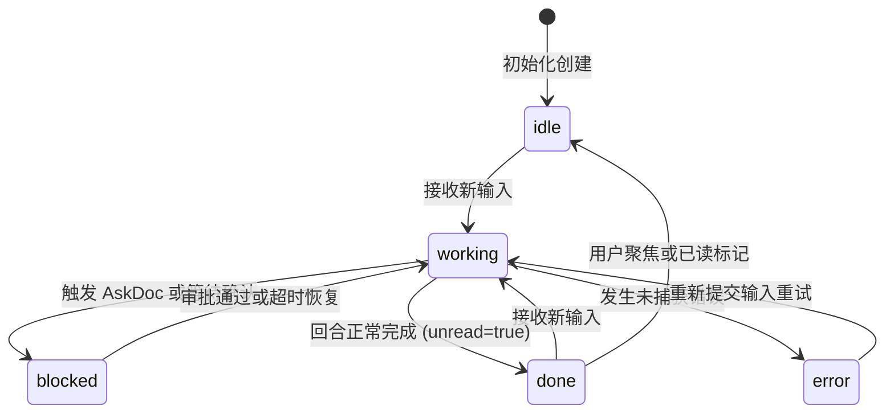
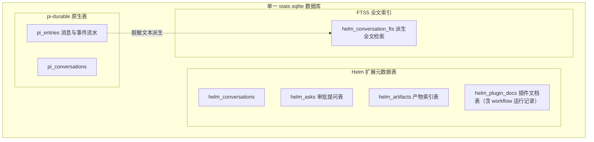
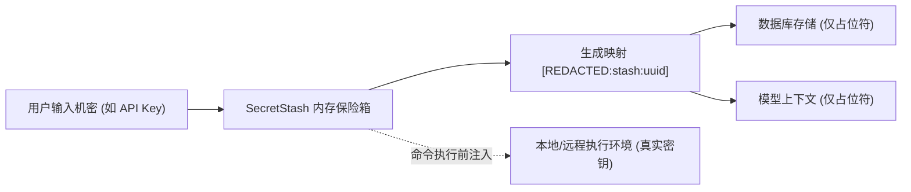
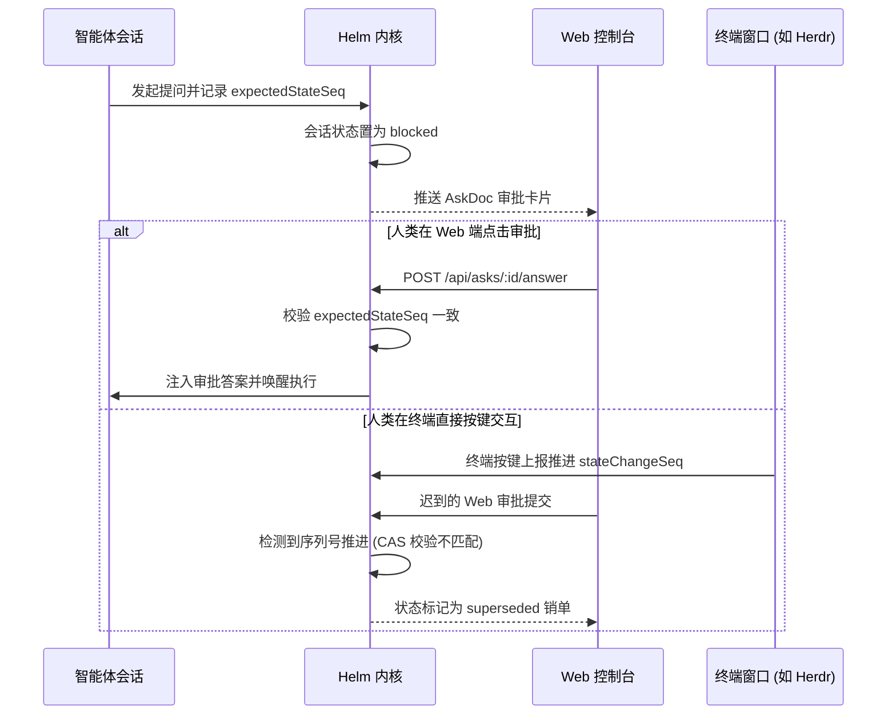

# 持久化会话与状态机

本文介绍 Helm 的通用会话状态机、SQLite 与 FTS5 存储引擎、机密内存隔离及 CAS 乐观锁审批机制。

---

## 通用会话状态机模型

Helm 将每个智能体执行上下文抽象为 `Conversation(nodeId, cwd)`。
系统通过单调递增的序列号跟踪所有状态跃迁。

### 五态生命周期定义

| 状态 | 标识 | 说明 |
| :--- | :--- | :--- |
| **空闲已读** | `idle` | 会话处于空闲状态，且历史消息已读 |
| **执行中** | `working` | 正在执行模型推理、工具调用或等待子智能体 |
| **等待审批** | `blocked` | 挂起等待人类审批通过或等待终端按键确认 |
| **完成未读** | `done` | 当前回合执行完毕，等待人类查阅（`unread = true`） |
| **执行错误** | `error` | 最近一轮执行因未捕获错误而中断退出 |

### 序列号与并发策略

1. **状态序列号（`stateChangeSeq`）**：
   任何状态跃迁、实时动作（`doing`）或审批项更新均推进该序号。
   该序号作为前端 SSE 推送的水位线与 CAS 乐观锁基准。
2. **完成序列号（`completionSeq`）**：
   每次回合正常结束或出错终止时单调递增，供工作流调度对账。
3. **未读状态守恒**：
   普通 API 读取不会清除 `unread` 状态。
   仅在人类用户于 Web 或 CLI 显式聚焦会话时清零。
4. **繁忙控制策略（`whenBusy`）**：
   当会话处于 `working` 状态时，新输入支持三种策略：
   - `steer`（默认）：插话引导，中止当前步骤并注入新指令。
   - `followUp`：排队等待，在当前回合结束后作为下一轮输入执行。
   - `reject`：拒绝接收，直接返回请求冲突错误。

---

## SQLite 单库与 FTS5 全文搜索

系统采用单一 `state.sqlite` 数据库管理全量持久化数据。
数据文件默认存储于 `~/.helm/state.sqlite`。

### 连接队列与 WAL 模式参数

为杜绝 SQLite 写入冲突与文件死锁，内核采用统一排队驱动：
- **单一连接排队**：所有 SQL 均通过单一 `NodeSqliteDatabase` 适配器排队。
- **WAL 模式**：配置 `journal_mode=WAL`，大幅提升读写并发性能。
- **同步级别**：配置 `synchronous=NORMAL`，兼顾性能与崩溃安全性。
- **锁等待超时**：配置 `busy_timeout=5000`，避免并发争抢导致写入失败。
- **检查点刷新**：配置 `wal_autocheckpoint=1000`，稳定控制 WAL 日志体积。

### FTS5 派生检索索引

- **派生索引定位**：FTS5 全文索引是纯派生数据，不得修改 `pi_*` 核心表语义。
- **结构定义**：`helm_conversation_fts(conversation_id UNINDEXED, entry_id UNINDEXED, title, body)`。
- **脱敏文本索引**：`body` 字段仅索引脱敏后的纯文本，敏感凭据绝不入库。
- **在线重建能力**：系统提供 `rebuildFts()` 接口，支持随时全量重建索引。

---

## SecretStash 纯内存机密隔离

用户凭据与密钥的安全隔离是多智能体系统的核心要求。
Helm 设计了纯内存的 `SecretStash` 机密保险箱机制。

### 内存存储与占位符映射

1. **纯内存驻留**：机密值只存储在 Node.js 进程内存中，绝不写入数据库与日志文件。
2. **上下文脱敏**：大模型上下文与时间线仅包含 `[REDACTED:stash:<uuid>]` 占位符。
3. **会话级隔离**：按会话隔离命名空间，杜绝跨会话串用机密。
4. **实时还原注入**：在 EnvFabric 执行 Shell 命令前现场还原并注入环境变量。

### 诚实安全边界

系统如实声明机密安全边界：
- 机密保险箱可以有效防止提示词泄漏与日志持久化泄露。
- 但由于 Shell 命令与进程内插件具备宿主执行权限。
- 系统无法防御受信任脚本在执行时主动读取环境变量或扫描进程内存。

---

## AskDoc 乐观锁审批机制

当智能体需要人类授权时，会创建 `AskDoc` 审批文档并将状态置为 `blocked`。

### 提问字段与机密输入

- **支持字段类型**：支持文本输入（`text`）、单选列表（`select`）与确认框（`confirm`）。
- **机密输入标记**：字段配置 `secret: true` 时，用户提交的答案直接进入 `SecretStash`。

### expectedStateSeq CAS 防竞态

当同一个智能体同时连接 Web 控制台与终端界面时，可能发生双端审批竞态：
1. **记录基准水位**：创建 `AskDoc` 时记录当时的 `expectedStateSeq`。
2. **终端优先推进**：若人类直接在终端窗格完成按键输入，底层状态序号递增。
3. **Web 端自动销单**：Web 端提交答案时 CAS 校验不匹配。
4. **无害幂等终态**：该审批单自动流转为 `superseded`，防止向终端重复发送按键。
