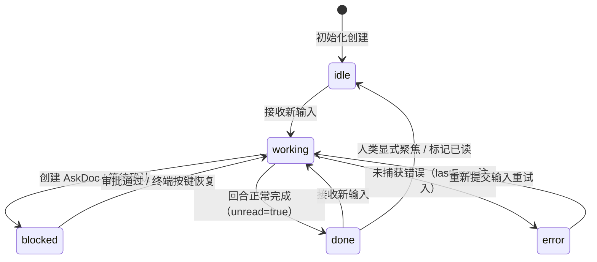
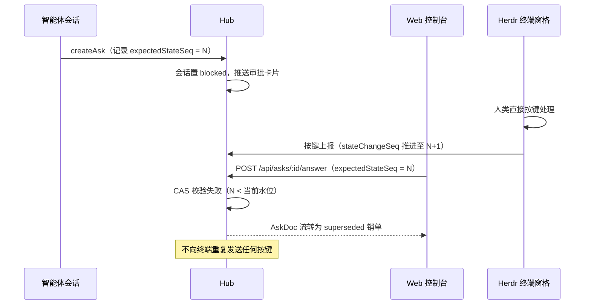

# 持久会话、存储、机密隔离与 CAS 审批

本文面向需要理解会话层内部机制的读者：排查会话状态与输入投递问题的维护者、要正确使用 `ctx.host.submitInputGuarded / abortConversationGuarded / createAsk` 的插件开发者，以及关心「机密到底存在哪里、谁能看到」的安全评审者。Helm 的会话层构建在 `pi-durable` 之上：每个智能体执行上下文抽象为通用 `Conversation(nodeId, cwd)`，配合五态状态机、单一 SQLite 持久层、纯内存机密保险箱与 CAS 乐观锁审批流。这一层与业务正交——内核没有任何角色枚举，会话职责由 `profileId` 与 `tags` 表达（见[架构总览](overview.md)）。

## 五态状态机

| 状态 | 含义 |
| :--- | :--- |
| `idle` | 空闲且历史已读 |
| `working` | 正在执行推理、工具调用或等待子代理 |
| `blocked` | 挂起等待人类审批（pending AskDoc）或子代理终端确认 |
| `done` | 本回合完毕待人类查阅（`unread = true`） |
| `error` | 最近一轮因未捕获异常终止（`lastError` 携带诊断，随下一回合开始自动清除） |

### 序列号水位线与并发策略

两条单调递增序列号支撑前端同步与调度对账：`stateChangeSeq` 在任何状态跃迁、实时动作（`doing` 零 Token 摘要）或审批项更新时递增，既是 SSE 推送的水位线也是 AskDoc CAS 乐观锁基准；`completionSeq` 在每次回合终态递增，供工作流调度器对账「回合是否真正结束」。`unread` 守恒：普通 API 读取不清零，仅人类在 Web/CLI 显式聚焦或显式 PATCH 时清零——自动化探针不会吞掉未读标记。

会话正忙（`working`）时新输入的三种策略由 `WhenBusy` 表达：`steer`（内核默认）中止当前步骤并注入新指令；`followUp` 排队至当前回合结束后作为下轮输入；`reject` 直接拒绝并返回冲突。无第三种隐式行为，批处理投递请显式 `followUp`。

### 输入身份、来源与归属权

输入以持久 `ConversationInput.id` 为唯一身份，该值也是提交给 SDK 的 `requestId`。SDK 的 `run.inputs` 使用 submission ID，追踪器通过独立的 `submissionId → requestId` 索引关联，不能把两种标识当作同一个值。重启恢复活跃回合时，追踪器按 SDK 的权威 submission 清单精确回读对应 entry，补齐来源、元数据和附件。

每次提交的 `helm.input` entry 附着输入来源 `origin: 'human' | 'agent' | 'trigger'`，从 CLI/HTTP 一路透传到 `turn_settled` 钩子。后台 Worker 本回合消费的输入只要含任一 `agent / trigger` 来源，即向中枢（`builtin:superagent` 的 router 会话）投递汇报；纯 `human` 回合仅静默更新召回图谱。

会话归属权 `ownedBy: 'human' | 'bot' | 'helm'`（缺省 `human`）是自动化红线的唯一可信判定来源：对 `bot/helm` 归属的后台会话允许自动恢复或中止；对 `human` 的人类直连会话或 Herdr 终端窗格**严禁发送任何按键或中止指令**，仅允许只读诊断与通知。未标记一律按 `human` 对待。

### guarded 端口：人类会话保护的执行层落地

一切自动化中止或输入提交必须走 `ctx.host.abortConversationGuarded(id, guard)` 与 `ctx.host.submitInputGuarded(id, text, opts, guard)`：调用方携带探针时刻的 `expectedOwnership`（严禁 `human`）与可选 `expectedStateSeq`，内核在会话串行域内、于第一个不可逆动作前同步复核，不匹配即抛 `404 not_found / 409 ownership_conflict / 409 state_seq_conflict` 且绝不产生副作用。`submitInputGuarded` 的全部准备工作（input 钩子、模型解析、附件授权）完成后才到达提交点复核；`abortConversationGuarded` 相位自适应——SDK 调度器已运行时中止并等待空闲；调度器仍处 paused（全局服务 prepare 屏障、resume 之前）时只对会话名下的存活 SDK 任务提交持久 abort 标记，不唤醒调度器、不等结算，供恢复编排（如 workflow 的 `prepareRecovery`）在调度器启动前持久取消中断任务。内核绝不批量取消任意会话：目标会话永远由调用方逐个显式给出。

插件可经 `ctx.host.manageConversation(id)` 声明会话管理权——受管期间会话删除保护（`409 conversation_managed_by_plugin`），插件停用/回滚时宿主自动释放。初始入口会话没有 ID 级删除豁免，删除后重启凭 tombstone 不复活、不补种。

## 单一 state.sqlite 存储架构

全部持久化收敛到 `<dataDir>/state.sqlite` 一个数据库文件（`packages/kernel/src/runtime/sqlite.ts`），pi-durable 原生表（`pi_` 前缀，由 SDK 管理与演进）与 Helm 扩展表共享同一连接与事务队列：

| 分组 | 表 | 用途 |
| :--- | :--- | :--- |
| pi-durable 原生 | `pi_*`（SDK 管理） | 会话骨架与消息/事件流水 |
| Helm 扩展 | `helm_conversations` | 会话元数据：title、profile_id、tags、parent_conversation_id、node_id、cwd、model、thinking_level、unread、pinned、state_change_seq、completion_seq |
| Helm 扩展 | `helm_conversation_tool_links` | 子会话与父工具调用 ID 关联 |
| Helm 扩展 | `helm_asks` | AskDoc 审批（spec、status、expected_state_seq） |
| Helm 扩展 | `helm_artifacts` | 产物索引（path、mime_type、size；按 conversation_id 索引） |
| Helm 扩展 | `helm_plugin_docs` / `helm_plugin_session_docs` | 插件全局文档与会话分片文档 |
| Helm 扩展 | `helm_seq` / `helm_tombstones` | 事件序列号发生器与删除墓碑 |
| 派生索引 | `helm_conversation_fts` | FTS5 全文检索（见下） |

连接纪律：所有 SQL 一律经同一 `NodeSqliteDatabase` adapter 排队执行——绕过 facade 的裸调用可能与 pi 事务互相回滚，绝不另开连接。打开时显式设置 PRAGMA：`journal_mode=WAL`、`synchronous=NORMAL`、`busy_timeout=5000ms`、`wal_autocheckpoint=1000` 页。

### FTS5：纯可重建的派生索引

`helm_conversation_fts(conversation_id UNINDEXED, entry_id UNINDEXED, title, body)` 是**可重建的派生索引**，不是权威数据：`body` 只索引脱敏后的纯文本（secret 值永不入库），结构变更时经 `rebuildFts()` 全量重建即可恢复，绝不允许向其写入 `pi_*` 表语义。全文检索入口为 `GET /api/search?q=` 与 `pnpm helm search <query>`（用户输入转成 FTS5 前缀 OR 查询，引号包裹每个 token 防语法注入）。

## SecretStash：纯内存机密隔离

机密值只存在于 Hub 进程内存（`StashedSecret` 对象，按 `conversationId` 命名空间隔离），持久层与模型上下文仅见到 `[REDACTED:stash:<uuid>]` 占位符。生命周期：用户或插件登记机密 → stash 生成 UUID 占位符 → 数据库/日志/时间线/FTS 全部只落占位符 → EnvFabric 执行命令前现场还原注入环境变量（`HELM_SECRET_*` 或登记时指定的环境变量名）→ 命令输出出站前过全局脱敏（占位符与已登记明文替换 `[REDACTED]`）。

`AskDoc` 字段标记 `secret: true` 时，用户提交的答案直接进入 stash，持久层仅存占位符；可选 `secretLifetime: { ttlMs?, scope? }`（仅 secret 字段允许，`ttlMs` 为不超 24h 的正 safe integer，`scope` 为 `conversation`（缺省）/ `turn`）声明生命周期。插件私有 secrets 持久化于 `credentials.json` 的 `pluginSecrets.<pluginId>`（恒 0600），明文不进入公共文档、事件或模型上下文。

**生命周期：停止注入 != 停止脱敏。** TTL 到期（读路径按注入 clock 惰性判定，无定时器）或 `turn` 作用域的回合结算（`completed | failed | aborted` 统一漏斗，按「出生结算序」精确归属——回合内登记属本回合，结算后落地/late hook 登记属下一回合，idle 不清扫）后，秘密仅从注入环境移除；`byUuid` 旧值（含同名覆盖前的旧值）永久保留用于全部输出脱敏（含跨 chunk 流式）。会话删除时 `stash.clear(conversationId)` 一并回收脱敏旧值。`addRedaction(value)` 登记全局逐值脱敏（如内核受管 `HELM_TOKEN`）：非环境变量、不计入统计、不随 `clear` 清除；多个登记可叠放同一值，全部解除后才停止脱敏。

### 诚实安全边界

stash 防的是**持久化泄漏与上下文泄漏**：提示词注入、日志落盘、数据库文件被读取都拿不到明文。但它**不承诺对可信代码零泄漏**：任意 Shell 命令与进程内插件（含全栈微应用）天然拥有宿主权限，可以读环境变量、扫描进程内存——这是可信代码的固有权限，本模块不设防也不应宣称设防。同理，TTL/回合结束无法从已启动的子进程撤回已注入的环境变量，只保证后续 spawn 不再注入。

## AskDoc：CAS 乐观锁审批

智能体需要人类授权时创建 `AskDoc` 并把会话置为 `blocked`。字段类型支持 `text`（文本输入）、`select`（单选列表）与 `confirm`（确认框）；`secret: true` 标记的答案走 SecretStash。`ctx.host.createAsk(spec)` 返回 Promise，正常三态终局（`answered / cancelled / superseded`）均 resolve，只有验证/I/O/宿主失败才 reject——调用方无需区分「人取消了」与「系统坏了」。

### expectedStateSeq 防双端竞态

同一智能体可能同时连接 Web 控制台与 Herdr 终端窗格：人类在终端直接按键处理时，底层 `stateChangeSeq` 已推进，而 Web 端的审批卡片仍是旧水位——若无保护，Web 端迟到的提交会向终端重复发送回车。

CAS 以持久化的 `spec.expectedStateSeq` 为准：客户端提供的不同 seq 返回 `409 ask_seq_conflict`；已结算审批再操作返回 `409 ask_already_settled`。CAS 水位的解析可注册异步 resolver（`ctx.host.registerAskSeqResolver`）——Herdr 场景下真实水位需经远端 IO 现查，而非创建时快照；声明的 expectedStateSeq 无 resolver 命中时显式拒绝校验，不猜测。`pnpm helm asks answer --expected-state-seq N` 在 CLI 侧提供同一保护。对 `ownedBy: 'human'` 会话的终端窗格，任何自动化路径（含 superseded 流转）都不得发送按键，这是归属权红线的直接推论；Herdr 的 `agent.send_keys` 强制要求服务端 `send_keys_expected_state_seq` 能力门禁。

## EventHub SSE：快照、事件代与短断线续传

全局 `GET /api/events` SSE 流由内核 `EventHub` 提供，seq 持久化（`helm_seq`）单调递增、重启不回退。每个 EventHub 实例启动时随机生成 `bootId`（事件代）：**seq 只在同代内连续可比**，跨代（服务端重启换实例）绝不凭裸 seq 续传。

首帧有两种形态：

- `event: snapshot`（`HelmSnapshot`，含 `bootId`）：全量对齐。客户端清空并重建本地状态，记录 `{bootId, seq}` 作为续传凭据；
- `event: resumed`（`HelmResumedFrame {bootId, seq, headSeq}`）：短断线续传。客户端携带 `?afterSeq=<seq>&bootId=<bootId>` 双凭据重连，服务端校验通过后先发该控制帧，再按 seq 顺序补发 `(afterSeq, headSeq]` 的缓存帧，随后无缝衔接实时增量——严格无重复、无遗漏。

服务端续传判定（任一不满足即回退 snapshot，绝不越缺口假成功）：`bootId` 必须与当前实例一致；`afterSeq` 不大于当前 head；需要补发的帧必须全部仍在内存 ring 中。畸形凭据显式 `400 invalid_input`，绝不静默忽略或半续传。

发布严格按「组装脱敏 → 编码 → 持久化 nextSeq → 推进内存水位 → 入 ring → 广播」排序：持久化抛错不推进水位、不留裸 seq 半成品，从根源上消除 ring 缺口。内存 ring 只保存发布时编码一次的脱敏 SSE 字节（订阅者 fan-out 与重放共享同一份，不可变），帧数与字节双上限（默认 256 帧 / 1 MiB）超限从头淘汰；单帧超字节预算即清空 ring——任何客户端都无法跨该帧续传，宁可回退 snapshot。

客户端（Web `HelmStoreProvider`）纪律：resumed 握手必须校验本地已初始化同 `bootId` 且水位一致，否则作废凭据强制全量；续传水位按帧实际应用成功才推进；协议错误作废凭据；登出/重新鉴权清空续传凭据；重连退避为指数退避加随机抖动。会话文档专用 SSE（`plugin.session_doc.updated`）不进入全局流，每连接独立首帧快照、不经 ring 续传。
