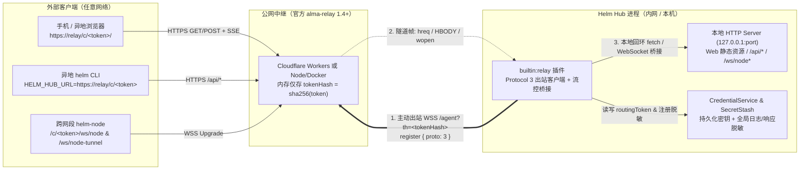

## 背景

Helm Hub 默认监听本机回环地址 `127.0.0.1:3202`（`packages/hub/src/main.ts`）。用户要在局域网外访问 Hub、从外部运行 `helm` CLI，或让跨网段的 `helm-node` 守护进程接入 Hub，必须自行配置公网 IP、端口映射、反向代理或虚拟局域网。

开源项目 `alma-relay`（MIT 许可证，版本 `1.4.0`）提供了一套无状态公网中继服务，支持部署在 Cloudflare Workers（Durable Objects + WebSocket Hibernation）或自建 Node.js / Docker 容器上。桌面端主动向中继发起一条出站 WebSocket 连接并保持长连，客户端通过 `https://<relay>/c/<token>/...` 访问中继，中继按 `sha256(token)` 查找桌面端连接并透明转发 HTTP 请求、流式响应（SSE）与 WebSocket 连接。

对照 Helm 的微内核架构与现有实现，直接接入 `alma-relay` 存在五处约束与缺口：

1. **职责边界与插件归属**：根据 `AGENTS.md` 第 2 节，内核（`@helm/kernel`）只提供持久会话、`EnvFabric` 节点执行底座、模型鉴权与 `PluginHost` 四块通用机制。`EnvFabric` 的 `/ws/node` 处理「受控节点反向连入 Hub」的执行控制面，而公网中继处理「外部世界经出站隧道访问 Hub」的边缘接入面。将公网中继客户端写进内核会扩大默认攻击面，并混同节点控制与外部接入两层职责。
2. **宿主内部缺少本地回环地址查询接口与启动就绪通知**：
   - `packages/hub/src/main.ts` 先执行 `await createHelm()`（内部调用 `kernel.start()` 启动全部已启用插件的 `service.start()`），随后才执行 `await startHub()` 监听端口并调用 `kernel.setHubUrl(url)`。在嵌入式或测试场景下，`startHub({ port: 0 })` 使用操作系统动态分配的端口，插件在 `service.start()` 时无法假设端口固定为 `3202`。
   - `HelmHostApi`（`packages/protocol/src/plugin.ts`）仅提供读取远端节点注册地址的 `nodeIpc.getNodeHubUrl(nodeId)`，未暴露 Hub 自身的本地监听地址 `runtime.hubUrl`，也未在 `setHubUrl` 时发出内部通知。
3. **Web 前端硬编码根路径 `/api/*` 与根资源路径，在 `/c/<token>/` 子路径下失效**：
   - `alma-relay` 解析客户端路径 `/c/<token>/rest`（`shared.mjs` 的 `parseClientPath`）时，会将剥离 `/c/<token>` 后的 `rest` 转发给 Hub。
   - 浏览器打开 `https://<relay>/c/<token>/` 时，`packages/web/vite.config.ts` 未设置相对 `base`，构建产物中的 `/assets/...` 会请求 `https://<relay>/assets/...` 并返回 `404`。
   - `packages/web/src/lib/api.ts`、`HelmStoreProvider.tsx`、`session-docs.ts` 及 `plugin-client.ts` 中的 `fetch('/api/...')` 以 `/` 开头，浏览器会丢弃 `/c/<token>` 前缀直接请求中继根路径。同时，若用户访问无尾斜杠的 `https://<relay>/c/<token>`，浏览器解析相对路径 `./api/...` 会将 `<token>` 当作文件名消去，变成 `https://<relay>/api/...`。
4. **插件任务计数（`liveTasks`）与常驻隧道生命周期冲突**：`PluginTaskTracker`（`packages/kernel/src/plugins/host-api.ts`）用于在插件停用或重载前拦截未完成的异步任务（返回 `409 plugin_has_live_tasks`，不可强制跳过）。若中继插件的出站 WebSocket 连接或代理中的长连接 SSE 流计入 `tracker.withTask`，只要有客户端打开 Web 页面，用户就无法停用或重载该插件。
5. **路由令牌脱敏盲区**：`@helm/node`（`packages/node/src/daemon/index.ts:495, 862`）与 `@helm/cli`（`packages/cli/src/hub-client.ts:13`）已原生保留 `hubUrl` 中的路径前缀，支持直接配置 `https://<relay>/c/<token>` 接入。但节点注册时会将完整的 `hubUrl`（含 `<token>` 明文）上报给 `NodeRegistry`（`packages/kernel/src/env/registry.ts:414`），并出现在 `GET /api/nodes`、SSE 快照及模型工具结果中。若未将 `<token>` 注册进内核 `SecretStash` 脱敏表，路由令牌会进入模型上下文与日志。

本次设计新增默认停用的内置插件 `builtin:relay`，作为 `alma-relay` 协议 3（Protocol 3）的客户端连接公网中继，并在内核补充只读 `hubUrl` 端口、在 Web 前端收敛相对路径请求。改造后达到以下可观察效果：

- 用户可直接部署官方 `alma-relay`（Cloudflare Workers 或 Docker/Node），在 Helm 中启用 `builtin:relay` 并填入中继地址，无需开放入站端口即可生成 `https://<relay>/c/<token>/` 访问链接。
- 手机或异地浏览器打开该链接（无论末尾是否带 `/`），均可加载完整 Web 界面、订阅 SSE 实时流并动态加载插件前端模块，身份认证继续由 Helm 既有的 `AuthService` 主控密码与 Bearer Token 保护。
- 异地 `helm` CLI 与 NAT 内网中的 `helm-node` 守护进程可将 `HELM_HUB_URL` 设为 `https://<relay>/c/<token>`，无需修改 `@helm/cli` 与 `@helm/node` 代码即可执行命令、建立 `/ws/node` 控制通道与 `/ws/node-tunnel` 节点隧道。
- 路由令牌与中继注册密钥全程存于 `credentials.json`（`0600`）并自动登记 `SecretStash` 全局脱敏，停用插件时立即断开出站隧道并中止在途代理流，不触发 `409 plugin_has_live_tasks`。

非目标：不自研或托管中心化公网中继服务端；不实现 Alma 客户端专有的 `/__alma_e2e__` 握手（该机制在开启后会以 `403` 拒绝一切标准 HTTP 请求与非加密 WebSocket，导致浏览器、`helm` CLI 与 `helm-node` 无法直接接入；本方案采用 HTTPS/WSS 传输加密 + 256-bit 随机路由令牌 + Helm Bearer Token 鉴权）；不在本阶段接入 APNs / FCM 移动端原生推送与 WebRTC TURN 凭据签发。

建议分支：`feature/builtin-relay-plugin`（建议新开分支名，当前尚未创建）。

---

## 整体设计

系统由公网 `alma-relay` 服务端、Hub 内的 `builtin:relay` 插件、内核本地 HTTP/WS 服务以及外部客户端（浏览器、`helm` CLI、`helm-node`）四部分组成。包依赖方向保持 `@helm/hub` → `@helm/plugins` / `@helm/kernel` → `@helm/protocol` 单向无环。



核心设计判断与取舍：

1. **以默认停用的内置插件 `builtin:relay` 实现，不放入内核**：
   公网穿透属于可选的边缘接入策略。将其实现为 `builtin:relay`（在 `@helm/hub` 的 `createHelm` 中以 `{ enabled: false }` 注册）有两个直接收益：一是未启用时不产生任何出站连接或额外配置项；二是复用 `ctx.configSchema`、`ctx.action`、`ctx.doc` 与 `ctx.ui.settingsPanel`，直接获得 CLI 命令（`helm relay status | rotate | reconnect`）与 Web 设置面板。
2. **直接使用 `alma-relay` 协议 3（Protocol 3），经本地回环桥接 HTTP 与 WebSocket**：
   Helm 的核心交互依赖长生命周期的 `/api/events` SSE 流、会话文档 SSE 流以及 `/ws/node`、`/ws/node-tunnel` 两类 WebSocket 网关。若使用协议 1 或 2，单个慢速移动网络客户端积压响应数据会导致中继暂停读取整条桌面端 WebSocket（`FLOW_HIGH_WATER_MB`），从而卡死同隧道内的 `helm-node` 心跳与其他客户端请求。`builtin:relay` 直接声明 `proto: 3`，按每条流独立的 `window`（默认 `1 MiB`）与中继发回的 `ack` 帧实施逐流暂停/恢复；对内统一通过 `ctx.host.getHubUrl()` 指向本机 HTTP Server 转发 HTTP 请求与 WebSocket 升级，无需在内核 HTTP 路由器与 `ws-gateway.ts` 中编写第二套内存分发通路。
3. **自管后台连接与代理流生命周期，不进入宿主 `PluginTaskTracker`**：
   `builtin:relay` 的出站 WebSocket 连接、重连定时器、在途本地 `fetch` 请求及桥接 WebSocket 全部保存在插件服务实例的私有集合中。调用 `service.stop()`（用户停用插件、重载插件或关闭 Hub）时，服务同步将 `stopping` 置为 `true`、中止全部在途 `AbortController`、销毁全部本地桥接 WebSocket 并关闭出站连接，使 `helm plugins disable builtin:relay` 在有活跃客户端连接时也能立即完成，不被 `409 plugin_has_live_tasks` 阻塞。
4. **前端采用纯静态相对路径适配，零服务端 HTML 改写**：
   由于 Helm Web 全站导航固定使用 URL Hash（`#/a/...`、`#/c/...`、`#/s/...`），`window.location.pathname` 在整个会话期间恒定不变。只要将 Vite 构建 `base` 设为 `'./'`，并在前端请求入口将 `/api/...` 统一转换为相对当前目录的 `./api/...`，同一份 `packages/web/dist` 构建产物即可同时在根路径 `http://127.0.0.1:3202/` 与任意深度的子路径 `https://<relay>/c/<token>/` 下运行，无需中继插件解析或改写 HTML 响应体。

---

## 详细设计

### 1. 内核宿主 `hubUrl` 端口与就绪事件

#### 1.1 `@helm/protocol` 与 `PluginHost` 扩展

在 `packages/protocol/src/plugin.ts` 的 `HelmHostApi` 中新增只读方法：

```ts
export interface HelmHostApi {
  // ... 既有方法
  /**
   * 读取当前 Hub 实例的本地 HTTP 基础地址（如 'http://127.0.0.1:3202'）。
   * startHub 绑定动态端口（port: 0）后调用 kernel.setHubUrl(url) 更新该值，
   * 并触发 broadcast: false 的内部事件 'hub.url_changed'。
   */
  getHubUrl(): string
}
```

同步在 `packages/kernel/src/plugins/types.ts` 的 `PluginHostBackend` Pick 列表中加入 `'getHubUrl'`，并在 `packages/kernel/src/runtime/runtime-host-backend.ts` 中实现为 `getHubUrl: () => runtime.hubUrl`。在 `packages/kernel/src/plugins/host-api.ts` 的 `wrapHostApi` 中包装周期守卫：

```ts
getHubUrl: () => {
  guard('host.getHubUrl')
  return backend.getHubUrl()
},
```

#### 1.2 `setHubUrl` 内部通知与启动时序对齐

在 `packages/kernel/src/runtime/runtime.ts` 的 `setHubUrl(url: string)` 中，当新写入的 `url` 与当前 `this.hubUrlValue` 不同时，更新 `this.hubUrlValue` 并触发进程内事件（不进入全局 SSE 广播）：

```ts
setHubUrl(url: string): void {
  if (typeof url !== 'string' || url === '') {
    throw new HelmError('validation_error', `hub URL 必须是非空字符串：${String(url)}`, 400)
  }
  const changed = this.hubUrlValue !== url
  this.hubUrlValue = url
  if (changed) {
    void this.emitHostEvent('hub.url_changed', { url }, { broadcast: false })
  }
}
```

这样即使 `createHelm()` 在 `startHub({ port: 0 })` 之前完成了 `pluginHost.start()`，`builtin:relay` 通过 `ctx.host.onEvent('hub.url_changed', ...)` 也能在 HTTP Server 实际绑定端口后拿到准确的本地回环地址并更新转发目标。

---

### 2. `builtin:relay` 插件契约、配置与机密管理

#### 2.1 插件注册与目录结构

插件实现在 `packages/plugins/src/relay.ts` 及子目录 `packages/plugins/src/relay/` 下：

- `packages/plugins/src/relay/contracts.ts`：定义配置类型、状态文档 `RelayStatusDoc`、动作输入输出 Schema 与协议帧类型；
- `packages/plugins/src/relay/protocol.ts`：实现 `alma-relay` 协议 3 的二进制帧编解码（`encodeBinary` / `decodeBinary`）、`sha256Hex`、256-bit Base64URL 路由令牌生成与出站流窗口控制器；
- `packages/plugins/src/relay/bridge.ts`：实现单代出站 WebSocket 连接、指数退避重连、`hreq` 本地流式 `fetch` 桥接与 `wopen` 本地 WebSocket 桥接；
- `packages/plugins/src/relay/client/index.tsx` 与 `models.ts`、`styles.css`：实现设置面板组件 `RelaySettingsPanel`（遵守 Fast Refresh 规范，组件文件仅导出 React 组件）。

在 `packages/plugins/src/index.ts` 中导出 `createRelayPlugin` 与 `RELAY_PLUGIN_ID = 'builtin:relay'`。在 `packages/hub/src/app.ts` 的 `createHelm` 中按默认停用注册：

```ts
await kernel.plugins.register(createRelayPlugin(), { enabled: false })
```

#### 2.2 配置 Schema 与路由令牌生命周期

通过 `ctx.configSchema` 声明两项配置：

| 字段名 | 类型 | 默认值 | `secret` | 说明 |
| :--- | :--- | :--- | :--- | :--- |
| `relayUrl` | `string` | `""` | `false` | 公网中继服务根地址（如 `https://relay.example.com`）；留空表示未配置，插件服务保持待机 `unconfigured` 状态。校验规则：非空时必须为合法的 `http:` 或 `https:` URL，且不得包含 userinfo、查询参数、fragment 或 `/c/` 子路径。 |
| `relayKey` | `string` | `""` | `true` | 可选的中继准入凭证（对应 `alma-relay` 的 `RELAY_REGISTRATION_KEY` 共享密钥或 `RELAY_TOKEN_SECRET` 签发的 HS256 JWT）。因标记 `secret: true`，由宿主自动隔离存储于 `credentials.json` 的 `pluginSecrets['builtin:relay'].relayKey`。 |

**路由令牌（`routingToken`）生成、存储与精确掩码不变量**：

1. **生成与持久化位置**：路由令牌不由用户手工编写，而是由插件调用 `randomBytes(32).toString('base64url')` 生成 43 字符的 256-bit 随机字符串（符合 `alma-relay` 的 `/^[A-Za-z0-9_-]{16,128}$/` 要求），通过 `ctx.host.secrets.set('routingToken', token)` 存入 `credentials.json`。
2. **中继密钥 `relayKey` 全局脱敏，而 `routingToken` 采用精确边界掩码**：
   - 若用户配置了非空 `relayKey`，插件在 `service.start()` 中调用 `ctx.host.secrets.addRedaction(relayKey)` 注册全局脱敏（停用时自动解除）。
   - `routingToken` 需要通过 `access_info` 动作返回给已通过 Bearer Token 鉴权的管理员（用于 Web 设置面板展示与 `helm relay access_info` CLI 复制连接地址）。由于内核 `invokeAction` 会对所有动作返回值执行 `SecretStash.redact`，若将 `routingToken` 放入全局 `addRedaction`，管理员调用 `access_info` 拿到的 URL 会被抹成 `[REDACTED]`。
   - 因此，`routingToken` **不放入全局 `addRedaction`**，而是按暴露面精确掩码：① 插件公开文档 `RelayStatusDoc` 绝不存放 `routingToken`（仅存 SHA-256 摘要前 12 位）；② 内核 `NodeManager.byomNodeInfo`（`packages/kernel/src/runtime/node-manager.ts:314`）在构造节点信息时，对 `conn.hubUrl` 中的 `/\/c\/([A-Za-z0-9_-]{16,128})(?=\/|$)/` 自动替换为 `/c/[REDACTED]`，防止远端节点上报的 `hubUrl` 将路由令牌带入 `/api/nodes`、SSE 快照或模型工具上下文。

#### 2.3 状态文档 `RelayStatusDoc` 与动作契约（`ctx.action`）

公开文档 `ctx.doc<RelayStatusDoc>('status', initial, { public: true })` 仅保存非敏感的连接状态与掩码摘要（供设置面板与列表实时展示，不触发 `SecretStash` 把面板自身需要展示的字段抹成 `[REDACTED]`）：

```ts
export type RelayConnectionState =
  | 'unconfigured' // 未配置 relayUrl
  | 'connecting'   // 正在建立 WSS 或等待 registered 确认
  | 'connected'    // 已注册在线
  | 'reconnecting' // 断线退避等待重连中
  | 'auth_failed'  // 中继返回 4002/4003/4401 鉴权或哈希错误（停止无限重连，等待修改配置或手动 reconnect）
  | 'conflict'     // 中继返回 4000（另一实例使用了相同 tokenHash，停止自动重连以防互踢死循环）

export interface RelayStatusDoc {
  state: RelayConnectionState
  /** 规范化后的中继根地址（不含尾斜杠）；未配置时为 ''。 */
  relayUrl: string
  /** 协商生效的 alma-relay 协议版本（连接成功后为 1 | 2 | 3）。 */
  negotiatedProto?: number
  /** 协议 3 流控窗口字节数。 */
  streamWindowBytes?: number
  /** 路由令牌哈希摘要的前 12 位十六进制（仅用于运维核对身份，不可逆推 token）。 */
  tokenHashPrefix?: string
  /** 当前活跃的代理 HTTP 请求数与桥接 WebSocket 数。 */
  activeHttpRequests: number
  activeWebSockets: number
  connectedAt?: number
  lastError?: string
}
```

插件通过 `ctx.action` 声明 4 个动作（自动映射为 `POST /api/actions/builtin%3Arelay/<id>` 与 `helm relay <id>`）：

| 动作 ID | 幂等 | 输入 Schema | 输出字段与行为说明 |
| :--- | :--- | :--- | :--- |
| `status` | `true` | `{}` | 返回 `RelayStatusDoc` 当前快照。 |
| `access_info` | `true` | `{}` | 返回 `{ configured: boolean, relayUrl: string, clientBaseUrl?: string, cliEnvHint?: string, nodeConnectHint?: string }`。仅对已通过 Bearer Token 鉴权的 HTTP/CLI 调用方返回完整 `https://<relay>/c/<token>/` 访问链接。 |
| `rotate` | `false` | `{}` | 重新生成 256-bit `routingToken` 写入 `ctx.host.secrets`，立即断开旧隧道并用新 `tokenHash` 重新连接中继，使此前分发的所有旧访问链接即时失效；返回新的 `access_info`。 |
| `reconnect` | `false` | `{}` | 立即重置退避计时器并重新发起中继连接（用于从 `auth_failed`、`conflict` 或网络故障中立即重连）；未配置 `relayUrl` 时抛出 `400 relay_not_configured`。 |

---

### 3. `alma-relay` 协议 3 客户端与本地回环桥接实现

#### 3.1 连接握手、心跳与退避状态机

1. **地址构造**：将配置的 `relayUrl`（`http:` → `ws:`，`https:` → `wss:`）拼接为 `<wsOrigin>/agent?th=<tokenHash>`，其中 `tokenHash = sha256Hex(routingToken)`。URL 查询参数 `?th=` 供 Cloudflare Workers 版中继在 WebSocket 握手阶段直接路由到对应的 Durable Object 实例。
2. **首帧注册**：WebSocket `open` 后（10 秒连接预算），立即发送 JSON 文本帧：
   ```json
   {
     "t": "register",
     "tokenHash": "<64位hex>",
     "name": "helm-hub",
     "ver": "0.1.0",
     "key": "<relayKey，未配置时省略>",
     "proto": 3
   }
   ```
   等待中继在 10 秒内返回 `{ "t": "registered", "proto": 3, "window": 1048576 }`。
3. **关闭码分类处置（禁止无脑重连死循环）**：
   - 收到 `{ "t": "error", "message": "..." }` 或关闭码 `4002`（bad hash）、`4003`（bad key）、`4401`（bad JWT token）：状态转入 `auth_failed`，记录 `lastError`，**停止自动重连**，直到用户修改插件配置或手动调用 `reconnect` / `rotate`。
   - 收到关闭码 `4000`（Replaced by a newer connection）：说明另一台 Hub 使用了相同的 `routingToken`；按 `alma-relay` 协议规范（`docs/PROTOCOL.md`："Don't redial in a loop"），状态转入 `conflict`，记录诊断并**停止自动重连**。
   - 其他网络断开或关闭码（如 `1012` 中继重启、`1006` 异常断开）：清理当前代所有在途代理请求与本地桥接 WebSocket，状态转入 `reconnecting`，按指数退避（初值 `500ms`，倍增至上限 `30_000ms`，附带 `±20%` 随机抖动）重连。
4. **保活与暂停态感知**：客户端每 `25_000ms` 向中继发送一次 WebSocket `ping`，并监控最后一次收到任何帧、`pong` 或主动 `pong`（中继在暂停读取桌面端期间每 5 秒发送一次未请求的 `pong`）的时间；超过 `60_000ms` 无任何下行活动则主动 `terminate()` 当前连接并触发重连。

#### 3.2 根路径无尾斜杠重定向与 HTTP 流式桥接（`hreq` / `HBODY` / `HCHUNK`）

当收到 `{ t: 'hreq', id, method, path, headers, b?, stream? }` 时：

1. **无尾斜杠根路径重定向守卫**：
   由于 `alma-relay` 的 `parseClientPath` 将客户端访问 `https://<relay>/c/<token>` 与 `https://<relay>/c/<token>/` 的 `rest` 均解析为 `'/'`，前端页面加载后在浏览器端执行自身地址检查（见第 4 节）：若 `window.location.pathname` 以 `/c/<token>` 结尾（无尾斜杠），立即在发起任何 API 请求前同步执行 `window.history.replaceState(null, '', `${pathname}/${search}${hash}`)`。该方案在浏览器历史栈内原地修正基准目录 URL，连一次额外的 HTTP 302 往返都不需要，且彻底消除了相对路径 `./api` 越界消去 `<token>` 的问题。
2. **流式请求体接收与 `hack` 窗口补充（Protocol 2/3）**：
   - 若 `stream: true`，插件为该请求 `id` 创建一个带 `ReadableStreamDefaultController<Uint8Array>` 的请求体流，传入本地 `fetch(localUrl, { method, headers, body, duplex: 'half', signal })`。
   - 每次收到二进制 `BIN.HBODY (kind=2)` 帧时，将字节推入流，并在流被本地 `fetch` 消费时累计字节数；每消费满 `64 KiB`（或收到 `hreqend` 时）向中继发送 `{ t: 'hack', id, n: consumedBytes }`，归还中继的 `4 MiB` 上传窗口额度。
   - 收到 `{ t: 'hreqend', id }` 时关闭请求体输入流；收到 `{ t: 'hcancel', id }` 时立即 `abort()` 对应的本地 `fetch` `AbortController`（若该请求是 `/api/events` 等 SSE 流，内核 `node-server.ts` 检测到连接关闭会自动取消内部事件订阅）。
3. **响应头与按流 Credit 控制的响应体转发（Protocol 3）**：
   - 本地 `fetch` 返回 `Response` 后，剥离 `connection`、`keep-alive`、`transfer-encoding`、`content-length`（避免分块流长度不一致），立即发送 `{ t: 'hres', id, status: response.status, headers }`。
   - 读取 `response.body.getReader()`：为流 `id` 维护 `unackedBytes = 0`。当 `unackedBytes >= streamWindowBytes`（默认 `1 MiB`）时，挂起本地 `reader.read()` 循环，等待中继发来 `{ t: 'ack', id, n }` 扣减 `unackedBytes < streamWindowBytes` 后再唤醒继续读取。
   - 读取到的每个 chunk 按最大 `256 KiB` 切片，封装为二进制帧 `encodeBinary(BIN.HCHUNK, id, chunk)` 发送，并将 `unackedBytes += chunk.byteLength`。
   - 流正常结束时发送 `{ t: 'hend', id }`；本地读取异常时发送 `{ t: 'herr', id, message }`。

#### 3.3 WebSocket 双向桥接与按流流控（`wopen` / `WBIN` / `WTEXT`）

当收到 `{ t: 'wopen', id, path }`（如远端 `helm-node` 连接 `/ws/node?nodeId=...` 或 `/ws/node-tunnel`）时：

1. **安全路径校验**：仅允许 `path` 以 `/ws/` 开头（匹配内核开放的 WebSocket 网关前缀），非法路径直接回复 `{ t: 'werr', id, message: 'Forbidden WebSocket path' }`。
2. **建立本地桥接**：使用 `ws` 客户端连接 `${localWsOrigin}${path}`（10 秒超时）：
   - 连接成功（`open`）：向中继发送 `{ t: 'wopened', id }`，并将 `open` 前缓存的帧按序写入本地 `ws`；
   - 连接失败（握手报错或超时）：向中继发送 `{ t: 'werr', id, message }` 并清理条目。
3. **双向数据转发与背压对齐**：
   - **中继 → 本地 Hub**（收到二进制 `BIN.WBIN (3)` / `BIN.WTEXT (4)` 或 JSON `wmsg`）：转发给本地 `ws.send(data, { binary })`。
   - **本地 Hub → 中继**（本地 `ws.on('message')`）：将消息封装为 `BIN.WBIN` 或 `BIN.WTEXT` 发送给中继，并累加该流 `id` 的 `unackedBytes`；若累加后 `unackedBytes >= streamWindowBytes`，立即调用 `localWs.pause()` 暂停从本地 Hub 读取，待收到中继 `{ t: 'ack', id, n }` 使 `unackedBytes < streamWindowBytes` 时再调用 `localWs.resume()`。
   - 任一端触发 `close` 时，使用 `sanitizeCloseCode(code)`（保留 `1000` 或 `3000..4999`）关闭对端并发送/清理 `wclose`。

---

### 4. Web 前端子路径适配与节点 URL 掩码保护

#### 4.1 Vite 相对资源路径与 `/c/<token>` 尾斜杠原地修正

1. **修改 `packages/web/vite.config.ts`**：增加 `base: './'`，使打包生成的 `dist/index.html` 引用 `./assets/index-xxx.js` 与 `./assets/index-xxx.css`。
2. **入口尾斜杠原地修正（`packages/web/src/main.tsx`）**：
   在 React 挂载前增加路径规范化函数：当 `window.location.pathname` 匹配 `/^\/c\/[A-Za-z0-9_-]{16,128}$/`（即通过 `alma-relay` 访问但末尾缺少 `/`）时，同步调用 `window.history.replaceState(null, '', `${window.location.pathname}/${window.location.search}${window.location.hash}`)`。这样浏览器地址栏立即变为 `/c/<token>/#/...`，后续所有静态资源与相对 API 请求均以 `/c/<token>/` 为基准目录解析。

#### 4.2 统一 API 路径解析函数 `resolveApiUrl`

在 `packages/web/src/lib/api.ts` 中导出纯函数 `resolveApiUrl(path: string): string`：

```ts
/**
 * 将 '/api/...' 路径转换为相对当前页面基准目录的请求路径：
 * - 根路径部署（pathname 为 '/'）时：返回 '/api/...'（与现状完全一致，兼容全部既有单测断言）；
 * - 子路径部署（如 pathname 为 '/c/<token>/'）时：返回 '/c/<token>/api/...'。
 */
export function resolveApiUrl(path: string): string {
  if (!path.startsWith('/')) return path
  if (typeof window === 'undefined') return path
  const pathname = window.location.pathname
  if (pathname === '/' || pathname === '') return path
  const baseDir = pathname.endsWith('/') ? pathname.slice(0, -1) : pathname.replace(/\/[^/]*$/, '')
  return baseDir ? `${baseDir}${path}` : path
}
```

将该函数应用到前端全部 4 个网络出口文件（共 7 处调用点）：

- `packages/web/src/lib/api.ts`：`apiRequest`、`conversationsApi.uploadArtifact`、`artifactsApi.fetchBlob`；
- `packages/web/src/lib/HelmStoreProvider.tsx`：主事件流 `fetch(resolveApiUrl(eventsUrl), ...)`；
- `packages/web/src/lib/session-docs.ts`：会话文档流 `resolvedFetch(resolveApiUrl('/api/plugins/...'))`；
- `packages/web/src/lib/plugin-client.ts`：`fetchChunkText` 与 `fetchModuleText` 中的 `/api/plugins/.../client.mjs`。

同时，在 `packages/plugin-client/src/artifact-url.ts` 的 `CONTENT_URL_RE` 中放宽可选的 `/c/<token>` 前缀匹配（`/^(?:\/c\/[A-Za-z0-9_-]{16,128})?\/api\/artifacts\/([A-Za-z0-9][A-Za-z0-9._:-]{0,127})\/content(?:\?.*)?$/`），确保子路径下的产物链接同样能被识别。

#### 4.3 远端节点 `hubUrl` 展示层掩码与执行环境守恒

当远端 `helm-node` 通过 `https://<relay>/c/<token>` 注册到 Hub 时，存在两类消费场景，职责截然不同：

1. **受管子进程回连（必须使用真实 URL）**：`packages/kernel/src/runtime/tools.ts:507` 在远端节点执行 `bash` 或派生子代理时，从 `envFabric.getNodeHubUrl(nodeId)` 读取真实 `hubUrl` 注入子进程的 `HELM_HUB_URL` 环境变量。此处保持原样返回真实 URL，确保远端受管 shell 内的 `helm` CLI 能经由中继回连 Hub。
2. **对外展示与模型上下文（必须掩码隐藏 `<token>`）**：在 `packages/kernel/src/runtime/node-manager.ts` 的 `byomNodeInfo` 中，对返回的 `conn.hubUrl` 增加纯函数 `maskRelayTokenInUrl(url)` 处理——将 `/\/c\/([A-Za-z0-9_-]{16,128})(?=\/|$)/` 替换为 `/c/[REDACTED]`。这样无论是 `GET /api/nodes`、SSE 广播的节点列表，还是模型在会话中读取到的节点信息，都只会看到 `https://relay.example.com/c/[REDACTED]`，不会泄露路由令牌。

---

### 5. Web 设置面板设计（`RelaySettingsPanel`）

遵循 `docs/conventions/web-frontend.md` 规范（零 Emoji、复用 `lucide-react` 线性图标与宿主 `kv-list` / `btn` / `callout` 原语类）：

- 在 `builtin:relay` 中注册 `ctx.ui.settingsPanel({ id: 'relay-panel', label: '公网中继穿透', order: 30, client: { module: 'index.tsx', export: 'RelaySettingsPanel' } })`。
- 面板顶部通过 `usePluginDoc('status')` 实时展示连接状态徽章（已连接 / 重连中 / 认证失败 / 令牌冲突 / 未配置）、协商协议版本（`Protocol 3`）、活跃请求/连接计数与最近错误诊断。
- 当已配置中继地址时，面板调用 `ctx.callAction('access_info', {})` 展示三项可一键复制的接入信息（默认掩码显示，点击「显示 / 复制」按钮操作）：
  1. **Web 远程访问地址**：`https://<relay>/c/<token>/`；
  2. **远端 CLI 环境变量**：`export HELM_HUB_URL="https://<relay>/c/<token>"`；
  3. **跨网段节点接入命令**：`helm-node connect "https://<relay>/c/<token>" --token <NODE_JOIN_TOKEN>`。
- 提供「立即重连」与「轮换访问令牌（使旧链接失效）」两个操作按钮（轮换前需二次确认）。

---

## 影响分析

| 涉及包与模块 | 改动性质 | 影响说明与联动处理 |
| :--- | :--- | :--- |
| `@helm/protocol` (`src/plugin.ts`) | 接口新增方法 | `HelmHostApi` 新增 `getHubUrl(): string`；全仓检索 `HelmHostApi` / `PluginHostBackend` 测试桩并补齐默认实现 |
| `@helm/kernel` (`src/runtime/runtime.ts`, `runtime-host-backend.ts`, `node-manager.ts`, `plugins/host-api.ts`, `plugins/types.ts`) | 机制小幅补齐 | ① `setHubUrl` 触发内部 `hub.url_changed` 事件；② `wrapHostApi` 转发 `getHubUrl`；③ `byomNodeInfo` 对 `hubUrl` 中的 `/c/<token>` 掩码为 `/c/[REDACTED]` |
| `@helm/plugins` (`src/relay.ts`, `src/relay/*`, `src/index.ts`) | 新增内置插件 | 新增 `builtin:relay` 插件与 `RelaySettingsPanel` 前端组件；动作通过 `ctx.action` 自动注册，无需修改 `CORE_CLI_COMMAND_PATHS` |
| `@helm/hub` (`src/app.ts`) | 默认插件清单更新 | 注册 `createRelayPlugin()` 为默认停用（`{ enabled: false }`）；内置插件总数由 10 个增至 11 个（同步更新断言内置插件列表的集成测试） |
| `@helm/web` (`vite.config.ts`, `src/main.tsx`, `src/lib/api.ts`, `HelmStoreProvider.tsx`, `session-docs.ts`, `plugin-client.ts`) | 相对路径收敛 | 根路径 `/` 下 `resolveApiUrl('/api/...')` 原样返回 `'/api/...'`，不影响任何现有开发代理（3201 -> 3202）与单测断言；子路径 `/c/<token>/` 下自动带上前缀 |
| `@helm/plugin-client` (`src/artifact-url.ts`) | 正则扩展 | `parseArtifactUrl` 兼容 `/c/<token>/api/artifacts/...` 路径前缀 |
| `@helm/node` / `@helm/cli` | **零代码改动** | 现有实现已完整保留 `hubUrl` 中的路径前缀并支持子路径拼接，直接兼容 |

---

## 发布与验证

### 发布与故障恢复

本次改动为纯增量内置插件（默认停用）与前端相对路径兼容，不涉及 SQLite 表结构变更或历史数据迁移：

- **常规发布**：按工作区依赖顺序执行 `pnpm build` 重新生成 `@helm/protocol`、`@helm/kernel`、`@helm/plugins`、`@helm/web` 产物后重启 `helm-hub`。
- **运行时止损与恢复**：
  - 若公网中继服务故障或遭受扫描，用户可在 Web 插件中心或通过本机 CLI 执行 `helm plugins disable builtin:relay`，插件 `service.stop()` 立即断开出站 WSS 连接并中止全部在途代理流，本地与局域网使用完全不受影响。
  - 若访问链接疑似泄露，执行 `helm relay rotate` 即可在 1 秒内更换 256-bit 路由令牌并切入新隧道，旧链接立即返回 `502/404`。
  - 若回退代码版本，删除 `~/.helm/config.json` 与 `credentials.json` 中 `builtin:relay` 相关条目即可恢复原状。

### 测试案例

按 `AGENTS.md` 第 5 节分层规范，新增测试文件均显式声明 `{ timeout: 60_000 }`，不设置 `HELM_TEST_SUITE_TIMEOUT_MS`：

1. **协议 3 帧编解码与流控单测（`packages/plugins/test/relay-protocol.test.ts`）**：
   - 验证 `encodeBinary` / `decodeBinary` 对 `HCHUNK(1)`、`HBODY(2)`、`WBIN(3)`、`WTEXT(4)` 的往返一致性与畸形帧（长度不足 2 字节或 `idLen` 越界）返回 `null`。
   - 验证下行流控窗口控制器：当单条流未确认字节达到 `window` 时挂起 `waitForCredit()`，收到 `{ t: 'ack', id, n }` 扣减到窗口以下后立即唤醒；流关闭时唤醒并取消挂起等待，不泄漏 Promise。
2. **中继端到端桥接集成测试（`packages/plugins/test/relay-integration.test.ts`，属于 `integration` 档）**：
   - **前置条件**：在测试进程内启动一个最小化的 `alma-relay` 协议 3 测试服务端（复用官方帧格式）与随机端口的 `startHub({ kernel, port: 0, webDistDir })`，启用 `builtin:relay` 并配置 `relayUrl` 与 `relayKey`。
   - **路径 1（HTTP + JSON 鉴权）**：客户端通过 `http://127.0.0.1:<relayPort>/c/<token>/api/auth/status` 与带 Bearer Token 的 `GET /c/<token>/api/conversations` 发起请求，验证响应状态码与直接请求 Hub 一致。
   - **路径 2（流式请求体上传 `HBODY` + `hack`）**：客户端通过 `/c/<token>/api/conversations/:id/artifacts` 上传大于 `512 KiB` 的二进制附件，验证中继分片发送 `HBODY`、插件回传 `hack` 并在 Hub 内成功创建产物。
   - **路径 3（SSE 实时流与客户端断开取消 `hcancel`）**：客户端连接 `/c/<token>/api/events` 收到 `event: snapshot` 首帧后主动断开连接，验证中继发送 `hcancel`、插件 abort 本地请求且 Hub 释放 SSE 订阅。
   - **路径 4（WebSocket 桥接与 `helm-node` 经中继接入）**：启动 `createNodeDaemon({ hubUrl: 'http://127.0.0.1:<relayPort>/c/<token>', identity, dataDir })`，验证节点经中继成功完成 `/ws/node` birpc 注册与心跳、`GET /api/nodes` 中该节点的 `hubUrl` 已被掩码为 `http://127.0.0.1:<relayPort>/c/[REDACTED]`，且在该节点执行 `execEnv` 与 `openTunnel`（`/ws/node-tunnel`）均正常工作。
   - **路径 5（令牌轮换 `rotate` 与随时停用 `disable`）**：在保持一条活跃 SSE 连接期间调用 `helm relay rotate`，验证旧 `<token>` 立即返回 `502`、新 `<token>` 可正常访问；随后在保持活跃 SSE 连接期间调用 `kernel.plugins.disable('builtin:relay')`，验证停用立即成功（不报 `409 plugin_has_live_tasks`）且中继侧连接已关闭。
   - **路径 6（错误关闭码停止重连守卫）**：模拟中继返回关闭码 `4003`（密钥错误）与 `4000`（令牌冲突），验证 `RelayStatusDoc.state` 分别停留在 `auth_failed` 与 `conflict`，不再触发无限重连定时器。
3. **Web 子路径解析单测（`packages/web/test/resolve-api-url.test.ts`，属于 `unit` 档）**：
   - 验证 `window.location.pathname` 为 `'/'` 时，`resolveApiUrl('/api/models')` 返回 `'/api/models'`。
   - 验证 `window.location.pathname` 为 `'/c/tok_1234567890abcdef/'` 时，`resolveApiUrl('/api/models?a=1')` 返回 `'/c/tok_1234567890abcdef/api/models?a=1'`。
   - 验证 `parseArtifactUrl('/c/tok_1234567890abcdef/api/artifacts/art_1/content?inline=1')` 正确提取产物 ID `'art_1'`。
