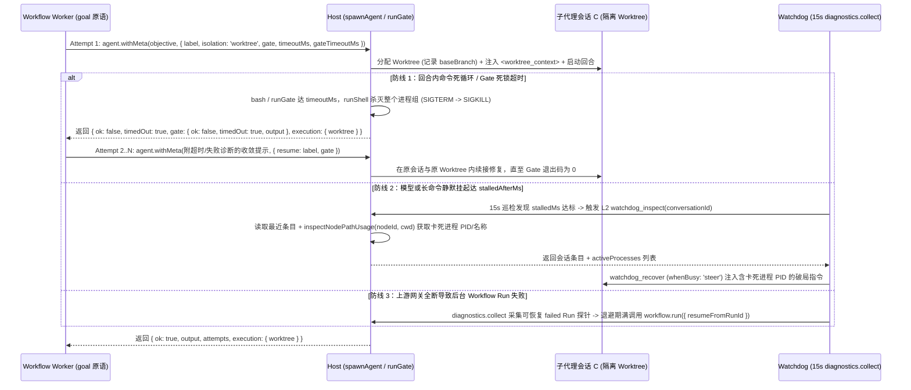

## 背景

Helm 需要支撑跨百级模块、千级子代理的超大规模无人值守研发流水线：

1. **架构与实施分层（A → B → C）**：主会话（高阶模型 A）仅与人类确定系统边界、跨模块共享契约并启动总控工作流；各模块由轻量级模型 B 独立负责模块内拆单、叶子成果合入与模块级集成验收；具体编码与单测验证由模型 C 在独立 Git Worktree 沙箱中并发完成。
2. **零主模型合并开销**：无冲突分支合入与工作树清理 100% 通过零 Token 的 `action()` 完成；仅在发生代码冲突或集成测试失败时唤醒模型 B 介入修复，主会话模型 A 全程不参与叶子细节与代码合并。
3. **网关换模与编排自愈解耦**：上游供应商限流、502 或渠道故障由 `builtin:magpie` 动态模型网关在同一模型组内透明漂移，工作流引擎不耦合跨模型热切换逻辑；编排层与 `builtin:superagent` 看门狗（Watchdog）专注解决代码级死循环、门禁失败自愈与长流程断点续跑。
4. **复用现有生命周期 Hook 与巡检探针**：不引入新的全局事件总线或额外 Hook，完全基于内核既有 7 个生命周期 Hook 与 Watchdog 15 秒 `diagnostics.collect` 巡检探针闭环。

核查当前代码库，现有实现存在 6 处阻碍上述流水线闭环的限制：

- **层级 Worktree 清理硬编码比对主工作树 `HEAD`**（`packages/kernel/src/builtin-plugins/workflow/worktree.ts:1512`）：`WorktreeAllocator.cleanup` 第 6 道安全检查固定执行 `git rev-list --count ${mainHead}..${fresh.branch}`。当模块分支 `B` 派生叶子分支 `C`，且 `C` 已 `git merge` 入 `B` 但 `B` 尚未合回主分支 `main` 时，清理 `C` 会因提交尚未到达 `main` 而报 `409 worktree_dirty` 拒绝删除，导致模块子工作流无法在不传 `force: true` 的前提下安全回收叶子工作树。
- **DSL `agent()` 缺失 Worktree 元数据返回与 `cwd` 参数**（`packages/kernel/src/builtin-plugins/workflow/engine/worker-source.ts:308, 410`）：`agent()` 仅返回模型文本或结构化 `schema` 输出，脚本无法读取宿主分配的 `execution.worktree.{id, path, branch}`，无法在后续 `action("env.exec")` 中拼装确定性的 `git merge <branch>` 与 `cleanup_worktree` 调用；同时 `AGENT_OPTIONS` 未暴露 `cwd`，模块合入冲突时无法直接指定在模块 Worktree 目录派生模型 B 解决冲突。此外，`isolation.ts:363` 仅在 `dirtySource === true` 时注入 `<worktree_context>`，干净仓库派生的子代理无法获知自身所在的隔离分支名与工作树路径。
- **Gate 失败或回合超时后无法原地 `resume` 收敛**（`packages/kernel/src/builtin-plugins/workflow/engine/runtime.ts:1143`）：引擎仅在 `result.ok === true`（模型回合成功且 Gate 退出码为 0）时将 `label` 登记入 `completedByLabel`。一旦首次调用因单测失败或死循环超时返回非 ok，后续 `resume: label` 立即抛出 `No agent has completed under the label` 致命错误，无法在同一 Worktree 与会话上下文中迭代修复。
- **死循环与测试挂死缺乏回合硬超时及进程级诊断**（`packages/kernel/src/runtime/tools.ts:412`、`packages/kernel/src/builtin-plugins/superagent/watchdog.ts:1387`）：`runGate` 固定使用 `DEFAULT_TIMEOUT_MS`（120 秒）且不返回 `timedOut` 与 `exitCode`；`agent()` 缺乏单回合总超时 `timeoutMs`。当子代理写出死循环测试或卡死在工具调用时，`watchdog_inspect` 的 `inspectConversation` 仅返回最近 10 条会话消息预览，未调用宿主已有的 `ctx.host.inspectNodePathUsage(nodeId, cwd)` 探查目标 Worktree 下挂起的操作系统进程（PID 与命令名），Watchdog 无法给出精准的破局指令。
- **非幂等 `env.exec` 触发后缀不确定性保护阻断 `resumeFromRunId`**（`packages/kernel/src/builtin-plugins/workflow/engine/journal.ts:39`）：内建动作 `env.exec` 默认 `idempotent: false`。当工作流前半段执行过未标幂等的 `git merge` 动作、后半段因网络或模型异常中断时，`readJournal` 的后缀断链保护或悬挂意图检查会将账本标为 `workflow_action_uncertain`，拒绝自动断点续跑。
- **DSL `workflow()` 嵌套限制为 1 层且状态单文档全量克隆**（`worker-source.ts:525`、`workflow.ts:483`、`worktree.ts:55`）：`scope.depth > 0` 禁止多级工作流组合；同时 `builtin:workflow` 的 `records` 与 `worktree` 的 `runtime/worktrees` 各自将全量历史记录存在单一 JSON 文档中，每次状态变更触发全量 `structuredClone` 与整包落库，在千级节点规模下存在显著写放大及触碰单文档 `2 MiB`（`413 document_too_large`）硬上限的风险。

建议分支：`feat/fractal-goal-workflow`（建议名称，当前尚未创建）。

---

## 整体设计

### 分形 Scope 树与单账本模型

多模块研发流水线通过 DSL 内建的 `workflow(ref, args)` 组织为同进程 Worker 内的分形 Scope 树（主控工作流 → 领域/模块子工作流 → 叶子 Goal 节点），而非在模型对话回合中嵌套调用 `SubagentWorkflow` 工具派生独立子 Run：

- **单一确定性账本**：整棵 Scope 树的全部 `agent` / `goal` / `action` 节点按发起序共享同一个单调递增的 `callIndex` 与同一份 `workflow-<runId>.jsonl` 账本。任意模块或叶子节点中断后，对根 `runId` 执行一次 `resumeFromRunId` 即可按前缀重放 100% 跳过已完成的模块与叶子节点，时间复杂度 $O(1)$、零 Token 消耗。
- **统一并发信号量**：宿主侧 `WorkflowService` 以全局 `agentSemaphore` 统一约束同时在途的 `spawnAgent` 数量，避免多模块并发时产生 $16 \times 16$ 的进程与连接风暴。
- **职责与成本边界**：主会话（Model A）只生成架构说明与模块划分参数；模块子工作流显式指定 `model: args.modelB`（拆单与解冲突）与 `model: args.modelC`（叶子实现），无冲突合并与清理全部走 `action("env.exec")` 与 `action("workflow.cleanup_worktree")`。

### 目标驱动收敛原语 `goal(spec)` 与三层防卡死体系

将「子代理编码 → 门禁命令验证 → 失败/超时抓现场 → 原会话原 Worktree 续接修复」提炼为 DSL 原语 `goal(spec)`，并结合内核进程组超时与 Watchdog 巡检探针构成三层防卡死防线：



为什么不引入全流程事件模型驱动 Watchdog？因为“代码死循环”与“连接半开挂死”的本质特征正是**静默无事件**——卡死期间不会发出 `tool_result` 或 `turn_settled`。因此，主动超时断路器（`timeoutMs` / `gateTimeoutMs`）配合周期性 Pull 探针（15 秒 `diagnostics.collect` + 按需 `inspectNodePathUsage`）是检测静默挂死的最简完备机制，无需在内核新增任何事件类型或生命周期 Hook。

---

## 详细设计

### 1. 层级 Worktree 拓扑记录与 `mergedInto` 安全清理

#### 1.1 `ManagedWorktreeRecord` 与协议字段扩展

在 `packages/protocol/src/plugin.ts` 的 `AgentExecutionInfo['worktree']` 与 `packages/kernel/src/builtin-plugins/workflow/worktree.ts` 的 `ManagedWorktreeRecord` 中新增两个可选字段：

```ts
export interface ManagedWorktreeRecord {
  id: string
  nodeId: string
  repoRoot: string
  path: string
  branch: string
  baseCommit: string
  /** 派生时刻 sourceCwd 检出的本地分支名（如父模块分支 'helm/spawn-b-auth-12ab34cd'；detached HEAD 时省略）。 */
  baseBranch?: string
  /** 若 sourceCwd 本身是一个活跃受管 worktree，记录其 worktreeId。 */
  parentWorktreeId?: string
  dirtySource: boolean
  parentConversationId: number
  conversationId?: number
  executionId?: string
  origin: 'native' | 'external'
  status: 'active' | 'removed'
  createdAt: number
  removedAt?: number
  branchDeleted?: boolean
  branchDeleteError?: string
}
```

`WorktreeAllocator.allocate`（`worktree.ts:620-765`）执行以下变更：

1. **只读探测移出 `withRepoLock`**：Step A（`rev-parse --show-toplevel`）、Step B（`resolveRepoAuthority`）、Step C（`rev-parse HEAD`、`symbolic-ref --quiet --short HEAD` 获取 `baseBranch`、`status --porcelain`）均为只读命令，移至 `withRepoLock(lockKey, ...)` 之外并发执行；锁内仅保留 Step F（`beforeCreate` 租约占位、`git worktree add` 与记录持久化），消除百级并发分配时的串行排队瓶颈。
2. **记录父树拓扑**：在当前活跃记录中查找满足 `r.nodeId === nodeId && normalizePathValue(r.path) === normalizePathValue(sourceToplevel)` 的项，命中时设置 `parentWorktreeId = r.id`。
3. **机密校验与上下文注入**：`baseBranch` 纳入 `assertMetadataSecretFree` 检查。同时修改 `packages/kernel/src/builtin-plugins/workflow/isolation.ts:363` 的 `buildDirtySourceNotice` 为常态化 `buildWorktreeContextNotice`：无论 `dirtySource` 是否为 `true`，凡分配或续接隔离 Worktree 均向子代理提示词注入 `<worktree_context>`（含 `worktreeId`、`path`、`branch`、`baseCommit`、`baseBranch`、`dirtySource`），要求子代理在结束回合前必须将改动 `git add` 并 `git commit` 至当前分支，保持工作区干净。

#### 1.2 `cleanup` 支持 `mergedInto` 与父分支合入校验

在 `CleanupInput`（`worktree.ts:154`）、`CleanupWorktreeRequest`（`packages/protocol/src/workflow.ts`）、`cleanup_worktree` 工具与动作 Schema（`workflow.ts`）以及 CLI `helm worktrees cleanup`（`packages/cli/src/commands/`）中新增可选参数 `mergedInto?: string`：

1. **参考提交 `referenceHead` 解析规则（替换 `worktree.ts:1512` 硬编码 `mainEntry.head`）**：
   - 若调用方显式传入 `input.mergedInto`：校验其为非空字符串，不含空白字符、控制字符、`..` 且不以 `-` 开头；在目标仓库执行 `git rev-parse --verify --quiet "${input.mergedInto}^{commit}"`。若解析失败，直接抛出 `HelmError('validation_error', 'mergedInto 指向的分支或提交不存在')`，绝不静默回退主工作树。
   - 若未传 `input.mergedInto` 且 `fresh.baseBranch !== undefined`：执行 `git rev-parse --verify --quiet "refs/heads/${fresh.baseBranch}^{commit}"`；若父分支仍存在，取其当前提交作为 `referenceHead`；若父分支已被删除，回退至 `mainEntry.head`。
   - 其余情况：取 `mainEntry.head`。
2. **第 6 道安全检查与分支删除**：
   - 执行 `git rev-list --count ${referenceHead}..${fresh.branch}`，当计数为 `0` 且 `dirtyFiles.length === 0` 时，视为代码已完整合入目标基线，无需 `force: true` 即可移除 Worktree。
   - 在 `deleteManagedBranch` 中，一旦锁内已通过 `rev-list --count ${referenceHead}..${fresh.branch} === 0` 证实代码已合入 `referenceHead`（或 `input.force === true`），统一使用 `git branch -D ${fresh.branch}` 删除受管分支，避免因 `referenceHead` 是尚未合回 `main` 的模块分支而在主工作树下被 `git branch -d` 拒绝。

---

### 2. DSL 原语扩充：`agent()` 增强、`agent.withMeta()` 与 `goal()`

#### 2.1 `agent()` 新增 `cwd`、`timeoutMs` 与 `gateTimeoutMs`

在 `packages/kernel/src/builtin-plugins/workflow/engine/worker-source.ts:308` 的 `AGENT_OPTIONS`、`runtime.ts`、`service.ts` 与 `journal.ts` 中新增以下选项：

| 选项名 | 类型与取值范围 | 互斥与账本规则 | 运行时行为 |
| :--- | :--- | :--- | :--- |
| `cwd` | `string`（目标节点绝对路径） | 与 `isolation: 'worktree'` 互斥；与 `resume` 互斥；追加至 `AgentJournalKeyInput` 版本槽 | 透传给 `spawnAgent({ cwd })`，使子代理直接在指定目录（如已有的模块 Worktree）内执行 |
| `timeoutMs` | `number`（`1_000 .. 3_600_000` 整数） | 可选；不纳入账本缓存 Key（超时失败行本身不作为 `ok: true` 缓存复用） | 在 `service.ts` 中以 `AbortSignal.any([run.abort.signal, AbortSignal.timeout(timeoutMs)])` 包装调用；超时触发 `abortConversationGuarded` 中止子会话回合，释放信号量并返回 `{ ok: false, timedOut: true, error: 'agent_timeout: ...' }` |
| `gateTimeoutMs` | `number`（`1_000 .. 600_000` 整数，默认 `120_000`） | 仅在声明 `gate` 时有效 | 透传至 `runGate(deps, command, { ..., timeoutMs: gateTimeoutMs })`。超时由 `runShell` 杀灭整个进程组（`SIGTERM` → `SIGKILL`），清理死循环残留测试进程，返回 `gate: { ok: false, timedOut: true, exitCode: null, output }` |

同步扩展 `packages/kernel/src/runtime/tools.ts:412` 的 `runGate` 返回类型与 `@helm/protocol` 的 `AgentGateResult`：

```ts
export interface AgentGateResult {
  ok: boolean
  output: string
  exitCode?: number | null
  timedOut?: boolean
}
```

#### 2.2 失败后原地 `resume` 与 `agent.withMeta(prompt, opts)`

1. **放宽 `completedByLabel` 登记条件（`runtime.ts:1120-1175` & `service.ts:2315`）**：
   - 在 `service.ts` 中，当 `spawnAgent` 的 `onResolved` 回调拿到 `{ conversationId, executionId, worktree }` 时，立即将其写入 `run.conversationByAgent.set(label, ...)`（早于模型回合结算与 `applyGate`）。
   - 在 `runtime.ts` 中，只要本次 `agent` 调用已分配或绑定了有效的 `conversationId` 或 `executionId`，即便模型回合超时、结构化输出校验失败或 `gate.ok === false`，也将其登记入 `completedByLabel.set(label, { cached: false })`。后续 `agent(..., { resume: label })` 可直接续接该子会话及其绑定的 Worktree，不再抛 `No agent has completed under the label`。
2. **`agent.withMeta(prompt, opts)`**：
   - 保持 `await agent(prompt, opts)` 原有返回值（成功返回 `string | object`，失败返回 `null`）100% 不变。
   - 新增 `await agent.withMeta(prompt, opts)`，始终返回结构化信封对象：
     ```ts
     export interface AgentWithMetaResult<T = unknown> {
       ok: boolean
       output: T | null
       error?: string
       timedOut?: boolean
       execution?: AgentExecutionInfo
       gate?: AgentGateResult
     }
     ```
   - `journal.ts` 的 `WorkflowJournalEntry`（`type: 'agent'`）新增可选字段 `execution?: AgentExecutionInfo` 与 `gate?: AgentGateResult`（写入前经宿主 `redact` 脱敏）。前缀重放命中缓存时，`agent.withMeta` 从账本完整还原 `execution`（含 `worktree.{id, path, branch, baseCommit, baseBranch}`）与 `gate`。

#### 2.3 目标驱动收敛原语：`goal(spec)`

在 `worker-source.ts` 沙箱全局提供 `goal(spec)`，将「首次派工 → Gate 客观校验 → 失败/超时诊断注入 → 原会话 `resume` 自愈」封装为声明式闭环：

```ts
export interface GoalSpec<T = unknown> {
  /** 必填：子代理唯一标签（第 1 轮创建会话与 Worktree，第 2..N 轮自动以 resume: label 续接）。 */
  label: string
  /** 必填：目标指令（第 1 轮完整 Prompt）。 */
  objective: string
  /** 必填：客观门禁 shell 命令（退出码 0 视为目标达成）。 */
  gate: string
  /** 最大尝试总轮数（1..10 整数，默认 3）。 */
  maxAttempts?: number
  /** 其余透传给首轮 agent.withMeta 的选项：model, agentType, isolation, cwd, effort, schema, timeoutMs, gateTimeoutMs, attachments, secretNames, maxSubagentDepth, phase */
}
```

**`worker-source.ts` 中的实现逻辑**：

```javascript
async function goalIn(scope, spec) {
  if (!spec || typeof spec !== "object" || Array.isArray(spec)) {
    throw new Error("goal(spec) expects a configuration object.");
  }
  const label = requireText(spec.label, "goal() spec.label");
  const objective = requireText(spec.objective, "goal() spec.objective");
  const gate = requireText(spec.gate, "goal() spec.gate");
  const maxAttempts = spec.maxAttempts === undefined ? 3 : spec.maxAttempts;
  if (typeof maxAttempts !== "number" || !Number.isInteger(maxAttempts) || maxAttempts < 1 || maxAttempts > 10) {
    throw new Error("goal() spec.maxAttempts must be an integer between 1 and 10.");
  }

  const PASSTHROUGH = [
    "phase", "model", "agentType", "isolation", "cwd", "effort",
    "schema", "attachments", "secretNames", "maxSubagentDepth", "timeoutMs", "gateTimeoutMs"
  ];
  const baseOpts = {};
  for (let i = 0; i < PASSTHROUGH.length; i++) {
    const k = PASSTHROUGH[i];
    if (spec[k] !== undefined) baseOpts[k] = spec[k];
  }

  let lastRes = null;
  for (let attempt = 1; attempt <= maxAttempts; attempt++) {
    const canResume = attempt > 1 && lastRes && lastRes.execution &&
      (lastRes.execution.conversationId !== undefined || lastRes.execution.executionId !== undefined);

    let prompt = objective;
    const callOpts = Object.assign({}, baseOpts, { label: label, gate: gate });

    if (canResume) {
      delete callOpts.isolation;
      delete callOpts.cwd;
      delete callOpts.model;
      delete callOpts.agentType;
      delete callOpts.effort;
      callOpts.resume = label;

      const diag = lastRes.gate && lastRes.gate.timedOut
        ? "门禁命令执行超时（进程组已被强制终止，疑似存在死循环、死锁或未退出的后台句柄）：\n" + (lastRes.gate.output || "")
        : lastRes.timedOut
          ? "上一轮回合执行超时（疑似命令挂起或工具调用死循环）：\n" + (lastRes.error || "")
          : "门禁命令未通过（exitCode=" + (lastRes.gate ? lastRes.gate.exitCode : "unknown") + "）：\n" +
            ((lastRes.gate && lastRes.gate.output) || lastRes.error || "");

      prompt =
        "[Goal 收敛第 " + attempt + "/" + maxAttempts + " 轮] 验收门禁尚未通过。\n" +
        "诊断输出（尾部）：\n" + diag.slice(-4000) + "\n\n" +
        "请根据上述诊断定位根因（若为超时请重点排查循环终止条件、异步等待与未关闭进程），在当前工作树修复代码并重新提交，确保通过门禁：" + gate;
    }

    lastRes = await agentWithMetaIn(scope, prompt, callOpts);
    if (lastRes && lastRes.ok) {
      return Object.assign({}, lastRes, { attempts: attempt });
    }
  }
  return Object.assign({}, lastRes || { ok: false, output: null }, { attempts: maxAttempts });
}
```

`goal()` 每一轮底层均通过 `agentWithMetaIn` 发起标准宿主调用，每一轮尝试在账本中占独立 `index`。若工作流在第 2 轮完成后因进程重启中断，`resumeFromRunId` 重放时第 1、2 轮直接命中账本缓存，从第 3 轮实时接续。

---

### 3. Watchdog 进程级死循环诊断与失败工作流自动续跑

#### 3.1 `watchdog_inspect` 接入 `inspectNodePathUsage` 进程快照

在 `packages/kernel/src/builtin-plugins/superagent/watchdog.ts:1387` 的 `inspectConversation(conversationId)` 中，直接复用宿主现有的 `ctx.host.inspectNodePathUsage` 端口，无需改动内核：

1. 获取目标会话的 `summary.nodeId ?? 'local'` 与 `summary.cwd`。
2. 当会话存在且 `summary.cwd` 非空时，调用 `ctx.host.inspectNodePathUsage({ nodeId: summary.nodeId ?? 'local', path: summary.cwd })`（捕获节点离线等异常降级为 `undefined`，不阻断会话条目返回）。
3. 在 `inspectConversation` 返回结构与 `inspectOutputSchema` 的 `conversation` 对象中新增 `activeProcesses` 字段（元素为脱敏后的 `{ pid, name, source, path }`）。
4. 在 `packages/kernel/src/builtin-plugins/superagent/assets/skill/references/` 下新增 `code-hang-loop.md`（同步注册至 `SKILL.md` 与 `assets.ts`）：指导 Watchdog L2 在巡检 `stalledMs` 超标会话时，结合 `entries`（是否重复调用同一报错命令）与 `activeProcesses`（是否有 `vitest` / `node` / `python` 进程长期驻留工作树目录），通过 `watchdog_recover`（`whenBusy: 'steer'`）向子代理注入包含具体卡死进程 `pid` 与 `name` 的恢复指令；若停滞达 `abortAfterMs`，由 L1 `autoAbort` 经 `abortConversationGuarded` 强制中止回合，交由上层 `goal()` 进入下一轮修复。

#### 3.2 基于 `diagnostics.collect` 的失败 Workflow Run 退避自动续跑

当上游模型网关发生长时间全局故障，导致后台无人值守运行的 Workflow Run 耗尽单节点重试变为 `failed` 时，通过现有 `diagnostics.collect` 探针机制实现自动断点续跑：

1. **探针上报（`packages/kernel/src/builtin-plugins/workflow.ts`）**：
   监听 `ctx.host.onEvent(DIAGNOSTICS_COLLECT_EVENT, ...)`，扫描当前满足以下全部条件的 Run 记录：
   - `status === 'failed'` 且 `notifyParentOnSettle === true`（后台自动运行任务）；
   - 错误码不属于确定性客户端错误（排除语法错误、参数 Schema 校验失败、`workflow_action_uncertain`）；
   - 读取其账本确认 `actionUncertain === false` 且至少已有 1 条成功记录（具备恢复价值）；
   - 记录上的 `autoResumeCount ?? 0` 小于上限 `3`，且未有后续子重跑 Run 处于 `running` 或 `completed`。
   向 `collection.probes` 追加外部探针：
   ```ts
   {
     targetKind: 'external',
     targetId: `workflow:${run.id}`,
     nodeId: 'local',
     ownedBy: 'helm',
     status: 'error',
     stateChangeSeq: run.autoResumeCount ?? 0,
     facts: {
       kind: 'workflow_run',
       runId: run.id,
       conversationId: run.conversationId,
       failedAt: run.completedAt ?? run.startedAt,
       autoResumeCount: run.autoResumeCount ?? 0,
     },
   }
   ```
2. **退避续跑（`packages/kernel/src/builtin-plugins/superagent/watchdog.ts`）**：
   在 `evaluateCollection` 中识别 `probe.targetKind === 'external' && probe.facts?.['kind'] === 'workflow_run'`：
   - 按 `autoResumeCount` 计算退避冷却窗口：第 0 次（首次自动恢复）距 `failedAt` 满 `2 分钟`、第 1 次满 `5 分钟`、第 2 次满 `15 分钟`；
   - 冷却期满且经 `hasFired(guardKey, 'recover', seq)` 去重通过后，调用 `ctx.host.invokeAction('builtin:workflow', 'run', { resumeFromRunId: runId, conversationId })` 触发断点续跑，并将原 Run 的 `autoResumeCount` 加 1。

---

### 4. `workflow()` 四级嵌套、宿主共享信号量与状态存储分片

1. **`workflow()` 嵌套深度上限放宽至 4**（`worker-source.ts:525`）：将 `if (scope.depth > 0)` 调整为 `if (scope.depth >= 4)`（导出常量 `MAX_WORKFLOW_NESTING_DEPTH = 4`），支持「架构总控（0）→ 子系统（1）→ 模块（2）→ 组件（3）」四级分形内联调用；保留 `WORKFLOW_NESTED_CAP = 256` 防无限递归。
2. **宿主级共享并发信号量**（`service.ts` & `runtime.ts`）：在 `WorkflowService` 实例层创建共享信号量（默认上限 `Math.max(2, Math.min(32, os.availableParallelism() * 2))`，支持通过 `builtin:workflow` 插件配置项 `maxConcurrentAgents` 在 `1..128` 范围内调整），所有活跃 Run 的 `spawnAgent` 调用共用该信号量。
3. **Run 与 Worktree 记录按 ID 分片持久化**：
   - `worktree.ts`：由单一 `runtime/worktrees` 数组文档改为索引文档 `runtime/worktrees:index`（仅存 ID 列表）加单条记录文档 `runtime/worktrees:item:${id}`；每次分配或清理仅读写目标 Worktree 单文档。
   - `workflow.ts`：`stateStore` 将每个 `key`（如 `index`、`run:${id}`）映射为独立私有文档 `ctx.doc('state:' + key, ...)`，消除每次 `putRun` 对全量历史 Run 执行 `structuredClone` 的写放大，彻底规避单文档 `2 MiB` 上限。

---

### 5. 幂等 Git 合并范式与分形编排标准脚本

为避免 `env.exec`（默认 `idempotent: false`）在发生中断后触发 `workflow_action_uncertain` 阻断 `resumeFromRunId`，工作流中的分支合入统一采用**祖先检查前置的幂等命令**：

```bash
git merge-base --is-ancestor "<branch>" HEAD || git merge --no-ff -m "<msg>" "<branch>"
```

若目标分支在前一次执行中已合入当前 `HEAD`，`git merge-base --is-ancestor` 直接返回 `0` 跳过合并；若尚未合入才执行 `git merge`。该命令在未发生未决冲突时具备严格的可重入幂等性（若冲突导致非零退出，`goal` 解冲突或清理重置后再重跑同样安全），因此可显式声明 `{ idempotent: true }`，确保整条流水线任意位置均可无阻碍执行 `resumeFromRunId`。

#### 5.1 模块自治工作流模板（`module-dev.js`）

```javascript
export const meta = {
  name: "module-dev",
  description: "单模块自治闭环：B 拆单 -> C 基于 goal 并发 Worktree 开发自愈 -> 0-Token 幂等合入与叶子清理",
  phases: [{ title: "模块拆单" }, { title: "Goal 并发实施" }, { title: "模块集成与清理" }],
}

// args: { moduleName, moduleScope, archSpec, modelB, modelC, gateCmd }
phase("模块拆单")
const modPlan = await goal({
  label: `b-plan-${args.moduleName}`,
  model: args.modelB,
  isolation: "worktree",
  maxAttempts: 2,
  objective:
    `你是模块「${args.moduleName}」负责人（目录范围：${args.moduleScope}）。\n` +
    `全局架构契约：\n${args.archSpec}\n` +
    `请拆分本模块的子任务（各子任务修改的文件集合互不重叠），不要修改代码，保持工作区干净。`,
  gate: "test -z \"$(git status --porcelain)\"",
  schema: {
    type: "object",
    properties: {
      tasks: {
        type: "array",
        items: {
          type: "object",
          properties: {
            id: { type: "string" },
            title: { type: "string" },
            files: { type: "array", items: { type: "string" } },
            instruction: { type: "string" },
            testCmd: { type: "string" },
          },
          required: ["id", "title", "files", "instruction", "testCmd"],
        },
      },
    },
    required: ["tasks"],
  },
})
if (!modPlan.ok || !modPlan.output || !modPlan.execution?.worktree) {
  throw new Error(`模块 ${args.moduleName} 拆单失败: ${modPlan.error}`)
}
const modWt = modPlan.execution.worktree // { id, path, branch }

phase("Goal 并发实施")
// 在模块 Worktree (cwd: modWt.path) 基础上进一步为每个 C 任务派生子级 Worktree（自动记录 baseBranch = modWt.branch）
const deliveries = await pipeline(
  modPlan.output.tasks,
  async (task) => {
    const res = await goal({
      label: `c-${args.moduleName}-${task.id}`,
      model: args.modelC,
      isolation: "worktree",
      maxAttempts: 3,
      timeoutMs: 300_000,
      gateTimeoutMs: 120_000,
      objective:
        `实施子任务「${task.title}」\n` +
        `负责文件：${task.files.join(", ")}\n` +
        `具体要求：${task.instruction}\n` +
        `完成后必须 git add 并 git commit 到当前隔离分支。`,
      gate: `${task.testCmd} && test -z "$(git status --porcelain)"`,
    })
    if (!res.ok || !res.execution?.worktree) {
      throw new Error(`子任务 ${task.id} 经 ${res.attempts} 轮 Goal 收敛未通过: ${res.error}`)
    }
    return { task, worktree: res.execution.worktree }
  }
)

phase("模块集成与清理")
for (const item of deliveries) {
  if (!item) throw new Error(`模块 ${args.moduleName} 存在未完成子任务`)
  const leafBranch = item.worktree.branch

  // 1. 0-Token 幂等合入模块工作树
  const merge = await action("env.exec", {
    cwd: modWt.path,
    command: `git merge-base --is-ancestor "${leafBranch}" HEAD || git merge --no-ff -m "feat(${args.moduleName}): merge ${item.task.id}" "${leafBranch}"`,
    allowFailure: true,
  }, { idempotent: true, label: `merge-${args.moduleName}-${item.task.id}` })

  // 2. 冲突时仅唤醒便宜的 B 模型进入 modWt.path 解冲突并过门禁
  if (!merge.ok) {
    const resolved = await goal({
      label: `b-conflict-${args.moduleName}-${item.task.id}`,
      model: args.modelB,
      cwd: modWt.path,
      maxAttempts: 2,
      objective: `在模块工作树合入分支 ${leafBranch} 时发生冲突：\n${merge.output}\n请解决冲突并完成 git commit。`,
      gate: `test -z "$(git status --porcelain)" && ! git rev-parse -q --verify MERGE_HEAD && ${args.gateCmd}`,
    })
    if (!resolved.ok) throw new Error(`模块 ${args.moduleName} 合入 ${leafBranch} 冲突解决失败`)
  }

  // 3. 安全回收叶子 Worktree（显式传 mergedInto: modWt.branch，无需 force）
  await action("workflow.cleanup_worktree", {
    worktreeId: item.worktree.id,
    mergedInto: modWt.branch,
    deleteBranch: true,
  }, { idempotent: true })
}

// 4. 模块整体门禁终验
const modVerify = await action("env.exec", {
  cwd: modWt.path,
  command: args.gateCmd,
  allowFailure: true,
}, { idempotent: true })

if (!modVerify.ok) {
  const fixed = await goal({
    label: `b-modfix-${args.moduleName}`,
    model: args.modelB,
    cwd: modWt.path,
    maxAttempts: 2,
    objective: `模块 ${args.moduleName} 子任务合入后模块门禁未通过：\n${modVerify.output}\n请修复并提交。`,
    gate: `${args.gateCmd} && test -z "$(git status --porcelain)"`,
  })
  if (!fixed.ok) throw new Error(`模块 ${args.moduleName} 集成修复失败`)
}

return { moduleName: args.moduleName, branch: modWt.branch, worktreeId: modWt.id }
```

#### 5.2 架构总控工作流模板（`arch-master.js`）

```javascript
export const meta = {
  name: "arch-master",
  description: "架构总控：共享契约先行 -> 模块分形并发 -> 0-Token/B 模型主干总成",
  phases: [{ title: "共享契约先行" }, { title: "模块分形并发" }, { title: "主干总成与终验" }],
}

// 1. 跨模块共享契约先行落入主干
phase("共享契约先行")
if (args.contractSpec) {
  const contract = await goal({
    label: "contract-first",
    model: args.modelB,
    maxAttempts: 3,
    objective: `按架构方案更新跨模块共享接口/协议定义并提交主分支：\n${args.contractSpec}`,
    gate: "pnpm typecheck && test -z \"$(git status --porcelain)\"",
  })
  if (!contract.ok) throw new Error(`共享契约阶段未收敛: ${contract.error}`)
}

// 2. 并发执行全部模块子工作流（同 Worker 分形 Scope，共享单账本与全局信号量）
phase("模块分形并发")
const modDeliveries = await parallel(
  args.modules.map((mod) => () =>
    workflow("module-dev", {
      moduleName: mod.name,
      moduleScope: mod.scope,
      archSpec: args.archSpec,
      modelB: args.modelB,
      modelC: args.modelC,
      gateCmd: mod.gateCmd,
    })
  )
)

// 3. 主干总成：0-Token 幂等合并 + B 模型兜底冲突，主会话 A 模型零消耗
phase("主干总成与终验")
for (const mod of modDeliveries) {
  if (!mod) throw new Error("存在未完成的模块子工作流")
  const modBranch = mod.branch

  const merge = await action("env.exec", {
    command: `git merge-base --is-ancestor "${modBranch}" HEAD || git merge --no-ff -m "feat: integrate module ${mod.moduleName}" "${modBranch}"`,
    allowFailure: true,
  }, { idempotent: true, label: `root-merge-${mod.moduleName}` })

  if (!merge.ok) {
    const resolved = await goal({
      label: `root-conflict-${mod.moduleName}`,
      model: args.modelB,
      maxAttempts: 2,
      objective: `主干合入模块「${mod.moduleName}」（分支 ${modBranch}）发生冲突：\n${merge.output}\n请解决冲突并 git commit。`,
      gate: "test -z \"$(git status --porcelain)\" && ! git rev-parse -q --verify MERGE_HEAD",
    })
    if (!resolved.ok) throw new Error(`主干合入模块 ${mod.moduleName} 冲突解决失败`)
  }

  await action("workflow.cleanup_worktree", {
    worktreeId: mod.worktreeId,
    deleteBranch: true,
  }, { idempotent: true })
}

// 4. 全仓终验门禁
const finalGate = args.finalGateCmd ?? "pnpm build && pnpm typecheck && pnpm test:all"
const finalCheck = await action("env.exec", { command: finalGate, allowFailure: true }, { idempotent: true })
if (!finalCheck.ok) {
  const fixed = await goal({
    label: "root-final-fix",
    model: args.modelB,
    maxAttempts: 3,
    objective: `全模块合入主干后全仓终验未通过：\n${finalCheck.output}\n请修复跨模块集成问题并 git commit。`,
    gate: `${finalGate} && test -z "$(git status --porcelain)"`,
  })
  if (!fixed.ok) throw new Error(`全仓终验未收敛: ${fixed.error}`)
}

return { status: "completed", modules: modDeliveries.map((m) => m.moduleName) }
```

---

## 影响分析

| 涉及模块与文件 | 变更内容 | 调用方影响与联动要求 |
| :--- | :--- | :--- |
| `@helm/protocol` (`src/plugin.ts`, `src/workflow.ts`) | ① `AgentExecutionInfo['worktree']` 新增 `baseBranch?: string`、`parentWorktreeId?: string`；② `AgentGateResult` 新增 `exitCode?: number \| null`、`timedOut?: boolean`；③ `CleanupWorktreeRequest` 新增 `mergedInto?: string` | 跨包契约变更：同步 `packages/cli/src/commands/`（`helm worktrees cleanup --merged-into`）与 `builtin:profile` 的 `helm-cli` 技能文档（通过 `services.test.ts` 双向锁定校验） |
| `packages/kernel/src/runtime/tools.ts` | `runGate` 增加可选 `timeoutMs` 参数，返回值透传 `exitCode` 与 `timedOut` | 既有 `runGate` 调用点不传 `timeoutMs` 时保持 `120_000ms` 默认行为不变 |
| `packages/kernel/src/builtin-plugins/workflow/worktree.ts` & `isolation.ts` | ① `allocate` 只读探测移出 `withRepoLock`，记录 `baseBranch` 与 `parentWorktreeId`；② `cleanup` 支持 `mergedInto` 与 `baseBranch` 合入校验；③ Worktree 记录按 `runtime/worktrees:item:<id>` 分片；④ 常态化注入 `<worktree_context>` | 开发期不保留旧单文档读取兼容层，升级时清理开发目录 `~/.helm` 旧 `runtime/worktrees` 单文档记录 |
| `packages/kernel/src/builtin-plugins/workflow/engine/` (`worker-source.ts`, `runtime.ts`, `journal.ts`, `service.ts`) & `workflow.ts` | ① `agent()` 支持 `cwd`、`timeoutMs`、`gateTimeoutMs`；② 新增 `agent.withMeta()` 与 `goal()`；③ 子会话创建即登记 `completedByLabel` 允许失败后原地 `resume`；④ `workflow()` 嵌套深度上限调整为 4；⑤ 全局 `agentSemaphore` 与 `state:run:<id>` 分片存储 | 现有脚本的 `await agent()` 返回值与行为保持不变；同步更新 `docs/workflows/dsl-guide.md`、`worktree-and-gate.md`、`journaling-recovery.md` |
| `packages/kernel/src/builtin-plugins/superagent/` (`watchdog.ts`, `assets/`) | ① `inspectConversation` 调 `inspectNodePathUsage` 返回 `activeProcesses`；② 新增 `code-hang-loop.md` 排障参考；③ 消费 `workflow_run` 外部探针实现退避自动 `resumeFromRunId` | 严守 `ownedBy: 'human'` 只读红线，仅对 `helm / bot` 归属的后台目标执行 `steer` 恢复、中止或自动续跑 |

---

## 发布

### 上线前检查

遵循项目开发期“不兼容、不迁移”原则，由于 `builtin:workflow` 的 Worktree 记录（`runtime/worktrees:index` + `runtime/worktrees:item:<id>`）与 Run 状态记录（`state:index` + `state:run:<id>`）切换为按 ID 独立文档分片存储，且 `AgentJournalKeyInput` 版本号递增：

1. 本地或测试环境更新代码后，清理 `~/.helm/state.sqlite`（或 `HELM_DATA_DIR`）中旧版 `builtin:workflow` 单文档持久化记录与旧账本文件。
2. 核对 `pnpm link:bins` 或构建产物，确保 CLI `helm worktrees cleanup --merged-into` 与 Hub 端 Schema 同步生效。

### 故障恢复

- **代码死循环或测试挂死**：第一道防线由 `goal()` 的 `gateTimeoutMs` / `timeoutMs` 直接触发 `runShell` 杀灭进程组并带诊断 `resume`；第二道防线由 Watchdog 15 秒巡检结合 `inspectNodePathUsage` 识别卡死进程 PID，经 `watchdog_recover`（`steer`）注入破局指令或 `abortConversationGuarded` 掐断回合。
- **上游网关中断或 Hub 进程重启**：重启后 `builtin:workflow` 的两阶段恢复（`prepareRecovery` + `init`）将中断 Run 标为 `failed`，随后由 Watchdog 退避探针自动调用 `workflow.run({ resumeFromRunId })`（或人工执行 `helm workflows run --resume-from-run-id`），依托单账本前缀重放与幂等 `action` 从断点处无缝接续。

---

## 测试

所有新增与更新测试均显式声明 `{ timeout: 60_000 }`，禁止设置 `HELM_TEST_SUITE_TIMEOUT_MS` 环境变量。

| 编号 | 测试档位与目标文件 | 前置条件与输入 | 操作路径 | 预期可观察结果 |
| :--- | :--- | :--- | :--- | :--- |
| T1 | `integration` (`packages/kernel/test/worktree.test.ts`) | 初始化 Git 仓库主分支 `main`；分配模块 Worktree `B`，并在 `B.path` 下进一步分配叶子 Worktree `C`；在 `C` 中提交文件并将其 `git merge` 入 `B`（`B` 未合入 `main`） | ① 调用 `cleanup({ worktreeId: C.id, mergedInto: B.branch, deleteBranch: true })`；② 另建叶子树 `C2` 合入 `B` 后省略 `mergedInto` 直接调用 `cleanup({ worktreeId: C2.id, deleteBranch: true })` | ① 与 ② 均无需 `force: true` 成功清理目录并删除叶子分支；`B.baseBranch` 为 `'main'`，`C.baseBranch` 为 `B.branch`，`C.parentWorktreeId` 为 `B.id`；传入不存在的 `mergedInto` 时显式抛 `400 validation_error` |
| T2 | `integration` (`packages/kernel/test/workflow.test.ts`) | 编写使用 `goal({ label: 'worker-c', isolation: 'worktree', maxAttempts: 3, gateTimeoutMs: 1500, gate: '...' })` 的工作流 | 第 1 轮子代理使 Gate 陷入 `sleep 30` 模拟死循环；第 2 轮子代理使 Gate 退出码为 1；第 3 轮子代理修复代码并提交 | 第 1 轮在 1.5s 后杀灭 Gate 进程组并返回 `gate.timedOut === true`；第 2、3 轮自动以 `resume: 'worker-c'` 复用同一 `conversationId` 与同一 Worktree；最终返回 `ok: true, attempts: 3` 且包含完整 `execution.worktree` |
| T3 | `integration` (`packages/kernel/test/workflow.test.ts`) | 编写 3 级嵌套 `workflow()`（总控 → 模块 → 组件），模块 1 完成 `goal` 编码、幂等 `git merge`（`idempotent: true`）与 `cleanup_worktree`，模块 2 的 `goal` 失败导致 Run 变为 `failed` | 修复模拟模型响应后，调用 `workflow.run({ resumeFromRunId })` | 模块 1 的全部 `agent`（含 `withMeta` 的 `execution.worktree`）与 `action` 100% 命中账本前缀重放（`cached: true`），不触发 `workflow_action_uncertain`，仅模块 2 的失败节点重新执行并最终 `completed` |
| T4 | `integration` (`packages/kernel/test/superagent.test.ts`) | ① 在受管子会话的 Worktree 目录下启动长驻子进程模拟挂死；② 构造一条 `notifyParentOnSettle: true`、账本干净的 `failed` Workflow Run | ① 调用 `watchdog_inspect({ conversationId })`；② 推进时钟超过 2 分钟冷却期后执行 Watchdog `singleflightTick()` | ① `inspectConversation` 的 `conversation.activeProcesses` 准确包含该 Worktree 下挂起子进程的 `pid` 与 `name`；② Watchdog 自动触发 `builtin:workflow` 的 `run({ resumeFromRunId })` 将失败 Run 恢复完成，且 `autoResumeCount` 递增为 1 |
| T5 | `unit` (`packages/protocol/test/` & `packages/cli/test/` & `packages/kernel/test/services.test.ts`) | 变更 `CleanupWorktreeRequest`、CLI `worktrees cleanup --merged-into` 与 `helm-cli` 技能模板 | 执行 `pnpm check:hygiene && pnpm typecheck && pnpm test:unit` | CLI 参数解析、`--json` 输出以及 `services.test.ts` 的 CLI-Skill 双向锁定校验全部通过 |
