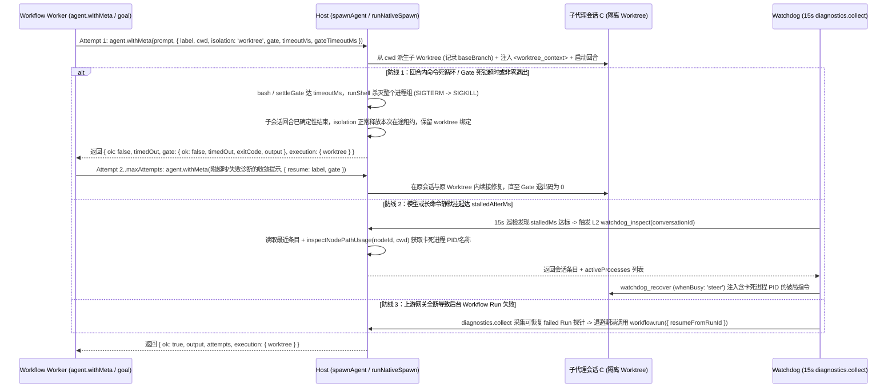

## 背景

Helm 需要支撑跨百级模块、千级子代理的超大规模无人值守研发与认知演进流水线：

1. **主干协议固定、落地节点自治（外层确定性骨架 + 内层自适应裂变）**：主工作流框架仅固化顶层契约（共享接口先行、Git Worktree 物理隔离、零 Token 合并清理与 Gate 门禁客观判停）；而每一个落地的执行节点（无论是模块架构师、子任务开发者还是审查官）都是自治的智能体——它到达现场读取真实代码、评估复杂度并按需调用 `load_skill` 后，可自主决定是直接编码交付、在回合内派发 `subagent` 协同探索，还是拉起子级工作流（如动态切分正交审查透镜进行多轮红蓝对抗质证）。
2. **零主模型合并开销**：主会话（高阶模型 A）仅与人类确定系统边界并启动总控工作流；各模块由模型 B 独立负责动态规划、叶子成果合入与模块级集成验收；具体编码与单测验证由模型 C 在独立 Git Worktree 沙箱中并发完成。无冲突分支合入与工作树清理 100% 通过零 Token 的 `action()` 完成；仅在发生代码冲突或集成测试失败时唤醒模型 B 介入修复。
3. **网关换模与编排自愈解耦**：上游供应商限流、502 或渠道故障由 `builtin:magpie` 动态模型网关在同一模型组内透明漂移，工作流引擎不耦合跨模型热切换逻辑；编排层与 `builtin:superagent` 看门狗（Watchdog）专注解决代码级死循环、门禁失败自愈与长流程断点续跑。
4. **严守单向包依赖与扩展面契约**：遵循最新架构重构边界——`@helm/protocol` 只保留通用执行信封（`AgentSpawnRequest` / `AgentExecutionInfo` / `AgentGateResult`）与 JSON-safe 命名空间 `meta`；工作流、Worktree 描述与清理等业务契约完整归属 `@helm/plugins`（`packages/plugins/src/contracts.ts`）；不引入新的全局事件总线或额外生命周期 Hook，完全基于内核既有 7 个 Hook 与 Watchdog 15 秒 `diagnostics.collect` 巡检探针闭环。

核查当前代码库（`@helm/kernel` + `@helm/plugins`），现有实现存在 7 处阻碍上述流水线闭环的限制：

- **层级 Worktree 清理硬编码比对主工作树 `HEAD`**（`packages/plugins/src/workflow/worktree.ts:1512`）：`WorktreeAllocator.cleanup` 第 6 道安全检查固定执行 `git rev-list --count ${mainHead}..${fresh.branch}`。当模块分支 `B` 派生叶子分支 `C`，且 `C` 已 `git merge` 入 `B` 但 `B` 尚未合回主分支 `main` 时，清理 `C` 会因提交尚未到达 `main` 而报 `409 worktree_dirty` 拒绝删除，导致模块子工作流无法在不传 `force: true` 的前提下安全回收叶子工作树。
- **DSL `agent()` 缺失 Worktree 元数据返回、`cwd` 参数与失败后自动收敛机制**（`packages/plugins/src/workflow/engine/worker-source.ts:227, 410`）：`agent()` 仅返回模型文本或结构化 `schema` 输出，脚本无法读取宿主分配的 `worktree.{id, path, branch}`，无法在后续 `action("env.exec")` 中拼装确定性的 `git merge <branch>` 与 `cleanup_worktree` 调用；同时 `AGENT_OPTIONS` 未暴露 `cwd`，模块合入冲突时无法直接指定在模块 Worktree 目录派生模型 B 解冲突，也无法以模块 Worktree 为源目录（`cwd` + `isolation: 'worktree'`）派生子级叶子 Worktree。此外，`isolation.ts:386` 仅在 `dirtySource === true` 时注入 `<worktree_isolation_notice>`，干净仓库派生的子代理无法获知自身所在的隔离分支名与工作树路径。
- **Gate 或回合失败时丢弃执行元数据、滞留租约且无法原地 `resume` 收敛**（`packages/kernel/src/runtime/spawn.ts:716`、`packages/plugins/src/workflow/engine/service.ts:2404`、`runtime.ts:1143`、`isolation.ts:436`）：
  1. `runNativeSpawn` 在回合末尾内部执行 `settleGate`，若 Gate 非零退出直接 `throw new HelmError('gate_failed')`；`service.ts` 的 `invokeSpawn` 在 `catch` 分支丢弃了已通过 `onResolved` 拿到的 `executionInfo`；
  2. `runtime.ts` 仅在 `result.ok === true` 时将 `label` 登记入 `completedByLabel`，导致首次调用因单测失败或超时返回非 ok 后，后续 `resume: label` 立即抛 `no agent has completed under the label` 致命错误；
  3. `isolation.ts` 的 `spawnWithWorktree` / `resumeWithWorktree` 在 `next(finalRequest)` 抛错（含 `gate_failed`）时调用 `settleLease(leaseToken, false, false)` 将租约永久保留，导致后续即便修复完成也因残留失败租约在 `cleanup_worktree` 时报 `409 worktree_execution_unknown`。
- **死循环与测试挂死缺乏回合硬超时及进程级诊断**（`packages/kernel/src/runtime/tools.ts:412`、`packages/plugins/src/superagent/watchdog.ts:1387`）：`runGate` 固定使用 `DEFAULT_TIMEOUT_MS`（120 秒）且 `AgentGateResult` 不含 `timedOut` 与 `exitCode`；`agent()` 缺乏单回合总超时 `timeoutMs`。当子代理写出死循环测试或卡死在工具调用时，`watchdog_inspect` 的 `inspectConversation` 仅返回最近 10 条会话消息预览，未调用宿主已有的 `ctx.host.inspectNodePathUsage(nodeId, cwd)` 探查目标 Worktree 下挂起的操作系统进程（PID 与命令名），Watchdog 无法给出精准的破局指令。
- **非幂等 `env.exec` 触发后缀不确定性保护阻断 `resumeFromRunId`**（`packages/plugins/src/workflow/engine/journal.ts:39`）：内建动作 `env.exec` 默认 `idempotent: false`。当工作流前半段执行过未标幂等的 `git merge` 动作、后半段因网络或模型异常中断时，`readJournal` 的后缀断链保护会将账本标为 `workflow_action_uncertain`，拒绝自动断点续跑。
- **DSL `workflow()` 嵌套限制为 1 层且子作用域 `label` 全局冲突**（`packages/plugins/src/workflow/engine/worker-source.ts:525`、`runtime.ts:624`）：`scope.depth > 0` 禁止多级工作流组合；且 `completedByLabel` 为根 Run 扁平共享，并发子工作流使用同名 `label` 会互相覆盖续接目标。
- **单文档全量克隆与节点大文本冗余在千级节点下触碰 `2 MiB` 上限**（`packages/plugins/src/workflow.ts:147, 504, 670`、`packages/plugins/src/workflow/engine/service.ts:2820`、`packages/kernel/src/plugins/doc-registry.ts:75`）：
  1. `ctx.doc` 必须在 `definePlugin` 阶段静态注册（运行期动态调 `ctx.doc` 会抛 `409 plugin_context_closed`），且 `doc` 与 `sessionDoc` 单文档硬上限均为 `2 MiB`（`413 plugin_doc_too_large`）；
  2. 当前 `builtin:workflow` 将所有历史 Run 记录塞入单一 `ctx.doc('records')`，每次状态变更对全量历史执行 `structuredClone`；
  3. 更隐蔽的是，`service.ts` 的 `nodesFromProgress` 将子代理完整 `prompt`（可达数十 KB 的架构说明）与长篇 `gate.output` 原样塞入每个 `WorkflowNodeState`，并在 `writeRunsDoc` 中整包写入会话级公共文档 `ctx.sessionDoc('runs')`——在百模块、千节点规模下，单个分形 Run 的 `nodes` 即可突破 `2 MiB` 导致 `runs` 投影与 `records` 落盘直接抛 `413` 失败（而完整提示词与输出本就持久保存在子会话 `conversationId` 详情与 `.jsonl` 账本中，无需在进度树上重复冗余拷贝）。

建议分支：`feat/fractal-goal-workflow`（建议名称，当前尚未创建）。

---

## 整体设计

### 1. 双模动态分形（主干确定性 Scope 树 + 节点自主裂变）与单账本模型

Helm 的多智能体编排不是静态死板的 CI 流水线，而是通过**「外层确定性 DSL 骨架 + 内层节点自主裂变」**构成的双模动态分形体系：

- **外层确定性分形（DSL `workflow(ref, args)` Scope 树）**：主控工作流通过 `workflow(ref, args)` 组织同进程 Worker 内的分形 Scope 树（总控 → 领域/模块 → 叶子或认知熔炉）。整棵 Scope 树的全部 `agent` / `action` 节点按发起序共享单调递增的 `callIndex` 与同一份 `workflow-<runId>.jsonl` 账本。任意位置中断后，对根 `runId` 执行一次 `resumeFromRunId` 即可按前缀重放 100% 跳过已完成节点，时间复杂度 $O(1)$、零 Token 消耗。
- **内层节点自主演进（先遣评估 + 技能动态加载 + 子树裂变授权）**：
  1. **动态策略选择**：工作流中的模块或评审节点不写死固定的子任务列表或审查规则，而是先由先遣规划节点（Planner / Scout）读取现场源码、Git Diff 及可用技能目录（`<available_skills>`），自主调用 `load_skill` 探查技能包结构，动态决定后续走「直接单节点直改（`direct`）」、「并发子任务流水线（`parallel_tasks`）」还是「先红蓝对抗评审再实施（`crucible_then_tasks`）」。
  2. **按节点授予自主裂变深度（`maxSubagentDepth`）**：依托 `builtin:workflow` 现有的深度守卫（`DEFAULT_MAX_SUBAGENT_DEPTH = 2`，`HARD_MAX_SUBAGENT_DEPTH = 5`），DSL 的 `agent()` / `goal()` 支持通过 `maxSubagentDepth` 为复杂节点授权更深的子树空间——未达深度上限的节点在自身对话回合内天然保留 `subagent` 与 `SubagentWorkflow` 工具（自动化子会话调用默认同步等待终态），可在回合内自主派发侦察子代理或动态编写内联子工作流；到达深度上限的叶子节点则由 `before_turn` 钩子自动剥离派工工具，专注编码与过门禁。
- **子工作流 `scopeId` 命名空间隔离**：每次调用 `workflow(ref, args)` 分配递增的确定性 `scopeId`（根为 `0`），引擎侧 `completedByLabel` 按 `${scopeId}:${label}` 键入，使并发执行的多个子工作流可安全使用简洁的局部 `label` 而互不串台。
- **防嵌套饥饿死锁的并发控制**：每个 `runWorkflow` 实例维持自身独立的 `Semaphore`（约束单工作流内部的并发度），且当父会话在回合内同步派生子级 `SubagentWorkflow` 或 `subagent` 时，子级执行不反抢父级已持有的槽位，从根源上杜绝“父占槽位等子完成、子排在队外等父释放槽位”的嵌套死锁。
- **职责与成本边界**：主会话（Model A）只与人类对齐顶层意图；模块与审查子工作流显式指定 `modelB`（规划、质证与解冲突）与 `modelC`（叶子编码与扫描），无冲突合并与清理全部走 `action("env.exec")` 与 `action("workflow.cleanup_worktree")`。

### 2. 目标驱动自愈：`agent()` 原生 `maxAttempts` 收敛、`agent.withMeta()` 与 `goal()` 语法糖

遵循 KISS 原则，不制造割裂的第二套底层执行通道，而是将「子代理编码 → 门禁命令验证 → 失败/超时抓现场 → 原会话原 Worktree 自动 `resume` 修复」直接内聚为 `agent(prompt, opts)` / `agent.withMeta(prompt, opts)` 的 `maxAttempts`（配合 `gate` 或 `timeoutMs`）原生能力，并提供语义化的 `goal(spec)` 薄语法糖：



为什么不引入全流程事件模型驱动 Watchdog？因为“代码死循环”与“连接半开挂死”的本质特征正是**静默无事件**——卡死期间不会发出 `tool_result` 或 `turn_settled`。因此，主动超时断路器（`timeoutMs` / `gateTimeoutMs`）配合周期性 Pull 探针（15 秒 `diagnostics.collect` + 按需 `inspectNodePathUsage`）是检测静默挂死的最简完备机制，无需在内核新增任何事件类型或生命周期 Hook。

---

## 详细设计

### 1. 层级 Worktree 拓扑记录、租约收敛与 `mergedInto` 安全清理

#### 1.1 `@helm/plugins` 编排契约与 `ManagedWorktreeRecord` 扩展

严格遵守单向包依赖（Worktree 业务形状归属 `@helm/plugins`，不进 `@helm/protocol`）：

1. 在 `packages/plugins/src/contracts.ts` 的 `WorktreeExecutionDescriptor` 与 `WorktreeCleanupRequest` 中扩展字段：
   ```ts
   export type WorktreeExecutionDescriptor = {
     path: string
     branch: string
     id?: string
     repoRoot?: string
     baseCommit?: string
     /** 派生时刻 sourceCwd 检出的本地分支名（如父模块分支 'helm/spawn-12ab34cd'；detached HEAD 时省略）。 */
     baseBranch?: string
     /** 若 sourceCwd 本身是一个活跃受管 worktree，记录其 worktreeId。 */
     parentWorktreeId?: string
     dirtySource?: boolean
   }

   export interface WorktreeCleanupRequest {
     worktreeId?: string
     conversationId?: number
     path?: string
     nodeId?: string
     /** 显式指定合入目标分支或提交（层级 Worktree 子树合入父模块分支时使用；缺省优先取记录的 baseBranch，再回退主工作树 HEAD）。 */
     mergedInto?: string
     deleteBranch?: boolean
     force?: boolean
   }
   ```
   同步更新 `contracts.ts` 中的 `sanitizeWorktreeDescriptor` 校验 `baseBranch` 与 `parentWorktreeId`（非空字符串）。
2. 在 `packages/plugins/src/workflow/worktree.ts` 的 `ManagedWorktreeRecord` 中同步新增 `baseBranch?: string` 与 `parentWorktreeId?: string`。
3. **`WorktreeAllocator.allocate`（`worktree.ts:606-765`）变更**：
   - 在 Step C 读取 `sourceCwd` 的 `HEAD` 时，增加执行 `git symbolic-ref --quiet --short HEAD`：若成功（退出码 0 且输出非空），记录 `baseBranch = output.trim()`；若处于 detached HEAD（退出码非 0），`baseBranch` 为 `undefined`。
   - `baseBranch` 与 `parentWorktreeId` 纳入 Step E `assertMetadataSecretFree` 机密检查。
   - 在 Step F 的 `withRepoLock` 锁内（消除并发读脏快照竞态），从当前活跃记录中查找满足 `r.nodeId === nodeId && normalizePathValue(r.path) === normalizePathValue(sourceToplevel)` 的项，命中时设置 `parentWorktreeId = r.id`。
4. **常态化注入 `<worktree_context>`（`packages/plugins/src/workflow/isolation.ts:386`）**：
   将仅在 `dirtySource === true` 时注入的 `<worktree_isolation_notice>` 升级为常态化 `<worktree_context>`（新建与 `resume` 均生效，通过 `isolation.ts` 在 `finalRequest.prompt` 尾部追加）：包含 `worktreeId`、`path`、`branch`、`baseCommit`、`baseBranch`（若有）及 `dirtySource` 提示，明确要求子代理在结束回合前必须将改动 `git add` 并 `git commit` 至当前隔离分支，保持工作区干净。

#### 1.2 Worktree 租约在回合失败（Gate / Schema / Timeout）时的正确收敛

修复当前 `isolation.ts:436` 在 `next(finalRequest)` 抛错时无条件保留 `running` 租约导致 `cleanup_worktree` 被 `409 worktree_execution_unknown` 永久锁死的问题：

- **根本区分**：durable 租约的职责是防止「进程崩溃或外部 CLI 失联，无法证明执行已停止」时误删目录。而对于原生子会话（`info.conversationId !== undefined && info.executionId === undefined`），当 `await next(finalRequest)` 抛出异常返回时，`runNativeSpawn` 的 `finally` 块已经执行完毕并释放了会话锁，子会话回合在进程内**已确定性终止**（无论因 `gate_failed`、`schema_validation_failed` 还是 `aborted`）。
- **收敛规则（`isolation.ts` 的 `spawnWithWorktree` 与 `resumeWithWorktree`）**：
  - 在 `catch (error)` 分支中，若本次执行为原生子会话且宿主 `isConversationWorking(conversationId) === false`（子会话回合已确认停止），调用 `await this.settleLease(leaseToken, true, false)` 正常核销本次调用的租约，同时保留 `allocator` 中的 active Worktree 记录与 `agentId -> childId` 绑定，供下一轮 `resume` 续接或后续 `cleanup_worktree` 清理。
  - 若 `resumeWithWorktree` 成功完成，额外清理该 `record.id` 名下可能遗留的历史同源租约条目。
  - 仅当进程崩溃（未走到 `catch`/`finally`）或外部运行时（`executionId !== undefined`）未确认停止时，保留租约拦截清理。

#### 1.3 `cleanup` 支持 `mergedInto` 与父分支合入校验

在 `CleanupInput`（`worktree.ts:154`）、`cleanup_worktree` 工具与动作 Schema（`packages/plugins/src/workflow.ts`）以及 CLI `helm worktrees cleanup --merged-into <ref>`（`packages/cli/src/commands/`）中贯通 `mergedInto?: string`：

1. **参考提交 `referenceHead` 解析规则（替换 `worktree.ts:1512` 硬编码 `mainEntry.head`）**：
   - 若调用方显式传入 `input.mergedInto`：校验其为非空字符串，不含空白字符、控制字符、`..`、`~`、`^`、`:` 且不以 `-` 开头；在目标仓库执行 `git rev-parse --verify --quiet "${input.mergedInto}^{commit}"`。若解析失败，直接抛出 `HelmError('validation_error', 'mergedInto 指向的分支或提交不存在', 400)`，绝不静默回退主工作树。
   - 若未传 `input.mergedInto` 且 `fresh.baseBranch !== undefined`：执行 `git rev-parse --verify --quiet "refs/heads/${fresh.baseBranch}^{commit}"`；若父分支仍存在，取其当前提交作为 `referenceHead`；若父分支已被删除，回退至 `mainEntry.head`。
   - 其余情况：取 `mainEntry.head`。
2. **第 6 道安全检查与分支删除**：
   - 执行 `git rev-list --count ${referenceHead}..${fresh.branch}`，当计数为 `0` 且 `dirtyFiles.length === 0` 时，视为代码已完整合入目标基线，无需 `force: true` 即可移除 Worktree。
   - 在 `deleteManagedBranch` 中，一旦锁内已通过 `rev-list --count ${referenceHead}..${fresh.branch} === 0` 证实代码已合入 `referenceHead`（或 `input.force === true`），统一使用 `git branch -D ${fresh.branch}` 删除受管分支，避免因 `referenceHead` 是尚未合回 `main` 的模块分支而在主工作树下被 `git branch -d` 拒绝。

---

### 2. DSL 原语扩充：`agent()` 增强、`agent.withMeta()` 与 `goal()`

#### 2.1 `@helm/protocol` 与内核 `spawn.ts` / `tools.ts` 的超时与 Gate 扩展

1. **`@helm/protocol`（`src/plugin.ts`, `src/agent-exec.ts`）**：
   - `AgentSpawnRequest` 新增可选字段 `gateTimeoutMs?: number`（单次 Gate 命令超时毫秒数）。
   - `AgentGateResult` 扩展为：
     ```ts
     export interface AgentGateResult {
       ok: boolean
       output: string
       exitCode?: number | null
       timedOut?: boolean
     }
     ```
   - `sanitizeAgentGateResult`（`packages/protocol/src/agent-exec.ts:89`）同步放行并校验可选的 `exitCode`（整数或 `null`）与 `timedOut`（布尔值）。
2. **`packages/kernel/src/runtime/tools.ts:412` & `spawn.ts:716`**：
   - `runGate` 接收可选 `timeoutMs?: number`（默认 `DEFAULT_TIMEOUT_MS = 120_000`），透传给 `runShell`，并将 `{ ok: result.ok, output: result.output, exitCode: result.exitCode, timedOut: result.timedOut }` 完整返回。
   - `spawn.ts` 的 `settleGate` 将 `request.gateTimeoutMs` 传给 `runGate`，并通过 `request.onGateResult?.(gate)` 完整回报 `{ ok, output, exitCode, timedOut }`；当 `!gate.ok` 时，抛出的 `HelmError('gate_failed', ...)` 在 `details` 中携带 `{ exitCode: gate.exitCode, timedOut: gate.timedOut, output: gate.output.slice(-4000) }`。

#### 2.2 `agent()` 新增 `cwd`、`timeoutMs`、`gateTimeoutMs` 与 `maxAttempts`

在 `packages/plugins/src/workflow/engine/worker-source.ts:227` 的 `AGENT_OPTIONS`、`runtime.ts`、`service.ts` 与 `journal.ts` 中新增以下选项：

| 选项名 | 类型与取值范围 | 组合与账本规则 | 运行时行为 |
| :--- | :--- | :--- | :--- |
| `cwd` | `string`（目标节点绝对路径） | **允许与 `isolation: 'worktree'` 同时使用**（此时 `cwd` 作为派生子级 Worktree 的源目录 `sourceCwd`）；与 `resume` 互斥；追加至 `AgentJournalKeyInput`（版本升级为 `v3`） | 透传给 `spawnAgent({ cwd })`：无 `isolation` 时子代理直接在 `cwd`（如模块 Worktree）内执行；有 `isolation: 'worktree'` 时由 `isolation.ts` 的 `resolveSpawnTarget({ requestCwd: request.cwd })` 从该 `cwd` 切出子级 Worktree |
| `timeoutMs` | `number`（`1_000 .. 3_600_000` 整数） | 可选；不纳入账本缓存 Key（超时失败行本身不作为 `ok: true` 缓存复用） | 在 `service.ts` 的 `invokeSpawn` 中以 `AbortSignal.any([run.abort.signal, AbortSignal.timeout(timeoutMs)])` 包装调用；超时触发 `abortChildConversation` 守卫中止子会话回合，返回 `{ ok: false, timedOut: true, error: '[agent_timeout] ...' }` |
| `gateTimeoutMs` | `number`（`1_000 .. 600_000` 整数，默认 `120_000`） | 仅在声明 `gate` 时有效 | 透传至 `AgentSpawnRequest.gateTimeoutMs` → `runGate`。超时由 `runShell` 杀灭整个进程组（`SIGTERM` → `SIGKILL`），清理死循环残留测试进程，返回 `gate: { ok: false, timedOut: true, exitCode: null, output }` |
| `maxAttempts` | `number`（`1 .. 10` 整数，默认 `1`） | 配合 `gate` 或 `timeoutMs` 使用；要求提供或自动派生稳定 `label` | 当第 1 轮因 Gate 非零退出、Gate 超时或回合超时失败且已获得有效会话/执行上下文时，在 Worker 内自动以 `resume: label` 注入诊断输出并在原会话与原 Worktree 内迭代修复，最多尝试 `maxAttempts` 轮 |

#### 2.3 失败后保留 `executionInfo`、原地 `resume` 与 `agent.withMeta()` / `goal()`

1. **`service.ts` `invokeSpawn` 失败分支保留 `executionInfo`（`packages/plugins/src/workflow/engine/service.ts:2404`）**：
   - 在 `catch (error)` 分支中，将 `onResolved` 已捕获的 `executionInfo` 与 `onGateResult` 已捕获的 `gateResult` 一并附在 `{ ok: false, error, timedOut, executionInfo, gate: gateResult }` 返回给 `runtime.ts`（绝不因 `gate_failed` 或超时抛错而丢弃已分配的 Worktree 与 `conversationId` 元数据）。
2. **放宽 `completedByLabel` 登记条件并按 `scopeId` 隔离（`runtime.ts:1120-1175`）**：
   - `completedByLabel` 的键改为 `${scopeId}:${label}`。
   - 只要本次 `agent` 调用已分配或绑定了有效的 `conversationId` 或 `executionId`（`base.conversationId !== undefined || base.executionId !== undefined`），即便模型回合超时、结构化输出校验失败或 `gate.ok === false`，也将其登记入 `completedByLabel.set(scopedKey, { agentId, label, agentType, model, isolation })`。后续同 Scope 内的 `agent(..., { resume: label })` 可直接续接该子会话及其绑定的 Worktree。
3. **`agent.withMeta(prompt, opts)` 与 `goal(spec)`**：
   - 保持 `await agent(prompt, opts)` 原有返回值（成功返回 `string | object`，失败返回 `null`）100% 不变。
   - 新增 `await agent.withMeta(prompt, opts)`，返回结构化信封对象：
     ```ts
     export interface AgentWithMetaResult<T = unknown> {
       ok: boolean
       output: T | null
       attempts: number
       error?: string
       timedOut?: boolean
       execution?: {
         nodeId?: string
         conversationId?: number
         executionId?: string
         effectiveCwd?: string
         worktree?: WorktreeExecutionDescriptor
       }
       gate?: AgentGateResult
     }
     ```
   - 新增 `await goal(spec)` 作为 `agent.withMeta` 的语义化语法糖：
     ```ts
     // goal({ label, objective, gate, maxAttempts = 3, ...rest })
     // 等价于调用 agent.withMeta(objective, { ...rest, label, gate, maxAttempts: spec.maxAttempts ?? 3 })
     ```
   - `journal.ts` 的 `WorkflowJournalEntry`（`type: 'agent'`）新增可选字段 `execution?: AgentWithMetaResult['execution']` 与 `gate?: AgentGateResult`（写入前经宿主 `redact` 脱敏）。前缀重放命中缓存时，`agent.withMeta` / `goal` 从账本完整还原 `execution`（含 `worktree.{id, path, branch, baseCommit, baseBranch, parentWorktreeId}`）与 `gate`。
   - 当 `maxAttempts > 1` 时，每一轮尝试底层均发起一次标准宿主 `agent` 调用，在账本中占独立 `index`。若工作流在第 2 轮完成后因进程重启中断，`resumeFromRunId` 重放时第 1、2 轮直接命中账本缓存，从第 3 轮实时接续。

---

### 3. Watchdog 进程级死循环诊断与失败工作流自动续跑

#### 3.1 `watchdog_inspect` 接入 `inspectNodePathUsage` 进程快照

在 `packages/plugins/src/superagent/watchdog.ts:1387` 的 `inspectConversation(conversationId)` 中，直接复用宿主现有的 `ctx.host.inspectNodePathUsage` 端口，无需改动内核：

1. 获取目标会话的 `summary.nodeId ?? 'local'` 与 `summary.cwd`。
2. 当会话存在且 `summary.cwd` 非空时，调用 `ctx.host.inspectNodePathUsage({ nodeId: summary.nodeId ?? 'local', path: summary.cwd })`（捕获节点离线等异常降级为 `undefined`，不阻断会话条目返回）。
3. 在 `inspectConversation` 返回结构与 `inspectOutputSchema` 的 `conversation` 对象中新增 `activeProcesses` 字段（元素为脱敏后的 `{ pid, name, source, path }`）。
4. 在 `packages/plugins/src/superagent/assets/skill/references/` 下新增 `code-hang-loop.md`（同步注册至 `SKILL.md` 与 `assets.ts`）：指导 Watchdog L2 在巡检 `stalledMs` 超标会话时，结合 `entries`（是否重复调用同一报错命令）与 `activeProcesses`（是否有 `vitest` / `node` / `python` 进程长期驻留工作树目录），通过 `watchdog_recover`（`whenBusy: 'steer'`）向子代理注入包含具体卡死进程 `pid` 与 `name` 的恢复指令；若停滞达 `abortAfterMs`，由 L1 `autoAbort` 经 `abortConversationGuarded` 强制中止回合，交由上层 `goal()` / `agent()` 进入下一轮修复。

#### 3.2 基于 `diagnostics.collect` 的失败 Workflow Run 退避自动续跑

当上游模型网关发生长时间全局故障，导致后台无人值守运行的 Workflow Run 耗尽单节点重试变为 `failed` 时，通过现有 `diagnostics.collect` 探针机制实现自动断点续跑，并严格维护重跑链状态防止无限重复派工：

1. **`RunIndexEntry` / `RunRecord` 续跑链元数据（`packages/plugins/src/workflow/engine/service.ts`）**：
   - 在 `RunRecord`（及轻量索引）上新增字段：
     - `autoResumeCount?: number`（当前重跑链累计自动恢复次数，初始 `0`）；
     - `resumedByRunId?: string`（若该失败 Run 已被后续 `resumeFromRunId` 接替，记录新 Run ID，防止对同一旧 Run 重复触发恢复）。
   - 当调用 `workflows.run({ resumeFromRunId })` 创建新 `runId` 时：
     - 自动将源 `replayFrom` 记录的 `resumedByRunId` 更新为新 `runId`；
     - 新 `runId` 自动继承源记录的 `notifyParentOnSettle` 及累加后的 `autoResumeCount = (replayFrom.autoResumeCount ?? 0) + 1`。
2. **探针上报（`packages/plugins/src/workflow.ts`）**：
   监听 `ctx.host.onEvent(DIAGNOSTICS_COLLECT_EVENT, ...)`，扫描当前满足以下全部条件的 Run 记录：
   - `status === 'failed'` 且 `notifyParentOnSettle === true`（后台自动运行任务）且 `resumedByRunId === undefined`（尚未被续跑接替）；
   - 错误码不属于确定性客户端错误（排除语法错误、参数 Schema 校验失败、`workflow_action_uncertain`）；
   - 读取其账本确认 `actionUncertain === false` 且至少已有 1 条成功记录（具备恢复价值）；
   - `autoResumeCount ?? 0` 小于上限 `3`。
   调用 `appendProbes(collection, [...])` 追加外部探针：
   ```ts
   {
     targetKind: 'external',
     targetId: `workflow:${run.id}`,
     nodeId: 'local',
     ownedBy: 'helm',
     status: 'error',
     stateChangeSeq: run.autoResumeCount ?? 0,
     facts: {
       kind: 'workflow_run',
       runId: run.id,
       conversationId: run.conversationId,
       failedAt: run.updatedAt,
       autoResumeCount: run.autoResumeCount ?? 0,
     },
   }
   ```
3. **退避续跑与单 Tick 错峰限流（`packages/plugins/src/superagent/watchdog.ts`）**：
   在 `classifyExternal` / `executeOps` 中识别 `probe.targetKind === 'external' && probe.facts?.['kind'] === 'workflow_run'`：
   - 按 `autoResumeCount` 计算退避冷却窗口：第 0 次（首次自动恢复）距 `failedAt` 满 `2 分钟`、第 1 次满 `5 分钟`、第 2 次满 `15 分钟`；
   - **单 Tick 错峰限流（防雷群效应）**：每轮巡检 tick 最多执行 **1 个** 失败 Workflow Run 的自动恢复（按 `failedAt` 升序优先恢复最早失败的 Run），避免上游网关恢复瞬间同时唤醒十余个大型工作流再次打崩网关；
   - 冷却期满且经 `shouldFire(finding.key, 'recover', seq, ...)` 去重通过后，调用 `ctx.host.invokeAction('builtin:workflow', 'run', { resumeFromRunId: runId, conversationId })` 触发断点续跑（源 Run 的 `resumedByRunId` 随即被置位，后续 tick 不再重复上报该旧 Run）。

---

### 4. `workflow()` 四级嵌套、`scopeId` 隔离与状态存储减重

1. **`workflow()` 嵌套深度上限放宽至 4 并隔离 `scopeId`**（`packages/plugins/src/workflow/engine/worker-source.ts:525`）：
   - 将 `if (scope.depth > 0)` 调整为 `if (scope.depth >= 4)`（导出常量 `MAX_WORKFLOW_NESTING_DEPTH = 4`），支持「架构总控（0）→ 子系统/认知熔炉（1）→ 模块（2）→ 组件/专项质证（3）」四级分形内联调用；保留 `WORKFLOW_NESTED_CAP = 256` 防无限递归。
   - `makeScope(name, depth)` 分配单调递增的 `scope.id = nextScopeId++`，并在 `callHost("agent", { ..., scopeId: scope.id })` 中透传给 `runtime.ts`，使子工作流内的 `label` 与 `resume` 在各自 `scopeId` 命名空间内独立解析。
2. **并发度配置与防嵌套死锁**（`service.ts` & `runtime.ts`）：支持通过 `builtin:workflow` 插件配置项 `maxConcurrentAgents`（`1..128`，默认 `Math.max(2, Math.min(32, os.availableParallelism() * 2))`）配置单工作流并发上限；同进程 `workflow()` 子作用域共享当前 Run 的信号量，而节点在自身回合内通过工具同步派生的子级运行拥有独立信号量，避免父子节点争抢同一信号量池产生饥饿死锁。
3. **遵循 `PluginHost` 静态文档约束与诚实性红线的状态减重**（规避 `409 plugin_context_closed` 与 `413 plugin_doc_too_large`，严禁静默丢弃历史记录）：
   - **节点状态大文本有界预览（源头消除 `runsDoc` 与 `records` 膨胀）**：在 `service.ts:2820` 的 `nodesFromProgress` 中，将 `WorkflowNodeState` 的 `prompt`、`gate.output` 与 `error` 限制为有界预览（上限 `1024` 字符，超出时末尾显式附加 `\n...[truncated, full content in conversation/journal]`，遵守“禁止静默截断”红线；完整提示词与回合详情本就持久保存在子会话 `conversationId` 与 `.jsonl` 账本中）。如此 500 个节点的分形 Run 摘要体积仅 ~300 KB，确保会话级公共文档 `ctx.sessionDoc('runs')` 永不触碰 `2 MiB` 上限。
   - **Run 详情文件化，轻量索引留 `ctx.doc('records')`**：`ctx.doc('records')` 仅存储 `workflow/runs` 轻量索引数组（每项仅含 `id, conversationId, status, createdAt, updatedAt, notifyParentOnSettle, autoResumeCount, resumedByRunId`）；每个 Run 的完整 `RunRecord` 以 JSON 文件形式通过原子写（同目录 `.tmp` + `fsync` + `rename`）存储在 `dataDir/artifacts/<convId>/workflow-<runId>.record.json`。如此消除每次节点进度更新对全量历史 Run 执行 `structuredClone` 的写放大，且 `worktree-state` 完整保留全部受管记录供 `inspect` 诚实审计（不做静默条数截断）。

---

### 5. 幂等 Git 合并范式与分形编排标准脚本

为避免 `env.exec`（默认 `idempotent: false`）在发生中断后触发 `workflow_action_uncertain` 阻断 `resumeFromRunId`，工作流中的分支合入统一采用**祖先检查前置的幂等命令**：

```bash
git merge-base --is-ancestor "<branch>" HEAD || git merge --no-ff -m "<msg>" "<branch>"
```

若目标分支在前一次执行中已合入当前 `HEAD`，`git merge-base --is-ancestor` 直接返回 `0` 跳过合并；若尚未合入才执行 `git merge`。该命令在未发生未决冲突时具备严格的可重入幂等性（若冲突导致非零退出，后续 `goal` 解冲突并提交后再重跑同样安全），因此可显式声明 `{ idempotent: true }`，确保整条流水线任意位置均可无阻碍执行 `resumeFromRunId`。

#### 5.1 自适应认知对抗与审查子工作流（`crucible.js`）

无论是架构方案推演、跨模块契约评审还是深度代码 Review，均无需硬编码固定规则或绑定特定技能目录结构，而是由**先遣侦察节点（Scout）**自主读取目标文件/Diff 与 `<available_skills>`，按需调用 `load_skill` 探查技能包内部结构，动态切分出正交审查透镜（Lenses），再经「多透镜并发扫描 → 独立质证官翻源码剔除假阳性 → 主笔闭环修订」收敛：

```javascript
export const meta = {
  name: "crucible",
  description: "自适应多智能体红蓝对抗熔炉：先遣 Agent 自主探查技能/规范并动态切分正交审查透镜，经独立质证去伪后收敛",
  phases: [{ title: "自主侦察与铸镜" }, { title: "红蓝对抗与质证" }, { title: "熔炉定案" }],
}

const PLAN_SCHEMA = {
  type: "object",
  required: ["mode", "targetSummary", "actorInstruction", "verifierInstruction", "lenses"],
  properties: {
    mode: { type: "string", enum: ["review_only", "create_and_refine", "fix_in_place"] },
    targetSummary: { type: "string" },
    actorInstruction: { type: "string", description: "主笔行动指南：指明应按需加载的技能（load_skill）或项目规范路径" },
    verifierInstruction: { type: "string", description: "独立质证官准则：如何结合源码与 AGENTS.md 驳回假阳性误报与过度设计" },
    lenses: {
      type: "array",
      minItems: 2,
      maxItems: 5,
      items: {
        type: "object",
        required: ["id", "title", "instruction"],
        properties: {
          id: { type: "string" },
          title: { type: "string" },
          instruction: { type: "string", description: "从可用技能/文档动态拆分出的专属审查准则及需按需读取的 skill/reference/文件路径" },
        },
      },
    },
  },
}

const FINDING_SCHEMA = {
  type: "object",
  required: ["findings"],
  properties: {
    findings: {
      type: "array",
      items: {
        type: "object",
        required: ["id", "severity", "location", "claim", "evidence", "suggestion"],
        properties: {
          id: { type: "string" },
          severity: { type: "string", enum: ["blocker", "major"] },
          location: { type: "string" },
          claim: { type: "string" },
          evidence: { type: "string", description: "必须给出 file:line 源码依据、复现路径或违反的具体条款" },
          suggestion: { type: "string" },
        },
      },
    },
  },
}

const VERDICT_SCHEMA = {
  type: "object",
  required: ["refuted", "reason"],
  properties: {
    refuted: { type: "boolean", description: "若属误报、脱离上下文或违背 KISS 原则，设为 true 予以驳回" },
    reason: { type: "string" },
  },
}

phase("自主侦察与铸镜")
const plan = await agent(
  `你是「先遣侦察与对抗规划官」。请针对以下任务请求探查目标文件/Diff、仓库规范（如 AGENTS.md）及当前可用技能（<available_skills>）：\n` +
  `${typeof args === "string" ? args : JSON.stringify(args, null, 2)}\n\n` +
  `请先用 load_skill 了解相关技能的内部结构，自主将审查标准动态切分为 2~5 个互不重叠的正交透镜（Lenses），并明确主笔与独立质证官的行动准则。`,
  { label: "scout", model: args?.modelB, cwd: args?.cwd, phase: "自主侦察与铸镜", schema: PLAN_SCHEMA }
)

let currentWork = plan.targetSummary
if (plan.mode === "create_and_refine") {
  currentWork = await agent(`${plan.actorInstruction}\n\n请完成初稿：\n${plan.targetSummary}`, {
    label: "actor",
    model: args?.modelB,
    cwd: args?.cwd,
    phase: "自主侦察与铸镜",
  })
}

const maxRounds = args?.maxRounds ?? (plan.mode === "review_only" ? 1 : 3)
const history = []

phase("红蓝对抗与质证")
for (let round = 1; round <= maxRounds; round++) {
  const verifiedLists = await pipeline(
    plan.lenses,
    (lens) =>
      agent(
        `你是专属审查官「${lens.title}」。\n【审查准则与技能指引】\n${lens.instruction}\n\n` +
        `【待审目标（第 ${round} 轮）】\n${currentWork}\n\n只报告有确凿证据的 blocker/major 问题；若无则 findings=[]。`,
        { label: `lens-${lens.id}-r${round}`, model: args?.modelC ?? args?.modelB, cwd: args?.cwd, phase: "红蓝对抗与质证", schema: FINDING_SCHEMA }
      ),
    async (res, lens) => {
      if (!res?.findings?.length) return []
      const judged = await parallel(
        res.findings.map((f) => () =>
          agent(
            `你是「独立交叉质证官」。\n【质证准则】\n${plan.verifierInstruction}\n\n` +
            `审查官「${lens.title}」提出了以下指控：\n${JSON.stringify(f, null, 2)}\n\n` +
            `请亲自读取源码与规范核实：若属假阳性误报或过度设计，令 refuted=true 驳回！`,
            { label: `verify-${lens.id}-${f.id}-r${round}`, model: args?.modelB, cwd: args?.cwd, phase: "红蓝对抗与质证", schema: VERDICT_SCHEMA }
          ).then((v) => ({ ...f, lens: lens.title, verdict: v }))
        )
      )
      return judged.filter((item) => item.verdict && !item.verdict.refuted)
    }
  )

  const confirmed = verifiedLists.flat().filter(Boolean)
  history.push({ round, confirmedCount: confirmed.length, issues: confirmed })
  if (plan.mode === "review_only" || confirmed.length === 0) break

  currentWork = await agent(
    `经独立质证剔除误报后，以下 ${confirmed.length} 项问题确认为必须解决的实锤硬伤：\n${JSON.stringify(confirmed, null, 2)}\n\n请逐项修复并验证。`,
    {
      label: "actor",
      resume: round === 1 && plan.mode === "fix_in_place" ? undefined : "actor",
      model: args?.modelB,
      cwd: args?.cwd,
      phase: "红蓝对抗与质证",
      ...(args?.gate ? { gate: args.gate } : {}),
    }
  )
}

phase("熔炉定案")
return { converged: history.at(-1)?.confirmedCount === 0, result: currentWork, history }
```

#### 5.2 模块自治演进工作流模板（`module-dev.js`）

主框架仅固定「分配模块隔离 Worktree + 终验门禁」，而模块负责人 B 到达现场后，根据模块实际复杂度**自主决定演进策略（`strategy`）**：
- **`direct`（轻量直改）**：微小型模块变更无需机械拆单，由模块节点直接在模块 Worktree 内闭环完成；
- **`parallel_tasks`（并发拆单 + 节点自治）**：拆分为多个无冲突子任务并发派生叶子 Worktree，且支持为每个子任务动态指定 `maxSubagentDepth`（允许复杂子任务在自身回合内进一步调用 `subagent` 或 `SubagentWorkflow`）；
- **`crucible_then_tasks`（先红蓝对抗推演再并发实施）**：面对高风险核心模块，先调用 `workflow("crucible", ...)` 对模块设计进行多透镜对抗收敛，再扇出实施。

```javascript
export const meta = {
  name: "module-dev",
  description: "单模块自适应自治闭环：B 现场评估并自主选择演进策略（直改 / 先对抗评审 / 并发拆单）-> 流式幂等合入与清理",
  phases: [{ title: "模块现场评估与规划" }, { title: "自适应演进实施" }, { title: "模块集成与清理" }],
}

// args: { moduleName, moduleScope, archSpec, modelB, modelC, gateCmd }
phase("模块现场评估与规划")
const modPlan = await goal({
  label: "plan", // 得益于子工作流 scopeId 隔离，直接使用局部简洁 label 即可，不与其他模块冲突
  model: args.modelB,
  isolation: "worktree",
  maxAttempts: 2,
  objective:
    `你是模块「${args.moduleName}」负责人（目录范围：${args.moduleScope}）。\n` +
    `全局架构契约：\n${args.archSpec}\n` +
    `请先查看本模块源码与可用技能（按需 load_skill），自主决定最适合本模块的执行策略（strategy）：\n` +
    `1. 若改动极小且内聚，选 "direct"，直接给出 directInstruction，无需强行拆单；\n` +
    `2. 若需多文件并发实施，选 "parallel_tasks"；若模块涉及复杂状态机或高风险设计需先做内部红蓝对抗评审，选 "crucible_then_tasks"；\n` +
    `3. 拆分 tasks 时各子任务修改的文件集合互不重叠，并可按子任务复杂度设置 autonomousDepth（1=纯编码叶子，2..4=允许该节点在回合内自主派发 subagent 或子工作流）。规划阶段不要修改代码，保持工作区干净。`,
  gate: "test -z \"$(git status --porcelain)\"",
  schema: {
    type: "object",
    required: ["strategy"],
    properties: {
      strategy: { type: "string", enum: ["direct", "parallel_tasks", "crucible_then_tasks"] },
      directInstruction: { type: "string" },
      tasks: {
        type: "array",
        items: {
          type: "object",
          required: ["id", "title", "files", "instruction", "testCmd"],
          properties: {
            id: { type: "string" },
            title: { type: "string" },
            files: { type: "array", items: { type: "string" } },
            instruction: { type: "string", description: "自包含实施指令（可指明建议加载的 skillId）" },
            testCmd: { type: "string" },
            autonomousDepth: { type: "number", minimum: 1, maximum: 4 },
          },
        },
      },
    },
  },
})
if (!modPlan.ok || !modPlan.output || !modPlan.execution?.worktree) {
  throw new Error(`模块 ${args.moduleName} 规划失败: ${modPlan.error}`)
}
const modWt = modPlan.execution.worktree // { id, path, branch }
let refinedContext = ""

phase("自适应演进实施")
if (modPlan.output.strategy === "crucible_then_tasks") {
  // 模块自主决定先拉起红蓝对抗子工作流打磨模块级方案
  const debate = await workflow("crucible", {
    mode: "create_and_refine",
    cwd: modWt.path,
    modelB: args.modelB,
    modelC: args.modelC,
    target: `为模块 ${args.moduleName}（${args.moduleScope}）制定详细的内部实现与并发安全方案：\n${args.archSpec}`,
  })
  refinedContext = `\n【模块内部红蓝对抗收敛结论】\n${debate.result}\n`
}

if (modPlan.output.strategy === "direct") {
  // 策略 A：轻量变更直接在模块 Worktree 内闭环完成，不产生多余叶子 Worktree
  const directRes = await goal({
    label: "direct-impl",
    model: args.modelC,
    cwd: modWt.path,
    maxAttempts: 3,
    objective: `${modPlan.output.directInstruction}\n完成后必须 git add 并 git commit 到当前模块分支。`,
    gate: `${args.gateCmd} && test -z "$(git status --porcelain)"`,
  })
  if (!directRes.ok) throw new Error(`模块 ${args.moduleName} 直接实施未收敛: ${directRes.error}`)
} else {
  // 策略 B/C：流式无屏障（No-Barrier）并发派生子 Worktree + 随完随合随清
  let mergeChain = Promise.resolve()
  function withMergeLock(fn) {
    const next = mergeChain.then(fn, fn)
    mergeChain = next.catch(() => {})
    return next
  }

  const deliveries = await pipeline(
    modPlan.output.tasks ?? [],
    async (task) => {
      const res = await goal({
        label: `task-${task.id}`,
        model: args.modelC,
        cwd: modWt.path,
        isolation: "worktree",
        maxSubagentDepth: task.autonomousDepth ?? 2, // 授权复杂节点在回合内自主派发 subagent 或子工作流
        maxAttempts: 3,
        timeoutMs: 300_000,
        gateTimeoutMs: 120_000,
        objective:
          `实施子任务「${task.title}」\n` +
          `负责文件：${task.files.join(", ")}\n` +
          `具体要求：${task.instruction}${refinedContext}\n` +
          `若遇到复杂子问题，你可按需调用 load_skill、派发 subagent 探路或运行内联 SubagentWorkflow；完成后必须 git add 并 git commit 到当前隔离分支。`,
        gate: `${task.testCmd} && test -z "$(git status --porcelain)"`,
      })
      if (!res.ok || !res.execution?.worktree) {
        throw new Error(`子任务 ${task.id} 经 ${res.attempts} 轮 Goal 收敛未通过: ${res.error}`)
      }
      return { task, worktree: res.execution.worktree }
    },
    async (item) =>
      withMergeLock(async () => {
        phase("模块集成与清理")
        const leafBranch = item.worktree.branch

        // 1. 0-Token 幂等合入模块工作树
        const merge = await action(
          "env.exec",
          {
            cwd: modWt.path,
            command: `git merge-base --is-ancestor "${leafBranch}" HEAD || git merge --no-ff -m "feat(${args.moduleName}): merge ${item.task.id}" "${leafBranch}"`,
            allowFailure: true,
          },
          { idempotent: true, label: `merge-${item.task.id}` }
        )

        // 2. 冲突时仅唤醒便宜的 B 模型进入 modWt.path 解冲突并过门禁
        if (!merge.ok) {
          const resolved = await goal({
            label: `conflict-${item.task.id}`,
            model: args.modelB,
            cwd: modWt.path,
            maxAttempts: 2,
            objective: `在模块工作树合入分支 ${leafBranch} 时发生冲突：\n${merge.output}\n请解决冲突并完成 git commit。`,
            gate: `test -z "$(git status --porcelain)" && ! git rev-parse -q --verify MERGE_HEAD && ${args.gateCmd}`,
          })
          if (!resolved.ok) throw new Error(`模块 ${args.moduleName} 合入 ${leafBranch} 冲突解决失败`)
        }

        // 3. 当场安全回收叶子 Worktree（显式传 mergedInto: modWt.branch，无需 force）
        await action(
          "workflow.cleanup_worktree",
          {
            worktreeId: item.worktree.id,
            mergedInto: modWt.branch,
            deleteBranch: true,
          },
          { idempotent: true }
        )
        return item.task.id
      })
  )

  for (const mergedTaskId of deliveries) {
    if (!mergedTaskId) throw new Error(`模块 ${args.moduleName} 存在未完成或合入失败的子任务`)
  }
}

// 4. 模块整体门禁终验与自适应代码深审
const modVerify = await action("env.exec", {
  cwd: modWt.path,
  command: args.gateCmd,
  allowFailure: true,
}, { idempotent: true })

if (!modVerify.ok) {
  const fixed = await goal({
    label: "modfix",
    model: args.modelB,
    cwd: modWt.path,
    maxAttempts: 2,
    objective: `模块 ${args.moduleName} 子任务合入后模块门禁未通过：\n${modVerify.output}\n请修复并提交。`,
    gate: `${args.gateCmd} && test -z "$(git status --porcelain)"`,
  })
  if (!fixed.ok) throw new Error(`模块 ${args.moduleName} 集成修复失败`)
}

return { moduleName: args.moduleName, branch: modWt.branch, worktreeId: modWt.id }
```

#### 5.3 架构总控工作流模板（`arch-master.js`）

```javascript
export const meta = {
  name: "arch-master",
  description: "架构总控：顶层意图对齐/红蓝对抗 -> 共享契约先行 -> 模块自适应分形演进 -> 主干总成与深审终验",
  phases: [{ title: "架构对抗与契约先行" }, { title: "模块分形演进" }, { title: "主干总成与终验" }],
}

// 1. 架构方案自适应红蓝对抗（可选）与跨模块共享契约先行落入主干
phase("架构对抗与契约先行")
let effectiveArchSpec = args.archSpec
if (args.adversarialArchReview) {
  const archDebate = await workflow("crucible", {
    mode: "create_and_refine",
    modelB: args.modelB,
    modelC: args.modelC,
    target: `请结合代码库与相关架构技能评审并完善以下全局架构方案：\n${args.archSpec}`,
  })
  effectiveArchSpec = archDebate.result
}

if (args.contractSpec) {
  const contract = await goal({
    label: "contract-first",
    model: args.modelB,
    maxAttempts: 3,
    objective: `按架构方案更新跨模块共享接口/协议定义并提交主分支：\n${args.contractSpec}\n\n${effectiveArchSpec}`,
    gate: "pnpm typecheck && test -z \"$(git status --porcelain)\"",
  })
  if (!contract.ok) throw new Error(`共享契约阶段未收敛: ${contract.error}`)
}

// 2. 并发执行全部模块子工作流（各模块落地后自主选择演进策略，共享单账本）
phase("模块分形演进")
const modDeliveries = await parallel(
  args.modules.map((mod) => () =>
    workflow("module-dev", {
      moduleName: mod.name,
      moduleScope: mod.scope,
      archSpec: effectiveArchSpec,
      modelB: args.modelB,
      modelC: args.modelC,
      gateCmd: mod.gateCmd,
    })
  )
)

// 3. 主干总成：0-Token 幂等合并 + B 模型兜底冲突，主会话 A 模型零消耗
phase("主干总成与终验")
for (const mod of modDeliveries) {
  if (!mod) throw new Error("存在未完成的模块子工作流")
  const modBranch = mod.branch

  const merge = await action("env.exec", {
    command: `git merge-base --is-ancestor "${modBranch}" HEAD || git merge --no-ff -m "feat: integrate module ${mod.moduleName}" "${modBranch}"`,
    allowFailure: true,
  }, { idempotent: true, label: `root-merge-${mod.moduleName}` })

  if (!merge.ok) {
    const resolved = await goal({
      label: `root-conflict-${mod.moduleName}`,
      model: args.modelB,
      maxAttempts: 2,
      objective: `主干合入模块「${mod.moduleName}」（分支 ${modBranch}）发生冲突：\n${merge.output}\n请解决冲突并 git commit。`,
      gate: "test -z \"$(git status --porcelain)\" && ! git rev-parse -q --verify MERGE_HEAD",
    })
    if (!resolved.ok) throw new Error(`主干合入模块 ${mod.moduleName} 冲突解决失败`)
  }

  await action("workflow.cleanup_worktree", {
    worktreeId: mod.worktreeId,
    deleteBranch: true,
  }, { idempotent: true })
}

// 4. 全仓终验门禁
const finalGate = args.finalGateCmd ?? "pnpm build && pnpm typecheck && pnpm test:all"
const finalCheck = await action("env.exec", { command: finalGate, allowFailure: true }, { idempotent: true })
if (!finalCheck.ok) {
  const fixed = await goal({
    label: "root-final-fix",
    model: args.modelB,
    maxAttempts: 3,
    objective: `全模块合入主干后全仓终验未通过：\n${finalCheck.output}\n请修复跨模块集成问题并 git commit。`,
    gate: `${finalGate} && test -z "$(git status --porcelain)"`,
  })
  if (!fixed.ok) throw new Error(`全仓终验未收敛: ${fixed.error}`)
}

return { status: "completed", modules: modDeliveries.map((m) => m.moduleName) }
```

---

## 影响分析

| 涉及模块与文件 | 变更内容 | 调用方影响与联动要求 |
| :--- | :--- | :--- |
| `@helm/protocol` (`src/plugin.ts`, `src/agent-exec.ts`) | ① `AgentSpawnRequest` 新增 `gateTimeoutMs?: number`；② `AgentGateResult` 新增 `exitCode?: number \| null`、`timedOut?: boolean` 并同步 `sanitizeAgentGateResult` | 仅含通用执行机制字段，不引入任何 Worktree/Workflow 业务概念 |
| `packages/kernel/src/runtime/` (`tools.ts`, `spawn.ts`) | `runGate` 增加可选 `timeoutMs` 参数并返回 `exitCode` 与 `timedOut`；`settleGate` 透传 `request.gateTimeoutMs` 并经 `onGateResult` 完整回报 | 既有 `runGate` 调用点不传 `timeoutMs` 时保持 `120_000ms` 默认行为不变 |
| `@helm/plugins` 共享契约 (`packages/plugins/src/contracts.ts`) | ① `WorktreeExecutionDescriptor` 新增 `baseBranch?: string`、`parentWorktreeId?: string` 并同步 `sanitizeWorktreeDescriptor`；② `WorktreeCleanupRequest` 新增 `mergedInto?: string` | 同步 `packages/cli/src/commands/`（`helm worktrees cleanup --merged-into`）与 `builtin:profile` 的 `helm-cli` 技能文档（通过 `services.test.ts` 双向锁定校验） |
| `packages/plugins/src/workflow/` (`worktree.ts`, `isolation.ts`) | ① `allocate` 记录 `baseBranch` 与锁内 `parentWorktreeId`；② `cleanup` 支持 `mergedInto` 与 `baseBranch` 合入校验；③ 原生子会话回合结束（含 `gate_failed`）时正常核销在途租约，保留 Worktree 绑定供续接或清理；④ 常态化注入 `<worktree_context>` | 开发期不保留旧格式兼容层 |
| `packages/plugins/src/workflow/engine/` (`worker-source.ts`, `runtime.ts`, `journal.ts`, `service.ts`) & `workflow.ts` | ① `agent()` 支持 `cwd`（可与 `isolation: 'worktree'` 组合）、`timeoutMs`、`gateTimeoutMs`、`maxAttempts`（及既有 `maxSubagentDepth` 授权）；② 新增 `agent.withMeta()` 与 `goal()`；③ `invokeSpawn` `catch` 分支保留 `executionInfo` 与 `gateResult`，子会话创建即按 `${scopeId}:${label}` 登记 `completedByLabel` 允许失败后原地 `resume`；④ `workflow()` 嵌套深度上限调整为 4；⑤ 单工作流并发上限配置 `maxConcurrentAgents`（防父子节点共享信号量池自锁）；⑥ `nodesFromProgress` 对节点 `prompt`/`gate.output` 做带显式标记的有界预览，Run 详情落盘为 `workflow-<runId>.record.json`，`ctx.doc('records')` 仅存轻量索引 | 现有脚本的 `await agent()` 返回值与行为保持不变；同步更新 `docs/workflows/dsl-guide.md`、`worktree-and-gate.md`、`journaling-recovery.md` |
| `packages/plugins/src/superagent/` (`watchdog.ts`, `assets/`) | ① `inspectConversation` 调 `inspectNodePathUsage` 返回 `activeProcesses`；② 新增 `code-hang-loop.md` 排障参考；③ 消费 `workflow_run` 外部探针实现退避自动 `resumeFromRunId`（依托 `resumedByRunId` 防重复派工，且每 tick 最多恢复 1 个 Run 防雷群效应） | 严守 `ownedBy: 'human'` 只读红线，仅对 `helm / bot` 归属的后台目标执行 `steer` 恢复、中止或自动续跑 |

---

## 发布

### 上线前检查

遵循项目开发期“不兼容、不迁移”原则，由于 `builtin:workflow` 的 Run 详情存储切换为 `workflow-<runId>.record.json` 独立文件 + `ctx.doc('records')` 轻量索引，且 `AgentJournalKeyInput` 版本号升级为 `v3`：

1. 本地或测试环境更新代码后，清理 `~/.helm/state.sqlite`（或 `HELM_DATA_DIR`）中旧版 `builtin:workflow` 的 `records` 文档与旧账本文件。
2. 核对 `pnpm link:bins` 或构建产物，确保 CLI `helm worktrees cleanup --merged-into` 与 Hub 端 Schema 同步生效。

### 故障恢复

- **代码死循环或测试挂死**：第一道防线由 `goal()` / `agent()` 的 `gateTimeoutMs` / `timeoutMs` 直接触发 `runShell` 杀灭进程组并带诊断自动 `resume`；第二道防线由 Watchdog 15 秒巡检结合 `inspectNodePathUsage` 识别卡死进程 PID，经 `watchdog_recover`（`steer`）注入破局指令或 `abortConversationGuarded` 掐断回合。
- **上游网关中断或 Hub 进程重启**：重启后 `builtin:workflow` 的两阶段恢复（`prepareRecovery` + `init`）将中断 Run 标为 `failed`，随后由 Watchdog 退避探针自动调用 `workflow.run({ resumeFromRunId })`（或人工执行 `helm workflows run --resume-from-run-id`），依托单账本前缀重放与幂等 `action` 从断点处无缝接续。

---

## 测试

所有新增与更新测试均显式声明 `{ timeout: 60_000 }`，禁止设置 `HELM_TEST_SUITE_TIMEOUT_MS` 环境变量。

| 编号 | 测试档位与目标文件 | 前置条件与输入 | 操作路径 | 预期可观察结果 |
| :--- | :--- | :--- | :--- | :--- |
| T1 | `integration` (`packages/plugins/test/native-worktree.test.ts` & `packages/hub/test/worktree-runtime.integration.test.ts`) | 初始化 Git 仓库主分支 `main`；分配模块 Worktree `B`，并以 `cwd: B.path, isolation: 'worktree'` 派生叶子 Worktree `C`；在 `C` 中提交文件并将其 `git merge` 入 `B`（`B` 未合入 `main`） | ① 调用 `cleanup({ worktreeId: C.id, mergedInto: B.branch, deleteBranch: true })`；② 另建叶子树 `C2` 合入 `B` 后省略 `mergedInto` 直接调用 `cleanup({ worktreeId: C2.id, deleteBranch: true })` | ① 与 ② 均无需 `force: true` 成功清理目录并删除叶子分支，且无残留 lease 阻断；`B.baseBranch` 为 `'main'`，`C.baseBranch` 为 `B.branch`，`C.parentWorktreeId` 为 `B.id`；传入不存在的 `mergedInto` 时显式抛 `400 validation_error` |
| T2 | `integration` (`packages/plugins/test/workflow.test.ts`) | 编写使用 `goal({ label: 'worker-c', isolation: 'worktree', maxAttempts: 3, gateTimeoutMs: 1500, gate: '...' })` 的工作流 | 第 1 轮子代理使 Gate 陷入 `sleep 30` 模拟死循环；第 2 轮子代理使 Gate 退出码为 1；第 3 轮子代理修复代码并提交 | 第 1 轮在 1.5s 后杀灭 Gate 进程组并返回 `gate.timedOut === true`；第 2、3 轮自动以 `resume: 'worker-c'` 复用同一 `conversationId` 与同一 Worktree（租约正常收敛不锁死）；最终返回 `ok: true, attempts: 3` 且包含完整 `execution.worktree` |
| T3 | `integration` (`packages/plugins/test/workflow.test.ts`) | 编写 3 级嵌套 `workflow()`（总控 → 两个并发模块 → 组件），两个并发模块内部使用相同局部 `label: 'plan'`；模块 1 完成 `goal` 编码、幂等 `git merge`（`idempotent: true`）与 `cleanup_worktree`，模块 2 的 `goal` 失败导致 Run 变为 `failed` | 修复模拟模型响应后，调用 `workflow.run({ resumeFromRunId })` | 并发模块的局部 `label` 按 `scopeId` 隔离互不覆盖；恢复时模块 1 的全部 `agent`（含 `withMeta` 的 `execution.worktree`）与 `action` 100% 命中账本前缀重放（`cached: true`），不触发 `workflow_action_uncertain`，仅模块 2 的失败节点重新执行并最终 `completed` |
| T4 | `integration` (`packages/plugins/test/superagent-watchdog.test.ts`) | ① 在受管子会话的 Worktree 目录下启动长驻子进程模拟挂死；② 构造一条 `notifyParentOnSettle: true`、账本干净的 `failed` Workflow Run | ① 调用 `watchdog_inspect({ conversationId })`；② 推进时钟超过 2 分钟冷却期后执行 Watchdog `singleflightTick()` | ① `inspectConversation` 的 `conversation.activeProcesses` 准确包含该 Worktree 下挂起子进程的 `pid` 与 `name`；② Watchdog 自动触发 `builtin:workflow` 的 `run({ resumeFromRunId })` 将失败 Run 恢复完成，源 Run 的 `resumedByRunId` 被置位防止二次重跑，新 Run 的 `autoResumeCount` 递增为 1 |
| T5 | `unit` (`packages/protocol/test/` & `packages/cli/test/` & `packages/plugins/test/contracts.test.ts`) | 变更 `AgentGateResult`、`WorktreeExecutionDescriptor`、`WorktreeCleanupRequest`、CLI `worktrees cleanup --merged-into` 与 `helm-cli` 技能模板 | 执行 `pnpm check:hygiene && pnpm typecheck && pnpm test:unit` | 契约边界校验、CLI 参数解析、`--json` 输出以及 CLI-Skill 双向锁定校验全部通过 |
