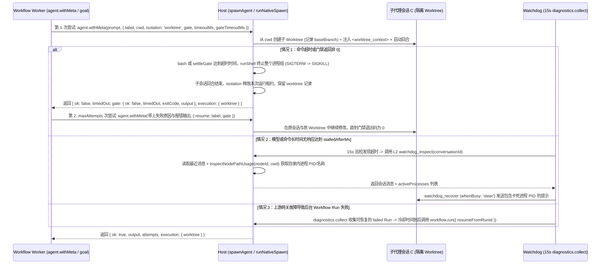

## 背景

Helm 需要支持跨百个模块、上千个子代理的自动化研发流水线：

1. **主流程固定、子流程按需调整**：主工作流只固定顶层步骤（先写共享接口、用 Git Worktree 隔离代码、合入分支后清理目录、用门禁命令检查结果）。每个执行节点的子代理拿到代码后，自己读取现场文件并按需调用 `load_skill`。子代理自己决定下一步：直接改代码、派发 `subagent` 协助，或者启动子工作流做多视角交叉审查。
2. **合并分支不消耗主模型 Token**：主会话（模型 A）只负责与用户确认方案并启动主工作流。各模块由模型 B 负责拆分任务、解决合并冲突和运行模块测试。具体编码和单元测试由模型 C 在独立 Git Worktree 中并发完成。无冲突的分支合并和目录清理全部通过 `action()` 执行，不消耗模型 Token。
3. **网关切换模型与工作流重试解耦**：上游接口限流或报错由 `builtin:magpie` 模型网关在同一模型组内自动切换。工作流引擎和 `builtin:superagent` 的 Watchdog 只处理代码死循环、门禁失败重试和工作流断点续跑。
4. **遵守单向包依赖与现有扩展点**：`@helm/protocol` 只放通用执行结构（`AgentSpawnRequest`、`AgentExecutionInfo`、`AgentGateResult`）和 `meta` 字段。工作流和 Worktree 的业务类型全部放在 `@helm/plugins`（`packages/plugins/src/contracts.ts`）。不新增全局事件或生命周期 Hook，只用内核现有的 7 个 Hook 和 Watchdog 每 15 秒一次的 `diagnostics.collect` 巡检。

检查当前代码（`@helm/kernel` 和 `@helm/plugins`），现有实现有 7 处限制：

- **清理子级 Worktree 时固定对比主分支 `HEAD`**（`packages/plugins/src/workflow/worktree.ts:1512`）：`WorktreeAllocator.cleanup` 第 6 步固定运行 `git rev-list --count ${mainHead}..${fresh.branch}`。当模块分支 `B` 派生子分支 `C`，且 `C` 已合并进 `B`、但 `B` 还没合并回 `main` 时，清理 `C` 会报错 `409 worktree_dirty`。子工作流如果不传 `force: true` 就无法删除子目录。
- **DSL `agent()` 缺少 Worktree 信息返回、`cwd` 参数和失败自动重试**（`packages/plugins/src/workflow/engine/worker-source.ts:227, 410`）：`agent()` 只返回模型输出文本或 `schema` 对象。脚本拿不到 `worktree.{id, path, branch}`，后面无法调用 `action("env.exec")` 执行 `git merge <branch>` 和 `cleanup_worktree`。同时 `AGENT_OPTIONS` 没有开放 `cwd`，合并冲突时无法指定在模块目录启动子代理解决冲突，也无法从模块目录（`cwd` 加 `isolation: 'worktree'`）切出子级 Worktree。另外，`isolation.ts:386` 只在 `dirtySource === true` 时注入 `<worktree_isolation_notice>`，从干净仓库切出的子代理不知道自己的分支名和目录路径。
- **门禁或回合失败时丢失执行信息、残留租约且无法原地 `resume`**（`packages/kernel/src/runtime/spawn.ts:716`、`packages/plugins/src/workflow/engine/service.ts:2404`、`runtime.ts:1143`、`isolation.ts:436`）：
  1. `runNativeSpawn` 在回合结束时运行 `settleGate`。如果门禁命令返回非 0，直接抛出 `HelmError('gate_failed')`。`service.ts` 的 `invokeSpawn` 在 `catch` 分支丢掉了 `onResolved` 已经拿到的 `executionInfo`。
  2. `runtime.ts` 只在 `result.ok === true` 时把 `label` 写入 `completedByLabel`。第一次调用因测试失败或超时报错后，后续 `resume: label` 会直接报 `no agent has completed under the label` 并终止。
  3. `isolation.ts` 的 `spawnWithWorktree` 和 `resumeWithWorktree` 在 `next(finalRequest)` 抛错时调用 `settleLease(leaseToken, false, false)`，一直保留失败租约。后面就算修好代码，调用 `cleanup_worktree` 也会报 `409 worktree_execution_unknown`。
- **死循环与测试卡死缺少回合超时和进程检查**（`packages/kernel/src/runtime/tools.ts:412`、`packages/plugins/src/superagent/watchdog.ts:1387`）：`runGate` 固定用 120 秒超时，且 `AgentGateResult` 没有 `timedOut` 和 `exitCode`。`agent()` 也没有单回合超时 `timeoutMs`。当子代理写出死循环测试时，`watchdog_inspect` 的 `inspectConversation` 只返回最近 10 条消息，没有调用宿主已有的 `ctx.host.inspectNodePathUsage(nodeId, cwd)` 查看卡住的系统进程（PID 和命令名）。
- **非幂等的 `env.exec` 会阻止 `resumeFromRunId` 续跑**（`packages/plugins/src/workflow/engine/journal.ts:39`）：内置动作 `env.exec` 默认 `idempotent: false`。工作流前半段执行过未标记幂等的 `git merge`、后半段因网络中断时，`readJournal` 会把账本标为 `workflow_action_uncertain`，拒绝从断点继续运行。
- **DSL `workflow()` 只能嵌套 1 层，且子工作流的 `label` 会互相冲突**（`packages/plugins/src/workflow/engine/worker-source.ts:525`、`runtime.ts:624`）：`scope.depth > 0` 限制了多级工作流调用。同时 `completedByLabel` 在整个 Run 内共用，并发运行的多个子工作流如果用了同名 `label`，会互相覆盖续接目标。
- **单文档全量复制与大段文本冗余在千级节点下会超过 `2 MiB` 上限**（`packages/plugins/src/workflow.ts:147, 504, 670`、`packages/plugins/src/workflow/engine/service.ts:2820`、`packages/kernel/src/plugins/doc-registry.ts:75`）：
  1. `ctx.doc` 必须在 `definePlugin` 阶段注册（运行时调用会报 `409 plugin_context_closed`）。`doc` 和 `sessionDoc` 单个文档上限都是 `2 MiB`（超过报 `413 plugin_doc_too_large`）。
  2. 当前 `builtin:workflow` 把所有历史 Run 记录存在同一个 `ctx.doc('records')` 里。每次状态更新都会对全部历史记录做 `structuredClone`。
  3. `service.ts` 的 `nodesFromProgress` 把子代理完整的 `prompt` 和 `gate.output` 原样放进每个 `WorkflowNodeState`，再由 `writeRunsDoc` 写入 `ctx.sessionDoc('runs')`。当节点数达到上千个时，单个 Run 的 `nodes` 就会超过 `2 MiB`，导致保存失败（完整提示词和输出本来就已经存在子会话和 `.jsonl` 账本里，不需要在进度树上重复存一份）。

建议分支：`feat/multi-level-goal-workflow`（建议名称，当前尚未创建）。

---

## 整体设计

### 1. 多级工作流树、节点自主派工与单账本重放

工作流采用「外层固定主流程 + 内层节点按需派工」的结构：

- **外层多级工作流（DSL `workflow(ref, args)`）**：主工作流通过 `workflow(ref, args)` 在同一个 Worker 进程内调用子工作流（例如：总控工作流 → 模块开发工作流 → 交叉审查工作流）。整棵工作流树里的所有 `agent` 和 `action` 节点共用递增的 `callIndex` 和同一个 `workflow-<runId>.jsonl` 账本文件。中途中断后，对根 `runId` 调用一次 `resumeFromRunId`，就能按账本前缀跳过所有已完成的节点，不重复消耗 Token。
- **内层节点自主决策**：
  1. **按现场代码选择做法**：工作流不在脚本里写死子任务列表或审查条目，而是先启动规划子代理读取代码、Git Diff 和可用技能列表（`<available_skills>`），按需调用 `load_skill` 查看技能说明，再决定下一步是「直接修改（`direct`）」、「拆分并发子任务（`parallel_tasks`）」还是「先交叉审查方案再拆分实施（`review_then_tasks`）」。
  2. **按节点配置子代理深度上限（`maxSubagentDepth`）**：基于 `builtin:workflow` 现有的深度限制（默认 `2`，最大 `5`），DSL 的 `agent()` 和 `goal()` 支持通过 `maxSubagentDepth` 指定该节点还能往下派发几层。未到深度上限的节点在回合内保留 `subagent` 和 `SubagentWorkflow` 工具（自动化子会话调用时默认同步等待结果）。到达深度上限的叶子节点由 `before_turn` 钩子自动移除派工工具，只负责写代码和跑过门禁。
- **子工作流 `scopeId` 隔离**：每次调用 `workflow(ref, args)` 分配递增的 `scopeId`（根工作流为 `0`）。引擎里的 `completedByLabel` 用 `${scopeId}:${label}` 作为键。并发运行的多个模块子工作流可以各自使用简单的 `label`（比如 `"plan"`），不会互相覆盖。
- **避免父子节点争抢并发槽位死锁**：每个工作流运行实例（Run）维护自己的并发信号量。同进程内通过 `workflow()` 调用的子工作流共用当前 Run 的信号量。子代理在对话回合内通过工具同步启动的子任务使用独立信号量，避免“父节点占着槽位等子节点完成、子节点在队列外等父节点释放槽位”的死锁。

### 2. 失败自动重试：`agent()` 的 `maxAttempts`、`agent.withMeta()` 与 `goal()`

不新增第二套执行通道，直接在现有的 `agent(prompt, opts)` 上增加 `maxAttempts` 自动重试能力，同时提供带执行信息的 `agent.withMeta(prompt, opts)` 和简写函数 `goal(spec)`：



为什么不用事件驱动 Watchdog？因为代码死循环和网络连接卡住时不会产生任何新事件，不会触发 `tool_result` 或 `turn_settled`。用主动超时（`timeoutMs` / `gateTimeoutMs`）配合定时轮询（15 秒一次 `diagnostics.collect` 加按需查询进程），就能在不改内核事件机制的前提下处理卡死问题。

---

## 详细设计

### 1. 多级 Worktree 父子关系记录、租约释放与 `mergedInto` 清理

#### 1.1 `@helm/plugins` 类型与 `ManagedWorktreeRecord` 扩展

Worktree 类型放在 `@helm/plugins`，不放进 `@helm/protocol`：

1. 在 `packages/plugins/src/contracts.ts` 的 `WorktreeExecutionDescriptor` 和 `WorktreeCleanupRequest` 中增加字段：
   ```ts
   export type WorktreeExecutionDescriptor = {
     path: string
     branch: string
     id?: string
     repoRoot?: string
     baseCommit?: string
     /** 创建 Worktree 时源目录检出的本地分支名（例如父模块分支 'helm/spawn-12ab34cd'；detached HEAD 时为空）。 */
     baseBranch?: string
     /** 若源目录本身是一个受管 Worktree，记录其 worktreeId。 */
     parentWorktreeId?: string
     dirtySource?: boolean
   }

   export interface WorktreeCleanupRequest {
     worktreeId?: string
     conversationId?: number
     path?: string
     nodeId?: string
     /** 指定已合入的目标分支或提交（缺省优先用记录里的 baseBranch，再回退到主工作树 HEAD）。 */
     mergedInto?: string
     deleteBranch?: boolean
     force?: boolean
   }
   ```
   同步更新 `contracts.ts` 中的 `sanitizeWorktreeDescriptor`，校验 `baseBranch` 和 `parentWorktreeId` 为非空字符串。
2. 在 `packages/plugins/src/workflow/worktree.ts` 的 `ManagedWorktreeRecord` 中增加 `baseBranch?: string` 和 `parentWorktreeId?: string`。
3. **修改 `WorktreeAllocator.allocate`（`worktree.ts:606-765`）**：
   - 在 Step C 读取 `sourceCwd` 的 `HEAD` 时，多运行一次 `git symbolic-ref --quiet --short HEAD`。如果退出码为 0 且输出非空，记录 `baseBranch = output.trim()`。如果是 detached HEAD（退出码非 0），`baseBranch` 为 `undefined`。
   - 将 `baseBranch` 和 `parentWorktreeId` 加入 Step E `assertMetadataSecretFree` 机密检查。
   - 在 Step F 的 `withRepoLock` 锁内，从当前活跃记录里查找 `r.nodeId === nodeId && normalizePathValue(r.path) === normalizePathValue(sourceToplevel)` 的项，找到则设 `parentWorktreeId = r.id`。
4. **每次启动都注入 `<worktree_context>`（`packages/plugins/src/workflow/isolation.ts:386`）**：
   把原来只在 `dirtySource === true` 时注入的 `<worktree_isolation_notice>` 改为每次都注入 `<worktree_context>`（新建和 `resume` 都生效，由 `isolation.ts` 追加到 `finalRequest.prompt` 末尾）。内容包含 `worktreeId`、`path`、`branch`、`baseCommit`、`baseBranch`（若有）和 `dirtySource` 提示，提醒子代理在结束回合前必须运行 `git add` 和 `git commit`，保持工作区干净。

#### 1.2 回合失败（Gate / Schema / Timeout）时正常释放运行租约

修复 `isolation.ts:436` 在 `next(finalRequest)` 抛错时一直保留 `running` 租约，导致后续 `cleanup_worktree` 报 `409 worktree_execution_unknown` 的问题：

- **原因分析**：租约的作用是防止「进程崩溃或外部 CLI 失联，无法确认子代理是否还在改文件」时误删目录。对于原生子会话（`info.conversationId !== undefined && info.executionId === undefined`），当 `await next(finalRequest)` 抛错返回时，`runNativeSpawn` 的 `finally` 块已经释放会话锁，子会话回合确定已经停止。
- **修改规则（`isolation.ts` 的 `spawnWithWorktree` 和 `resumeWithWorktree`）**：
  - 在 `catch (error)` 分支中，如果是原生子会话且 `isConversationWorking(conversationId) === false`，调用 `await this.settleLease(leaseToken, true, false)` 释放本次运行租约，同时保留 Worktree 记录和 `agentId -> childId` 映射，供下一轮 `resume` 或后续 `cleanup_worktree` 使用。
  - 如果 `resumeWithWorktree` 成功完成，顺带清理该 `record.id` 下残留的旧租约。
  - 只有进程崩溃或外部 CLI（`executionId !== undefined`）未确认停止时，才保留租约阻止清理。

#### 1.3 `cleanup` 支持 `mergedInto` 与父分支检查

在 `CleanupInput`（`worktree.ts:154`）、`cleanup_worktree` 工具与动作 Schema（`packages/plugins/src/workflow.ts`）以及 CLI `helm worktrees cleanup --merged-into <ref>`（`packages/cli/src/commands/`）中加上 `mergedInto?: string`：

1. **目标提交 `referenceHead` 的确定规则（替换 `worktree.ts:1512` 固定的 `mainEntry.head`）**：
   - 如果传入了 `input.mergedInto`：校验它是非空字符串，不含空白字符、控制字符、`..`、`~`、`^`、`:` 且不以 `-` 开头。在仓库运行 `git rev-parse --verify --quiet "${input.mergedInto}^{commit}"`。如果找不到提交，直接抛出 `HelmError('validation_error', 'mergedInto 指向的分支或提交不存在', 400)`，不回退到主工作树。
   - 如果没传 `input.mergedInto`，但 `fresh.baseBranch !== undefined`：运行 `git rev-parse --verify --quiet "refs/heads/${fresh.baseBranch}^{commit}"`。如果父分支还在，用它的当前提交作为 `referenceHead`。如果父分支已删，回退到 `mainEntry.head`。
   - 其他情况：用 `mainEntry.head`。
2. **第 6 步未合并检查与分支删除**：
   - 运行 `git rev-list --count ${referenceHead}..${fresh.branch}`。当结果为 `0` 且工作区无未提交修改（`dirtyFiles.length === 0`）时，说明提交已全部合入目标分支，不用传 `force: true` 即可删除 Worktree。
   - 在 `deleteManagedBranch` 中，只要锁内已经确认 `rev-list --count ${referenceHead}..${fresh.branch} === 0`（或 `input.force === true`），统一用 `git branch -D ${fresh.branch}` 删除分支。这样可以避免在 `referenceHead` 不是 `main` 分支时，`git branch -d` 拒绝删除分支。

---

### 2. DSL 扩展：`agent()` 新参数、`agent.withMeta()` 与 `goal()`

#### 2.1 `@helm/protocol` 与内核 `spawn.ts` / `tools.ts` 的门禁超时扩展

1. **`@helm/protocol`（`src/plugin.ts`, `src/agent-exec.ts`）**：
   - `AgentSpawnRequest` 新增可选字段 `gateTimeoutMs?: number`（单次门禁命令超时毫秒数）。
   - `AgentGateResult` 扩展为：
     ```ts
     export interface AgentGateResult {
       ok: boolean
       output: string
       exitCode?: number | null
       timedOut?: boolean
     }
     ```
   - `sanitizeAgentGateResult`（`packages/protocol/src/agent-exec.ts:89`）同步校验可选的 `exitCode`（整数或 `null`）和 `timedOut`（布尔值）。
2. **`packages/kernel/src/runtime/tools.ts:412` & `spawn.ts:716`**：
   - `runGate` 接收可选的 `timeoutMs?: number`（默认 `120_000`），传给 `runShell`，返回 `{ ok: result.ok, output: result.output, exitCode: result.exitCode, timedOut: result.timedOut }`。
   - `spawn.ts` 的 `settleGate` 把 `request.gateTimeoutMs` 传给 `runGate`，并通过 `request.onGateResult?.(gate)` 回传完整结果。当 `!gate.ok` 时，抛出的 `HelmError('gate_failed', ...)` 在 `details` 中带上 `{ exitCode: gate.exitCode, timedOut: gate.timedOut, output: gate.output.slice(-4000) }`。

#### 2.2 `agent()` 新增 `cwd`、`timeoutMs`、`gateTimeoutMs` 与 `maxAttempts`

在 `packages/plugins/src/workflow/engine/worker-source.ts:227` 的 `AGENT_OPTIONS`、`runtime.ts`、`service.ts` 和 `journal.ts` 中新增以下选项：

| 选项名 | 类型与取值范围 | 组合与账本规则 | 运行时行为 |
| :--- | :--- | :--- | :--- |
| `cwd` | `string`（目标节点绝对路径） | 可与 `isolation: 'worktree'` 同时使用（此时从 `cwd` 切出子 Worktree）。与 `resume` 互斥。写入 `AgentJournalKeyInput`（版本升为 `v3`） | 传给 `spawnAgent({ cwd })`。不带 `isolation` 时直接在 `cwd` 下运行。带 `isolation: 'worktree'` 时从该 `cwd` 创建子 Worktree |
| `timeoutMs` | `number`（`1_000 .. 3_600_000` 整数） | 可选，不记入账本缓存 Key | 在 `service.ts` 的 `invokeSpawn` 中用 `AbortSignal.any([run.abort.signal, AbortSignal.timeout(timeoutMs)])` 包装调用。超时后调用 `abortChildConversation` 中止子会话，返回 `{ ok: false, timedOut: true, error: '[agent_timeout] ...' }` |
| `gateTimeoutMs` | `number`（`1_000 .. 600_000` 整数，默认 `120_000`） | 仅在设置 `gate` 时有效 | 传给 `AgentSpawnRequest.gateTimeoutMs` → `runGate`。超时由 `runShell` 终止整个进程组（`SIGTERM` → `SIGKILL`），返回 `gate: { ok: false, timedOut: true, exitCode: null, output }` |
| `maxAttempts` | `number`（`1 .. 10` 整数，默认 `1`） | 配合 `gate` 或 `timeoutMs` 使用，需要有 `label`（未传则自动生成） | 第 1 次如果因为门禁失败、门禁超时或回合超时失败，且已经拿到子会话 ID，则在 Worker 内自动用 `resume: label` 带上报错信息继续修改，最多跑 `maxAttempts` 次 |

#### 2.3 失败时保留 `executionInfo`、支持原地 `resume` 与 `agent.withMeta()` / `goal()`

1. **`service.ts` `invokeSpawn` 在失败分支保留 `executionInfo`（`packages/plugins/src/workflow/engine/service.ts:2404`）**：
   - 在 `catch (error)` 分支中，把 `onResolved` 拿到的 `executionInfo` 和 `onGateResult` 拿到的 `gateResult` 一起放进 `{ ok: false, error, timedOut, executionInfo, gate: gateResult }` 返回给 `runtime.ts`，不丢弃已创建的 Worktree 和 `conversationId`。
2. **放宽 `completedByLabel` 登记条件并按 `scopeId` 隔离（`runtime.ts:1120-1175`）**：
   - `completedByLabel` 的键改为 `${scopeId}:${label}`。
   - 只要本次 `agent` 调用拿到了 `conversationId` 或 `executionId`，就算回合超时、Schema 校验失败或门禁未通过，也登记到 `completedByLabel.set(scopedKey, { agentId, label, agentType, model, isolation })`。后续同一 Scope 内的 `agent(..., { resume: label })` 可以直接续接该子会话和它的 Worktree。
3. **`agent.withMeta(prompt, opts)` 与 `goal(spec)`**：
   - 保持 `await agent(prompt, opts)` 原有返回值不变（成功返回文本或对象，失败返回 `null`）。
   - 新增 `await agent.withMeta(prompt, opts)`，返回包含执行信息和门禁结果的对象：
     ```ts
     export interface AgentWithMetaResult<T = unknown> {
       ok: boolean
       output: T | null
       attempts: number
       error?: string
       timedOut?: boolean
       execution?: {
         nodeId?: string
         conversationId?: number
         executionId?: string
         effectiveCwd?: string
         worktree?: WorktreeExecutionDescriptor
       }
       gate?: AgentGateResult
     }
     ```
   - 新增 `await goal(spec)` 作为 `agent.withMeta` 的简写（默认 `maxAttempts: 3`）：
     ```ts
     // goal({ label, objective, gate, maxAttempts = 3, ...rest })
     // 等价于 agent.withMeta(objective, { ...rest, label, gate, maxAttempts: spec.maxAttempts ?? 3 })
     ```
   - `journal.ts` 的 `WorkflowJournalEntry`（`type: 'agent'`）新增可选字段 `execution?: AgentWithMetaResult['execution']` 和 `gate?: AgentGateResult`（落盘前做 `redact` 脱敏）。断点续跑命中账本缓存时，`agent.withMeta` 和 `goal` 从账本直接还原 `execution`（含 `worktree` 信息）和 `gate`。
   - 当 `maxAttempts > 1` 时，每次尝试在账本里各占一条独立的 `index` 记录。如果第 2 次尝试跑完后进程重启，`resumeFromRunId` 重放时会直接跳过前 2 次，从第 3 次开始跑。

---

### 3. Watchdog 死循环进程检查与失败工作流自动续跑

#### 3.1 `watchdog_inspect` 增加目录进程列表

在 `packages/plugins/src/superagent/watchdog.ts:1387` 的 `inspectConversation(conversationId)` 中，调用宿主已有的 `ctx.host.inspectNodePathUsage`：

1. 读取目标会话的 `summary.nodeId ?? 'local'` 和 `summary.cwd`。
2. 当会话存在且 `summary.cwd` 非空时，调用 `ctx.host.inspectNodePathUsage({ nodeId: summary.nodeId ?? 'local', path: summary.cwd })`（节点离线等报错捕获后返回 `undefined`，不影响会话消息返回）。
3. 在 `inspectConversation` 返回结果和 `inspectOutputSchema` 的 `conversation` 对象中增加 `activeProcesses` 字段（每项为脱敏后的 `{ pid, name, source, path }`）。
4. 在 `packages/plugins/src/superagent/assets/skill/references/` 下新增 `code-hang-loop.md`（同步加到 `SKILL.md` 和 `assets.ts`）：说明 Watchdog L2 在检查超时会话时，如何结合最近消息和 `activeProcesses`（比如卡在工作树目录里的 `vitest`、`node`、`python` 进程），通过 `watchdog_recover`（`whenBusy: 'steer'`）把卡死进程的 `pid` 和 `name` 发给子代理处理。如果停滞时间达到 `abortAfterMs`，由 L1 `autoAbort` 调用 `abortConversationGuarded` 中止当前回合，让外层 `goal()` 进入下一次重试。

#### 3.2 失败工作流自动断点续跑

当上游模型接口长时间故障，导致后台运行的 Workflow Run 用完重试次数变为 `failed` 时，通过现有的 `diagnostics.collect` 巡检自动触发断点续跑：

1. **`RunIndexEntry` / `RunRecord` 增加续跑记录字段（`packages/plugins/src/workflow/engine/service.ts`）**：
   - 新增字段：
     - `autoResumeCount?: number`（当前累计自动续跑次数，初始为 `0`）。
     - `resumedByRunId?: string`（如果新的 `resumeFromRunId` 已接替该失败 Run，记录新 Run ID，防止重复触发）。
   - 调用 `workflows.run({ resumeFromRunId })` 创建新 `runId` 时：
     - 把原记录的 `resumedByRunId` 设为新 `runId`。
     - 新记录继承原记录的 `notifyParentOnSettle`，并设 `autoResumeCount = (replayFrom.autoResumeCount ?? 0) + 1`。
2. **上报待续跑的失败 Run（`packages/plugins/src/workflow.ts`）**：
   监听 `ctx.host.onEvent(DIAGNOSTICS_COLLECT_EVENT, ...)`，找出同时满足以下条件的 Run：
   - `status === 'failed'`、`notifyParentOnSettle === true`（后台任务）且 `resumedByRunId === undefined`。
   - 错误码不是语法错误、参数校验错误或 `workflow_action_uncertain`。
   - 账本中 `actionUncertain === false` 且至少有 1 条成功记录。
   - `autoResumeCount ?? 0` 小于 `3`。
   调用 `appendProbes(collection, [...])` 上报探针：
   ```ts
   {
     targetKind: 'external',
     targetId: `workflow:${run.id}`,
     nodeId: 'local',
     ownedBy: 'helm',
     status: 'error',
     stateChangeSeq: run.autoResumeCount ?? 0,
     facts: {
       kind: 'workflow_run',
       runId: run.id,
       conversationId: run.conversationId,
       failedAt: run.updatedAt,
       autoResumeCount: run.autoResumeCount ?? 0,
     },
   }
   ```
3. **退避等待与每次巡检限流（`packages/plugins/src/superagent/watchdog.ts`）**：
   在 `classifyExternal` / `executeOps` 中处理 `probe.targetKind === 'external' && probe.facts?.['kind'] === 'workflow_run'`：
   - 按 `autoResumeCount` 等待冷却时间：第 0 次等 `2 分钟`、第 1 次等 `5 分钟`、第 2 次等 `15 分钟`。
   - **每次巡检最多恢复 1 个 Run**：按 `failedAt` 从早到晚排序，每轮 tick 最多恢复 1 个失败工作流，避免网关刚恢复时同时唤醒十几个大工作流再次把接口打挂。
   - 冷却时间到后，调用 `ctx.host.invokeAction('builtin:workflow', 'run', { resumeFromRunId: runId, conversationId })` 从断点继续运行。

---

### 4. `workflow()` 四级嵌套、并发配置与存储减重

1. **`workflow()` 嵌套上限调到 4 层并隔离 `scopeId`**（`packages/plugins/src/workflow/engine/worker-source.ts:525`）：
   - 把 `if (scope.depth > 0)` 改为 `if (scope.depth >= 4)`（导出常量 `MAX_WORKFLOW_NESTING_DEPTH = 4`），保留 `WORKFLOW_NESTED_CAP = 256` 防止无限递归。
   - `makeScope(name, depth)` 分配递增的 `scope.id = nextScopeId++`，并在 `callHost("agent", { ..., scopeId: scope.id })` 中传给 `runtime.ts`，让各子工作流里的 `label` 和 `resume` 互不干扰。
2. **并发上限配置**（`service.ts` & `runtime.ts`）：在 `builtin:workflow` 插件配置中增加 `maxConcurrentAgents`（范围 `1..128`，默认 `Math.max(2, Math.min(32, os.availableParallelism() * 2))`），用于控制单个工作流的最大并发子代理数。
3. **控制进度文档与历史记录体积**（避免超过 `2 MiB` 报 `413 plugin_doc_too_large`）：
   - **进度树中的长文本截断预览**：在 `service.ts:2820` 的 `nodesFromProgress` 中，将 `WorkflowNodeState` 的 `prompt`、`gate.output` 和 `error` 限制为最多 `1024` 个字符，超出时在末尾加上 `\n...[truncated, full content in conversation/journal]`（完整内容本来就保存在子会话和 `.jsonl` 账本里）。这样 500 个节点的进度数据只有约 300 KB，不会撑爆 `ctx.sessionDoc('runs')`。
   - **Run 详情单独存文件，`ctx.doc('records')` 只存索引**：`ctx.doc('records')` 只保存轻量索引（`id, conversationId, status, createdAt, updatedAt, notifyParentOnSettle, autoResumeCount, resumedByRunId`）。每个 Run 的完整 `RunRecord` 通过原子写（`.tmp` + `fsync` + `rename`）存到 `dataDir/artifacts/<convId>/workflow-<runId>.record.json`。`worktree-state` 保留全部记录，不删减历史条目。

---

### 5. 幂等 Git 合并写法与工作流脚本示例

内置动作 `env.exec` 默认 `idempotent: false`。为了避免工作流中断后因跑过 `git merge` 报 `workflow_action_uncertain` 而无法续跑，分支合并统一先检查是否已合入：

```bash
git merge-base --is-ancestor "<branch>" HEAD || git merge --no-ff -m "<msg>" "<branch>"
```

如果该分支之前已经合入当前 `HEAD`，`git merge-base --is-ancestor` 直接返回 `0` 跳过合并。未合入时才运行 `git merge`。这样就可以安全地标记 `{ idempotent: true }`，支持任意位置断点续跑。

#### 5.1 多视角交叉审查子工作流（`cross-review.js`）

无论是评审设计方案还是审查代码，都不需要在脚本里写死固定规则。脚本先启动规划子代理查看目标文件、项目规范（如 `AGENTS.md`）和可用技能（`<available_skills>`），按需调用 `load_skill` 读取匹配的技能说明，拆出 2~5 个互不重叠的检查维度，然后按「多维度并发检查 → 独立复核人查源码过滤误报 → 执行人修改」循环直到没有严重问题：

```javascript
export const meta = {
  name: "cross-review",
  description: "多视角交叉审查：先根据代码与技能动态拆分检查维度，再并发检查、独立复核过滤误报并闭环修改",
  phases: [{ title: "拆分检查维度" }, { title: "并发检查与复核" }, { title: "输出结论" }],
}

const PLAN_SCHEMA = {
  type: "object",
  required: ["mode", "targetSummary", "authorInstruction", "verifierInstruction", "checkDimensions"],
  properties: {
    mode: { type: "string", enum: ["review_only", "create_and_refine", "fix_in_place"] },
    targetSummary: { type: "string" },
    authorInstruction: { type: "string", description: "编写或修改时的说明：指出需要加载的技能（load_skill）或项目文档路径" },
    verifierInstruction: { type: "string", description: "复核准则：如何对照源码和项目规范剔除误报与过度设计" },
    checkDimensions: {
      type: "array",
      minItems: 2,
      maxItems: 5,
      items: {
        type: "object",
        required: ["id", "title", "instruction"],
        properties: {
          id: { type: "string" },
          title: { type: "string" },
          instruction: { type: "string", description: "该维度的检查重点及需要读取的技能或文件路径" },
        },
      },
    },
  },
}

const FINDING_SCHEMA = {
  type: "object",
  required: ["findings"],
  properties: {
    findings: {
      type: "array",
      items: {
        type: "object",
        required: ["id", "severity", "location", "claim", "evidence", "suggestion"],
        properties: {
          id: { type: "string" },
          severity: { type: "string", enum: ["blocker", "major"] },
          location: { type: "string" },
          claim: { type: "string" },
          evidence: { type: "string", description: "具体的文件行号、复现步骤或违反的规范条目" },
          suggestion: { type: "string" },
        },
      },
    },
  },
}

const VERDICT_SCHEMA = {
  type: "object",
  required: ["rejected", "reason"],
  properties: {
    rejected: { type: "boolean", description: "如果是误报、脱离上下文或属于过度设计，设为 true 驳回" },
    reason: { type: "string" },
  },
}

phase("拆分检查维度")
const plan = await agent(
  `请查看以下任务的目标文件、项目规范（如 AGENTS.md）和可用技能列表（<available_skills>）：\n` +
  `${typeof args === "string" ? args : JSON.stringify(args, null, 2)}\n\n` +
  `请先用 load_skill 查看相关技能说明，把本次审查拆成 2~5 个互不重叠的检查维度（checkDimensions），并写明修改人和复核人的判断标准。`,
  { label: "planner", model: args?.modelB, cwd: args?.cwd, phase: "拆分检查维度", schema: PLAN_SCHEMA }
)

let currentWork = plan.targetSummary
if (plan.mode === "create_and_refine") {
  currentWork = await agent(`${plan.authorInstruction}\n\n请完成初稿：\n${plan.targetSummary}`, {
    label: "author",
    model: args?.modelB,
    cwd: args?.cwd,
    phase: "拆分检查维度",
  })
}

const maxRounds = args?.maxRounds ?? (plan.mode === "review_only" ? 1 : 3)
const history = []

phase("并发检查与复核")
for (let round = 1; round <= maxRounds; round++) {
  const verifiedLists = await pipeline(
    plan.checkDimensions,
    (dim) =>
      agent(
        `你负责检查「${dim.title}」。\n【检查标准】\n${dim.instruction}\n\n` +
        `【待检查内容（第 ${round} 轮）】\n${currentWork}\n\n只报告有明确依据的 blocker/major 问题；没有问题则返回 findings=[]。`,
        { label: `check-${dim.id}-r${round}`, model: args?.modelC ?? args?.modelB, cwd: args?.cwd, phase: "并发检查与复核", schema: FINDING_SCHEMA }
      ),
    async (res, dim) => {
      if (!res?.findings?.length) return []
      const judged = await parallel(
        res.findings.map((f) => () =>
          agent(
            `请复核以下问题是否成立。\n【复核标准】\n${plan.verifierInstruction}\n\n` +
            `检查维度「${dim.title}」报告的问题：\n${JSON.stringify(f, null, 2)}\n\n` +
            `请直接读取源码和文档核实：如果是误报或过度设计，将 rejected 设为 true。`,
            { label: `verify-${dim.id}-${f.id}-r${round}`, model: args?.modelB, cwd: args?.cwd, phase: "并发检查与复核", schema: VERDICT_SCHEMA }
          ).then((v) => ({ ...f, dimension: dim.title, verdict: v }))
        )
      )
      return judged.filter((item) => item.verdict && !item.verdict.rejected)
    }
  )

  const confirmed = verifiedLists.flat().filter(Boolean)
  history.push({ round, confirmedCount: confirmed.length, issues: confirmed })
  if (plan.mode === "review_only" || confirmed.length === 0) break

  currentWork = await agent(
    `复核确认以下 ${confirmed.length} 个问题需要修改：\n${JSON.stringify(confirmed, null, 2)}\n\n请逐项修复并验证。`,
    {
      label: "author",
      resume: round === 1 && plan.mode === "fix_in_place" ? undefined : "author",
      model: args?.modelB,
      cwd: args?.cwd,
      phase: "并发检查与复核",
      ...(args?.gate ? { gate: args.gate } : {}),
    }
  )
}

phase("输出结论")
return { passed: history.at(-1)?.confirmedCount === 0, result: currentWork, history }
```

#### 5.2 单模块开发子工作流（`module-dev.js`）

主流程只固定「创建模块 Worktree + 运行最终门禁」。模块规划节点读取该模块的代码后，根据实际改动大小从三种方式里选一种运行（`strategy`）：
- **`direct`（直接修改）**：改动很小，直接在模块 Worktree 里改完跑测试，不切分多余的子分支。
- **`parallel_tasks`（并发子任务）**：拆成多个互不重叠的子任务，各自切出子 Worktree 并发修改，谁先跑完谁先合入并清理子目录。每个子任务可按复杂度设置 `maxSubagentDepth`。
- **`review_then_tasks`（先评审方案再并发开发）**：改动复杂时，先调 `workflow("cross-review", ...)` 把模块设计定下来，再拆分并发开发。

```javascript
export const meta = {
  name: "module-dev",
  description: "单模块开发：先查看代码选择做法（直接改 / 先评审方案 / 并发子任务），再流式合入与清理",
  phases: [{ title: "模块评估与拆分" }, { title: "执行开发" }, { title: "合入与清理" }],
}

// args: { moduleName, moduleScope, archSpec, modelB, modelC, gateCmd }
phase("模块评估与拆分")
const modPlan = await goal({
  label: "plan", // 子工作流有独立的 scopeId，直接用简短 label 不会与其他模块冲突
  model: args.modelB,
  isolation: "worktree",
  maxAttempts: 2,
  objective:
    `你负责模块「${args.moduleName}」（目录：${args.moduleScope}）。\n` +
    `全局接口约定：\n${args.archSpec}\n` +
    `请先查看本模块代码和可用技能（按需 load_skill），选择最合适的执行方式（strategy）：\n` +
    `1. 改动很小且集中时，选 "direct"，填写 directInstruction，不用拆子任务；\n` +
    `2. 需要多文件并发修改时，选 "parallel_tasks"；如果涉及复杂逻辑需要先做交叉评审，选 "review_then_tasks"；\n` +
    `3. 拆分 tasks 时，各子任务修改的文件不能重叠，并可按复杂度设置 maxSubagentDepth（1=只写代码，2..4=允许在回合内继续派发 subagent 或子工作流）。规划阶段不要改代码，保持工作区干净。`,
  gate: "test -z \"$(git status --porcelain)\"",
  schema: {
    type: "object",
    required: ["strategy"],
    properties: {
      strategy: { type: "string", enum: ["direct", "parallel_tasks", "review_then_tasks"] },
      directInstruction: { type: "string" },
      tasks: {
        type: "array",
        items: {
          type: "object",
          required: ["id", "title", "files", "instruction", "testCmd"],
          properties: {
            id: { type: "string" },
            title: { type: "string" },
            files: { type: "array", items: { type: "string" } },
            instruction: { type: "string" },
            testCmd: { type: "string" },
            maxSubagentDepth: { type: "number", minimum: 1, maximum: 4 },
          },
        },
      },
    },
  },
})
if (!modPlan.ok || !modPlan.output || !modPlan.execution?.worktree) {
  throw new Error(`模块 ${args.moduleName} 规划失败: ${modPlan.error}`)
}
const modWt = modPlan.execution.worktree // { id, path, branch }
let reviewNotes = ""

phase("执行开发")
if (modPlan.output.strategy === "review_then_tasks") {
  const review = await workflow("cross-review", {
    mode: "create_and_refine",
    cwd: modWt.path,
    modelB: args.modelB,
    modelC: args.modelC,
    target: `制定模块 ${args.moduleName}（${args.moduleScope}）的实现方案：\n${args.archSpec}`,
  })
  reviewNotes = `\n【模块实现方案】\n${review.result}\n`
}

if (modPlan.output.strategy === "direct") {
  const directRes = await goal({
    label: "direct-impl",
    model: args.modelC,
    cwd: modWt.path,
    maxAttempts: 3,
    objective: `${modPlan.output.directInstruction}\n完成后执行 git add 和 git commit 提交到当前模块分支。`,
    gate: `${args.gateCmd} && test -z "$(git status --porcelain)"`,
  })
  if (!directRes.ok) throw new Error(`模块 ${args.moduleName} 直接修改未通过: ${directRes.error}`)
} else {
  // 并发运行子任务；任意子任务通过门禁后，立即排队合入模块分支并删除子 Worktree，不等待其他慢任务
  let mergeChain = Promise.resolve()
  function withMergeLock(fn) {
    const next = mergeChain.then(fn, fn)
    mergeChain = next.catch(() => {})
    return next
  }

  const deliveries = await pipeline(
    modPlan.output.tasks ?? [],
    async (task) => {
      const res = await goal({
        label: `task-${task.id}`,
        model: args.modelC,
        cwd: modWt.path,
        isolation: "worktree",
        maxSubagentDepth: task.maxSubagentDepth ?? 2,
        maxAttempts: 3,
        timeoutMs: 300_000,
        gateTimeoutMs: 120_000,
        objective:
          `完成子任务「${task.title}」\n` +
          `涉及文件：${task.files.join(", ")}\n` +
          `要求：${task.instruction}${reviewNotes}\n` +
          `完成后必须 git add 并 git commit 到当前分支。`,
        gate: `${task.testCmd} && test -z "$(git status --porcelain)"`,
      })
      if (!res.ok || !res.execution?.worktree) {
        throw new Error(`子任务 ${task.id} 重试 ${res.attempts} 次后仍未通过: ${res.error}`)
      }
      return { task, worktree: res.execution.worktree }
    },
    async (item) =>
      withMergeLock(async () => {
        phase("合入与清理")
        const leafBranch = item.worktree.branch

        // 1. 幂等合入模块工作树
        const merge = await action(
          "env.exec",
          {
            cwd: modWt.path,
            command: `git merge-base --is-ancestor "${leafBranch}" HEAD || git merge --no-ff -m "feat(${args.moduleName}): merge ${item.task.id}" "${leafBranch}"`,
            allowFailure: true,
          },
          { idempotent: true, label: `merge-${item.task.id}` }
        )

        // 2. 有冲突时启动模型 B 在模块目录解决冲突
        if (!merge.ok) {
          const resolved = await goal({
            label: `conflict-${item.task.id}`,
            model: args.modelB,
            cwd: modWt.path,
            maxAttempts: 2,
            objective: `合入分支 ${leafBranch} 时发生冲突：\n${merge.output}\n请解决冲突并完成 git commit。`,
            gate: `test -z "$(git status --porcelain)" && ! git rev-parse -q --verify MERGE_HEAD && ${args.gateCmd}`,
          })
          if (!resolved.ok) throw new Error(`模块 ${args.moduleName} 合入 ${leafBranch} 冲突解决失败`)
        }

        // 3. 删除子 Worktree（传入 mergedInto: modWt.branch，无需 force）
        await action(
          "workflow.cleanup_worktree",
          {
            worktreeId: item.worktree.id,
            mergedInto: modWt.branch,
            deleteBranch: true,
          },
          { idempotent: true }
        )
        return item.task.id
      })
  )

  for (const mergedTaskId of deliveries) {
    if (!mergedTaskId) throw new Error(`模块 ${args.moduleName} 存在未完成的子任务`)
  }
}

// 4. 模块整体门禁检查
const modVerify = await action("env.exec", {
  cwd: modWt.path,
  command: args.gateCmd,
  allowFailure: true,
}, { idempotent: true })

if (!modVerify.ok) {
  const fixed = await goal({
    label: "modfix",
    model: args.modelB,
    cwd: modWt.path,
    maxAttempts: 2,
    objective: `模块 ${args.moduleName} 合入子任务后整体测试未通过：\n${modVerify.output}\n请修复并提交。`,
    gate: `${args.gateCmd} && test -z "$(git status --porcelain)"`,
  })
  if (!fixed.ok) throw new Error(`模块 ${args.moduleName} 整体测试修复失败`)
}

return { moduleName: args.moduleName, branch: modWt.branch, worktreeId: modWt.id }
```

#### 5.3 多模块总控工作流（`arch-master.js`）

```javascript
export const meta = {
  name: "arch-master",
  description: "多模块总控：评审顶层方案与提交共享接口 -> 并发运行各模块子工作流 -> 合入主干与全仓测试",
  phases: [{ title: "评审方案与提交共享接口" }, { title: "并发开发各模块" }, { title: "合入主干与全仓测试" }],
}

// 1. 可选先对顶层方案做交叉审查，再把跨模块共享接口提交到主分支
phase("评审方案与提交共享接口")
let effectiveArchSpec = args.archSpec
if (args.reviewArchSpec) {
  const archReview = await workflow("cross-review", {
    mode: "create_and_refine",
    modelB: args.modelB,
    modelC: args.modelC,
    target: `请结合代码库与项目规范检查并完善以下总体设计方案：\n${args.archSpec}`,
  })
  effectiveArchSpec = archReview.result
}

if (args.contractSpec) {
  const contract = await goal({
    label: "contract-first",
    model: args.modelB,
    maxAttempts: 3,
    objective: `按总体方案更新跨模块共享接口定义并提交到主分支：\n${args.contractSpec}\n\n${effectiveArchSpec}`,
    gate: "pnpm typecheck && test -z \"$(git status --porcelain)\"",
  })
  if (!contract.ok) throw new Error(`共享接口提交失败: ${contract.error}`)
}

// 2. 并发运行所有模块子工作流（共用同一个账本文件）
phase("并发开发各模块")
const modDeliveries = await parallel(
  args.modules.map((mod) => () =>
    workflow("module-dev", {
      moduleName: mod.name,
      moduleScope: mod.scope,
      archSpec: effectiveArchSpec,
      modelB: args.modelB,
      modelC: args.modelC,
      gateCmd: mod.gateCmd,
    })
  )
)

// 3. 依次合入主分支并清理模块 Worktree
phase("合入主干与全仓测试")
for (const mod of modDeliveries) {
  if (!mod) throw new Error("存在未完成的模块子工作流")
  const modBranch = mod.branch

  const merge = await action("env.exec", {
    command: `git merge-base --is-ancestor "${modBranch}" HEAD || git merge --no-ff -m "feat: integrate module ${mod.moduleName}" "${modBranch}"`,
    allowFailure: true,
  }, { idempotent: true, label: `root-merge-${mod.moduleName}` })

  if (!merge.ok) {
    const resolved = await goal({
      label: `root-conflict-${mod.moduleName}`,
      model: args.modelB,
      maxAttempts: 2,
      objective: `主分支合入模块「${mod.moduleName}」（分支 ${modBranch}）时发生冲突：\n${merge.output}\n请解决冲突并 git commit。`,
      gate: "test -z \"$(git status --porcelain)\" && ! git rev-parse -q --verify MERGE_HEAD",
    })
    if (!resolved.ok) throw new Error(`主分支合入模块 ${mod.moduleName} 冲突解决失败`)
  }

  await action("workflow.cleanup_worktree", {
    worktreeId: mod.worktreeId,
    deleteBranch: true,
  }, { idempotent: true })
}

// 4. 全仓构建与测试
const finalGate = args.finalGateCmd ?? "pnpm build && pnpm typecheck && pnpm test:all"
const finalCheck = await action("env.exec", { command: finalGate, allowFailure: true }, { idempotent: true })
if (!finalCheck.ok) {
  const fixed = await goal({
    label: "root-final-fix",
    model: args.modelB,
    maxAttempts: 3,
    objective: `全部模块合入主分支后全仓测试未通过：\n${finalCheck.output}\n请修复并提交。`,
    gate: `${finalGate} && test -z "$(git status --porcelain)"`,
  })
  if (!fixed.ok) throw new Error(`全仓测试修复失败: ${fixed.error}`)
}

return { status: "completed", modules: modDeliveries.map((m) => m.moduleName) }
```

---

## 影响分析

| 涉及模块与文件 | 变更内容 | 调用方影响与联动要求 |
| :--- | :--- | :--- |
| `@helm/protocol` (`src/plugin.ts`, `src/agent-exec.ts`) | ① `AgentSpawnRequest` 新增 `gateTimeoutMs?: number`。② `AgentGateResult` 新增 `exitCode?: number \| null`、`timedOut?: boolean` 并更新 `sanitizeAgentGateResult` | 只包含通用执行字段，不引入 Worktree 或 Workflow 业务类型 |
| `packages/kernel/src/runtime/` (`tools.ts`, `spawn.ts`) | `runGate` 增加可选 `timeoutMs` 参数并返回 `exitCode` 与 `timedOut`。`settleGate` 传入 `request.gateTimeoutMs` 并通过 `onGateResult` 回传结果 | 现有 `runGate` 调用点不传 `timeoutMs` 时保持 120 秒默认超时 |
| `@helm/plugins` 共享契约 (`packages/plugins/src/contracts.ts`) | ① `WorktreeExecutionDescriptor` 新增 `baseBranch?: string`、`parentWorktreeId?: string` 并更新 `sanitizeWorktreeDescriptor`。② `WorktreeCleanupRequest` 新增 `mergedInto?: string` | 同步修改 `packages/cli/src/commands/`（`helm worktrees cleanup --merged-into`）和 `builtin:profile` 的 `helm-cli` 技能文档（通过 `services.test.ts` 校验） |
| `packages/plugins/src/workflow/` (`worktree.ts`, `isolation.ts`) | ① `allocate` 记录 `baseBranch` 和锁内 `parentWorktreeId`。② `cleanup` 支持 `mergedInto` 和 `baseBranch` 检查。③ 原生子会话回合结束时正常释放运行租约，保留 Worktree 记录供续接或清理。④ 每次启动注入 `<worktree_context>` | 开发期不保留旧格式兼容代码 |
| `packages/plugins/src/workflow/engine/` (`worker-source.ts`, `runtime.ts`, `journal.ts`, `service.ts`) & `workflow.ts` | ① `agent()` 支持 `cwd`（可与 `isolation: 'worktree'` 同时使用）、`timeoutMs`、`gateTimeoutMs`、`maxAttempts`（以及现有的 `maxSubagentDepth`）。② 新增 `agent.withMeta()` 和 `goal()`。③ `invokeSpawn` 的 `catch` 分支保留 `executionInfo` 和 `gateResult`，子会话创建后按 `${scopeId}:${label}` 登记 `completedByLabel` 支持失败后原地 `resume`。④ `workflow()` 嵌套上限调至 4 层。⑤ 增加 `maxConcurrentAgents` 并发配置。⑥ `nodesFromProgress` 对节点 `prompt`/`gate.output` 做 1024 字符截断预览，Run 详情存为 `workflow-<runId>.record.json` 文件，`ctx.doc('records')` 只存轻量索引 | 现有脚本的 `await agent()` 返回值与行为保持不变。同步更新 `docs/workflows/dsl-guide.md`、`worktree-and-gate.md`、`journaling-recovery.md` |
| `packages/plugins/src/superagent/` (`watchdog.ts`, `assets/`) | ① `inspectConversation` 调用 `inspectNodePathUsage` 返回 `activeProcesses`。② 新增 `code-hang-loop.md` 排障说明。③ 处理 `workflow_run` 探针，实现失败工作流冷却后自动 `resumeFromRunId`（用 `resumedByRunId` 防止重复续跑，且每轮 tick 最多恢复 1 个 Run） | 遵守 `ownedBy: 'human'` 只读规则，只对 `helm / bot` 归属的后台任务做恢复、中止或续跑 |

---

## 发布

### 上线前检查

遵循项目开发期“不兼容、不迁移”原则，`builtin:workflow` 的 Run 详情改为存 `workflow-<runId>.record.json` 文件 + `ctx.doc('records')` 轻量索引，且 `AgentJournalKeyInput` 版本号升为 `v3`：

1. 本地或测试环境更新代码后，清理 `~/.helm/state.sqlite`（或 `HELM_DATA_DIR`）中旧版 `builtin:workflow` 的 `records` 文档和旧账本文件。
2. 运行 `pnpm link:bins` 或重新构建，确认 CLI `helm worktrees cleanup --merged-into` 与 Hub 端 Schema 同步生效。

### 故障恢复

- **代码死循环或测试卡死**：第一层由 `goal()` / `agent()` 的 `gateTimeoutMs` / `timeoutMs` 触发 `runShell` 杀掉进程组，并带上报错信息自动 `resume` 重试。第二层由 Watchdog 每 15 秒巡检并调用 `inspectNodePathUsage` 查出卡死进程 PID，通过 `watchdog_recover`（`steer`）发给子代理处理，或调用 `abortConversationGuarded` 中止当前回合。
- **上游网关中断或 Hub 进程重启**：重启后 `builtin:workflow` 将中断的 Run 标为 `failed`，随后由 Watchdog 等待冷却期满自动调用 `workflow.run({ resumeFromRunId })`（或人工运行 `helm workflows run --resume-from-run-id`），按账本前缀跳过已完成节点继续运行。

---

## 测试

所有新增与修改的测试都显式声明 `{ timeout: 60_000 }`，不设置 `HELM_TEST_SUITE_TIMEOUT_MS` 环境变量。

| 编号 | 测试档位与目标文件 | 前置条件与输入 | 操作路径 | 预期结果 |
| :--- | :--- | :--- | :--- | :--- |
| T1 | `integration` (`packages/plugins/test/native-worktree.test.ts` & `packages/hub/test/worktree-runtime.integration.test.ts`) | 初始化 Git 仓库主分支 `main`。创建模块 Worktree `B`，并以 `cwd: B.path, isolation: 'worktree'` 创建子 Worktree `C`。在 `C` 中提交文件并 `git merge` 到 `B`（`B` 未合入 `main`） | ① 调用 `cleanup({ worktreeId: C.id, mergedInto: B.branch, deleteBranch: true })`。② 另建子 Worktree `C2` 合入 `B` 后不传 `mergedInto`，直接调用 `cleanup({ worktreeId: C2.id, deleteBranch: true })` | ① 和 ② 都无需 `force: true` 即可成功删除目录和子分支，没有残留租约阻塞。`B.baseBranch` 为 `'main'`，`C.baseBranch` 为 `B.branch`，`C.parentWorktreeId` 为 `B.id`。传入不存在的 `mergedInto` 时报 `400 validation_error` |
| T2 | `integration` (`packages/plugins/test/workflow.test.ts`) | 编写调用 `goal({ label: 'worker-c', isolation: 'worktree', maxAttempts: 3, gateTimeoutMs: 1500, gate: '...' })` 的工作流 | 第 1 次让门禁运行 `sleep 30` 模拟卡死。第 2 次让门禁退出码为 1。第 3 次修复代码并提交 | 第 1 次在 1.5s 后杀掉门禁进程组并返回 `gate.timedOut === true`。第 2、3 次自动用 `resume: 'worker-c'` 复用同一个 `conversationId` 和同一个 Worktree（租约正常释放不锁死）。最终返回 `ok: true, attempts: 3` 和完整的 `execution.worktree` |
| T3 | `integration` (`packages/plugins/test/workflow.test.ts`) | 编写 3 级嵌套 `workflow()`（总控 → 两个并发模块 → 子工作流），两个并发模块内部都用同名 `label: 'plan'`。模块 1 完成 `goal` 修改、幂等 `git merge`（`idempotent: true`）和 `cleanup_worktree`，模块 2 的 `goal` 失败导致 Run 变为 `failed` | 修复模拟模型响应后，调用 `workflow.run({ resumeFromRunId })` | 并发模块的同名 `label` 按 `scopeId` 隔离互不覆盖。续跑时模块 1 的所有 `agent`（含 `withMeta` 的 `execution.worktree`）和 `action` 全部命中账本缓存（`cached: true`），不报 `workflow_action_uncertain`，只重跑模块 2 失败的节点并最终 `completed` |
| T4 | `integration` (`packages/plugins/test/superagent-watchdog.test.ts`) | ① 在子会话的 Worktree 目录下启动长驻子进程模拟卡死。② 构造一条 `notifyParentOnSettle: true`、账本可恢复的 `failed` Workflow Run | ① 调用 `watchdog_inspect({ conversationId })`。② 将时钟推进超过 2 分钟冷却期后运行 Watchdog `singleflightTick()` | ① `inspectConversation` 返回的 `conversation.activeProcesses` 包含该目录下挂起子进程的 `pid` 和 `name`。② Watchdog 自动调用 `builtin:workflow` 的 `run({ resumeFromRunId })` 恢复失败 Run，写入原 Run 的 `resumedByRunId` 防止重复恢复，新 Run 的 `autoResumeCount` 变为 1 |
| T5 | `unit` (`packages/protocol/test/` & `packages/cli/test/` & `packages/plugins/test/contracts.test.ts`) | 修改 `AgentGateResult`、`WorktreeExecutionDescriptor`、`WorktreeCleanupRequest`、CLI `worktrees cleanup --merged-into` 和 `helm-cli` 技能文档 | 运行 `pnpm check:hygiene && pnpm typecheck && pnpm test:unit` | 类型校验、CLI 参数解析、`--json` 输出以及 CLI 与技能文档的双向校验全部通过 |
