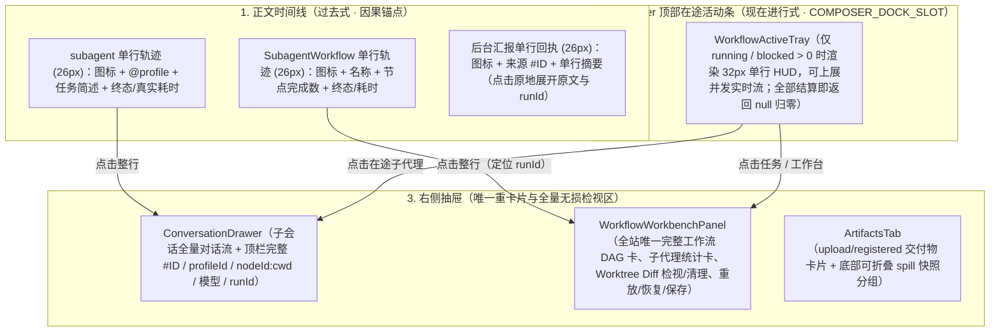

## 背景

Helm Web 主控台已完成多空间 Hash 路由、智能体待命草稿、并排分屏、会话大纲、`pi-durable` 排队撤回接口以及 `builtin:workflow` 执行树等底层机制建设，但在桌面端（`1440×900` 及双栏分屏）与移动端（`390×844` 触屏视口）的实际交互中，仍存在五类结构性体验问题：

1. **同一编排实体多处重复渲染，时间线与工作台信息密度倒挂**：
   - `builtin:workflow` 同时注册了 `replaceRow: true` 的 `SubagentToolView`、`WorkflowToolView`（`packages/plugins/src/workflow/ui.ts:19-30`）、`BackgroundReportCard`（`ui.ts:13-18`）以及右侧抽屉 `WorkflowWorkbenchPanel`（`ui.ts:31-38`）。单次后台子代理在时间线派发处渲染一张双层 `SubagentLiveCard`，结算到达时再渲染一张双层 `BackgroundReportCard`，打开工作台又渲染第三遍同构卡片；工作流定义列表也同时出现在左栏「工作流库」视图与工作台顶部 `WorkflowLibrarySection`（`WorkflowWorkbenchPanel.tsx:66`）。
   - 时间线内的 `SubagentLiveCard` 与 `WorkflowRunCard` 默认平铺内部会话 ID、模型名、思考档位、工具步数、最多 6 个操作按钮、重复的阶段标题及内联 `WorktreeInspectSection`（`SubagentCardDetails.tsx:37-100`、`WorkflowRunCard.tsx:43, 224-405`），严重割裂对话阅读流；且后台派发句柄返回但 `runs` 分片未命中时，`resolveSubagentElapsedMs`（`model-subagent-card.ts:168-171`）误将派发工具调用耗时（如 `34ms`）当作子代理任务耗时展示。
   - 反之，右侧工作台 `WorkflowWorkbenchPanel`（`WorkflowWorkbenchPanel.tsx:95-108`）挂载 `SubagentLiveCard` 时未传入 `toolSummary`，且默认标题 `"子代理 <id>"` 被 `compactCardTitle` 过滤，导致工作台卡片缺失任务标题、发起时间与真实耗时；当在途任务滚出时间线视口时，输入框上方也没有类似 `pi` / `agy` 的实时底部进度挂载位。
2. **键盘流缺失、焦点错位与排队消息重编断链**：
   - 全站全局快捷键仅在 `HelmStoreProvider.tsx:675-685` 注册了 `Mod+K`，缺少对齐 `pi` 肌肉记忆的模型切换（`Ctrl+L`）、思考档位循环（`Shift+Tab`）、过程折叠（`Ctrl+O`）、运行中止（双按 `Esc`）及侧栏/工作台开关（`Mod+B` / `Mod+J`）；并排分屏下 `App.tsx:81-86` 与 `CommandPaletteModal.tsx:66-71` 固定读取 `primaryTarget`，右屏聚焦时快捷键与工作台仍操作左屏。
   - `ModelPicker.tsx:146-163` 打开浮层时，默认焦点落在首项破坏性按钮「跟随 Profile 默认（清除覆盖）」而非搜索输入框，且无 `↑ / ↓ / Enter` 列表键盘导航。
   - 内核与 `timeline-actions.ts:51-76` 已实现基于 `conversationsApi.withdraw` 的排队撤回，但 `Composer.tsx:357-364` 处理空输入框 `ArrowUp` 时仅查询已落库的 `lastEditableHumanInput(detail?.entries)`，忽略了 `live?.queuedInputs`，导致用户在运行中按 `↑` 修改刚发出的排队消息时，误触发对上一轮已执行消息的回滚编辑。
3. **智能体待命页（`#/a/<profileId>`）输入能力割裂**：
   - `AgentStandbyPane.tsx:520-640` 独立维护的 `StandbyModelPicker` 仅读取 `draft.model || profile.model`（第 531 行），遗漏全局默认 `store.defaultModelInfo?.defaultModel`，导致未单独绑定模型的角色在待命页显示「默认模型」且隐藏思考档位选择器与目录刷新入口；同时待命页未接入无需会话 ID 即可静态计算的 `/` 斜杠命令与角色白名单技能补全。
4. **工作台产物噪音、角标重复与无损信息死角**：
   - 内核 `ArtifactService.spill`（`packages/kernel/src/services/artifacts.ts:374-407`）将超 32 KiB 的工具输出写入 `helm_artifacts` 表且无类型区分，导致工作台「产物」页签及顶栏角标被大量 `tool-spill-*.txt` 内部缓存淹没；`workbench-model.ts:102, 156` 与 `WorkbenchDrawer.tsx:108-112` 同时在页签名、页签徽章和底栏渲染计数，造成 `产物 (1) 1` 重复显示。
   - 现有多处元数据仅存于鼠标悬停 `title`（如 `BackgroundReportCard.tsx:43` 的 `runId`），在无 Hover 的触屏手机端不可见；子会话抽屉 `ConversationDrawer` 在移动端因 `responsive.css:56` 隐藏 `.env-subtitle-full`，导致本机子会话的 `profileId` 与 `cwd` 在手机端完全不可见。
5. **移动端与桌面端壳层、资源中心及插件视图细节缺陷**：
   - 移动端（`390×844`）下：`ConversationPane.tsx:358-375` 的「工作台」按钮未包裹 `.pane-action-label`，挤占顶栏导致会话标题仅剩 3 个汉字；正忙发送控件（`responsive.css:71-74`）隐藏文字后仅剩 `22px` 窄下拉条；`PluginDetailDrawer` 在窄屏仍展示无效的「右屏打开」按钮；`ConversationPane` 抽屉模式将关闭键 `[×]` 置于 `[···]` 左侧，违背全站右上角关闭惯例；`HerdrOverviewScreen`（`packages/plugins/src/herdr/client/index.tsx:186-206, 245-364`）顶栏按钮溢出视口被裁切且 9 列宽表在手机端不可读。
   - 全局组件与中心卡片：`NodeCard.tsx:36` 的 `'laptop' | 'server'`、`AgentStandbyPane.tsx:244, 416` 的 `'circle-slash' | 'file'` 未在 `packages/plugin-client/src/icons.tsx` 注册，`WorkflowIcon.tsx` 缺少 `'search'`，均退化为空心圆 `○`；`ScreenHost` 与 `.screen-header`（`primitives.css:506-526`）产生双顶栏重复标题且副标题居中漂移；`ConversationOutlinePopover` 默认「全部」档被业务卡刷屏；`CommandPaletteModal` 首屏被 11 条插件配置项占满；`ModelCenter` 与 `PluginCenter` 缺少状态筛选胶囊，`SkillCard` 渲染无意义的 `0 个参考文件`，`ProfileCard` 缺少生效模型继承展示与直达对话入口；多处组件混用未定义的 `.callout--error` / `.callout--warning` 与标准原语 `.callout-error` / `.callout-warn`。

本次设计在不破坏微内核与插件单向边界、三级视图形态契约、唯一 URL Hash 导航契约与归属权安全红线的前提下，达成以下可观察目标：

- **编排展示三区零重复与 100% 无损分层**：时间线取消重型子代理卡与工作流卡，统一退回与 `bash / read` 同构的 `26px` 单行因果轨迹；新增紧贴 Composer 上方的瞬态「底部在途活动条」（仅在途显示、跑完即隐）；右侧抽屉（`工作台` 与 `子会话抽屉`）作为全站唯一承载完整执行树卡片、成本统计、Worktree Diff 检视与产物的权威容器，所有技术字段在 PC 与手机端均有非 Hover 的固定可见位置。
- **一功能唯一键的 `pi` 键盘流与队列重编**：建立零别名、零浏览器标签冲突的单键映射表，打通 `Ctrl+L` 选模型、`Shift+Tab` 切思考档位、空输入 `↑` 队列优先撤回重编、双按 `Esc` 中止、`Ctrl+O` 过程折叠、`Mod+B` 侧栏折叠与 `Mod+J` 工作台开关，分屏下精准跟随当前焦点面板。
- **待命页对齐、产物显式分流与双端细节清零**：待命页严守「不预建会话、不伪造 `ConversationSummary`」契约，补齐完整默认模型继承展示与静态 `/` 技能补全；协议层为 `ArtifactMetadata` 增加显式 `kind` 区分交付物与 `spill` 快照；全面修复移动端顶栏、忙时发送双按钮、抽屉关闭键序、Herdr 响应式卡片、断链图标与各中心筛选卡片体验。

非目标：不把工作台改为第四栏常驻停靠面板或引入拖拽分割条（并排对照继续由原生 Split View 承担）；不把角色级 `MEMORY.md` 塞入单会话工作台；不在待命页伪造 `conversationId` 以强开依赖服务端真实会话的 `@` 动作补全；不在手机端手写与浏览器历史返回冲突的边缘滑动手势；不在 `Herdr` 视图对 `ownedBy: 'human'` 窗格开放快照读取或聚焦控制。

建议分支：`feature/web-ux-and-three-zone-workflow`（建议新开分支名，当前尚未创建）。

---

## 整体设计

整体架构维持 `@helm/hub` → `@helm/plugins` / `@helm/kernel` → `@helm/protocol` 与 `@helm/web` → `@helm/plugin-client` → `@helm/protocol` 单向依赖不变。宿主 `@helm/web` 只提供通用插槽、焦点面板上下文与设计系统原语，零插件 ID 或工具名 `if/else` 特判。

### 编排任务「三区零重复 + 无损下钻」模型

针对同一子代理或工作流在多处重复画卡的问题，按「时间态」与「信息粒度」将编排界面严格切分为三个互不重叠的区域：



各区域职责与生命周期边界如下：

| 区域 | 唯一职责 | 渲染形态 | 存续周期 |
| :--- | :--- | :--- | :--- |
| **正文时间线** | 记录对话演进中的工具触发与汇报到达位置，保持正文阅读流连贯 | 与原生 `TraceRow`（`bash / read / edit`）完全同构的 `26px` 单行轨迹；异常或存在未清理 Worktree 时在行尾显式打标，绝不渲染多行重框卡片或内联 Diff | 随会话条目持久展示 |
| **底部活动条** | 对齐 `pi` / `agy` 体感，在输入视线焦点处盯控当前在途后台任务并支持即时干预 | 经宿主保留子插槽 `COMPOSER_DOCK_SLOT` 挂载于 `AskDock` 上方；默认 `32px` 单行滚动摘要，点击可展开限高并发列表执行 `中止` / `转入后台` | 仅当本会话或其后代存在 `running / blocked` 任务时挂载；全部结算瞬间返回 `null`（高度 `0px`） |
| **右侧抽屉** | 承载全部详细卡片、DAG 节点树、成本账单、Git Worktree Diff 与会话产物 | 维持 `web-frontend.md` 标准右侧滑出抽屉（桌面 `560px` / `720px`，移动 `100vw`）；移除工作台顶部与左栏「视图空间 → 工作流库」重复的嵌入式工作流库区块，仅保留轻量跳转/运行入口 | 用户点击单行轨迹、底部活动条、顶栏按钮或按 `Mod+J` 时按需滑出 |

---

## 详细设计

### 1. 协议与内核产物分类契约

#### 1.1 新增输入区顶部托盘保留插槽 `COMPOSER_DOCK_SLOT`（`packages/protocol/src/ui.ts`）

参照既有 `COMPOSER_STATUS_SLOT`（`ui.ts:250`），在 `@helm/protocol` 新增宿主保留子插槽常量：

```ts
export const COMPOSER_DOCK_SLOT = 'builtin:composer/dock' as const
```

`Composer.tsx` 在 `.composer-inner` 内、`<AskDock />` 正上方常驻挂载 `<PluginSlot ownerPluginId="builtin:composer" name={COMPOSER_DOCK_SLOT} conversationId={conversation.id} composer={composer} slotProps={{ conversation, composer }} />`。与收折进移动端 `⋯` 菜单的静态 `composer.widget` 不同，该插槽在桌面端与移动端均直出在输入框上方；无在途任务的插件组件直接返回 `null`，不占任何像素，插件停用后随生命周期即时卸载。

#### 1.2 `ArtifactMetadata.kind` 显式来源分类（`@helm/protocol`、`@helm/kernel`）

为消除前端按 `tool-spill-` 文件名前缀猜测产物性质的脆弱逻辑，按开发期直接演进契约规范更新产物模型：

- **协议层**（`packages/protocol/src/artifact.ts`）：新增 `export type ArtifactKind = 'upload' | 'registered' | 'spill'`，并在 `ArtifactMetadata` 增加必填字段 `kind: ArtifactKind`。
- **内核服务与存储层**（`packages/kernel/src/services/artifacts.ts`、`runtime/sqlite.ts`、`runtime/store.ts`、`http/validate.ts`）：
  - `HELM_SCHEMA` 的 `helm_artifacts` 表新增 `kind TEXT NOT NULL` 列（开发库无旧格式兼容逻辑，清理重建或新库即生效）；
  - `ArtifactService.writeUploaded` 固定写入 `kind: 'upload'`，`register` 固定写入 `kind: 'registered'`，`spill` 固定写入 `kind: 'spill'`；
  - `HelmStore` 的产物读写、HTTP 产物响应与 CLI `helm artifacts` 输出原样透出 `kind`。

---

### 2. 编排插件 `builtin:workflow` 三区重构与无损承载

#### 2.1 时间线单行轨迹组件（`SubagentToolView`、`WorkflowToolView`、`BackgroundReportCard`）

三个时间线扩展点保留各自注册方式（`toolView` `replaceRow: true` 与 `timelineRenderer`），内部统一渲染为 `26px` `.trace-row` 风格单行组件：

- **`SubagentToolView`（`packages/plugins/src/workflow/client/SubagentToolView.tsx`）**：
  - 原生子会话单行布局：左侧 `状态图标 + subagent 标签 + @profileId 胶囊 + 任务语义标题（resolveSubagentTaskTitle）`，右侧 `（若有）待审批/未清理 Worktree 提示徽章 + 真实任务耗时 + 状态文本`；整行点击调用 `ctx.openConversationDrawer(childId)`，键盘 `Enter / Space` 同权激活，并保留 `data-outline-card-id` 锚点。
  - 外部执行（无原生 `childId`，如 Herdr 窗格）：同样渲染单行轨迹，点击调用工作台定位打开对应外部运行卡片。
  - **耗时诚实性修正**（`model-subagent-card.ts:152-172`）：当 `parseSubagentExecutionInfo(toolSummary?.resultText)?.runId !== undefined`（即本次工具调用仅返回后台运行句柄而非同步等待完成）且 `backgroundRun` 尚未解析到终态耗时时，严禁回退读取 `toolSummary.durationMs`（派发句柄耗时），无真实执行耗时即如实省略。
- **`WorkflowToolView`（`WorkflowRunCard.tsx`）**：
  - 时间线内不再挂载 `WorkflowRunCardBody`，改为渲染单行轨迹：左侧 `状态图标 + workflow 标签 + run.name + 节点进度 (done/total)`，失败时紧随单行错误摘要，含未清理受管 Worktree 时附分支提示徽章；右侧显示 `真实总耗时 + 状态`。
  - 整行点击设置包内运行聚焦状态 `requestWorkbenchRunFocus(props.conversationId, run.id)` 并调用 `ctx.openWorkbench('plugin:builtin:workflow/tasks')`，直接打开右侧工作台并进入该 `run.id` 的展开详情视图。若 `run === undefined`（引擎尚未建出关联记录），点击可在行下原地展开 `ToolCallDetailsInline` 查看原始入参/返回。
- **`BackgroundReportCard`（`BackgroundReportCard.tsx`）**：
  - 默认收起态渲染为单行轻量回执：左侧 `展开箭头 + 状态图标 + 「子代理汇报 / 工作流汇报」 + （若有）#childId + 清洗后的单行结果预览`，右侧 `状态文本 + （若有）打开子会话图标按钮`；当 `status === 'failed' || status === 'aborted' || view.invalid` 时默认初始展开（`open = true`），确保异常一眼可见。
  - 点击整行在下方原地展开完整无损详情块：**显式键值行展示 `runId` 与投递时间**（修复原实现 `runId` 仅在 `title` 属性导致手机端丢失的问题）、错误横幅（`.callout-error`）、完整 Markdown/JSON 结果、`otherRunningTasks` 在途快照胶囊及原文复制按钮。
- **单行摘要清洗器（`model-format.ts` / `model-subagent-card.ts`）**：提取单行预览时剥离行内 Markdown 语法符号，跳过纯标题前缀空行（如首行为 `汇报:` 或 `# 结果` 时取下一非空实质行），对 JSON 对象提取前序可读键值摘要而非直接截断裸 `{` 字符串。

#### 2.2 底部在途活动条 `WorkflowActiveTray`（新增模块，注册于 `COMPOSER_DOCK_SLOT`）

在 `packages/plugins/src/workflow/ui.ts` 新增 `ctx.ui.slot({ id: 'active-tray', target: COMPOSER_DOCK_SLOT, client: { module: 'index.tsx', export: 'WorkflowActiveTray' } })`：

- **数据同源**：复用 `usePluginSessionDoc('runs', { conversationId })` 与 `useConversations()`，通过既有 `buildExecutionTree` 提取当前会话下 `effectiveStatus === 'working' || effectiveStatus === 'blocked'` 的活跃节点。活跃集合为空时直接 `return null`。
- **默认紧凑态（单行 `32px`）**：左侧旋转指示器 + `N 项运行中`（含 `blocked` 时高优标黄 `N 项待审批`）+ 最前线 1~2 条实时语义动作摘要（复用 `collectExecutionFrontline`）+ 动态秒表；右侧提供 `[展开 ▴]` 与 `[工作台]` 按钮。
- **展开态（限高 `180px` 纵向滚动）**：逐行展示当前活跃的工作流或子代理，每行提供 `状态 / 实时工具动作 / 秒表` 与直接操作按钮（前台同步任务 `转入后台`、后台任务 `中止`、原生子会话 `抽屉查看`、工作流 `详情`）。用户切换会话时展开态自动复位。

#### 2.3 工作台面板与子会话抽屉全量无损承载

为保证时间线「退卡还行」后不产生任何信息损失，所有技术事实在右侧抽屉中建立固定可见展示位（绝不依赖鼠标 Hover Tooltip）：

| 信息项 | 权威可见位置（PC 与手机端一致可见） |
| :--- | :--- |
| 子代理 `任务标题 / 完整 Prompt / 思考 / 工具明细 / 回复` | `ConversationDrawer` 会话正文流；工作台子代理卡同步展示经首条 `helm.input` 或 `run` 节点提炼的任务标题 |
| 子代理 `#conversationId`、`profileId`、`nodeId:cwd` | 工作台子代理卡元数据行 + **`ConversationPane`（`isDrawer` 模式）新增移动端可见的紧凑环境副栏**（修复手机端隐藏 `.env-subtitle-full` 导致丢失本机 `profileId` 与 `cwd` 的问题） |
| `runId`、`executionId`（外部执行）、发起时间戳、真实总耗时 | 工作台工作流卡 / 子代理卡 / 外部执行卡头部与键值区；`BackgroundReportCard` 原地展开体头部 |
| `模型 · 思考档位`、`工具调用步数`、`Token 用量`、`cached` 标记 | 工作台内 `WorkflowRunCardBody`、`WorkflowNodeCard` 与 `SubagentLiveCard` 统计行完整保留展示 |
| `Worktree 分支 / 路径 / baseCommit`、只读 Diff 检视、`清理工作树` | 唯一收敛于工作台内的工作流节点卡与子代理卡（`WorktreeInspectSection`），不再在时间线重复挂载 |
| `Gate 命令与输出`、重放表单、断点恢复、保存为工作流、原始 `input/result` | 工作台 `WorkflowRunCardBody` 详情视图完整展示；卡片顶栏主动作旁以 Radix `DropdownMenu`（`···`）收纳重放、保存为工作流等低频动作，消除窄屏折行挤压，并去掉 `.phase-bar` 与章节头的重复阶段标题 |
| 已保存工作流库 | 移除 `WorkflowWorkbenchPanel` 顶部内嵌的 `WorkflowLibrarySection`，仅在工作台面板顶栏保留 `[工作流库 ↗]` 跳转按钮（直达 `screen:builtin:workflow/library`），消除与左栏视图空间的重复 |

---

### 3. 一功能唯一键的 `pi` 键盘流、焦点面板与队列重编

#### 3.1 分屏焦点面板追踪（`HelmStoreProvider.tsx`、`App.tsx`）

在 Store 中维护轻量内存态 `focusedPanel: 'primary' | 'split'`（默认 `'primary'`，关闭分屏时自动复位 `'primary'`，不写入 URL Hash）。主屏与右屏容器通过 `onPointerDownCapture` 与 `onFocusCapture` 同步更新 `focusedPanel`。`activeTarget`（当前激活面板对应的 `ResolvedTarget`）统一驱动全局快捷键、`CommandPaletteModal` 默认上下文及 `WorkbenchDrawer` 绑定的会话 ID。

#### 3.2 全站唯一快捷键映射表

严格执行「一功能唯一键」，不设双快捷键别名，并避开浏览器保留键（如 `Ctrl+T` / `Ctrl+W` / `Ctrl+N`）。`Mod` 在 macOS 表示 `metaKey`（`⌘`），在 Windows/Linux 表示 `ctrlKey`（`Ctrl`）：

| 功能 | 唯一快捷键 | 作用域与精确行为 |
| :--- | :--- | :--- |
| 打开模型选择器 | `Ctrl+L` | 当前激活面板为会话或待命页时打开其 `ModelPicker`（已打开则关闭） |
| 循环切换思考档位 | `Shift+Tab` | 仅当焦点位于会话或待命页 Composer `textarea` 时拦截，按当前模型支持的 `thinkingLevels` 顺序循环切换 |
| 撤回排队重编 / 编辑上条提问 | `↑`（`ArrowUp`） | 焦点位于 Composer `textarea`、草稿为空、非编辑态且无补全浮层时：**若 `live?.queuedInputs` 存在 `origin === 'human'` 项，取最后一条调用 `withdraw` 撤回并回填文本与附件**；仅当无人类排队项时，才回退调用 `lastEditableHumanInput(detail?.entries)` 进入历史原地编辑 |
| 发送（空闲发送 / 忙时插话 `steer`） | `Enter` | Composer `textarea` 内且非 IME 组合输入时触发 |
| 忙时排队发送（`followUp`） | `Mod+Enter` | Composer `textarea` 内且会话正忙时以 `whenBusy: 'followUp'` 提交 |
| 输入换行 | `Shift+Enter` | Composer `textarea` 原生换行 |
| 退出浮层 / 退出编辑 / 双按中止回合 | `Esc` | 优先级递进：① 顶层浮层/抽屉/弹窗打开时关闭最上层浮层；② Composer 处于历史编辑态时取消编辑；③ 当前激活会话处于 `working / blocked` 时，首次按 `Esc` 弹出 1.5 秒轻提示「再按一次 Esc 停止当前执行」，1.5 秒窗口内第二次按 `Esc` 调用 `conversationsApi.abort` |
| 展开 / 收起最近一轮思考与工具过程 | `Ctrl+O` | 当前激活面板为会话时，切换最新 Assistant 回合内全部 `StepGroup` / `ThinkingRow` 的展开状态 |
| 全局搜索与命令面板 | `Mod+K` | 全局开关 `CommandPaletteModal` |
| 折叠 / 展开桌面左侧栏 | `Mod+B` | 桌面端（`>860px`）切换左侧二级导航栏折叠态（保留 `48px` Activity Rail），状态持久化于 `localStorage`（键 `helm:sidebar-collapsed`），不写入 URL Hash |
| 展开 / 关闭右侧工作台 | `Mod+J` | 当前激活面板为会话时开关 `WorkbenchDrawer` |

#### 3.3 `ModelPicker` 键盘闭环与排队胶囊直出操作

- **`ModelPicker` 焦点修正与键盘选择**（`ModelPicker.tsx` 与待命页共用组件）：
  - `PopoverContent` 打开时通过 `onOpenAutoFocus` 将焦点精确落入搜索 `<input>`（不再聚焦首项「跟随 Profile 默认（清除覆盖）」）；
  - 维护高亮索引 `activeIndex`，初始指向当前生效模型在过滤列表中的位置；在搜索框内按 `ArrowDown / ArrowUp` 循环移动高亮，按 `Enter` 选中高亮项关闭浮层，并通过 `onCloseAutoFocus` 将焦点归还当前面板 Composer `textarea`。
- **时间线排队胶囊直出「编辑 / 撤回」**（`ConversationTimeline.tsx:264-344`、`timeline-actions.ts`）：
  - 对处于 `item.queuedMode !== undefined && item.origin === 'human'` 的未落库排队胶囊，操作按钮不再隐藏于需要悬停的 `.msg-hover-bar`，而是直接在排队状态行尾展示紧凑按钮 `[编辑]`（调用 `withdrawQueuedForEdit` 撤回并回填输入框）与 `[撤回]`（新增 `withdrawQueuedOnly`：调用 `conversationsApi.withdraw` 直接取消排队，**不覆盖 Composer 当前正在输入的草稿**；若返回 `already_placed` 则如实通知「消息已进入执行，无法撤回」）。

---

### 4. 待命页对齐与工作台产物重构

#### 4.1 待命页严守「无会话 ID」诚实边界并补齐静态能力（`AgentStandbyPane.tsx`）

- **不伪造会话上下文**：待命页在首次发送前不存在服务端 `conversationId`，继续严格不挂载依赖真实会话 ID 校验的 `@` 动作补全（如 `list_mentionable`）与会话级插件胶囊，绝不构造虚假 `ConversationSummary`。
- **模型继承链完整解析与组件复用**：修正待命页模型解析顺序为 `draft.model || profile.model || store.defaultModelInfo?.defaultModel`；当角色跟随全局默认模型（如 `magpie/auto/glm-5.3`）时，待命页首屏即如实展示 `glm-5.3 · max`、开放对应模型的思考档位选择器，并补齐动态模型目录刷新按钮與 `Ctrl+L` / `Shift+Tab` 快捷键响应。
- **静态 `/` 斜杠菜单接入**：在待命页输入框接入 `CommandPopover`，数据源由宿主命令（`/new` 重置草稿；`/clear` 与 `/compact` 选择或回车时维持现有显式提示「需先创建会话」）与纯静态过滤的 `slashMenuSkills(profile, store.skills, enabledPluginIds)` 组成，使用户在首条消息即可检索并插入 `/skill:<id>`。

#### 4.2 工作台角标去重与产物分层卡片（`workbench-model.ts`、`WorkbenchDrawer.tsx`）

- **修复角标三重重复**：`buildWorkbenchTabs` 中产物页签 `label` 改为纯文本 `'产物'`（去掉内嵌括号数字，统一由 `WorkbenchDrawer` 渲染页签徽章；同时修改 `WorkbenchDrawer.tsx:109` 使激活态页签同样保留紧凑计数徽章，切换页签时宽度不跳动）；`buildWorkbenchFooter` 移除重复的 `产物 N` 拼接。
- **产物角标与列表按 `kind` 分流**：
  - `useWorkbenchTabs` 计算 `artifactCount` 时仅统计 `a.kind !== 'spill'` 的条目，消除工具溢出文件造成的顶栏角标膨胀；
  - `ArtifactsTab` 主列表渲染 `upload` 与 `registered` 产物卡片：展示文件类型图标（图片类展示懒加载缩略图）、文件名、可读格式标签（附原始 `mimeType`）、字节大小、创建时间（`formatMessageTime`），并提供独立的 **`预览`** 与 **`下载`**（调用 `artifactsApi` Blob 下载）按钮；
  - 若当前会话存在 `kind === 'spill'` 条目，在列表底部渲染默认收起的折叠分组 `超长工具输出快照 (N)`，展开后同样提供完整预览与下载能力，确保零数据丢失。

---

### 5. 移动端与桌面端壳层、视图及卡片细节打磨

1. **移动端会话区与抽屉细节（`≤680px` / `≤860px`）**：
   - **释放会话顶栏标题宽度**（`ConversationPane.tsx:373`）：将顶栏「工作台」按钮文本包裹 `<span className="pane-action-label">工作台</span>`，窄屏自动收敛为 `[◫ N]` 图标+角标，使 `390px` 视口下会话标题恢复 10~14 个汉字可读空间；点击标题区支持通过轻量 `Popover` 查看完整长标题与完整 `profileId · nodeId:cwd` 路径。
   - **移动端忙时发送双按钮**（`ComposerSendControls.tsx`、`responsive.css`）：在 `@container (max-width: 680px)` 且 `working && editingEntryId === null && text.trim() !== ''` 时，不再渲染 `22px` 窄缝下拉菜单，直接并排渲染触控热区达标的紧凑按钮 `[插话]`（`send('steer')`）与 `[排队]`（`send('followUp')`）。
   - **移动端补全浮层去键盘提示**：窄屏或粗指针设备（`pointer: coarse`）下隐藏 `CommandPopover` 与 `CompletionPopover` 顶部的 `↑ ↓ 选择 · Enter 确认 · Esc 关闭` 文案。
   - **清理窄屏无效分屏入口**：`PluginDetailDrawer` 等组件内的「右屏打开」按钮统一增加窄屏隐藏类（`@media (max-width: 860px)` 隐藏），与主舞台分屏门控保持一致。
   - **统一抽屉右上角关闭键位**：调整 `ConversationPane`（`isDrawer` 模式）顶栏操作顺序为 `[全屏] [···] [×]`，确保全站所有右侧抽屉最右上角均为关闭按钮 `[×]`。
   - **`HerdrOverviewScreen` 移动端响应式适配**（`packages/plugins/src/herdr/client/index.tsx`、`styles.css`）：顶栏统计与按钮组启用 `flex-wrap: wrap` 消除右侧按钮裁切；`≤680px` 下将窗格列表切换为双行卡片布局（首行：`窗格 ID + 状态徽章 + 归属 + 节点`，次行：`CLI + 工作目录 + 受控操作`），严格复用 `canFocusPane` 与 `canSnapshotPane` 门控，`human` 归属窗格保持纯只读展示。
2. **长对话悬浮「回到底部」与桌面侧栏折叠**：
   - `ConversationTimeline` 监听滚动容器距底距离：当离开底部超过 `240px` 时，在时间线右下方悬浮渲染圆形 `↓` 按钮（会话流式生成中或存在未读排队变化时附动态圆点提示），点击平滑滚回底部并恢复自动跟随。
   - 桌面端左栏标题区增加侧栏收起按钮（配对 `Mod+B`），收起后仅保留左侧 `48px` Activity Rail（Rail 顶部提供展开按钮）。
3. **导航、大纲、命令面板与各管理中心打磨**：
   - **会话大纲默认聚焦对话骨架**（`outline-model.ts`、`ConversationOutlinePopover.tsx`）：顶部分段控件调整为 **`对话`（默认：保留 `human[origin='human']`、`assistant`、`heading`、`divider`）| `仅提问` | `全部`**，零插件名硬编码即可滤除时间线业务轨迹行刷屏，切回「全部」仍可检索定位任意轨迹锚点。
   - **命令面板优先级重排与快捷键角标**（`CommandPaletteModal.tsx`）：空搜索词首屏按「当前会话高频操作（切换模型、切换工作台、新话题）→ 最近活跃会话（前 5 条）→ 空间与中心导航 → 插件命令与配置」排序，并为已绑定唯一快捷键的命令展示右侧 `<kbd>` 提示。
   - **修复断链图标与统一视图页头**：在 `packages/plugin-client/src/icons.tsx` 注册 `laptop`（`Laptop`）、`server`（`Server`）、`circle-slash`（`CircleSlash`）、`file`（`File`）；删除 `packages/plugins/src/workflow/client/WorkflowIcon.tsx` 私有映射表，全量改用 `@helm/plugin-client` 的 `HelmIcon`。修正 `Screen` 原语与 `.screen-header` 布局：当运行在已渲染顶栏标题的 `ScreenHost` 内时避免重复渲染同名大标题，并将副标题与标题左对齐组合，消除副标题居中漂移。
   - **管理中心卡片信息补强**：
     - `ProfileCard`：补齐实际生效模型（标注自身绑定或继承全局默认）、默认节点/目录摘要、关联会话计数，并在卡片右下角提供独立 `对话` 按钮（`e.stopPropagation()` 直达 `#/a/<profileId>`）；
     - `ModelCenter` & `ModelCard`：增加 `全部 / 已配置` 顶部筛选胶囊并将已配置供应商置顶；已配置卡片底部展示前 3 个可用模型短名胶囊及剩余计数；
     - `PluginCenter`：增加 `全部 / 已启用 / 已停用` 顶部筛选胶囊；
     - `SkillCard`：当参考文件数为 `0` 时不再渲染 `0 个参考文件` 胶囊，改为展示可一键复制的 `/skill:<id>` 调用口令胶囊与来源标签（`内置 / 共享 / 工作区`）；
     - **样式原语统一**：全仓清理 `AuthGate.tsx` 等处大面积内联样式，并将误写的 `.callout--error` / `.callout--warning` 统一修正为设计系统定义的 `.callout-error` / `.callout-warn`。

---

## 影响分析

- **跨包契约影响面**：
  - `@helm/protocol` 新增导出常量 `COMPOSER_DOCK_SLOT` 与类型 `ArtifactKind`，`ArtifactMetadata` 新增必填字段 `kind`。需全仓普查 `ArtifactMetadata` 消费方（`packages/kernel`、`packages/cli`、`packages/web` 及各包单测 fixture）一次性同步新字段。
  - `@helm/kernel` 修改 `helm_artifacts` 表结构并由 `ArtifactService` 三处写入入口填充 `kind`；`state.sqlite` 属于可重建内核状态表，遵循仓库开发阶段不写旧表迁移与兼容读取的规则。
- **插件隔离与热停用一致性**：
  - `builtin:workflow` 停用后，时间线单行 `toolView` / `timelineRenderer`、底部 `WorkflowActiveTray`（`COMPOSER_DOCK_SLOT`）、右侧 `WorkflowWorkbenchPanel` 及左栏「工作流库」同步卸载，宿主界面不留空壳或幻影提示。
  - 其他使用 `<Screen>` 原语的插件（`builtin:apps`、`builtin:triggers`、`builtin:superagent` 及外部全栈微应用）共享 `.screen-header` 布局修复，需逐一核对顶栏与页头操作按钮不丢失。
- **既有测试契约同步**：
  - `packages/plugins` 与 `packages/web` 中断言时间线内直接挂载完整 `SubagentLiveCard` / `WorkflowRunCardBody` 内部节点树或断言产物页签名为 `产物 (N)` 的单测，需同步更新为「时间线单行轨迹 + 底部在途活动条 + 工作台完整卡片」与新页签契约。

---

## 发布

本项目处于开发阶段，遵循仓库「不兼容、不迁移」约定：

- **开发数据处置**：因 `helm_artifacts` 表新增 `kind NOT NULL` 列，本地开发目录 `~/.helm`（或自定义 `HELM_DATA_DIR`）中若存在旧表结构，升级后清理旧 `state.sqlite`（或重建开发数据目录）按新 Schema 初始化即可，不编写 `ALTER TABLE` 兼容迁移脚本。
- **构建与静态产物顺序**：因 `@helm/protocol` 与 `@helm/plugin-client` 导出符号更新，构建与检查严格按拓扑顺序先编译底层包（`pnpm typecheck` 与 `pnpm build` 脚本已内置前置滤镜编译），插件客户端 esbuild 缓存随源码 hash 变化自动失效重编。
- **恢复方式**：若前端交互或插件客户端视图出现异常，直接回退对应 Git 提交并重跑 `pnpm build`；若回退跨 `helm_artifacts` 表结构变更提交，同步清理本地开发测试库重建即可。

---

## 测试

全部新增与更新测试文件须显式声明 `{ timeout: 60_000 }`，严禁设置 `HELM_TEST_SUITE_TIMEOUT_MS`，按 `unit` 与 `integration` 分档执行并通过真实浏览器完成双端交互验证：

| 验证维度 | 前置条件与操作路径 | 预期可观察结果 |
| :--- | :--- | :--- |
| **产物 `kind` 契约与工作台分流** | 分别经上传接口、`register_artifact` 工具与超 32 KiB `read` 工具产生三类产物，打开会话工作台「产物」页签 | 数据库与 API 准确返回 `upload / registered / spill`；顶栏与页签角标仅计前两类且无 `产物 (1) 1` 重复显示；主列表展示交付物卡片与预览/下载按钮，`spill` 归入底部可展开折叠组 |
| **编排三区零重复与无损下钻** | 在会话中发起并发后台 `subagent` 与带 Worktree/Gate 的 `SubagentWorkflow`，观察运行期与结算后界面 | ① 运行期输入框上方出现 `32px` `WorkflowActiveTray`，可展开中止或转入后台，全部结算后自动消失（高度 `0px`）；② 时间线仅渲染 `26px` 单行派发轨迹与单行汇报回执（后台句柄不误显 `34ms` 耗时，汇报展开可见 `runId` 与全文）；③ 点击工作流轨迹自动打开工作台并定位到对应 `runId` 完整卡片，可见模型/档位/Token/工具步数/Worktree Diff，且工作台顶部不再重复嵌入工作流库 |
| **唯一快捷键与分屏焦点面板** | 开启左右双栏分屏，将焦点置于右屏输入框，依次测试 `Ctrl+L`、`Shift+Tab`、`Ctrl+O`、`Mod+B`、`Mod+J` 与运行期单按/双按 `Esc` | 所有面板级快捷键精准作用于右屏会话；`Ctrl+L` 打开模型浮层且焦点直接落入搜索框，`↑/↓/Enter` 选定模型后焦点回到右屏输入框；单按 `Esc` 仅提示不误杀，1.5s 内双按 `Esc` 真实中止右屏回合；`Mod+B` 折叠左栏并跨刷新保持（URL Hash 不变） |
| **排队消息 `↑` 撤回重编与直接撤回** | 会话 `working` 期间连续发送一条插话与一条排队消息，分别在空输入框按 `↑` 及在已输入新草稿时点击排队胶囊 `[撤回]` | 空输入框按 `↑` 优先撤回最新人类排队项并回填文本与附件（不触发历史回滚警告）；非空草稿点击 `[撤回]` 仅移除该排队项且保留输入框现有草稿；无任何人类排队项时按 `↑` 正常编辑上一条已落库人类消息 |
| **待命页模型继承与静态 `/` 补全** | 全局默认设为 `magpie/auto/glm-5.3`（`max`）、角色未单独绑定模型，进入 `#/a/assistant` 待命页并输入 `/` | 待命页模型按钮直接显示 `glm-5.3 · max` 且可切换思考档位与刷新目录；输入 `/` 弹出 `/new` 与可用 `/skill:*` 列表，选中仅插入文本且全过程不发起创建会话请求 |
| **移动端 `390×844` 全链路与归属红线** | 在 `390×844` 视口下打开会话、正忙输入框、子会话抽屉、插件详情抽屉与 `Herdr 终端总览` | 会话顶栏标题可读宽度 ≥10 字；忙时输入显示 `[插话]` `[排队]` 双按钮；子会话抽屉可见 `profileId · nodeId:cwd` 且 `[×]` 位于最右端；插件抽屉隐藏「右屏打开」；Herdr 顶栏无裁切并以双行卡片展示，`human` 窗格无快照/聚焦按钮 |
| **全仓门禁验收** | 执行 `pnpm check:hygiene && pnpm typecheck && pnpm build && pnpm test:all` | 静态卫生检查、全包类型检查、生产构建及 `unit + integration` 全量测试全部通过 |
