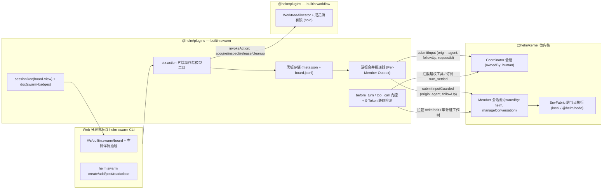
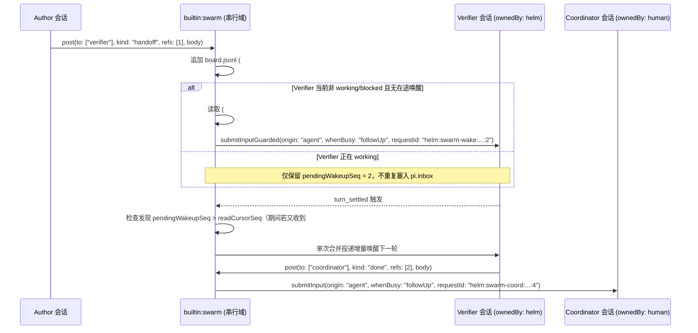

## 背景

Helm 现有编排生态由两块插件分别覆盖已知拓扑流水线与全局常驻路由：

1. `builtin:workflow`（`packages/plugins/src/workflow.ts`）通过 JavaScript DSL（`agent`、`parallel`、`pipeline`、`phase`）编排确定性任务图，执行流由脚本控制，子代理之间只能经父流程串联传递返回值，不支持动态轮次的对等协商与打回（如 `Author <-> Verifier` 围绕同一改动多轮审查修复）。
2. `builtin:superagent`（`packages/plugins/src/superagent.ts`）维护全局唯一的 `superagent` 常驻中枢会话与后台 `worker` 池，所有汇报在 `turn_settled` 钩子单向回流中枢（`packages/plugins/src/superagent/hooks.ts:155`）。当多个后台成员需要交叉验证时，中枢必须充当传声筒反复搬运 Diff 与日志，导致中枢上下文快速膨胀，且无法在任意普通人类会话内按需组建任务级协作组。

外部聊天式多智能体看板方案（Shared-Board Swarm）通过「单调递增序号黑板（`#seq` 引用传递）+ 游标门铃唤醒 + 读写角色分离」解决了上下文膨胀与横向交接问题，但其实现依赖若干高开销或脆弱机制：用独立 `Narrator` 智能体持续消耗模型配额生成界面摘要；用定时轮询的 `Monitor` 智能体检测全员休眠死锁；靠解析消息正文中的自然语言 `@name` 触发唤醒（易被代码片段中的 `@helm/protocol` 或装饰器误触发）；用阻塞式 `wait` 工具挂起协调者回合；以及仅靠系统提示词约定协调者与审查员不改文件。

对照 Helm 微内核边界与现有源码，落地看板协同还存在四处具体工程约束：

1. **宿主内部缺少会话分叉端口**：内核已实现按指定历史条目克隆上下文的 `KernelRuntime.forkConversation(id, { entryId, title? })`（`packages/kernel/src/runtime/conversation-context-ops.ts:89`）及对应 HTTP/CLI 入口，但 `HelmHostApi`（`packages/protocol/src/plugin.ts:935`）未暴露该方法，插件无法在进程内热分叉已有成员上下文。
2. **受管 Git Worktree 单一真源与空闲间隙保护**：`WorktreeAllocator` 与租约表保存在 `builtin:workflow` 私有文档中（`packages/plugins/src/workflow/isolation.ts`、`isolation-lease-store.ts`），当前仅经 `agent_spawn` 管道为单次子代理分配隔离树。看板成员是通过 `createConversation` / `forkConversation` 创建的多轮持久会话；若新插件另建一套 Worktree 登记表，将导致 `helm worktrees list / inspect / cleanup` 双源分裂；若直接复用瞬态 spawn 租约，成员在两轮打回之间的 `idle` 间隙会被重启租约回收器解除保护或被外部清理误删。
3. **会话归属权红线与投递通道分野**：`ctx.host.submitInputGuarded` 与 `abortConversationGuarded`（`packages/protocol/src/plugin.ts:993, 1035`）在内核执行层强制校验目标归属为 `'helm' | 'bot'`，对 `'human'` 归属会话调用必抛 `409 ownership_conflict`。人类发起的协调会话（Coordinator）保持 `ownedBy: 'human'`，集群招募的成员会话（Member）标记 `ownedBy: 'helm'`，两类目标的唤醒与异常处置必须走不同宿主通道。
4. **文档体积硬上限与广播写放大**：`PluginDocRegistry` 单文档上限为 `2 MiB`（超限返回 `413`），且公开 `ctx.doc` 会进入全局 SSE 首帧与广播。高频追加的看板消息正文不能存入全局文档或单一 SQLite JSON 文档。

本次设计新增默认停用的内置插件 `builtin:swarm`，并在内核宿主端口与 `builtin:workflow` 补齐最小协调原语。落地后达到以下可观察效果：

- 用户可在任意顶层人类会话（作为 Coordinator）按需创建任务级 Swarm，招募绑定任意 `Profile`、计算节点 `(nodeId, cwd)`、读写模式（`readwrite | readonly`）与隔离模式（`inherit | worktree`）的成员会话，支持从协调者或已有成员的落盘历史条目热分叉（`fork`）上下文。
- 成员通过强 Schema 的 `post` / `read` 动作围绕单调递增 `#seq` 黑板协作，以 `refs: [seq]` 指针引用前序产出；仅结构化 `to` 字段命中的成员按游标批量合并唤醒，空闲成员保持 `idle / done` 零模型开销。
- 协调者活跃期与 `readonly` 审查成员通过 `before_turn` 与 `tool_call` 钩子实施确定性工具门控；隔离工作树统一归口 `builtin:workflow` 登记并受成员级持有锁保护，成员归档或集群关闭前强制校验脏改动与未合入提交。
- 界面态势由 `ctx.sessionDoc` 与 Web 分屏看板（`#/s/builtin:swarm/board`）零 Token 实时投影，不设 `Narrator` 智能体；全群漏交接死锁由 `turn_settled` 钩子内的零 Token 单调水位对账即时检出，进程级卡死经 `diagnostics.collect` 汇入既有看门狗体系，不设轮询 `Monitor` 智能体。
- 全部业务能力经 `ctx.action` 单点声明，同步暴露为 HTTP、CLI（`helm swarm ...`）、模型工具、Workflow 动作与 Web 操作入口；停用插件后工具、动作、CLI、受管技能与界面贡献即时消失。

非目标：不在 `@helm/kernel` 引入任何 `'coordinator' | 'verifier'` 角色枚举或黑板表结构；不构建跨多个独立根会话共享的全局聊天室（全局常驻路由仍由 `builtin:superagent` 承担）；不对 `readonly` 成员的图灵完备 `bash` 工具承诺操作系统级只读文件沙箱（通过工具门控阻断 `write / edit` 并在回合结算后对 Git 工作树做脏状态只读审计告警）。

建议分支：`feature/builtin-swarm-plugin`（建议新开分支名，当前尚未创建）。

---

## 整体设计

系统在包拓扑上严格保持 `@helm/hub` → `@helm/plugins` / `@helm/kernel` → `@helm/protocol` 单向依赖。`@helm/kernel` 仅将既有的 `forkConversation` 透传至 `HelmHostApi`；`builtin:workflow` 暴露受管工作树分配与持有锁释放动作；`builtin:swarm` 声明 `dependencies: ['builtin:workflow']`，承载黑板存储、游标投递、工具门控、静默检测与看板视图。



核心设计判断与取舍：

1. **任务级黑板绑定既有会话，零专用角色会话自举**：
   不同于 `builtin:superagent` 启动即常驻两个全局会话，`builtin:swarm` 在启用时不创建任何空置会话。任意顶层人类会话调用 `swarm create` 即成为该集群的 Coordinator（同一会话同一时刻至多关联一个 `active` 集群），集群生命周期随任务结单（`close`）收敛。成员身份完全复用 `builtin:profile` 的 `profileId`，运行态通过 `tags: ['swarm-member', 'swarm:<swarmId>']` 表达，内核零角色硬编码。
2. **结构化寻址与按成员合并投递（Batch Coalescing），消除群聊风暴与阻塞等待**：
   发帖动作将唤醒目标独立为强类型数组 `to`（成员名、`#channel` 或仅协调者可用的 `all`），彻底规避正文 `@` 字符串误匹配。针对正在 `working` 的成员，后续新到达的点名消息仅推进该成员的 `pendingWakeupSeq` 水位而不重复向 `pi.inbox` 塞入碎片化输入；待当前回合 `turn_settled` 结算后，投递器将 `(readCursorSeq, pendingWakeupSeq]` 区间的全部增量一次性合并为单条输入唤醒下一轮。Coordinator 派工后直接自然结束回合，无需阻塞式 `swarm_wait` 工具。
3. **四层存储分离，解除 2 MiB 文档限制并隔离广播**：
   对齐 `builtin:workflow` 账本模式（`packages/plugins/src/workflow/engine/run-store.ts`），黑板全量消息追加写入 `<ctx.dataDir>/swarms/<swarmId>/board.jsonl`，集群元数据与成员游标持久化于同目录 `meta.json`；插件私有 `ctx.doc('index')` 仅存轻量路由索引；公开 `ctx.sessionDoc('board-view')` 按 Coordinator 会话分片投影成员实时状态与最近有界消息摘要；全局公开 `ctx.doc('swarm-badges')` 仅存每会话紧凑角标计数。
4. **机制门控替代提示词约束，零 Token 水位对账替代巡检智能体**：
   Coordinator 活跃期（可配置开关）与 `readonly` 成员直接通过 `before_turn` 裁剪工具列表并在 `tool_call` 硬性 `block` 越权调用。静默死锁不依赖定时唤醒 LLM 检查，而是在每次 `turn_settled` 与投递完成后按 `completionSeq` 与游标水位做确定性判定，一旦确认全群无在途回合、无待答审批且无待发消息，立即按同一水位至多一次向 Coordinator 投递 `[stall]` 诊断卡。

---

## 详细设计

### 1. 宿主端口与 `builtin:workflow` 跨插件协调扩展

#### 1.1 `HelmHostApi.forkConversation` 端口接线

内核 `ConversationService.forkConversation`（`packages/kernel/src/runtime/conversation-service.ts:967`）已支持从指定 `entryId` 分叉会话并同步复制 `helm_conversations` 元数据。本次在 `packages/protocol/src/plugin.ts` 的 `HelmHostApi` 中公开该机制端口：

```ts
export interface HelmHostApi {
  // ... 既有方法
  /**
   * 从源会话指定历史条目分叉新会话（与 POST /api/conversations/:id/fork 同源）。
   * 源会话不存在或 entryId 不属于源会话时显式抛 HelmError（404/400）。
   */
  forkConversation(
    id: number,
    opts: { entryId: number; title?: string },
  ): Promise<ConversationSummary>
}
```

同步在 `packages/kernel/src/plugins/types.ts` 的 `PluginHostBackend`、`packages/kernel/src/runtime/runtime-host-backend.ts` 及 `packages/kernel/src/plugins/host-api.ts` 的 `wrapHostApi` 中完成透传，纳入插件启用周期守卫（`guard('host.forkConversation')`）与在途任务计数（`tracker.withTask`）。HTTP 与 CLI（`helm conversations fork`）已存在，无需改动 `CORE_CLI_COMMAND_PATHS`。

#### 1.2 `builtin:workflow` 受管工作树持有锁动作

为保持 `worktree-state` 为全仓唯一的受管工作树真源，同时避免多轮协作成员在 `idle` 间隙被外部清理或被瞬态 spawn 崩溃恢复逻辑误回收，在 `packages/plugins/src/workflow/worktree-store.ts` 的 `ManagedWorktreeRecord` 上增加可选持久化持有锁字段：

```ts
export interface ManagedWorktreeHold {
  /** 持有方插件 ID（如 'builtin:swarm'）。 */
  pluginId: string
  /** 持有方业务标识（如 '<swarmId>:<memberName>'）。 */
  holdId: string
  /** 面向诊断与拒绝提示的可读说明。 */
  label: string
  acquiredAt: number
}
```

在 `WorktreeLeaseStore.isPathInUse`（`packages/plugins/src/workflow/isolation-lease-store.ts:86`）中增加判定：凡 `status === 'active'` 且 `record.hold !== undefined` 的受管工作树一律视为占用中。即使调用 `cleanup_worktree` 时传入 `force: true`（`force` 仅允许跳过脏文件/未合入分支检查，不可越过占用检查），亦显式返回 `409 worktree_in_use` 并附带 `record.hold.label`。

在 `packages/plugins/src/workflow/actions-worktree.ts` 中新增两个内部协调动作（设置 `cli: { hidden: true }`、`exposeAsTool: false`，仅供授权插件经 `ctx.host.invokeAction` 调用）：

- `acquire_worktree`：输入 `{ conversationId, parentConversationId, nodeId?, sourceCwd?, hold: { pluginId, holdId, label } }`。内部复用 `isolation.deps.host.resolveSpawnTarget` 解析权威 `(nodeId, sourceCwd)`，经 `beforeCreate` 写临时占位租约后调用 `allocator.allocate`、`allocator.bindConversation` 并原子写入 `record.hold`，最后清除临时 spawn 占位租约，返回完整的 `ManagedWorktreeRecord`。
- `release_worktree_hold`：输入 `{ worktreeId, pluginId, holdId }`。校验当前 `record.hold` 与调用方 `{ pluginId, holdId }` 一致（不匹配返 `409 worktree_hold_mismatch`，已释放或已移除幂等返回 `{ released: false }`），清空 `record.hold` 并 `await docStore.flush()` 落盘。

---

### 2. `builtin:swarm` 插件契约、资产与四层存储

#### 2.1 插件注册与配置 Schema

插件位于 `packages/plugins/src/swarm.ts` 与 `packages/plugins/src/swarm/` 子目录，声明 `id: 'builtin:swarm'`、`dependencies: ['builtin:workflow']`，在 `packages/hub/src/app.ts` 的 `createHelm` 中以 `{ enabled: false }` 默认停用注册。

通过 `ctx.configSchema` 声明以下配置项：

| 字段名 | 类型 | 默认值 | 边界约束 | 说明 |
| :--- | :--- | :--- | :--- | :--- |
| `maxMembersPerSwarm` | `number` | `12` | 整数 `2..32` | 单个 Swarm 允许招募的活跃成员上限（防失控裂变） |
| `maxHelperDepth` | `number` | `1` | 整数 `0..2` | 成员自行招募下属 Helper 的最大深度（Coordinator 为 `0`，`1` 表示一级成员可招募 Helper，Helper 不可再向下招募） |
| `defaultCoordinatorGuard` | `boolean` | `true` | — | 新建 Swarm 时是否默认开启 Coordinator 重度工具收敛守卫 |
| `sessionPreviewLimit` | `number` | `80` | 整数 `20..200` | `sessionDoc('board-view')` 保留的最近消息条数上限 |

启用阶段通过 `ctx.host.skills.ensureSkill` 幂等安装受管技能 `swarm`（`managedByPlugin: 'builtin:swarm'`），内含任务拆分边界原则、结构化 `post` 交接规范与 `Author <-> Verifier` 闭环手册；插件停用时宿主自动将其从可用技能目录移除。

#### 2.2 四层存储模型与数据结构

```text
<ctx.dataDir>/swarms/<swarmId>/
├── meta.json      # SwarmRecord 权威真源（经 atomicWriteFile 原子替换）
└── board.jsonl    # SwarmBoardPost 追加写日志（每行一条 JSON，单调递增 seq）
```

核心持久化结构定义（`packages/plugins/src/swarm/contracts.ts`）：

```ts
export type SwarmStatus = 'active' | 'closed'
export type MemberAccess = 'readwrite' | 'readonly'
export type MemberIsolation = 'inherit' | 'worktree'
export type BoardPostKind = 'brief' | 'handoff' | 'review' | 'comment' | 'blocker' | 'done' | 'stall'

export interface SwarmMemberRecord {
  /** 集群内唯一短名：/^[a-z][a-z0-9-]{0,30}$/，保留字 'coordinator' | 'all' | 'human' 禁用。 */
  name: string
  conversationId: number
  profileId: string
  access: MemberAccess
  isolation: MemberIsolation
  nodeId: string
  cwd: string
  /** isolation === 'worktree' 时关联的 builtin:workflow 受管登记 ID。 */
  worktreeId?: string
  /** 招募者：'coordinator' 或上级成员名。 */
  addedBy: string
  depth: number
  /** 订阅频道列表，恒包含 'main'，首个非常规频道为默认发帖频道。 */
  channels: string[]
  lifecycle: 'active' | 'archived'
  /** 已成功注入该成员会话上下文的最大黑板序号。 */
  readCursorSeq: number
  /** 待唤醒投递的最大黑板序号（> readCursorSeq 表示存在待合并增量）。 */
  pendingWakeupSeq: number
  /** 最近一次向该成员发起唤醒时观测到的会话 completionSeq（用于对账回合是否已推进）。 */
  lastWakeCompletionSeq?: number
  createdAt: number
  archivedAt?: number
}

export interface SwarmRecord {
  id: string
  title: string
  coordinatorConversationId: number
  coordinatorGuard: boolean
  status: SwarmStatus
  channels: Array<{ name: string; topic?: string; archived?: boolean }>
  members: SwarmMemberRecord[]
  headSeq: number
  /** Coordinator 已消费或已投递汇报的最大黑板序号。 */
  coordinatorNotifiedSeq: number
  /** 防重复死锁告警水位：`${headSeq}:${maxCompletionSeq}`。 */
  lastStallWatermark?: string
  /** Coordinator 会话已被用户删除时置 true，停止后台汇报投递。 */
  coordinatorDetached?: boolean
  createdAt: number
  updatedAt: number
  closedAt?: number
  closeSummary?: string
}

export interface SwarmBoardPost {
  seq: number
  swarmId: string
  channel: string
  /** 发送方标识：'coordinator' | 'human' | 成员名。 */
  from: string
  /** 显式唤醒目标：成员名、'#<channel>' 或 'all'；空数组表示仅归档记录不唤醒。 */
  to: string[]
  /** 实际解析展开后的被唤醒成员名集合（含 'coordinator'），落盘备查。 */
  resolvedTargets: string[]
  kind: BoardPostKind
  /** 引用的前序黑板序号列表（校验 1 <= ref < seq）。 */
  refs: number[]
  /** 经 ctx.host.redact 脱敏后的正文（硬上限 64 KiB）。 */
  body: string
  createdAt: number
}
```

四层存储职责严格隔离：

| 存储层 | 载体 | 内容与体积控制 |
| :--- | :--- | :--- |
| 权威记录与日志 | `<dataDir>/swarms/<id>/{meta.json, board.jsonl}` | 完整成员表、游标水位与全量 `#seq` 消息；进程内按 `swarmId` 串行队列互斥写，写入前统一经 `ctx.host.redact` 脱敏 |
| 路由索引 | 私有 `ctx.doc('index')` | `coordinatorConvId -> activeSwarmId`、`memberConvId -> { swarmId, memberName }` 及历史集群摘要列表；不含消息正文 |
| 会话看板投影 | 公开 `ctx.sessionDoc('board-view')` | 以 `coordinatorConversationId` 为键，投影集群头部信息、各成员结合 `getConversation` 现读的实时状态（`status / doing / model / lastError`）及最近 `sessionPreviewLimit` 条消息（单条 `body` 超过 `2000` 字符时截断并置 `bodyTruncated: true`，点击后经 `read` 动作拉取原文） |
| 全局导航角标 | 公开 `ctx.doc('swarm-badges')` | 按 `coordinatorConversationId` 索引 `{ count, tone, footerText }`：有成员运行中或集群 `active` 时 `tone: 'accent'`，存在 `error / stall` 时 `tone: 'warn'`，已关闭后清除在途高亮 |

---

### 3. 五端动作、黑板寻址与游标合并投递

#### 3.1 动作与模型工具矩阵

全部能力通过 `ctx.action` 注册，自动生成 `POST /api/actions/builtin%3Aswarm/<id>` 与 `helm swarm <subcommand>` CLI 命令：

| 动作 ID | CLI 命令 | `exposeAsTool` | 调用权限与核心行为 |
| :--- | :--- | :--- | :--- |
| `create` | `helm swarm create` | `true` | 在目标顶层会话创建 `active` Swarm（每会话限一个活跃集群，冲突返 `409 swarm_already_active`）；可选初始化子频道 |
| `add_member` | `helm swarm add` | `true` | 招募单个成员或按 `tasks: string[]` 批量分片派生 `<name>-1..k`；支持 `profileId`、`access`、`isolation`、`nodeId`、`cwd`、`channels`、`forkFrom`、`forkEntryId?` 与初始 `brief`；写入 `#seq(kind: 'brief')` 并立即触发首次唤醒 |
| `post` | `helm swarm post` | `true` | 追加一条黑板消息，校验 `channel`、`to`、`refs` 与权限后推进目标 `pendingWakeupSeq` 并触发异步合并投递 |
| `read` | `helm swarm read` | `true`（`idempotent: true`） | 按 `swarmId`（缺省解析当前会话所属集群）、`channel?`、`sinceSeq`（默认 `0`）、`seqs?: number[]`（精确按引用号读取）、`limit`（`1..100`）只读返回完整消息 |
| `status` | `helm swarm status` | `true`（`idempotent: true`） | 返回集群状态、各成员实时会话摘要、游标差值（`unreadCount = pendingWakeupSeq - readCursorSeq`）及绑定工作树路径 |
| `channel` | `helm swarm channel` | `false`（经 `run_action` 可达） | 管理子频道：`create / subscribe / unsubscribe / archive` |
| `switch_model` | `helm swarm model` | `true` | 为处于非 `working` 状态的成员原地切换 `model`（调用 `updateConversation`），保留完整历史上下文与工作树；目标 `working` 时返 `409 swarm_member_busy` |
| `archive_member` | `helm swarm archive` | `true` | 归档已空闲成员：校验非 `working / blocked`，若绑定 `worktree` 默认调用 `inspect_worktree` 核验干净度（脏工作树或存在领先 `baseCommit` 未合入提交且未传 `keepWorktree: true` 或 `force: true` 时显式返 `409 swarm_worktree_unmerged`），通过后释放 `hold`、可选清理工作树、替换标签为 `swarm-member-archived` 并解除 `manageConversation` |
| `close` | `helm swarm close` | `true` | 仅 Coordinator 或人工可调用。校验无在途 `working / blocked` 成员（`abortRunning: true` 时先对全部活跃成员执行 `abortConversationGuarded`），逐个按 `archive_member` 同一安全规则收敛成员与工作树持有锁，写入终态 `[done]` 记录并将集群置为 `closed` |

会话作用域裁剪：避免对无关单聊会话造成提示词膨胀，`add_member / post / read / status / switch_model / archive_member / close` 仅在「已关联活跃 Swarm 的 Coordinator 会话」或带 `'swarm-member'` 标签的成员会话中暴露为直接工具；普通顶层人类会话默认仅暴露 `create`（及 `/skill:swarm` 技能入口），一旦 `create` 成功，下一轮 `before_turn` 自动解锁完整集群工具集。

#### 3.2 热上下文分叉（`forkFrom`）确定性时序

当 `add_member` 指定 `forkFrom`（取值为 `'coordinator'` 或同集群已有成员名）时：

1. 解析源会话 `sourceConvId`。若 `forkFrom === 'coordinator'` 且就是当前正在执行 `add_member` 工具调用的会话，读取 `getConversationDetail(sourceConvId, { limit: 50 })` 中最新一条**已完成落盘**条目的正整数 ID 作为默认锚点；若 `forkFrom` 指向其他成员且该成员当前 `status === 'working'`、调用方又未显式提供 `forkEntryId`，立即拒绝并返回 `409 swarm_fork_source_busy`（防止分叉出半截推理状态）。源会话无任何可分叉条目时返 `409 swarm_fork_empty_history`。
2. 若新成员声明 `isolation: 'worktree'`，先调用 `builtin:workflow` 的 `acquire_worktree` 在权威目标节点与源目录分配隔离工作树并挂上 `hold`。
3. 调用 `ctx.host.forkConversation(sourceConvId, { entryId, title })` 生成新会话 `memberConv`，紧接调用 `updateConversation(memberConv.id, { profileId, tags: ['swarm-member', `swarm:${swarmId}`], nodeId: targetNodeId, cwd: targetCwd, ...(model ? { model } : {}) })`，随后执行 `markConversationOwnership(memberConv.id, 'helm')` 与 `manageConversation(memberConv.id)`。
4. 若步骤 3 任一环节抛错，回滚释放步骤 2 已获取的 `hold` 并清理空工作树，绝不遗留孤儿锁。

#### 3.3 寻址规则与 Per-Member 合并投递状态机

`post` 的寻址校验与权限边界：

- `to` 数组每项只能是已注册的 `active` 成员名、分组前缀（匹配 `<prefix>-1..k`）、`'coordinator'`、`'#<channel>'` 或 `'all'`。指向未知名称、已归档成员、已归档频道或 `'#main'` 时显式返回 `400 validation_error`（不静默忽略无效收件人）。
- **广播限权**：`to` 包含 `'all'` 仅允许 Coordinator 或无会话上下文的人工 CLI/HTTP 调用；普通 Member 调用 `to: ['all']` 返回 `403 swarm_broadcast_forbidden`，防止单个成员触发全群唤醒风暴。Member 向同域广播须使用具名频道 `'#<channel>'`。
- **防自激**：发送方自身出现在展开后的目标集合中时自动剔除，成员不会因自己的发帖唤醒自己。

持久化与唤醒投递严格遵循「先落盘、后投递、按回合合并」：



双轨投递实现细节：

- **向 Member 投递（`ownedBy: 'helm'`）**：调用 `ctx.host.submitInputGuarded(member.conversationId, prompt, { origin: 'agent', whenBusy: 'followUp', requestId: `helm:swarm-wake:${swarmId}:${member.name}:${targetSeq}`, meta: { renderer: 'swarm:wakeup-envelope', swarmId, fromSeq: prevCursor + 1, toSeq: targetSeq } }, { expectedOwnership: 'helm' })`。信封文本仅内联本次点名消息及同频道未读消息的头信息与正文（单次组装总字符数受控上限 `32 KiB`，超长消息仅附摘要并提示调用 `swarm read` 按 `seqs` 精确读取；被引用的 `refs` 只标注 `#seq` 元数据而不自动递归全文复制，保持传引用优势）。
- **向 Coordinator 投递（`ownedBy: 'human'`）**：对齐 `builtin:workflow` 后台汇报契约（`packages/plugins/src/workflow/background.ts:147`），仅当消息显式 `to: ['coordinator']`（或 `kind` 为 `'blocker'`）时，调用 `ctx.host.submitInput(coordinatorId, reportText, { origin: 'agent', whenBusy: 'followUp', requestId: `helm:swarm-coord:${swarmId}:${post.seq}`, meta: { renderer: 'swarm:board-report', swarmId, seq: post.seq, from: post.from, kind: post.kind } })`。若捕获 `404 not_found`（人类已删除主会话），置 `coordinatorDetached = true` 并发送全局 `notification` 告警，不再重试投递；其他存储或瞬态错误保留 `coordinatorNotifiedSeq` 不推进，待下次结算或重启 `start()` 幂等补发。

---

### 4. 确定性工具门控与只读审查边界

插件在 `before_turn` 与 `tool_call` 两个生命周期钩子实施双保险门控（`before_turn` 负责节省上下文并注入实时态势，`tool_call` 负责硬拦截手写伪造调用）：

| 会话角色 | 生效条件 | 拦截工具集合 | 附加行为 |
| :--- | :--- | :--- | :--- |
| Coordinator | 该会话存在 `status === 'active'` 的 Swarm 且 `coordinatorGuard === true` | `write`、`edit`、`bash`、`subagent`、`SubagentWorkflow` | `before_turn` 注入 `<active_swarm>` 实时态势段落（成员列表、状态、`doing`、未读差值与最新 `headSeq`）；`close` 后下一轮自动恢复全部原生工具 |
| Readonly Member（如 Verifier） | 会话命中 `index` 中的活跃成员且 `access === 'readonly'` | `write`、`edit`、`cleanup_worktree`、`subagent`、`SubagentWorkflow`，以及 `run_action` 中 `idempotent !== true` 的外部写动作（本插件允许成员调用的 `post / status / read` 白名单除外） | 保留 `read`、`read_artifact`、`bash`（供执行编译与测试命令）及只读 `inspect_worktree` |

**诚实只读审计（针对 `readonly` 成员的 `bash` 边界）**：
由于 Verifier 必须通过 `bash` 运行测试套件，系统不宣称 `bash` 具备内核级文件系统只读隔离。为及时暴露 Verifier 在共享目录（`isolation: 'inherit'`）中因测试脚本副作用或误操作产生的意外写入，插件在创建或招募 `readonly` 成员时记录其工作目录的初始 `git status --porcelain` 指纹快照（非 Git 目录跳过）；每次该 `readonly` 成员 `turn_settled` 时重新执行只读 `git status --porcelain` 比对，若出现新增修改或未跟踪文件，自动在黑板追加一条 `from: 'coordinator'`（系统审计标记）、`to: ['coordinator']`、`kind: 'blocker'` 的告警记录列出变动文件路径，绝不静默掩盖工作树污染。

---

### 5. 零 Token 静默死锁检测、看门狗联动与重启恢复

#### 5.1 基于单调水位的确定性静默检测（Quiescence Guard）

每次成员会话触发 `turn_settled`（覆盖 `completed | failed | aborted` 三态），在完成待发增量合并投递后，插件在同一 `swarmId` 串行队列内执行零 Token 静默判定。当且仅当同时满足以下六个条件时，判定集群陷入「无人接棒」静默态（Stall）：

1. `swarm.status === 'active'` 且 `!swarm.coordinatorDetached`；
2. 插件内存对该 `swarmId` 的在途投递计数 `inFlightDeliveries === 0`；
3. 全体 `lifecycle === 'active'` 成员均满足 `pendingWakeupSeq <= readCursorSeq`（无待投递消息）；
4. 现读全体活跃成员的 `getConversation(m.conversationId)`，均满足 `status !== 'working' && status !== 'blocked'`，且若存在 `lastWakeCompletionSeq`，当前 `summary.completionSeq > m.lastWakeCompletionSeq`（证明最后一次投递已被真实回合结算消费，而非尚在 `pi.inbox` 排队等待启动）；
5. 现读 Coordinator 会话 `status !== 'working' && status !== 'blocked'`，且最新黑板消息并未向 Coordinator 投递未处理的汇报（`coordinatorNotifiedSeq === latestCoordinatorTargetSeq`）；
6. 计算当前水位 `watermark = "${swarm.headSeq}:${maxMemberCompletionSeq}"`，且 `swarm.lastStallWatermark !== watermark`。

命中后，插件原子更新 `lastStallWatermark = watermark`、在黑板追加一条 `kind: 'stall'` 诊断记录（汇总最后结算成员的 `name / outcome / lastError` 及最近 3 条 `#seq` 摘要），并通过幂等 `requestId: "helm:swarm-stall:${swarmId}:${watermark}"` 向 Coordinator 投递 `followUp` 提醒，由 Coordinator 决定补派、`switch_model`（如成员因模型配额报错 `outcome === 'failed'`）或 `close`。

#### 5.2 接入 `diagnostics.collect` 看门狗探针

各成员会话本质上是 `ownedBy: 'helm'` 的原生会话。当用户同时启用 `builtin:superagent` 时，其 Layer 1 机械探针已自动覆盖全部原生 `helm` 归属会话的停滞与连续错误检测（`packages/plugins/src/superagent/watchdog.ts`）。`builtin:swarm` 额外监听进程内 `diagnostics.collect` 事件（`packages/plugins/src/diagnostics.ts:56`），为属于活跃 Swarm 的成员会话补充业务上下文事实（在对应会话探针或附加探针的 `facts` 中标注 `swarmId`、`memberName`、`coordinatorConversationId`），使看门狗认知层在排障恢复时知晓该会话的集群归属，恢复提示沿用 `whenBusy: 'steer'` 交成员自愈。

#### 5.3 插件启停保护与跨 Hub 重启恢复

通过 `ctx.service({ id: 'swarm-coordinator', prepare, start, stop, liveTasks, inUse })` 对接宿主生命周期：

- **停用门禁**：
  - `liveTasks()`：返回当前正在执行异步动作或存在 `working / blocked` 成员的标签 `swarm:<swarmId>`；非空时 `helm plugins disable builtin:swarm` 硬性返回 `409 plugin_has_live_tasks`（不可 `--force`）。
  - `inUse()`：枚举所有成员虽已空闲但尚未 `close` 的 `active` Swarm；非空时默认返回 `409 plugin_in_use`，显式传入 `--force` 时允许停用（停用保留磁盘 `swarms/` 记录与 `worktree` 持有锁，重新启用后可继续操作或 `close`）。
- **优雅关停与崩溃恢复（对齐 `20261116` 重启恢复屏障）**：
  - `stop()`：置 `stopping = true` 阻断新投递，等待在途 `meta.json / board.jsonl` 与 `sessionDoc` 排队写 `flush()` 完成。当 `ctx.host.isClosing === true`（Hub 关停）时，不篡改 `active` Swarm 状态。
  - `prepare()`（先于 SDK 调度器 `harness.resume()`）：扫描全部 `status === 'active'` 的 `SwarmRecord`，对活跃成员重新挂载 `manageConversation` 删除保护，并对在崩溃前处于 `working` 的 `ownedBy: 'helm'` 成员会话调用 `ctx.host.abortConversationGuarded(member.conversationId, { expectedOwnership: 'helm' })` 落持久中止标记（避免中断半截的有副作用工具盲目无人监管续跑）。
  - `start()` + 监听 `runtime.started`：待内核调度器恢复且遗留成员会话收敛至非运行态后，遍历所有 `active` Swarm：补发崩溃前已写入 `board.jsonl` 但未送达的 `pendingWakeupSeq > readCursorSeq` 门铃信封与 `coordinatorNotifiedSeq` 汇报（幂等 `requestId` 去重）；若成员因重启被中止导致无在途任务，自然命中第 5.1 节静默检测，向 Coordinator 投递一条结构化中断恢复提示，由 Coordinator 或人类显式指令续跑。

---

### 6. Web 看板界面与 URL Hash 导航设计

前端实现在 `packages/plugins/src/swarm/client/` 下，严格遵守 [`web-frontend.md`](file:///root/code/helm/docs/conventions/web-frontend.md) 与 [`web-navigation.md`](file:///root/code/helm/docs/conventions/web-navigation.md) 的五条铁律（零 Emoji、主舞台卡片网格 + 右侧 520px~560px 详情抽屉、复用 `@helm/plugin-client` Radix 原语、唯一 URL Hash 导航、`.tsx` 组件与纯逻辑模块分离）：

1. **全屏与分屏看板视图（`ctx.ui.screen`）**：
   - 路由地址：`#/s/builtin:swarm/board`，查询参数通过 `ScreenProps.params / setParams` 编码为 `sp.swarmId`、`sp.channel`、`sp.member`（分屏下自动映射为 `ssp.*`，与左屏主对话互不串扰）。
   - 主舞台上方为紧凑集群控制栏（标题、频道 Radix `Tabs` 切换、Coordinator 守卫开关、人工插话输入框调用 `swarm post`、结单关闭二次确认弹层）；主体分左右两栏或响应式上下区：成员态势卡片网格（显示名称、`profileId`、`access` 徽章、`doing` 实时摘要、未读游标计数、模型名与 Worktree 分支）与按 `#seq` 倒序/正序切换的结构化交接消息流（点击 `#ref` 标签平滑定位并拉取对应完整原文）。
   - 点击任意成员卡片时写入 `setParams({ member: name })`，展开右侧 `540px` 标准详情抽屉：抽屉内包含该成员最近会话时间线跳转入口（`openTarget` 打开或分屏 `#/c/<memberConvId>`）、模型切换 Radix `Select` 表单、以及当 `isolation === 'worktree'` 时调用 `builtin:workflow` `inspect_worktree` 渲染的只读改动文件清单与 Diff 预览。
2. **会话内微操作、工作台与时间线卡片**：
   - `ctx.ui.action({ target: 'conversation:header', placement: 'toolbar' })`：在关联了 Swarm 的会话顶栏提供「打开协同看板」按钮，一键将当前视图切换为左对话（`#/c/<id>`）+ 右看板（`split=s/builtin:swarm/board`）并排模式。
   - `ctx.ui.workbenchPanel({ id: 'swarm', badge: { doc: 'swarm-badges', byConversationField: 'byConversation' } })`：在会话右侧工作台提供紧凑成员列表与快速归档/检视入口。
   - `ctx.ui.timelineRenderer`：接管 `meta.renderer === 'swarm:board-report'` 与 `'swarm:wakeup-envelope'` 条目，将原始唤醒信封与汇报渲染为结构化折叠胶囊卡（展示发送方、`kind` 徽章、`#seq` 引用链与正文预览）。
   - `ctx.ui.composerCompleter`：在看板输入框与成员会话中绑定 `sessionDoc('board-view')` 提供 `@` 成员名与 `#` 频道名候选补全。

---

## 影响分析

| 受影响模块 | 变更内容与范围 | 对既有调用方的影响 |
| :--- | :--- | :--- |
| `@helm/protocol` | `HelmHostApi` 新增 `forkConversation` 方法签名（`packages/protocol/src/plugin.ts`） | 纯增量方法；需全仓普查测试中的 Mock `HelmHostApi` / `PluginHostBackend` 实现并补齐桩函数 |
| `@helm/kernel` | `PluginHostBackend`、`runtime-host-backend.ts`、`host-api.ts` 接线 `forkConversation` | 委托既有 `runtime.forkConversation`，不改变会话存储表结构、HTTP 接口或 `CORE_CLI_COMMAND_PATHS` |
| `builtin:workflow` | `ManagedWorktreeRecord` 增加可选 `hold` 字段；`isPathInUse` 识别 `hold`；新增隐藏协调动作 `acquire_worktree` 与 `release_worktree_hold` | 未携带 `hold` 的既有 `subagent` / DSL 工作流运行与清理语义保持不变；由 Swarm 持有的工作树在 `helm worktrees list / inspect` 中透明可见，在释放前调用 `helm worktrees cleanup`（含 `--force`）会被明确阻断并提示所属 Swarm 成员 |
| `@helm/hub` | `createHelm` 注册 `createSwarmPlugin()`（`{ enabled: false }`） | 默认停用，未启用用户零内存、零提示词、零界面变化 |
| `builtin:superagent` | 通过既有 `diagnostics.collect` 进程内事件接收成员附加事实 | 两插件互不依赖；同时启用时，`superagent` 维持全局常驻路由，`swarm` 服务于指定会话的任务级协作，标签命名空间（`worker` vs `swarm-member`）完全正交 |

---

## 发布

本次改动全部位于单仓 workspace 内，无外部数据库 Schema 迁移（遵循开发阶段不写兼容层原则，`ManagedWorktreeRecord.hold` 为新增可选字段，无需迁移既有记录）。

1. **构建与静态校验门禁**：合入前依次通过 `pnpm build`、`pnpm typecheck`、`pnpm check:hygiene` 与 `pnpm test:all`，确认包依赖图无环且无跨包私有 `src` 导入。
2. **默认停用灰度和启用前置依赖**：`builtin:swarm` 发布后默认处于 `disabled` 状态。用户通过 Web 插件中心或 `helm plugins enable builtin:swarm` 启用时，宿主自动校验前置依赖 `builtin:workflow` 已启用（若 `builtin:workflow` 被停用，宿主拒绝启用并返回 `409 plugin_dependency_not_enabled`；`builtin:swarm` 启用期间宿主同样阻止停用 `builtin:workflow`）。
3. **运行观测与异常处置**：
   - 通过 `helm swarm status`、Web 侧栏角标（`warn` 色调）及全局 `notification` 事件观测成员错误与 `[stall]` 停滞告警。
   - 若运行中发现插件缺陷需要紧急止损：先对活跃集群执行 `helm swarm close --abort-running`（或 `helm conversations abort` 中止异常会话后关闭集群），随后执行 `helm plugins disable builtin:swarm` 即刻卸载全部钩子、工具、CLI 动态命令与前端扩展，无需重启 Hub 即可恢复纯单会话/常规工作流模式。
   - 若直接回退代码版本，回退前应先 `close` 活跃集群以释放 `worktree-state` 中的 `hold` 标记；若在未关闭集群时直接回退至不含 `hold` 逻辑的旧版本，旧版本 `WorktreeAllocator` 将忽略未知字段，遗留受管工作树仍可通过 `helm worktrees list / cleanup` 人工检视与回收，不会丢失磁盘代码。

---

## 测试

测试按 `scripts/test-suites.mjs` 分档落位，所有用例显式声明 `{ timeout: 60_000 }` 且不设置 `HELM_TEST_SUITE_TIMEOUT_MS`：

### 1. Unit 档（`packages/protocol/test/`、`packages/cli/test/`、`packages/web/test/`）

- **契约与边界校验**：验证成员名正则（拒绝保留字 `'coordinator' | 'all' | 'human'`、大写字母与路径字符）、`SwarmBoardPost` 寻址校验（拒绝 `'#main'`、未知成员、越界 `refs >= seq`、超 64 KiB 正文）与配置 Schema 整数越界拒绝。
- **CLI 动态动作映射**：注入 `builtin:swarm` Action 清单后，验证 `helm swarm create / add / post / read / status / close` 参数解析、`--json` 输出及 `--current` 会话自动感知。
- **Web 看板视图与深链导航（happy-dom）**：验证 `#/s/builtin:swarm/board` 与分屏 `ssp.swarmId / ssp.channel / ssp.member` 参数独立读写、右侧详情抽屉开闭、截断消息点击加载完整原文，以及时间线折叠卡渲染无 Emoji 与原生 `<select>` 违规。

### 2. Integration 档（`packages/kernel/test/`、`packages/plugins/test/`、`packages/hub/test/`）

- **宿主 `forkConversation` 端口与热分叉隔离**：
  - 前置条件：源会话已有落盘条目，且仓库为真实临时 Git 仓库。
  - 路径与预期：调用 `add_member({ forkFrom: 'coordinator', isolation: 'worktree', ... })` 派生新成员，断言新会话继承源历史条目、`ownedBy === 'helm'`、受 `manageConversation` 保护（调用删除 API 返 `409 conversation_managed_by_plugin`），且 `cwd` 已切换至新分配的独立 `.helm-worktrees/...` 目录而非源会话目录；当源成员处于 `working` 且未传 `forkEntryId` 时，断言显式返回 `409 swarm_fork_source_busy`。
- **结构化寻址、权限边界与合并投递（Batch Coalescing）**：
  - 前置条件：创建含 `author`、`verifier` 与频道 `#parser` 的集群。
  - 路径与预期：① 普通成员调用 `post({ to: ['all'] })` 被 `403 swarm_broadcast_forbidden` 拒绝；② 正文包含 `@verifier` 但 `to: []` 时，断言 `verifier` 保持 `idle` 不被唤醒；③ 当 `verifier` 处于 `working` 期间连续写入 `#3`、`#4` 两条 `to: ['verifier']` 消息，断言 `verifier` 在当前回合 `turn_settled` 后仅触发**一次**后续回合，且唤醒信封完整包含 `#3` 与 `#4`、游标推进至 `4`。
- **确定性工具门控与只读脏写审计**：
  - 前置条件：Coordinator 开启 `coordinatorGuard: true`；招募 `access: 'readonly'` 的 `verifier`（`isolation: 'inherit'`）。
  - 路径与预期：① Coordinator 尝试调用 `write / edit / bash` 被 `tool_call` Hook 返回 `block` 拦截；执行 `swarm close` 后同一会话再次调用 `bash` 立即放行；② `verifier` 尝试调用 `write / edit` 被 `block` 拦截；当 `verifier` 通过 `bash` 在 Git 工作树写入未跟踪文件并结束回合后，断言黑板自动生成一条 `kind: 'blocker'` 脏文件审计告警并投递给 Coordinator。
- **Worktree 持有锁防误删与未合入改动保护**：
  - 前置条件：招募 `isolation: 'worktree'` 的 `author`，完成一轮文件修改（未提交或领先 `baseCommit` 未合入）并进入 `done` 空闲态。
  - 路径与预期：① 外部直接调用 `cleanup_worktree({ conversationId: authorConvId, force: true })`，断言因 `hold` 存在返回 `409 worktree_in_use`；② 调用 `archive_member` 或 `close`（不传 `force` / `keepWorktree`），断言返回 `409 swarm_worktree_unmerged` 且保留工作树与代码；③ 将分支合入主仓后再次调用 `close`，断言 `hold` 释放且工作树正常清理。
- **零 Token 静默死锁检测与去重水位**：
  - 前置条件：`author` 完成回合但未调用 `post` 唤醒任何下游，或因测试 Provider 抛错以 `outcome: 'failed'` 结算，全群无其他在途成员。
  - 路径与预期：断言 `turn_settled` 后立即生成唯一一条 `kind: 'stall'` 记录并向 Coordinator 投递 `followUp` 汇报；在无新黑板消息或新回合完成前，重复触发检查不会产生第二条重复告警。
- **跨 Hub 重启恢复与启停生命周期干净度**：
  - 前置条件：集群存在活跃成员与一条已落盘但尚未送达的唤醒消息，模拟 Hub 重启（`close` 后重新 `createHelm`）。
  - 路径与预期：`prepare` 阶段遗留运行中成员被持久中止，`start` 后未送达的门铃消息按幂等 `requestId` 准确补发，受管会话保护恢复；关闭集群并停用 `builtin:swarm` 后，验证工具、动作、受管技能 `swarm` 与 UI 扩展列表清零。
