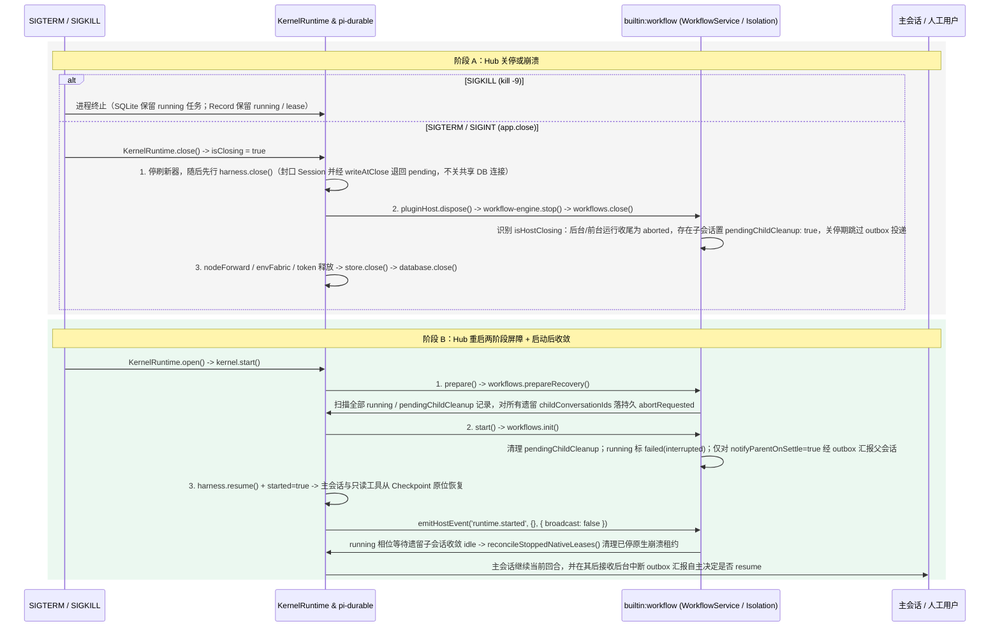

# Hub 进程重启优雅关停保留与遗留资源收敛设计文档

## 背景

日常开发与运维中，Hub 服务常通过 `SIGTERM` / `SIGINT`（优雅关停）或 `SIGKILL`（强杀）重启升级。`@earendil-works/pi-durable` 已在 `state.sqlite` 中维护 `GenerationTask` 与 `ToolTask` 的微阶段 Checkpoint，`builtin:workflow` 也具备运行记录、JSONL 账本、即时 `childConversationIds`、Worktree 持久租约与父会话 outbox 中断汇报机制。

经核查现行实现，真正阻塞跨重启体验与资源收敛的问题集中在以下**两处内核关停机制错位**与 **四个编排恢复存量缺陷**：

1. **优雅关停误杀全部会话且拆毁顺序失配**（`packages/kernel/src/runtime/runtime-bootstrap.ts`、`sqlite.ts`、`tool-registry.ts`）：
   - `pi-durable` 的 `Harness.close()` 原生语义是封口 `Session` 并发起 `writeAtClose()`，将在途 `GenerationTask` / `ToolTask` 退回 `pending` Checkpoint（不写 `aborted` 终态、不计 `restarts`），供下次 `harness.resume()` 原位恢复；
   - 然而 `teardownKernelRuntime` 在 `harness.close()` 前遍历 `store.listConvs()` 执行 `closeAborts` 循环，强行 `abort()` 全部会话，导致 `SIGTERM` 反而不如 `SIGKILL` 能保留主会话 Checkpoint；
   - 且由于 `SqliteStorage.close()` 直接关闭与 `HelmStore` 共享的底层 SQLite 连接，`teardownKernelRuntime` 把 `pluginHost.dispose()` 与 `envFabric.dispose()` 排在 `harness.close()` 之前，关停期工具或断连错误可能先于 `Harness` 封口被写入持久状态；同时 `wrapToolExecute` / 关停前工具执行若捕获 `AbortError` 转成 `{ isError: true }` 返回，也会阻止 `ToolTask` 进入 `writeAtClose()` 退回 `pending`。
2. **只读内核工具未声明安全重放**（`packages/kernel/src/runtime/tools/file-ops.ts`、`artifact-tools.ts`）：
   - 纯只读的 `read` 与 `read_artifact` 工具未声明 `replay: 'safe'`，重启进入 `ToolTask.phases.execute` 时与有写副作用工具一样被统一按 `interrupted` 失败结算。
3. **非后台工作流的孤儿原生子会话遗留**（`packages/plugins/src/workflow/engine/service-recovery.ts`）：
   - 原生子会话在 `pi-durable` 中以 `{ ownership: { kind: 'ownerless' } }` 创建，不受父 `ToolTask` 失败级联取消；
   - `prepareRecovery()` 与 `init()` 当前只对 `isBackgroundRecord(record)` 收集 `childConversationIds` 并守卫中止。经同步 `SubagentWorkflow`（`background: false`）或 CLI `helm workflows run` 发起的工作流在重启中断后，其遗留原生子会话无人落 `abortRequested` 标记，会在 `harness.resume()` 后成为孤儿任务继续执行。
4. **原生 Worktree 崩溃租约阻塞清理**（`packages/plugins/src/workflow/isolation.ts`、`isolation-lease-store.ts`、`packages/kernel/src/runtime/runtime.ts`）：
   - 原生 `isolation: 'worktree'` 执行遇 `SIGKILL` 遗留的 `phase: 'pending'` 占位租约或 `phase: 'running'`（无外部 `executionId`）租约在下次 Hub 启动后无自动回收入口，即使底层子会话已确认停止，调用 `cleanup_worktree` 仍被永久 `409 worktree_execution_unknown` 阻塞。
5. **手动续跑跨步 `agent({ resume: label })` 断链**（`packages/plugins/src/workflow/engine/runtime-agent-replay.ts`）：
   - 工作流账本重放命中成功的原生 `agent({ label })`（`replayedEntry.ok === true` 且带 `execution.conversationId`、无外部 `executionId`）时，`completedByLabel` 被无条件标为 `replayed: true` 而未记录 `resumeRef`，导致父会话或用户按 `resumeFromRunId` 续跑后紧接未落账的 `agent({ resume: label })` 时报错拒绝。
6. **后台单子代理派生丢失 `meta`**（`packages/plugins/src/workflow/engine/background-agent-runner.ts`）：
   - `startBackgroundAgent` 组装下游 `AgentSpawnRequest` 时传 `withWorkflowSpawnMeta(undefined, { runId })`，覆盖丢弃了 `subagent` 工具在 `request.meta` 中写入的 `maxSubagentDepth`。

### 目标与明确非目标

- **目标**：
  1. 跨 `SIGTERM` / `SIGINT` 与 `SIGKILL` 重启后，人工直连主会话的在途生成回合与只读工具（`read` / `read_artifact`）依托 `pi-durable` Checkpoint 无损恢复，有副作用工具（`bash` / `write` / `edit` 等）按 SDK 契约向模型报告 `interrupted` 并推进下一轮推理自愈；
  2. 一切因重启或关停中断的原生工作流/子代理子会话均被可靠中止收敛至 `idle`，并在 `harness.resume()` 完成后回收已停原生 Worktree 崩溃租约；
  3. 后台工作流与后台单子代理保持既有「标 `failed`/`aborted` + outbox 向父会话投递结构化中断汇报」契约，父会话模型恢复后收到完整上下文自行决定是否 `resumeFromRunId` / `subagent resume`，且原生多步 `label -> resume` 与深度配额传递完整可用。
- **明确非目标（机制与策略分离）**：
  - **不做引擎级自动重启拉起全部后台任务**：无条件开机自动重跑重启前全部后台工作流与子代理属于策略行为——开发/运维重启常源于修改脚本或纠偏（自动重跑会盲目烧 Token 与占锁），而携机密或已脱敏 Prompt 的自动重派亦易违背安全与语义预期。无人值守的自动断点续跑继续统一归口上层策略插件 `builtin:superagent` Watchdog，交互式续跑由收到 outbox 中断报告的父会话或人类通过 `resumeFromRunId` / `subagent resume` 显式决策。

建议分支：`helm/restart-recovery`。

---

## 整体设计

整体方案坚持「内核提供无损关停与启动后事件机制、编排插件完成状态收敛与存量缺陷修复」的最小正交设计，不引入新状态机与自动拉起调度器：



各任务形态在调整后的表现如下：

| 任务形态 | 重启前所处位置 | 恢复处理方式 | 最终可见行为 |
| :--- | :--- | :--- | :--- |
| **人工直连主会话** | 模型流式生成中（`request` / `poll`） | `SIGTERM` 退回 `pending` 且不增 `restarts`（半截输出转 aborted 条目后重发）；`SIGKILL` 按既定退避重试 | 自动继续生成完整回复，不在 `close()` 被强行 `aborted` |
| **人工直连主会话** | 只读工具执行中（`read` / `read_artifact`） | 工具声明 `replay: 'safe'`，`ToolTask.execute` 自动重跑工具并继续回合 | 无缝完成读取与后续推理 |
| **人工直连主会话** | 写/外部工具（`bash` / `write` / `edit` 等） | 维持缺省 `'unsafe'`，关停退回 `pending`，恢复期提交 `interrupted` 结果 | 模型基于中断反馈自主检查现场后继续 |
| **后台工作流 / 子代理** | 运行中（`notifyParentOnSettle: true`） | 子会话被持久中止收敛 `idle`、崩溃原生租约被回收；按原状态经 outbox 向父会话发 `failed`/`aborted` 报告 | 父会话活着接住报告，凭完好账本与原生 `label` 句柄按需手动 `resumeFromRunId` / `resume` |
| **同步 / CLI 工作流** | 运行中（`notifyParentOnSettle` 未置位） | `prepareRecovery` 与 `init` 同样收集其 `childConversationIds` 守卫中止并等至 `idle`，回收原生崩溃租约，不发后台通知 | 零孤儿原生子会话继续烧 Token，仍可手动 `resumeFromRunId` 与 `cleanup_worktree` |

---

## 详细设计

### 1. 内核会话层：无损关停拆毁顺序与只读工具可重放

#### 1.1 解耦 `SqliteStorage.close()` 与共享数据库连接（`packages/kernel/src/runtime/sqlite.ts`）

`openHelmDatabase` 中，`pi-durable` 的 `SqliteStorage` 与内核 `HelmStore` 共用同一 `NodeSqliteDatabase` 连接与串行事务队列。当前 `SqliteStorage.close()` 会直接关闭底层 `db`，迫使 `harness.close()` 只能排在 `pluginHost.dispose()` 之后。

本次调整在 `openHelmDatabase` 向 `SqliteStorage.open` 传入参数时，构造一个仅实现 `SqliteDatabase` 公共契约的代理视图 `storageDb`（转发 `exec` / `run` / `runCounted` / `get` / `all` / `transaction` 到同一 `db`，将 `close` 实现为 `async () => {}`）：
- `harness.close()` 调用 `SqliteStorage.close()` 时仍完整执行读排空、延迟文档刷盘与 `closed` 封口，但不再提前断开物理连接；
- `openHelmDatabase` 初始化阶段（`SqliteStorage.open` 或 `HELM_SCHEMA` / `FTS_SCHEMA` 建表）若抛错，在 `catch` 分支显式调用物理 `db.close()` 防连接句柄泄漏；
- 正常关停时的物理 SQLite 连接由 `teardownKernelRuntime` 末尾的 `database.close()` 唯一关闭（`HelmDatabase.close()` 保留现有 `storage.close()` + `db.close()` 的幂等语义）。

#### 1.2 重排 `teardownKernelRuntime` 并移除 `closeAborts`（`packages/kernel/src/runtime/runtime-bootstrap.ts`）

删除 `teardownKernelRuntime` 中遍历 `store.listConvs()` 调用 `conversation.abort()` 与 `tracker.settleAborted()` 的 `closeAborts` 循环，并将拆毁顺序重排为：

1. **停后台刷新与在途元数据变更加载**：`modelsRegistry.abortRefresh(new Error('kernel closing'))`、`assetReloader.stop()`、`nodes.dispose()`（停盘空间定时刷新并等在途）、`assetReloader.waitForInflight()`、`modelsRegistry.dispose()`（等模型配置链收敛）；
2. **先行关闭 `Harness`**：调用 `harness.close(BACKGROUND_CONTEXT)`。此时 `pluginHost`、`envFabric`、`HelmStore` 与受管 `HELM_TOKEN` 仍在，但 `Harness` 已同步封口 `Session` 并触发 `TaskScheduler.join()`，向全部在途模型请求与工具调用发出 `AbortSignal` 等待内存执行退出，最后经 `writeAtClose()` 将打断的 `running` 任务退回 `pending`（半截流式文本一并刷入 `state.sqlite`）；
3. **排空已触发结算并停插件宿主**：调用 `settledInflight()` → `tracker.close()`（唤醒 `waitForIdle` 等待者并停观镜像，`ContextUsageRefresh` 同步检查 `isClosing` 拒绝向已关闭 `Harness` 发起无谓刷新）→ `pluginHost.dispose()` → 再次 `settledInflight()`（覆盖插件停止窗口内排入的清理回调；此时 `HelmStore` 仍开启，插件终态与投影可正常落库）；
4. **释放连接与底层存储**：依次执行 `nodeForward.close()`、`envFabric.dispose()`、`processTokenHandle?.dispose()`、`store.close()`、`database.close()`；
5. **清理纯内存通道**：`events.close()`、`sessionDocLifecycleRelease?.()`、`sessionDocStreams.close()`、`stashService.clear()`。

#### 1.3 工具中止透传契约与纯只读重放标记（`tool-registry.ts`、`shell-exec.ts`、`file-ops.ts`、`artifact-tools.ts`）

`pi-durable` 的 `ToolTask` 在 `beforeClose()` / `join()` 阶段依据「`tool.execute()` 抛出异常且 `runtime.signal.aborted === true`」来判定本次调用因关停或取消中断；若工具捕获 `AbortError`（或从内部 `Result` 返回 `{ isError: true }`）并正常返回，则会跳过中断分支导致关停时产生多余 `spill` 写盘甚至触发 `afterTool`。

- 在 [tool-registry.ts](file:///root/code/helm/packages/kernel/src/runtime/tool-registry.ts) 的 `wrapToolExecute`（同时包裹内核工具与插件工具；已命中 `tool_call handled` 缓存的短路路径除外）出口增加校验：当 `execute(...)` 返回后若 `context.abortSignal?.aborted === true`，抛出中止错误（优先原 `abortSignal.reason` Error，否则 `DOMException(..., 'AbortError')`）；
- 在 `createBashTool`（`shell-exec.ts`）与 `createReadTool`（`file-ops.ts`）调用 `deps.artifacts.spill(...)` 之前同样先检查 `context.abortSignal?.aborted`，若已中止直接抛出中止错误，避免关停窗口在磁盘生成无意义的截断产物文件；
- 在以下两个纯只读且重放幂等的内核工具 `defineTool` 选项中显式声明 `replay: 'safe'`（`installKernelTools` 的对象浅拷贝包装原样透传该字段）：
  - `packages/kernel/src/runtime/tools/file-ops.ts`：`createReadTool`（`spill` 命名确定性 `read-${api.callId}`，多次重写同一产物槽幂等）；
  - `packages/kernel/src/runtime/tools/artifact-tools.ts`：`createReadArtifactTool`。
- `bash`、`write`、`edit`、`register_artifact`、`run_action` 及所有插件工具保持缺省 `'unsafe'`。

#### 1.4 内核启动完成内部事件 `runtime.started`（`packages/kernel/src/runtime/runtime.ts`）

`KernelRuntime.start()` 当前在 `await this.pluginHost.start()` 返回后才调用 `this.harness.resume()` 并置 `this.#started = true`。因此插件 `service.start()` 内无法等待需要调度器已运行才能完成的清理工作。

在 `KernelRuntime.start()` 将 `this.#started = true` 置位后，紧接发送一条仅面向进程内监听器的内部事件：

```ts
if (this.pluginHost) await this.pluginHost.start()
this.harness.resume()
this.#started = true
await this.emitHostEvent('runtime.started', {}, { broadcast: false })
```

该事件不改变 `PluginServiceSpec`、不增加 `@helm/protocol` 新端口、不向 SSE 客户端广播。

---

### 2. 编排引擎关停协同与四个存量缺陷修复

#### 2.1 宿主先停 `Harness` 时的 `builtin:workflow` 优雅收尾协同

因 `harness.close()` 先于 `pluginHost.dispose()` 执行，在途原生 `spawnAgent` 内的 `submission.wait()` 会因 `Session` 封口而提前退出。为避免该信号被正在收尾的工作流或后台子代理误判为普通业务失败或尝试向已关闭的 `Harness` 投递通知：

1. 在 `WorkflowServiceHost`（`packages/plugins/src/workflow/engine/host-adapter.ts`）增加可选只读探测 `isHostClosing?(): boolean`，由 `engine-host.ts` 从既有 `HelmHostApi.isClosing` 注入；
2. 在 `RunRecord`（`packages/plugins/src/workflow/engine/run-store.ts`）新增可选持久布尔字段 `pendingChildCleanup?: boolean`（并在 `runRecordProblem` 中做布尔严格校验），专门标记「本 run 虽已终态落盘（如 `SIGTERM` 优雅关停结算为 `aborted`），但因其派生子会话可能在 `harness.close()` 时经 `writeAtClose()` 被退回 `pending`，下次启动需由 `prepareRecovery()` 补落持久取消标记」；
3. 当 `svc.host.isHostClosing?.() === true` 时：
   - `invokeAgentSpawn`（入口与异常捕获分支）及 `enginePrepareAction`（在写入 `action_started` 之前）立即触发 `run.abort.abort()` 阻止脚本继续向后执行重试或下一节点；已在关停瞬间真实完成的单步 `agent` / `action` 正常落账，不截断配对终态账本行；
   - `abortChildViaHost` 跳过向已关闭 `Harness` 发起 `abortConversationGuarded` 调用（消除关停期无意义的 `Session is closed` 报错日志），转由下方 `pendingChildCleanup` 闭环保障；
   - `settleWorkflowRun`（`run-settle.ts`）与 `startBackgroundAgent` 的 `settle`（`background-agent-runner.ts`）对未真实完成的运行强制将终态记为 `status: 'aborted'`（真实完成的保留 `completed`；延续 `workflow-shutdown.integration.test.ts` 与 `controlled-stop-doc.test.ts` 的契约），跳过关停期 `onBackgroundAgentSettled` 投递（留待下次 `init()` 的 outbox 通知父会话），并在未完成且存在任意在途子会话时写入 `pendingChildCleanup: true`；
   - 不与插件单独停用/热重载路径（`host.isClosing === false`）混淆：插件停用路径照常直接走 `workflows.close()` + 运行期守卫中止子会话，行为零变化。

#### 2.2 全覆盖清理非后台与重启遗留的孤儿原生子会话（`service-recovery.ts`）

- **`prepareRecovery()` 扫描全量遗留子会话**：不再用 `!isBackgroundRecord(record)` 跳过同步工作流与 CLI/Web 动作工作流。凡 `record.status === 'running' || record.pendingChildCleanup === true` 的持久记录，一律提取 `backgroundChildIds(record)` 并经 `host.abortConversationGuarded(id)`（此刻调度器仍 `paused`）落持久 `abortRequested` 标记，同时将本批收集到的 `childIds` 记入 `StartupRecovery` 实例内存集合 `preparedChildIds`；
- **`init()` 状态收敛与严格保留通知边界**：对全部 `record.status === 'running'` 记录的 `backgroundChildIds(record)` 执行守卫中止并将 `status` 落盘为 `failed`（中断错误文案与既有节点失败投影规则不变）；对携带 `pendingChildCleanup: true` 的记录在落盘前清除该字段；仅当 `record.notifyParentOnSettle === true && record.notifiedAt === undefined` 时经 outbox 向父会话补发通知（同步 `SubagentWorkflow` 与 CLI `workflows run` 依旧绝不产生后台通知）；
- **`awaitPreparedChildrenSettled()` 启动后收敛**：`builtin:workflow` 监听 `runtime.started` 事件并依次执行：
  1. 对 `preparedChildIds` 与本轮 `init()` 收集的遗留原生子会话再次调用运行态 `abortConversationGuarded`（此时 `KernelRuntime.started === true`，真实等待尚未停下的任务完成取消并收敛至 `idle`，同时清理内存集合；`not_found` 与 `ownership_conflict` 按既定红线跳过并输出诊断）；
  2. 调用 `isolation.reconcileStoppedNativeLeases()` 并刷新 `worktreeDocStore.flush()`。

#### 2.3 回收已确认停止的原生 Worktree 崩溃租约（`isolation.ts`、`isolation-lease-store.ts`）

`WorktreeLeaseStore` 与 `WorktreeIsolation` 新增 `reconcileStoppedNativeLeases()`，仅在 `runtime.started` 启动收尾（确证前序 Hub 进程已结束且遗留原生子会话已收敛后）调用一次：

- 保留既有同进程 `cleanup()` 运行期的 fail-closed 保护不变（外部运行时租约、同进程异常未确认状态或缺失 `conversationId` 的未知租约继续由 `assertNoUnknownExecution` 拒绝并报 `409 worktree_execution_unknown`）；
- 启动收敛阶段仅清理以下两类**可证明已无任何活跃执行**的原生崩溃租约：
  1. `lease.phase === 'pending' && lease.info.executionId === undefined` 且未在 `host.listActiveSpawnExecutions()` 命中（`openPendingLease` 仅用于原生 `spawnWithWorktree` / `resumeWithWorktree` 预分配，外部运行时只走 `trackWithoutPreallocation` 的 `running` 租约）；
  2. `lease.phase === 'running' && lease.info.executionId === undefined && lease.info.conversationId !== undefined`、未在 `host.listActiveSpawnExecutions()` 命中，且确认底层会话非工作态（`getConversation(id).status` 不为 `'working'` / `'blocked'`，或 `getConversation` 抛出 `HelmError('not_found')` 表示会话已删除；其余读取异常一律 fail-closed 保留）。
- 清理时移除对应租约并原子落盘 `worktree-leases`（`WorktreeAllocator` 的工作树记录、`branch` 与 `agentId` 绑定完整保留，用户随后可正常执行 `subagent resume` 或 `cleanup_worktree`）。

#### 2.4 账本重放保留原生 `label` 会话的 `resumeRef` 句柄（`runtime-agent-replay.ts`）

在 `resolveAgentReplayCall` 命中成功的 `agent` 账本记录（`replayedEntry.type === 'agent' && replayedEntry.ok`）时：
- 提取 `execution = replayedEntry.execution`；
- 若 `execution?.conversationId !== undefined && execution.executionId === undefined`（即该步骤是在 `state.sqlite` 内持久留存的原生子会话），登记 `ctx.completedByLabel` 时携带 `resumeRef: String(execution.conversationId)` 且不设置 `replayed: true`；
- 若属于外部运行时（`execution?.executionId !== undefined`）或测试/无执行句柄的纯缓存记录（`execution?.conversationId === undefined`），维持原状标为 `replayed: true`，在前缀失配需要实时续接时显式拒绝，保持既有无活会话守卫与 `workflow-resume-replay.test.ts` 契约不变。

#### 2.5 修复 `startBackgroundAgent` 透传 `meta`（`background-agent-runner.ts`）

将 `background-agent-runner.ts` 组装 `proto` 处的 `meta: withWorkflowSpawnMeta(undefined, { runId })` 修正为 `meta: withWorkflowSpawnMeta(request.meta, { runId })`，使 `subagent` 工具经 `request.meta` 注入的 `maxSubagentDepth` 在后台与前台同步派生路径均真实生效并进入 `depth.ts` 注册校验。

---

## 影响分析

- **内核与插件边界**：不修改 `@helm/protocol` 跨包接口（直接复用 `HelmHostApi.isClosing` 与 `PluginDefinition` 事件通道），不引入跨包循环依赖；`KernelRuntime` 对外部插件完全零点名。
- **`background` / `sync` / CLI 工作流兼容差异**：
  - 唯一刻意调整的存量测试契约位于 [workflow-background-notify.test.ts](file:///root/code/helm/packages/plugins/test/workflow-background-notify.test.ts#L309-L335)：该用例原断言「同步 workflow 崩溃恢复时不守卫中止子会话」。修复孤儿原生子会话泄漏后，同步与 CLI 工作流在重启恢复时同样守卫中止其 `childConversationIds` 以防 `ownerless` 任务在后台空跑，但依然保持「绝不向父会话发送后台结算通知」的既有边界，需同步更新该用例断言与 [journaling-recovery.md](file:///root/code/helm/docs/workflows/journaling-recovery.md#L85-L103) 描述。
- **`@helm/plugins` 其他内置插件**：`workflow-shutdown.integration.test.ts` 与 `controlled-stop-doc.test.ts` 的 `status === 'aborted'` 关停终态与最终投影契约完全保留；`builtin:superagent` 的 `listAutoResumeCandidates` 与 `Watchdog` 冷却恢复路径保持独立且不受影响。
- **内存态机密与待答审批**：延续现有诚实安全边界：`SecretStash` 不落盘、重启后内存机密清空；`pending` 态 `AskDoc` 仍由启动恢复报告并保留等待人工处理；远端 `EnvFabric` 节点若尚未重连，工具调用显式报 `409 node_offline`。

---

## 发布

本项目处于开发阶段，遵循仓库「不兼容、不迁移」约定：

- **存储与契约影响**：`RunRecord` 新增的 `pendingChildCleanup` 为可选布尔字段，`runRecordProblem` 对非法非布尔值显式拒绝，现行开发库无需迁移脚本即可直接读取并生效。
- **可观测性**：关停期与恢复期跳过的子会话、守卫中止诊断与租约清理失败均按现有前缀规范输出至标准错误日志（`workflow prepareRecovery` / `workflow init` / `builtin:workflow`）。
- **回滚方案**：所有变更集中在运行时 teardown 时序、`read` / `read_artifact` 工具标记与 `builtin:workflow` 恢复修补，不涉及数据库 Schema 变更或不可逆迁移；如发现回归，回退代码提交即可恢复原行为。

---

## 测试

所有新增与修改测试显式声明 `{ timeout: 60_000 }`，禁止设置 `HELM_TEST_SUITE_TIMEOUT_MS`，集成测试使用 `mkdtempSync` 隔离临时目录并在 `after` 钩子清理自有子进程与目录：

| 用例维度 | 覆盖目标与关键断言 | 对应位置 |
| :--- | :--- | :--- |
| **优雅关停保留与重启续跑** | 构造主会话慢速流式生成中与 `read` / `read_artifact` / `bash` 执行中，分别触发 `app.close()`（`SIGTERM`）与 `SIGKILL` 后重开恢复：`GenerationTask` 退回 `pending` 且不白增 `restarts` 后继续生成完整回复；`read` 与 `read_artifact` 经 `replay: 'safe'` 无感重跑完成回合；`bash` 结算为 `interrupted` 并由模型下一轮推理自愈 | `@helm/kernel` / `@helm/hub` 集成测试 |
| **工具中止不产生假结果与垃圾 spill** | `wrapToolExecute` 与 `bash` / `read` 在 `abortSignal.aborted === true` 时抛出中止异常，关停 `harness.close()` 期间不触发额外 `spill` 写入或错误结果提交 | `@helm/kernel` 单元测试 |
| **同步 / CLI 工作流孤儿清理** | 同步 `SubagentWorkflow` 与 CLI `workflows run` 派生原生子会话途中遭遇 `SIGKILL` 与 `app.close()`（`pendingChildCleanup`）：重启后 `prepareRecovery` 落标记、`init` 清理 `pendingChildCleanup` 且不发父会话通知、`runtime.started` 后子会话收敛 `idle`（零新增模型调用） | [workflow-background-notify.test.ts](file:///root/code/helm/packages/plugins/test/workflow-background-notify.test.ts)、[background-restart.integration.test.ts](file:///root/code/helm/packages/plugins/test/background-restart.integration.test.ts) |
| **原生 Worktree 崩溃租约回收与外部 fail-closed** | 模拟 `SIGKILL` 遗留原生 `pending` 占位租约、已停原生 `running` 租约及外部 `executionId` 租约：重开 `kernel.start()` 触发 `runtime.started` 后，原生租约自动清理且随后 `cleanup_worktree` 成功，外部 `executionId` 租约继续严格报 `worktree_execution_unknown` | `packages/plugins/test/native-worktree.test.ts` / [worktree-runtime.integration.test.ts](file:///root/code/helm/packages/hub/test/worktree-runtime.integration.test.ts) |
| **跨步 `resume: label` 与 `meta.maxSubagentDepth`** | ① 已落账成功的原生 `agent({ label })` 经 `resumeFromRunId` 重放后，后续 `agent({ resume: label })` 成功续接原 `childId`（而纯缓存/外部记录继续报不可续接）；② `subagent` 传 `maxSubagentDepth` 经 `startBackgroundAgent` 启动后台与同步子代理时真实传递进 `AgentSpawnRequest.meta` | [workflow-resume-replay.test.ts](file:///root/code/helm/packages/plugins/test/workflow-resume-replay.test.ts)、[background-subagent.test.ts](file:///root/code/helm/packages/plugins/test/background-subagent.test.ts) |
| **回归门禁验收** | 执行 `pnpm check:hygiene && pnpm typecheck && pnpm check:changed -- --base main`；涉及 `@helm/kernel` 与 `@helm/plugins` 跨档变更，全量执行 `pnpm test:all` 并确认 `controlled-stop-doc.test.ts` 与 `workflow-shutdown.integration.test.ts` 全通 | 全仓验收 |
