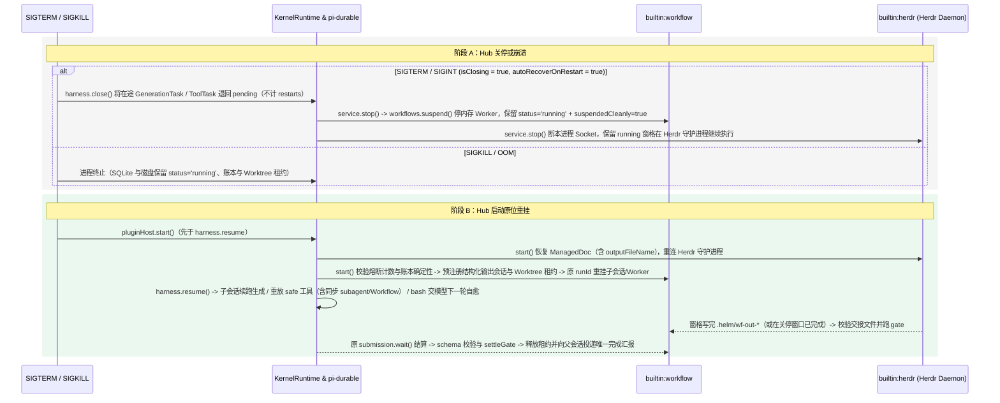

## 背景

在大规模重构与多模块并发开发中，用户常在单个或多个会话下同时运行十几至二十余个后台 `subagent`、确定性 DSL 工作流（`SubagentWorkflow` / `helm workflows run`）或 Herdr 外部终端 CLI，期间不可避免会遇到 Hub 优雅重启（代码构建升级、`SIGTERM` / `SIGINT`）或异常重启（进程崩溃、`SIGKILL`）。

核查当前代码库，内核会话底座与上层编排插件在重启行为上存在明显断层：

1. **内核 `pi-durable` 已具备单会话无感续跑能力，但编排插件在关停与启动时主动中止了所有子任务**：
   - 内核 `teardownKernelRuntime`（`packages/kernel/src/runtime/runtime-bootstrap.ts:376`）在优雅关停时先行调用 `harness.close()`，将所有在途 `GenerationTask` 与 `ToolTask` 退回 `pending` Checkpoint 且不计 `restarts`；只读工具（`read` / `read_artifact`）已声明 `replay: 'safe'` 自动重放，有副作用工具（`bash` / `write` / `edit`）在崩溃恢复后向模型返回 `interrupted` 结果并自动推进同一回合的下一轮推理自愈。
   - 然而 `builtin:workflow` 在 `stop()` 时无条件调用 `workflows.close()`（`packages/plugins/src/workflow/engine/service.ts:365`、`run-settle.ts:38-59`），对全部在途工作流与后台 `subagent` 触发 `abort`、改标 `aborted` 并写入 `pendingChildCleanup: true`；下次启动时 `prepareRecovery()` 与 `init()`（`service-recovery.ts:54-191`）又逐个调用 `abortConversationGuarded` 强杀原本可由 `pi-durable` 自动续跑的子会话，改标 `failed (interrupted by process restart)` 并向父会话批量刷入中断失败通知。
   - `builtin:herdr` 在 `stopResources()`（`packages/plugins/src/herdr.ts:724-735`）中未区分「Hub 进程关停」与「手动停用插件」，关停时直接遍历受管窗格调用 `closePane`，导致原本独立运行在 Herdr 守护进程中的外部 CLI 被强行关闭；且 `ManagedDoc`（`herdr/panes.ts:55-74`）未持久化交接文件名 `outputFileName`，重启后无法衔接已产出的 `.helm/wf-out-*` 文件。
2. **既有 Watchdog 自动续跑链路过重且覆盖不全**：
   - `service-recovery.ts:276` 的 `listAutoResumeCandidates` 依赖默认停用的 `builtin:superagent` Watchdog 每 15 秒轮询，要求 2 / 5 / 15 分钟冷却且每轮最多恢复 1 个任务，并以新建 `runId`（`resumedByRunId`）替代原任务；同时显式跳过全部 `kind === 'subagent'` 的后台子代理、非后台启动的 CLI/Web 工作流，以及在首个节点完成前被重启打断的工作流（空账本无安全重放锚点）。
3. **多层同步子任务重放断链，且真失败任务缺少批量恢复入口**：
   - 自动化子会话（`ownedBy: 'helm' | 'bot'`）或显式 `background: false` 调用 `subagent` / `SubagentWorkflow` 时采用同步工具阻塞等待，插件工具未声明 `replay: 'safe'`，重启后父会话工具调用直接以 `interrupted` 报错结算，导致多层任务树断链。
   - 当上游模型接口长时间故障或门禁环境问题导致十几个任务真实落入 `failed` 时，后台 `subagent` 卡片没有单卡恢复入口，工作台与 CLI 也缺少一键批量恢复能力，只能逐个手动处理。

### 目标与边界

- **目标**：
  1. **跨重启原位无感恢复**：Hub 优雅重启或异常崩溃重启后，所有在途后台 `subagent`、DSL 工作流、多层同步子任务与存活的 Herdr 外部终端窗格默认保持**原 `runId`、原子会话 `conversationId`、原隔离 `Worktree`** 自动继续执行，不产生虚假失败通知、不分裂新卡片、不依赖 `builtin:superagent`、零冷却等待；
  2. **机制与策略分离及崩溃熔断**：提供插件配置与环境变量开关支持排障时关闭自动恢复；对连续异常崩溃设置单任务熔断上限（3 次），优雅重启不计次数；
  3. **严守诚实性红线**：悬挂非幂等 `action_started`、外部窗格丢失且无交接文件、或未建窗却依赖已清空内存态 `secretNames` 时显式报错，绝不静默重跑未知外部副作用或伪造成功结果；
  4. **真失败一键批量恢复**：补齐失败后台 `subagent` 的单卡续接能力，并提供五端统一的 `resume_failed` 批量恢复动作与工作台顶栏入口。

建议分支：`feat/seamless-restart-recovery`（建议名称，当前尚未创建）。

---

## 整体设计

核心原则是将**「Hub 进程换代（挂起与原位重挂）」**与**「任务失败 / 人工取消」**彻底解耦：Hub 关停时只卸载当前进程内的内存句柄与 Worker，保留持久层 `running` 真相；下次启动在 `harness.resume()` 前预注册在途重挂句柄与结构化输出会话，利用 `pi-durable` 原生的 `submissionByRequest`（确定性 `requestId` 持久去重）直接挂回原回合等待结算。



各任务形态在跨重启与真失败场景下的行为如下：

| 任务形态 | Hub 优雅重启 / 异常崩溃（`autoRecoverOnRestart: true`） | 诚实失败 / 熔断边界 | 真 `failed` 后的恢复方式 |
| :--- | :--- | :--- | :--- |
| **人工直连主会话** | 保持现有 `pi-durable` Checkpoint 续跑与工具自愈 | 单任务底层异常超限进 `error` | 会话内直接重试或继续输入 |
| **后台单子代理（`subagent`）** | 原 `runId` 按 `requestId` 原位重挂子会话，完成后发唯一汇报 | 连续崩溃 > 3 次或未建窗含 `secretNames` 标 `failed` | 单卡「恢复」按钮或 `resume_failed` 批量续接 |
| **DSL 工作流（`workflow`）** | 原 `runId` 拉起 Worker：已完成行 0 Token 重放，`agent_started` 在途节点原位重挂 | 非幂等 `action_started` 悬挂显式报 `workflow_action_uncertain` | 单卡「断点恢复」或 `resume_failed` 批量续跑 |
| **同步子任务（多层树）** | 工具声明 `replay: 'safe'`，按 `(conversationId, callId)` 幂等命中在途 `runId` 继续等待 | 子任务最终失败时向父回合如实返回 `isError` 结果 | 从顶层失败 Run 一键续跑 |
| **Herdr 外部终端窗格** | 关停不关窗；启动后凭 `outputFileName` 收取已写完文件或重挂在途监听 | 窗格已消失且无交接文件时附 40 行脱敏快照报错 | 空闲存活窗格可续接，否则由父工作流重派 |

---

## 详细设计

### 1. 宿主关停二分、策略开关与崩溃熔断

#### 1.1 自动恢复配置与环境变量逃生阀（`packages/plugins/src/workflow/config.ts`）

在 `builtin:workflow` 的 `configSchema` 中新增布尔配置 `autoRecoverOnRestart`（默认 `true`），并支持进程环境变量 `HELM_AUTO_RECOVER=0`（或 `false`）作为紧急覆盖：

- **生效判定**：`effectiveAutoRecover = process.env.HELM_AUTO_RECOVER !== '0' && process.env.HELM_AUTO_RECOVER !== 'false' && readAutoRecoverOnRestart(ctx)`；
- 当 `effectiveAutoRecover === false` 时，启动恢复退回既有「`prepareRecovery` 落取消标记 + `init` 守卫中止并标 `failed(interrupted)`」路径，供修改了坏脚本或需强制清场排障时使用。

#### 1.2 区分插件停用与宿主进程关停（`workflow.ts`、`service.ts`、`herdr.ts`）

利用宿主已有的 `ctx.host.isClosing` 区分两类停止路径：

1. **插件停用或测试显式关闭（`ctx.host.isClosing === false`）**：
   - 运行期存在活跃任务时宿主本身已由 `liveTasks()` 硬阻断（`409 plugin_has_live_tasks`）；直接调用 `workflows.close()` 或 `herdr` `stop()` 时保持现状，取消全部在途任务并落盘 `aborted`、关闭自有窗格。
2. **Hub 进程优雅关停（`ctx.host.isClosing === true`）**：
   - **`WorkflowService.suspend()`**：当 `effectiveAutoRecover === true` 时，`workflow-engine.stop()` 改调 `workflows.suspend()`——仅向进程内 Worker 子进程与本地等待句柄发挂起退出信号（阻止 Worker 继续发起新调用或把中断写为终态），**不调用 `abortConversationGuarded`、不改写 `record.status`（保持 `'running'`）、不投递父会话通知**，仅在活跃 `RunRecord` 上原子落盘 `suspendedCleanly: true` 并 `flush`；
   - **`builtin:herdr` 保活断连**：`stopResources()` 在 `ctx.host.isClosing === true` 时正常断开本进程 Socket 订阅、停止心跳定时器并清理进程内 Ask 协调句柄，但跳过对 `pane.outcome === 'running'` 窗格的 `closePane` 调用，保留窗格在 Herdr 守护进程内继续运行。

#### 1.3 异常崩溃计数与死循环熔断（`run-store.ts`、`service-recovery.ts`）

`RunRecord` 新增两个可选字段（同步加入 `runRecordProblem` 严格形状校验）：

- `suspendedCleanly?: boolean`：优雅关停挂起标记；启动恢复读取后立即清除；
- `crashRecoveries?: number`：非正常崩溃连续重挂次数（非负整数，缺省 `0`）。

启动恢复扫描 `record.status === 'running'` 记录时：
- 若 `record.suspendedCleanly === true`：清除该标记，`crashRecoveries` 保持不变（日常开发构建、服务平滑重启无限次均不触发熔断）；
- 若 `record.suspendedCleanly !== true`（`SIGKILL`、OOM 或断电）：将 `crashRecoveries` 递增 `1` 并先行落盘（确保重挂过程再次崩溃也能累计数）；当递增后 `crashRecoveries > 3`（常量 `MAX_CRASH_RECOVERIES = 3`）时触发熔断，守卫中止其关联子会话并将 Run 标为 `failed`（错误码前缀 `[crash_recovery_limit]`），不再自动重挂。

---

### 2. `spawnAgent` 跨重启幂等重挂与同步工具可重放

#### 2.1 `@helm/protocol` 最小契约扩展（`src/plugin.ts`）

遵守单向包边界，仅在通用协议层新增无业务耦合的可选字段：

```ts
export interface AgentSpawnRequest {
  // ...既有字段保持不变
  /**
   * 跨重启幂等提交键（可选）：原生执行行传给 pi-durable conversation.submit({ requestId })，
   * 同一子会话下重复提交返回既有持久 SubmissionHandle 而不重复追加消息。
   */
  requestId?: string
  /**
   * 跨重启原位重挂坐标（可选，与 resume/fork 互斥）：指向重启前已创建的子会话或外部执行句柄，
   * 挂回等待其在途回合结算并继续执行 schema 校验与 gate 验收。
   */
  reattach?: {
    conversationId?: number
    executionId?: string
    effectiveCwd?: string
  }
}

export interface PluginToolSpec<TIn = Record<string, unknown>> extends PluginPromptFields {
  // ...既有字段保持不变
  /**
   * 工具跨重启重放安全性（缺省 'unsafe'）：仅当工具实现本身按 (conversationId, callId)
   * 具备严格持久幂等保证时才可声明 'safe'，由 RuntimeToolRegistry 透传给 pi-durable defineTool。
   */
  replay?: 'safe' | 'unsafe'
}
```

#### 2.2 原生执行行 `reattach` 与结构化输出预注册（`packages/kernel/src/runtime/spawn.ts`、`structured-output.ts`）

1. **确定性 `requestId` 提交**：
   - `driveTurn`（`spawn.ts:735`）调用 `conversation.submit` 时透传 `request.requestId`；若触发一次 `schema` 文本自愈追问（`spawn.ts:754`），使用派生键 `${request.requestId}:schema-heal`（无 `requestId` 时保持原状）。
2. **`reattach.conversationId` 原位重挂流程**：
   - 校验目标子会话存在且 `parentConversationId === request.parentConversationId`，不新建会话、不修改模型或目录配置，直接触发 `onResolved` 回传既有坐标；
   - 若携带 `request.schema`：先在 `structuredOutputSessions` 登记会话并确保 `register_structured_output` 扩展已安装（因插件 `start()` 先于 `harness.resume()` 执行，恢复后的模型回合可直接调用该工具）；同时扫描该子会话当前活跃回合自本 `submission.entry` 起已落库的非错误 `register_structured_output` 工具调用，若崩溃前已完成校验则直接回填 `structured.accepted`；
   - 调用 `conversation.submit({ type: 'input', requestId: request.requestId, content: promptText, whenBusy: 'followUp' }, bg)`：命中 `pi-durable` 的 `submissionByRequest` 持久记录，零副作用拿回原 `SubmissionHandle`，`await submission.wait(bg)` 等待在途回合完成（若崩溃瞬间回合已结束则立即返回），随后原样执行 `schema` 校验与 `settleGate` 门禁验收。
3. **Worktree 租约续持（`packages/plugins/src/workflow/isolation-spawn.ts`）**：
   - `agent_spawn` 隔离钩子识别 `request.reattach`：若该 `agentId`（或目标 `conversationId`）在 `worktree-state` 中已有受管 Worktree 记录，直接复用既有持久 `running` 租约（若无则补登记）并回传 `worktree` 描述符，待 `next(finalRequest)` 正常结算后释放租约；`reconcileStoppedNativeLeases()` 在全部可恢复 Run 完成重挂登记后再运行，仅回收确实无活跃 Run 持有的孤儿崩溃租约。

#### 2.3 同步 `subagent` / `SubagentWorkflow` 工具幂等重放（`tool-registry.ts`、`tool-subagent.ts`、`tools.ts`）

- `RuntimeToolRegistry.installPluginTools`（`packages/kernel/src/runtime/tool-registry.ts:179`）将 `spec.replay` 透传给 `defineTool({ ..., ...(spec.replay ? { replay: spec.replay } : {}) })`；
- `subagent` 与 `SubagentWorkflow` 声明 `replay: 'safe'`：
  1. **副作用前刷盘不变量**：`startBackgroundAgent` 与 `startWorkflowRun` 在发起任何 `spawnAgent` 或启动 Worker 之前，确保携带 `parentToolCallId: context.callId` 的 `RunRecord` 及索引已 `await state.flush()` 落盘；
  2. **重放命中短路**：工具 `execute(args, context)` 入口若存在非空 `context.callId`，先在 `workflows` 中按 `(context.conversationId, context.callId)` 查找既有 Run：
     - 若命中且为后台模式（或已 `detachedAt` 转后台）：直接返回原后台运行句柄，绝不二次创建；
     - 若命中且为前台同步模式（`syncForeground: true`）：若仍在 `running` 则直接 `await workflows.waitForeground(existing.id)` 继续阻塞等待重挂后的子任务完成，若已达终态则直接构造并返回终态工具信封。

---

### 3. 后台子代理、DSL 工作流与 Herdr 窗格原位恢复

#### 3.1 后台单子代理恢复契约（`background-agent-runner.ts`、`run-store.ts`）

`RunRecord` 新增可选 `subagentSpec`（仅 `kind === 'subagent'` 使用，字符串字段经宿主 `redact` 脱敏，严禁保存 `secretNames` 明文）：

```ts
export interface PersistedSubagentSpec {
  agentId: string
  requestId: string
  prompt: string
  agentType?: string
  cwd?: string
  isolation?: 'worktree'
  gate?: string
  gateTimeoutMs?: number
  schema?: Record<string, unknown>
  maxSubagentDepth?: number
  hadSecretGrant?: boolean
}
```

启动恢复时对 `kind === 'subagent' && status === 'running'` 的记录：
- 若已拥有 `execution.conversationId`（原生子会话）或 `execution.executionId`（外部窗格）：构造带 `requestId` 与 `reattach` 的请求重新挂入 `launchBackgroundAgent` 的结算等待链，复用同一 `runId`；
- 若崩溃发生在 `onResolved` 之前（尚无任何子会话或窗格坐标）：若 `hadSecretGrant === true`（曾请求注入父会话内存态机密），因重启后 `SecretStash` 已清空，显式标 `failed`（`secret_grant_expired_on_restart`）并投递诚实诊断；否则使用原 `requestId` 安全发起首次派生。

#### 3.2 DSL 工作流账本 `agent_started` 与同 `runId` 续跑（`journal-entry.ts`、`journal.ts`、`replay.ts`、`runtime-agent-handler.ts`）

1. **新增 `agent_started` 账本行**：
   - 在 `WorkflowJournalEntry` 中新增与 `action_started` 对称的意图行（仅作恢复重挂锚点，写入异常计 `agentIoErrors` 而不触发 `actionUncertain`）：
     ```ts
     {
       v: 1
       seq: number
       type: 'agent_started'
       scopePath: string
       scopeCallIndex: number
       index: number
       key: string
       attempt?: number
       invocationIndex?: number
       requestId: string
       execution: JournalAgentExecution
     }
     ```
   - `journal.ts` 的 `AGENT_LINE_PREFIX` 扩展为匹配 `"type":"agent"` 与 `"type":"agent_started"`：崩溃导致的半截 `agent_started` 尾行归为 `agentCorrupt`（计 `ioErrors` 跳过），不误触 `workflow_action_uncertain`；
   - `invokeAgentSpawn` 在 `onResolved` 拿到真实 `execution` 坐标的同一时刻，向账本写入 `agent_started` 行并更新 `RunRecord.childConversationIds`。
2. **同 `runId` 原位续跑与在途节点重挂**：
   - 启动恢复扫描到 `kind !== 'subagent' && status === 'running'` 的记录时，先调用 `readJournal(record.journalPath)`：
     - 若 `journal.actionUncertain === true`（例如 `SIGKILL` 恰好中断在非幂等 `action_started` 与终态行之间）：守卫中止全部关联子会话，将原 Run 结算为 `failed(workflow_action_uncertain)` 并按 `notifyParentOnSettle` 汇报；
     - 若账本确定安全：直接以**原 `runId`** 启动 Worker，`JournalWriter` 以 `initialSeq = maxExistingSeq + 1` 追加打开原账本文件；
     - **重放规则**：已有配对终态的 `action` 与 `agent` 行按既有前缀规则 0 Token 瞬间返回（同文件原位恢复模式下跳过重复补写已存在的重放行，避免膨胀与序号重复）；当 `scopePath + scopeCallIndex + attempt + key` 命中仅有 `agent_started` 而无终态 `agent` 行的在途调用时，引擎向宿主发起带 `requestId` 与 `reattach: entry.execution` 的调用，原位等待该子会话/窗格完成后追加终态 `agent` 行，随后继续执行脚本剩余逻辑。

#### 3.3 Herdr 外部终端窗格重挂对账（`herdr/panes.ts`、`herdr/executor.ts`、`herdr.ts`）

1. **`ManagedDoc` 补存 `outputFileName`**：在 `ManagedPane` 与 `ManagedDoc.panes[i]`（`panes.ts:57`）持久化当前有效的 `.helm/wf-out-*` 交接文件名（含 `steer` 重定向后的最新文件名）。
2. **`executor.handle` 支持 `reattach.executionId`**：
   - 在 `PaneRegistry` 中按 `(nodeId, executionId)` 查回 `ManagedPane`；缺失或无 `outputFileName` 时显式抛 `herdr_reattach_missing`；
   - 先通过 `PaneHandoff` 检查目标节点 `effectiveCwd/.helm/<outputFileName>` 是否已在 Hub 重启窗口内写入完成：若文件已存在且内容完整，直接校验 Schema、执行 `gate` 验收并结算窗格；
   - 若交接文件尚未生成，调用 `agent.get` 核验窗格状态：
     - 窗格仍存活且处于 `working / blocked`：恢复事件订阅、CAS 审批桥与交接轮询，等待其自然完成；
     - 窗格已 `idle` 但交接文件缺失：走既有一次原地追问自愈流程；若仍缺失或窗格已不存在，按诚实性红线读取尾部 40 行脱敏终端快照并抛 `herdr_output_contract_violation` / `herdr_pane_lost`，绝不截取屏幕脏文本冒充成功。

---

### 4. 真失败任务的单卡续接与一键批量恢复

针对上游模型网关故障、门禁未通过（人工修复环境后）或手动关闭自动恢复所产生的真实 `failed` / `aborted` 任务：

#### 4.1 补齐后台 `subagent` 单卡失败续接（`service-run.ts`、`SubagentCardDetails.tsx`）

- 扩展 `workflows.run({ resumeFromRunId })`：当目标 `replayFrom.kind === 'subagent'` 时不再一律 `400` 拒绝，而是检查其是否具备可续接句柄（`subagentSpec` 存在，且拥有原生 `execution.conversationId` 或经确认空闲的外部 `executionId`，且未被 `resumedByRunId` 接管）：
  - 满足条件时创建接替后台子代理 Run，写回原记录 `resumedByRunId` 防重复点击，沿用原 `agentType / gate / gateTimeoutMs / schema / maxSubagentDepth` 并以 `resume: String(conversationId | executionId)` 注入续跑提示词（`"前次执行中断或未通过验收，请检查当前工作区状态并继续完成原任务。"`）；
- `SubagentCardActions`（`SubagentCardDetails.tsx:104`）在 `backgroundRun` 处于 `failed / aborted`、未被接管且具备可续接句柄时渲染「恢复」按钮（`rotate-cw` 图标）。

#### 4.2 新增五端动作 `resume_failed` 与工作台顶栏入口（`actions-run.ts`、`WorkflowWorkbenchPanel.tsx`）

1. **动作契约（`builtin:workflow` `resume_failed`）**：
   - HTTP：`POST /api/actions/builtin:workflow/resume_failed`；
   - CLI：`helm workflows resume-failed [--current | --conversation-id <id> | --all] [--json]`（未传 `--all` 时要求 `--current` 或 `--conversation-id` 显式指定目标会话，与 `workflows run` 冲突校验一致）；同步更新 `builtin:profile` 的 `helm-cli` 技能文档；
   - 入参：`{ conversationId?: number, all?: boolean }`（二者互斥且至少其一）；
   - 筛选规则：扫描目标范围内 `status === 'failed'` 且 `resumedByRunId === undefined` 的记录（同时覆盖 `kind === 'workflow'` 与可续接的 `kind === 'subagent'`），跳过语法错误、参数校验错误、`workflow_action_uncertain` 及无续接句柄的单子代理（记入返回值的 `skipped: Array<{ runId, reason }>`）；
   - 执行方式：按 `createdAt` 从早到晚依次发起 `workflows.run({ resumeFromRunId })`（子代理执行受引擎 `maxConcurrentAgents` 信号量自然限流，不会瞬间打爆模型网关），返回 `{ resumed: WorkflowRunSummary[], skipped: Array<{ runId: string; reason: string }> }`。
2. **Web 工作台交互（`WorkflowWorkbenchPanel.tsx:109`）**：
   - 在右侧工作台「当前会话任务」头部栏统计当前会话可恢复的失败任务数 `resumableFailedCount`；
   - 当 `resumableFailedCount > 0` 时，在「工作流库」按钮左侧展示简洁的 `恢复失败 (${resumableFailedCount})` 按钮（使用 `Icon name="rotate-cw"`，零 Emoji，在途禁用防连点），点击调用 `ctx.callAction('resume_failed', { conversationId })` 并经 `ctx.notify` 反馈已拉起数量与跳过原因。

---

## 影响分析

| 涉及包与模块 | 核心变更 | 边界与存量兼容说明 |
| :--- | :--- | :--- |
| `@helm/protocol` (`src/plugin.ts`) | `AgentSpawnRequest` 新增可选 `requestId`、`reattach`；`PluginToolSpec` 新增可选 `replay` | 纯通用执行机制字段，零 Worktree / Workflow / Herdr 业务类型泄漏 |
| `@helm/kernel` (`runtime/spawn.ts`, `structured-output.ts`, `tool-registry.ts`) | 原生 `spawn` 支持 `requestId` 透传与 `reattach` 回合重挂、预注册结构化输出会话；插件工具透传 `replay` | 内核零角色与插件 ID 特判；普通 `spawnAgent` 调用行为完全不变 |
| `builtin:workflow` (`config.ts`, `workflow.ts`, `tools.ts`, `tool-subagent.ts`, `isolation-spawn.ts`, `engine/*`, `client/*`) | 新增 `autoRecoverOnRestart` 配置、`suspend()` 关停挂起、`crashRecoveries` 熔断、`agent_started` 账本行、同 `runId` 原位重挂、`subagent` 失败续接、`resume_failed` 动作与工作台批量按钮 | `ctx.host.isClosing === false`（插件停用 / 单测直调 `close()`）仍走 `aborted` 终态，既有 `workflow-shutdown` 与 `controlled-stop-doc` 契约保留；`builtin:superagent` Watchdog 独立保留应对运行期网关长时故障 |
| `builtin:herdr` (`herdr.ts`, `herdr/panes.ts`, `herdr/executor.ts`) | `ManagedDoc` 持久化 `outputFileName`；`isClosing === true` 保留 `running` 窗格；支持 `reattach.executionId` 对账验收 | 手动停用插件仍关闭全部自有窗格；`ownedBy: 'human'` 只读红线与 CAS 审批水位校验不变 |
| `builtin:profile` & `docs/` | 同步 `helm-cli` 技能文档（新增 `helm workflows resume-failed`）与 `docs/plugins/workflow.md`、`docs/workflows/journaling-recovery.md`、`docs/plugins/herdr.md` | 通过 `services.test.ts` CLI 与技能文档双向锁定校验 |

---

## 发布

### 上线前检查

遵循仓库开发期「不兼容、不迁移」约定：
1. `builtin:herdr` 的 `ManagedDoc` 新增可选 `outputFileName` 字段，`builtin:workflow` 的 `RunRecord` 新增可选 `suspendedCleanly`、`crashRecoveries`、`subagentSpec` 字段，账本新增 `agent_started` 行类型，均为增量可选扩展，现有健康状态库无需手工清理即可启动；若本地开发目录残留损坏测试账本，直接清理对应开发数据重建。
2. 构建后执行 `pnpm link:bins`，确认 CLI `helm workflows resume-failed` 与新动作 Schema 同步生效。

### 故障恢复与观测

- **日志可观测性**：重挂成功、跳过或熔断均在标准错误流输出带 `runId` 与 `conversationId / paneId` 的结构化诊断前缀（`workflow recovery: reattached ...` / `workflow recovery: circuit-breaker tripped ...`）。
- **紧急降级开关**：若线上或本地排障发现特定编排脚本在自动恢复时异常消耗资源，无需回滚代码，直接设置环境变量 `HELM_AUTO_RECOVER=0` 重启 Hub（或运行 `helm plugins config builtin:workflow autoRecoverOnRestart=false`），即可立即退回启动时全部守卫中止收敛模式。

---

## 测试

所有测试显式声明 `{ timeout: 60_000 }`，禁止设置 `HELM_TEST_SUITE_TIMEOUT_MS`，不使用固定长 `sleep`，集成测试使用 `@helm/test-kit` 隔离目录与自有子进程组清理：

| 编号 | 档位与目标位置 | 前置条件与输入 | 操作路径 | 预期可观察结果 |
| :--- | :--- | :--- | :--- | :--- |
| T1 | `integration` (`packages/plugins/test/background-restart.integration.test.ts`) | 主会话并发启动多个后台原生 `subagent`（带 `isolation: 'worktree'`、`gate` 与 `schema`），部分处于模型流式生成中、部分处于 `bash` 执行中 | 分别执行 `runtime.close()`（优雅重启）与子进程 `SIGKILL`（崩溃重启），重新打开并 `start()` Hub | 所有后台 `subagent` 保持原 `runId`（无 `interrupted` 失败汇报刷入父会话），子会话自动完成回合、通过 `schema` 与 `gate` 验收、释放 Worktree 租约，并向主会话各投递恰好一次完成汇报；优雅重启 `crashRecoveries` 为 0 |
| T2 | `integration` (`packages/plugins/test/workflow-restart-reattach.integration.test.ts`) | 启动含多阶段 `parallel` 的 DSL 工作流：节点 A 已完成落账，节点 B（原生 Worktree 子会话）正在运行中，节点 C 尚未开始 | 触发优雅重启与 `SIGKILL` 重启；另构造一组处于非幂等 `action_started` 悬挂态的 `SIGKILL` 账本 | 前两组以**原 `runId`** 自动续跑：节点 A 命中账本 0 Token 跳过（账本无 `seq` 冲突），节点 B 原位重挂同一 `conversationId` 与 Worktree 完成并补写 `agent` 终态行，节点 C 接着跑完使原 Run 变为 `completed`；非幂等悬挂组诚实落盘 `failed(workflow_action_uncertain)` 并中止遗留子会话 |
| T3 | `integration` (`packages/plugins/test/workflow-sync-tree-restart.integration.test.ts`) | 构造两层同步调用树（主会话 `background: false` 或一层自动化子代理同步调用 `subagent` / `SubagentWorkflow`） | 在二层子代理执行途中重启 Hub | 一层会话的工具调用经 `replay: 'safe'` 与 `(conversationId, parentToolCallId)` 幂等重连既有 `runId`（不重复派生第二个 Run），等待二层完成后拿到真实结果并完成整棵树结算 |
| T4 | `integration` (`packages/plugins/test/herdr-restart.integration.test.ts`) | 启用 `builtin:herdr`（Mock Herdr Transport），派生外部窗格任务：场景 ① 重启期间 `.helm/wf-out-*` 已写完；场景 ② 重启后窗格仍在 `working` 随后写完；场景 ③ 重启后窗格已消失且无文件 | 执行 `runtime.close()`（验证不发 `closePane`）并重新启动 Hub | 场景 ① 立即读取交接文件跑过 `gate` 结算；场景 ② 重挂监听后正常结算；场景 ③ 诚实报 `herdr_pane_lost` / `herdr_output_contract_violation` 并附脱敏快照；手动停用插件（`isClosing === false`）仍正常关闭窗格 |
| T5 | `integration` (`packages/plugins/test/workflow-batch-resume.test.ts`) | 构造同一会话下 5 个 `failed` 任务（2 个可恢复 DSL 工作流、2 个带原生子会话的后台 `subagent`、1 个 `workflow_action_uncertain` 不可恢复工作流），以及 1 个连续 `SIGKILL` 4 次的任务 | ① 验证第 4 次 `SIGKILL` 启动行为；② 调用 `resume_failed({ conversationId })` 及 CLI `helm workflows resume-failed --current --json` | ① 第 4 次崩溃触发 `crashRecoveries > 3` 熔断标 `failed` 并中止子会话；② `resume_failed` 成功拉起 4 个可恢复任务（写回 `resumedByRunId`）并在 `skipped` 中如实列出 1 个 `workflow_action_uncertain` 任务，重复调用幂等返回 0 个新拉起 |
| T6 | `unit` (`packages/web` / `packages/plugins` client DOM 测试 + `services.test.ts`) | 渲染 `WorkflowWorkbenchPanel` 与 `SubagentLiveCard`（含失败可恢复与已接管状态）；校验 CLI 命令表与 `helm-cli` 技能文档 | 点击顶栏 `恢复失败 (N)` 与子代理卡「恢复」按钮；运行 `pnpm check:hygiene && pnpm typecheck && pnpm test:unit` | 按钮显隐、禁用防连点与动作参数准确，零 Emoji，CLI 与技能文档双向锁定测试全绿 |
