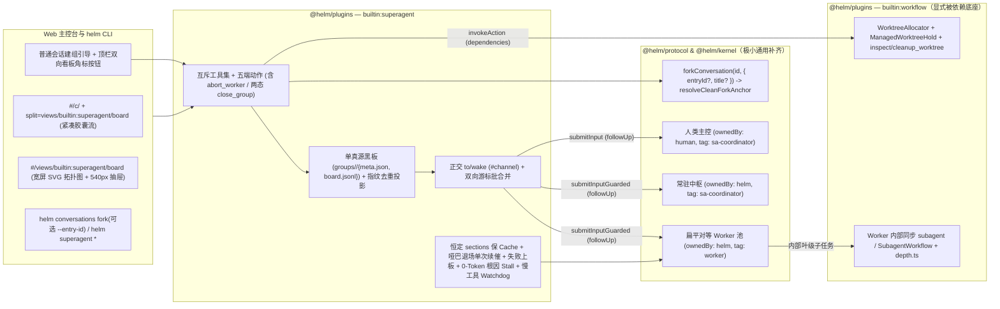
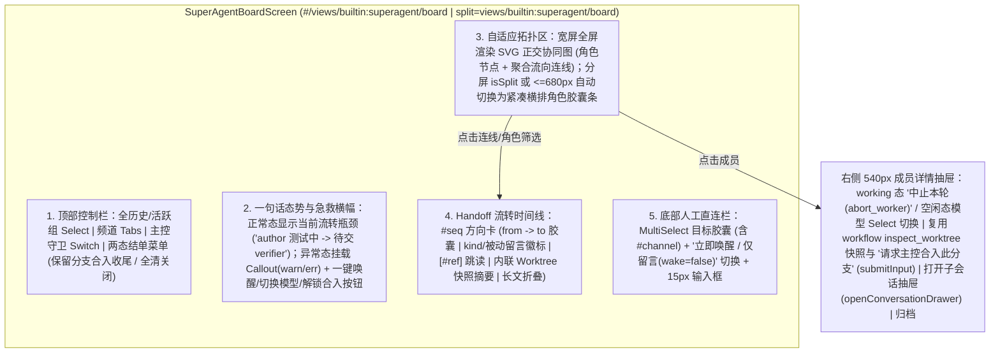

> **最终落地架构决策（2026-11-17，Option A — KISS 与单一职责解耦）**
>
> 按「一个模块只做好一件事」第一性原理评审后，最终实现采用 **Option A 独立插件解耦方案**（现行权威文档见 [`docs/plugins/swarm.md`](../plugins/swarm.md)）：
> 1. **`builtin:superagent` 保持 100% 零改动**：专注常驻双层中枢路由、RecallGraph 与两层定时看门狗，不混入会话级协同看板职责；
> 2. **新增默认启用的第 12 个内置插件 `builtin:swarm`**：零全局常驻会话、零后台轮询定时器，协作组按需挂载于目标顶层会话（`swarm-coordinator` / `swarm-worker` / `swarm-worker-archived`），异常自愈与 6 条件 0-Token `[stall]` 归因 100% 由 `turn_settled` 纯事件驱动（谁派生、谁负责）；
> 3. **通用底座保留复用**：Stage 1A 内核 `forkConversation` 可选 `entryId` 干净锚点与 Stage 1B `builtin:workflow` `ManagedWorktreeHold`（`acquire_worktree / release_worktree_hold`）按原设计落地；`builtin:swarm` 不声明静态 `dependencies: ['builtin:workflow']`，空闲时不阻塞停用 `builtin:workflow`，活跃持锁工作树经 `ManagedWorktreeHold` 自动提供 `409 plugin_in_use` 与 `409 worktree_in_use` 保护；
> 4. **命名空间映射**：下文初稿中的 `builtin:superagent` 看板能力在现行代码中对应 `builtin:swarm`（`ctx.action` 保持短名、11 个面向模型的 `ctx.tool` 统一带 `swarm_*` 前缀以便与 `builtin:superagent` 零工具名冲突共存；CLI `helm swarm *`、受管技能 `swarm-collab`、标签 `swarm-coordinator / swarm-worker`、回执渲染器 `swarm:board-report / swarm:board-wakeup`、系统提示词恒定块 `<active_swarm_group>`、Web 路由 `#/views/builtin:swarm/board`）。

## 背景

Helm 现有多智能体编排由 `builtin:workflow` 与 `builtin:superagent` 两块内置插件按控制流归属正交分工：

1. **`builtin:workflow`（默认启用，代码或父会话拥有控制流）**：通过 `subagent` 工具、JavaScript DSL（`agent`、`parallel`、`pipeline`、`phase`、`action`）与全仓唯一的 `WorktreeAllocator`（[`packages/plugins/src/workflow.ts`](../../packages/plugins/src/workflow.ts)），完备解决单飞后台委派、独立分片并发、带 `gate` 门禁的确定性流水线及断点账本重放。但其通信拓扑为父子纵向汇聚，子会话之间无法在无预设脚本调度的前提下围绕同一产物横向多轮协商与打回（例如 `Author <-> Verifier` 多轮交叉审改）。
2. **`builtin:superagent`（按需启用，智能体拥有控制流）**：维护常驻自治路由与驻留 `worker` 池（[`packages/plugins/src/superagent.ts`](../../packages/plugins/src/superagent.ts)），当前在横向对等协同与人机交互上存在五处断层：
   - **星型单向汇报导致中枢沦为传声筒**：[`packages/plugins/src/superagent/hooks.ts#L113-L176`](../../packages/plugins/src/superagent/hooks.ts#L113-L176) 在 `turn_settled` 中将所有含 `agent | trigger` 输入的 Worker 摘要无条件投递回全局 `routerConversationId`；Worker 之间缺乏共享黑板，交叉审改只能靠中枢反复搬运 Diff 与日志。
   - **仅限全局单会话且缺乏互斥切换通道**：[`packages/plugins/src/superagent/actions.ts#L29-L41`](../../packages/plugins/src/superagent/actions.ts#L29-L41) 将 `dispatch_worker` 锁死在全局常驻 `superagent` 会话；日常人类对话需要拉起多角色对等审改时，既无直观启动入口，也缺乏与默认 `subagent` 互斥切换的清晰边界。
   - **系统提示词混入可变状态打碎 KV Cache**：内核 [`hook-bridge.ts#L189-L219`](../../packages/kernel/src/runtime/hook-bridge.ts#L189-L219) 在 `turn.sections` 变化时会重写会话第 0 条 `pi.system` 消息；现有 `activeWorkersSection`（[`superagent/hooks.ts#L16-L37`](../../packages/plugins/src/superagent/hooks.ts#L16-L37)）把动态成员列表与实时 `status / doing` 拼入 `turn.sections`，每次扩缩容或状态跳变均导致长会话 Provider Prompt Cache 整段失效。
   - **通用 `forkConversation` 缺少默认干净锚点**：内核已有 `resolveCleanForkAnchor()`（[`packages/kernel/src/runtime/spawn-fork.ts#L221-L242`](../../packages/kernel/src/runtime/spawn-fork.ts#L221-L242)），但通用 [`forkConversation`](../../packages/kernel/src/runtime/conversation-context-ops.ts#L89) 仍强迫必传 `entryId`；主控在工具调用中途分叉热上下文给 Worker 时易带入未闭合 `toolCall` 触发上游 400 报错。
   - **缺少跨回合 Worktree 持久锁、解锁合入闭环与防掉棒自愈**：多轮交接空闲期缺少防 `cleanup_worktree` 误删的持有锁；主控开启守卫剥离 `bash` 后若结单强拒未合入分支会产生收尾死锁；同时缺少单成员原地刹车（`abort_worker`）、Worker 哑巴退场（完成回合却漏调黑板发帖）自愈、失败回合自动上板、0-Token 根因 `[stall]` 守卫及慢工具感知 Watchdog。

遵循 Helm 第一性原理（感觉笨重先怀疑设计、KISS / YAGNI、一个模块只做好一件事、机制与策略分离、诚实报错与归属权红线），本次设计让 `builtin:superagent` **显式依赖并 100% 复用 `builtin:workflow` 的 Worktree 与内部子代理机制**，只专注于 `workflow` 不承担的「扁平对等序号黑板、正交唤醒与防掉棒闭环」。

**非目标与按项目原则明确剔除的冗余设计**：

1. **不重复建设 `builtin:workflow` 已有能力**：
   - Worktree 分配、持久锁、快照检视与清理 100% 复用 `builtin:workflow`，不在 `superagent` 另起 Git/Diff 状态机；
   - 不在黑板层引入 `maxHelperDepth` 自招树与下级权限矩阵——`ownedBy: 'helm'` 的 Worker 原生已具备 `builtin:workflow` 同步等待的 `subagent / SubagentWorkflow` 及深度守卫（[`depth.ts`](../../packages/plugins/src/workflow/depth.ts)），内部子任务与 `gate` 门禁直接复用 `workflow`，黑板成员名册保持纯扁平；
   - 不在 `dispatch_worker` 引入 `tasks: string[]` 批量分片参数——纯独立分片并发归 `SubagentWorkflow` 的 `parallel()`，协作组只面向需要横向多轮交互的具名角色；
   - 不抢占 `COMPOSER_DOCK_SLOT`——底栏留给 [`WorkflowActiveTray.tsx`](../../packages/plugins/src/workflow/client/WorkflowActiveTray.tsx) 独占，避免双插件同时运行时输入框上方状态条叠罗汉。
2. **不越界侵占 `builtin:profile` 与内核职责**：
   - 不做会话级 `skills` 白名单提示词裁剪与 `load_skill` 拦截（角色提示词、默认模型与技能集合统一由 `profileId` 表达）；
   - 不建平行计费对账系统 `WorkerUsageLedger`（`modelDrifted / cacheReadShare / maxTokens`）与冗余的 `recall_expand` 工具（模型一致性归内核 `updateConversation`，流式速率归 `builtin:token-speed`，超时/死循环归既有 Watchdog，读取成员原始时间线直接复用 `inspect_worker`）。
3. **不引入有并发误报缺陷的 `git status` 快照审计与自建路径沙箱**：共享目录（`inherit`）并发下对只读成员做回合前后 `git status --porcelain` 对比，会因人类或读写队友同期合法改文件而触发假阳性 `[blocker]`；并发写隔离统一走物理 `isolation: 'worktree'`（辅以内核既有文件互斥锁），`readonly` 成员仅干净剥离并拦截写工具。
4. **不引入静默修参（`silent catalog repairs`）、第二套脚本沙箱、文件锁跨进程 Mesh 或人类会话原地强制换模型**。

建议分支：`feature/superagent-collab-board`（建议名称，当前尚未创建）。

---

## 整体设计

包依赖拓扑维持 `@helm/hub` → `@helm/plugins` / `@helm/kernel` → `@helm/protocol` 与 `@helm/web` → `@helm/plugin-client` → `@helm/protocol` 单向无环。`builtin:superagent` 在插件定义上显式声明 `dependencies: ['builtin:workflow']`，经内核原生插件拓扑管理启停顺序与 `409 plugin_in_use` 保护，跨插件能力复用全部走 `ctx.host.invokeAction` 公开端口。



核心架构与体验决策：

1. **显式插件依赖 + 工具集严格互斥（零认知打架）**：
   - `builtin:superagent` 声明 `dependencies: ['builtin:workflow']`，Worktree 生命周期 100% 复用 `builtin:workflow`；
   - 未建组的普通人类会话仅暴露 `builtin:workflow` 的 `subagent / SubagentWorkflow`（`dispatch_worker / board_*` 因无 `sa-coordinator` 标签完全隐藏）；调用 `create_group` 挂载 `sa-coordinator` 标签后，内核 [`hook-bridge.ts#L156-L229`](../../packages/kernel/src/runtime/hook-bridge.ts#L156-L229) 在同一回合下一拍 `beforeRequest` 即刻解锁全套黑板主控工具，并在 `coordinatorGuard: true` 时剥离 `subagent / SubagentWorkflow / edit / write / bash`，同一时刻绝不向模型暴露两套派工入口。
2. **纯扁平角色名册 + 单真源存储**：
   - 组内成员增删、刹车、切模与归档统一归主控独享（`COORDINATOR_SCOPE`），成员间只做对等消息交接（复杂叶级子任务由成员自身调 `workflow` 同步 `subagent` 完成）；
   - 全局 `ctx.doc('index')` 仅存单飞 Worker 记录与轻量反查指针（`{ conversationId, groupId, name }` + `CollabGroupSummary`），协作组成员状态以 `<dataDir>/groups/<groupId>/meta.json` 为唯一真源，杜绝双写漂移。
3. **两态 `close_group` 打通「主控守卫 + Worktree 合入」闭环**：默认全清模式要求全部工作树已合入且干净（否则返 `409 superagent_worktree_unmerged` 附分支列表）；传入 `keepWorktree: true` 时安全释放 `ManagedWorktreeHold`、归档成员会话但完整保留有改动的分支与目录，同时摘除非常驻主控的 `sa-coordinator` 标签恢复其 `bash / edit / write` 权限并返回 `retainedWorktrees` 清单，供主控或人工无缝 `git merge` 与清理收尾。
4. **扩缩容零破 Cache + 正交唤醒 + 防哑巴退场闭环**：`turn.sections` 仅放创建后永不变更的 `groupId` 与静态协作协议（不含可变成员名册），中途增减成员亦 100% 不重写第 0 条系统消息；`board_post` 支持 `#<channel>` 子频道寻址并将 `to` 与 `wake` 正交分离；配合双向游标批合并、回合 `failed` 自动上板、Worker 哑巴退场单次续催及带精确 `#seq` 根因的 0-Token `[stall]` 守卫，消除掉棒与死锁。

---

## 详细设计

### 1. 内核、协议与 CLI 极小通用补齐（`forkConversation` 可选 `entryId`）

复用 [`packages/kernel/src/runtime/spawn-fork.ts#L221-L242`](../../packages/kernel/src/runtime/spawn-fork.ts#L221-L242) 已有的 `resolveCleanForkAnchor(harness, parentConversationId)`（内部经 `selectCleanForkAnchorEntryId` 自动跳过未收到 `toolResult` 闭合的尾 `assistant` `toolCall` 条目）：

- 将 [`packages/protocol/src/plugin.ts#L644`](../../packages/protocol/src/plugin.ts#L644)、[`packages/kernel/src/http/contracts.ts#L309`](../../packages/kernel/src/http/contracts.ts#L309)、[`packages/kernel/src/runtime/runtime.ts#L748`](../../packages/kernel/src/runtime/runtime.ts#L748)、[`conversation-service.ts#L1006`](../../packages/kernel/src/runtime/conversation-service.ts#L1006) 与 [`conversation-context-ops.ts#L89`](../../packages/kernel/src/runtime/conversation-context-ops.ts#L89) 的签名放宽为 `forkConversation(id: number, opts?: { entryId?: number; title?: string })`；
- [`parseConversationForkBody`](../../packages/kernel/src/http/validate.ts#L331) 中 `entryId` 改为 `Type.Optional(SafePositiveInt)`（显式传入非法值仍返 `400 validation_error`）；
- `ConversationContextOps.forkConversation` 在省略 `entryId` 时先校验 `requireConv`，再调用 `resolveCleanForkAnchor(this.host.harness, id)` 解析干净锚点（空历史显式抛 `409 fork_empty_history`）；
- `helm conversations fork`（[`packages/cli/src/commands/conversations.ts#L417-L448`](../../packages/cli/src/commands/conversations.ts#L417-L448)）将 `--entry-id` 改为可选标志，同步更新 [`SKILL.md#L36`](../../packages/plugins/src/profile/skill/SKILL.md#L36) 与 [`skill-and-plugin-dev.md#L155`](../../packages/plugins/src/profile/skill/references/skill-and-plugin-dev.md#L155)。

---

### 2. `builtin:workflow` 受管工作树持久持有锁（`ManagedWorktreeHold`）

保持 `runtime/worktrees`（[`packages/plugins/src/workflow/worktree-store.ts`](../../packages/plugins/src/workflow/worktree-store.ts)）为全仓唯一受管 Git Worktree 真源，在 `ManagedWorktreeRecord` 上新增可选 `hold` 字段：

```ts
export interface ManagedWorktreeHold {
  /** 持有锁的插件 ID（如 'builtin:superagent'）。 */
  pluginId: string
  /** 插件内稳定持有标识（如 '<groupId>:<workerName>'）。 */
  holdId: string
  /** 面向拒绝诊断与列表展示的可读说明（写入前经 redact 脱敏）。 */
  label: string
  acquiredAt: number
}
```

1. **路径占用硬拦截**：`WorktreeLeaseStore.isPathInUse`（[`isolation-lease-store.ts#L87`](../../packages/plugins/src/workflow/isolation-lease-store.ts#L87)）纳入 `status === 'active' && record.hold !== undefined` 记录；即便外部 `cleanup_worktree` 传 `force: true`，仍显式返回 `409 worktree_in_use` 并附带 `record.hold.label`。
2. **插件 `inUse` 声明**：`builtin:workflow` 服务 `inUse()` 上报全部持 `hold` 的活跃工作树（与 `builtin:superagent` 的 `dependencies: ['builtin:workflow']` 双重保障启停拓扑安全）。
3. **隐藏内部动作（[`actions-worktree.ts`](../../packages/plugins/src/workflow/actions-worktree.ts)，`cli: { hidden: true }`、`exposeAsTool: false`）**：
   - `acquire_worktree`：接收 `{ conversationId, parentConversationId, profileId?, requestCwd?, fork?, hold }`，走 `resolveSpawnTarget` → `openPendingLease` → `allocator.allocate` → `bindConversation` → 密检写入 `hold` → 释放临时 `pending` 租约并 `flush`；
   - `release_worktree_hold`：接收 `{ worktreeId, pluginId, holdId }`，不存在或无锁幂等返回 `{ released: false }`，`pluginId / holdId` 不匹配显式抛 `409 worktree_hold_mismatch`，匹配则清空 `hold` 并 `flush`。

---

### 3. `builtin:superagent` 极简单真源模型与四层存储

#### 3.1 显式依赖、最小配置与受管技能

在 [`packages/plugins/src/superagent.ts`](../../packages/plugins/src/superagent.ts) 声明 `dependencies: ['builtin:workflow']`，仅新增 **2 项**配置（既有 6 项保持不变）：

| 字段名 | 类型 | 默认值 | 边界约束 | 说明 |
| :--- | :--- | :--- | :--- | :--- |
| `maxWorkersPerGroup` | `number` | `12` | 整数 `2..32` | 单个协作组同时处于 `active` 生命周期的对等成员上限 |
| `boardPreviewLimit` | `number` | `80` | 整数 `20..200` | `sessionDoc('board-view')` 保留的最近流转消息条数上限 |

`bootstrapAssets` 幂等自举受管技能 `collab-board`（`managedByPlugin: 'builtin:superagent'`），沉淀四条实战编排铁律：
1. **主控零编码铁律**：主控只做任务拆分、具名派工、冲突裁决与最终合入收尾，严禁亲自改业务代码或跑长时构建阻塞看板调度；
2. **无重叠切分 + 审改分离**：并行改代码成员必须分配 `isolation: 'worktree'`；每 2~4 名读写 Author 配备 1 名 `access: 'readonly'` 的 Verifier（Verifier 只跑测试与门禁并向对应 Author 发 `review` 打回，绝不亲自改文件）；
3. **`#seq` 指针零搬运**：跨成员交接一律通过 `refs: [seq]` 与正文 `#seq` 引用前序黑板记录，严禁复制粘贴其他成员的 Diff 或长篇报告；
4. **`wake` 门铃与收尾纪律**：`wake: true` 是唤醒门铃而非抄送，对等流水线仅唤醒下一跳责任人，仅在最终交付（`done`）或需裁决阻塞（`blocker`）时唤醒 `coordinator`；全员审过且存在待合入分支时调用 `close_group({ keepWorktree: true })` 解锁主控合入收尾。

#### 3.2 单真源数据结构（[`packages/plugins/src/superagent/contracts.ts`](../../packages/plugins/src/superagent/contracts.ts)）

```ts
export const COORDINATOR_TAG = 'sa-coordinator'
export type WorkerAccess = 'readwrite' | 'readonly'
export type WorkerIsolation = 'inherit' | 'worktree'
export type CollabGroupStatus = 'active' | 'closed'
export type BoardPostKind = 'brief' | 'handoff' | 'review' | 'comment' | 'blocker' | 'done' | 'stall'

/** 全局 index 轻量项：协作组成员仅存 { conversationId, groupId, name } 反查指针，详细状态以组 meta.json 为唯一真源。 */
export interface SuperAgentWorker {
  conversationId: number
  parentConversationId: number
  profileId: string
  groupId?: string
  name?: string
  createdAt: number
}

export interface CollabGroupSummary {
  id: string
  title: string
  coordinatorConversationId: number
  status: CollabGroupStatus
  coordinatorDetached?: boolean
  activeWorkerCount: number
  headSeq: number
  createdAt: number
  updatedAt: number
  closedAt?: number
}

export interface GroupMemberState {
  name: string
  conversationId: number
  profileId: string
  access: WorkerAccess
  isolation: WorkerIsolation
  nodeId: string
  cwd: string
  worktreeId?: string
  channels: string[]
  lifecycle: 'active' | 'archived'
  readCursorSeq: number
  pendingWakeupSeq: number
  /** 该成员最近一次调用 board_post 发布的序号（用于检测哑巴退场与未回复点名）。 */
  lastPostSeq?: number
  /** 最近一次向该成员投递的行动类唤醒（brief / handoff / review）最高序号。 */
  lastWakeTaskSeq?: number
  /** 已对该成员发送过单次哑巴退场续催的任务水位（防无限循环）。 */
  silentExitNudgeSeq?: number
  lastWakeCompletionSeq?: number
  lastOutboundEdge?: { seq: number; to: string[]; kind: BoardPostKind }
  createdAt: number
  archivedAt?: number
}

export interface RetainedWorktreeInfo {
  memberName: string
  worktreeId: string
  branch: string
  path: string
  commitsAhead: number
}

export interface CollabGroupRecord {
  id: string
  title: string
  objective?: string
  coordinatorConversationId: number
  coordinatorGuard: boolean
  status: CollabGroupStatus
  channels: Array<{ name: string; topic?: string; archived?: boolean }>
  members: GroupMemberState[]
  headSeq: number
  coordinatorNotifiedSeq: number
  coordinatorPendingSeq: number
  lastStallWatermark?: string
  coordinatorDetached?: boolean
  /** keepWorktree: true 结单时固化的待主控合入分支清单。 */
  retainedWorktrees?: RetainedWorktreeInfo[]
  createdAt: number
  updatedAt: number
  closedAt?: number
  closeSummary?: string
}

export interface WorktreeHandoffSnapshot {
  worktreeId: string
  branch?: string
  commitsAhead?: number
  dirtyCount: number
  changedFilesPreview: string[]
}

export interface BoardPost {
  seq: number
  groupId: string
  channel: string
  from: string
  to: string[]
  resolvedTargets: string[]
  /** 是否主动拉起处于空闲态的目标会话；false 仅留档展示并随下次有效唤醒一并投递。 */
  wake: boolean
  kind: BoardPostKind
  refs: number[]
  body: string
  worktreeSnapshot?: WorktreeHandoffSnapshot
  createdAt: number
}
```

#### 3.3 四层存储与投影指纹去重

| 存储层 | 载体 | 内容与防写放大机制 |
| :--- | :--- | :--- |
| 组权威账本与黑板日志 | `<dataDir>/groups/<groupId>/{meta.json, board.jsonl}` | `meta.json` 经 `atomicWriteFile` 原子替换；`board.jsonl` 按 `groupId` 串行锁（外包 `withFileLock`）追加脱敏单行 JSON，不受全局 `ctx.doc` 2 MiB 限制 |
| 全局轻量路由索引 | 公开 `ctx.doc('index')` | 含 `workers`（组内成员仅存反查指针）与 `groups: CollabGroupSummary[]` |
| 会话级实时看板投影 | 公开 `ctx.sessionDoc('board-view')` | 按 `coordinatorConversationId` 键控，合成一句话态势 `headline`、成员现读状态、聚合流转边 `edges` 及最近 `boardPreviewLimit` 条消息；**以 `(headSeq, memberStateDigest)` 指纹去重**，流式生成帧不重复触发 SSE 广播 |
| 顶栏与侧栏角标 | 公开 `ctx.doc('board-badges')` | `{ byConversation: Record<string, { count: number; tone: 'accent' \| 'warn' \| 'neutral'; footerText?: string }> }`，出现 `stall / blocker / error` 时置 `'warn'` |

---

### 4. 五端动作、确定性寻址与双向游标批合并

#### 4.1 互斥作用域与动作矩阵

保持 `ctx.tool`（精确短名）+ `ctx.action`（`exposeAsTool: false`）同源注册：

- `COORDINATOR_SCOPE = { tags: ['sa-coordinator'] }`（成员生命周期与组管理由主控独享）
- `COLLAB_PARTICIPANT_SCOPE = { tags: ['sa-coordinator', 'worker'] }`（黑板读写与只读检视由主控与组内成员共享）

| 动作 ID / 工具短名 | CLI 命令 | 模型工具 `scope` | 核心权限与行为契约 |
| :--- | :--- | :--- | :--- |
| `create_group` | `helm superagent create-group` | 无 `scope`（`before_turn` 对已挂 `sa-coordinator`、`worker`、`watchdog` 会话隐藏） | 在目标顶层会话创建 `active` 协作组（同会话限 1 个活跃组，冲突返 `409 superagent_group_already_active`）；支持 `title`、`objective?`、`coordinatorGuard?`（缺省 `true`）；挂载 `sa-coordinator` 标签并在同一回合下一拍解锁主控工具 |
| `update_group` | `helm superagent update-group` | `COORDINATOR_SCOPE` | 修改 `title / objective` 或切换 `coordinatorGuard` |
| `manage_channel` | `helm superagent channel` | 仅 `ctx.action`（`COORDINATOR_SCOPE`） | 子频道管理：`create / subscribe / unsubscribe / archive`（`main` 频道禁止归档或退订） |
| `dispatch_worker` | `helm superagent dispatch-worker` | `COORDINATOR_SCOPE` | ① 常驻中枢无组单飞保持原行为；② 关联活跃组招募具名对等成员（校验小写短名唯一且非保留字 `coordinator / all / system`）：支持 `profileId?`、`access`（`readwrite \| readonly`）、`isolation`（`inherit \| worktree`，`worktree` 调 `builtin:workflow` `acquire_worktree` 持锁）、`forkFrom?`（`'coordinator'` 或现有成员名，调内核 `forkConversation` 干净锚点）、`forkEntryId?`、`model?`、`effort?`、`channels?`；自动将首条 `brief` 写入黑板并唤醒该成员 |
| `board_post` | `helm superagent board-post` | `COLLAB_PARTICIPANT_SCOPE` | 结构化 `to` 寻址 + 正交 `wake?: boolean`（`comment` 缺省 `false`，其余非空目标缺省 `true`）；发帖成员绑定 `worktreeId` 且 `kind` 为 `handoff \| done` 时自动调用 `builtin:workflow` `inspect_worktree` 内联 `worktreeSnapshot` |
| `board_read` | `helm superagent board-read` | `COLLAB_PARTICIPANT_SCOPE`（`idempotent: true`） | 按 `groupId? / channel? / sinceSeq? / seqs? / limit` 分页读取黑板记录 |
| `board_status` | `helm superagent board-status` | `COLLAB_PARTICIPANT_SCOPE`（`idempotent: true`） | 返回组元数据、全员现读状态、游标差值、在途 `activeWorkingMembers` 及 `retainedWorktrees` |
| `abort_worker` | `helm superagent abort-worker` | `COORDINATOR_SCOPE` | **单成员原地刹车**：经 `abortConversationGuarded(id, { expectedOwnership: 'helm' })` 终止目标成员当前在途回合，**完整保留会话上下文与 Worktree 锁**供后续纠偏唤醒（非忙态幂等返回 `{ aborted: false }`） |
| `switch_worker_model` | `helm superagent switch-model` | `COORDINATOR_SCOPE` | 为非 `working` 态成员调用内核 `updateConversation(id, { model })` 原地切模续跑（应对配额耗尽或模型切换） |
| `inspect_worker` | `helm superagent inspect-worker` | `COLLAB_PARTICIPANT_SCOPE`（`idempotent: true`） | 读取目标成员最近时间线摘要、产物与绑定 `worktreeId` |
| `archive_worker` | `helm superagent archive-worker` | `COORDINATOR_SCOPE` | 归档空闲成员：存在未合入/脏 `worktreeId` 且未传 `keepWorktree / force` 时返 `409 superagent_worktree_unmerged`；通过后调用 `release_worktree_hold`、按需调 `cleanup_worktree` 并改标 `worker-archived` |
| `close_group` | `helm superagent close-group` | `COORDINATOR_SCOPE` | **两态收尾结单**：校验无在途成员（`abortRunning: true` 时先逐个 `abortConversationGuarded`）。① 默认全清模式：全部工作树须已合入且干净（否则返 `409 superagent_worktree_unmerged` 附分支列表），释放 `hold` 并调 `cleanup_worktree`；② **解锁合入模式（`keepWorktree: true`）**：释放全部 `hold`、归档成员但完整保留有改动的 Worktree，写入 `retainedWorktrees`，摘除非常驻主控的 `sa-coordinator` 标签立即恢复其 `bash / edit / write / subagent` 工具，返回待合入分支清单 |

#### 4.2 Fail-Closed 目标寻址与双向游标批合并

1. **`board_post.to` 确定性解析契约（严禁静默丢弃未知目标）**：
   - `'coordinator'` → 主控会话；
   - `'all'` → 组内全体 `active` 成员（仅限主控或人工调用，Worker 调用返 `403 superagent_broadcast_forbidden`）；
   - `'#<channel>'` → `'#main'` 显式返 `400`（应显式使用 `'all'`）；未知或已归档频道显式返 `404 / 409`；合法活跃子频道展开为订阅该频道的全部 `active` 成员（自动剔除发帖者自身防自回声）；
   - `'<name>'` → 精确匹配 `active` 成员（剔除发帖者自身；未知或已归档成员显式返 `404 superagent_unknown_target`）。
2. **Worker 唤醒（`ownedBy: 'helm'`）**：仅 `wake === true` 的目标推进 `member.pendingWakeupSeq = post.seq`（若 `kind ∈ {'brief', 'handoff', 'review'}` 同步记录 `member.lastWakeTaskSeq = post.seq`）。目标空闲时立即将 `(readCursorSeq, pendingWakeupSeq]` 区间消息（含此前 `wake: false` 留档的 `comment`）组装为单封 `superagent:board-wakeup`，经 `submitInputGuarded(..., { expectedOwnership: 'helm', whenBusy: 'followUp' })` 投递；目标正忙则仅推进水位，待 `turn_settled` 一次性合并唤醒。
3. **Coordinator 批汇总（防连环打断与早结单）**：当 `resolvedTargets` 含 `'coordinator'` 或 `kind ∈ {'blocker', 'done', 'stall'}` 时推进 `coordinatorPendingSeq = post.seq`。若主控正忙或命中 `50ms` 微批窗口，将 `(coordinatorNotifiedSeq, coordinatorPendingSeq]` 合并为单封 `superagent:board-report` `followUp` 投递（常驻 `router` 走 `submitInputGuarded`，`ownedBy: 'human'` 主控走 `submitInput`，严格遵守归属权红线）；信封头部固定携带**协作组 `title / objective` 锚点**与**当前仍在运行的 `activeWorkingMembers` 名单**。
4. **统一反回声守则**：双向信封尾部固定声明：`若本批消息仅为进展同步且无需执行实质动作，请直接结束回合，严禁发送纯确认或致谢帖；只要 activeWorkingMembers 非空，切勿将局部成员完工当作全组结单。`

---

### 5. 扩缩容零破 Cache、极简写门控与防哑巴退场自愈

1. **100% 恒定的 `before_turn` 系统提示词注入（保 KV Cache）**：
   - 鉴于 [`hook-bridge.ts#L189-L219`](../../packages/kernel/src/runtime/hook-bridge.ts#L189-L219) 只要 `turn.sections` 发生字节差异就会重写会话首条 `pi.system` 消息，`<active_collab_group>` 与 `<active_workers>` 在 `turn.sections` 中**仅注入建组后恒定不变的标识与静态协作铁律（不拼入可变的成员列表、`status`、`doing` 或 `headSeq`）**；
   - 成员扩缩容与实时进展完全通过工具调用返回值、`board_status` 与消息流尾部的黑板信封感知，保证整个协作周期首条系统提示词 **0 次重算**。
2. **极简无误报的写工具门控（`before_turn` + `tool_call`）**：
   - **主控守卫**：常驻 `routerMode` 或活跃组 `coordinatorGuard === true` 时，剥离并拦截 `edit`、`write`、`bash`、`subagent`、`SubagentWorkflow`；
   - **只读成员（`access: 'readonly'`）**：剥离并拦截 `write`、`edit`、`cleanup_worktree` 及非幂等外部动作，保留 `bash` 供 Verifier 运行测试与校验命令；并行代码修改统一通过 `isolation: 'worktree'` 物理隔离，不做易产生并发假阳性的 `git status` 快照比对。
3. **异常失败自动上板、防哑巴退场单次自愈与 0-Token 根因 `[stall]` 守卫**：
   - **失败即上板**：组内活跃成员 `turn_settled` 若 `outcome === 'failed'`（如配额耗尽、上游 429/5xx 报错），系统立即向黑板追加 `from: 'system', to: ['coordinator'], wake: true, kind: 'blocker'`（含脱敏错误详情与当前模型名）并排队唤醒主控，便于主控或人工即时 `switch_worker_model` 续跑；
   - **防哑巴退场单次自愈（At-Most-Once Silent-Exit Nudge）**：活跃成员在 `outcome === 'completed'` 且无新待投递唤醒（`pendingWakeupSeq <= readCursorSeq`）时，若存在未交接的任务唤醒（`lastWakeTaskSeq !== undefined && (lastPostSeq ?? 0) < lastWakeTaskSeq`）：
     1. 首次命中（`silentExitNudgeSeq !== lastWakeTaskSeq`）：置 `silentExitNudgeSeq = lastWakeTaskSeq`，经 `submitInputGuarded` 发送最多 1 次确定性续催（提醒其调用 `board_post` 发布 `done / handoff / review / blocker`），本拍不触发全组静默告警；
     2. 二次命中（续催后仍未调用 `board_post`）：绝不循环追问，自动截取其末条回复脱敏摘要代发一条 `from: 'system', to: ['coordinator'], wake: true, kind: 'blocker'` 上板并结清该水位；
   - **带精确根因的 6 条件 0-Token Quiescence Guard**：当全组满足 6 项静默条件（组活跃未脱离 + 无在途投递 + 全员读游标追平 + 全员空闲且 `completionSeq > lastWakeCompletionSeq` + 主控空闲且无待送达汇报/最新非 `done` + 水位首次命中）时，纯代码零延迟归因并写入 `kind: 'stall'` 正文：① 存在 `wake === false` 的未唤醒悬空产出（指明 `#seq`）；② 存在已读唤醒但未回帖的成员（指明 `@name` 与 `#seq`）；③ 全员空闲待命但尚未产生最终 `done` 交付；
   - **慢工具感知 Watchdog**：`ConversationActivityTracker`（[`watchdog-activity.ts`](../../packages/plugins/src/superagent/watchdog-activity.ts)）跟踪 `live.tools` 运行态，对存在合法运行中工具调用的会话标记 `waitingOnSlowTool`，避免长时构建测试被 Layer 1 机械探针误判为无响应死锁。

---

### 6. 全动线 Web 协同流转看板（`packages/plugins/src/superagent/client/`）

严格遵循 [`web-frontend.md`](../conventions/web-frontend.md) 与 [`web-navigation.md`](../conventions/web-navigation.md) 五条硬铁律（零 Emoji、全 `HelmIcon`、共享 `@helm/plugin-client` Radix 原语 `<Select> / <MultiSelect> / <Tabs> / <Switch> / <Dialog> / <Callout>`、唯一 `#/views/builtin:superagent/board` Hash 导航、`.tsx` 与 `*-model.ts` 纯逻辑分离）。

#### 6.1 无碰撞入口与对话流零重复收口

1. **普通会话启动引导**：在未挂 `sa-coordinator` 的顶层人类会话顶栏「更多操作」菜单（`conversation:header`, `placement: 'menu'`）及全屏看板空态页提供**「开启协同组」**入口，内置三类轻量预设（*Author + Verifier 审改闭环*、*多角色联合攻坚*、*自定义空白组*）；创建后自动展开右侧分屏看板（窄屏跳全屏）并可选向输入框填入任务草稿（仅预填草稿不自动发送）。
2. **主控与 Worker 顶栏双向定位按钮（`SuperAgentOpenBoardAction`）**：注册 `conversation:header`（`placement: 'toolbar'`, `scope: COLLAB_PARTICIPANT_SCOPE`），渲染实时成员数与异常状态角标（不占用底栏 `COMPOSER_DOCK_SLOT`，与 `WorkflowActiveTray` 零冲突）；无论处于主控会话还是任意组内 Worker 子会话，点击均通过 `index` 反查所属 `groupId`，调用 `ctx.openSplitScreen('screen:builtin:superagent/board?groupId=...')` 打开同一张看板（从 Worker 点击自动附 `worker=<name>` 高亮自身）。
3. **正文单行回执与 `@/#` 补全**：`timelineRenderer` 将黑板唤醒与汇总信封渲染为紧凑单行胶囊（点击 `#seq` 在右屏定位对应流转卡，不在对话流重复堆叠重框）；`composerCompleter` 为 `COLLAB_PARTICIPANT_SCOPE` 提供 `@`（活跃成员短名）与 `#`（活跃子频道名）补全。

#### 6.2 自适应流转看板与 `540px` 成员抽屉



双通道无白屏保障：活跃且 `!coordinatorDetached` 时走 `usePluginSessionDoc('board-view', { conversationId: coordinatorConversationId })` 实时订阅；切换检视历史 `closed` 组或主控会话已删除（`coordinatorDetached: true`）时，自动切至 `board_status` + `board_read` 加载完整快照并保留清理入口。

---

## 影响分析

| 受影响模块 | 变更内容与范围 | 对既有调用方与测试的影响 |
| :--- | :--- | :--- |
| `@helm/protocol` / `@helm/kernel` / `@helm/cli` | `forkConversation(id, { entryId?, title? })` 支持省略 `entryId` 自动取 `resolveCleanForkAnchor`；同步 HTTP、CLI 与 `helm-cli` 技能 | 显式传入 `entryId` 的既有调用与测试 100% 保持原行为；跨包修改前经 `rg` 全仓核对消费方与测试桩 |
| `builtin:workflow` | `ManagedWorktreeRecord` 新增可选 `hold`；`isPathInUse` 与 `inUse()` 识别锁；新增隐藏动作 `acquire_worktree` / `release_worktree_hold` | 原生 `subagent` / DSL 工作流无 `hold` 行为不变；持锁工作树未释放前清理返 `409 worktree_in_use` |
| `builtin:swarm`（原推演合入 `superagent`，最终 Option A 独立拆分） | 新增默认启用内置插件（不设静态 `dependencies` 锁，持锁期由 `ManagedWorktreeHold` 保护）；落地扁平对等单真源黑板、互斥主控工具集、正交 `wake` 与 `#channel` 寻址、`abort_worker`、两态 `close_group`、恒定 `<active_swarm_group>` Cache 保护、`turn_settled` 哑巴退场单次自愈、失败上板、0-Token 根因 `[stall]` 及自适应流转看板 | `builtin:superagent` 100% 保持原样不变；普通会话未建组时工具集无变化 |
| `docs/plugins/swarm.md` / `overview.md` / `AGENTS.md` | 新增 `builtin:swarm` 权威文档并同步内置插件清单（11 → 12，默认启用 9 → 10） | 保持文档中心与源码契约一致 |

---

## 发布

遵循开发阶段「不兼容、不迁移」原则：不为旧版开发态 `builtin:superagent:index` 编写兼容层，本地开发数据若有旧结构直接清理重建。

1. **三阶段隔离开发路径（`../helm-worktrees/` + GLM 子代理）**：
   - **Stage 1（通用底座与锁机制）**：`@helm/protocol` + `@helm/kernel` + `@helm/cli` `forkConversation` 可选干净锚点（及 `helm-cli` 文档同步）；`builtin:workflow` `ManagedWorktreeHold` 与 `acquire_worktree / release_worktree_hold`；
   - **Stage 2（SuperAgent 协同核心）**：显式 `dependencies: ['builtin:workflow']`、单真源 `groups/<id>` 存储、全套五端动作（含 `abort_worker`、两态 `close_group`）、`#<channel>` 目标解析与正交 `wake`、双向游标批汇总、恒定 `sections` Cache 保护、失败自动上板、哑巴退场单次自愈、0-Token 根因 `[stall]` 守卫与慢工具感知 Watchdog；
   - **Stage 3（Web 流转看板与全仓验收）**：普通会话建组引导、顶栏双向 `SuperAgentOpenBoardAction`、宽屏 SVG / 分屏胶囊自适应看板、一句话态势与 `<Callout>` 急救条、`540px` 详情抽屉、双通道降级；更新 `docs/plugins/superagent.md`，执行 `pnpm build && pnpm typecheck && pnpm lint && pnpm check:hygiene && pnpm test:all`。
2. **应急止损**：任意时刻可执行 `helm superagent close-group --group-id <id> --abort-running --keep-worktree` 停下所有成员、保留现场代码分支并解锁主控会话，或执行 `helm plugins disable builtin:superagent` 即时卸载全部钩子与 UI。

---

## 测试

所有测试严格遵守 [`AGENTS.md`](../../AGENTS.md) 第 5 节卫生门禁（每个 `test/it` 显式 `{ timeout: 60_000 }`，禁设 `HELM_TEST_SUITE_TIMEOUT_MS`，禁对 DOM 节点调 `assert.equal / deepEqual`）：

### 1. Unit 档（`packages/protocol` / `packages/cli` / `packages/web` / `packages/plugins` 纯内存）
- **`forkConversation` 契约与 CLI 同步**：验证省略 `entryId` 放行、非法值仍返 `400`、`helm conversations fork --current` 无 `--entry-id` 请求体构造及 `helm-cli` 技能双向锁定测试通过。
- **单真源契约、寻址与静默归因纯函数**：验证 `BoardPost` 的 `wake` 缺省推导（`comment -> false`，`handoff -> true`）、`#<channel>` 展开与 `#main` / 未知频道 / 普通 Worker `all` 的 Fail-Closed 拒绝、`(headSeq, memberStateDigest)` 投影指纹去重，以及 0-Token `[stall]` 三类根因（未唤醒悬空产出 / 已读未回帖 / 全员待命未结单）精确判定。
- **全动线 Web 界面（happy-dom）**：
  - 验证普通人类会话展示「开启协同组」预设引导、不占用 `COMPOSER_DOCK_SLOT`、从主控与组内 Worker 顶栏按钮准确反查打开所属看板；
  - 验证全屏宽视口渲染 SVG 拓扑连线、`isSplit: true` 自动收敛为紧凑角色胶囊条、`stall / blocker` 渲染 `<Callout>` 急救按钮、抽屉暴露 `abort_worker` / 模型 `<Select>` / Worktree 合入请求按钮，以及 `closed` 历史组与 `coordinatorDetached` 退避读取正常（零 Emoji、无原生 `<select>`）。

### 2. Integration 档（`packages/kernel` / `packages/plugins` / `packages/hub` 真实进程）
- **`forkConversation` 自 Fork 防悬空**：在工具调用中途（尾条目为未闭合 `toolCall`）省略 `entryId` 调用 `forkConversation`，断言自动截取至上一完整回合锚点并正常续聊，空历史显式抛 `409 fork_empty_history`。
- **互斥建组、Worktree 复用审改到解锁合入全闭环**：
  - 普通会话 `#C` 未建组时不暴露 `dispatch_worker / board_*`；调 `create_group` 下一拍解锁团队工具并剥离 `subagent / bash / edit / write`；中途增减成员期间 `turn.sections` 字节 100% 恒定不变；
  - `author`（`isolation: 'worktree'`）发 `handoff` 自动经 `workflow:inspect_worktree` 内联快照，空闲期外部 `cleanup_worktree(force: true)` 返 `409 worktree_in_use`；`verifier`（`readonly`）写文件被拦截但可调 `bash` 跑测试；
  - 审过回报 `[done]` 后，默认 `close_group` 返 `409 superagent_worktree_unmerged`；传 `close_group({ keepWorktree: true })` 释放 `hold`、保留待合入分支并摘除 `#C` 的 `sa-coordinator` 标签恢复 `bash`，`#C` 合入分支后再调 `cleanup_worktree` 干净收尾。
- **防哑巴退场自愈、失败上板、正交唤醒、批汇总与慢工具保护**：
  - 成员因 `brief / handoff` 唤醒后未调 `board_post` 即完成回合，触发最多 1 次确定性续催；若仍不发帖则自动摘取末轮摘要代发 `[blocker]` 唤醒主控；成员回合 `failed` 自动写 `[blocker]` 上板；
  - `working` 态成员经 `abort_worker` 刹停后保留上下文与 Worktree 锁可继续唤醒；`comment(wake: false)` 不拉起空闲成员；多成员并发回报主控合并为单封并附 `activeWorkingMembers`；长工具运行期 Watchdog 不误杀；Hub 重启后在途成员原位续跑且未发信封幂等补发。
