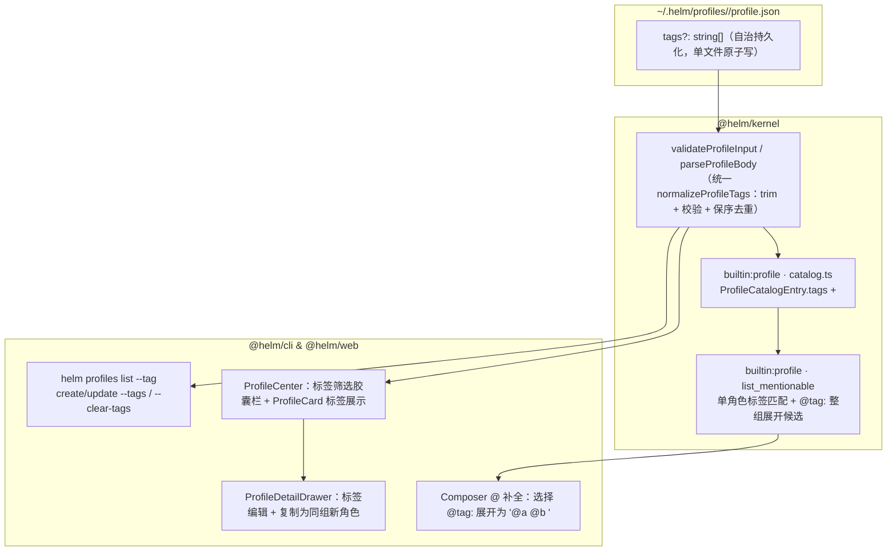

# 基于 Tag 的 Profile 团队归组与协同点名设计文档

## 背景

用户创建大量自定义 Profile 时，多个角色往往围绕同一业务域或工程职责协同工作（例如前端架构、UI 实现与前端测试同属 `frontend` 组）。当前系统已在协议与存储层预留 `Profile.tags?: string[]`，但从配置入口到协同目录存在四处断层：

1. **认知目录与补全缺失团队拓扑**：`builtin:profile` 的 `catalog.ts` 在构造 `ProfileCatalogEntry`、渲染 `<available_profiles>` 及执行 `list_mentionable`（`@` 补全源）时未读取 `profile.tags`。主会话模型（如 `assistant` 或 `superagent`）无法从 `<available_profiles>` 获知哪些角色同属一个协作组；用户在输入框键入 `@frontend` 时既搜不到该组下的成员，也无法一键点名整组角色。
2. **CLI 缺少标签读写与过滤参数**：`packages/cli/src/commands/profiles.ts` 的 `PROFILE_FIELD_FLAGS` 未包含 `tags`，用户无法通过语义化参数设置或清空标签，也无法按标签过滤 `helm profiles list`。
3. **Web 角色中心与编辑抽屉未打通标签与同组克隆**：`ProfileDetailDrawer.tsx` 在表单中未暴露 `tags` 输入框（仅在保存时原样透传 `form.source.tags`）；`ProfileCard.tsx` 未渲染标签胶囊；`ProfileCenter.tsx` 缺少按标签筛选的快捷胶囊与「复制角色（带出同组 `tags` / `cwd` / `nodeId` / `model` / `skills`）」操作，创建同组新角色需手工重复填写环境与技能白名单。
4. **标签边界校验口径不统一**：`packages/kernel/src/http/validate.ts` 仅校验每项长度为 `1..64`，而 `ProfileService.validateProfileInput` 未做去重与空白剥离，首尾空白、空串或重复标签可能直接落盘。

本次设计的目标是直接复用 `Profile.tags` 表达角色归组与团队协作关系，不引入独立的 `profile-groups.json` 存储表、新增 HTTP CRUD 路由或运行时配置继承：

- `ProfileService` 与 HTTP/CLI 边界对 `tags` 执行统一的 trim、非空、格式与保序去重校验；
- `builtin:profile` 在 `<available_profiles>` 中输出 `tags` 属性，并在 `list_mentionable` 中同时支持按标签搜索单角色与 `@tag:<tag>` 整组点名展开（插入组内全部候选成员的 `@<id>` 文本）；
- `helm profiles list/create/update` 支持 `--tag` / `--tags` / `--clear-tags`；
- Web 角色中心支持标签胶囊筛选、卡片标签展示、抽屉标签编辑与基于现有角色的同组模板克隆。

非目标：

- 不新增独立 Group 实体、数据库表或 `/api/profile-groups` 路由；
- 不实现运行时配置继承（组成员在运行期各自读取自身 `profile.json`，不隐式继承同组其他角色的 `model`、`cwd`、`nodeId` 或 `skills`）；
- 不修改 `builtin:workflow` 的 `agent()` 签名（不在引擎内将单个 `agentType` 隐式裂变为多节点，保持前缀账本 `agentJournalKey` 的确定性重放语义）；
- 不建立绑定多角色的「组会话」（会话仍严格绑定单一 `profileId`）。

建议分支：`feat/profile-tags-grouping`。

## 整体设计

改动沿用单向依赖 `@helm/web` / `@helm/cli` → `@helm/protocol` ← `@helm/kernel`，在既有 `Profile.tags` 字段上打通存储校验、认知注入、补全动作、CLI 与 Web 五个切面。



核心设计判断：

1. **单文件自治优于外部成员清单**：归组关系直接保存在各自 `~/.helm/profiles/<id>/profile.json` 的 `tags` 数组中。修改角色所属组只需一次单文件原子写（`atomicWriteJson`），天然不存在跨文件锁竞争与「角色已删除但组清单残留悬空 ID」的数据不一致问题。全量标签集合由 `profiles.list()` 实时派生。
2. **展开在输入层与认知层完成，执行层保持显式单角色契约**：用户在输入框点选 `@tag:frontend` 时，补全器将其纯文本替换为 `@fe-arch @fe-ui @fe-test `；模型在 `<available_profiles>` 中看到各角色的 `tags="frontend"` 属性，按任务依赖调用 `subagent`、`SubagentWorkflow`（`parallel` / `pipeline`）或 `dispatch_worker`。底层派工工具只接收真实存在的单个 `profileId`，避免隐式扇出破坏重放或掩盖部分成员缺失。
3. **配置复用通过创建期克隆实现，而非运行期继承**：在 `ProfileDetailDrawer` 提供「以此为模板新建」动作，将源角色的 `tags`、`model`、`thinkingLevel`、`nodeId`、`cwd`、`skills`、`runtime` 预填至新建草稿。每個 Profile 落盘后完全自包含，运行期行为可预期。

## 详细设计

### 标签规范化与边界校验

在 `@helm/protocol`（或内核共享校验层）收敛标签格式约束，并在 `ProfileService.validateProfileInput`（`packages/kernel/src/services/profiles-skills.ts`）、HTTP `parseProfileBody`（`packages/kernel/src/http/validate.ts`）与 CLI 本地预检（`packages/cli/src/commands/profiles.ts`）执行同一套规则：

| 规则项 | 契约要求 | 非法行为 |
| --- | --- | --- |
| 元素类型 | `tags` 必须为字符串数组（`string[]`） | 非数组或含非字符串元素抛 `400 validation_error` |
| 单项规范化与长度 | 每项先执行 `.trim()`；trim 后长度须为 `1..64` 个 Unicode 码点 | 含纯空白或空串 `""`、超 64 码点显式拒绝（不静默过滤空项） |
| 禁止字符 | 单项禁止包含空白字符（`\s`）、逗号（`, / ，`）与 XML/路径控制字符 | 含禁止字符抛 `400 validation_error`（保证 `@` 分词与逗号分隔输入无歧义） |
| 数组上限与去重 | 按 trim 后字符串精确匹配保序去重；去重后最多 `16` 个标签 | 超过 16 个标签抛 `400 validation_error` |
| 空数组与缺省语义 | `tags: []` 落盘保留或归一为无标签；PUT 整体替换传 `tags: []` 显式清空既有标签 | 不保留旧标签 |

```ts
export const PROFILE_TAGS_MAX_ITEMS = 16
export const PROFILE_TAG_MAX_LENGTH = 64
const INVALID_TAG_CHAR_RE = /[\s,，/\\<>"]/

export function normalizeProfileTags(raw: unknown, at = 'tags'): string[] {
  if (!Array.isArray(raw) || raw.some((item) => typeof item !== 'string')) {
    throw new Error(`${at} 必须是字符串数组`)
  }
  const seen = new Set<string>()
  const out: string[] = []
  for (let i = 0; i < raw.length; i++) {
    const trimmed = (raw[i] as string).trim()
    const len = [...trimmed].length
    if (len === 0 || len > PROFILE_TAG_MAX_LENGTH) {
      throw new Error(`${at}[${i}] 去除首尾空白后长度需为 1..${PROFILE_TAG_MAX_LENGTH} 个字符`)
    }
    if (INVALID_TAG_CHAR_RE.test(trimmed)) {
      throw new Error(`${at}[${i}] 不能包含空白、逗号、斜杠或引号字符: ${trimmed}`)
    }
    if (!seen.has(trimmed)) {
      seen.add(trimmed)
      out.push(trimmed)
    }
  }
  if (out.length > PROFILE_TAGS_MAX_ITEMS) {
    throw new Error(`${at} 最多允许 ${PROFILE_TAGS_MAX_ITEMS} 个标签`)
  }
  return out
}
```

### `builtin:profile` 协同目录与 `@` 组点名

#### 1. `ProfileCatalogEntry` 与 `<available_profiles>` 渲染

`packages/kernel/src/builtin-plugins/profile/catalog.ts` 的 `ProfileCatalogEntry` 增加 `tags: string[]` 字段：

- `toCatalogEntry(profile)` 提取 `tags: profile.tags ? [...profile.tags] : []`；
- `renderProfileCatalogSection` 在 `entry.tags.length > 0` 时，于 `<profile>` 节点输出 `tags="tag1,tag2"` 属性（经 `escapeXmlText` 转义），并在协作指引中补充一行说明：同 `tags` 的角色属于同一协作组，需要多人配合时可按职责组合调用。

渲染示例：

```xml
<available_profiles>
可 @点名 协作的角色目录（@<id> 是纯文本点名约定，不是必然执行的指令；引用或代码中的 @ 不代表派工）：
<profile id="fe-arch" name="前端架构" mention="@fe-arch" tags="frontend,arch" runtime="native">负责组件拆分与状态设计</profile>
<profile id="fe-ui" name="UI 实现" mention="@fe-ui" tags="frontend" runtime="native">负责样式与交互原语实现</profile>
...
</available_profiles>
```

#### 2. `list_mentionable` 动作与 `@tag:<tag>` 聚合候选

`packages/kernel/src/builtin-plugins/profile.ts` 中的 `list_mentionable` 在保持既有输入/输出 Schema（`items: Array<{ id, label, insertText, hint, icon }>`）与 `idempotent: true` 不变的前提下，基于当前会话的 `entries`（已通过 `isCollaborationCandidate` 过滤掉当前会话自身、`humanSelectable: false`、未启用插件托管及无接管外部运行时的角色）生成两类补全项：

1. **单角色候选（既有项增强）**：
   - `id`: `<profile.id>`
   - `label`: `@<id> · <name>`（外部运行时附 `(external:<kind>)`）
   - `insertText`: `@<id> `
   - `hint`: 在 `describeHint(entry)` 中，若 `entry.tags.length > 0`，前缀增加 `[#tag1 #tag2]`，随后拼接节点目录位置与职责摘要。
   - **查询匹配**：`haystack` 纳入 `entry.tags.join('\n')`，用户输入 `@frontend` 时直接过滤出所有带 `frontend` 标签的单角色候选。

2. **标签组聚合候选（同标签下可用候选数 ≥ 2 时生成）**：
   - 按 `entries` 中出现的 `tag` 聚合（字典序排列，仅当某 `tag` 至少包含 2 个可用候选角色时才生成组候选，单成员标签不产生冗余组项）：
   - `id`: `tag:<tag>`（与普通 `profileId` 的 `[a-z0-9-]` 命名空间天然隔离，不冲突）
   - `label`: `@tag:${tag} · ${tag} 组（${members.length} 人）`
   - `insertText`: `${members.map((m) => `@${m.id}`).join(' ')} `（尾随空格，选中后直接展开为组内全体可用成员的 `@<id>` 序列）
   - `hint`: `成员：${members.map((m) => `${m.name}(@${m.id})`).join('、')}`
   - `icon`: `'boxes'`
   - **排序与过滤**：查询命中组名或成员时，匹配的组聚合候选排在单角色候选之前（方便一键点名整组），也可往下方向键单选组内某个具体成员。

### CLI `helm profiles` 扩展

`packages/cli/src/commands/profiles.ts` 保持 API 与 CLI 同权：

1. **`helm profiles list [--tag <tag>]`**：
   - 新增可选过滤参数 `--tag <string>`；
   - CLI 获取 `/api/profiles` 列表后，若指定 `--tag`，按 `p.tags?.includes(tag.trim())` 过滤后输出（支持 `--json` 与文本表格）。
2. **`helm profiles create` / `helm profiles update`**：
   - 新增 `--tags <json-or-csv>`（支持 JSON 字符串数组 `'["frontend","ui"]'` 或逗号分隔字符串 `'frontend,ui'`）与布尔标志 `--clear-tags`；
   - `--tags` 与 `--clear-tags` 互斥（同时传入在本地抛 `CliError('conflicting_flags')`）；
   - `update` 语义化路径下：传入 `--tags` 则覆盖 `body.tags = normalizedTags`；传入 `--clear-tags` 则设置 `body.tags = []`；两者均未传时保留 `fetchProfileBase` 读出的既有 `tags`。

### Web 角色中心与详情抽屉

遵守 `docs/conventions/web-frontend.md` 规范（零 Emoji、`lucide-react` 图标、纯函数剥离至 `profile-center-model.ts`）：

1. **主舞台标签筛选（`ProfileCenter.tsx` & `profile-center-model.ts`）**：
   - 新增纯函数 `collectProfileTags(profiles: Profile[]): Array<{ tag: string; count: number }>`，提取所有角色中的标签并按数量降序、字典序排列（排除内置单例如与系统分类完全重合的噪声标签，或如实展示全部自定义标签）；
   - 当存在标签时，在主舞台工具栏下方渲染轻量标签胶囊栏（`selectedTag: string | null`），点击某标签可与顶部 `categoryTab`（全部/内置/自定义/Herdr）及搜索框 `query` 组合过滤；
   - `ProfileCard.tsx` 底部胶囊区渲染该角色的前 3 个标签胶囊（`<HelmIcon name="layers" size={10} />` + 标签名，超出显示 `+N`）。
2. **抽屉标签编辑（`ProfileDetailDrawer.tsx`）**：
   - `FormState` 增加 `tagsText: string`（以逗号分隔展示与编辑，复用 `textToTags` / `tagsToText` 纯函数，并提供已有标签快捷点选 Chip）；
   - `isDirty` 纳入规范化后的 `tags` 数组对比；
   - `handleSave` 将解析校验后的 `tags: string[]` 写入 `payload.tags`（编辑既有角色清空输入框时提交 `tags: []` 清空标签）。
3. **同组角色克隆（复制新建）**：
   - 在非新建模式的 `ProfileDetailDrawer` 头部或底部操作区增加「复制为新角色」按钮（`<HelmIcon name="copy" size={13} />`）；
   - 点击后切换抽屉至 `isNew = true` 草稿态：清空 `id`，`name` 设为 `${source.name || source.id} 副本`，完整保留源角色的 `tags`、`model`、`thinkingLevel`、`nodeId`、`cwd`、`useAllSkills`、`selectedSkillIds` 与 `runtime`，不复制 `managedByPlugin` 与 `MEMORY.md`。

## 发布与验证

本次改动不涉及 SQLite 表结构变更或磁盘文件迁移；存量 `profile.json` 中的 `tags` 字段直接兼容。常规编译部署后生效，回退代码版本即可恢复原状，已写入 `profile.json` 的 `tags` 数组在旧版本中同样合法保留。

### 测试案例

所有新增单测与集成测试均显式声明 `{ timeout: 60_000 }`：

1. **标签规范化与边界校验（`packages/kernel/test/` & `packages/cli/test/`）**：
   - 输入 `[' frontend ', 'ui', 'frontend']`，经 `validateProfileInput` 与 `parseProfileBody` 后规范化为 `['frontend', 'ui']`；
   - 输入含空串 `['']`、含空格 `['fe team']`、含逗号 `['a,b']`、单标签超 64 字符或总数超 16 个时，HTTP `POST/PUT /api/profiles` 返回 `400 validation_error`，CLI 本地预检直接报 `invalid_flag_value` 且不发请求；
   - 对已有 `tags: ['frontend']` 的 Profile 执行 `PUT /api/profiles/:id` 传 `tags: []`，重读后标签被清空。
2. **协同目录 `<available_profiles>` 标签注入（`packages/kernel/test/profile-collaboration.test.ts`）**：
   - 播种 `fe-arch`（`tags: ['frontend', 'arch']`）与 `fe-ui`（`tags: ['frontend']`），触发顶层会话 `before_turn`，断言注入的 `profile.catalog` 段包含 `tags="frontend,arch"` 与 `tags="frontend"`；无标签角色不输出空的 `tags=""` 属性。
3. **`list_mentionable` 标签搜索与 `@tag:<tag>` 整组展开（`packages/kernel/test/profile-collaboration.test.ts`）**：
   - 当 `frontend` 标签下有 `fe-arch` 和 `fe-ui` 两个可用候选时，调用 `list_mentionable({ query: 'frontend' })`，返回结果包含 `id: 'tag:frontend'` 的聚合项（`insertText: '@fe-arch @fe-ui '`、`icon: 'boxes'`）以及两个单角色项；
   - 当某个标签下仅有 1 个可用候选（例如另一个同标签角色是当前会话自身或 `humanSelectable: false` 被排除）时，不生成 `tag:<tag>` 聚合项，只返回该单角色项；
   - 在 Web `composer-completion.test.ts` 中选中 `tag:frontend` 候选，断言 `replaceTriggerToken('请 @front 一起看下', 8, '@fe-arch @fe-ui ')` 输出 `'请 @fe-arch @fe-ui 一起看下'`。
4. **CLI `--tags` / `--clear-tags` / `--tag` 闭环（`packages/cli/test/cli.test.ts`）**：
   - `helm profiles create fe-arch --name 前端架构 --tags frontend,arch --json` 创建成功并带回 `tags: ['frontend', 'arch']`；
   - `helm profiles update fe-arch --name 新名称 --json`（未传 tags 相关 flag）保持原 `tags` 不丢失；
   - `helm profiles list --tag frontend --json` 仅返回包含 `frontend` 标签的角色；
   - `helm profiles update fe-arch --clear-tags --json` 清空该角色标签。
5. **Web 角色中心标签筛选、编辑与克隆（`packages/web/test/profile-center.test.ts`）**：
   - `ProfileCard` 渲染角色的 `tags` 胶囊且不含任何 Emoji；
   - `filterProfiles` 支持按 `selectedTag` 精确过滤，并与 `categoryTab`、`query` 交集生效；
   - `ProfileDetailDrawer` 修改标签输入框后 `isDirty` 为 `true`，保存时提交更新后的 `tags` 数组；点击「复制为新角色」后草稿带出源角色的 `tags`、`cwd`、`model` 与 `skills` 白名单且 `id` 置空。
