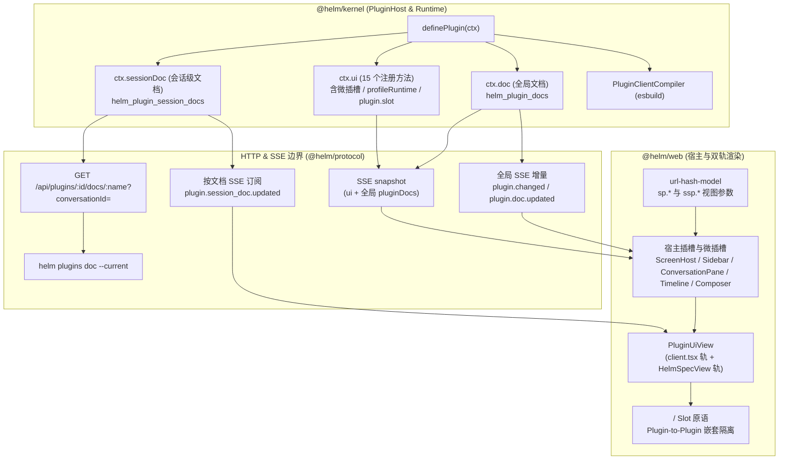
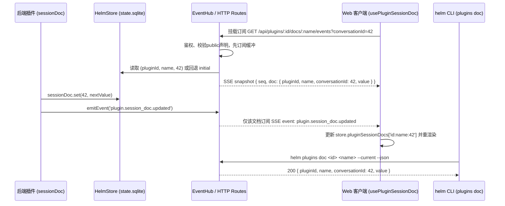

## 背景

Helm 前端目前通过 `@helm/protocol`（`packages/protocol/src/ui.ts`）暴露 7 类扩展面共 10 个注册方法（`sidebarItem`、`sidebarSection`、`screen`、`timelineRenderer`、`toolView`、`composerPill`、`composerWidget`、`workbenchPanel`、`command`、`settingsPanel`），并支持声明式 `@json-render` 与 `client.tsx` 动态编译双轨渲染。该机制已支撑 `builtin:workflow`、`builtin:superagent`、`builtin:triggers`、`builtin:magpie` 与 `builtin:assistant` 的基础界面接入，但在多插件协同与复杂交互场景下暴露出五类架构瓶颈：

1. **宿主仍残留对内置插件的业务硬编码**：
   - `packages/web/src/screens/ScreenHost.tsx`（第 23 行）硬编码 `if (pluginId === 'builtin:herdr' && screenId === 'overview')`，将 380 行 `HerdrOverviewScreen.tsx` 留在 `@helm/web` 包内；
   - `packages/web/src/modals/ProfileEditorModal.tsx`（第 29、127、482 行）硬编码 `BUILTIN_PROTECTED_PROFILES`、`builtin:herdr` 启用状态判断与 Herdr 专属表单；
   - `packages/web/src/shell/sidebar-model.ts`（第 200、208 行）硬编码 `profileId === 'assistant'` 的图标与置顶排序。
2. **上下文控制力与深链能力受限**：
   - `ScreenProps` 仅含 `{ pluginId, screenId }`，`packages/web/src/lib/url-hash-model.ts` 的 `s/<pluginId>/<screenId>` 不支持携带查询参数，组件也无法感知自身处于主屏还是右侧分屏（`isSplit`）；
   - `ComposerScopeProps` 仅传入 `{ conversation }`，`composer.pill` 与 `composer.widget` 无法读写输入框草稿、插入文本或触发发送；斜杠命令 `/new`、`/clear`、`/compact` 在 `packages/web/src/conversation/Composer.tsx`（第 560 行）硬编码，插件无法注册 `/slash` 命令；
   - `packages/web/src/lib/plugin-client-context.ts`（第 52、131 行）将 `usePluginDoc` 与 `callAction` 闭包绑定在当前 `pluginId` 上，`client.tsx` 组件无法跨插件订阅公开文档或调用其他插件动作，也缺少直接向会话提交输入的 `submitInput` 接口。
3. **插槽颗粒度过粗且缺乏冲突裁决**：
   - 会话顶栏操作区（`ConversationPane.tsx` 第 340–378 行）、左栏会话行菜单（`Sidebar.tsx`）与消息悬停操作栏（`ConversationTimeline.tsx` 第 196–230 行）均为宿主私有，插件无法追加微交互动作；
   - `timelineRenderer` 与 `toolView` 在多插件声明重叠时（`timeline-model.ts` 第 390–418 行）仅按数组顺序取首个命中项，无显式优先级；
   - `PluginSettingsModal.tsx` 使用 `.find()` 仅渲染每个插件的第一个 `settings.panel`。
4. **插件间无法互相暴露子插槽（Plugin-to-Plugin Composition）**：
   - `packages/kernel/src/plugins/plugin-host.ts`（第 2269–2279 行）将 UI 扩展面固定为宿主枚举的 10 个位置，插件无法在自身 `Screen`、`WorkbenchPanel` 或 `ToolView` 内部声明子插槽供其他插件注入扩展内容。
5. **公开文档全量广播导致写放大与首帧膨胀**：
   - `ctx.doc(name, initial, { public: true })` 在每次写入时经 `packages/kernel/src/runtime/events.ts`（第 133–146 行）向所有 SSE 客户端广播整份文档，并在连接建立时将所有启用插件的全部公开文档塞入 `HelmSnapshot.pluginDocs`（`runtime.ts` 第 467 行）。对于按会话分片的状态（如某会话下的工作流运行摘要或终端绑定状态），缺乏按 `conversationId` 隔离存储与按需拉取/增量订阅的会话级投影通道。

参考 `deepseek-ai/deepseek-harness`（`dsh`）的插件化 UI 设计（内置能力即插件、插槽优先级覆盖、Command Surface 自动派生、Plugin-to-Plugin 子插槽注入、`SessionProjection` 会话级投影），本次设计在不引入重型客户端 IoC 容器、完整保留 Helm 零构建 `@json-render` 与 `esbuild` 即时编译双轨优势的前提下，一次性完成上述五个维度的架构演进：

- 消除 `@helm/web` 中全部内置插件与特定 Profile ID 的硬编码分支，`builtin:herdr/overview` 迁入插件 `client.tsx` 轨道，Profile 外部运行时配置表单改为插件声明式注册；
- 为 `Screen` 增加 URL Hash 参数化深链与 `isSplit` 感知，为 `Composer` 与 `PluginClientContext` 补齐草稿读写、消息发送、`/slash` 命令派生及跨插件文档/动作寻址能力；
- 为 `timelineRenderer` 与 `toolView` 引入 `priority` 优先级裁决，修复同插件多 `settings.panel` 渲染，并新增会话顶栏、会话行菜单、消息操作栏 3 类微插槽；
- 新增 `<PluginSlot />`（及声明式 `Slot` 原语）与 `ctx.ui.slot()`，支持插件间声明和注入子插槽；
- 新增 `ctx.sessionDoc()` 会话级持久文档与按需订阅通道，补齐 HTTP 与 `helm plugins doc --conversation|--current` CLI 同权接口。

非目标：不在浏览器端引入第二套 Cordis/IoC 模块加载器；不放开外部插件客户端代码的任意第三方 npm 裸包打包限制；不改变现有 `ctx.doc` 全局文档的存储格式。

建议分支：`feature/ui-extension-and-session-docs`（建议新开分支名，非既有分支）。

---

## 整体设计

本次改造横跨 `@helm/protocol`、`@helm/kernel`、`@helm/web` 与 `@helm/cli` 四个包，保持五包单向依赖方向不变（`web` / `cli` $\rightarrow$ `protocol` $\leftarrow$ `kernel`）。



核心设计判断与权衡：

1. **保持单一宿主 UI 注册表，通过通用 `plugin.slot` 实现 Plugin-to-Plugin 组合**：
   不效仿 `dsh` 将侧栏、布局拆成数十个独立 npm 客户端包，而是在 `@helm/plugin-client` 中提供 `<PluginSlot name="..." />` 组件，在 `@json-render` 中提供 `{ type: 'Slot' }` 原语，统一消费 `ctx.ui.slot({ target: '<ownerPluginId>/<slotName>', ... })`。这样既获得了插件间任意层级嵌套与错误边界隔离能力，又維持了单包 `@helm/web` 的极简构建链路。
2. **Screen 深链参数采用查询串命名空间前缀 `sp.` / `ssp.`**：
   根据 `docs/conventions/web-navigation.md`，主屏与分屏可同时展示不同（甚至相同）的插件 `Screen`。若直接占用顶层查询参数，会与宿主保留键（`split`、`wb`、`modal`、`id`、`conv`）或主副屏互相冲突。因此主屏 Screen 参数统一编码为 `sp.<key>=<val>`，分屏 Screen 参数统一编码为 `ssp.<key>=<val>`，并在主副屏切换或关闭分屏时精确跟随目标迁移或清理。
3. **会话级文档（`sessionDoc`）与全局文档（`doc`）物理分表、事件分流**：
   全局配置或跨会话汇总仍走 `ctx.doc`（进 `HelmSnapshot.pluginDocs` 首帧）；按会话隔离的高频状态走 `ctx.sessionDoc`（存 `helm_plugin_session_docs` 表，不进全局首帧快照）。前端仅在组件订阅某 `(pluginId, name, conversationId)` 时建立该文档的专用 SSE 连接，由首帧提供当前值，再接收该文档的 `plugin.session_doc.updated`。同一浏览器内同一键的多个组件共享连接，最后一个组件卸载即退订。普通 `/api/events` 不发送该事件；不以浏览器丢弃无关事件冒充服务端按需传输。

---

## 详细设计

### 1. 宿主特判清退与内置插件自举（P0）

#### 1.1 `builtin:herdr/overview` 迁入插件 `client.tsx` 轨道

在 `packages/kernel/src/builtin-plugins/herdr/` 下新增 `client/index.tsx` 与 `client/styles.css`：

- `createHerdrPlugin`（`packages/kernel/src/builtin-plugins/herdr.ts`）设置 `clientRoot: resolveHerdrClientRoot()`（探测逻辑与 `packages/kernel/src/builtin-plugins/workflow.ts` 第 45–57 行一致，兼容 `src` 与编译后 `dist` 目录）。
- `builtin:herdr` 注册 `screen` 时同时声明 `client: { module: 'index.tsx', export: 'HerdrOverviewScreen' }` 与原有 `json` 降级描述。
- `HerdrOverviewScreen` 通过 `@helm/plugin-client` 的 `usePluginContext()` 与 `usePluginDoc('overview')` 获取数据并调用 `ctx.callAction('focus' | 'read' | 'list', ...)`，不再直接导入宿主内部 `useHelmStore`。
- 删除 `packages/web/src/screens/HerdrOverviewScreen.tsx`，并删除 `packages/web/src/screens/ScreenHost.tsx` 第 23–25 行的 `if (pluginId === 'builtin:herdr' && screenId === 'overview')` 分支。`ScreenHost` 顶栏新增渲染 `screen` 关联的刷新/扩展动作，所有 `screen` 一律经 `<PluginUiView />` 渲染。

#### 1.2 Profile 托管保护与外部运行时表单插件化

1. **统一 Profile 保护判定**：
   - `builtin:assistant` 在自举自身 Profile 时显式写入 `managedByPlugin: 'builtin:assistant'`。托管策略由插件定义，不在 `ProfileService.get()` / `list()` 中按 Profile ID 补字段，也不添加旧数据归一化兼容路径。
   - 后端 `DELETE /api/profiles/:id`（`packages/kernel/src/http/routes.ts` 第 364 行）：若目标 Profile 的 `id === DEFAULT_PROFILE_ID` 或 `profile.managedByPlugin !== undefined` 且对应插件处于已注册状态，返回 `403 profile_managed_by_plugin`（`assistant` 保持 `403 default_profile_protected` 或统一受保护错误码）。
   - 前端 `ProfileEditorModal.tsx` 删除 `BUILTIN_PROTECTED_PROFILES` 常量，统一由 `profile.managedByPlugin` 判定托管保护，不保留特定 Profile ID 分支。
   - 前端 `sidebar-model.ts`（第 200、208 行）删除 `profileId === 'assistant'` 分支，站位图标与 `order` 统一优先取 `pinMeta.get(profile.id)`（`builtin:assistant` 已固定注册 `order: 0, icon: 'sparkles'` 的 `sidebar.item`），无 `pinMeta` 时回退 `profile.runtime !== undefined ? 'terminal' : 'bot'` 与默认 `order: 100`。

2. **新增 `ctx.ui.profileRuntime` 扩展点**：
   在 `packages/protocol/src/ui.ts` 中新增 `ProfileRuntimeUiSpec`：

   ```ts
   export interface ProfileRuntimeUiSpec {
     /** 扩展点内唯一 ID。 */
     id: string
     /** 对应 ProfileRuntime.kind（如 'herdr'）。 */
     kind: string
     /** 运行时显示名称（如 '外部 Herdr 运行时'）。 */
     label: string
     /** 徽章与标题图标名（lucide-react 图标标识，默认 'terminal'）。 */
     icon?: string
     /** 开关旁辅助说明文案。 */
     description?: string
     /** Agent 输入框候选列表（datalist 建议值）。 */
     agentSuggestions?: string[]
     order?: number
   }
   ```

   - `PluginUiRegistry` 新增 `profileRuntime(spec: ProfileRuntimeUiSpec): void`（surface 名为 `'profile.runtime'`）。
   - 若多个已启用插件声明相同 `kind`，`PluginHost` 显式拒绝重复并回滚本次启用，不允许前端按顺序吞掉冲突；`builtin:herdr` 在 `definePlugin` 中声明 `kind: 'herdr'` 及 23 种 CLI 候选列表。
   - `ProfileEditorModal.tsx` 从 `store.groupedUi.profileRuntimes` 动态读取当前可用运行时定义：
     - 当列表非空时，Tab 标题显示「基础与运行时」，支持开启运行时并选择已注册的 `kind`（单运行时直接切换开关，多运行时提供 `kind` 下拉选择），按选中 `ProfileRuntimeUiSpec` 渲染徽章与 `agentSuggestions`；
     - 当对应插件停用导致 `profile.runtime.kind` 不在 `groupedUi.profileRuntimes` 中时，展示通用「已保存外部运行时配置（`{runtime.kind}`），所属插件未启用，保存时原样保留 / 清除」提示。

---

### 2. 参数化 Screen 深链、Composer 控制面与跨插件上下文（P1）

#### 2.1 Screen URL Hash 参数化与分屏感知

在 `packages/web/src/lib/types.ts` 与 `packages/web/src/lib/url-hash-model.ts` 中扩展 `ResolvedTarget`：

```ts
export type ResolvedTarget =
  | { kind: 'conversation'; conversationId: number; highlightEntryId?: string }
  | {
      kind: 'screen'
      pluginId: string
      screenId: string
      /** Screen 路由参数（仅字符串键值对，按字典序稳定序列化）。 */
      params?: Record<string, string>
    }
```

**URL Hash 编解码规则（`url-hash-model.ts`）**：

| 位置状态 | Hash 编码形式 | 解析与清理规则 |
| :--- | :--- | :--- |
| 主屏为 `screen` 且含参数 | `#/s/<pluginId>/<screenId>?sp.<k>=<v>` | 仅当 `primaryTarget.kind === 'screen'` 时提取 `sp.<k>`（`<k>` 需匹配 `/^[A-Za-z0-9._-]+$/` 且非空）；主屏切回 `c/<id>` 时丢弃全部 `sp.*` |
| 分屏为 `screen` 且含参数 | `#/...?split=s/<pluginId>/<screenId>&ssp.<k>=<v>` | 仅当 `splitTarget?.kind === 'screen'` 时提取 `ssp.<k>`；关闭分屏或分屏切回 `c/<id>` 时丢弃全部 `ssp.*` |
| `resolveTargetString` 字符串 | `screen:<pluginId>/<screenId>?k1=v1&k2=v2` | 支持在 `openScreen` / `sidebarItem.target` / `helm:open` 中直接附带查询串并解析进 `params` |

- **等价性与历史栈判定**：
  - `isSameResolvedTarget(a, b)` 在 `kind === 'screen'` 时除比较 `pluginId` 与 `screenId` 外，浅比较 `params` 键值对；
  - `shouldPushLocationHistory(prev, next)`：当 `primaryTarget` 或 `splitTarget` 的 `(kind, pluginId, screenId)` 不变而仅 `params` 变化时，默认返回 `false`（使用 `history.replaceState` 避免筛选器每次按键污染后退栈）；调用方显式传入 `{ push: true }` 时强制 `pushState`。
- **`ScreenProps` 契约更新（`packages/protocol/src/ui.ts`）**：
  ```ts
  export interface ScreenProps {
    pluginId: string
    screenId: string
    /** 当前视图是否渲染在右侧分屏。 */
    isSplit: boolean
    /** 当前视图的 URL 查询参数（无参数时为空对象 {}）。 */
    params: Readonly<Record<string, string>>
    /** 更新当前视图参数（值为 undefined 的键将被移除；默认 replace 历史记录）。 */
    setParams(
      patch: Record<string, string | undefined>,
      options?: { push?: boolean },
    ): void
  }
  ```
  `ScreenHost.tsx` 根据自身 `isSplit` 属性，将 `setParams` 绑定到 `primaryTarget` 或 `splitTarget` 的参数更新方法，并通过 `slotProps` 同时传入 `client.tsx` 组件与 `HelmSpecView` 的 `$data`。

#### 2.2 Composer 受控句柄与 `/slash` 命令派生

1. **`ComposerController` 接口（`packages/protocol/src/ui.ts`）**：
   ```ts
   export interface ComposerController {
     /** 当前输入框草稿文本。 */
     readonly draft: string
     /** 当前已选附件与发送状态。 */
     readonly attachments: ReadonlyArray<ConversationAttachmentRef>
     readonly sending: boolean
     /** 整体替换当前输入框草稿。 */
     setDraft(text: string): void
     /** 在当前光标位置（或末尾）插入文本片段（如 @artifact 引用或模板）。 */
     insertText(text: string): void
     /** 省略 text 时发送当前草稿及附件；显式 text 不消费原草稿。失败必须 reject。 */
     submit(text?: string, options?: { whenBusy?: WhenBusy }): Promise<void>
   }

   export interface ComposerScopeProps {
     conversation: ConversationSummary
     composer: ComposerController
   }
   ```
   `Composer.tsx` 构造绑定当前输入框 state 与 `textareaRef` 的 `ComposerController` 实例，通过 `slotProps` 注入所有 `composer.pill` 与 `composer.widget` 的 `<PluginUiView />`，同时在 `<PluginClientContext>` 上暴露可选的 `composer?: ComposerController`。

2. **插件命令扩展与 `/slash` 自动派生**：
   扩展 `CommandSpec`（`packages/protocol/src/ui.ts`）：
   ```ts
   export interface CommandSpec extends UiSpecBase {
     title: string
     /** 命令图标名（lucide-react 图标，缺省 'zap'）。 */
     icon?: string
     /**
      * 可选斜杠触发词（不含前导 '/'，匹配 /^[a-z0-9][a-z0-9:_-]{0,63}$/）。
      * 声明后同时出现在 ⌘K 命令面板与会话输入框 '/' 补全列表中。
      */
     slash?: string
     /** 斜杠菜单与命令面板中的副标题描述。 */
     description?: string
     /** 绑定的插件 Action ID（所属插件可由 actionPluginId 覆写，默认本插件）。 */
     actionId?: string
     actionPluginId?: string
     input?: Record<string, unknown>
     keywords?: string[]
   }
   ```
   - `PluginHost` 注册边界校验 `slash` 格式，拒绝与 `new`、`clear`、`compact` 或 `skill:` 保留命名空间冲突，拒绝已启用插件之间的同名斜杠词。声明 `slash` 必须同时绑定 `actionId`。
   - `Composer.tsx` 的 `detectPopover` 在解析 `/` 前缀时，合并命中 `matchesUiScope(cmd.spec.scope, conversation)` 且含 `slash` 的插件命令；用户回车或点击选中时，调用 `store.invokePluginAction(cmd.spec.actionPluginId ?? cmd.pluginId, cmd.spec.actionId, cmd.spec.input, conversation.id)`。
   - `CommandPaletteModal.tsx` 渲染命令图标时使用 `cmd.spec.icon ?? 'zap'`。

#### 2.3 `PluginClientContext` 跨插件寻址与会话输入提交

更新 `packages/protocol/src/ui.ts` 与 `packages/web/src/lib/plugin-client-context.ts`：

```ts
export interface CallActionOptions {
  /** 目标插件 ID；省略时调用当前组件所属插件。 */
  pluginId?: string
  /** 关联会话 ID；省略时继承当前槽位 conversationId。 */
  conversationId?: number
}

export interface PluginClientContext {
  pluginId: string
  callAction(actionId: string, input?: unknown, options?: CallActionOptions): Promise<unknown>
  submitInput(
    text: string,
    options?: { conversationId?: number; whenBusy?: WhenBusy },
  ): Promise<void>
  openScreen(target: string): void
  openSplitScreen(target: string): void
  openConversationDrawer(conversationId: number): void
  openArtifact(artifactId: string): void
  openWorkbench(panelId?: string): void
  closeWorkbench(): void
  notify(message: string, tone?: 'info' | 'warning' | 'error'): void
  getPluginDoc(docName: string, pluginId?: string): Promise<unknown>
  getPluginSessionDoc(
    docName: string,
    options?: { conversationId?: number; pluginId?: string },
  ): Promise<unknown>
  conversationId?: number
  composer?: ComposerController
  theme: 'light' | 'dark'
}
```

`@helm/plugin-client` 导出的共享 Hook 同步扩展：
- `usePluginDoc<T = unknown>(docName: string, pluginId?: string): T | undefined`：`pluginId` 省略时取 `ctx.pluginId`，传入时订阅指定插件的公开文档。
- `usePluginSessionDoc<T = unknown>(docName: string, options?: { conversationId?: number; pluginId?: string }): T | undefined`：响应式订阅会话级公开文档（见第 5 节）。

---

### 3. 优先级裁决与高频微插槽（P2）

#### 3.1 `priority` 裁决与多 `settings.panel` 渲染

1. **`TimelineRendererSpec` 与 `ToolViewSpec` 增加 `priority?: number`**：
   - `PluginHost` 在注册边界校验 `priority` 若存在必须为有限安全整数（`Number.isSafeInteger`），缺省为 `0`。
   - `packages/web/src/conversation/timeline-model.ts` 中的 `matchTimelineRenderer` 与 `findToolView` 按 `(spec.priority ?? 0)` 降序排序候选列表，优先级相同时保持插件贡献顺序（先注册先命中）。
2. **同插件多 `settings.panel` 支持**：
   - `packages/web/src/modals/PluginSettingsModal.tsx` 将 `store.groupedUi.settingsPanels.find(...)` 改为 `.filter(p => p.pluginId === selectedId)` 并按 `(spec.order ?? 100)` 升序排列，依次渲染所有属于当前选中插件的 `PluginUiView` 面板。

#### 3.2 三类高频微插槽契约

在 `packages/protocol/src/ui.ts` 中新增微插槽定义：

```ts
/** 会话级微插槽动作（用于会话顶栏与左栏会话行菜单）。 */
export interface ConversationActionSpec extends UiSpecBase {
  label: string
  icon?: string
  order?: number
  /**
   * 仅 conversation.header.action 有效：
   * 'toolbar' 直接展示在会话顶栏右侧按钮组；'menu' 收纳进顶栏「更多操作」下拉菜单（默认 'menu'）。
   */
  placement?: 'toolbar' | 'menu'
  /** 点击时直接调用的插件 Action ID（自动注入 { ...input, conversationId }）；若提供 client/json 则渲染自定义视图。 */
  actionId?: string
  actionPluginId?: string
  input?: Record<string, unknown>
}

/** 时间线消息条目 Hover 操作栏微插槽。 */
export interface TimelineEntryActionSpec extends UiSpecBase {
  label: string
  icon?: string
  order?: number
  /** 限定匹配的 entry.kind 列表；省略时匹配普通消息与插件条目。 */
  kinds?: string[]
  /** 限定匹配的文本消息角色（'user' | 'assistant'）。 */
  roles?: Array<'user' | 'assistant'>
  /** 点击时直接调用的插件 Action ID（自动注入 { ...input, conversationId, entryId: entry.id }）。 */
  actionId?: string
  actionPluginId?: string
  input?: Record<string, unknown>
}
```

`PluginUiRegistry` 新增 3 个注册方法：

| 注册方法 | Surface 名称 | 宿主挂载组件 | 注入 `slotProps` / Action 默认载荷 |
| :--- | :--- | :--- | :--- |
| `conversationHeaderAction(spec)` | `'conversation.header.action'` | `ConversationPane.tsx` 顶栏按钮区与更多菜单 | `{ conversation }`；Action 载荷 `{ ...spec.input, conversationId: conversation.id }` |
| `conversationRowAction(spec)` | `'conversation.row.action'` | `Sidebar.tsx` 会话行右侧操作菜单 | `{ conversation }`；Action 载荷 `{ ...spec.input, conversationId: conversation.id }` |
| `timelineEntryAction(spec)` | `'timeline.entry.action'` | `ConversationTimeline.tsx` 消息气泡 Hover 栏 | `{ conversationId, entry }`；Action 载荷 `{ ...spec.input, conversationId, entryId: entry.id }` |

所有微插槽均通过 `matchesUiScope(conversation, spec.scope)` 按当前会话过滤。保留字段由实际宿主上下文最终覆盖，`spec.input` 不得伪造 `conversationId` 或 `entryId`；Action 的调用上下文也必须携带实际会话 ID。当条目仅声明 `actionId`（无需声明 `json` 或 `client`）时，宿主渲染标准极简按钮并在点击时调用对应 Action；当条目声明了 `client` 或 `json` 时，宿主内联挂载 `<PluginUiView />`。为此，`PluginHost` 的 `addUi` 对上述三类微插槽允许 `actionId` 作为独立执行轨（`actionId`、`client`、`json` 三者至少提供其一）。

---

### 4. Plugin-to-Plugin 子插槽声明与注入（P3）

#### 4.1 贡献方注册契约：`ctx.ui.slot`

在 `packages/protocol/src/ui.ts` 中新增：

```ts
export interface PluginSlotContributionSpec extends UiSpecBase {
  /**
   * 目标子插槽全限定名，格式为 '<ownerPluginId>/<slotName>'
   * （如 'builtin:herdr/overview-header' 或 'builtin:workflow/run-actions'）。
   */
  target: string
  order?: number
  priority?: number
}
```

- `PluginUiRegistry` 新增 `slot(spec: PluginSlotContributionSpec): void`（surface 名为 `'plugin.slot'`）。
- `PluginHost` 在注册边界校验 `target` 必须包含恰好一个 `/` 分隔符，前半段为合法 `pluginId`（`/^[A-Za-z0-9:_-]+$/`），后半段为合法 `slotName`（`/^[A-Za-z0-9._-]+$/`），否则抛 `400 invalid_ui_spec`。
- 贡献方的注册与宿主插件的启用顺序完全解耦：即使目标插件尚未启用，贡献方的 `plugin.slot` 声明仍正常登记并在前端 `store.groupedUi.pluginSlots` 中按 `target` 归组。

#### 4.2 声明方渲染原语：`<PluginSlot />` 与声明式 `Slot`

1. **`client.tsx` 轨道组件 `<PluginSlot />`（由 `@helm/plugin-client` 导出）**：
   ```tsx
   export interface PluginSlotProps {
     /** 本插件内部子插槽名（如 'toolbar'，自动拼接为 `<ctx.pluginId>/<name>`；若含 '/' 则视为显式全限定名）。 */
     name: string
     /** 传递给子插槽组件的上下文数据（注入子组件 props 与声明式 $data）。 */
     slotProps?: Record<string, unknown>
     /** 基数模式：'list' 渲染全部命中项（默认），'single' 仅渲染 priority 最高的首项。 */
     mode?: 'list' | 'single'
     /** 无任何插件注入时的回退内容。 */
     fallback?: ReactNode
     className?: string
   }
   ```
   `<PluginSlot />` 内部读取当前 `<PluginClientContext>` 的 `pluginId` 与 `conversationId`，从 `store.groupedUi.pluginSlots` 查找 `target === qualifiedName` 且命中当前会话 `scope` 的贡献项，按 `priority ?? 0` 降序、`order ?? 100` 升序排列后，逐项使用 `<PluginUiView />`（自带独立 `<ViewBoundary />`）渲染。
2. **声明式 `@json-render` 轨道原语 `Slot`（`packages/web/src/ui/spec-primitives.tsx`）**：
   在 `HelmSpecView` 的原语表中新增 `Slot`：
   ```json
   {
     "type": "Slot",
     "props": {
       "name": "overview-extra",
       "mode": "list"
     }
   }
   ```
   渲染逻辑直接复用 `<PluginSlot />`，并将当前 `$data` 透传为 `slotProps`。
3. **递归环保护**：`<PluginSlot />` 维护 React Context 渲染栈 `SlotAncestryContext`（记录已处于渲染链中的 `(contributorPluginId, slotId)`）；若检测到同一贡献项在祖先链中再次出现，显式渲染 `jr-callout-warn` 环告警并终止递归，并限制最大嵌套深度，防止无重复贡献项的过长链拖垮页面。每个子项均重新绑定贡献者插件上下文；父槽位的插件身份不得泄漏到子项的动作寻址。JSON 求值域仅包含数据，不注入 Composer 或 Screen 控制函数。

---

### 5. `SessionProjection` 会话级状态文档与按需订阅（P4）

#### 5.1 协议与后端存储契约

在 `packages/protocol/src/plugin.ts` 中新增会话级文档句柄契约：

```ts
export interface PluginSessionDocHandle<TState = unknown> {
  /** 读取指定会话下的文档当前值（深拷贝；未写入过时返回 initial 深拷贝）。 */
  get(conversationId: number): TState
  /** 写入指定会话下的文档值并触发持久化队列；若 public: true 则发布 plugin.session_doc.updated 事件。 */
  set(conversationId: number, next: TState): void
  /** 基于当前值原子计算并更新指定会话下的文档值。 */
  update(conversationId: number, fn: (current: TState) => TState): void
  /** 删除记录；public 时发布 deleted: true 且 value 为初始值，订阅者据此复位。 */
  delete(conversationId: number): void
  /** 列出当前已持久化写入过该文档的所有会话 ID（升序）。 */
  listConversationIds(): number[]
  /** 等待底层持久化队列冲刷完成。 */
  flush(): Promise<void>
}
```

`HelmPluginContext` 新增：
```ts
sessionDoc<TState>(
  name: string,
  initial: TState,
  opts?: { public?: boolean },
): PluginSessionDocHandle<TState>
```

- **命名空间与冲突检查**：同一插件内 `sessionDoc` 的 `name` 与 `doc` 的 `name` 共享文档名校验规则（`/^[A-Za-z0-9._-]+$/`），且同一插件内 `doc` 与 `sessionDoc` 严禁同名（防止 `GET /api/plugins/:id/docs/:name` 路由歧义，同名抛 `409 duplicate_doc`）。
- **SQLite 表结构（`packages/kernel/src/runtime/sqlite.ts`）**：
  ```sql
  CREATE TABLE IF NOT EXISTS helm_plugin_session_docs (
    plugin_id TEXT NOT NULL,
    name TEXT NOT NULL,
    conversation_id INTEGER NOT NULL,
    value TEXT NOT NULL,
    updated_at INTEGER NOT NULL,
    PRIMARY KEY (plugin_id, name, conversation_id)
  );
  CREATE INDEX IF NOT EXISTS helm_plugin_session_docs_conv
    ON helm_plugin_session_docs (conversation_id);
  ```
- **内存镜像与生命周期清理（`packages/kernel/src/runtime/store.ts`）**：
  - `HelmStore` 启动时加载 `helm_plugin_session_docs` 至内存 Map（键为 `${pluginId}\0${name}\0${conversationId}`），读写同步更新内存镜像并入队 `this.enqueue(...)` 顺序写盘，保证与 `helm_plugin_docs` 完全一致的事务队列语义；
  - `conversationId` 边界校验必须为正安全整数（`Number.isSafeInteger(id) && id > 0`），且会话必须存在；删除后的异步回调不得重建孤儿文档。存储端口缺失时返回显式不支持错误，不创建内存降级存储；
  - 当会话删除（`HelmStore.deleteConversation(conversationId)`）时，同步清除内存镜像中属于该 `conversationId` 的所有会话文档，并在同一 SQLite 事务队列中执行 `DELETE FROM helm_plugin_session_docs WHERE conversation_id = ?`。

#### 5.2 SSE 事件、HTTP 接口与 CLI 同权



1. **SSE 事件契约（`packages/protocol/src/events.ts`）**：
   `HelmEventType` 新增 `'plugin.session_doc.updated'`，仅通过会话文档专用流传输：
   ```ts
   export interface PublicPluginSessionDoc {
     pluginId: string
     name: string
     conversationId: number
     value: unknown
     deleted?: boolean
   }

   export interface PluginSessionDocUpdatedEvent {
     type: 'plugin.session_doc.updated'
     doc: PublicPluginSessionDoc
   }
   ```
   `HelmSnapshot` **不携带** `pluginSessionDocs` 字段。`GET /api/plugins/:id/docs/:name/events?conversationId=N` 仅接受已启用插件的公开会话文档，首帧为 `event: snapshot`，数据类型为 `PluginSessionDocSnapshot { seq, doc }`；后续帧为 `HelmEventFrame { seq, event }`。服务端先订阅缓冲，再取得当前文档与水位线，冲刷水位之后的事件，防止 GET 与订阅之间丢更新。

   客户端按元组引用计数共享订阅；每次重连以新首帧替换缓存，不以旧缓存冒充恢复成功。最后一个引用卸载、登出、会话删除或插件停用时中止连接、清理对应缓存。非重试性错误须显式呈现，网络中断使用有界退避重连；服务端沿用有界背压与 abort 退订，慢客户端关流后靠新快照恢复。

2. **HTTP 端点扩展（`packages/kernel/src/http/routes.ts`）**：
   扩展既有 `GET /api/plugins/:pluginId/docs/:name`：
   - 未传 `conversationId` 查询参数时：读取全局 `public: true` 的 `ctx.doc`（若目标实际为 `sessionDoc`，返回 `400 session_doc_requires_conversation` 并提示传入 `conversationId`）；
   - 传入 `?conversationId=<正整数>` 时：校验会话存在且目标文档为已启用插件声明的 `public: true` `sessionDoc`，返回 `{ pluginId, name, conversationId, value }`（經 `redactJsonValue` 脱敏）；若插件未启用、文档不存在或非 `public`，统一返回 `404 plugin_doc_not_found`。

3. **CLI 同权扩展（`packages/cli/src/commands/plugins.ts`）**：
   扩展 `helm plugins doc <pluginId> <name>` 命令：
   - 新增 `--conversation <id>`（`number`）与 `--current`（`boolean`，自动从 `HELM_CONVERSATION_ID` 解析当前会话 ID，二者互斥）；
   - 指定会话时请求 `/api/plugins/${encodeURIComponent(pluginId)}/docs/${encodeURIComponent(name)}?conversationId=${conversationId}`，支持人类模式与 `--json` 结构化输出。
   - `--watch` 对应同一元组的专用 SSE 端点，输出首帧与后续事件。缺少会话上下文时明确报错，不监听全局文档冒充会话订阅。

4. **声明式 `@json-render` 轨集成**：
   - `UiSpecBase` 新增 `sessionDocs?: string[]`；
   - `PluginHost.assertUiDocsRegistered` 在启用边界校验 `spec.sessionDocs` 中的每个名称必须是本插件已注册且 `public: true` 的 `sessionDoc`，否则抛 `400 invalid_ui_spec`；
   - `HelmSpecView` 在有 `conversationId` 上下文时，通过 `usePluginSessionDocsMap` 订阅 `spec.sessionDocs` 并注入求值域 `$sessionDocs.<docName>`。

#### 5.3 内置工作流采用会话投影

`builtin:workflow` 的完整 `runs` 改为 `ctx.sessionDoc('runs', { runs: [] }, { public: true })`，每个父会话仅保存自己的运行摘要。ToolView 与工作台通过 `usePluginSessionDoc('runs')` 和 `sessionDocs: ['runs']` 订阅，后台节点变化不再向所有标签页发送全部会话的节点、输出和运行详情。

工作台页签与顶栏角标仍需在面板尚未挂载时展示导航摘要，因此另保留公开全局 `run-badges` 文档，只含按会话索引的 `count / tone / footerText`，不含运行详情。内容没有变化时不写投影、不发布事件；节点输出变化不会无条件重发角标。完整运行记录仍由插件私有 `records` 文档维护，服务启动和停止阶段按现有生命周期刷新对应投影。父会话已删除时跳过该投影，不能从私有历史运行记录重新创建孤儿状态。去重必须比较完整投影内容，不能只比较毫秒时间戳与状态，否则同毫秒内节点变化会被误吞。

会话投影之外的事件通道也遵守相同边界：全局 `workflow.updated` 只发布 `id / conversationId / status` 提示；完整 `workflow.settled` 使用通用 `ctx.host.emitEvent(type, payload, { broadcast: false })` 仅分发给进程内监听器并等待其完成，不进入全局 SSE。否则完整输出仍会通过自定义事件旁路广播，抵消分片设计。

---

## 影响分析

| 模块 / 消费方 | 现状基线 | 目标变化与影响 |
| :--- | :--- | :--- |
| `builtin:herdr` 与 `ScreenHost.tsx` | `HerdrOverviewScreen.tsx` 硬编码在 `@helm/web` 包内，由 `ScreenHost.tsx` 按插件 ID 特判挂载 | 迁入 `packages/kernel/src/builtin-plugins/herdr/client/index.tsx`；`ScreenHost.tsx` 零特判；新增对 URL 参数 `?sp.node=...&sp.owner=...&sp.status=...` 的深链支持，刷新页面保留筛选器状态 |
| `ProfileEditorModal.tsx` 与 `sidebar-model.ts` | 硬编码 `BUILTIN_PROTECTED_PROFILES`、`builtin:herdr` 与 `assistant` | 保护态统一由 `managedByPlugin` 驱动；外部运行时表单由 `ctx.ui.profileRuntime` 驱动；未启用 `builtin:herdr` 时零痕迹隐藏，启用时完整展示 |
| URL Hash 导航（`url-hash-model.ts`） | `#/s/<pluginId>/<screenId>` 不支持视图参数 | 新增 `sp.<key>`（主屏）与 `ssp.<key>`（分屏）参数编解码；现有无参深链 `#/c/1`、`#/s/builtin:herdr/overview` 100% 保持原样 |
| Builtin 与外部插件 UI（`PluginUiView`） | 仅支持 10 个宿主固定位置，`callAction`/`usePluginDoc` 锁死本插件 | 支持 15 个注册方法（新增 3 类微插槽、`profileRuntime`、`slot`）、跨插件调用与 `<PluginSlot />` 嵌套组合 |
| 状态存储与 SSE（`state.sqlite` / `events.ts`） | 仅有 `helm_plugin_docs` 全局表 | 新增 `helm_plugin_session_docs` 表与 `plugin.session_doc.updated` 事件；既有全局 `ctx.doc` 行为不变 |
| CLI（`@helm/cli`） | `helm plugins doc <pluginId> <name>` 仅支持全局文档 | 新增 `--conversation <id>` 与 `--current` 标志，与 HTTP `?conversationId=` 严格同权 |

---

## 发布

本次改造遵循项目开发期「不兼容、不保留旧死代码」原则，在单次代码合入中完成 `protocol` $\rightarrow$ `kernel` $\rightarrow$ `cli` $\rightarrow$ `web` 的全链路同步构建：

1. **数据库表结构自动就绪**：`openHelmDatabase`（`packages/kernel/src/runtime/sqlite.ts`）在启动时通过 `CREATE TABLE IF NOT EXISTS helm_plugin_session_docs` 与索引 DDL 自动建表，无需人工迁移脚本。
2. **默认 Profile 自举**：`builtin:assistant` 在正常自举中写入自身的托管元数据，不增加旧格式读取、迁移或按 ID 归一化。
3. **插件编译缓存自刷新**：`builtin:herdr` 新增 `clientRoot` 后，首次访问 `GET /api/plugins/builtin%3Aherdr/client.mjs?module=index.tsx` 时由 `PluginClientCompiler` 编译并写入 `<dataDir>/cache/plugin-staging/builtin_herdr/`。
4. **异常恢复**：若外部或内置插件的客户端模块编译失败、子插槽渲染抛错，`PluginUiView` 与 `<PluginSlot />` 的 `ViewBoundary` 局部拦截并展示显式错误卡片与「重试加载」按钮，不影响宿主主界面、会话收发与其他插件运行；需要恢复代码时可回退提交并重启；开发期不承诺新旧存储格式互读。会话文档与由其生成的界面投影可清理并重建，恢复后必须校验其与引擎私有记录一致，不能把回退代码等同于业务状态已恢复。

---

## 测试

所有自动化单测统一在 `packages/*/test/` 下使用 `tsx --test` 执行，单测显式声明 `{ timeout: 60_000 }`，总测试命令加上 `timeout 50s`。

| 编号 | 验证域 | 前置条件与输入 | 目标路径 | 预期可观察结果 |
| :--- | :--- | :--- | :--- | :--- |
| **T1** | **P0：`HerdrOverviewScreen` 客户端化与特判清退** | 启用 `builtin:herdr`，请求 `/api/plugins/builtin%3Aherdr/client.mjs?module=index.tsx` 并挂载 `ScreenHost` | `PluginClientCompiler` $\rightarrow$ `ScreenHost` $\rightarrow$ `PluginUiView` | 编译成功返回含 `HerdrOverviewScreen` 导出的 ESM 产物；`ScreenHost.tsx` 源码不含 `'builtin:herdr'` 字符串；切换 `sp.node` / `sp.owner` 筛选器同步更新 URL Hash |
| **T2** | **P0：`profileRuntime` 动态表单与 Profile 保护** | 分别在 `builtin:herdr` 启用与停用状态下打开 `ProfileEditorModal`；尝试调用 `DELETE /api/profiles/superagent` | `ctx.ui.profileRuntime` $\rightarrow$ `ProfileEditorModal`；`routes.ts` `DELETE /api/profiles/:id` | `herdr` 启用时渲染 Herdr 徽章与运行时表单，停用时隐藏表单且已配 `runtime` 的 Profile 显示原样保留提示；删除 `managedByPlugin` 非空的 Profile 返回 `403` |
| **T3** | **P1：Screen URL Hash 参数编解码与分屏隔离** | 输入 `#/s/builtin:workflow/runs?sp.runId=wf_1&split=s/builtin:herdr/overview&ssp.node=local&wb=artifacts` | `parseLocationHash` $\leftrightarrow$ `formatLocationHash` 往返及 `ScreenProps.setParams` | `primaryTarget.params` 解析为 `{ runId: 'wf_1' }`，`splitTarget.params` 解析为 `{ node: 'local' }`；在主屏调用 `setParams({ runId: 'wf_2' })` 仅修改 `sp.runId` 且触发 `replaceState`；关闭分屏后 `ssp.*` 被彻底清除 |
| **T4** | **P1：Composer 受控句柄与 `/slash` 命令派生** | 插件注册 `ctx.ui.command({ id: 'arch', title: '归档', slash: 'archive', actionId: 'archive' })` 与 `composerPill` | `Composer.tsx` 斜杠补全与 `ComposerScopeProps.composer` | 输入 `/ar` 弹出 `/archive` 候选，回车后调用该插件 `archive` Action；`composerPill` 调用 `composer.insertText('@artifact:a1')` 与 `composer.submit()` 成功修改草稿并发送消息 |
| **T5** | **P1：跨插件 `usePluginDoc` 与 `callAction`** | 插件 A 声明公开 doc `status` 与 action `ping`；插件 B 的 `client.tsx` 调用 `usePluginDoc('status', 'plugin-a')` 与 `ctx.callAction('ping', {}, { pluginId: 'plugin-a' })` | `PluginClientContext` $\rightarrow$ `HelmStore` | 插件 B 实时收到插件 A 的 `status` 文档更新，并成功调用 `plugin-a/ping` 获取返回值 |
| **T6** | **P2：`priority` 优先级裁决与多 `settings.panel`** | 插件 A（`priority: 0`）与插件 B（`priority: 10`）同时接管 `toolNames: ['bash']`；插件 C 注册 2 个 `settings.panel`（`order: 20` 与 `order: 10`） | `findToolView` / `matchTimelineRenderer`；`PluginSettingsModal` | `bash` 工具卡穩定命中插件 B，停用插件 B 后自动回退命中插件 A；插件 C 的设置页按 `order: 10 -> 20` 顺序同时渲染两个面板 |
| **T7** | **P2：三类微插槽渲染与 Action 触发** | 插件注册 `conversationHeaderAction`、`conversationRowAction` 与 `timelineEntryAction`（均绑定 `actionId` 及 `scope: { tags: ['worker'] }`） | `ConversationPane` / `Sidebar` / `ConversationTimeline` | 仅在含 `worker` 标签的会话中展示对应按钮/菜单项；点击消息操作栏按钮时，后端 Action 收到 `{ conversationId, entryId }` 载荷 |
| **T8** | **P3：Plugin-to-Plugin `<PluginSlot />` 与环保护** | 插件 A 在 Screen 中渲染 `<PluginSlot name="cards" />`；插件 B 注册 `ctx.ui.slot({ id: 'b1', target: 'plugin-a/cards', ... })`；构造 A $\rightarrow$ B $\rightarrow$ A 循环插槽 | `<PluginSlot />` / `Slot` 原语 / `SlotAncestryContext` | 插件 B 的卡片正确嵌入插件 A 视图内；停用插件 B 后插槽区域立即退化为空；循环插槽触发环告警提示且不发生死循环栈溢出 |
| **T9** | **P4：`ctx.sessionDoc` 存储、SSE 增量、级联清理与 CLI 同权** | 插件声明公开会话文档 `metrics`；创建两个非根会话并分别写入不同值；执行 `helm plugins doc <id> metrics --conversation <id> --json`，随后删除第一个会话 | `PluginHost.sessionDoc` → `HelmStore` → HTTP/SSE/CLI | 全局首帧不含 `metrics`；仅对应元组订阅收到更新，其余会话与全局流均无该数据；CLI 一次读取与 `--watch --json` 同权；末引用卸载退订，重连首帧恢复，删除会话后级联清理且拒绝异步回写 |
| **T10** | **P4：工作流实际采用会话投影** | 两个会话各运行一个工作流，在一个运行中更新节点输出；重启后读取投影 | 工作流私有 records → 会话 runs / 全局 run-badges | 完整节点与输出只进入各自会话文档；另一会话投影内容不变时不发事件，角标没有变化时不重发全局摘要；重启投影与私有记录一致 |
