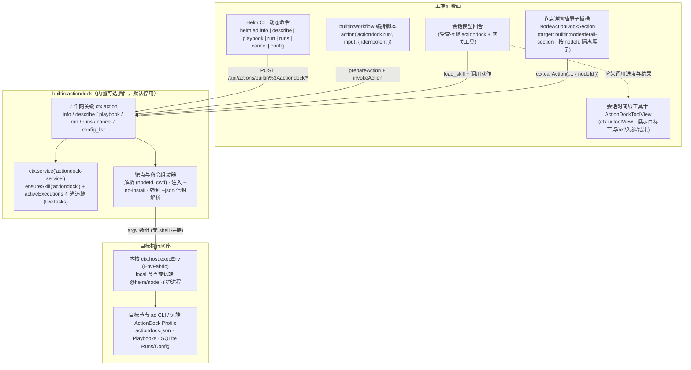

## 背景

Helm 微内核（`packages/kernel`）负责持久会话状态机、跨平台节点执行底座 `EnvFabric`（`/ws/node`，驱动 `local` 与远端 `@helm/node` 的 `execEnv` / 文件操作）、Model/Auth 以及强类型插件宿主 `PluginHost`（`definePlugin(ctx)`）；所有外部系统桥接、角色认知与编排能力均通过内置或外部插件实现。与此同时，同级工程 ActionDock 2.x（`/root/code/action-dock`，CLI 命令 `ad`）是面向 AI 智能体原子业务工具（Action）与操作规程（Playbook）的开发、纯内存沙箱测试、依赖锁定（`actiondock.json` / `actiondock.lock.json`）、静态加密配置（`ad config`，AES-256-GCM v3）与多形态交付工具链，已在本地沉淀 `sui-tools`、`cgb-bill-parser` 等垂直业务 Action 包。

当前在 Helm 会话或 `SubagentWorkflow` 确定性编排中使用 ActionDock 生态资产时，存在四处割裂：

1. **缺乏跨节点与会话坐标感知的统一桥接层**：Helm 会话与 Profile 直接绑定物理坐标 `(nodeId, cwd)`（`packages/protocol/src/conversation.ts`），而用户在会话或工作流中手工拼接 `bash` 调用 `ad` 时，既无法在 Web 端按节点直观查看该节点已挂载的 Action 包、规程与配置就绪状态，也无法在 `SubagentWorkflow` 中以结构化 `action('actiondock.run', ...)` 原语享受前置 Schema 校验与账本重放保护。
2. **扁平全量暴露与渐进式规程决议冲突**：ActionDock 生态包含大量垂直包与子动作，若将所有 ActionDock 动作静态展开为 Helm 顶层 `ctx.action` 或模型工具，会撑爆命令空间与模型工具上下文，且违背 ActionDock「先检索能力（`info`）→ 优先阅读匹配规程（`playbook show`）→ 查验字段契约（`describe`）→ 按契约调用（`run`）」的核心调度原则。
3. **写操作副作用与工作流恢复语义未对齐**：Helm 的 `builtin:workflow` 账本恢复（`packages/kernel/src/builtin-plugins/workflow/engine/journal.ts`）依赖 `idempotent` 区分只读操作与不可回滚副作用，而 ActionDock 的网络/跨进程调用存在 `SERVICE_RESULT_UNKNOWN`（请求已发出但握手或等待阶段未确认结果）与幂等键 `requestId` 机制。缺少显式映射时，工作流中断恢复可能误重放非幂等业务动作，或丢失 `requestId` 去重保护。
4. **运行期长任务与宿主生命周期脱钩**：ActionDock 支持同步执行与 `--async` 后台长任务，若不纳入插件 `ctx.service` 的 `liveTasks()` 在途追踪，停用插件或关闭宿主时会导致在途 `ad run` 进程悬空或状态不一致。

本次设计新增默认停用、按需启用的内置可选插件 `builtin:actiondock`（与 `builtin:herdr`、`builtin:magpie` 同级），在不修改 `@helm/protocol` 与内核任何一行核心代码的前提下，通过 `ctx.action` 网关动作、`ctx.host.execEnv` 跨节点靶点执行、`ctx.host.skills.ensureSkill` 受管技能自举、以及节点详情抽屉子插槽（`NODE_DETAIL_SECTION_SLOT`）与会话工具视图（`ctx.ui.toolView`），将每个节点上的 ActionDock 资产、Playbook 规程查阅、Action 契约校验执行、运行记录追踪与安全脱敏配置视图接入 Helm。

非目标：不新增独立的 `ActionDockScreen` 一级全屏视图或左栏导航项（多节点下的 `ad` 天然依附于具体节点运行，直接挂载在「节点中心」各节点的详情抽屉内）；不在 Helm 内核或插件中复制 ActionDock 的 `actiondock.lock.json` 依赖安装事务、`.actiondock/bindings.json` 路由解析或 `adenc:v1` 配置加解密逻辑（全部以目标节点的 `ad` CLI / 远端 Runner 为唯一权威）；不在插件启用或回合开始前自动运行 `ad doctor` 或触发隐式依赖安装；不通过 Web 界面明文回显或绕过 ActionDock 的敏感配置保护。

建议分支：`feature/builtin-actiondock-plugin`（建议新开分支名，非既有分支）。

---

## 整体设计

`builtin:actiondock` 位于 `packages/kernel/src/builtin-plugins/actiondock.ts` 及 `packages/kernel/src/builtin-plugins/actiondock/` 目录下，作为 `PluginHost` 的标准消费者运行，零内核特判、零新增协议包重依赖。



核心设计判断与取舍：

1. **统一采用 `ctx.host.execEnv` + `ad ... --json` argv 数组协议，不把 `@actiondock/core` 静态打包进 Hub 进程**：
   Helm 的核心特征是跨节点分布式执行（会话与 Profile 可绑定任意远端 `@helm/node` 节点与工作目录 `cwd`）。若在 Hub 进程内直接 `import '@actiondock/core'` 读写本机 SQLite，则当会话位于远端节点时，插件要么错误读取 Hub 本机数据，要么维护「本机走 SDK 内存、远端走 CLI 子进程」的双轨分叉实现。统一通过 `ctx.host.execEnv` 在目标 `(nodeId, cwd)` 上以 `command: string[]`（argv 数组，不经 Shell 解析，彻底杜绝参数注入）调用 `ad <subcommand> --json`，使本机与远端节点共享完全一致的执行路径、错误码信封与 `SecretStash` 脱敏防线。
2. **UI 按节点物理归属收敛到 `NODE_DETAIL_SECTION_SLOT`，不造跨节点混排大屏**：
   每个节点（`local` 或远端 `@helm/node`）拥有各自独立的 `ad` CLI、全局链接注册表（`~/.actiondock/registry.json`）与远端 Profile（`~/.actiondock/profiles.json`）。若新建独立全屏 `ActionDockScreen`，不仅要在左栏增加导航噪音，还要解决多节点同名包冲突、离线节点超时拖慢整页以及工作目录切换等复杂交互。直接通过 `ctx.ui.slot({ target: NODE_DETAIL_SECTION_SLOT })` 将组件嵌入「节点中心」每个节点的右侧详情抽屉，天然获得宿主传入的 `{ nodeId, isLocal, isOnline, isNew: false }` 上下文——点开哪个节点就查哪个节点的 `ad`，多节点物理隔离一目了然，零多余导航层级。
3. **网关级动作收敛 + 受管技能渐进式发现，拒绝全量动作扁平注册**：
   插件仅注册 7 个正交的网关动作（`info`、`describe`、`playbook`、`run`、`runs`、`cancel`、`config_list`），CLI 顶层命令路径统一映射为 `helm ad <action>`。模型侧通过插件自举的受管技能 `actiondock` 获得「先 `info` 检索 → 有规程必先读 `playbook` → `describe` 核对 Schema → `run` 传参执行」的决策表，按需检索和调用任意规模的 ActionDock 资产，不在系统提示词中静态灌入全量 Action Schema。
4. **默认 `--no-install` 确定性执行守卫**：
   `ad run` 本地执行默认会在首次调用前按需触发 npm/bun 依赖安装，这在后台自动化编排或受控节点上可能造成不可预期的长耗时阻塞或网络副作用。因此，`builtin:actiondock` 的 `run` 动作默认追加 `--no-install`（可通过入参 `allowInstall: true` 显式放开）；当目标包依赖未就绪时，ActionDock 立即返回 `DEPENDENCIES_NOT_READY` 结构化错误，由人类或智能体知情决策，遵守零静默副作用纪律。
5. **内置可选插件定位（默认停用、零参数工厂）**：
   遵循 `AGENTS.md` 内置插件规范，`createActionDockPlugin()` 为零参数工厂函数，在 `packages/kernel/src/app.ts` 中以 `{ enabled: false }` 注册。未使用 ActionDock 的用户零感知；启用后自动自举 `actiondock` 技能、挂载节点详情抽屉扩展区、工具卡片与 `helm ad` CLI 命令；停用后技能、命令与界面立即消失，不留幻影提示词。

---

## 详细设计

### 1. 插件配置与跨节点靶点解析

#### 1.1 插件配置 Schema（`ctx.configSchema`）

插件通过 `ctx.configSchema` 声明可选的全局默认连接与环境参数（凭据字段标记 `secret: true`，由宿主自动分离至 `credentials.json` 并登记 `SecretStash` 全局脱敏）：

| 配置键 | 类型 | `secret` | 默认值 | 说明 |
| :--- | :--- | :--- | :--- | :--- |
| `adBin` | `string` | `false` | `'ad'` | 目标节点上的 `ad` 可执行文件名或绝对路径 |
| `defaultProfile` | `string` | `false` | `''` | 默认远端 ActionDock Profile 名称（空串表示使用目标节点本地环境或节点自身当前激活 Profile） |
| `serverUrl` | `string` | `false` | `''` | 显式直连的远端 ActionDock HTTP(S) 服务地址（配置后传 `--server`） |
| `serverToken` | `string` | `true` | `''` | 远端 ActionDock 服务 Bearer Token（经环境变量或参数安全传递，全局脱敏） |
| `actiondockHome` | `string` | `false` | `''` | 覆盖目标节点 `ACTIONDOCK_HOME` 环境变量路径（隔离测试或定制全局目录时使用） |

#### 1.2 `(nodeId, cwd)` 物理坐标解析规则

所有网关动作均支持可选入参 `nodeId?: string`、`cwd?: string`、`profile?: string` 与 `conversationId?: number`。靶点按以下固定优先级解析，**严禁在远端节点离线或配置缺失时静默回退到 Hub 本机**：

1. **会话坐标继承**：若调用上下文 `context.conversationId` 存在（模型工具调用、Workflow 调用或 CLI `--current`），或入参显式提供了 `conversationId`（无外层上下文时的 CLI 调用），先调用 `ctx.host.getConversation(id)` 获取真实会话（会话不存在直接抛 `404 not_found`），提取会话绑定的 `(conv.nodeId ?? 'local', conv.cwd)` 作为基准坐标。
2. **显式参数覆盖**：入参显式传入的 `nodeId` 与 `cwd` 覆盖基准坐标（例如节点详情抽屉子插槽始终显式传入当前抽屉的 `{ nodeId }`）；若既无会话上下文也未显式传 `nodeId` / `cwd`，则默认在 `'local'` 节点与 Hub 进程工作目录执行。
3. **离线硬阻断**：调用 `ctx.host.execEnv` 时，若目标 `nodeId !== 'local'` 且节点离线，内核直接抛出 `409 node_offline`，插件原样上抛，绝不回退 `'local'`。

---

### 2. 网关动作契约（五端复用）

7 个动作均通过 `ctx.action` 注册，CLI 命令统一设置 `cli: { command: ['ad', '<subcommand>'] }`。

| 动作 ID | CLI 命令映射 | `idempotent` | `exposeAsTool` | 输入要点 | 输出与行为要点 |
| :--- | :--- | :--- | :--- | :--- | :--- |
| `info` | `helm ad info [patterns...]` | `true` | `true` | `patterns?: string[]`, `intent?: string`, `packageId?: string`, `tree?: boolean`, `profile?: string`, `nodeId?: string`, `cwd?: string`, `conversationId?: number` | 执行 `ad info ... --json`，返回匹配的 `packages`、`actions` 与 `playbooks` 摘要列表。供智能体与节点详情抽屉执行能力发现。 |
| `describe` | `helm ad describe <ref>` | `true` | `true` | `ref: string`（`<action>` 或 `<pkg>/<action>`，必填）, `packageId?: string`, `profile?: string`, `nodeId?: string`, `cwd?: string`, `conversationId?: number` | 执行 `ad describe <ref> ... --json`，返回 Action 的完整 `inputSchema`、`outputSchema`、`uses` 依赖声明、扁平赋值语法指引与示例。 |
| `playbook` | `helm ad playbook <id>` | `true` | `true` | `id: string`（Playbook ID，必填）, `packageId?: string`, `profile?: string`, `nodeId?: string`, `cwd?: string`, `conversationId?: number` | 执行 `ad playbook show <id> ... --json`，返回规程标题、描述、引用的 Action 列表与完整 Markdown 操作规程正文。 |
| `run` | `helm ad run <ref>` | `false` | `true` | `ref: string`（必填）, `input?: Record<string, unknown>`, `config?: Record<string, unknown>`, `async?: boolean`, `timeoutMs?: number`, `requestId?: string`, `allowInstall?: boolean`（默认 `false`）, `profile?: string`, `nodeId?: string`, `cwd?: string`, `conversationId?: number` | 执行目标 Action（详见 2.1 节）。同步模式返回 `{ ok: true, runId, status: 'succeeded', data, durationMs }`；`async: true` 返回 `{ ok: true, runId, status: 'running' \| 'queued' }`。 |
| `runs` | `helm ad runs [runId]` | `true` | `true` | `runId?: string`（提供时查单条详情 `ad runs show`，省略时查列表 `ad runs list --with-total`）, `packageId?: string`, `actionId?: string`, `status?: string`, `requestId?: string`, `limit?: number`, `offset?: number`, `profile?: string`, `nodeId?: string`, `cwd?: string`, `conversationId?: number` | 查询单条运行记录详情（含入参快照、返回值、错误诊断与事件流）或分页运行列表。 |
| `cancel` | `helm ad cancel <runId>` | `false` | `false` | `runId: string`（必填）, `reason?: string`, `profile?: string`, `nodeId?: string`, `cwd?: string`, `conversationId?: number` | 执行 `ad runs cancel <runId> [--reason ...] --json`，取消正在运行的异步任务并返回取消结果。 |
| `config_list` | `helm ad config [packageId]` | `true` | `false` | `packageId?: string`, `global?: boolean`, `profile?: string`, `nodeId?: string`, `cwd?: string`, `conversationId?: number` | 执行 `ad config list ... --json` 与 `ad config schema ... --json`，返回安全脱敏视图（`configured`、`secret`、`source`、`value`、`redactedPaths`）。 |

#### 2.1 `run` 动作的参数编码、幂等与不确定性处理

1. **零临时文件、零 Shell 转义的 JSON 入参传递**：
   `run` 动作接收结构化对象 `input`（默认 `{}`），在插件内通过 `JSON.stringify(input)` 序列化（提前拦截 `BigInt`、`NaN`、`Infinity`），并以 argv 数组方式组装命令：
   ```ts
   const argv: string[] = [
     adBin,
     'run',
     input.ref,
     '--json',
     '--input',
     JSON.stringify(input.input ?? {}),
   ]
   if (input.allowInstall !== true) argv.push('--no-install')
   if (input.async === true) argv.push('--async')
   if (input.requestId !== undefined) argv.push('--request-id', input.requestId)
   if (input.timeoutMs !== undefined) argv.push('--timeout', `${input.timeoutMs}ms`)
   ```
   若传入单次配置覆盖 `input.config`，对每个键值对编码为 `['-c', `${key}:=${JSON.stringify(val)}`]`。由于 `ctx.host.execEnv` 对 `string[]` 直接走 `execFile` / 节点原生 `spawn(file, args, { shell: false })`，JSON 字符串无论包含换行、引号、`$VAR` 或反斜杠均原样送达 `ad` 进程，无需落盘临时文件，也不会触发 Shell 展开。
2. **与 `builtin:workflow` 账本恢复的幂等对齐**：
   - `run` 动作定义端默认 `idempotent: false`。在 `SubagentWorkflow` 脚本中调用 `await action('actiondock.run', { ref: '...', input: {...}, requestId: '...' })` 时，若进程在执行期间崩溃，工作流账本会留下悬挂的 `action_started` 行，重启恢复时引擎按 `workflow_action_uncertain` 显式拒绝自动重跑，防止重复产生外部副作用（如重复入账、重复发消息）。
   - 对于明确无副作用的查询类 Action，或已通过确定性 `requestId` 由 ActionDock 宿主保证幂等去重的调用，工作流脚本作者可显式声明 `await action('actiondock.run', { ref: '...', requestId: '...' }, { idempotent: true })`，从而允许断点恢复时安全重放。
3. **错误信封与退出码的诚实透传**：
   ActionDock CLI 在 `--json` 模式下遇到参数错误（退出码 2）或业务/运行时失败（退出码 1）时，会在 stdout 输出 `{ ok: false, runId?, error: { code, message, details } }`。插件解析该信封并映射为 `HelmError`：
   - `ACTION_NOT_FOUND` / `PACKAGE_NOT_FOUND` → HTTP `404`（`actiondock_${code.toLowerCase()}`）；
   - `ACTION_INPUT_INVALID` / `INVALID_JSON` / `CONFIG_VALUE_INVALID` → HTTP `400`；
   - `UNAUTHORIZED` / `ACTION_FORBIDDEN` / `PACKAGE_NOT_ALLOWED` → HTTP `403`；
   - `DEPENDENCIES_NOT_READY` / `PROJECT_BUSY` / `PROJECT_RECOVERY_REQUIRED` / `PACKAGE_ID_CONFLICT` → HTTP `409`；
   - `SERVICE_RESULT_UNKNOWN` → HTTP `502`（错误 `details` 中完整保留 `profile`、`requestId`、`remoteRunId`、`resultUnknown: true`，严禁将其包装成普通重试错误误导模型盲目重跑）；
   - 若目标节点未安装 `ad` 命令（`execEnv` 返回 `ENOENT` 或退出码 127），显式抛出 `503 actiondock_cli_not_found`，指明目标 `nodeId` 与缺失命令名。

---

### 3. 在途任务追踪与停用保护（`ctx.service`）

插件注册后台服务 `ctx.service({ id: 'actiondock-service', ... })`：

1. **`start()`**：
   调用 `ctx.host.skills.ensureSkill(ACTIONDOCK_SKILL_ASSET)` 自举受管技能 `actiondock`（`managedByPlugin: 'builtin:actiondock'`）。技能内嵌完整的「先 `info` → 规程优先 `playbook` → `describe` 核验契约 → `run` 调用」决策流程与错误码自愈表，指引智能体优先使用 `builtin:actiondock` 动作，或在终端环境按标准规范调用 `ad`。
2. **`liveTasks()` 与取消传导**：
   - 插件维护进程内集合 `activeExecutions = new Map<string, { label: string; abort: AbortController }>()`；
   - 每次执行 `run`（含同步等待期间）或长耗时动作时，将任务登记入 `activeExecutions`，并将宿主 `context.signal` 与内部 `AbortController` 级联传入 `ctx.host.execEnv(..., { signal })`；
   - 当插件存在未结算的执行时，`liveTasks()` 返回非空标签数组（如 `['actiondock:run:sui/add-record']`），宿主停用预检直接以 `409 plugin_has_live_tasks` 拒绝停用或热重载，确保不会在动作写库中途强拆插件；
   - `stop()` 被调用时，遍历中止所有残留 `AbortController` 并等待在途 `execEnv` 收敛。

---

### 4. Web 前端设计：节点详情抽屉子插槽与会话工具卡

前端组件位于 `packages/kernel/src/builtin-plugins/actiondock/client/index.tsx`（纯逻辑与类型拆至 `models.ts`，样式位于 `styles.css`），严格遵守 `docs/conventions/web-frontend.md`：

#### 4.1 节点详情抽屉子插槽 `NodeActionDockSection`（`NODE_DETAIL_SECTION_SLOT`）

插件注册节点扩展插槽：

```ts
import { NODE_DETAIL_SECTION_SLOT } from '@helm/protocol'

ctx.ui.slot({
  id: 'node-actiondock-section',
  target: NODE_DETAIL_SECTION_SLOT,
  order: 20,
  client: { module: 'index.tsx', export: 'NodeActionDockSection' },
})
```

当用户在「节点中心（Nodes）」点击任意节点（`local` 或远端 `@helm/node`）滑出右侧 520px `NodeDetailDrawer` 时，宿主向 `NodeActionDockSection` 传入 `NodeDetailSlotProps`（`{ nodeId, isLocal, isOnline, isNew: false }`）：

1. **按节点严格隔离与代数竞争保护**：
   - 组件不依赖全局当前会话，所有 `ctx.callAction('info' | 'runs' | 'config_list', { nodeId, cwd, profile })` 均显式携带 `props.nodeId`；
   - 当用户在「节点中心」点击切换不同节点时，`props.nodeId` 变化触发 `generation.current += 1`，立即清空上一节点状态并作废上一节点的在途请求，严禁把节点 A 的包列表残留渲染到节点 B 的抽屉中；
   - 若 `props.isOnline === false`，组件不发起后端请求，直接通过 `.callout` 渲染「当前节点离线，无法查询 ActionDock 资产」；若目标节点未安装 `ad`（返回 `503 actiondock_cli_not_found`），如实展示「当前节点未检测到 `ad` 命令」诊断提示，绝不静默回退读取 `local` 节点。
2. **可选工作目录与 Profile 筛选条**：
   - 默认查询该节点的全局链接注册表（不传 `cwd`）；顶部提供轻量输入框/快捷选择（可从 `useConversations()` 提取绑定在该 `nodeId` 下的去重会话 `cwd` 供一键切换，也可填入可选 `profile` 名）与「刷新」按钮，满足「同一节点下存在多个项目级 `ad` 或多个远端 Profile」的切换查看需求。
3. **三段紧凑 `Tabs` 面板（全面复用宿主 `.section-flat`、`.helm-table`、`.kv-grid` 原语）**：
   - **`Packages & Actions（包与动作）`**：以 `.helm-table` 展示该节点已注册的包（名称、版本、动作数、规程数），点击某行展开该包下的 Action 列表（名称、描述、必填入参摘要）与 Playbook 规程名；
   - **`Runs（最近运行）`**：调用 `runs` 动作展示该节点最近 10 条 Action 执行记录（`runId`、动作 `ref`、状态徽章 `succeeded/failed/running`、耗时）；对 `running` 状态的异步任务提供「取消」按钮（调用 `cancel`）；
   - **`Config（配置状态）`**：按选中包调用 `config_list`，展示配置键名、就绪徽章（`已配置` / `未配置`）、来源（`package / global / env / default`）与敏感标记（`已加密隐藏`），并提供一键复制 `ad config set <KEY> -P <pkg> --browser` 命令按钮（利用共享 `CopyButton`），不在 Web 端明文回显加密凭据。

#### 4.2 会话时间线工具视图 `ActionDockToolView`（`ctx.ui.toolView`）

为暴露给模型的 5 个动作工具（`builtin:actiondock/info`、`describe`、`playbook`、`run`、`runs`）注册 `ctx.ui.toolView`：
- 标题行显示线性图标（`HelmIcon`）、动作类型与目标标识（如 `ActionDock · run sui/add-record`）、实际执行的 `nodeId` 徽章以及执行状态/耗时；
- 展开区复用宿主 `CodeBlockView` / `.kv-grid` 展示结构化入参 JSON 与脱敏后的返回结果信封。

---

## 影响分析

| 模块 / 包 | 影响面与行为变化 |
| :--- | :--- |
| `@helm/protocol` | **零改动**。直接复用现有 `NODE_DETAIL_SECTION_SLOT`、`NodeDetailSlotProps`、`ToolViewProps`、`ctx.action`、`ctx.host.execEnv` 与 `ctx.host.skills.ensureSkill`。 |
| `@helm/kernel` | 新增 `packages/kernel/src/builtin-plugins/actiondock.ts` 及 `actiondock/{contracts.ts,runner.ts,skill.ts,client/}`；`packages/kernel/src/app.ts` 的 `createHelm` 中新增一行 `await kernel.plugins.register(createActionDockPlugin(), { enabled: false })`。默认停用，对未开启该插件的现有实例与测试零影响。 |
| `@helm/cli` | **零静态代码改动**。插件启用后，7 个 `ctx.action` 自动通过 CLI 动态命令机制映射为 `helm ad info | describe | playbook | run | runs | cancel | config`，原生支持 `--json` 与 `--current` 当前会话感知；插件停用后命令即时消失。 |
| `@helm/web` | **零宿主核心代码改动**。`NodeDetailDrawer.tsx` 已内置 `<PluginSlot ownerPluginId="builtin:node" name={NODE_DETAIL_SECTION_SLOT} />`，插件启用后自动在已有节点抽屉内渲染 ActionDock 区块，停用后自动卸载。 |
| `/root/code/action-dock` | **只读零改动**。通过标准 `ad ... --json` CLI 契约通信，不侵入 ActionDock 仓库。 |

---

## 发布

本次改动为纯增量内置可选插件（默认 `enabled: false`），不涉及 `state.sqlite` 表结构变更、历史数据迁移或外部服务发布顺序依赖：

1. **启用与日常运行**：部署升级后，已有环境保持原状；需要使用 ActionDock 集成时，执行 `helm plugins enable builtin:actiondock`（或在 Web「插件中心」开启 `ActionDock` 插件），前提是目标执行节点 `PATH` 中已安装 `ad`（Node.js ≥ 24.12.0）或已在插件配置中指定 `adBin` 路径。
2. **故障隔离与恢复**：
   - 若某个节点未安装 `ad` 或远端 ActionDock 服务不可达，仅该节点的抽屉区块或动作调用返回结构化错误（`503 actiondock_cli_not_found` 或 ActionDock 错误码），不影响其他节点的正常展示，也绝不阻塞 Hub 启动、会话回合或插件启用；
   - 如需关闭或回退，执行 `helm plugins disable builtin:actiondock` 即可即时卸载所有动作、CLI 命令、`actiondock` 受管技能与节点抽屉扩展区；动作运行产生的历史记录与配置保存在各节点 ActionDock 自身的 `.actiondock/` 或 `~/.actiondock/` 目录中，停用插件不会破坏任何业务数据。

---

## 测试

测试案例集中在 `packages/kernel/test/actiondock-plugin.test.ts` 与 `packages/web/test/actiondock-client.test.ts` 中，使用 `tsx --test` 运行，单测显式声明 `{ timeout: 60_000 }`，通过构造受控的假 `ad` 可执行脚本（PATH fixture）与真实 `createHelm` 实例验证全链路，不依赖外网：

1. **插件启停生命周期与受管技能正交性（内核单测）**：
   - **前置条件**：启动 `createHelm()`，初始状态下检查插件清单、动作清单与技能清单。
   - **目标路径**：依次执行 `kernel.plugins.enable('builtin:actiondock')` → 检查 `skills.list()`、会话 `before_turn` 注入的 `<available_skills>`、`listActions()` 与 `listUi()` → 再执行 `kernel.plugins.disable('builtin:actiondock')`。
   - **预期结果**：初始默认停用；启用后 `actiondock` 技能、7 个网关动作、`NODE_DETAIL_SECTION_SLOT` 插槽贡献与 `tool.view` 全部就绪（无多余 `sidebar.item` 或 `screen`）；停用后技能、动作与 UI 贡献立即从可用列表中移除，不留幻影提示词。
2. **`info / describe / playbook / config_list` 契约解析与 argv 安全传递（内核单测）**：
   - **前置条件**：启用 `builtin:actiondock`，配置指向测试桩 `ad` 脚本（记录收到的完整 `argv` 与环境变量，并输出标准 ActionDock v2 JSON 信封）。
   - **目标路径**：分别调用 `info`（含 `intent`、`tree: true`）、`describe`（含 `<pkg>/<action>`）、`playbook` 与 `config_list`。
   - **预期结果**：插件始终以 `string[]` 数组向 `execEnv` 传入 `--json`，不触发 Shell 解析；返回结构通过 `outputSchema` 校验，且 `serverToken` 在错误与输出中被 `SecretStash` 替换为 `[REDACTED]`。
3. **`run` 动作的默认 `--no-install` 守卫、配置覆盖与错误码映射（内核单测）**：
   - **前置条件**：启用插件，准备包含特殊字符（双引号、换行、`$HOME`）的 `input` 对象与 `config` 覆盖项。
   - **目标路径**：
     1. 默认参数调用 `run`，检查透传给 `ad run` 的 `argv`；
     2. 显式传 `allowInstall: true`、`async: true`、`requestId: 'req-1'` 调用 `run`；
     3. 模拟 `ad` 返回退出码 1 及 `ACTION_INPUT_INVALID`、`DEPENDENCIES_NOT_READY`、`SERVICE_RESULT_UNKNOWN` 错误信封。
   - **预期结果**：
     1. 默认包含 `--no-install` 与 `--input <serializedJson>`，特殊字符分毫不差；
     2. `allowInstall: true` 时移除 `--no-install` 并附带 `--async`、`--request-id req-1`；
     3. 错误信封分别精确映射为 HTTP `400`、`409`、`502` 的 `HelmError`，其中 `SERVICE_RESULT_UNKNOWN` 完整保留 `remoteRunId` 与 `resultUnknown: true` 详情。
4. **跨节点坐标继承与远端节点离线硬阻断（内核单测）**：
   - **前置条件**：创建绑定在远端离线节点 `nodeId: 'remote-fin', cwd: '/srv/ledger'` 的会话 `#2`。
   - **目标路径**：在会话 `#2` 的上下文中调用 `builtin:actiondock/info` 与 `builtin:actiondock/run`。
   - **预期结果**：插件准确解析出目标 `(nodeId: 'remote-fin', cwd: '/srv/ledger')` 并交由 `execEnv` 执行，因节点离线立即抛出 `409 node_offline`，绝不在 Hub 本机 `'local'` 节点静默执行。
5. **在途任务阻断停用与 `SubagentWorkflow` 账本不确定性保护（内核集成测试）**：
   - **前置条件**：启动慢速 `ad run` 任务使其处于执行中状态。
   - **目标路径**：
     1. 在 `run` 未结束前调用 `kernel.plugins.disable('builtin:actiondock')`；
     2. 在 `SubagentWorkflow` 脚本中调用未声明 `idempotent: true` 的 `action('actiondock.run', ...)`，模拟执行中途失败后使用 `resumeFromRunId` 恢复。
   - **预期结果**：
     1. 停用请求被 `409 plugin_has_live_tasks` 拦截；待 `run` 结束后方可正常停用；
     2. 工作流恢复时检测到非幂等动作异常终态，以 `workflow_action_uncertain` 显式拒绝自动重跑；当脚本显式传入 `{ idempotent: true }` 时则允许从断点安全重跑。
6. **`NodeActionDockSection` 节点抽屉插槽隔离与代数竞争保护（前端单测）**：
   - **前置条件**：通过 `ClientCompiler` 真实编译 `builtin:actiondock` 的 `client/index.tsx` 并注入 `NodeDetailDrawer`。
   - **目标路径**：
     1. 渲染在线节点 `node-a` 的抽屉，验证发起 `callAction('info', { nodeId: 'node-a' })`；
     2. 在 `node-a` 请求尚未返回时，切换抽屉至在线节点 `node-b`，随后让 `node-a` 的旧请求返回；
     3. 切换至离线节点 `node-offline`（`isOnline: false`）。
   - **预期结果**：编译成功且零 Emoji、零原生 `<select>`；切换到 `node-b` 后旧节点 `node-a` 的响应被代数守卫丢弃，不污染 `node-b` 视图；离线节点直接展示离线提示且不发起无效后端请求。
