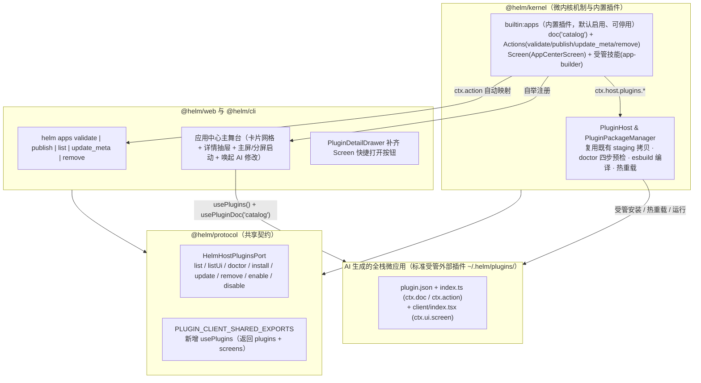

## 背景

Helm 当前具备两层界面扩展能力：一层是由 `builtin:json-render`（`packages/kernel/src/builtin-plugins/json-render.ts`）提供的聊天内联 ```` ```ui ```` 声明式卡片，包含 21 个展示与表单原语及 `helm:action`、`helm:open`、`helm:send` 三类动作指令，适合单轮对话内的轻量数据展示与参数确认，但无客户端状态存储、无自定义后端逻辑且随对话流滚动沉底；另一层是由 `PluginHost`（`packages/kernel/src/plugins/plugin-host.ts`）与 `PluginPackageManager`（`packages/kernel/src/plugins/package-manager.ts`）支撑的完整外部插件体系，支持 TypeScript 后端（`ctx.doc` SQLite 持久化、`ctx.action` 五端同权动作、`ctx.host.execEnv` 跨节点执行）、`client/*.tsx` React 前端实时编译（`packages/kernel/src/plugins/client-compiler.ts`）、四阶段静态自检（`doctorPluginDir`）与受控热重载。

当用户希望让 AI 生成一个带前后端、持久状态、可脱离聊天流反复使用的全栈微应用（如账单对账台、多节点容器监控面板、Release 追踪器），并在验证后一键发布到应用中心或随时唤起 AI 迭代升级时，现有实现存在四处缺口：

1. **宿主端口未向插件开放受管包生命周期能力**：`PluginHost` 已实现 `doctorExternalPlugin`、`installPluginPackage`、`updatePluginPackage`、`removePluginPackage`、`enable` 与 `disable`，但 `wrapHostApi`（`packages/kernel/src/plugins/host-api.ts` 第 172–179 行）仅向 `ctx.host` 暴露只读的 `listPlugins()` 与 `listUi()`。上层编排插件无法在自身 Action 中对工作区生成的应用草稿执行静态预检、受管安装、热更新或卸载。
2. **插件客户端共享 SDK 缺少插件与 Screen 列表的响应式订阅原语**：`@helm/plugin-client`（`packages/web/src/lib/plugin-client-context.ts` 与 `plugin-client-sdk.ts`）导出了 `useConversations` 与 `usePluginDoc`，但未导出订阅宿主 `plugins` 清单与 `groupedUi.screens` 的 Hook。插件自定义的「应用中心」视图无法响应式感知已安装全栈应用及其主视图（`Screen`）的启停与增删。
3. **缺少面向全栈微应用「生成、预检、发布、启动、对话迭代」的独立管理闭环**：现有的 `PluginCenter`（`packages/web/src/plugins/PluginCenter.tsx`）面向系统管理员展示底层 Hook、Tool 与配置表单，既未区分系统底座插件与业务全栈应用，也未在 `PluginCard` 或 `PluginDetailDrawer` 中提供打开插件 `Screen` 的主入口；同时 `PluginSummary` 不记录应用的创建来源会话（`originConversationId`）、工作区源码目录（`workspaceDir`）或置顶分类等产品元数据，用户无法在界面上一键跳回原对话或新建带源码上下文的对话让 AI 继续修改应用。
4. **缺少指导模型一次性写出合规全栈应用并通过 `doctor` 预检的受管技能**：现有 `helm-cli` 的 `references/skill-and-plugin-dev.md` 仅罗列底层 API，模型缺少从工作区草稿构建、执行静态自检、一键发布或输出预览发布卡片的标准作业规程（SOP）。

本次设计遵循微内核「机制与策略分离」原则：**不新建平行的第二套应用运行时或子宿主**，所有全栈微应用在底层均作为携带 `ctx.ui.screen` 的标准外部插件运行于 `PluginHost`；在宿主补齐受控插件包管理端口与客户端 `usePlugins` 响应式 Hook 的基础上，新增默认启用、可停用的内置插件 `builtin:apps`（「应用中心与全栈应用工坊」），统一承载应用目录元数据（`catalog`）、全栈应用预检与一键发布动作、左栏「应用中心」全屏启动台以及随插件启停自举的 `app-builder` 受管技能；同时在宿主 `PluginDetailDrawer` 中补齐已启用 `Screen` 的快捷打开入口。

非目标：不在宿主内为全栈应用提供沙箱隔离（生成并发布的应用与外部插件同属进程内可信代码，拥有宿主权限，界面与文档如实声明）；不扩展 `builtin:json-render` 的 JSON DSL 去承载后端逻辑或复杂状态；不要求生成的应用默认注册 `ctx.ui.sidebarItem`（避免左栏导航随应用数量增长而膨胀，统一由「应用中心」收敛入口）。

建议分支：`feature/builtin-apps-fullstack-studio`（建议新开分支名，非既有分支）。

---

## 整体设计

改动横跨 `@helm/protocol`、`@helm/kernel`、`@helm/cli` 与 `@helm/web`，保持单向依赖关系 `@helm/web` / `@helm/cli` → `@helm/protocol` ← `@helm/kernel` 不变。



核心设计判断与取舍：

1. **底层运行时 100% 复用 `PluginHost`，上层产品生命周期归口 `builtin:apps`**：
   若由 `builtin:apps` 自行管理一套应用目录、编译流水线或文档存储，将在 `PluginHost` 之上造出「套娃宿主」，导致生成的应用无法自动获得 CLI 子命令映射（`helm <appId> <action>`）、Agent Tool 暴露（`exposeAsTool: true`）、SSE 实时文档同步与 `409 plugin_has_live_tasks` 停用保护。因此，每个全栈微应用在物理形态上就是标准受管外部插件（安装于 `<dataDir>/plugins/<appId>`）；`builtin:apps` 只通过 `ctx.host.plugins` 调用宿主的 `doctor / install / update / remove`，并在自有公开文档 `ctx.doc('catalog')` 中维护 `PluginSummary` 不承载的产品级元数据（创建会话 `originConversationId`、源码工作区路径 `workspaceDir`、应用分类 `category`、图标 `icon` 与置顶状态 `pinned`）。
2. **「草稿预检（Draft Validate）」与「正式发布（Publish）」两阶段分离，零半挂载态**：
   不向 `PluginHost` 引入半挂载的临时插件状态。对于一次性展示需求，模型直接输出 ```` ```ui ```` 卡片；对于全栈微应用，模型先在会话工作区（如 `<cwd>/apps/<appId>`）生成源码并调用 `builtin:apps` 的 `validate` 动作（内部执行 `doctorPluginDir` 真实校验清单、TS 后端转译、`definePlugin` 注册契约与 React 客户端导出）。
   - 若用户要求直接可用：模型立即调用 `publish` 动作完成安装启用，并输出含「在分屏中打开应用」按钮的 ```` ```ui ```` 卡片；
   - 若用户希望先审阅再决定是否常驻：模型仅执行 `validate`，输出包含应用结构摘要与「一键发布到应用中心」按钮（绑定 `helm:action` → `builtin:apps/publish`）的 ```` ```ui ```` 卡片，由用户点击后再触发受管安装。
3. **默认只注册 `ctx.ui.screen`，由「应用中心」统一收敛启动入口**：
   AI 生成的全栈微应用在 `definePlugin` 中必须声明至少一个 `ctx.ui.screen`，默认不声明 `ctx.ui.sidebarItem`，防止用户生成十几个工具后左栏「视图」分组被塞满。左栏仅常驻 `builtin:apps` 贡献的一个「应用中心」入口；用户在应用中心内可一键「主屏打开」或「右屏并排打开」任意应用，也可通过 URL Hash `#/s/<appId>/<screenId>` 直接深链访问。
4. **完全遵循可停用插件铁律**：
   `builtin:apps` 默认启用、非 `locked` 可停用。停用 `builtin:apps` 后，左栏「应用中心」入口、`helm apps ...` 动作与 `app-builder` 技能即时从系统中消失（不留幻影提示词）；此前已通过它发布到 `<dataDir>/plugins/<appId>` 的全栈微应用作为独立受管插件继续正常运行，不受 `builtin:apps` 停用的影响。

---

## 详细设计

### 1. 宿主插件管理端口扩展（`@helm/protocol` 与 `@helm/kernel`）

#### 1.1 `HelmHostPluginsPort` 契约

在 `packages/protocol/src/plugin.ts` 中新增 `HelmHostPluginsPort` 并挂载到 `HelmHostApi.plugins`（同时保留 `HelmHostApi.listPlugins()` 与 `listUi()` 以兼容既有插件调用）：

```ts
export interface HelmHostPluginsPort {
  /** 当前全部已注册插件摘要（与 listPlugins() 同源）。 */
  list(): PluginSummary[]
  /** 当前全部已启用插件的 UI 贡献清单（与 listUi() 同源）。 */
  listUi(): PluginUiContribution[]
  /** 对指定绝对路径目录或已注册外部插件 ID 执行四阶段静态自检（manifest/backend/register/client）。 */
  doctor(target: { dir?: string; id?: string }): Promise<PluginDoctorReport>
  /** 从 npm/git/local 来源受管安装外部插件包；enable: true 时安装后立即启用。 */
  install(source: string, options?: { enable?: boolean }): Promise<PluginInstallResult>
  /** 重新拉取受管插件包的安装来源、执行预检并原子热重载（保持启用状态与已有 ctx.doc 数据）。 */
  update(pluginId: string): Promise<PluginUpdateResult>
  /** 卸载受管安装的外部插件包并清理受管目录（内置插件 403，在途任务 409）。 */
  remove(pluginId: string): Promise<PluginRemoveResult>
  /** 启用已注册插件。 */
  enable(pluginId: string): Promise<PluginSummary>
  /** 停用已注册插件（locked 403，在途任务 409，持久占用非 force 409）。 */
  disable(pluginId: string, options?: { force?: boolean }): Promise<PluginSummary>
}
```

#### 1.2 `wrapHostApi` 与安全边界守卫

在 `packages/kernel/src/plugins/host-api.ts` 与 `plugin-host.ts` 中将 `deps.pluginsPort` 接入 `wrapHostApi`：

- 所有异步修改方法（`doctor`、`install`、`update`、`remove`、`enable`、`disable`）均通过 `tracked('host.plugins.<op>', ...)` 包装：调用前执行 `guard()` 校验当前插件处于有效启用周期（非 `deactivating` / `disposed`），执行期间计入调用方插件的 `PluginTaskTracker` 在途任务计数。
- **自指死锁防护（Self-Target Guard）**：由于 `PluginHost` 对单插件生命周期采用 `enqueue(pluginId, ...)` 串行队列，若插件 A 在其自身的 Action（持有插件 A 的 `tracker` 在途任务）中调用 `ctx.host.plugins.disable(A)`、`remove(A)` 或 `update(A)`，将触发 `assertNoLiveTasks(A)` 失败或队列自等待。因此，`host.plugins.update / remove / disable` 在入口处显式校验：`if (targetPluginId === pluginId)` 立即抛出 `HelmError('plugin_self_lifecycle_forbidden', '插件不得在自身运行任务中更新、停用或卸载自身', 409, { pluginId })`。
- **输出结果统一脱敏**：`doctor`、`install`、`update` 返回的结构化报告或错误诊断文本在出站前经过 `redactJsonValue` 脱敏，防止构建输出中的敏感环境变量进入模型上下文。

---

### 2. 客户端共享 SDK 扩展与插件中心快捷打开（`@helm/protocol` 与 `@helm/web`）

#### 2.1 `@helm/plugin-client` 新增 `usePlugins`

1. 在 `packages/protocol/src/ui.ts` 中新增导出类型并将 `'usePlugins'` 加入 `PLUGIN_CLIENT_SHARED_EXPORTS`：
   ```ts
   export interface UsePluginsResult {
     /** 宿主当前全部插件摘要（随 SSE plugin.changed 实时同步）。 */
     plugins: PluginSummary[]
     /** 当前全部已启用插件注册的 Screen 贡献列表。 */
     screens: Array<{ pluginId: string; spec: ScreenSpec }>
   }
   ```
2. 在 `packages/web/src/lib/plugin-client-context.ts` 中实现并导出 `usePlugins()`：
   ```ts
   export function usePlugins(): UsePluginsResult {
     const store = useHelmStore()
     return {
       plugins: store.plugins,
       screens: store.groupedUi.screens,
     }
   }
   ```
   `store.plugins` 与 `store.groupedUi.screens` 在 `HelmStoreProvider` 中已由 SSE 首帧与 `plugin.changed` 事件实时驱动，无需额外发起 HTTP 轮询。

#### 2.2 `PluginDetailDrawer` 补齐视图打开入口

在 `packages/web/src/plugins/PluginDetailDrawer.tsx` 中：
- 从 `store?.groupedUi?.screens` 查找 `s.pluginId === plugin?.id` 的所有 `ScreenSpec`。
- 当插件处于 `enabled` 状态且至少声明了一个 `Screen` 时，在抽屉顶部的操作栏（`plugin-drawer-action-bar`）渲染 **「打开视图」**（调用 `store.openTarget({ kind: 'screen', pluginId: plugin.id, screenId: primaryScreen.id })` 并关闭抽屉）与 **「右屏打开」**（调用 `store.openTarget(..., { split: true })`）按钮，使底层「插件中心」也能直接启动任何带界面的插件。

---

### 3. 内置插件 `builtin:apps`（应用中心与全栈应用工坊）

在 `packages/kernel/src/builtin-plugins/apps.ts` 及 `packages/kernel/src/builtin-plugins/apps/` 下新增内置插件 `builtin:apps`，并在 `createHelm`（`packages/kernel/src/app.ts`）中默认启用注册（`await kernel.plugins.register(createAppsPlugin())`）。

#### 3.1 公开文档 `catalog` 数据契约

`builtin:apps` 注册公开持久文档 `ctx.doc<AppsCatalogDoc>('catalog', { apps: {} }, { public: true })`：

```ts
export type AppCategory = 'productivity' | 'devops' | 'data' | 'finance' | 'automation' | 'other'

export interface AppCatalogEntry {
  /** 对应受管插件的 pluginId。 */
  pluginId: string
  /** 应用显示图标（lucide 图标名，缺省 'layout-grid'）。 */
  icon: string
  /** 业务分类标签。 */
  category: AppCategory
  /** 是否在应用中心置顶收藏。 */
  pinned: boolean
  /** 开发该应用的工作区源码绝对路径（供后续 AI 修改后直接执行 publish 热更新）。 */
  workspaceDir?: string
  /** 首次生成或最近迭代该应用的会话 ID（供一键跳回原对话继续迭代）。 */
  originConversationId?: number
  /** 首次发布时间戳（epoch 毫秒）。 */
  publishedAt: number
  /** 最近一次发布/更新时间戳（epoch 毫秒）。 */
  updatedAt: number
}

export interface AppsCatalogDoc {
  apps: Record<string, AppCatalogEntry>
}
```

**发现与合并规则（自动兼容非 `publish` 途径安装的带界面插件）**：
前端「应用中心」与后端 `list` 动作通过将宿主 `plugins` + `screens` 与 `catalog.apps` 左连接（Left Join）生成完整应用视图：
- 凡是满足 **「在 `catalog.apps` 中有登记」** 或 **「属于外部插件（`!id.startsWith('builtin:')`）且声明了至少一个 `ctx.ui.screen`（或已被受管安装且带 `Screen`）」** 的插件，均作为「应用」展示；
- 内置系统插件（如 `builtin:superagent` 的 `recall-graph`、`builtin:apps` 自身的 `center`）不混入用户应用列表；
- 若用户直接通过 `helm plugins remove <id>` 卸载了某个插件，应用中心在渲染与 `list` 时自动忽略 `plugins` 中已不存在的孤儿 `catalog` 条目，并在下次 `publish` / `remove` 时顺带清理。

#### 3.2 单点 Schema 动作（HTTP / CLI `helm apps ...` / Agent Tool 同权）

`builtin:apps` 注册以下 5 个动作：

| 动作 ID | CLI 命令映射 | `exposeAsTool` | `idempotent` | 职责与执行逻辑 |
| :--- | :--- | :--- | :--- | :--- |
| `validate` | `helm apps validate <dir>` | `true` | `true` | 接收 `{ dir: string }`（工作区应用目录路径，相对路径按调用会话绑定 `cwd` 或 Hub `cwd` 解析为绝对路径）。调用 `ctx.host.plugins.doctor({ dir })`，此外额外检查该插件在 `register` 阶段是否至少声明了一个 `ctx.ui.screen`（全栈应用必须具备前端 Screen 视图，缺失则在报告中追加 `missing_app_screen` 失败项）。返回结构化预检报告 `{ ok, pluginId, checks, screenIds, summary }`。 |
| `publish` | `helm apps publish <dir>` | `true` | `false` | 接收 `{ dir: string, icon?: string, category?: AppCategory, pinned?: boolean, conversationId?: number }`。<br/>1. 先执行与 `validate` 相同的校验（未通过直接 422 拒绝，附完整诊断）；<br/>2. 检查目标 `pluginId` 是否已作为受管包安装：若未安装，或原受管记录的 `source` 路径与本次 `dir` 不同，调用 `ctx.host.plugins.install(dir, { enable: true })`（若 `enableError` 存在则 422 报错返回）；若已安装且同源，调用 `ctx.host.plugins.update(pluginId)`，若处于停用态再调用 `enable(pluginId)`；<br/>3. 更新 `catalog` 文档（记录 `workspaceDir: resolvedDir`、`originConversationId: input.conversationId ?? context.conversationId`、`icon`、`category`、`pinned` 与时间戳）并 `await catalog.flush()`；<br/>4. 返回 `{ pluginId, mode: 'installed' \| 'updated', screenTarget: 'screen:<pluginId>/<firstScreenId>', catalogEntry, summary }`。 |
| `list` | `helm apps list` | `true` | `true` | 汇总当前所有全栈应用（合并 `ctx.host.plugins.list()`、`ctx.host.plugins.listUi()` 中的 `screen` 与 `catalog.apps`），返回每个应用的 `{ pluginId, name, description, version, enabled, status, error, screens, catalog }`。 |
| `update_meta` | `helm apps update_meta <pluginId>` | `false` | `false` | 接收 `{ pluginId: string, pinned?: boolean, category?: AppCategory, icon?: string, workspaceDir?: string, originConversationId?: number }`。校验目标插件存在后，更新 `catalog.apps[pluginId]` 并 `flush()`。供 Web 端置顶、修改分类或绑定工作区使用。 |
| `remove` | `helm apps remove <pluginId>` | `false` | `false` | 接收 `{ pluginId: string }`。调用 `ctx.host.plugins.remove(pluginId)` 卸载受管插件包，随后删除 `catalog.apps[pluginId]` 并 `flush()`。 |

> **跨节点诚实性约束**：当调用会话绑定在远端节点（`conv.nodeId !== 'local'`）且传入相对路径时，`validate` 与 `publish` 动作显式检查会话 `nodeId`：由于 `PluginHost` 与 `PluginPackageManager` 运行在 Hub 主机上，仅支持从 Hub 本机文件系统（`local` 节点）或 Git/npm 源安装插件。若会话位于远端节点且目标路径不在 Hub 本机，立即抛出 `400 app_source_must_be_on_hub` 显式错误，指引使用 Hub 本机工作区或 Git 仓库，绝不静默在 Hub 本机找同名路径冒充。

#### 3.3 前端全屏视图 `AppCenterScreen`（`client/index.tsx` + `client/styles.css`）

`builtin:apps` 注册：
- 左栏导航项：`ctx.ui.sidebarItem({ id: 'app-center', label: '应用中心', icon: 'layout-grid', target: 'screen:builtin:apps/center', order: 15 })`
- 全屏视图：`ctx.ui.screen({ id: 'center', label: '应用中心', icon: 'layout-grid', client: { module: 'index.tsx', export: 'AppCenterScreen' } })`

`AppCenterScreen` 严格遵守 [Web 前端设计系统与开发约定](../../conventions/web-frontend.md) 与 [Web 导航与 URL Hash 开发约定](../../conventions/web-navigation.md)：

1. **顶栏与筛选工具栏**：
   - 标题「应用中心」、副标题「AI 生成与受管安装的全栈微应用工作台」、统计摘要（`共 N 个应用 · M 个已就绪`）以及 **「让 AI 创建新应用」** 主按钮（点击在当前或新会话回填创建引导词并切屏）。
   - 搜索框（按名称、`pluginId`、描述、Action 搜索）与分类药丸标签栏：`全部`、`已置顶`、`效率工具 (productivity)`、`运维监控 (devops)`、`数据看板 (data)`、`财务记账 (finance)`、`自动化 (automation)`。
   - 筛选分类、搜索词与右侧选中详情应用 ID 编码在 `ScreenProps.params`（`tab`、`q`、`app`）中，支持主屏 `sp.*` 与分屏 `ssp.*` 独立深链恢复。
2. **响应式应用卡片网格（`AppCard`）**：
   - 展示应用线性图标（`HelmIcon`）、应用名称、版本号徽章、置顶星标按钮、状态徽章（`已就绪` / `已停用` / `异常`）、功能描述与包含的视图/动作计数胶囊。
   - **卡片底部直接操作栏（零层级直达）**：
     - 当应用已启用且有 `Screen` 时：主按钮 **「打开应用」**（`ctx.openScreen('screen:<pluginId>/<screenId>')`）、次按钮 **「分屏打开」**（`ctx.openSplitScreen('screen:<pluginId>/<screenId>')`）；
     - 当应用已停用时：显示 **「启用并打开」** 按钮；
     - 辅助图标按钮：**「让 AI 修改」**（一键触发对话迭代）。
3. **右侧 520px 应用详情与管理抽屉（基于 `@helm/plugin-client` 共享 `Dialog` 原语）**：
   - 点击卡片空白处滑出详情抽屉（同步 `setParams({ app: pluginId })`）：
     - 展示应用所有 `Screen` 列表（多视图应用可分别主屏/分屏打开）、后端 `Actions` 与 `Tools` 清单；
     - 展示并可编辑应用元数据：置顶开关（`Switch`）、分类下拉（共享 `Select` 原语）、关联源码目录 `workspaceDir`（`mono selectable`）与创建会话 `#originConversationId`；
     - **「在对话中继续迭代此应用」** 按钮：
       - 若 `originConversationId` 存在且在 `useConversations()` 中未删除：调用 `ctx.openScreen('conversation:' + originConversationId)` 打开原对话，并将应用右侧分屏并排打开（`ctx.openSplitScreen('screen:' + pluginId + '/' + screenId)`），方便边看边改；
       - 若原会话不存在：通过 `ctx.notify` 提示并在主屏打开当前会话，同时复制或提示该应用的 `pluginId` 与 `workspaceDir`；
     - 底部管理操作：**「热更新同步（从源码目录重新发布）」**（调用 `publish` 动作）与 **「卸载应用」**（二次确认后调用 `remove` 动作）。

---

### 4. 受管技能 `app-builder` 与对话内预览/发布闭环

`builtin:apps` 在 `ctx.service({ id: 'app-builder-skill' })` 的 `start()` 中调用 `ctx.host.skills.ensureSkill` 自举受管技能 `app-builder`（声明 `managedByPlugin: builtin:apps`）：

- `SKILL.md`：定义触发条件（当用户要求“生成一个应用/全栈应用/可视化工具台/看板并能反复使用或发布到应用中心”时加载），明确区分 **L1 临时卡片（```` ```ui ````）** 与 **L2 全栈微应用（`builtin:apps` 插件包）** 的选型边界，并规定四步标准交付 SOP：
  1. **规划与目录初始化**：默认在 `<cwd>/apps/<app-id>/` 下创建 `plugin.json`、`index.ts`、`client/index.tsx`、`client/styles.css`；命名与图标遵守零 Emoji 铁律；
  2. **全栈编码约束**：
     - 后端 `index.ts`：使用 `ctx.doc('<name>', initialState, { public: true })` 持久化业务数据；使用 `ctx.action({ id, description, inputSchema, outputSchema, exposeAsTool: true, handler })` 编写增删改查或跨节点执行逻辑（写操作后调用 `await doc.flush()`）；注册 `ctx.ui.screen({ id: 'main', label: '...', client: { module: 'index.tsx', export: 'MainScreen' } })`，**默认不注册 `sidebarItem`**；
     - 前端 `client/index.tsx`：从 `@helm/plugin-client` 导入 `usePluginContext`、`usePluginDoc` 及共享 UI 原语（`HelmIcon`、`Tabs`、`Select`、`Switch`、`Dialog`、`Callout`），使用宿主 CSS 变量（`var(--bg-elevated)`、`var(--border)` 等）保持暗色/亮色主题自适应，组件文件仅导出组件与类型；
  3. **强制静态自检（Zero-Broken-App）**：编写或修改代码后，**必须**调用 `apps_validate` 工具（或 `helm apps validate <dir> --json`）。若 `ok: false`，根据 `checks` 报告当场修复 TS 类型、Schema 或 React 导出错误，直至 `ok: true`，严禁跳过预检直接交付；
  4. **发布或草稿预览交付**：
     - 若用户指令为直接生成可用应用或升级已有应用：调用 `apps_publish`（传入 `dir`、`icon`、`category`），随后在回复正文中输出 ```` ```ui ```` 交付卡片，包含「在右屏并排打开应用」（`{ "type": "helm:open", "target": "screen:<appId>/main", "split": true }`）与「进入应用中心」（`{ "type": "helm:open", "target": "screen:builtin:apps/center" }`）按钮；
     - 若用户要求“先生成草稿看看，合适再发布”：仅完成 `apps_validate`，在回复中输出 ```` ```ui ```` 预览卡片，展示应用的数据结构与动作列表，并提供「一键发布到应用中心」按钮（`{ "type": "helm:action", "pluginId": "builtin:apps", "actionId": "publish", "input": { "dir": "<absDir>", "category": "..." } }`）。
- `references/fullstack-template.md`：提供一份可直接参考的完整全栈应用最小可运行代码模板（含后端 `ctx.doc` + CRUD `ctx.action`、前端 `usePluginDoc` + `callAction` + 表单交互 + `styles.css`）。

---

## 影响分析

| 模块 / 包 | 影响面与行为变化 |
| :--- | :--- |
| `@helm/protocol` | `HelmHostApi` 新增 `plugins: HelmHostPluginsPort`；`PLUGIN_CLIENT_SHARED_EXPORTS` 新增 `'usePlugins'` 及 `UsePluginsResult` 类型。 |
| `@helm/kernel` | `host-api.ts` 与 `plugin-host.ts` 接入 `host.plugins` 端口并含自指生命周期守卫；新增 `packages/kernel/src/builtin-plugins/apps.ts` 及 `apps/client/`、`apps/skill/`；`app.ts` 注册 `createAppsPlugin()`；`profile/catalog.ts` 将 `app-builder` 纳入内置技能目录白名单。 |
| `@helm/cli` | `builtin:apps` 的 5 个 `ctx.action` 自动通过动态命令机制映射为 `helm apps validate | publish | list | update_meta | remove`，支持 `--json` 与 `--current`。 |
| `@helm/web` | `plugin-client-context.ts` 与 `plugin-client-sdk.ts` 导出 `usePlugins`；`PluginDetailDrawer.tsx` 对含已启用 `Screen` 的插件展示「打开视图 / 右屏打开」按钮；左栏「视图」区新增「应用中心」入口。 |

---

## 发布

本次改动位于单仓四包内，无数据库表结构变更，无外部迁移依赖：

1. **存量数据与兼容性**：`builtin:apps` 使用独立的插件文档键 ` (`builtin:apps`, `catalog`) ` 存于 `state.sqlite` 的 `plugin_docs` 表；此前用户已通过 `helm plugins install` 安装的任何带 `Screen` 的外部插件，在启用 `builtin:apps` 后会被自动识别并展示在「应用中心」列表中。
2. **故障隔离与恢复**：若不再需要应用中心能力，用户可随时通过 `helm plugins disable builtin:apps` 或在插件中心关闭开关，其 UI 入口、CLI 动态命令与 `app-builder` 技能立即卸载；若需版本回退，直接回滚提交重启 Hub 即可，已存储在 `<dataDir>/plugins/<appId>` 的外部插件不受影响。

---

## 测试

所有测试案例均在 `packages/protocol/test/`、`packages/kernel/test/`、`packages/cli/test/` 与 `packages/web/test/` 中通过 `tsx --test` 运行，单测显式声明 `{ timeout: 60_000 }`：

1. **`ctx.host.plugins` 端口转发与自指死锁拦截（内核单测）**：
   - **前置条件**：启动带 `PluginPackageManager` 的 `PluginHost`，准备一个含 `Screen` 的合法外部插件源码目录 `sample-app` 与一个存在语法错误的目录 `broken-app`。
   - **目标路径**：通过插件内部调用 `ctx.host.plugins.doctor`、`install`、`update`、`disable`、`enable`、`remove`；并构造插件在自身 Action 中调用 `ctx.host.plugins.remove( ctx.pluginId )`。
   - **预期结果**：`doctor` 对 `broken-app` 返回 `ok: false`，对 `sample-app` 返回 `ok: true`；`install` / `update` / `remove` 正常完成受管生命周期；插件对自身调用 `remove` / `disable` / `update` 时立即抛出 `409 plugin_self_lifecycle_forbidden`。
2. **`builtin:apps` 的 `validate` 与 `publish` 全链路闭环（内核集成测试）**：
   - **前置条件**：启动 `createHelm`，在临时工作区创建两个插件草稿：一个是仅声明了后端 Action 但未声明 `ctx.ui.screen` 的 `no-screen-app`，另一个是包含 `ctx.doc('items')`、`ctx.action('add_item')` 与 `ctx.ui.screen('main')` 的完整全栈应用 `todo-app`。
   - **目标路径**：
     1. 调用 `builtin:apps` 的 `validate` 动作分别校验两个目录；
     2. 调用 `publish` 发布 `todo-app`（传入 `conversationId: 1, category: 'productivity', pinned: true`）；
     3. 调用 `todo-app` 的 `add_item` 动作写入一条数据；
     4. 修改 `todo-app` 工作区源码（将版本号从 `0.1.0` 改为 `0.2.0` 并新增一个 Action），再次调用 `publish`；
     5. 调用 `builtin:apps` 的 `remove` 卸载 `todo-app`。
   - **预期结果**：
     1. `no-screen-app` 校验返回 `ok: false` 且包含 `missing_app_screen` 错误；`todo-app` 校验返回 `ok: true` 且 `screenIds` 含 `'main'`；
     2. 首次 `publish` 返回 `mode: 'installed'`、`screenTarget: 'screen:todo-app/main'`，`catalog` 文档落盘且 `todo-app` 处于 `active` 状态；
     3. 第二次 `publish` 返回 `mode: 'updated'`，版本号更新为 `0.2.0`，且此前写入 `ctx.doc('items')` 的数据完整保留；
     4. `remove` 后受管目录与 `catalog.apps['todo-app']` 均被清理。
3. **远端节点路径边界拦截（内核单测）**：
   - **前置条件**：创建绑定在远端节点 `nodeId: 'remote-dev'` 的会话 `#2`。
   - **目标路径**：在会话 `#2` 上下文中以相对路径 `./my-app` 调用 `builtin:apps` 的 `validate` 或 `publish`。
   - **预期结果**：显式拒绝并抛出 `400 app_source_must_be_on_hub`，不在 Hub 本机工作区误解析路径。
4. **`builtin:apps` 启停对 `app-builder` 技能与已发布应用的正交性（内核单测）**：
   - **前置条件**：通过 `builtin:apps` 发布 `todo-app` 后，调用 `kernel.plugins.disable('builtin:apps')`。
   - **目标路径**：检查当前可用技能目录、UI 贡献列表以及 `todo-app` 的运行状态。
   - **预期结果**：`app-builder` 技能与 `screen:builtin:apps/center` 立即从可用列表中消失；但 `todo-app` 仍保持 `active`，其 `Screen` 与 `Action` 正常可用。
5. **`@helm/plugin-client` 的 `usePlugins` 与 `AppCenterScreen` 交互（前端单测）**：
   - **前置条件**：挂载包含 `builtin:apps` 及两个已发布应用（一个 `enabled: true, pinned: true`，一个 `enabled: false`）的 `HelmStoreProvider`。
   - **目标路径**：渲染 `AppCenterScreen`，验证分类 Tab 切换、关键字搜索、点击「打开应用」/「分屏打开」、点击卡片打开详情抽屉、点击「让 AI 修改」跳转原会话并开启右屏分屏；同时测试 `PluginDetailDrawer` 对含 `Screen` 插件的快捷打开按钮。
   - **预期结果**：组件真实编译挂载成功（零 Emoji）；分类与搜索过滤准确；点击「打开应用」与「分屏打开」分别将 `primaryTarget` / `splitTarget` 设为 `{ kind: 'screen', pluginId: '<appId>', screenId: 'main' }`；点击「让 AI 修改」将主屏切至 `originConversationId` 并将右屏设为应用视图。
6. **CLI 动态命令同权验证（CLI 单测）**：
   - **前置条件**：启动测试 Hub。
   - **目标路径**：执行 `helm apps validate <dir> --json`、`helm apps publish <dir> --category devops --pinned --json`、`helm apps list --json`、`helm apps remove <id> --json`。
   - **预期结果**：CLI 命令正常解析并输出符合 Schema 的 JSON 结果。
