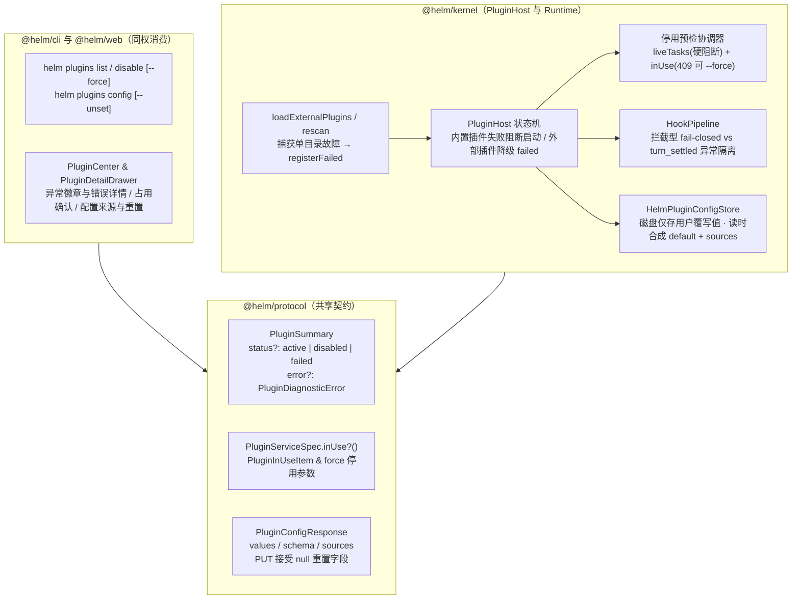

## 背景

Helm 通过 `PluginHost`（`packages/kernel/src/plugins/plugin-host.ts`）与 `@helm/protocol`（`packages/protocol/src/plugin.ts`）提供进程内强类型插件宿主，承载 9 个内置插件与 `<dataDir>/plugins/<id>/` 下的外部插件。当前插件机制在生命周期屏障（`prepare -> start`）、启用周期守卫（`epoch`）、在途任务停用拦截（`409 plugin_has_live_tasks`）以及单点 Action 五端同权复用上已经完备，但在故障隔离、持久资源引用检查、回合结算管道健壮性、配置溯源与外部插件诊断上仍存在五处设计缺口：

1. **外部插件单点故障拖垮整个 Hub 启动**：`loadExternalPlugins`（`packages/kernel/src/plugins/external-loader.ts` 第 61–101 行）在 `createHelm` 启动期间逐个扫描并导入 `<dataDir>/plugins/` 目录。任一外部插件出现 `plugin.json` 语法损坏、入口文件缺失、TypeScript 转译错误、导出契约非法或自动恢复启用失败时，异常直接向上抛出并中断 `createHelm`，导致整个 Hub 进程无法启动；同时 `PluginSummary` 仅包含布尔值 `enabled`，无法表达「插件已发现但加载或启用失败」的诊断状态。
2. **停用预检只覆盖运行时瞬态任务，未覆盖持久资源占用（`InUse`）**：`PluginHost.disable`（`plugin-host.ts` 第 286–314 行）通过 `assertNoLiveTasks` 与 `assertProvidersIdle` 拦截执行中的工具调用、Hook 与后台任务，但不检查静态持久资源引用。当用户已将某 Profile 的 `runtime.kind` 绑定为 `herdr`（由 `builtin:herdr` 注册 `profileRuntime`）、或某 Profile 的 `model` 指向 `magpie/*`（由 `builtin:magpie` 注册 Provider）、或 `builtin:triggers` 已配置开启的 `cron` / `webhook` 规则时，停用对应插件会直接成功，导致关联会话或触发器在后续执行时才因找不到运行时或模型而报错。
3. **`turn_settled` 结算钩子缺乏单插件异常隔离**：`HookPipeline.run`（`packages/kernel/src/plugins/hooks.ts` 第 258–316 行）对全部 7 个生命周期 Hook 采用相同的串行短路策略——任一处理器抛出异常即包装为 `HelmError('hook_execution_failed', 500)` 并中断管道。对于拦截与改写型钩子（`trigger`、`input`、`before_turn`、`tool_call`、`tool_result`、`agent_spawn`），失败中断（`fail-closed`）符合安全预期；但 `turn_settled`（`packages/kernel/src/runtime/runtime.ts` 第 415–423 行）属于回合终态结算与通知钩子，若优先级较高的外部插件在 `turn_settled` 中抛出未捕获异常，将直接阻断后续 `builtin:superagent` 的 Worker 汇报投递、RecallGraph 节点落盘以及全局 `turn.settled` 事件发布。
4. **插件配置固化默认值后丢失来源层级且不支持重置回默认值**：`HelmPluginConfigStore.apply`（`packages/kernel/src/runtime/plugin-config-store.ts` 第 137–146 行）在保存配置时，会将用户未传入但 `configSchema` 声明了 `default` 的字段一并写入 `config.json` 或 `credentials.json`。这导致两点问题：一是插件升级调整 `configSchema.default` 后，磁盘上被固化的旧默认值会永久遮蔽新默认值；二是 `GET /api/plugins/:id/config` 只返回合并后的 `{ values, schema }`，Web 端与 CLI 无法区分某个字段是「用户显式配置（`configured`）」还是「回退默认值（`default`）」，也无法将单个字段或已配置的 `secret` 密钥清除重置。

> 注：外部插件开发闭环（`POST /api/plugins/doctor`、`POST /api/plugins/:id/reload`、`POST /api/plugins/rescan` 及 `helm plugins init / doctor / reload / rescan`）已在 `bb46d73bb`（`feat(plugin): 完善外部插件开发闭环`）中落地实现（见 `packages/kernel/src/plugins/plugin-doctor.ts` 与 `external-loader.ts`），本文不再重复设计。

对照同级项目 Magpie（`internal/pluginrt` 与 `internal/plugin`）的插件治理经验，其针对 Go 宿主与不可信第三方生态设计的 Bun 子进程 NDJSON 协议、流式 credit window、进程内 JS 引擎与 `iframe` 页面沙箱不适用于 Helm 的 Node.js/TypeScript 同构可信插件架构；但其在生命周期治理上的核心原则——**单插件故障降级隔离（`failed` 态附诊断原因）、持久资产占用停用保护（`InUse`）、扩展点失败语义分级、以及配置分层合成与只存用户显式覆写值**——与 Helm 的第一性原理、KISS 原则和诚实性纪律高度契合。

本次设计在不引入子进程 IPC、不引入插件静态依赖图（`Requires/Provides`）、不建设中心化插件市场数据库的前提下，将上述四项尚未实现的治理机制原生融入 `PluginHost`、`@helm/protocol`、`@helm/cli` 与 `@helm/web`。

非目标：不在宿主内为外部插件提供进程隔离或代码沙箱（外部插件仍为拥有宿主权限的可信代码）；不重复修改已落地的 `doctor / reload / rescan / init` 契约；不新增独立插件市场服务或包管理器封装。

建议分支：`feature/plugin-governance-and-isolation`（建议新开分支名，非既有分支）。

---

## 整体设计

改动横跨 `@helm/protocol`、`@helm/kernel`、`@helm/cli` 与 `@helm/web` 四个包，保持 `@helm/web` / `@helm/cli` → `@helm/protocol` ← `@helm/kernel` 的单向依赖边界不变。



核心设计判断与取舍：

1. **内置插件启动失败立刻阻断，外部插件加载或恢复失败隔离为 `failed` 态**：
   内置插件（`builtin:*`）是系统随二进制交付的自有代码，任何注册或启动期异常均代表代码缺陷，必须在 `createHelm` 阶段立刻抛出并中止启动。外部插件位于用户数据目录 `<dataDir>/plugins/<dir>`，受用户手工编辑或环境影响大；当外部插件在启动扫描、模块导入、`definePlugin` 执行或自动恢复启用阶段失败时，宿主回滚该插件已登记的部分能力，将其作为 `status: 'failed'` 条目保留在 `PluginHost` 注册表中并暴露结构化错误诊断，既保证 Hub 与其余正常插件可用，又不在列表界面静默抹掉出错的插件（遵守诚实性纪律）。真实文件系统级故障（如 `<dataDir>/plugins` 根目录权限拒绝 `EACCES`）仍显式上抛，不伪装成空目录或单插件错误。
2. **运行期在途任务（`liveTasks`）硬阻断 vs 持久资源占用（`inUse`）显式确认**：
   `liveTasks` 代表正在执行中的异步操作或未决 I/O，强行停用会造成状态撕裂，因此始终硬性拒绝（`409 plugin_has_live_tasks`，不提供强制跳过）。`inUse` 代表静态配置或持久资产引用（例如某 Profile 配置了该插件提供的 `runtime.kind` 或 `provider`），停用不会破坏底层存储，但会导致关联资产暂时不可执行。因此 `disable` 默认拒绝并返回 `409 plugin_in_use` 及具体引用列表；调用方可通过显式传入 `force: true`（CLI `--force` 或 Web 确认弹窗）在知情前提下停用。
3. **`turn_settled` 逐处理器隔离异常，不新造第二套 Observer 扩展点**：
   不为观察需求额外发明与 `turn_settled` 重叠的 `observer` 钩子。保持 7 个生命周期 Hook 不变，在 `HookPipeline` 中按挂载点职责区分异常语义：`trigger`、`input`、`before_turn`、`tool_call`、`tool_result`、`agent_spawn` 保持严格 `fail-closed`（处理器异常或契约违约立即中止当前操作）；`turn_settled` 改为逐处理器隔离模式——单个处理器抛错或返回非法结果时，宿主捕获错误、脱敏后发布 `notification` 告警事件并记录诊断，然后继续执行后续插件的 `turn_settled` 处理器（使用最后一个合法载荷）并最终发布 `turn.settled` 事件。
4. **配置持久化「只存显式覆写、读时合成默认值」**：
   借鉴 Magpie `plugins.yml` 只存用户修改键的做法，`config.json` 的 `plugins.<pluginId>` 与 `credentials.json` 的 `pluginSecrets.<pluginId>` 不再写入 `schema.default` 固化值。读取时由 `schema.default` 与磁盘显式值实时合成有效配置，并输出每个字段的 `source: 'default' | 'configured' | 'unset'`；写入时传入 `null`（CLI `--unset <key>`）即可删除磁盘上的显式键，使字段恢复回退 `schema.default`。

---

## 详细设计

### 1. 外部插件故障隔离状态机与启动韧性

#### 1.1 协议契约变更（`@helm/protocol`）

在 `packages/protocol/src/plugin.ts` 中扩展 `PluginSummary`：

```ts
export type PluginStatus = 'active' | 'disabled' | 'failed'

export interface PluginDiagnosticError {
  code: string
  message: string
  /** 发生故障的阶段：scan（清单/入口解析）、load（模块导入/契约校验）、define（definePlugin/UI 校验）、enable（Provider 挂载/服务启动）。 */
  stage: 'scan' | 'load' | 'define' | 'enable'
  details?: Record<string, unknown>
}

export interface PluginSummary {
  id: string
  name: string
  description?: string
  version?: string
  locked: boolean
  enabled: boolean
  /** 插件当前状态：active（已启用且运行正常）、disabled（已停用）、failed（加载或启用失败）。 */
  status: PluginStatus
  /** 当 status === 'failed' 时携带结构化诊断信息（已通过宿主 SecretStash 脱敏）。 */
  error?: PluginDiagnosticError
  hooks: HookName[]
  actions: string[]
  tools: string[]
}
```

不变量约束：
- `status === 'active'` 当且仅当 `enabled === true` 且无故障；
- `status === 'disabled'` 时 `enabled === false` 且 `error === undefined`；
- `status === 'failed'` 时 `enabled === false`（故障插件的一切 Hook、Action、Tool、Route、Provider、UI 贡献均已清空，不对外生效），且 `error` 必填。

#### 1.2 `PluginHost.registerFailed` 与启用失败降级

1. **发现与导入期故障登记（`registerFailed`）**：
   `PluginHost` 新增内部方法 `registerFailed(spec: { id: string; name?: string; version?: string; description?: string; dirPath: string; error: PluginDiagnosticError }): void`：
   - 当 `loadExternalPlugins` 扫描 `<dataDir>/plugins/<dirName>` 时：
     - 若目录既无 `plugin.json` 也无任何约定入口文件（`index.ts` 等），判定为纯插件数据目录，保持现状静默跳过；
     - 若存在 `plugin.json` 或约定入口，但在解析清单、校验入口越界/符号链接、转译导入模块、校验默认导出对象或检查 ID 冲突时失败：捕获该异常，若未能从清单或导出对象读到合法非空且非 `builtin:` 的 `id`，则以目录名 `external:<dirName>`（清理非法字符后）作为占位 ID（若与已注册 ID 冲突则追加目录名区分），调用 `plugins.registerFailed(...)` 登记为 `status: 'failed'`，释放该目录的 `releaseTsRoot()`（若在导入阶段失败），继续扫描下一个外部插件目录。
   - **IO 故障边界**：`<dataDir>/plugins` 根目录本身的 `readdirSync` 非 `ENOENT` 错误，仍直接上抛；单个子目录内部的 `ELOOP` / `EACCES` 归入该子目录的 `scan` 阶段故障登记为 `failed`，不阻断其他子目录加载。

2. **`register` / `enable` 阶段故障处理**：
   - **内置插件（`id.startsWith('builtin:')`）**：`register` 期间若 `definePlugin`、UI 校验、Provider 挂载或服务启动失败，保持现状执行 `rollbackAndRemove` 并直接向调用方抛出 `HelmError`。
   - **外部插件**：
     - 在 `loadExternalPlugins` 调用的 `register(normalized, { enabled: false })` 期间：若 `definePlugin`、UI 声明校验或自动恢复启用（当 `config.json` 中 `pluginEnabled[id] === true` 时）失败，宿主执行 `teardownPlugin` 与 `clearRegistrations` 清空残余注册，但**不从 `this.plugins` Map 中移除该条目**，而是将 `state.enabled = false`、`state.lastError = { code, message, stage, details }` 保留在内存状态中（磁盘 `config.json.pluginEnabled` 原值保持不变，不覆写用户意图）。
     - 在用户通过 `POST /api/plugins/:id/enable` 手动启用已注册插件时：若失败，执行回滚并将 `state.lastError` 更新为本次 `enable` 阶段错误，广播 `plugin.changed` 事件（使前端实时看到 `failed` 状态与原因），同时本次 HTTP / CLI 请求仍返回对应 `4xx/5xx` 错误码（不伪装成功）。
     - 当插件处于 `failed` 状态且属于 `define` / `enable` 阶段故障（模块已成功加载，`definition` 有效）时，用户修复配置（如补齐必填配置或启动外部依赖）后再次调用 `enable(id)`，宿主重新执行 `definePlugin` 与激活流程；成功后清空 `state.lastError`，状态转为 `active`。若属于 `scan` / `load` 阶段故障（无有效 `definition`），调用 `enable(id)` 直接返回 `409 plugin_load_failed`，提示修复插件源码后重启 Hub。

---

### 2. 持久资源占用保护（`inUse`）与停用预检

#### 2.1 宿主级与插件级双向占用探测

停用插件（`POST /api/plugins/:id/disable`）前，在 `assertNoLiveTasks` 与 `assertProvidersIdle` 通过后，执行持久资源占用检查（`collectPluginInUse(pluginId)`），汇总两类来源：

1. **宿主通用引用探测（内核自动感知，零插件业务硬编码）**：
   - **Profile 外部运行时引用**：检查当前该插件通过 `ctx.ui.profileRuntime` 声明的所有 `kind`；遍历 `kernel.profiles.list()`，若存在 `profile.runtime?.kind` 命中该集合，生成占用项 `{ kind: 'profile_runtime', id: profile.id, label: `角色 "${profile.name || profile.id}" 绑定了运行时 ${profile.runtime.kind}` }`。
   - **Profile 模型供应商引用**：检查当前该插件通过 `ctx.provider` 声明的所有 `provider.id`；遍历 `kernel.profiles.list()`，若存在 `profile.model` 以 `<providerId>/` 开头，生成占用项 `{ kind: 'profile_model', id: profile.id, label: `角色 "${profile.name || profile.id}" 默认模型使用了 ${profile.model}` }`。
   - **活跃人类会话模型引用**：遍历 `kernel.listConversations()`，若存在非归档会话的 `model` 以 `<providerId>/` 开头，生成占用项 `{ kind: 'conversation_model', id: String(conv.id), label: `会话 #${conv.id} 正在使用模型 ${conv.model}` }`。

2. **插件自声明持久占用（`PluginServiceSpec.inUse?`）**：
   在 `packages/protocol/src/plugin.ts` 的 `PluginServiceSpec` 中新增可选方法：
   ```ts
   export interface PluginInUseItem {
     /** 占用资源类别标识（如 'cron_job'、'webhook_endpoint'）。 */
     kind: string
     /** 资源唯一标识。 */
     id: string
     /** 面向用户的可读占用说明。 */
     label: string
   }

   export interface PluginServiceSpec {
     id: string
     prepare?(): MaybePromise<void>
     start(): MaybePromise<void>
     stop(): MaybePromise<void>
     liveTasks?(): string[]
     liveWorktrees?(): Array<{ nodeId: string; path: string }>
     /**
      * 声明本服务当前管辖的持久生效资源（非瞬态运行中任务）。
      * 非空时默认阻止停用（409 plugin_in_use），除非调用方显式指定 force: true。
      * 函数抛错时按「未知即占用」原则拒绝停用，绝不静默当空放行。
      */
     inUse?(): MaybePromise<PluginInUseItem[]>
   }
   ```
   - `builtin:triggers` 在其服务中实现 `inUse()`：返回当前已启用（`enabled: true`）的 `cron` 定时任务与 `webhook` 端点列表。

#### 2.2 停用拦截与 `--force` 契约

- `PluginHost.disable(pluginId: string, options?: { force?: boolean }): Promise<void>`：
  - `liveTasks` 或 `providers.assertIdle` 非空时：**无论 `force` 是否为 `true`，一律拒绝并返回 `409 plugin_has_live_tasks`**（保护运行中状态一致性）。
  - `inUse` 汇总列表非空且 `options?.force !== true` 时：拒绝停用并抛出 `HelmError('plugin_in_use', '插件存在关联的配置或持久资源，停用后相关功能将失效', 409, { pluginId, usages })`。
  - `options?.force === true` 时：放行停用（关联的 Profile 配置或 Trigger 记录保留在磁盘不删除，待下次启用恢复）。
- **HTTP 与 CLI 映射**：
  - `POST /api/plugins/:id/disable`：可选请求体 `{ force?: boolean }`（或查询参数 `?force=1`）。
  - `helm plugins disable <id> [--force]`：新增 `--force` 布尔标志；未传 `--force` 遇 `409 plugin_in_use` 时，CLI 格式化输出 `details.usages` 列表并提示确认后可使用 `--force` 停用。

---

### 3. `turn_settled` 钩子单插件异常隔离

#### 3.1 7 大 Hook 失败策略分级矩阵

| Hook 名称 | 管道角色 | 单插件异常或非法返回值策略 |
| :--- | :--- | :--- |
| `trigger` | 入站信封验签、路由改写与拦截 | **Fail-closed**：立即抛出 `HelmError`，中止本次触发器投递 |
| `input` | 会话输入预处理与拦截 | **Fail-closed**：立即抛出 `HelmError`，拒绝本次输入提交 |
| `before_turn` | 提示词段落、工具表与消息原地装配 | **Fail-closed**：立即抛出 `HelmError`，当前回合转为 `failed` 终态 |
| `tool_call` | 工具执行前鉴权、参数脱敏与 `block` 门控 | **Fail-closed**：立即抛出 `HelmError`，阻断该工具执行 |
| `tool_result` | 工具结果格式化与产物登记 | **Fail-closed**：由 `HookBridge` 捕获并转为 `isError: true` 的工具错误输出 |
| `agent_spawn` | 子代理派生环境准备与外部运行时接管 | **Fail-closed**：立即抛出 `HelmError`，中止本次子代理派生 |
| `turn_settled` | 回合终态（`completed`/`failed`/`aborted`）结算与汇报 | **Fault-isolated（单插件隔离）**：捕获单插件异常或非法产物，记录并告警，继续执行后续插件处理器 |

#### 3.2 `HookPipeline` 结算隔离实现

在 `packages/kernel/src/plugins/hooks.ts` 与 `plugin-host.ts` 中：

- `HookPipeline` 针对 `this.name === 'turn_settled'`（或通过显式管道配置 `isolateErrors: true`）在遍历 `this.entries()` 时：
  1. 入口初始 `payload` 仍严格执行 `assertHookPayload('turn_settled', payload)`（宿主自身传入的初始载荷非法属于内核 bug，直接抛错）。
  2. 执行单个插件的 `hook.handler(current)` 时：
     - 若抛出异常，或返回了非法结果（非 `continue | transform | handled`），或 `transform.value` 未通过 `assertHookPayload('turn_settled', result.value)`：
       - **不中断循环，不覆盖 `current` 载荷**（保留上一个合法的 `current`）；
       - 将错误信息收集到本次运行的 `errors: Array<{ pluginId: string; error: JsonSafeErrorInfo }>` 列表中；
     - 若返回合法的 `{ action: 'transform', value }`：更新 `current = value` 并继续下一个处理器；
     - 若返回 `{ action: 'handled' }`：正常短路后续处理器。
  3. 管道执行完毕后，若 `errors.length > 0`，`PluginHost.runHook('turn_settled', ...)` 遍历 `errors`，通过 `this.options.host.emitEvent('notification', ...)` 为每个出错插件发出 `level: 'warning'` 的显式告警通知（标题：`插件 ${pluginId} 回合结算钩子异常`，正文经 `redactText` 脱敏），确保错误对用户和日志完全透明，同时保证 `builtin:superagent` 等后续插件及 `turn.settled` 全局广播正常完成。

---

### 4. 插件配置分层溯源与字段重置

#### 4.1 存储与读取分离（不固化 `default`）

修改 `packages/kernel/src/runtime/plugin-config-store.ts`：

1. **写入路径（`set` / `apply`）**：
   - `apply(pluginId, value, schema)` 支持字段值为 `string | number | boolean | null`：
     - 当 `value[key] === null` 时：表示**清除用户的显式配置（重置回默认值）**。若该字段为 `required: true` 且 `schema[key].default === undefined`，抛出 `400 validation_error`（必填且无默认值的字段不可清除）；否则从 `config.json` 的 `plugins.<pluginId>`（非 secret）或 `credentials.json` 的 `pluginSecrets.<pluginId>`（secret，`CredentialService` 新增 `deletePluginSecret(pluginId, key)`）中删除该键，并同步从内存 `mirror` 中移除。
     - 当 `value[key]` 为普通值时：校验类型与 `secret` 属性后写入对应存储。
     - **移除默认值固化逻辑**：对于 `value` 中未出現的字段（或已被 `null` 清除的字段），仅校验「若 `required === true && default === undefined` 且存储中无已存值则报错」，**不再把 `field.default` 写入 `config.json` 或 `credentials.json`**。

2. **读取与溯源路径（`get` 与 `getWithSources`）**：
   - `PluginHost.getConfig(pluginId)`（供插件内部 `ctx.getConfig()` 调用）：读取 `schema = state.configSchema ?? {}` 与 `stored = configStore.get(pluginId)`，对 `schema` 中定义了 `default` 且不在 `stored` 中的键，实时填充 `field.default` 后返回。插件代码通过 `ctx.getConfig()` 拿到的有效值与改造前完全一致。
   - 新增 `PluginConfigFieldSource = 'configured' | 'default' | 'unset'`：
     - `'configured'`：磁盘 `config.json` 或 `credentials.json` 中存在用户显式设置的值；
     - `'default'`：磁盘无显式值，当前生效值来自 `configSchema[key].default`；
     - `'unset'`：磁盘无显式值，且 `configSchema[key]` 未声明 `default`。
   - `GET /api/plugins/:id/config` 返回结构扩展为：
     ```ts
     export interface PluginConfigResponse {
       values: Record<string, unknown>
       schema: Record<string, PluginConfigFieldSchema>
       sources: Record<string, PluginConfigFieldSource>
     }
     ```
     其中 `values` 为合成后的当前有效值（`secret: true` 字段在 `sources[key] === 'configured'` 或有默认值时仍掩码为 `'******'`，`'unset'` 时为空串 `''`）。

#### 4.2 CLI 与 Web 配置交互

- **CLI `helm plugins config <id>`**：
  - 查询时人类可读模式与 `--json` 均输出 `values`、`schema` 与 `sources`。
  - 新增可重复标志 `--unset <key>`：将指定键置为 `null` 发送给 `PUT /api/plugins/:id/config`，清除显式覆写值（或清除已存的 `secret` 密钥）。
- **Web `PluginDetailDrawer`（`PluginConfigForm`）**：
  - 每个配置项标签旁根据 `config.sources?.[key]` 显示轻量标识：当 `source === 'configured'` 时显示「已自定义」徽章，若该字段存在 `schema.default`（或为已配置的 `secret` 字段），提供「重置」微操作按钮（点击发送 `{ [key]: null }` 并刷新配置表单）。

---

## 影响分析

| 模块 / 包 | 影响面与行为变化 |
| :--- | :--- |
| `@helm/protocol` | `PluginSummary` 新增 `status` 与可选 `error`；`PluginServiceSpec` 新增可选 `inUse()`；`PluginConfigResponse` 新增 `sources`。 |
| `@helm/kernel` | `external-loader.ts` 单插件异常转为 `registerFailed`；`plugin-host.ts` 维护 `lastError` 与 `inUse` 预检；`hooks.ts` 对 `turn_settled` 启用单处理器异常隔离；`plugin-config-store.ts` 停止固化默认值并支持 `null` 删除键；`http/routes.ts` 扩展 `disable` 与 `config` 路由。 |
| `builtin:triggers` | 在后台服务中实现 `inUse()`，返回已启用的 `cron` 与 `webhook` 条目。 |
| `@helm/cli` | `helm plugins list` 展示 `status` 与错误摘要；`helm plugins disable` 新增 `--force`；`helm plugins config` 展示 `sources` 并新增 `--unset <key>`。 |
| `@helm/web` | `PluginCard` 与 `PluginDetailDrawer` 支持展示 `failed` 状态徽章与错误详情框；停用遇 `409 plugin_in_use` 时弹出占用清单确认并支持强制停用；`PluginConfigForm` 展示配置来源并支持单字段重置。 |

---

## 发布

本次改动位于 Helm 单仓五包内，不涉及历史数据迁移或外部服务发布依赖：

1. **存量配置行为**：既有 `config.json` 中已写入的插件配置键在升级后被识别为 `source: 'configured'`，运行时有效值保持不变；用户点击「重置」或执行 `--unset` 后即可清除固化键并回退 `schema.default`。
2. **观测与诊断**：外部插件加载失败可通过 `GET /api/plugins`、`helm plugins list`、`helm plugins doctor` 及 Web 插件中心直接观测；`turn_settled` 单插件异常通过全局 `notification` 事件实时告警。
3. **恢复方式**：纯代码逻辑变更，若出现非预期问题可直接回退提交并重启 Hub，SQLite `state.sqlite` 表结构与 `config.json` / `credentials.json` 存储结构均无破坏性变更。

---

## 测试

所有测试案例均在 `packages/kernel/test/`、`packages/cli/test/` 与 `packages/web/test/` 中以 `tsx --test` 执行，单测显式声明 `{ timeout: 60_000 }`：

1. **外部插件发现期与定义期故障隔离**：
   - **前置条件**：`<dataDir>/plugins/` 下同时存在一个合法外部插件 `good-plugin`、一个 `plugin.json` 损坏的 `bad-json`、一个入口文件缺失的 `missing-entry`、以及一个 `definePlugin` 抛出异常的 `bad-define`。
   - **目标路径**：调用 `createHelm` 启动内核并请求 `GET /api/plugins`。
   - **预期结果**：`createHelm` 正常启动不抛错；内置插件与 `good-plugin` 均可正常启用和调用；`bad-json`、`missing-entry`、`bad-define` 均出现在 `plugins.list()` 中，`status` 为 `'failed'`，`enabled` 为 `false`，`error.stage` 分别为 `'scan'`、`'scan'`、`'define'` 且 `error.message` 含明确原因。
2. **外部插件恢复启用失败隔离与手动重试**：
   - **前置条件**：外部插件 `ext-retry` 持久化了 `pluginEnabled['ext-retry'] = true`，首次启动时其 `service.start()` 因外部条件未就绪抛错。
   - **目标路径**：启动 `createHelm` 观察状态；随后修复条件并调用 `POST /api/plugins/ext-retry/enable`。
   - **预期结果**：启动后 `ext-retry` 的 `status` 为 `'failed'`（`error.stage === 'enable'`），其余插件正常；手动调用 `enable` 成功后，`status` 变为 `'active'`，`error` 清空。
3. **内置插件启动失败仍然严格阻断**：
   - **前置条件**：构造一个 `id: 'builtin:broken'` 的插件并在 `register` 或 `start` 中抛错。
   - **目标路径**：调用 `PluginHost.register` / `PluginHost.start`。
   - **预期结果**：直接 reject 抛出 `HelmError`，不降级为 `failed` 静默继续。
4. **持久资源占用（`inUse`）拦截与 `--force` 强制停用**：
   - **前置条件**：启用 `builtin:herdr` 并创建绑定 `runtime: { kind: 'herdr', agent: 'pi' }` 的 Profile `coder`；启用 `builtin:triggers` 并创建一条 `enabled: true` 的 Cron 规则。
   - **目标路径**：分别调用 `POST /api/plugins/builtin:herdr/disable` 与 `POST /api/plugins/builtin:triggers/disable`（不带 `force`），再携带 `{ force: true }` 调用；同时构造存在 `liveTasks` 的插件携带 `{ force: true }` 调用 `disable`。
   - **预期结果**：不带 `force` 时均返回 `409 plugin_in_use`，`details.usages` 包含 `coder` 与 Cron 规则详情；携带 `{ force: true }` 时两者均成功停用；存在 `liveTasks` 的插件即使传入 `{ force: true }` 仍返回 `409 plugin_has_live_tasks`。
5. **`turn_settled` 单插件异常隔离与告警**：
   - **前置条件**：注册高优先级外部插件 `broken-settler`（在 `onTurnSettled` 中抛出 `new Error('boom')`）与 `builtin:superagent`（依赖 `onTurnSettled` 更新 RecallGraph 并向中枢汇报）。
   - **目标路径**：驱动 Worker 会话完成一轮 `origin: 'agent'` 的回合结算。
   - **预期结果**：`broken-settler` 的异常被捕获并产生一条 `level: 'warning'` 的 `notification` 事件；`builtin:superagent` 的 `onTurnSettled` 照常执行完毕，RecallGraph 节点写入成功且中枢收到汇报卡片，全局 `turn.settled` 事件正常发出。
6. **配置不固化默认值、`sources` 溯源与 `null` 重置**：
   - **前置条件**：插件声明 `configSchema` 含 `endpoint`（`default: 'http://127.0.0.1:3425'`）、`timeout`（`default: 5000`）与 `apiKey`（`secret: true`）。
   - **目标路径**：调用 `PUT /api/plugins/:id/config` 仅设置 `{ timeout: 8000, apiKey: 'sk-123' }`；读取磁盘 `config.json` 与 `GET /api/plugins/:id/config`；再发送 `{ timeout: null, apiKey: null }`。
   - **预期结果**：首次写入后磁盘 `config.json` 仅含 `timeout: 8000`（不含 `endpoint`），GET 返回 `values.endpoint === 'http://127.0.0.1:3425'`（`sources.endpoint === 'default'`）、`values.timeout === 8000`（`sources.timeout === 'configured'`）、`values.apiKey === '******'`（`sources.apiKey === 'configured'`）；发送 `null` 重置后，`timeout` 回到 `5000`（`sources.timeout === 'default'`），`apiKey` 回到 `''`（`sources.apiKey === 'unset'`），`credentials.json` 中对应密钥被删除。
