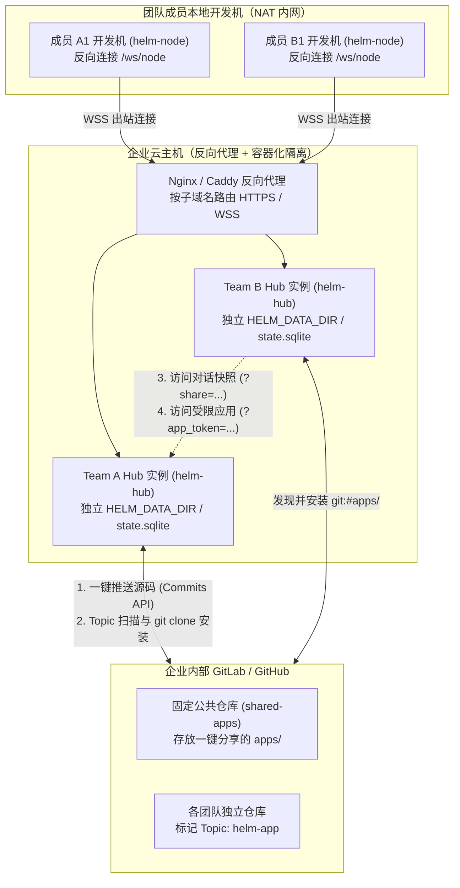
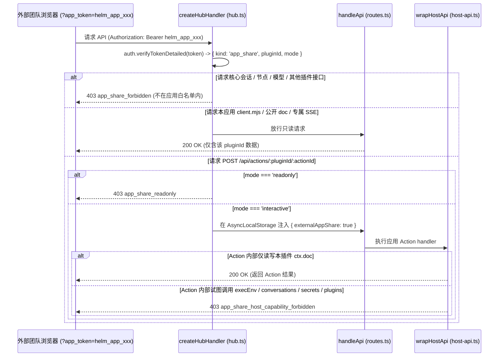
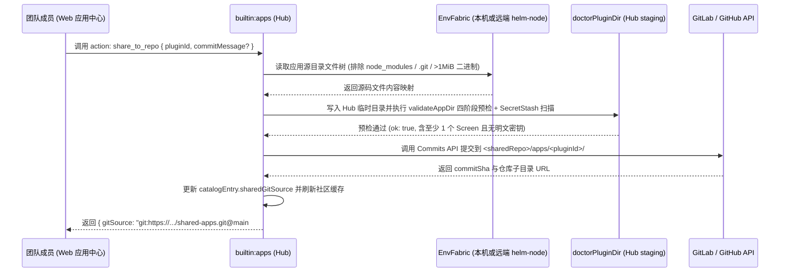

## 背景

Helm 现有架构面向单信任域（Single-Tenant）运行：`AuthService`（`packages/kernel/src/services/auth.ts`）仅维护单个管理员密码哈希与全局全权令牌表，通过 `verifyToken` 的调用方对当前 Hub 实例内的全部会话、模型凭据（`credentials.json`）、持久文档（`ctx.doc`）以及所有已接入的 `helm-node` 节点拥有无差别控制权；`EventHub`（`packages/kernel/src/runtime/events.ts`）通过 `/api/events` 向所有已连接客户端广播全量会话与插件状态快照。

当推广至多团队使用时，若让所有团队共用同一个 Hub 实例，任意成员均可通过 `POST /api/env/exec` 或新建会话将执行靶点指向其他团队成员接入的开发机节点，存在跨机器任意命令执行与敏感上下文泄露风险；若要求每位成员在本地维护全套 Hub 服务与模型配置，又会带来较高的部署与升级成本。因此，团队化部署确定采用**「云主机按团队独立实例（容器/子域名隔离）+ 成员本地开发机安装 `@helm/node` 经 `/ws/node` 反向接入」**的架构。在该拓扑下，团队内部共享同一信任域，而跨团队之间的高频协作诉求集中在三项能力，现有实现存在以下缺口：

1. **跨团队对话分享受阻于实例鉴权与机密边界**：会话 URL（`#/c/<id>`）受目标团队 Hub 的主控密码保护，跨团队成员打开链接会被 `AuthGate`（`packages/web/src/shell/AuthGate.tsx`）拦截；且会话原始条目可能包含工具执行输出与模型上下文，缺少不可变脱敏快照导出、免登只读渲染及一键导入（Fork）到接收方团队实例的机制。
2. **全栈微应用无法以受限权限直接对外提供在线服务**：`createHubHandler`（`packages/kernel/src/http/hub.ts`）仅支持「公开免鉴权路由（`public: true`）」与「全权管理员 Bearer Token」两档鉴权。当某团队构建了跨团队协同类微应用（如测试环境占坑看板、发版排期表），无法生成一个仅允许外部成员访问该应用 `Screen` 视图、公开文档（`ctx.doc`）与专属动作（`ctx.action`），同时严格阻断会话、节点执行与宿主特权接口的受限访问凭证。
3. **跨团队应用源码共享缺少 Git 原生发布与自动发现闭环**：底层 `PluginPackageManager`（`packages/kernel/src/plugins/package-manager.ts`）与 `parsePluginSource`（`packages/kernel/src/plugins/package-source.ts`）虽已原生支持 `git:<repo>[@<ref>][#<subdirectory>]` 与 HTTPS Git URL 的浅克隆安装，但还存在三处断点：
   - **私有仓库克隆鉴权缺失**：`defaultPackageRunner` 固定设置 `GIT_TERMINAL_PROMPT=0` 与 `GIT_ASKPASS=echo`，在无全局 SSH 密钥的容器环境中克隆企业内部私有 GitLab/GitHub 仓库会因认证失败退出；
   - **远端开发机路径受阻**：`builtin:apps` 的 `resolveAppSourceDir`（`packages/kernel/src/builtin-plugins/apps.ts`）要求应用源码目录必须位于 Hub 本机（`local` 节点），而团队部署模式下 AI 生成的应用草稿通常位于成员本地开发机（`nodeId !== 'local'`）的工作区内；
   - **缺少自动发现与一键推送**：用户无法在界面上将微应用一键推送至公司公共仓库子目录，也无法自动抓取内部 GitLab/GitHub 上标记了特定 Topic（如 `helm-app`）的仓库并在应用中心直接安装。

本次设计在不引入重型多租户 RBAC 账户体系和独立外部市场后端的前提下，基于现有微内核扩展契约补齐团队云端托管与三类轻量化跨团队共享机制：

- **对话一键分享**：生成经 `SecretStash` 全量脱敏的不可变会话快照，通过公开只读视图免登回放，并支持跨团队 JSON 导入与续聊；
- **应用实例直接共享（在线即用）**：引入应用级受限分享令牌（`AppShareToken`）与前端单应用纯净壳（Standalone App Mode），在 HTTP 鉴权与 `ctx.host` 宿主端口双重收紧权限边界，防止越权调用节点与宿主能力；
- **应用源码 Git 共享（一键发布与 Topic 自动发现）**：在 `builtin:apps` 中集成 GitLab / GitHub API 适配层，支持通过 `EnvFabric` 跨节点读取应用源码并一键提交至固定公共仓库，同时按 Topic 标签自动聚合内部开源应用，复用 `PluginPackageManager` 完成带凭证的 Git 子目录安装与更新。

非目标：不在单个 Hub 实例内实现多用户账号与会话级 RBAC 隔离；不为已安装进本团队 Hub 的插件提供进程级安全沙箱（跨团队安装源码属于引入可信代码，由 Git 仓库提交审计与 `doctor` 预检把关）；不构建独立的外部应用市场数据库或服务端。

建议分支：`feature/team-sharing-and-git-registry`（建议新开分支名，非既有分支）。

---

## 整体设计

整体架构由「部署拓扑层」与「跨团队协作能力层」组成，代码改动保持五包单向依赖 `@helm/web` / `@helm/cli` → `@helm/protocol` ← `@helm/kernel` 不变。



核心设计判断与取舍：

1. **云端实例级隔离替代单实例多租户改造**：
   每个小团队（或独立开发者）独占一个 `helm-hub` 进程与 `HELM_DATA_DIR` 目录，由云主机反向代理按子域名（如 `team-a.helm.internal`）分发流量。该取舍避免了在内核全部 7 个生命周期 Hook、`EnvFabric` 节点池与 SQLite 表中侵入用户 ID 鉴权逻辑，同时天然保证了团队 A 的成员绝无可能操作团队 B 的本地开发机节点。
2. **「实例在线即用」与「源码安装魔改」双轨并行，但在 `ctx.host` 层实施能力熔断**：
   允许外部人员携带 `AppShareToken` 直接调用应用 Action 时，若该应用在其 Action 处理器内调用了 `ctx.host.execEnv`、`ctx.host.conversations` 或 `ctx.host.secrets` 等宿主特权端口，仅靠 HTTP 路由前缀白名单仍会被应用代码间接触发宿主操作（Confused Deputy 问题）。因此，设计在 `AsyncLocalStorage` 调用链上下文中标记外部受限调用身份，当处于 `AppShareToken` 上下文时，`wrapHostApi`（`packages/kernel/src/plugins/host-api.ts`）除本插件 `ctx.doc` 读写与纯文本脱敏外，对一切节点执行、文件修改、会话操作、密钥读取与插件管理调用统一抛出 `403 app_share_host_capability_forbidden`。
3. **跨节点源码读取经由 `EnvFabric` 完成，消除「源码必须在 Hub 本机」的限制**：
   在云端 Hub + 本地开发机 `helm-node` 的模式下，用户在会话中生成的微应用源码位于开发机本地目录。分享发布或本地预检时，若目标会话绑定在远端节点（`nodeId !== 'local'`），`builtin:apps` 通过 `ctx.host.executionEnv(nodeId, cwd)` 将远端应用目录内受控源码文件（排除 `node_modules`、`.git`）拉取至 Hub 的临时 staging 目录后再执行 `doctor` 预检、本地安装或 Git API 推送，从而让远端节点上的微应用开发与本机完全同构。
4. **复用内部 GitLab / GitHub 作为唯一共享底座，零自建存储服务**：
   日常随手生成的微应用通过 GitLab Commits API（或 GitHub Contents/Trees API）直接将文件树提交至预设公共仓库的 `apps/<pluginId>/` 子目录，免去用户手动建仓与本地安装 Git 凭据的步骤；重度独立维护的插件仓库只需在 GitLab/GitHub 打上 `helm-app` Topic 标签，即可被相同的发现引擎抓取，统一通过 `git:<repo>@<ref>#<subdirectory>` 语法交由现有 `PluginPackageManager` 安装。

---

## 详细设计

### 1. 团队云端部署与反向代理规范

云主机通过 Docker Compose 或 systemd 运行多个 `helm-hub` 实例，每个实例绑定本机回环的不同端口（如 `13201`、`13202`）与独立数据目录（如 `/var/lib/helm/team-a`）。前置 Nginx / Caddy 负责 TLS 终结与 WebSocket 升级转发：

- **WebSocket 透传**：必须对 `/ws/node` 与 `/ws/node-tunnel` 转发 `Upgrade` 与 `Connection` 头，并将 `proxy_read_timeout` 设为 `3600s`（配合 `NodeRegistry` 心跳保活）；
- **SSE 流式防缓冲**：对 `/api/events`、`/api/plugins/*/docs/*/events` 及 `/api/env/exec` 禁用代理缓冲（`X-Accel-Buffering: no` / `flush_interval -1`），确保流式输出与文档变更实时到达前端；
- **公共环境变量预置**：可通过容器环境变量统一注入模型网关配置，各团队首次访问各自域名时通过 `AuthGate` 独立初始化本团队主控密码，随后签发节点令牌供团队成员在本地开发机执行 `helm-node connect https://<team>.helm.internal --token <token>`。

---

### 2. 对话一键分享（不可变脱敏快照与跨实例 Fork）

#### 2.1 数据结构与存储

对话快照归属 `builtin:apps`（或独立轻量模块，统一挂载于 `<dataDir>/shares/conversations/<shareId>.json`），不在 `state.sqlite` 中新建业务表，索引元数据维护在插件私有文档 `ctx.doc('conversation-shares', { items: {} }, { public: false })` 中：

```ts
export interface SharedConversationSnapshot {
  /** 随机 128-bit base62 标识（如 sh_8f9k2m...）。 */
  shareId: string
  /** 源会话标题。 */
  title: string
  /** 源会话绑定的角色 ID 与显示名称。 */
  profileId: string
  profileName?: string
  /** 源会话使用的模型标识。 */
  model: string
  /** 快照生成时间戳（epoch 毫秒）。 */
  createdAt: number
  /** 可选过期时间戳（epoch 毫秒，缺省永不过期）。 */
  expiresAt?: number
  /** 经 SecretStash 全量脱敏并剥离敏感系统路径后的时间线条目。 */
  entries: ConversationEntry[]
}
```

#### 2.2 生成、脱敏与撤回流程

1. **创建快照 Action（`share_conversation`）**：
   - 输入：`{ conversationId: number, upToEntryId?: string, expiresInHours?: number }`；
   - 读取会话详情 `ctx.host.getConversationDetail(conversationId)`，若指定 `upToEntryId` 则截取至该条目（含）；
   - **强制脱敏与清洗**：遍历全部条目，仅保留用户消息、助手回复（含思维链、文本、```` ```ui ```` 与 ```` ```mermaid ```` 代码块）及工具调用的名称与结果摘要；移除内部运行态字段（如 `byTaskId`、宿主环境变量快照），并对整棵 JSON 树强制执行 `ctx.host.redactText`（将 `SecretStash` 已登记的所有密钥、节点 Token 替换为 `[REDACTED]`）；
   - 通过 `ctx.host.atomicWriteFile` 写入 `<dataDir>/shares/conversations/<shareId>.json`，返回免登访问链接 `https://<hub-host>/?share=<shareId>`。
2. **公开只读获取路由**：
   - 注册插件公开路由 `ctx.route({ method: 'GET', path: '/shares/conversations/:shareId', public: true })`；
   - 校验 `shareId` 格式（仅允许 `/^sh_[A-Za-z0-9]{16,32}$/`，防路径穿越）；若已过期或文件不存在返回 `404 share_not_found`；
   - 响应头附带 `Cache-Control: private, no-store`，返回 `SharedConversationSnapshot` JSON。
3. **撤回分享 Action（`revoke_conversation_share`）**：
   - 删除对应 JSON 快照文件并移除索引记录，后续访问立即返回 `404`。

#### 2.3 前端免登回放与「导入到我的团队」

1. **免登只读视图**：
   前端 `App.tsx` 启动时检测 URL 查询参数 `?share=<shareId>`。若存在，跳过 `AuthGate` 与全局 `/api/events` SSE 建连，直接请求 `/api/plugins/builtin%3Aapps/routes/shares/conversations/<shareId>` 并渲染只读版 `ConversationTimeline`（复用现有 `MarkdownView`、`CodeBlockRenderer`、Mermaid 与 JSON UI 静态渲染，禁用输入框与工具重跑）。
2. **跨团队 Fork 续聊**：
   只读页面顶栏提供 **「复制快照 JSON / 导入到我的团队」** 按钮。其他团队成员可在自己团队的 Hub 中调用 `helm conversations import-share <url-or-file>`（或前端粘贴分享链接），拉取该公开快照 JSON 后，在本团队新建一个绑定本机 `nodeId` 与 `cwd` 的会话，并将历史对话上下文合入首轮背景，实现无缝接力排查。

---

### 3. 全栈微应用直接共享（`AppShareToken` 与单应用纯净壳）

#### 3.1 `AuthService` 扩展与 `AppShareToken` 契约

在 `packages/kernel/src/services/auth.ts` 与 `@helm/protocol` 中扩展应用级受限令牌机制，令牌前缀固定为 `helm_app_` 以区别于管理员全权令牌：

```ts
export type AppShareAccessMode = 'readonly' | 'interactive'

export interface AppShareTokenRecord {
  /** 令牌唯一标识（用于列表展示与按 ID 吊销）。 */
  id: string
  /** SHA-256(token) 十六进制摘要（绝不存储明文）。 */
  digest: string
  /** 绑定的目标微应用插件 ID（禁止为 builtin:*）。 */
  pluginId: string
  /** 权限档位：readonly 仅允许读 UI 与公开 doc；interactive 额外允许调用该插件自身的 Action。 */
  mode: AppShareAccessMode
  /** 备注名称（如「发给测试团队使用」）。 */
  label?: string
  createdAt: string
  expiresAt?: string
}

export type VerifiedAuthContext =
  | { kind: 'admin' }
  | { kind: 'app_share'; tokenId: string; pluginId: string; mode: AppShareAccessMode }
```

- 令牌签发、摘要比对（`timingSafeEqual`）与持久化沿用 `AuthService` 现有的两级文件锁（`auth` 锁 → `config.json` 锁）；
- 明文令牌仅在签发时返回一次，同时自动注册进 `SecretStash.addRedaction`，防止明文意外进入任何日志或模型输出。

#### 3.2 HTTP 网关白名单与 `ctx.host` 能力熔断（核心安全边界）



1. **HTTP 路由级严格白名单（`packages/kernel/src/http/hub.ts` 与 `routes.ts`）**：
   当 `verifyTokenDetailed` 返回 `{ kind: 'app_share', pluginId, mode }` 时，仅放行以下 5 个端点，其余一切 `/api/*` 请求（包括 `/api/events` 全局 SSE、`/api/conversations/*`、`/api/nodes/*`、`/api/env/exec`、`/api/plugins/:id/config`）立即返回 `403 app_share_forbidden`：
   - `GET /api/app-share/bootstrap`：返回渲染单应用壳所需的最小初始化载荷 `{ plugin: PluginSummary, screens: ScreenSpec[], publicDocs: Record<string, unknown>, mode: AppShareAccessMode }`；
   - `GET | HEAD /api/plugins/<pluginId>/client.mjs`（仅限令牌绑定的 `pluginId`）；
   - `GET /api/plugins/<pluginId>/docs/:docName`（仅限令牌绑定的 `pluginId` 且无 `conversationId` 参数的全局公开文档）；
   - `GET /api/plugins/<pluginId>/docs/events`：**新增单插件公开文档专用轻量 SSE 流**，仅推送该 `pluginId` 的 `plugin.doc.updated` 事件，使外部使用者无需订阅包含全量会话隐私的 `/api/events` 即可获得实时看板更新；
   - `POST /api/actions/<pluginId>/:actionId`：**仅当 `mode === 'interactive'` 且目标插件等于令牌绑定的 `pluginId` 时放行**，且强制拒绝请求体中携带 `conversationId`（防止借用宿主会话作用域）。
2. **`ctx.host` 宿主端口级能力熔断（`packages/kernel/src/plugins/host-api.ts`）**：
   通过 `AsyncLocalStorage` 传递 `ActionInvocationOrigin`。当 Action 由 `app_share` 令牌触发时：
   - **允许**：插件自身的 `ctx.doc` 读写与 `flush()`、`ctx.getConfig()`（只读自身配置）、`ctx.host.redact` / `redactText`；
   - **熔断拦截（返回 `403 app_share_host_capability_forbidden`）**：`executionEnv`、`execEnv`、`withFileMutationQueue`、`probeNodeFs`、`nodeIpc`、`openTunnel`、`nodeFetch`、`conversations` 全系方法、`spawnAgent`、`runGate`、`secrets` 写/删、`setConfig`、`plugins` 包管理端口以及跨插件 `invokeAction`。
   这一双层机制确保：即使被分享的微应用代码包含调用本机 Shell 的动作，外部访客也无法通过分享链接触发任何宿主机或开发机节点上的命令执行。

#### 3.3 前端单应用纯净壳（Standalone App Mode）

前端 `HelmStoreProvider` 识别 URL 中的 `?app_token=helm_app_...`（存入 `sessionStorage`，不覆盖 `localStorage` 中可能存在的本团队管理员 Token）：

- 调用 `GET /api/app-share/bootstrap` 初始化插件 UI 注册表与公开文档，并连接 `/api/plugins/<pluginId>/docs/events` 专用 SSE；
- `App.tsx` 进入 `StandaloneAppShell` 布局：**不渲染**左侧导航栏 `Sidebar`、命令中心 `CommandPaletteModal`、分屏按钮与设置入口，全屏仅挂载该微应用的 `ScreenHost`；
- 顶栏右侧显示权限徽章（`只读视图` 或 `可交互应用`），并提供 **「一键安装到我的团队」** 按钮（若该应用已登记 Git 仓库地址，点击后可复制 `helm apps install <git-source>` 命令或填写本团队 Hub 地址直接跳转安装）。

---

### 4. 基于 GitLab / GitHub 的应用共享与自动发现

#### 4.1 `builtin:apps` 新增 Git 共享配置 Schema

在 `packages/kernel/src/builtin-plugins/apps.ts` 中通过 `ctx.configSchema` 声明团队共享仓库配置（`gitToken` 标记为 `secret: true`，由宿主自动分离存储至 `credentials.json` 并登记进 `SecretStash`）：

| 配置键 | 类型 | secret | 默认值 | 说明 |
| :--- | :--- | :--- | :--- | :--- |
| `provider` | `'gitlab' \| 'github'` | 否 | `'gitlab'` | 内部代码托管平台类型 |
| `baseUrl` | `string` | 否 | `''` | 平台基础地址（如 `https://gitlab.company.com` 或 `https://github.com`） |
| `gitToken` | `string` | **是** | `''` | 具备 API 读写与仓库拉取权限的 Personal / Project / Group Access Token |
| `sharedRepo` | `string` | 否 | `''` | 一键分享的目标公共仓库路径（如 `ai-hub/shared-apps`） |
| `sharedBranch` | `string` | 否 | `'main'` | 公共仓库默认分支 |
| `discoverTopic` | `string` | 否 | `'helm-app'` | 自动抓取独立应用仓库的 Topic 标签名 |

#### 4.2 跨节点源码采集与一键推送到固定仓库（`share_to_repo`）

解决「应用源码在成员本地开发机（远端 `helm-node`），而用户想在 Web 界面一键分享到 GitLab 公共仓库」的完整链路：



1. **源码位置解析与跨节点读取**：
   - 若应用已安装在 Hub（`<dataDir>/plugins/<pluginId>`），直接从受管目录读取源码文件树；
   - 若从工作区草稿直接分享且绑定会话在远端节点（`nodeId !== 'local'`），通过 `ctx.host.executionEnv(nodeId, cwd)` 递归列出并读取文件（单文件上限 512 KiB，总计上限 5 MiB，自动过滤 `node_modules`、`.git`、`.staging` 及隐藏文件）。
2. **强制预检与防密钥泄漏门禁**：
   - 将源码写入 Hub 临时目录执行 `validateAppDir`（确保 manifest、TS 后端、register 与 React client 全部合法且包含 `Screen`）；
   - **机密扫描硬阻断**：对所有待上传源码文件内容检查是否包含 `SecretStash` 已登记的明文凭据；一旦命中，立即拒绝推送并返回 `422 app_source_contains_secret`（指明文件名与行号），绝不把团队私钥推入公共 Git 仓库。
3. **免本地 Git 克隆的 API 原生提交**：
   - **GitLab 路径**：先查询目标仓库 `GET /api/v4/projects/:id/repository/tree?path=apps/<pluginId>` 获取已有文件列表，计算 `create / update / delete` 差异后，调用单次原子提交接口 `POST /api/v4/projects/:id/repository/commits`，将全部文件变更与生成的索引描述合并为一个 Commit 推送到 `apps/<pluginId>/` 目录；
   - **GitHub 路径**：通过 Git Data API（`POST /repos/:owner/:repo/git/trees` + `git/commits` + `PATCH git/refs/heads/:branch`）完成单次原子提交。

#### 4.3 Topic 标签自动抓取与公共仓库聚合（`discover_shared`）

`builtin:apps` 新增幂等查询动作 `discover_shared`（CLI：`helm apps discover [--refresh]`），聚合两路来源并在内存中缓存（默认 TTL 300 秒，支持强制刷新）：

1. **来源一：Topic 标签仓库自动发现**
   - GitLab：`GET /api/v4/projects?topic=<discoverTopic>&simple=true&per_page=100`；
   - GitHub：`GET /search/repositories?q=topic:<discoverTopic>&per_page=100`；
   - 并发抓取各仓库默认分支根目录下的 `plugin.json`（若仓库同时包含 `.helm-apps.json` 多应用清单则展开子目录），提取 `id`、`name`、`version`、`description`、`category`、`icon` 与仓库最近更新时间，生成标准安装源字符串：`git:<http_url_to_repo>@<default_branch>`。
2. **来源二：固定公共仓库（`sharedRepo`）子目录扫描**
   - 读取 `sharedRepo` 下 `apps/*/plugin.json`，生成带子目录片段的标准安装源字符串：`git:<shared_repo_https_url>@<sharedBranch>#apps/<pluginId>`。
3. **去重与版本对比**：
   - 将两路来源合并后与本团队已安装的 `plugins` 列表对比，标记每项应用的本地状态：`not_installed`（未安装）、`installed`（已安装且版本一致）、`update_available`（远端版本高于本地 `installedVersion`）。

#### 4.4 私有 Git 仓库受控认证安装（`PluginPackageManager` 增强）

现有 `PluginPackageManager.fetchGit`（`packages/kernel/src/plugins/package-manager.ts` 第 601 行）直接执行 `git clone --depth 1 -- <repo> <repoDir>`，当 `<repo>` 是内部私有 GitLab HTTPS 地址时无凭据可用。

在不把明文 Token 写入命令行参数、不落盘保存至 `.git/config` URL（防 `ps` 与文件泄露）的前提下，增强 `HelmHostPluginsPort.install` 与 `update`：

- `install(source, options)` 新增可选瞬态参数 `gitAuth?: { username?: string; token: string }`（仅在进程内调用间传递，**不写入 `PluginPackageRecord` 持久化记录**）；
- `fetchGit` 在存在 `gitAuth.token` 且 `source.repo` 为 `https://` 且主机名与配置的 `baseUrl` 同源时，通过 `git -c http.extraHeader="Authorization: Basic <base64(oauth2:token)>" clone ...` 环境变量/配置注入认证头（并将该 base64 串同步注册进 `SecretStash.addRedaction` 确保任何报错输出被自动抹除）；
- 当后续执行 `helm apps update <pluginId>` 时，`builtin:apps` 自动从自身配置的 `gitToken` 读取最新凭据传入 `host.plugins.update`，从而支持私有仓库的无缝升级与 Token 轮换。

#### 4.5 应用中心界面扩展（`AppCenterScreen`）

在 `packages/kernel/src/builtin-plugins/apps/client/index.tsx` 中扩展现有主舞台与详情抽屉，严格遵循 `docs/conventions/web-frontend.md` 规范（零 Emoji、复用 `Screen` / `Dialog` 原语）：

1. **主舞台新增「团队共享市场」切换视图**：
   - 顶部筛选栏右侧增加分段切换：`已安装应用` | `团队共享市场`；
   - 在「团队共享市场」下展示 `discover_shared` 抓取到的卡片网格，卡片显示来源标签（`公共仓库` 或 `Topic: helm-app`）、作者/仓库路径、版本号，以及右侧一键 **「安装到本团队」** / **「更新」** 按钮。
2. **应用详情抽屉新增「分享与协作」分节**：
   - **方式一：免登使用链接（共用本团队实例与数据）**：提供「生成只读链接」「生成可交互链接」按钮及已签发链接的复制与一键吊销列表；
   - **方式二：推送源码到团队市场（供其他团队独立安装与二次开发）**：提供「一键发布到公共仓库」按钮，已发布的应用显示远端 Commit 状态与「同步更新到市场」按钮。

---

## 发布

### 上线前检查

1. **GitLab / GitHub 公共仓库与凭据准备（若启用源码共享）**：
   - 在企业内部 GitLab（或 GitHub）创建公共仓库（如 `ai-hub/shared-apps`），初始化默认分支 `main`；
   - 创建具备 `api` / `write_repository` 权限的访问令牌，在各团队 Hub 的「插件中心 → 应用中心配置」或通过 CLI `helm plugins config set builtin:apps ...` 填入 `baseUrl`、`gitToken` 与 `sharedRepo`。
2. **云主机反向代理检查**：
   - 确认 Nginx / Caddy 已配置 `/ws/node` 与 `/ws/node-tunnel` 的 WebSocket Upgrade 转发，且 `/api/events` 与 `/api/plugins/*/docs/*` 已关闭响应缓冲。

### 发布顺序与恢复方式

1. **发布顺序**：
   - 本次改动仅涉及 `@helm/protocol`、`@helm/kernel`、`@helm/cli` 与 `@helm/web`，不改变 `@helm/node` 的 RPC 协议；各团队成员本地开发机已运行的 `helm-node` 守护进程**无需升级或重启**；
   - 构建并更新云主机上的 `helm-hub` 与静态前端资源即可生效。
2. **异常控制与恢复**：
   - **单链接应急熔断**：若某个对外分享的对话快照或应用免登链接发生非预期访问，团队管理员可在详情抽屉或通过 CLI `helm apps share-token revoke <id>` / `helm apps share-conversation revoke <shareId>` 即时吊销，毫秒级生效，不影响本团队正常使用；
   - **插件级停用与回退**：Git 共享与快照路由均承载于 `builtin:apps`，停用该插件或清空 `gitToken` 配置即可关闭外部仓库交互；`config.json` 中新增的 `appShareTokens` 字段与 `<dataDir>/shares/` 目录与主状态库正交，回退代码版本后旧版 `ConfigService` 保留未知键不报错，已有会话与插件数据零损。

---

## 测试

### 1. 对话快照分享与脱敏验证

- **前置条件**：在 `SecretStash` 中登记敏感凭据 `sk-secret-12345`，并在会话 `#1` 中产生包含该明文凭据的工具输出、Mermaid 图表与普通对话条目。
- **目标路径**：调用 `builtin:apps` 的 `share_conversation` 动作生成 `shareId`，随后在不携带任何 `Authorization` 头的匿名上下文请求 `GET /api/plugins/builtin%3Aapps/routes/shares/conversations/<shareId>`，最后调用 `revoke_conversation_share`。
- **预期结果**：
  1. 匿名 GET 请求返回 `200 OK`，响应体条目中所有 `sk-secret-12345` 均被替换为 `[REDACTED]`，且不含宿主环境变量字段；
  2. 传入非法 `shareId`（如 `../../config.json`）返回 `400` 或 `404`，不发生路径穿越；
  3. 吊销后再次请求同一 URL 返回 `404 share_not_found`。

### 2. `AppShareToken` 路由隔离与宿主能力熔断验证

- **前置条件**：安装并启用测试微应用 `sample-app`（声明公开文档 `board`、只读正常动作 `add_item`、以及一个在内部调用 `ctx.host.execEnv` 执行 `whoami` 的越权动作 `run_shell`）；分别签发 `readonly` 令牌 `T_RO` 与 `interactive` 令牌 `T_INT`。
- **目标路径与预期结果**：

| 验证场景 | 请求携带令牌 | 请求接口 / 动作 | 预期结果 |
| :--- | :--- | :--- | :--- |
| 读取本应用公开文档 | `T_RO` 或 `T_INT` | `GET /api/plugins/sample-app/docs/board` | `200 OK`，返回 `board` 文档内容 |
| 订阅本应用文档专用 SSE | `T_RO` 或 `T_INT` | `GET /api/plugins/sample-app/docs/events` | `200 OK`，`board` 更新时收到 `plugin.doc.updated` 帧 |
| 越权读取会话列表或全局 SSE | `T_RO` 或 `T_INT` | `GET /api/conversations` 或 `GET /api/events` | `403 app_share_forbidden` |
| 越权调用节点命令或读取其他插件 | `T_RO` 或 `T_INT` | `POST /api/env/exec` 或 `GET /api/plugins/other/docs/x` | `403 app_share_forbidden` |
| 只读令牌尝试调用应用动作 | `T_RO` | `POST /api/actions/sample-app/add_item` | `403 app_share_readonly` |
| 交互令牌调用正常业务动作 | `T_INT` | `POST /api/actions/sample-app/add_item` | `200 OK`，`board` 文档成功更新 |
| 交互令牌触发内部调用 `ctx.host.execEnv` 的动作 | `T_INT` | `POST /api/actions/sample-app/run_shell` | **`403 app_share_host_capability_forbidden`**，命令未执行 |
| 吊销令牌后再次访问 | 已吊销的 `T_INT` | `GET /api/plugins/sample-app/docs/board` | `401 unauthorized` |

### 3. 跨节点源码采集、机密阻断与 Git 仓库共享验证

- **前置条件**：模拟远端节点 `node-dev-1` 工作区 `/home/dev/workspace/apps/env-board` 下存在合规微应用源码；配置本地 Fake GitLab HTTP 服务与 `gitToken`。
- **目标路径与预期结果**：
  1. **跨节点发布与推送**：在绑定 `node-dev-1` 的会话上下文中调用 `share_to_repo`，系统通过 `executionEnv('node-dev-1', ...)` 拉取文件树、通过 `doctor` 四阶段预检，并向 Fake GitLab 提交 `apps/env-board/` 文件树，返回 `commitSha`；
  2. **源码含明文密钥硬阻断**：向应用源码 `index.ts` 写入已登记在 `SecretStash` 中的明文密钥后再次调用 `share_to_repo`，请求以 `422 app_source_contains_secret` 拒绝，Fake GitLab 未收到任何提交请求；
  3. **Topic 与公共仓库自动发现**：调用 `discover_shared`，返回列表中同时包含 Fake GitLab 下标记了 `topic=helm-app` 的独立仓库应用与 `sharedRepo` 下的 `env-board`；
  4. **带凭证克隆安装**：在另一空白 Hub 实例上选中发现的 `env-board` 执行安装，`PluginPackageManager` 通过 `http.extraHeader` 完成认证浅克隆与子目录提取，应用成功启用并出现在左栏「应用中心」；若克隆失败，错误详情中的认证头自动被脱敏为 `[REDACTED]`。
