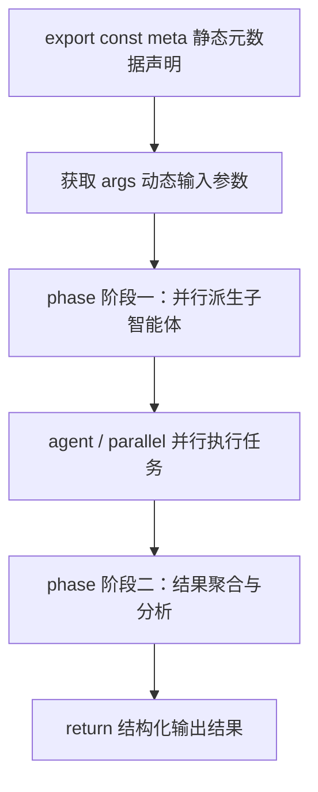
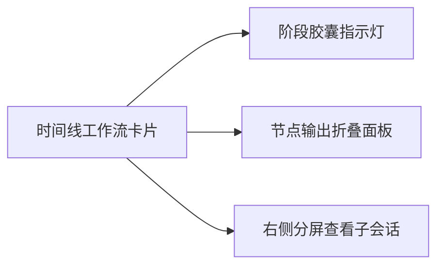

# 编写首个工作流

本文带你从零编写并执行第一个确定性多智能体编排工作流。

---

## 什么是确定性工作流

传统多智能体系统多依赖黑盒 Prompt 循环。
执行过程难以预测，发生中断后无法恢复状态。

Helm 采用原生 JavaScript 作为编排 DSL：
- **逻辑确定**：使用普通 JavaScript 语言特性控制分支、循环与错误处理。
- **状态持久**：基于 `pi-durable` 内核，自动记录每一步执行流水。
- **断点续跑**：任务中断后直接读取流水账本，跳过已成功的历史节点。
- **沙箱隔离**：支持分配独立 Git Worktree，并执行自动化门禁验收。

---

## 编排 DSL 核心语法

工作流脚本包含静态元数据与执行体两部分：



### 1. 元数据对象 (`meta`)

脚本顶部必须通过字面量导出 `meta` 对象：

```javascript
export const meta = {
  name: "hello-orchestra",
  description: "最小编排演示：并行两路并汇总",
  phases: [
    { title: "并行打招呼" },
    { title: "汇总成果" },
  ],
}
```

内核通过静态词法提取元数据。
`meta` 必须是纯静态字面量，禁止使用动态变量插值。

### 2. 内置全局函数与变量

工作流执行沙箱注入了以下全局变量与函数：

| 标识符 | 类型 | 说明 |
| :--- | :--- | :--- |
| `args` | `unknown` | 外部传入的动态参数对象 |
| `log(message)` | `function` | 记录时间线进度日志 |
| `phase(title)` | `function` | 声明进入指定业务阶段 |
| `agent(prompt, options)` | `function` | 调度子智能体执行任务 |
| `parallel(tasks)` | `function` | 并行执行多个异步任务 |
| `action(id, input)` | `function` | 调用插件注册的动作能力 |

#### `agent(prompt, options)` 参数说明

- `prompt`：子智能体提示词。
- `options.label`：节点展示名称。
- `options.agentType`：指定 Profile ID（专家 Bot 标识）或外部运行时标识。
- `options.model`：指定的模型标识。
- `options.gate`：代码门禁验收命令（如 `pnpm test`）。

---

## 完整示例：双路翻译与汇总

创建示例文件 `hello-orchestra.workflow.js`（仓库中已附带同款演示：`demo/hello-orchestra.workflow.js`）：

```javascript
export const meta = {
  name: "hello-orchestra",
  description: "最小编排演示：并行两路并汇总",
  phases: [
    { title: "并行打招呼" },
    { title: "汇总成果" },
  ],
}

// 记录输入参数日志
log(`接收到参数 word = ${args.word}`)

// 进入第一阶段：并行翻译
phase("并行打招呼")
const replies = await parallel([
  () => agent(`把「${args.word}」翻译成英文，只回翻译结果。`, { label: "翻译英文" }),
  () => agent(`把「${args.word}」翻译成日文，只回翻译结果。`, { label: "翻译日文" }),
])

// 进入第二阶段：汇总成果
phase("汇总成果")
const joined = replies.filter((r) => r !== null).join(" / ")
const summary = await agent(`把「${joined}」合成一句话介绍。`, { label: "成果汇总" })

// 返回结构化产出
return { replies, summary }
```

---

## 执行工作流

你可以通过 CLI 或 Web 界面执行工作流。

### 1. 使用 CLI 命令行执行

执行以下命令并传入参数：

```bash
helm workflows run hello-orchestra.workflow.js --args '{"word":"创新"}' --wait
```

参数说明：
- `--args`：传入 JSON 格式输入参数，在脚本中通过 `args` 访问。
- `--wait`：阻塞等待执行完成并直接输出最终返回数据。

### 2. 检查工作流执行列表

查看历史工作流执行记录：

```bash
helm workflows runs --json
```

### 3. 检查单次执行详情与阶段

通过 `inspect` 命令查看完整的节点状态流水：

```bash
helm workflows inspect <runId> --json
```

输出内容包含阶段进度、子智能体会话 ID、耗时与产出结果。

---

## 在 Web 界面中可视化观察

启动 Web 界面并访问 `http://localhost:3201`。



1. **工作流卡片**：在当前会话时间线展示整体执行进度与耗时。
2. **阶段胶囊**：直观展示每个 `phase` 的执行状态与子任务数量。
3. **分屏审查**：点击任一 `agent` 节点可在右侧分屏查看该子会话完整交互。
4. **日志抽屉**：展开底部日志面板，实时查看 `log()` 输出信息。

---

## 错误处理与断点恢复

当工作流中的某一步因网络或环境问题失败时，系统提供安全恢复能力。

### 1. 断点恢复执行

使用 `--resume-from-run-id` 参数指定失败的 `runId`：

```bash
helm workflows run hello-orchestra.workflow.js --args '{"word":"创新"}' --resume-from-run-id <failedRunId> --wait
```

内核会自动读取原执行流水账本。
已经成功的 `agent` 节点会直接复用缓存结果，仅重跑失败或未执行的节点。

### 2. 手动中止在途任务

如需停止正在执行的工作流任务：

```bash
helm workflows abort <runId>
```

系统会优雅中止所有在途子智能体会话并释放占用的环境资源。
