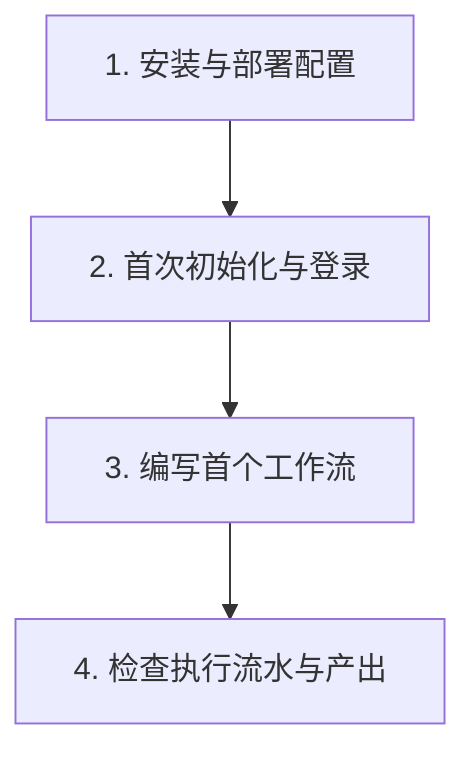

# 新手起步导览

欢迎使用 Helm。
本专题帮助你在数分钟内完成环境搭建并理解核心工作方式。

---

## 为什么选择 Helm

传统 Agent 框架多采用黑盒对话循环或复杂的重型图 DSL。
Helm 采用微内核架构，专注于工程任务的确定性与持久性。

- **状态全量持久化**：会话采用 `pi-durable` 五态状态机，自动落盘 SQLite 与 FTS5。
- **编排确定可审计**：使用原生 JavaScript 编写工作流，执行流水完整记录。
- **跨机零 SSH 依赖**：通过 `EnvFabric` 与反向 WebSocket 连接受控节点。
- **终端真实协同**：调度物理终端 CLI Agent，支持结构化文件交接与原地自愈。
- **接口与命令行同权**：所有 HTTP 接口均提供对等的 `helm` CLI 命令与 `--json` 输出。

---

## 核心概念速查

在开始之前，了解以下五个核心概念：

| 概念 | 说明 |
| :--- | :--- |
| **微内核 (Kernel)** | 极简系统核心，零业务角色硬编码，统一托管插件与执行底座。 |
| **持久会话 (Conversation)** | 绑定 `(nodeId, cwd)` 物理坐标的状态机，支持中断续接与全文检索。 |
| **确定性工作流 (Workflow)** | 原生 JavaScript 编写的编排脚本，由 `builtin:workflow` 插件驱动，支持 `agent()` 与 `parallel()` 调度。 |
| **受控节点 (Node)** | 部署 `helm-node` 守护进程的计算机器，反向接入 Hub 承载命令执行。 |
| **凭据隔离 (Credentials)** | CLI 登录态、服务端模型密钥与节点身份采用物理文件隔离存储。 |

---

## 新手起步路线图

建议按照以下顺序阅读本专题文档：

1. **[环境准备与部署配置](installation.md)**
   - 检查 Node.js 与 pnpm 版本要求。
   - 启动 Hub 内核服务与 Web 控制台。
   - 完成管理员账户初始化与 CLI 登录。
   - 理解多端凭据物理隔离机制。

2. **[编写首个工作流](first-workflow.md)**
   - 学习原生 JavaScript 编排 DSL 基础结构。
   - 编写包含并行翻译与汇总的轻量工作流。
   - 通过 CLI 与 Web 检查器执行工作流。
   - 观察阶段进度、日志时间线与产出结果。

3. **进阶学习指引**
   - 深入理解架构：阅读 [微内核架构哲学](../architecture/overview.md) 与 [双 7 扩展点](../architecture/extension-points.md)。
   - 编写高级编排：阅读 [原生 JS DSL 手册](../workflows/dsl-guide.md) 与 [Git Worktree 隔离](../workflows/worktree-and-gate.md)。
   - 扩展系统功能：阅读 [插件系统设计](../plugins/overview.md) 与 [自定义插件开发](../plugins/plugin-development.md)。
