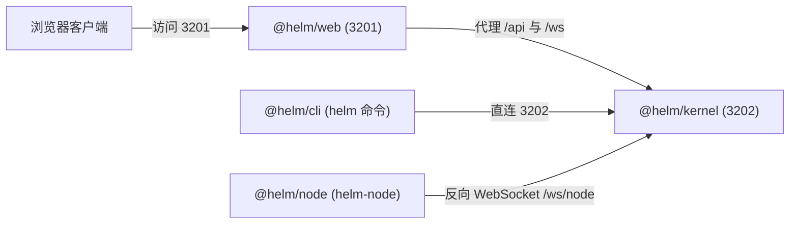
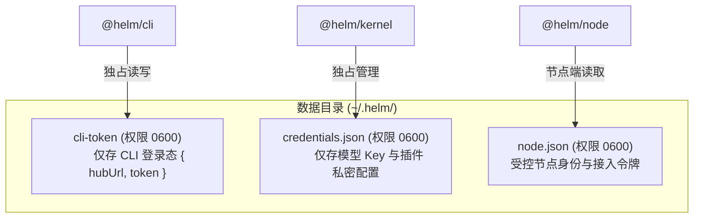

# 安装与配置指南

本文介绍 Helm 的环境要求、部署流程、端口规划与凭据隔离机制。

---

## 环境要求

部署前请确保环境满足以下要求：

| 组件 | 最低要求 | 说明 |
| :--- | :--- | :--- |
| **Node.js** | `>= 24.12.0` | 推荐使用 LTS 最新稳定版 |
| **pnpm** | `>= 9.0.0` | 管理 Monorepo 依赖与脚本 |
| **Git** | `>= 2.30.0` | 支撑 Worktree 沙箱隔离能力 |
| **操作系统** | Linux / macOS / WSL2 | 支持所有主流 POSIX 环境 |

---

## 部署与启动流程

### 1. 获取代码与安装依赖

克隆代码仓库并安装依赖：

```bash
git clone https://github.com/helm-org/helm.git
cd helm
pnpm install
```

编译所有包产物：

```bash
pnpm build
```

---

### 2. 启动服务

系统提供两种启动方式。

#### 方式一：前后端联合启动（推荐）

该命令同时启动 Web 控制台与微内核服务：

```bash
HELM_PORT=3202 pnpm dev
```

启动完成后：
- 前端 Web 访问地址为：`http://localhost:3201`
- 内核 Hub 监听地址为：`http://localhost:3202`

#### 方式二：组件分离启动

如需单独调试前端或内核，可分窗口启动：

```bash
# 窗口 1：仅启动微内核 Hub
HELM_PORT=3202 pnpm dev:kernel

# 窗口 2：仅启动 Web 前端
pnpm dev:web
```

---

### 3. 初始化管理员与登录

系统首次部署时需要初始化管理员账户：

```bash
# 初始化管理员密码（密码采用 scrypt 哈希存储）
helm setup --password your-secure-password
```

使用 CLI 登录并存储认证凭据：

```bash
helm login --password your-secure-password
```

检查系统与组件状态：

```bash
helm status --json
```

---

## 端口约定与网络规划

系统采用严格的端口规划，防止端口冲突：



| 服务名称 | 端口号 | 协议 | 说明 |
| :--- | :--- | :--- | :--- |
| **Web 前端** | `3201` | HTTP / WS | Vite 开发服务器，强制使用 `strictPort: true` |
| **微内核 Hub** | `3202` | HTTP / WS | 内核核心服务，承载 API 与 WebSocket 网关 |

### 端口规避约束

系统严禁占用以下预留端口：
- `3000`：外部公共开发服务端口。
- `3001` / `3002`：历史 `botd` 服务预留端口。
- `3101` / `3102`：历史 `botx` 服务预留端口。

---

## 环境变量参考

你可以通过环境变量配置内核与客户端行为：

| 变量名 | 默认值 | 适用组件 | 功能说明 |
| :--- | :--- | :--- | :--- |
| `HELM_PORT` | `3202` | `@helm/kernel` | Hub 服务监听端口 |
| `HELM_HOST` | `127.0.0.1` | `@helm/kernel` | Hub 服务绑定监听地址 |
| `HELM_DATA_DIR` | `~/.helm` | 全部包 | 数据持久化与凭据存储主目录 |
| `HELM_HUB_URL` | `http://127.0.0.1:3202` | `@helm/cli` | CLI 访问的目标 Hub 地址 |
| `HELM_TOKEN` | 无 | `@helm/cli` | 临时覆盖磁盘凭据的访问令牌 |

---

## 凭据隔离存储机制

Helm 采用三层物理凭据隔离，杜绝机密扩散。



### 1. CLI 登录凭据 (`cli-token`)

- **存储路径**：`<HELM_DATA_DIR>/cli-token`。
- **文件权限**：严格限制为 `0600`。
- **隔离规则**：
  - 由 `helm setup` 与 `helm login` 命令写入。
  - 仅包含 `{ hubUrl, token }`。
  - 启用同源绑定，仅向匹配的 `hubUrl` 发送令牌。
  - CLI 绝不读取或修改模型密钥文件。
  - 通过 `cli-token.lock` 实现跨进程排他写入。

### 2. 服务端机密库 (`credentials.json`)

- **存储路径**：`<HELM_DATA_DIR>/credentials.json`。
- **文件权限**：严格限制为 `0600`。
- **隔离规则**：
  - 由 Hub 的 `CredentialService` 独占管理。
  - 存储模型 API Key（`providers.<id>.value`）。
  - 存储插件私密配置（`pluginSecrets.<pluginId>.<key>`）。
  - 启动时与非机密配置 `config.json` 在内存合并。
  - 具备进程内队列与跨进程文件锁双层互斥。

### 3. 受控节点身份 (`node.json`)

- **存储路径**：节点机器数据目录下的 `node.json`。
- **文件权限**：严格限制为 `0600`。
- **隔离规则**：
  - 在节点执行 `helm-node connect <hubUrl> --token <token>` 时生成。
  - 记录节点 ID 与连接凭证。
  - 守护进程读取该文件反向接入 `/ws/node` 通道。
  - `helm-node doctor` 命令会自动验证文件完整性。

### 4. 机密脱敏边界说明

系统通过 `SecretStash` 机制管理会话机密。
机密内容不会写入数据库，也不会进入模型上下文。
受管 Shell 命令与同进程插件拥有本地宿主权限，可访问本地环境。
文档如实记录该安全边界，不作夸大承诺。
