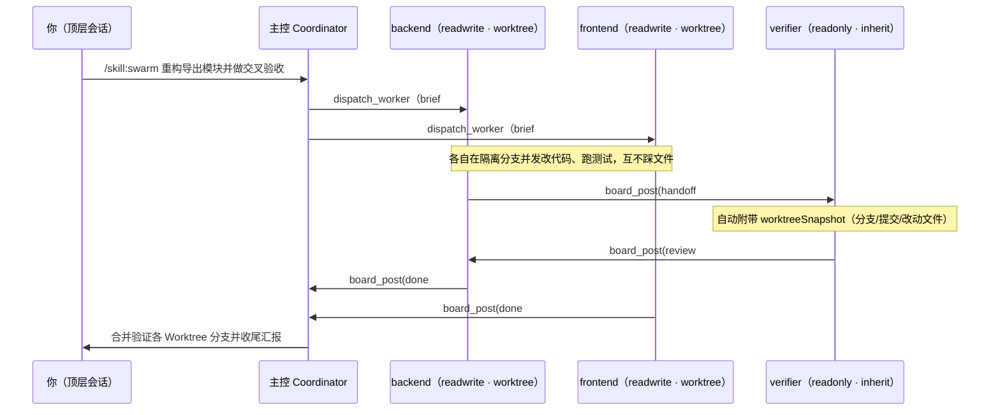

# 多智能体编排选型与实战指南

Helmx 提供**四种正交的多智能体协作形态**，而不是把所有需求塞进同一种抽象。它们共享同一套持久会话、EnvFabric 跨节点底座、受管 Git Worktree 与 Herdr 终端 CLI 能力，但各自解决不同确定性与生命周期的问题。

读完本文，你应当能在 30 秒内判断手头任务该选哪一种，并掌握尤其是 **Swarm 对等协同** 与 **Workflow 确定性编排** 的实战用法。

---

## 一张表做出选型

| 形态 | 触发入口 | 典型场景 | 优势 | 明确不适合 |
| :--- | :--- | :--- | :--- | :--- |
| **1. 单子代理 `subagent`** | 模型自动调用 `subagent` 工具 | 委派一个聚焦子任务：查一处实现、写一组单测、做一次独立审查 | 最轻、人类会话默认后台不阻塞，支持 `fork` / `worktree` / `gate` / 运行中 `steer` | 多成员需要来回讨论、互相评审并多轮改稿 |
| **2. Swarm 对等协同** | `/skill:swarm <任务>` 或自然语言让助理开组（`swarm_create_group`） | 复杂开发拆分多模块并行写、Writer ↔ 只读 Verifier 多轮交叉审改、边做边调整分工或换模型 | **零常驻会话**、按需动态拆角、`#seq` 序号黑板 + 正交 `wake` 门铃、`turn_settled` 纯事件自愈、复用 Worktree 防写冲突 | 几行小改、单点查询、拓扑固定需反复精确重跑的流水线 |
| **3. 确定性 JS Workflow** | `SubagentWorkflow` 工具或 `helmx workflows run` | 多阶段固定流水线、团队可复用的研发 SOP、需要严格审计与零 Token 断点续跑 | 标准 JS 脚本、JSONL 前缀重放（断网/限流零 Token 续跑）、Hub 重启无感原位恢复、门禁自动重试 | 需求还在探索期、成员间需要开放式多轮来回协商 |
| **4. SuperAgent 双层中枢** | 启用 `builtin:superagent`（按需） | 7×24 路由分诊（配合 Cron / Webhook）、驻留后台 Worker、失败工作流冷却自动续跑 | 零阻塞路由、RecallGraph 长期召回、两层看门狗且严守 `ownedBy: 'human'` 红线 | 只需偶尔跑一两次临时多代理任务 |

一句话口诀：

- **一件小事外派** → `subagent`
- **拉个临时工程小队打硬仗（并行写 + 交叉审改 + 随时调角换模）** → **Swarm**
- **固化成可重放、可断点续跑的确定性脚本** → **Workflow**
- **需要 7×24 值守路由与自动巡检兜底** → **SuperAgent**

---

## 实战一：用 Swarm 像带真实工程小队一样交付复杂功能

Swarm（`builtin:swarm`，默认启用）是日常工程开发里最顺手的多智能体协作方式：没有全局常驻会话拖累成本，只在你需要的顶层会话里按需开组，用完结单自动收尾。

### 1. 怎么开启

在任意顶层人类会话中，任选一种方式：

- **显式指令**：直接输入 `/skill:swarm 把导出模块重构为流式下载，补齐单测并交叉审查`，系统在同回合自动建组并解锁全部 `swarm_*` 主控工具；
- **自然语言**：直接说「开个 swarm 小队来拆这个需求，前后端并行改，再配一个只读 reviewer 验收」，主控会自动调用 `swarm_create_group` 并加载 `swarm` 协作手册。

### 2. 一个典型的「并行写 + 只读交叉验收」协作流



### 3. 为什么这套协同用起来不吵、不掉棒、不失控

- **主控专注统筹**：主控负责切分边界、具名派工、裁决冲突与最终合入，不自己埋头写大段业务代码把调度堵死；
- **`#seq` 指针引用 + 正交 `wake` 门铃**：成员交接不用反复复制几千字背景，直接 `refs: [3]` 引用黑板 `#3`；`wake: true` 只叫醒下一跳责任人，不抄送闲人，多条消息经游标自动批合并；
- **并发写代码零冲突**：多个 `readwrite` 成员分配到独立受管 Git Worktree（持 `ManagedWorktreeHold` 锁防误删），发 `handoff / done` 时自动内联分支名、最新提交与改动摘要；
- **盘中随时微调**：发现某个成员卡住或思路偏了，主控可原地 `swarm_abort_worker` 刹停、用 `swarm_switch_worker_model` 给空闲成员原地切换更强模型续跑，而不丢上下文与 Worktree；
- **纯事件自愈（0 轮询定时器）**：成员回合报错自动上板 `[blocker]`；被唤醒却零发帖直接结束回合自动触发单次确定性续催；全组静默未交付自动触发 6 条件 0-Token `[stall]` 归因；
- **你在界面里随时看得清、插得上手**：
  - 时间线里的每次派工/交接折叠为 **26px 自然语言轨迹行**，点击直接打开对应成员的完整子会话抽屉；
  - 主控会话 Composer 上方出现 **「进行中」活动托盘**，实时显示在跑成员与最新动态，支持一键中止；
  - 右侧 **Workbench 编排面板** 聚合全组目标、成员进度、Worktree 分支与交接时间线；
  - 你随时可以在主控输入框里用 `@成员名` 或 `#频道名` 直接插话纠偏。

### 4. 安全收尾与保留分支

任务结束后，主控有两条干净的结单路径：

- **已合入全清**：确认各 Worktree 分支已合并后执行 `swarm_close_group()`——校验无未合入提交后自动清理工作树与临时分支；
- **交由人类自己审改/合并**：执行 `swarm_close_group({ keepWorktree: true })`——释放锁并解绑主控会话，保留待合入分支与路径清单（`retainedWorktrees`）在编排面板里供你自行检视合入。

需要强制刹停整个小队时，CLI 随时可用：

```bash
helmx swarm close-group --group-id <id> --abort-running --keep-worktree
```

---

## 实战二：把高频套路固化为确定性 JS Workflow

当你发现某个研发流程每周都要跑很多遍（例如「先交叉评审架构 → 提交共享契约 → 多模块并发 Worktree 开发 → 全仓门禁验收」），就应该把它写成标准 JS Workflow 存进工作流库。

仓库 `docs/workflows/examples/` 内置了三份生产级范本，可以直接保存运行或改造成自己的流水线：

| 示例脚本 | 编排模式 | 核心展示能力 |
| :--- | :--- | :--- |
| [`cross-review.js`](../workflows/examples/cross-review.js) | 多视角交叉审查 | 动态拆分检查维度 → 并发审查 → 独立复核剔除误报 → 闭环修改 |
| [`module-dev.js`](../workflows/examples/module-dev.js) | 单模块自适应开发 | 规划子代理选策略（直改 / 先审 / 并发子任务）→ 独立 Worktree 并发实现 → 流式合入与门禁验收 |
| [`arch-master.js`](../workflows/examples/arch-master.js) | 多模块总控（嵌套子工作流） | 调 `workflow("cross-review")` 评审方案 → `goal()` 带自动重试提交共享契约 → 并发调 `workflow("module-dev")` 交付各模块 |

保存并运行一个工作流：

```bash
# 保存为跨会话可复用资产
helmx workflows save docs/workflows/examples/cross-review.js

# 显式指定目标会话运行
helmx workflows run cross-review --args '{"mode":"review_only","target":"..."}' --conversation-id 1 --wait

# 若中途因模型限流或网络失败，零 Token 断点续跑
helmx workflows run cross-review --resume-from-run-id <failedRunId> --wait
```

---

## 实战三：叠加跨节点与 Herdr 终端 CLI

上面全部四种编排形态都与「执行位置」和「执行运行时」正交解耦，可以任意组合：

- **跨机器跑**：只要把目标会话或 Profile 绑定到远端节点 `(nodeId, cwd)`（如家里的 Windows 电脑 `dev-win` 或内网 GPU 节点），Swarm 成员、Workflow 子代理、Git Worktree 与测试 Gate 全部自动落在该远端节点上执行——离线时显式 `409 node_offline`，绝不悄悄退回本机。
- **混跑 23 种真实终端 CLI**：启用 `builtin:herdr` 后，在 `subagent` 或 Workflow 中写 `agentType: "herdr:claude"` / `"herdr:codex"` / `"herdr:pi"`（或 `"herdr:claude@dev-win"` 指定节点），就能让真实终端里的 CLI Agent 加入同一套编排与门禁体系；遇到终端审批确认自动弹出带 CAS 乐观锁的 Web 审批卡，人类随时可在物理终端亲自接管。

---

## 下一步深入阅读

- [Swarm 对等协同插件完整文档](../plugins/swarm.md)
- [编写首个工作流](first-workflow.md) · [原生 JS DSL 手册](../workflows/dsl-guide.md)
- [Git Worktree 与代码门禁](../workflows/worktree-and-gate.md) · [状态流水与故障恢复](../workflows/journaling-recovery.md)
- [EnvFabric 分布式执行底座](../architecture/envfabric.md) · [Herdr 终端协同](../plugins/herdr.md) · [SuperAgent 双层中枢](../plugins/superagent.md)
