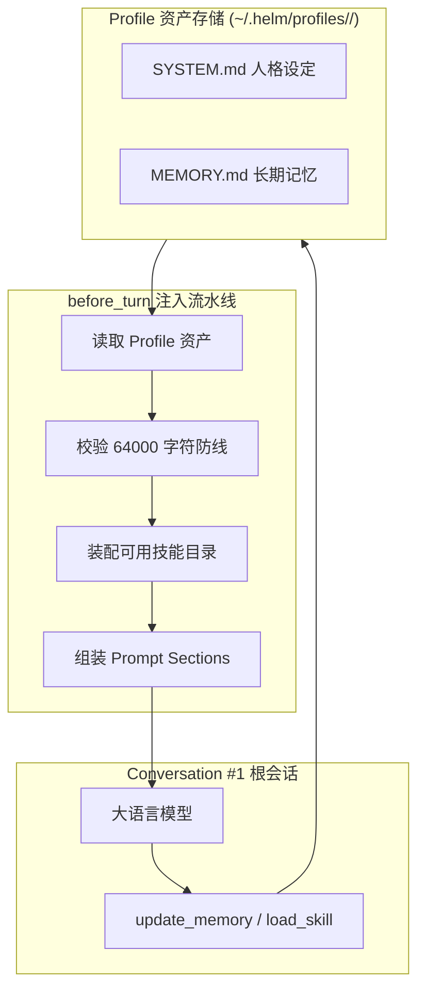
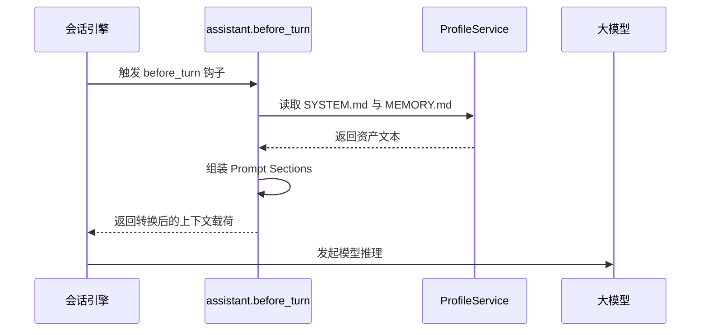
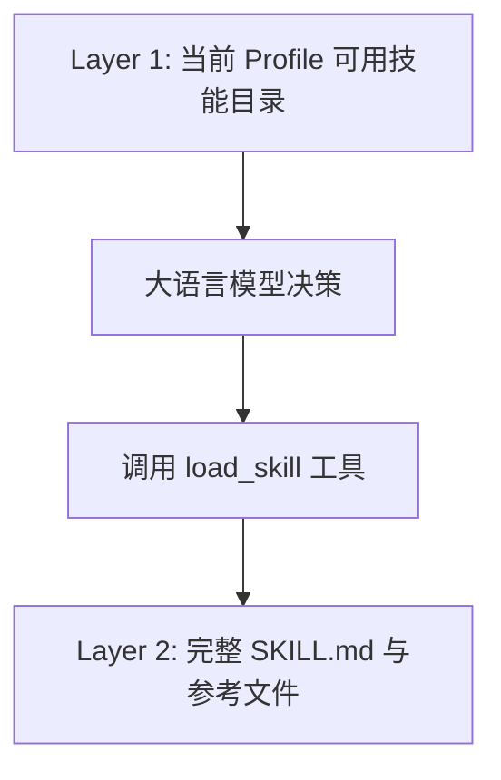

# 常驻个人助理插件

本文介绍 `builtin:assistant` 个人助理插件的架构设计、根会话守护、独立资产注入、记忆管理与动态技能加载机制。

---

## 插件定位与架构总览

`builtin:assistant` 是 Helm 系统常驻内置插件。
该插件声明了 `locked: true` 属性。
系统禁止卸载或停用个人助理插件。
插件负责驱动单兵个人助理会话。
它为所有会话按 `profileId` 注入独立的人格与记忆。



---

## 常驻根会话 `#1` 守护机制

系统初始化时自动创建根会话 `Conversation #1`。
根会话作为用户日常交互的单兵主入口。

### 保护约束

1. **禁止删除**：
   - 系统拦截针对根会话的删除请求。
   - 接口返回 `403 root_conversation_protected` 错误。
2. **固定侧边栏入口**：
   - 插件通过 `ctx.ui.sidebarItem` 挂载固定入口。
   - 配置 `order: 0` 保证展示在左栏顶部。
   - 点击直达 `conversation:1` 视图。
3. **默认 Profile 绑定**：
   - 根会话默认绑定 `assistant` 专家画像。
   - 自动继承专属的人格定义与记忆存储。

---

## 独立资产注入机制

在每个交互回合开始前，插件通过 `before_turn` 钩子注入上下文。



### 注入段落规范

1. **`assistant.system`**：
   - 注入 `SYSTEM.md` 的原始内容。
   - 定义智能体的基础人设、语气风格与行为准则。
2. **`assistant.memory`**：
   - 注入 `<memory>` 标签包裹的长期记忆内容。
3. **`assistant.skills`**：
   - 注入可用技能目录摘要。
   - 提示模型使用 `load_skill` 按需加载详细定义。

### 资产缺失自愈防线

若外部误删 `SYSTEM.md` 或 `MEMORY.md` 文件：

1. **降级为空文本**：
   - 系统不阻断当前回合执行。
2. **发送告警事件**：
   - 宿主触发 warning 级别系统通知。
   - 告知用户资产文件缺失。
3. **注入显式说明**：
   - 向模型注入 `<profile_assets_missing>` 段落。
   - 明确告知模型当前缺少人设与记忆。
   - 告诫模型谨慎回答，绝不伪造既往历史。
4. **自动重建自愈**：
   - 后续执行 `update_memory` 时会自动重建文件。

---

## 记忆管理与大小防线

智能体通过 `update_memory` 工具原子写回记忆。
系统设计了严格的字符上限防线。

### 工具接口定义

```json
{
  "name": "update_memory",
  "description": "更新当前会话 Profile 的 MEMORY.md。append 追加内容，replace 替换全文（超过 64000 字符需先 replace 精简）。",
  "parameters": {
    "type": "object",
    "properties": {
      "text": { "type": "string" },
      "mode": { "type": "string", "enum": ["append", "replace"] }
    },
    "required": ["text", "mode"]
  }
}
```

### 64000 字符防线机制

为防止系统提示词无界膨胀，系统强制执行记忆上限：

1. **单点权威防线**：
   - 在 `ProfileService.updateMemory` 文件锁内统一校验。
   - 并发追加操作在文件锁内排队执行。
   - 合并后长度超过 64000 字符时拒绝写入。
   - 接口返回 `400 memory_limit_exceeded` 错误。
2. **存量超限截断**：
   - 若用户通过外部编辑器修改导致文件超限。
   - 插件在 `before_turn` 注入时切片截断前 64000 字符。
   - 注入末尾附加截断说明，提示模型进行整理精简。
   - 插件绝不直接修改磁盘源文件。

---

## 动态技能按需加载

为了节约模型上下文，Helm 采用两层技能加载架构。



### 技能分层设计

1. **Layer 1 轻量目录**：
   - 在 `before_turn` 中按当前会话的 Profile 配置注入可用技能的名称、描述与引用清单。
   - 只注入摘要，不自动读取所有技能正文。
2. **Layer 2 详细内容**：
   - 模型在需要时调用 `load_skill` 工具。
   - 支持读取 `SKILL.md` 核心流程。
   - 支持按需读取 `references/*.md` 子指引文件。

### Profile 可用技能配置

`profile.json` 的 `skills` 字段控制当前 Profile 的技能目录与 `load_skill`：

| 配置 | 行为 |
| --- | --- |
| 省略 `skills` | 所有当前可用技能；新安装的技能自动可用 |
| `"skills": []` | 不提供任何技能 |
| `"skills": ["helm-cli", "git-commit"]` | 只提供指定 ID 的技能 |

托管技能还要求其 `managedByPlugin` 对应插件处于启用状态。插件停用后，即使技能仍在磁盘上或白名单中，也不进入会话目录，`load_skill` 同样拒绝读取。每次回合与工具调用均读取当前配置；不需要重建会话。

Web 的 Profile 编辑器提供「全部可用技能」开关与技能多选。关闭开关后，未选择任何技能即保存为 `[]`。白名单内缺失或暂不可用的技能会保留配置并显示不可用，用户可显式移除。会话的 `/skill:` 菜单使用同一规则；全局技能库与 `helm skills list/read` 保持管理视角，不按当前 Profile 过滤。

新自举的个人助理 Profile 省略 `skills`；SuperAgent 中枢为 `[]`，巡检看门狗为 `["watchdog-playbooks"]`。已存在的 Profile 不自动改写，也不迁移。可通过编辑器或 CLI 显式修改。

```bash
helm profiles update coder --skills '["helm-cli","git-commit"]' --json
helm profiles update coder --skills '[]' --json
helm profiles update coder --all-skills --json
```

此配置是 Helm 的技能发现与加载策略，不是权限沙箱。`bash`、文件读取、管理 API 与可信插件的权限不会因此收窄；已加载到历史消息中的技能正文也不会被追溯删除。外部 CLI Agent 自己发现的技能不受该字段控制。限制实际执行能力仍需工具作用域、执行环境与凭据边界。

### 内置技能保护

系统启动时自动同步内置管理技能 `skills/helm-cli/`：

1. **版本强制对齐**：
   - 插件服务启动时校验内置技能资产。
   - 发现文件缺失或版本陈旧时自动覆盖修复。
2. **禁止常规修改**：
   - 内置管理技能禁止通过常规 API 篡改。
   - 保证系统命令调用指引的权威性。

---

## 产物管理机制 (Artifacts)

助理在执行任务时会产出报告、代码片段与设计图表。
插件通过产物机制解耦大文本传输。

1. **独立存储**：
   - 大文本写入 `.helm/artifacts/` 目录。
   - 分配唯一产物标识。
2. **轻量传递**：
   - 会话历史中只保留产物元数据与摘要。
   - 避免长文本重复占用后续回合上下文。
3. **前端渲染**：
   - 前端工作台面板自动根据产物类型渲染富文本视图。
