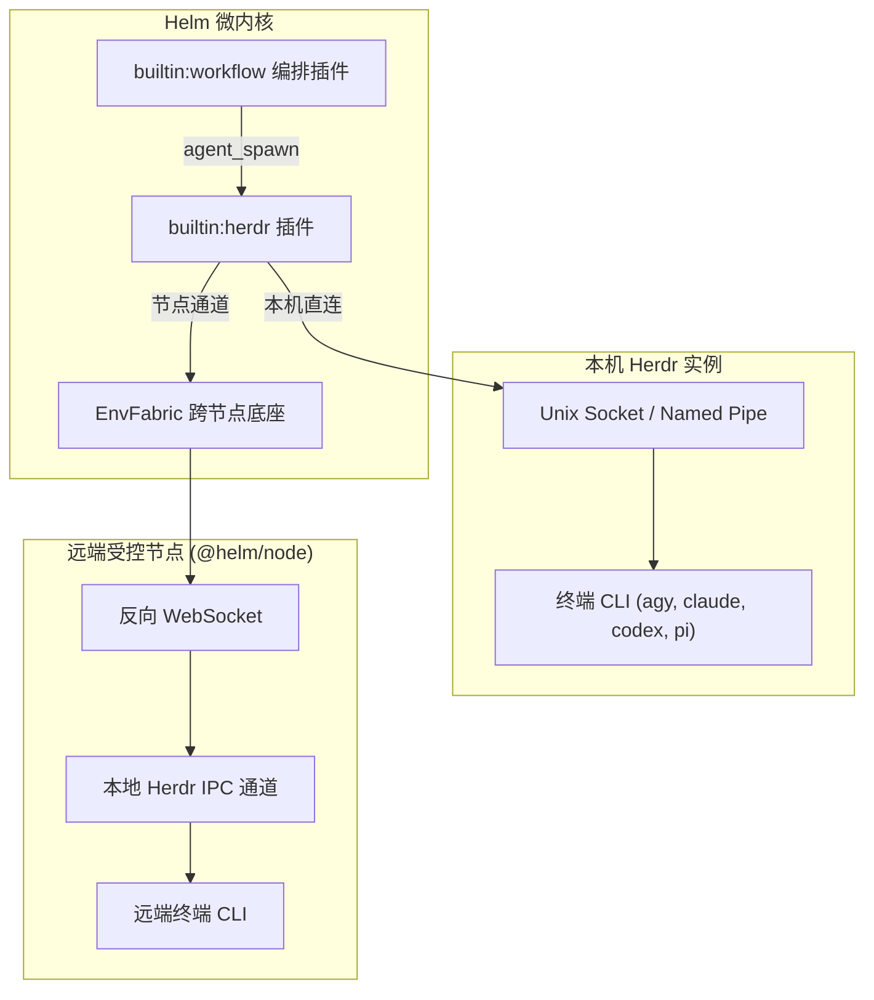
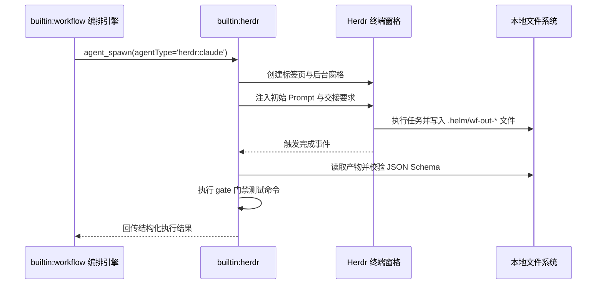
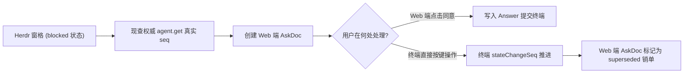

# Herdr 终端协同主控插件

本文介绍 `builtin:herdr` 插件的架构设计、终端代理调度、文件交接、CAS 审批桥与状态总览机制。

---

## 插件定位与连接架构

`builtin:herdr` 负责驱动 Herdr 终端多智能体。
插件使 Helm 可以调度各种外部命令行智能体。
它支持本机与远端分布式受控节点。

### 通信连接规范

1. **本机连接方式**：
   - Linux 与 macOS 环境使用 Unix Domain Socket 通信。
   - Windows 环境使用 Named Pipe 管道通信。
2. **远端节点复用**：
   - 跨节点执行复用内核 `EnvFabric` WebSocket 底座。
   - 节点由 `@helm/node` 代理受管连接。
   - 架构内无需为 Herdr 单独搭建 SSH 通道。
3. **冻结连接目标**：
   - 插件启用时冻结连接目标配置。
   - 执行期间禁止热切换通信通道，防止误触其他实例。

---

## 终端代理调度与「终端跑过程，文件交结果」

插件通过注册 `agent_spawn` 钩子拦截子代理派生请求。
当请求的 `agentType` 以前缀 `herdr:` 开头时，插件接管执行。
系统支持 23 种终端命令行智能体。

### 核心交接契约

1. **后台窗格隔离**：
   - 插件在 Herdr 内部创建带有 `helm-wf-` 前缀的窗格。
   - 窗格在后台静默执行，不干扰前台用户操作。
2. **结构化文件交接**：
   - 智能体通过写入工作目录下的 `.helm/wf-out-*` 文件回传结果。
   - 产物文件内容必须符合请求声明的 JSON Schema。
3. **原地追问自愈机制**：
   - 若智能体未创建交接文件，或文件内容校验失败。
   - 插件向终端原地注入追加指令，促使智能体修正错误。
   - 系统绝不直接截取脏屏幕冒充成功。
4. **门禁验收**：
   - 若派生请求配置了 `gate` 验收命令。
   - 插件在窗格执行环境中恰好执行一次门禁命令。
   - 验收通过后才认定子代理任务完成。

---

## 带 CAS 乐观锁的审批桥

终端智能体在执行高风险命令时可能进入等待交互状态。
插件创建了双向远程审批桥机制。

### CAS 乐观锁工作流程

1. **状态监测与现查**：
   - 插件发现窗格处于 `blocked` 状态。
   - 插件异步调用 `agent.get` 获取权威 `stateChangeSeq` 序号。
   - 插件创建携带当前序号的 `AskDoc` 记录。
2. **Web 审批提交**：
   - 用户在 Web 前端点击审批通过。
   - 插件校验序号是否一致，通过后向终端注入回车。
3. **终端冲突销单**：
   - 若用户直接在终端窗格中按键完成了输入。
   - 终端的 `stateChangeSeq` 会自动递增。
   - 审批桥感知序号变化，自动将 `AskDoc` 流转为 `superseded`。
   - 机制避免向终端重复发送按键。

---

## 状态 Token 投射机制

为了在 Herdr 终端内部直观展示 Helm 任务状态。
插件向终端侧边栏实时投射 `$helm` 状态 Token。

1. **去重保活心跳**：
   - 插件周期性向 Herdr 发送心跳指令。
   - 内部缓存上次状态，状态未变时静默跳过。
   - 机制杜绝产生事件循环。
2. **有界续命管理**：
   - 状态 Token 附带有限有效期。
   - 当 Helm 服务正常退出时自动清理 Token。
   - 崩溃错误发生时 Token 会在过期后自动消失。

---

## 终端总览与受管动作

插件维护全局终端视图，并通过动作总线向外部暴露受管接口。

### 导出动作列表

| 动作标识 | 描述说明 | 关键参数 |
| :--- | :--- | :--- |
| `list` | 列出当前连接的所有受管终端窗格 | 无 |
| `read` | 读取指定终端末尾 40 行脱敏文本快照 | `paneId`, `nodeId` (可选) |
| `focus` | 将指定终端窗格切换聚焦至前台展示 | `paneId`, `nodeId` (可选) |

### 节点标识消歧

在多节点集群环境中，不同节点的窗格标识可能重复：

1. **显式传递 `nodeId`**：
   - 调用 `read` 与 `focus` 时可指定执行节点。
2. **歧义拦截**：
   - 若未提供 `nodeId` 且存在同名窗格。
   - 接口显式抛出 `409` 冲突错误，拒绝猜谜执行。

### 启动对账与孤儿回收

服务重启时，插件执行严格的对账流程：

1. **精确归属校验**：
   - 校验窗格名称是否符合 `helm-wf-*` 规范。
   - 验证智能体归属记录，防止误杀用户自主启动的窗格。
2. **保留工作现场**：
   - 仍处于 `working` 或 `blocked` 状态的窗格予以保留并报告。
   - 状态为 `failed` 的窗格保留屏幕历史供排错审计。
   - 确认无用的已完成窗格执行安全回收清理。
