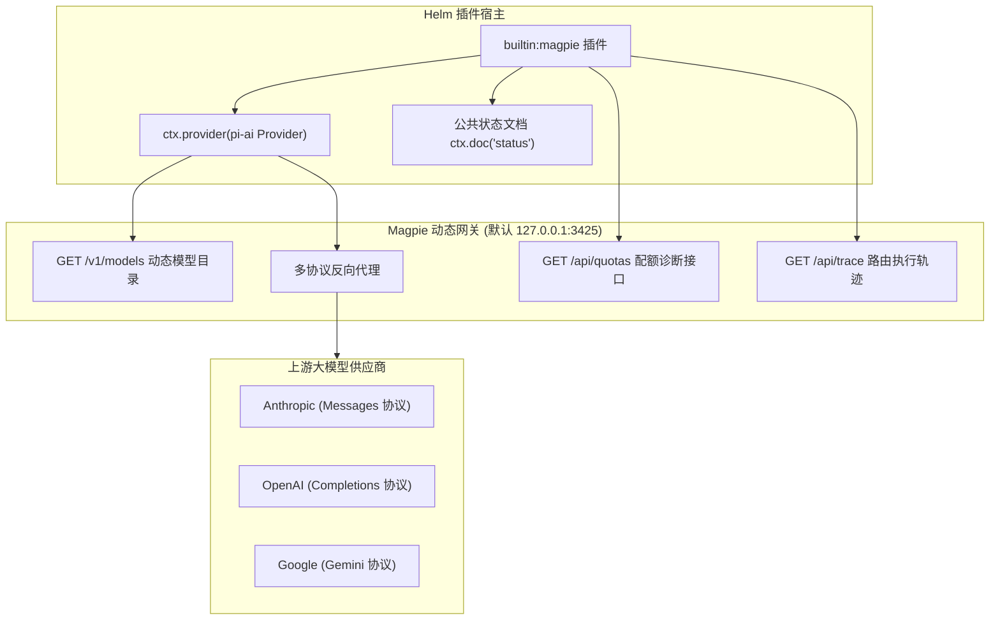
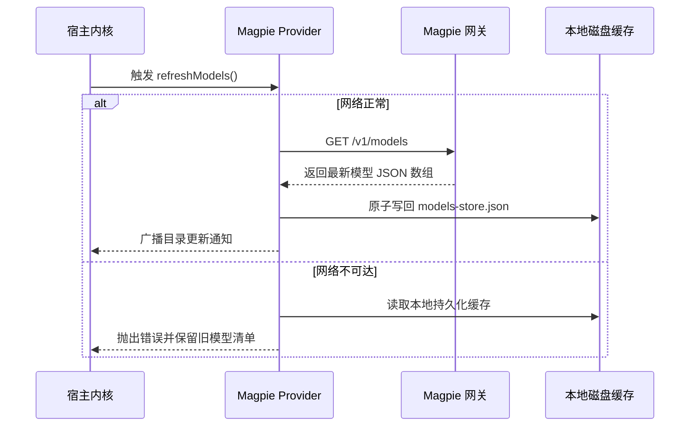

# 动态模型网关插件

本文介绍 `builtin:magpie` 插件的架构设计、原生协议分发、动态模型目录热重载与配额诊断机制。

---

## 插件定位与网关架构

`builtin:magpie` 为系统提供大模型接入能力。
插件将 Magpie 网关注册为标准的 `pi-ai` Provider。
它管理模型目录拉取、供应商路由组解析与调用配额诊断。

---

## 原生多协议分发与 Provider 挂载

插件通过 `ctx.provider` 声明模型供应商。
宿主在服务启动前自动挂载 Provider，停用后自动注销。

### 协议自动适配

不同模型供应商使用不同的通信协议。
Provider 根据模型类型动态匹配请求路径：

1. **Anthropic 协议族**：
   - 使用 Messages 规范。
   - 请求端点自动指向网关根路径。
2. **OpenAI 兼容协议族**：
   - 使用 Chat Completions 规范。
   - 请求端点自动追加 `/v1` 前缀。
3. **动态 BaseURL 修正**：
   - 每次推理请求动态读取当前生效配置。
   - 系统绝不依赖静态文件中的历史地址。

---

## 动态模型目录与热重载

模型目录不再静态硬编码在代码库中。
插件支持从网关拉取最新模型清单。

### 诚实性与安全更新契约

1. **禁止假成功**：
   - 网络不可达时刷新方法必须如实抛出错误。
   - 宿主绝不向用户掩盖错误或误报成功。
2. **离线缓存兜底**：
   - 插件首次启动时优先从磁盘读取缓存模型。
   - 离线加载不触发外部网络请求。
3. **配置快照一致性守卫**：
   - 数据读取过程绑定当前网关配置快照。
   - 若拉取期间用户修改了网关地址。
   - 插件丢弃挂起的旧请求结果，防止脏数据覆盖。

---

## 配额与路由组状态诊断

插件通过状态文档 `status` 实时公开网关状态。
状态供 Web 配置面板与 CLI 命令行查询。

### 核心状态字段

| 字段名称 | 类型 | 说明 |
| :--- | :--- | :--- |
| `gatewayUrl` | string | 当前连接生效的网关根地址 |
| `local` | boolean | 是否指向本机回环地址 |
| `reachable` | boolean | 网关当前是否可以成功联通 |
| `modelCount` | number | 当前可用模型总数量 |
| `groupCount` | number | 路由分组总数量 |
| `quotas` | array | 各供应商剩余配额数据快照 |
| `routes` | array | 最近调用路由分配记录 |
| `diagnostics` | array | 诊断告警信息列表 |

### 导出的受管 Action

1. **`status`**：
   - 查询当前网关连接状态与模型总数。
2. **`refresh`**：
   - 强制触发模型目录网络刷新。
   - 若网关不可达，动作抛出 `magpie_gateway_unreachable` 错误。
3. **`quota`**：
   - 查询各上游渠道的账户额度与余量。
4. **`groups` 与 `group`**：
   - 查询供应商路由组规则与分流策略。

### 静默后台自愈刷新

每个交互回合结算时触发 `turn_settled` 钩子：

1. **静默刷新配额**：
   - 插件后台请求携带 `?kept=1` 参数。
   - 接口只复用网关本地缓存的指标。
2. **零副作用保证**：
   - 机制不消耗上游供应商调用配额。
   - 刷新过程异步执行，绝不阻塞用户会话。

---

## 机密隔离与安全红线

大模型接入涉及敏感认证密钥。
插件贯彻严格的机密隔离边界。

1. **API Key 全局脱敏**：
   - 网关 API Key 存储在 `credentials.json`。
   - 系统将密钥注册到 `SecretStash` 中。
   - 日志、事件与状态文档中严禁出现明文密钥。
2. **区分本机与远端模式**：
   - 本机回环地址默认使用预设通信凭据。
   - 远端独立网关强制校验专属 Bearer 令牌。
