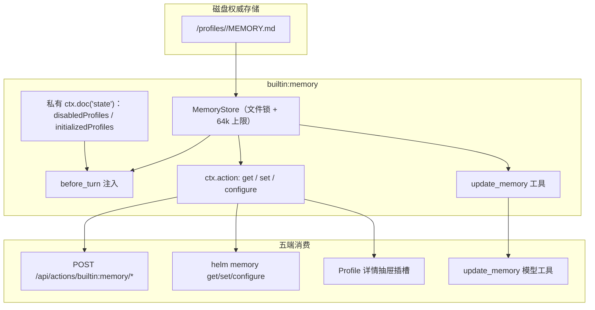

# 长期记忆插件

本文介绍 `builtin:memory` 长期记忆插件的存储防线、单 Profile 启停、注入流水线与五端动作契约。本插件与 `builtin:profile`（角色与技能底座）正交：内核与 `@helm/protocol` 对记忆零感知，全部记忆代码归口本插件。

---

## 插件定位与架构总览

`builtin:memory` 是完全自治的长期记忆插件：`locked: false`、默认启用、可全局停用。



核心设计原则：

1. **磁盘是全文唯一权威**：`MEMORY.md` 全文不进任何公共文档、不进全局首帧或 SSE 广播；Web 端经 `get` 动作按需读取当前 Profile 的内容与开关。
2. **私有紧凑状态**：单 Profile 开关（`disabledProfiles`）与初始化标记（`initializedProfiles`）持久化于插件私有 `ctx.doc('state')`（state.sqlite），不含全文。
3. **初始化与删除区分跨重启成立**：从未初始化的合法 Profile 首次需要记忆时惰性创建；已初始化后被外部删除则显式 warning + `memory.assets-missing` 段落，绝不启动时无条件重建掩盖丢失。

---

## 两级控制语义

| 插件状态 | 单角色状态 | `before_turn` 注入 | `update_memory` 可见性 | 直接调用 `update_memory` |
| :--- | :--- | :--- | :--- | :--- |
| 已启用（默认） | 未禁用（默认开启） | `memory.content` / `memory.guide` + 工具用法提示 | 可见 | 正常原子写盘（64k 防线） |
| 已启用（默认） | 已禁用（单角色关闭） | 不读取、不注入 | 从本回合工具表剥离 | `403 memory_disabled_for_profile` |
| 已停用（全局） | 任意 | 不注入 | 已从宿主卸载 | `tool_not_found` |

停用插件后：动作（`helm memory` 命令与 HTTP 端点）、工具与 Web 插槽贡献即时消失；`builtin:profile` 的 SYSTEM.md 注入与 `load_skill` 不受影响。

---

## MemoryStore 与 64k 防线

`MemoryStore` 直接管理 `<dataDir>/profiles/<profileId>/MEMORY.md`：

- 复用内核 `fs-atomic` 通用原语（`withFileLock` / `atomicWriteFile` / `readTextFile`）：进程内按真实路径串行化，temp+rename 原子落盘；
- `MAX_MEMORY_CHARS = 64_000` 上限在**文件锁内对合并后的最终内容**统一强制：并发 `append` 不可能各自预读检查通过后叠加突破上限；超限显式抛 `400 memory_limit_exceeded`，不写半截文件；
- 所有写入路径（`update_memory` 工具 / `set` 动作 / `configure` 携带 text）走同一防线，无绕过上限的参数；
- 存量超限（外部手改绕过防线）：注入时截断并附显式说明，绝不静默截断、不修改源文件。

---

## 注入段落规范

开启记忆的会话在 `before_turn` 获得：

| 段落 ID | 触发条件 | 内容 |
| :--- | :--- | :--- |
| `memory.content` | MEMORY.md 非空白 | `<memory>` 包裹全文 + `update_memory` 用法提示 |
| `memory.guide` | MEMORY.md 空白（合法态） | 仅 `update_memory` 用法提示（无内容、无告警） |
| `memory.assets-missing` | 已初始化后被外部删除 | 显式警告段落（按 profileId 独立去重告警），不重建 |

`update_memory` 的使用指引由本插件动态注入（SYSTEM.md 不再硬编码），插件停用后该指引随之消失——不留幻影能力。

---

## 动作契约（五端复用）

三个 `ctx.action` 自动映射为 HTTP `POST /api/actions/builtin:memory/<action>`、CLI `helm memory <action>`（支持 `--json`）与 Web `invokeAction`：

### `helm memory get`

```bash
helm memory get --profile-id coder --json
```

```json
{ "profileId": "coder", "enabled": true, "content": "# Memory\n\n...", "initialized": true }
```

- Profile 不存在显式 `404 profile_not_found`；文件不存在如实返回空串。

### `helm memory set`

```bash
helm memory set --profile-id coder --text '# Memory\n\n偏好简洁回复。' --json
# 追加模式
helm memory set --profile-id coder --text '新事实' --mode append --json
```

- 单角色已关闭时 `403 memory_disabled_for_profile`；
- 超限 `400 memory_limit_exceeded`（提示 replace 精简）。

### `helm memory configure`

```bash
helm memory configure --profile-id coder --enabled false --json
# 开启并惰性创建文件
helm memory configure --profile-id coder --enabled true --json
# 携带替换文本（先写成功再提交开关，不留半配置）
helm memory configure --profile-id coder --enabled true --text '# 重置后的记忆' --json
```

- 单角色开关即时生效；已有 `MEMORY.md` 文件保留在磁盘上，重新开启即可恢复。

---

## Web 单 Profile 插槽

插件经 `ctx.ui.slot({ target: 'builtin:profile/detail-section' })` 向角色详情抽屉注入：

- 单角色「启用长期记忆」开关（即时生效）；
- `MEMORY.md` 编辑器与「保存记忆」按钮（内容独立保存，不随「取消角色编辑」回滚）；
- 新建尚未落盘的 Profile 只提示先创建角色，再配置记忆；
- 异步切换 Profile 带代数竞争保护（不串数据），后台刷新不覆盖未保存的本地草稿。

---

## 全局启停

```bash
helm plugins disable builtin:memory
helm plugins enable builtin:memory
```

停用后 `helm memory` 命令、HTTP 端点、`update_memory` 工具与 Web 插槽即时消失；磁盘 `MEMORY.md` 文件与插件私有开关状态保留，重新启用后恢复。
