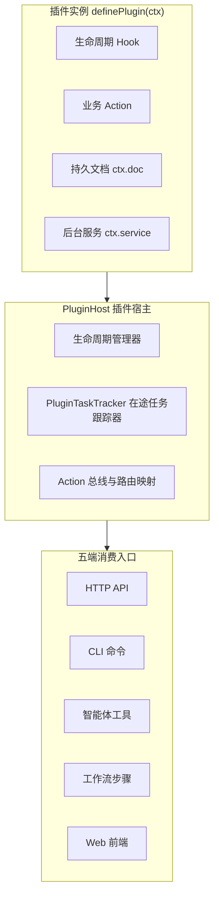
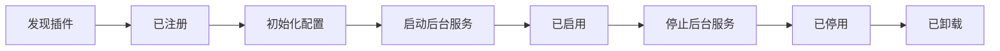
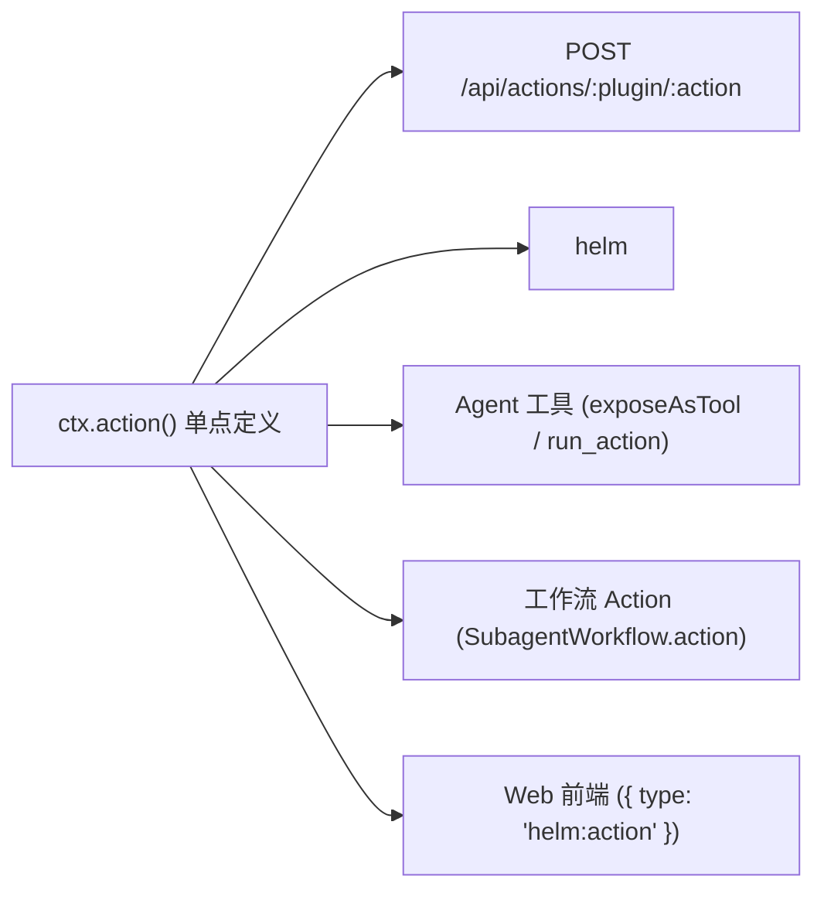
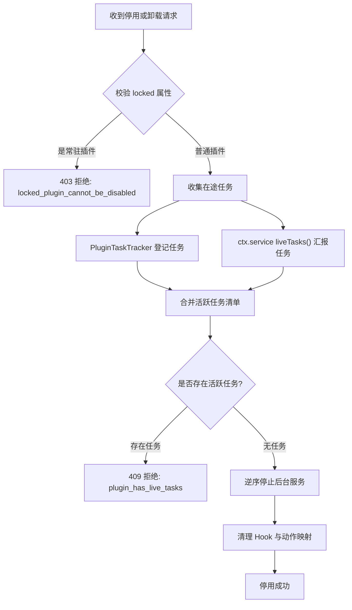

# 插件系统设计与契约

本文介绍 Helm 的插件宿主架构、`definePlugin(ctx)` 强类型契约、动作五端映射与在途任务安全保护机制。

---

## 插件宿主架构设计

Helm 坚持机制与策略分离原则。
内核只保留通用状态机、执行底座与编排引擎。
所有业务角色、外部系统对接与高级交互均由插件实现。



插件宿主提供统一的沙箱隔离与生命周期管理：

1. **唯一强类型入口**：每个插件必须导出标准定义并实现 `definePlugin(ctx)`。
2. **状态与配置隔离**：每个插件分配专属数据目录 `~/.helm/plugins/<id>/`。
3. **单点动作声明**：一次定义 Schema，自动映射到五端消费入口。
4. **安全受控卸载**：停用与卸载时校验在途任务，杜绝状态破坏。

---

## `definePlugin(ctx)` 契约

插件必须通过 `definePlugin(ctx)` 声明全部扩展项。
上下文对象 `ctx` 提供了完整的宿主交互能力。

### 插件上下文接口

| 接口方法 | 职责说明 | 作用范围 |
| :--- | :--- | :--- |
| `ctx.pluginId` | 读取当前插件的唯一标识 | 插件全局 |
| `ctx.dataDir` | 读取专属持久化目录路径 | 本地文件存储 |
| `ctx.getConfig()` | 读取当前插件生效的配置对象 | 插件配置 |
| `ctx.configSchema()` | 声明插件配置字段的结构校验规则 | 属性配置与机密隔离 |
| `ctx.hook` | 注册后端生命周期 Hook | 请求与回合生命周期 |
| `ctx.action()` | 注册五端复用的强类型动作 | 跨端业务能力 |
| `ctx.tool()` | 注册仅对大模型可见的专用工具 | 模型上下文执行 |
| `ctx.route()` | 挂载 Web Standard 原始 HTTP 路由 | 自定义协议与回调 |
| `ctx.doc()` | 声明受管的持久状态文档 | SQLite 状态存储 |
| `ctx.service()` | 注册后台长周期驻留服务 | 守护进程与定时轮询 |
| `ctx.provider()` | 注册自定义模型供应商网关 | 模型接入 |
| `ctx.ui` | 注册前端 7 大扩展点视图 | 界面渲染 |
| `ctx.host` | 调用内核受限的基础运行时能力 | 会话调度与审批交互 |

### 插件生命周期状态流转



1. **注册阶段**：宿主扫描清单文件，校验插件 ID 与接口定义。
2. **启用阶段**：加载持久化配置，挂载 Hook 与路由，启动后台服务。
3. **执行阶段**：响应外部请求，分发事件钩子，执行动作。
4. **停用阶段**：校验在途任务，停止后台服务，卸载 Hook 与动态动作。
5. **卸载阶段**：清理运行时上下文，释放会话管理权。

---

## 动作单点 Schema 与五端映射

插件通过 `ctx.action()` 声明业务动作。
宿主根据声明自动将动作映射到五个不同的执行环境。



### 动作声明范例

```typescript
ctx.action({
  id: 'send_alert',
  description: '向运维通道发送警报信息',
  inputSchema: {
    type: 'object',
    properties: {
      channel: { type: 'string' },
      message: { type: 'string' },
    },
    required: ['channel', 'message'],
    additionalProperties: false,
  },
  outputSchema: {
    type: 'object',
    properties: {
      delivered: { type: 'boolean' },
      deliveryId: { type: 'string' },
    },
    required: ['delivered', 'deliveryId'],
    additionalProperties: false,
  },
  exposeAsTool: true,
  async handler(input, context) {
    return {
      delivered: true,
      deliveryId: 'alert-1001',
    };
  },
});
```

### 五端映射机制说明

1. **HTTP API 映射**：
   - 宿主自动生成 `POST /api/actions/:pluginId/:actionId` 端点。
   - 请求体与返回体自动执行 JSON Schema 强校验。
2. **CLI 命令映射**：
   - 自动生成 `helm <plugin> <action>` 顶层命令。
   - 支持 `--json` 管道输出与参数提示。
3. **Agent 工具映射**：
   - 若配置 `exposeAsTool: true`，直接注入当前会话的工具列表。
   - 若未直接注入，模型可通过元工具 `run_action` 按需调用。
4. **工作流编排映射**：
   - 编排脚本可通过 `action('pluginId:actionId', input)` 调度。
5. **Web 界面动作映射**：
   - 前端声明式 JSON Spec 中可通过 `{ type: 'helm:action', actionId, input }` 触发。

---

## 持久状态与文档广播 (`ctx.doc`)

插件可以使用 `ctx.doc()` 维护状态。
文档由内核统一存储在 `state.sqlite` 数据库中。

```typescript
interface MonitorState {
  healthy: boolean;
  activeNodes: number;
}

const monitorDoc = ctx.doc<MonitorState>(
  'monitor_status',
  { healthy: true, activeNodes: 0 },
  { public: true },
);

// 读取状态
const current = monitorDoc.get();

// 原子更新状态
monitorDoc.update((state) => ({
  ...state,
  activeNodes: state.activeNodes + 1,
}));
```

### 文档公开与实时事件

配置 `{ public: true }` 的文档具有以下特性：

1. **跨端只读访问**：前端与 CLI 可以通过接口直接获取文档快照。
2. **实时变更通知**：每次调用 `set()` 或 `update()`，内核自动广播 `plugin.doc.updated` 事件。
3. **数据敏感隔离**：公共文档只存储展示状态，禁止包含未脱敏机密信息。

---

## 在途任务保护与安全卸载

为了防止破坏未完成的任务，Helm 实现了强约束卸载保护机制。



### 在途任务统计范围

1. **正在执行的动作**：通过 HTTP、CLI 或工作流发起的 Action 调用。
2. **正在调用的工具**：模型正在执行的 Plugin Tool 任务。
3. **执行中的子代理**：由该插件拦截接管的子代理派生。
4. **服务自主声明的任务**：后台服务通过 `liveTasks()` 动态返回的未完成任务标签。

### 保护规则与错误处理

- **存在活跃任务**：宿主立即拒绝操作并抛出错误：
  - 错误码：`409 plugin_has_live_tasks`。
  - 响应包含具体阻塞的任务标签列表。
- **服务校验错误**：若 `liveTasks()` 执行崩溃或返回非法数据：
  - 错误码：`500 plugin_live_tasks_check_failed`。
  - 宿主绝不默认放行，保持插件状态不变。
- **常驻插件保护**：声明 `locked: true` 的内置插件（如 `builtin:assistant`）永久禁止停用或卸载。

---

## 宿主运行时能力 (`ctx.host`)

宿主通过 `ctx.host` 为插件开放受控的核心能力：

```typescript
export interface HelmHostApi {
  // 外部事件投递
  dispatchTrigger(event: ExternalTriggerEnvelope): Promise<void>;
  
  // 会话输入提交
  submitInput(conversationId: number, text: string, opts?: { origin?: InputOrigin; whenBusy?: WhenBusy }): Promise<void>;
  
  // 会话管理
  createConversation(init: ConversationInit): Promise<ConversationSummary>;
  listConversations(filter?: { profileId?: string; tag?: string; status?: ConversationStatus }): ConversationSummary[];
  getConversation(id: number): ConversationSummary;
  updateConversation(id: number, patch: ConversationPatch): Promise<ConversationSummary>;
  manageConversation(id: number): () => void;
  markConversationOwnership(id: number, owner: 'helm' | 'bot' | 'human'): void;
  
  // 人机交互审批
  createAsk(spec: AskCreateSpec): Promise<AskResult>;
  cancelAsk(askId: string, reason?: 'cancelled' | 'superseded'): Promise<void>;
  registerAskSeqResolver(resolver: (askId: string) => MaybePromise<number | undefined>): () => void;
  
  // 工作流与系统事件
  onWorkflowSettled(listener: (run: WorkflowRunSummary) => MaybePromise<void>): () => void;
  emitEvent(type: string, payload: unknown): void;
}
```

插件只能通过此受限接口调用内核机制。
严禁插件绕过宿主直接操作核心数据库或会话内部变量。
