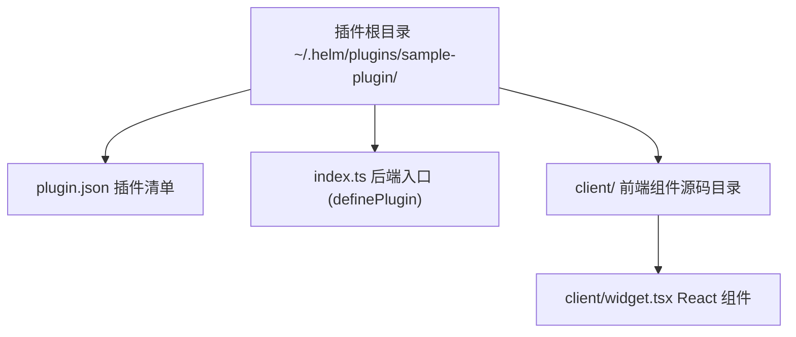
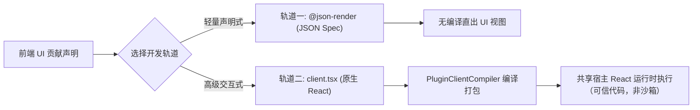

# 自定义插件开发实战

本文介绍 Helm 自定义插件的工程规范、清单配置、后端逻辑开发、前端双轨扩展与本地测试验证流程。

---

## 插件工程目录规范

外部插件统一存放在数据目录下的 `plugins` 文件夹中。
默认路径为 `~/.helm/plugins/<pluginId>/`。
每个插件必须具备清晰的文件结构。



### 推荐目录结构示例

```text
~/.helm/plugins/sample-plugin/
├── plugin.json              # 插件元数据与入口配置
├── index.ts                 # 后端入口代码
├── package.json             # 依赖声明文件
└── client/                  # 前端 React 组件目录
    └── widget.tsx           # 前端自定义视图组件
```

---

## 插件清单定义 (`plugin.json`)

清单文件声明插件的基础属性与前端根目录。

```json
{
  "id": "sample-plugin",
  "name": "示例业务插件",
  "version": "1.0.0",
  "main": "index.ts",
  "clientRoot": "./client"
}
```

### 清单字段约束

1. **`id` 规范**：
   - 仅允许字母、数字、下划线与连字符。
   - 禁止使用 `builtin:` 前缀，防止与内置插件冲突。
2. **`locked` 剥离**：
   - 外部插件禁止声明常驻锁定。
   - 宿主加载时会自动移除 `locked: true` 属性。
3. **安全默认启用状态**：
   - 外部插件初次注册时默认为未启用状态。
   - 用户必须通过显式命令激活插件。

---

## 后端逻辑开发

插件通过导出标准的 `definePlugin(ctx)` 函数注入能力。

### 完整后端示例

```typescript
import { HelmError, type PluginDefinition } from '@helm/protocol';

export default function createPlugin(): PluginDefinition {
  return {
    id: 'sample-plugin',
    name: '示例业务插件',
    version: '1.0.0',
    definePlugin(ctx) {
      // 1. 声明配置结构 (secret: true 自动存储至 credentials.json)
      ctx.configSchema({
        apiKey: {
          type: 'string',
          secret: true,
          description: '远端服务认证密钥',
        },
        retryCount: {
          type: 'number',
          default: 3,
        },
      });

      // 2. 声明持久状态文档
      const statsDoc = ctx.doc('stats', { totalCalls: 0 }, { public: true });

      // 3. 注册单点 Schema 动作
      ctx.action({
        id: 'send_notice',
        description: '发送业务通知消息',
        inputSchema: {
          type: 'object',
          properties: {
            target: { type: 'string' },
            content: { type: 'string' },
          },
          required: ['target', 'content'],
          additionalProperties: false,
        },
        outputSchema: {
          type: 'object',
          properties: {
            success: { type: 'boolean' },
          },
          required: ['success'],
          additionalProperties: false,
        },
        exposeAsTool: true,
        async handler(input, context) {
          statsDoc.update((state) => ({
            ...state,
            totalCalls: state.totalCalls + 1,
          }));
          return { success: true };
        },
      });

      // 4. 注册生命周期服务与在途任务检查
      let activeJobs = 0;
      ctx.service({
        id: 'worker-service',
        async start() {},
        async stop() {},
        liveTasks() {
          return activeJobs > 0 ? [`job-count:${activeJobs}`] : [];
        },
      });
    },
  };
}
```

---

## 前端双轨开发机制

Helm 支持声明式 JSON 与原生 React 两种前端界面扩展轨道。



### 轨道一：`@json-render` 声明式视图

适合构建配置面板、表格与简单指标卡片。
视图无需编写前端构建配置。

```typescript
ctx.ui.settingsPanel({
  id: 'sample-settings',
  label: '示例插件配置',
  docs: ['stats'],
  json: {
    component: 'Stack',
    children: [
      { component: 'Text', variant: 'title', text: '业务统计总览' },
      {
        component: 'KeyValueList',
        items: [
          { key: '/$docs/stats/totalCalls', label: '调用总次数' },
        ],
      },
    ],
  },
});
```

### 轨道二：`client.tsx` 原生 React 组件

适合构建带复杂交互、动态图表或定制样式的视图。

1. **依赖共享规范**：
   - 组件引入 `react`、`react-dom` 与 `lucide-react`。
   - 宿主自动映射到全局命名空间，绝不打包第二份依赖。
2. **样式归属**：
   - 插件业务样式以 `clientRoot` 内本地 `.css` 导入（如 `import './styles.css'`），不得写进宿主 `styles.css`。
   - 编译器用 esbuild 按依赖顺序合并 CSS，再以保留导出 `__helmClientCss` 内联进插件 JS；插件源码不得占用该导出名。编译器不生成写 DOM 的样式副作用，宿主加载器在导入成功且加载未失效后才注入带 `data-helm-plugin-css` 标记的 `<style>`。
   - 同一入口更新时替换原样式；插件停用/卸载或登出时回收。失效或失败的在途导入不会重新挂载这些托管样式，也不会覆盖重新启用后的样式。
   - SSE 重连快照会失效模块缓存，仍挂载的原生视图随之重新加载组件与样式，避免继续执行断线前的旧代码；仅某个插件失效时，其他插件视图不重建。
   - 支持 `clientRoot` 内的本地 `@import`，被导入文件同样参与路径校验与缓存 hash；根外、符号链接逃逸及远程 `@import` 显式拒绝。
   - `url()` 支持 `data:` 内联资源与 HTTP(S)/协议相对的绝对资源地址。当前不提供插件静态资源端点，本地相对、站点根相对和片段资源 URL 显式拒绝，请改用内联资源，避免按宿主页基址误解析。
   - 可复用宿主全局设计变量（如 `var(--fg-muted)`、`var(--border)`）与通用组件类（如 `.badge`），不重复定义宿主原语。
3. **极简无 Emoji 铁律**：
   - 界面文案与状态徽标严禁使用任何 Emoji。
   - 图标统一使用 `lucide-react` 线性图标。

```tsx
import React from 'react';
import { Activity } from 'lucide-react';
import { usePluginDoc } from '@helm/plugin-client';

export function SampleWidget() {
  // usePluginDoc 只需一个 docName：自动绑定当前插件（ctx.pluginId）
  const stats = usePluginDoc<{ totalCalls: number }>('stats');

  return (
    <div className="p-4 border rounded-lg bg-card">
      <div className="flex items-center gap-2 mb-2 font-medium">
        <Activity className="w-4 h-4 text-primary" />
        <span>业务运行状态</span>
      </div>
      <p className="text-sm text-muted-foreground">
        当前累计调用次数：{stats?.totalCalls ?? 0}
      </p>
    </div>
  );
}
```

`@helm/plugin-client` 是宿主共享模块，编译器将其映射到全局命名空间：

| 共享 Hook | 作用 |
| :--- | :--- |
| `usePluginDoc(docName, pluginId?)` | 响应式订阅公开全局文档，默认当前插件，也可显式跨插件寻址 |
| `usePluginSessionDoc(docName, options?)` | 按当前会话订阅公开会话文档，可指定 `conversationId / pluginId`；引用归零时退订 |
| `PluginSlot` | 声明本插件子插槽，供其他插件通过 `ctx.ui.slot()` 注入内容 |
| `useConversations()` | 订阅宿主会话摘要列表 |
| `useConversation(conversationId)` | 订阅单个会话的摘要、详情、流式状态和审批；按需加载详情并提供重试方法 |
| `usePluginContext()` | 获取 `callAction`、`openConversationDrawer`、`openArtifact`、`openWorkbench`、`closeWorkbench`、`notify` 等宿主交互能力 |
| `useToolActivity(callId, active)` | 工具视图向所在时间线回合报告真实后台活动，宿主据此控制复制/分叉按钮 |

`useToolActivity` 的注册表属于当前回合，不进入全局 Store。工具调用已经返回但后台任务仍在执行时，插件应根据自己的真实状态报告 `active: true`。同一调用的多个挂载来源独立清理；参数变化、卸载或插件停用会自动释放登记。缺少 `callId` 或组件不在时间线回合内时不登记，因此工作台视图不会影响其他回合。

`openConversationDrawer(conversationId)` 打开现有子会话抽屉，不切换主屏、不创建分屏，也不改变工作台开关。

`ctx.callAction(actionId, input, { pluginId?, conversationId? })` 支持显式跨插件调用。`ctx.submitInput(text, { conversationId?, whenBusy? })` 向指定或当前会话提交输入；缺少会话时明确报错。

Screen 组件通过 `ScreenProps.params / setParams` 管理可深链子页面，并通过 `isSplit` 区分主屏与分屏。输入区组件通过 `props.composer` 或 `ctx.composer` 读写草稿、插入文本、读取附件和提交输入。控制函数不注入声明式求值域；JSON 子插槽只接收数据。

`<PluginSlot name="cards" slotProps={{ selectedId }} />` 相对当前插件声明子插槽，贡献方注册 `ctx.ui.slot({ id: 'my-card', target: 'owner-plugin/cards', client: ... })`。`mode="single"` 用优先级选择单个贡献，默认 `list` 渲染全部。循环引用显示错误而不继续渲染。

注意 `client.tsx` 是可信代码而非安全沙箱，宿主不提供隔离边界。插件 UI 的组件、交互与样式均为插件资产：宿主只提供通用扩展点与共享原语，不包含工作流/子代理业务类名或专用渲染分支。

4. **在后端注册组件**：

```typescript
ctx.ui.workbenchPanel({
  id: 'sample-widget-panel',
  label: '业务监控',
  client: {
    module: 'widget.tsx',
    export: 'SampleWidget',
  },
});
```

---

## 本地调试与测试验证

完成代码编写后，在本地执行验证与测试。

### 步骤一：部署插件文件

将插件文件夹移动至数据目录：

```bash
mkdir -p ~/.helm/plugins/sample-plugin
cp -r ./* ~/.helm/plugins/sample-plugin/
```

### 步骤二：查询与激活插件

使用 `helm` 命令行工具激活插件：

```bash
# 列出所有已发现插件
helm plugins list

# 启用指定插件
helm plugins enable sample-plugin
```

### 步骤三：验证 Action 动作调用

通过 CLI 测试已注册的 Action：

```bash
helm sample-plugin send_notice --target "ops" --content "服务启动完成" --json
```

### 步骤四：在途任务卸载保护测试

编写自动化测试，验证宿主在任务执行期间拒绝停用：

```typescript
import { test } from 'node:test';
import assert from 'node:assert/strict';

test('在途任务存在时安全拦截停用请求', async () => {
  // 模拟插件存在活跃任务
  const error = await host.disablePlugin('sample-plugin').catch((err) => err);
  
  assert.equal(error.code, 'plugin_has_live_tasks');
  assert.equal(error.statusCode, 409);
});
```
