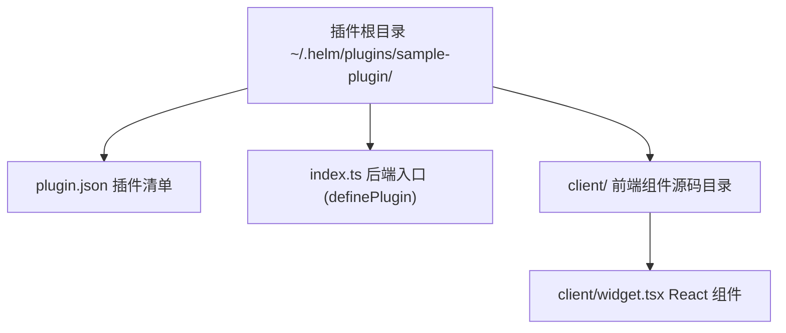
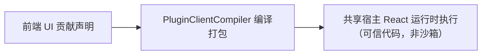

# 自定义插件开发实战

本文介绍 Helm 自定义插件的工程规范、清单配置、后端逻辑开发、前端双轨扩展与本地测试验证流程。

---

## 插件工程目录规范

外部插件统一存放在数据目录下的 `plugins` 文件夹中。
默认路径为 `~/.helm/plugins/<pluginId>/`。
每个插件必须具备清晰的文件结构。



### 推荐目录结构示例

```text
~/.helm/plugins/sample-plugin/
├── plugin.json              # 插件元数据与入口配置
├── index.ts                 # 后端入口代码
├── package.json             # 依赖声明文件
└── client/                  # 前端 React 组件目录
    └── widget.tsx           # 前端自定义视图组件
```

---

## 插件清单定义 (`plugin.json`)

清单文件声明插件的基础属性与前端根目录。

```json
{
  "id": "sample-plugin",
  "name": "示例业务插件",
  "version": "1.0.0",
  "main": "index.ts",
  "clientRoot": "./client"
}
```

### 清单字段约束

1. **`id` 规范**：
   - 仅允许字母、数字、下划线与连字符。
   - 禁止使用 `builtin:` 前缀，防止与内置插件冲突。
2. **`locked` 剥离**：
   - 外部插件禁止声明常驻锁定。
   - 宿主加载时会自动移除 `locked: true` 属性。
3. **安全默认启用状态**：
   - 外部插件初次注册时默认为未启用状态。
   - 用户必须通过显式命令激活插件。
4. **TS 入口与模块生命周期**：
   - 后端入口与相对依赖（含 `.js` 说明符映射到同名 `.ts`、无扩展名、目录 `index.ts`）在宿主进程内转译加载；`import.meta.url` 指向插件目录内的真实源文件。
   - 插件目录可自带 `node_modules`，Node 内置模块与第三方 npm 包按常规规则解析；`@helm/*` 公共包由宿主提供同一实例。
   - 插件根在注册成功后常驻宿主进程：插件运行期动态 `import()` 的 TS 依赖始终可转译；同一模块在同进程内只初始化一次。
   - 停用或卸载插件不会卸载已加载的模块（同进程内重新启用/重新注册不重复初始化）；完全重新加载插件代码用受控热重载（`helm plugins reload <id>`，见下文「开发闭环」），无需重启 Hub。

---

## 后端逻辑开发

插件通过导出标准定义对象（`export default { ... definePlugin(ctx) {...} }`）注入能力；外部加载器只接受对象形式的默认导出。

### 完整后端示例

```typescript
import { type PluginDefinition } from '@helm/protocol';

// 外部插件：export default 定义对象（加载器只接受对象，不接受工厂函数）
export default {
  id: 'sample-plugin',
  name: '示例业务插件',
  version: '1.0.0',
  definePlugin(ctx) {
    // 1. 声明配置结构 (secret: true 自动存储至 credentials.json)
    ctx.configSchema({
      apiKey: {
        type: 'string',
        secret: true,
        description: '远端服务认证密钥',
      },
      retryCount: {
        type: 'number',
        default: 3,
      },
    });

    // 2. 声明持久状态文档
    const statsDoc = ctx.doc('stats', { totalCalls: 0 }, { public: true });

    // 3. 注册单点 Schema 动作
    ctx.action({
      id: 'send_notice',
      description: '发送业务通知消息',
      inputSchema: {
        type: 'object',
        properties: {
          target: { type: 'string' },
          content: { type: 'string' },
        },
        required: ['target', 'content'],
        additionalProperties: false,
      },
      outputSchema: {
        type: 'object',
        properties: {
          success: { type: 'boolean' },
        },
        required: ['success'],
        additionalProperties: false,
      },
      exposeAsTool: true,
      async handler(input, context) {
        statsDoc.update((state) => ({
          ...state,
          totalCalls: state.totalCalls + 1,
        }));
        return { success: true };
      },
    });

    // 4. 注册生命周期服务与在途任务检查
    let activeJobs = 0;
    ctx.service({
      id: 'worker-service',
      async start() {},
      async stop() {},
      liveTasks() {
        return activeJobs > 0 ? [`job-count:${activeJobs}`] : [];
      },
    });
  },
} satisfies PluginDefinition;
```

### 外部插件加载机制

外部插件入口支持直接使用 TypeScript（`.ts` / `.tsx`）：宿主加载器基于 Node 24 `module.registerHooks` 钩子加载源码，对 `.ts` / `.tsx` 文件用 esbuild 做 transform（不打包），按依赖闭包逐文件转译。模块内的 `import.meta.url` 始终指向真实源码文件 URL；裸 npm 说明符从插件自身目录解析；`@helm/protocol` 等宿主协议包与宿主共享同一实例，不重复加载。加载器不承诺解析 `tsconfig` 的 `paths` 别名，插件源码不要依赖 tsconfig aliases。

---

## 前端 client.tsx 单轨开发机制

Helm 视图类扩展点统一采用 `client.tsx` 原生 React 组件单轨：`UiSpecBase` 不再同时接受 `json / docs / sessionDocs` 与 `client` 双轨声明。声明式 JSON 渲染能力由 `builtin:json-render` 插件提供（默认启用、可停用），需要纯数据驱动的界面时依赖该插件的能力而非在视图声明中写 `json` 字段。



### `client.tsx` React 组件

适合构建配置面板、指标卡片与带复杂交互、动态图表或定制样式的视图。

1. **依赖共享规范**：
   - 组件引入 `react`、`react-dom` 与 `lucide-react`。
   - 宿主自动映射到全局命名空间，绝不打包第二份依赖。
2. **样式归属**：
   - 插件业务样式以 `clientRoot` 内本地 `.css` 导入（如 `import './styles.css'`），不得写进宿主 `styles.css`。
   - 编译器用 esbuild 按依赖顺序合并 CSS，再以保留导出 `__helmClientCss` 内联进插件 JS；插件源码不得占用该导出名。编译器不生成写 DOM 的样式副作用，宿主加载器在导入成功且加载未失效后才注入带 `data-helm-plugin-css` 标记的 `<style>`。
   - 同一入口更新时替换原样式；插件停用/卸载或登出时回收。失效或失败的在途导入不会重新挂载这些托管样式，也不会覆盖重新启用后的样式。
   - SSE 重连快照会失效模块缓存，仍挂载的原生视图随之重新加载组件与样式，避免继续执行断线前的旧代码；仅某个插件失效时，其他插件视图不重建。
   - 支持 `clientRoot` 内的本地 `@import`，被导入文件同样参与路径校验与缓存 hash；根外、符号链接逃逸及远程 `@import` 显式拒绝。
   - `url()` 支持 `data:` 内联资源与 HTTP(S)/协议相对的绝对资源地址。当前不提供插件静态资源端点，本地相对、站点根相对和片段资源 URL 显式拒绝，请改用内联资源，避免按宿主页基址误解析。
   - 可复用宿主全局设计变量（如 `var(--fg-muted)`、`var(--border)`）与通用组件类（如 `.badge`），不重复定义宿主原语。
3. **极简无 Emoji 铁律**：
   - 界面文案与状态徽标严禁使用任何 Emoji。
   - 图标统一使用 `lucide-react` 线性图标。

```tsx
import React from 'react';
import { Activity } from 'lucide-react';
import { usePluginDoc } from '@helm/plugin-client';

export function SampleWidget() {
  // usePluginDoc 只需一个 docName：自动绑定当前插件（ctx.pluginId）
  const stats = usePluginDoc<{ totalCalls: number }>('stats');

  return (
    <div className="p-4 border rounded-lg bg-card">
      <div className="flex items-center gap-2 mb-2 font-medium">
        <Activity className="w-4 h-4 text-primary" />
        <span>业务运行状态</span>
      </div>
      <p className="text-sm text-muted-foreground">
        当前累计调用次数：{stats?.totalCalls ?? 0}
      </p>
    </div>
  );
}
```

`@helm/plugin-client` 是宿主共享模块，编译器将其映射到全局命名空间：

| 共享 Hook | 作用 |
| :--- | :--- |
| `usePluginDoc(docName, pluginId?)` | 响应式订阅公开全局文档，默认当前插件，也可显式跨插件寻址 |
| `usePluginSessionDoc(docName, options?)` | 按当前会话订阅公开会话文档，可指定 `conversationId / pluginId`；引用归零时退订 |
| `PluginSlot` | 声明本插件子插槽，供其他插件通过 `ctx.ui.slot()` 注入内容 |
| `useConversations()` | 订阅宿主会话摘要列表 |
| `useConversation(conversationId)` | 订阅单个会话的摘要、详情、流式状态和审批；按需加载详情并提供重试方法 |
| `usePluginContext()` | 获取 `callAction`、`openConversationDrawer`、`openArtifact`、`openWorkbench`、`closeWorkbench`、`notify` 等宿主交互能力 |
| `useToolActivity(callId, active)` | 工具视图向所在时间线回合报告真实后台活动，宿主据此控制复制/分叉按钮 |

`useToolActivity` 的注册表属于当前回合，不进入全局 Store。工具调用已经返回但后台任务仍在执行时，插件应根据自己的真实状态报告 `active: true`。同一调用的多个挂载来源独立清理；参数变化、卸载或插件停用会自动释放登记。缺少 `callId` 或组件不在时间线回合内时不登记，因此工作台视图不会影响其他回合。

`openConversationDrawer(conversationId)` 打开现有子会话抽屉，不切换主屏、不创建分屏，也不改变工作台开关。

`ctx.callAction(actionId, input, { pluginId?, conversationId? })` 支持显式跨插件调用。`ctx.submitInput(text, { conversationId?, whenBusy? })` 向指定或当前会话提交输入；缺少会话时明确报错。

Screen 组件通过 `ScreenProps.params / setParams` 管理可深链子页面，并通过 `isSplit` 区分主屏与分屏。输入区组件通过 `props.composer` 或 `ctx.composer` 读写草稿、插入文本、读取附件和提交输入。

`<PluginSlot name="cards" slotProps={{ selectedId }} />` 相对当前插件声明子插槽，贡献方注册 `ctx.ui.slot({ id: 'my-card', target: 'owner-plugin/cards', client: ... })`。`mode="single"` 用优先级选择单个贡献，默认 `list` 渲染全部。循环引用显示错误而不继续渲染。

注意 `client.tsx` 是可信代码而非安全沙箱，宿主不提供隔离边界。插件 UI 的组件、交互与样式均为插件资产：宿主只提供通用扩展点与共享原语，不包含工作流/子代理业务类名或专用渲染分支。

4. **在后端注册组件**：

```typescript
ctx.ui.workbenchPanel({
  id: 'sample-widget-panel',
  label: '业务监控',
  client: {
    module: 'widget.tsx',
    export: 'SampleWidget',
  },
});
```

---

## 节点详情、产物预览与输入补全

### 在节点详情内注入内容

使用现有 `slot`，不新增节点管理端点，也不把节点底座变成可停用插件：

```ts
import { NODE_DETAIL_SECTION_SLOT } from '@helm/protocol';

ctx.ui.slot({
  id: 'node-inspection',
  target: NODE_DETAIL_SECTION_SLOT,
  client: { module: 'client.tsx', export: 'NodeInspectionSection' },
});
```

组件接收 `{ nodeId, isLocal, isOnline, isNew: false }`，按 `nodeId` 调用插件自己的 Action 获取诊断。新节点接入表单不挂载此插槽，Props 不包含令牌、连接命令或隐式会话。

### 声明产物预览器

```ts
ctx.ui.artifactPreviewer({
  id: 'csv',
  label: '数据表',
  mimeTypes: ['text/csv'],
  extensions: ['.csv', '.tsv'],
  priority: 10,
  client: { module: 'client.tsx', export: 'CsvPreview' },
});
```

`CsvPreview` 接收 `ArtifactPreviewerProps`。`text` 在二进制或文本超过 1 MiB 时为 `null`，组件必须明确提示而非展示空表冒充结果；`blobUrl` 由宿主管理、组件不得撤销。名称元数据未就绪时 `name` 缺省。用户可以切回宿主默认预览并下载原件。

预览组件本身是与宿主同环境运行的可信插件，不受内容沙箱保护。不可信 HTML 应放入 `<iframe sandbox="" srcDoc={html} />`，不得直接注入宿主 DOM。空 sandbox 是保守起点，不是任意网络资源的零外传保证；需要脚本或外部资源的报表应另行明确 CSP、网络与消息通道约束。不要同时授予 `allow-scripts` 与 `allow-same-origin`。

### 声明引用候选源

已有公开文档可直接作为候选源：

```ts
ctx.doc('references', {
  items: [{ id: 'guide', label: '项目指南', insertText: '请参考项目指南：', hint: '常用引用' }],
}, { public: true });
ctx.ui.composerCompleter({
  id: 'references',
  label: '项目引用',
  trigger: '#',
  source: { kind: 'doc', name: 'references', itemsField: 'items' },
});
```

会话候选改用 `ctx.sessionDoc` 与 `source.kind: 'sessionDoc'`。文档只能来自当前贡献插件，`itemsField` 仅支持顶层字段，不执行表达式或对象路径。

需要远端查询时注册 `idempotent: true` 的 Action，再声明：

```ts
ctx.ui.composerCompleter({
  id: 'workspace-files',
  label: '工作区文件',
  trigger: '@',
  source: { kind: 'action', actionId: 'search_files' },
});
```

`search_files` 的输入 Schema 为 `{ query: string, conversationId: number }`，输出为 `{ items: Array<{ id, label, insertText, hint?, icon? }> }`。服务端从真实会话解析 `(nodeId, cwd)`，通过已有 `ctx.host.execEnv` / EnvFabric 查询目标节点，不在浏览器拼接 shell，不自行建立 SSH 通道。Action 应只查询；声明幂等并不会自动禁止插件副作用。跨插件动作使用显式 `actionPluginId`，调用时仍检查动作可用性与幂等标记。

该查询天然可通过 `helm <plugin> search_files --query <text> --current --json` 调用。补全仅将候选的 `insertText` 插入草稿，不能把候选选中当成执行、发送或审批。

### 配置角色引导词

```bash
helm profiles update reviewer --starters '[{"label":"审查改动","prompt":"请审查当前工作区的未提交改动。"}]' --json
helm profiles update reviewer --starters '[]' --json
```

引导词落入 `profile.json`，也可在角色详情编辑。仅真正空白且历史已加载完整的会话显示；点击回填后由用户确认发送。草稿、附件、历史编辑和在途上传/发送不被覆盖。最大六项，标题最多 24 个 Unicode 码点，提示词最多 4000 个码点。

---

## 开发闭环：脚手架、静态自检与受控热重载

外部插件开发的完整迭代闭环（API 与 CLI 同权，全部支持 `--json`）：

### 1. 脚手架：`helm plugins init`

本地命令（不访问 Hub）：在目标目录生成插件骨架。

```bash
helm plugins init my-plugin                                # 生成到 ~/.helm/plugins/my-plugin/（默认 full 模板）
helm plugins init my-plugin --dir ~/code                   # 生成到 ~/code/my-plugin/
helm plugins init my-plugin --template minimal              # 仅后端探针动作（无前端文件）
```

产出（full 模板）：`plugin.json`（含 `clientRoot: "./client"`）、`index.ts`（含 doc 与 `increment` 动作示例）、`tsconfig.json`（本地类型检查配置；宿主运行时转译不依赖它，仅供编辑器与 CI）、`client/index.tsx`（`SamplePanel` 组件，引入 `@helm/plugin-client` 共享 Hook）、`README.md`。minimal 模板不声明 `clientRoot`、不生成前端文件。目标目录非空时默认拒绝（`--force` 继续，同名文件被覆盖）。

### 2. 静态自检：`helm plugins doctor <id | dir>`

对插件执行真实自检（不是近似检查）。目标择一：目录绝对路径（`--path`/`--dir`/位置参数）或已注册插件 id（服务端解析其源目录）。

```bash
helm plugins doctor /root/code/my-plugin    # 按目录
helm plugins doctor my-plugin               # 按已注册插件 id
```

1. **manifest**：plugin.json 合法性、main 越根、入口存在；
2. **backend**：TS 转译与模块代际导入（用独立代际号，不影响运行中实例）；
3. **register**：临时 PluginHost 真实执行 definePlugin，与生产同一校验链
   （action/tool/ui/doc/service/provider 形状、重复、scope）；
4. **client**：对声明的全部 client.tsx 模块真实编译，并校验声明的具名导出
   真实存在（悬空 `export` 引用在此暴露，不留到运行期渲染空白）。

预检失败项逐条列出（code + message），不静默。注意 doctor 是静态自检：
`definePlugin` 顶层依赖 `ctx.host.*` 调用的插件会在 register 检查处如实失败——
宿主调用应放入动作处理器、服务生命周期或钩子内。

### 3. 增量发现：`helm plugins rescan`

扫描插件目录并只注册「当前未注册」的外部插件（默认停用）。已注册插件不重载、
不干扰。放入新插件目录后无需重启 Hub：

```bash
helm plugins rescan
helm plugins enable my-plugin
```

### 4. 受控热重载：`helm plugins reload <id>`

修改插件代码后的重载链（不重启 Hub）：

1. **在途保护**：插件存在在途任务（自定义任务、执行中 Tool、挂起 agent_spawn、
   provider 在途流）时 `409 plugin_has_live_tasks` 拒绝（先于一切重载动作）；
2. **dry-run 预检**：对源目录执行完整 doctor（见上）；任一失败则旧实例保持不动，
   返回 `422 plugin_reload_preflight_failed`（含完整 doctor 报告）——坏代码
   绝不打断在运行插件；
3. **切换与回滚**：注销旧实例后以新代际模块图重新注册；新实例注册失败时用
   旧代定义回滚（同一 definePlugin 引用，无重复初始化），旧实例继续可用
   （错误附 `rolledBack: true`）；回滚本身失败则如实上报（插件已注销，需人工
   修复，持久化启停状态未被破坏）；
4. **启用状态保持**：重载前后启用状态不变（之前启用则新实例照常启用，服务
   按同一 prepare→start 屏障启动）。

内置插件（`builtin:*`）禁止热重载（403）；修改内置插件需重启 Hub。

代际机制说明：重载用 `?helmgen=<n>` 标记入口 URL，标记沿插件根内的相对导入
逐层传播，新代数模块图独立初始化；`@helm/*`、npm 包、Node 内置模块不带标记，
与宿主及旧代数共享同一实例（无双重实例、无状态漂移）。旧代数模块在进程内
保持可用，正在执行的旧实例回调不受影响。

---

## 本地调试与测试验证

完成代码编写后，在本地执行验证与测试。

### 步骤一：部署插件文件

将插件文件夹移动至数据目录：

```bash
mkdir -p ~/.helm/plugins/sample-plugin
cp -r ./* ~/.helm/plugins/sample-plugin/
```

### 步骤二：查询与激活插件

使用 `helm` 命令行工具激活插件：

```bash
# 列出所有已发现插件
helm plugins list

# 启用指定插件
helm plugins enable sample-plugin
```

### 步骤三：验证 Action 动作调用

通过 CLI 测试已注册的 Action：

```bash
helm sample-plugin send_notice --target "ops" --content "服务启动完成" --json
```

### 步骤四：在途任务卸载保护测试

编写自动化测试，验证宿主在任务执行期间拒绝停用：

```typescript
import { test } from 'node:test';
import assert from 'node:assert/strict';

test('在途任务存在时安全拦截停用请求', async () => {
  // 模拟插件存在活跃任务
  const error = await host.disablePlugin('sample-plugin').catch((err) => err);
  
  assert.equal(error.code, 'plugin_has_live_tasks');
  assert.equal(error.statusCode, 409);
});
```
