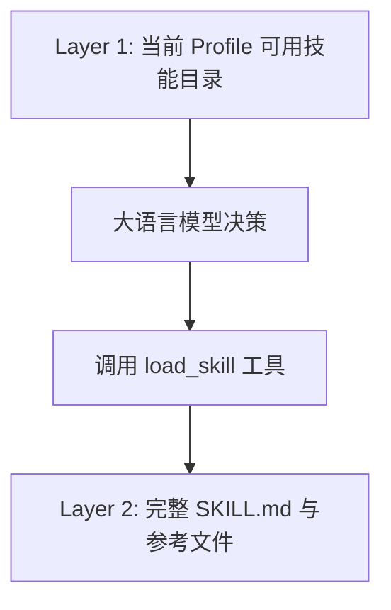

# 常驻角色与技能底座插件

本文介绍 `builtin:profile` 角色与技能底座插件的架构设计、启动自举、资产注入与技能加载机制。长期记忆（`MEMORY.md` / `update_memory`）已拆分至独立的 [`builtin:memory`](memory.md) 插件，本插件零记忆逻辑。

---

## 插件定位与架构总览

`builtin:profile` 是 Helm 系统常驻内置底座插件。
该插件声明了 `locked: true` 属性。
系统禁止卸载或停用本插件。
它为所有会话按 `profileId` 注入独立的人格定义（SYSTEM.md）与可用技能目录。

```mermaid
flowchart td
    subgraph Storage["Profile 资产存储 (~/.helm/profiles/<id>/)"]
        SysFile["SYSTEM.md 人格设定"]
    end

    subgraph Hook["before_turn 注入流水线"]
        Read["读取 SYSTEM.md"]
        Skills["装配可用技能目录"]
        Sections["组装 Prompt Sections"]
    end

    subgraph Session["任意绑定该 Profile 的会话"]
        Model["大语言模型"]
        Tools["load_skill"]
    end

    Storage --> Read
    Read --> Skills
    Skills --> Sections
    Sections --> Model
    Model --> Tools
```

---

## 启动自举

插件服务（`profile-skills`）在启动时完成两件事：

1. **系统级内置技能同步**：调用 `SkillService.ensureSkill` 同步 `skills/helm-cli/`（SKILL.md + references），以源码版本为准逐文件覆盖，缺失补齐；常规写入接口对受管技能统一 403 拒绝。
2. **默认 Profile 托管声明**：若默认角色 `assistant` 的 `profile.json` 缺少 `managedByPlugin`，显式补写 `builtin:profile`（已存在时原样保留，不做归一化）。

默认 `assistant` Profile 由内核 `ProfileService.ensureDefault` 先行创建（`profile.json` + `SYSTEM.md`）。

---

## 独立资产注入机制

在每个交互回合开始前，插件通过 `before_turn` 钩子注入上下文。

### 注入段落规范

1. **`profile.system`**：
   - 注入 `SYSTEM.md` 的原始内容。
   - 定义智能体的基础人设、语气风格与行为准则。
2. **`profile.skills`**：
   - 注入可用技能目录摘要（`<available_skills>` 包裹）。
   - 提示模型使用 `load_skill` 按需加载详细定义。
3. **`profile.assets-missing`**：
   - SYSTEM.md 缺失或为空时注入显式说明（`<profile_assets_missing>` 包裹）。
   - 告诫模型谨慎回答，绝不伪造特定人格。

### 资产缺失自愈防线

若外部误删 `SYSTEM.md`：

1. **降级为空文本**：系统不阻断当前回合执行。
2. **发送告警事件**：宿主触发 warning 级别系统通知（按 `profileId` 独立去重）。
3. **注入显式说明**：向模型注入 `profile.assets-missing` 段落。
4. **自动重建自愈**：后续执行 `profiles update --system` 等写入时可自愈重建。

---

## 动态技能按需加载

为了节约模型上下文，Helm 采用两层技能加载架构。



### 技能分层设计

1. **Layer 1 轻量目录**：在 `before_turn` 中按当前会话的 Profile 配置注入可用技能的名称、描述与引用清单。
2. **Layer 2 详细内容**：模型在需要时调用 `load_skill` 工具读取 SKILL.md 或 `references/*.md` 子文件。

### Profile 可用技能配置

`profile.json` 的 `skills` 字段控制当前 Profile 的技能目录与 `load_skill`：

| 配置 | 行为 |
| --- | --- |
| 省略 `skills` | 所有当前可用技能；新安装的技能自动可用 |
| `"skills": []` | 不提供任何技能 |
| `"skills": ["helm-cli", "git-commit"]` | 只提供指定 ID 的技能 |

托管技能还要求其 `managedByPlugin` 对应插件处于启用状态。每次回合与工具调用均读取当前配置；不需要重建会话。

```bash
helm profiles update coder --skills '["helm-cli","git-commit"]' --json
helm profiles update coder --skills '[]' --json
helm profiles update coder --all-skills --json
```

此配置是技能发现与加载策略，不是权限沙箱。

### 内置技能保护

系统启动时自动同步内置管理技能 `skills/helm-cli/`：版本强制对齐、禁止常规 API 篡改。

---

## Profile 详情抽屉子插槽

本插件提供 `builtin:profile/detail-section` 子插槽（协议常量 `PROFILE_DETAIL_SECTION_SLOT`）：
Web 的角色详情抽屉在该位置挂载 `<PluginSlot ownerPluginId="builtin:profile" name={PROFILE_DETAIL_SECTION_SLOT} slotProps={{ profileId, isNew, disabled }} />`。
其他插件（如 `builtin:memory`）经 `ctx.ui.slot` 向该插槽注入单 Profile 级别的扩展区块，宿主不硬编码任何插件业务字段。

---

## 左栏 Profile 站位导航

插件注册 `ctx.ui.sidebarItem({ id: 'assistant', target: 'conversation:profile:assistant', order: 0 })`：
- 指向 Profile 而非某一具体会话（该 Profile 的会话全部删除后站位仍在，点击可新建会话）；
- 不依赖任何特定会话 ID 存在。
