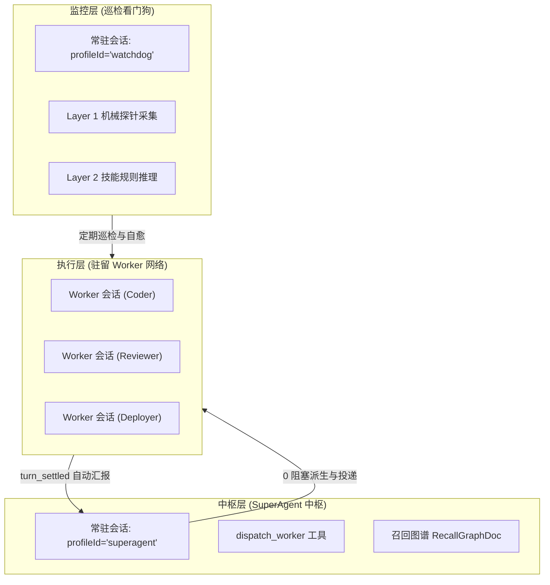
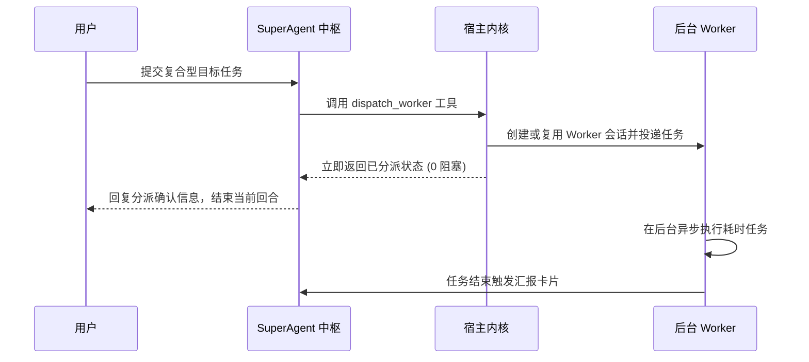
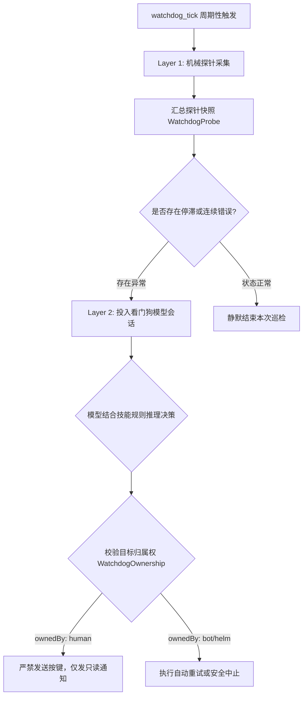

# SuperAgent 双层中枢与看门狗插件

本文介绍 `builtin:superagent` 插件的架构设计、双层常驻会话、0 阻塞路由、召回图谱与两层巡检机制。

---

## 插件定位与双层架构

`builtin:superagent` 负责构建多智能体编排网络。
系统解耦总控路由与后台作业，实现双层协作拓扑。
中枢负责意图识别与任务分派。
后台 Worker 负责长期驻留并执行专项任务。
看门狗负责全局巡检与错误自愈。

---

## 动态常驻会话分配

插件首次启用时动态分配两个核心会话。
系统不硬编码固定 ID。
会话元数据统一保存在持久文档 `index` 中。

### 常驻会话定义

1. **SuperAgent 路由中枢**：
   - 绑定 `profileId: 'superagent'`。
   - 负责承接用户综合性复杂需求。
   - 调度专家智能体协同作业。
2. **巡检看门狗**：
   - 绑定 `profileId: 'watchdog'`。
   - 负责定期接收探针快照。
   - 分析系统瓶颈并执行错误自愈。

### 受管保护规则

- **会话删除保护**：
  - 插件启动时调用 `ctx.host.manageConversation(id)` 接管会话。
  - 插件启用期间拦截针对这两个会话的删除请求。
  - 接口返回 `409 conversation_managed_by_plugin` 错误。
- **动态释放机制**：
  - 插件停用时自动释放管理权。

---

## 0 阻塞总控路由与 Worker 管理

中枢通过 `dispatch_worker` 工具派发任务。
分发过程遵循非阻塞设计原则。

### 核心管理工具

1. **`dispatch_worker` 工具**：
   - 支持指定专家画像 `profileId` 与任务内容。
   - 自动为新会话附加 `tags: ['worker']` 标记。
   - 任务投递完成后立即返回，绝不同步阻塞等待。
2. **`archive_worker` 工具**：
   - 为闲置或已完成的 Worker 附加 `archived` 标签。
   - 解除中枢的主动管理绑定，释放系统资源。

---

## 输入来源与自动汇报机制

系统通过 `origin` 标记精确追踪输入的产生来源。

### 输入来源类型

- **`human`**：用户直接输入的对话内容。
- **`agent`**：智能体通过工具发起的协同调用。
- **`trigger`**：定时器或 Webhook 投递的外部事件。

### `turn_settled` 自动汇报流程

每个回合结算时（包含 `completed`、`failed`、`aborted` 三种终态）：

1. **来源校验**：
   - 插件校验本回合消费的输入列表。
   - 若包含任意 `agent` 或 `trigger` 来源。
2. **投递汇报卡片**：
   - 插件自动向中枢投递结构化结算卡片。
   - 卡片汇总任务执行结论、消耗与产物。
3. **静默更新图谱**：
   - 若本回合全部为 `human` 输入。
   - 插件静默更新召回图谱，不打扰中枢。

---

## `ThreadKey` 0ms 直通路由

为了降低中枢的重复路由开销。
插件提供了基于 `ThreadKey` 的事件直通机制。

1. **订阅登记**：
   - Worker 会话可在 `ThreadSubscriptionDoc` 中订阅指定业务键。
2. **事件拦截**：
   - `trigger` 钩子拦截入站事件。
   - 若载荷包含匹配的 `threadKey`。
3. **定向改写直投**：
   - 钩子返回 `transform` 动作。
   - 直接将目标会话修改为对应 Worker 的 ID。
   - 事件跳过中枢意图识别，实现零延迟直达。

---

## 召回图谱 (`RecallGraphDoc`)

插件维护全局召回图谱文档。
图谱持久保存在 SQLite 数据库中。

1. **拓扑结构记录**：
   - 记录父子会话衍生关系。
   - 追踪各 Worker 正在处理的业务领域。
2. **意图召回辅助**：
   - 当用户提出新需求时。
   - 中枢检索召回图谱匹配历史专家。
   - 优先复用已有上下文的 Worker，减少重复开销。

---

## 两层巡检与看门狗红线

巡检看门狗每分钟执行一次周期性系统巡检。
巡检采用分层处理策略。

### 两层巡检分工

1. **Layer 1 机械探针**：
   - 宿主无开销采集所有会话与终端窗格状态。
   - 记录状态停滞毫秒数 `stalledMs`。
   - 统计连续错误次数与尾部输出快照。
2. **Layer 2 规则模型推理**：
   - 发现停滞或错误时唤醒看门狗会话。
   - 模型结合专用技能规则分析根本原因。
   - 生成精准的修复或重试策略。

### 归属权安全红线 (`WatchdogOwnership`)

看门狗在执行干预前必须严格校验归属权：

- **`ownedBy: 'human'`（人类会话）**：
  - **绝对禁止**发送任何模拟按键或强制终止指令。
  - 系统仅允许生成只读诊断报告，并通过事件通知用户。
- **`ownedBy: 'bot' | 'helm'`（受管会话）**：
  - 允许看门狗自动执行取消、重试或恢复操作。
