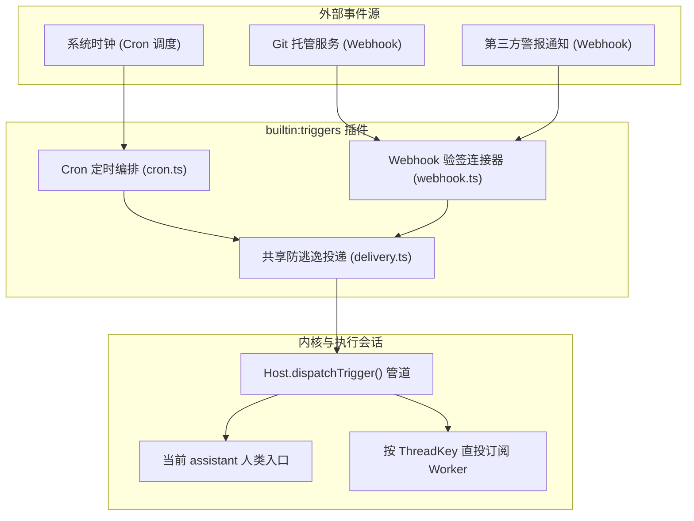
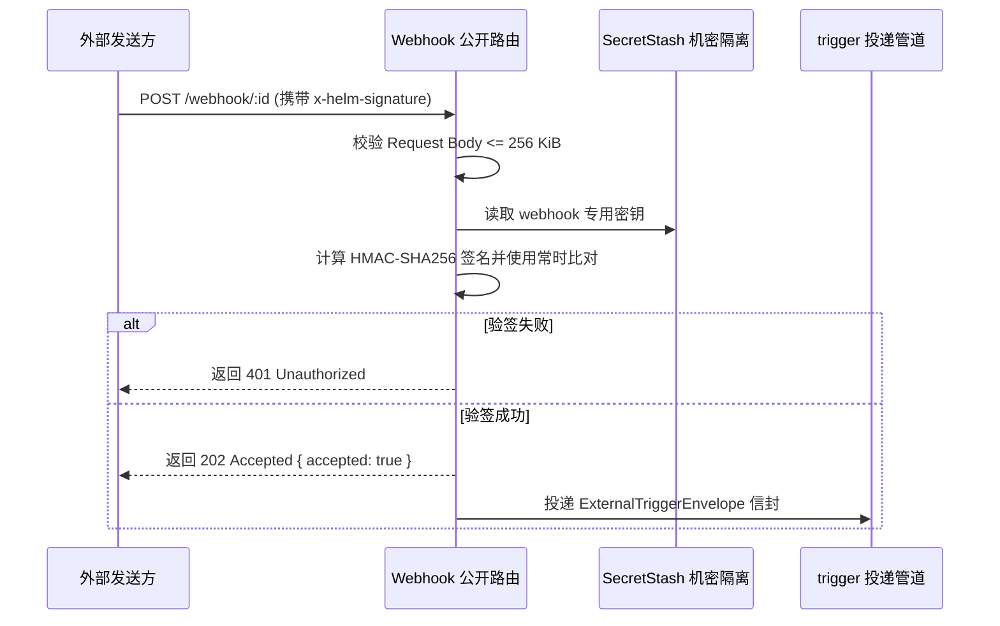

# 自动化触发器插件

本文介绍 `builtin:triggers` 插件的架构设计、Cron 定时编排、Webhook 签名入站与防逃逸信封机制。

---

## 插件定位与架构总览

`builtin:triggers` 负责接收与分发外部事件。
插件包含两大入站连接器：Cron 定时器与 Webhook 接收器。
事件经处理后投递给内核 `trigger` 管道。



---

## Cron 定时编排机制

Cron 模块支持基于标准五字段表达式调度自动化任务。
调度任务配置持久存储在 `crons` 公共文档中。

### 调度保证与执行语义

1. **至多一次语义**：
   - 定时点触发时先推进下次时间并冲刷持久化。
   - 机制防止系统崩溃重试引发重复扣费或副作用。
2. **单飞保护机制**：
   - 单个任务在同一时刻只允许一个执行中实例。
   - 上次回合未完成时跳过并发触发。
3. **重启补跑策略 (`catchUp`)**：
   - 配置 `catchUp: true` 时，重启后对错过的时间段合并补跑一次。
   - 配置 `catchUp: false` 时，重启后直接跳跃至未来的下一个执行点。
4. **超长定时器安全防溢出**：
   - 定时器间隔超过 32 位整数上限时。
   - 调度器分段续排，杜绝定时器提前误触发。

### Cron 管理动作

| 动作标识 | 功能描述 | 关键参数 |
| :--- | :--- | :--- |
| `cron_create` | 创建新的定时作业 | `id`, `schedule`, `text`, `catchUp` |
| `cron_update` | 修改已有任务配置 | `id`, `schedule`, `text`, `enabled` |
| `cron_delete` | 删除指定定时任务 | `id` |
| `cron_trigger` | 手动立刻触发指定任务 | `id` |
| `cron_list` | 查询所有已注册定时任务 | 无 |

---

## Webhook 签名入站与机密隔离

Webhook 模块提供公网入站接口。
宿主为插件分配公共路由 `POST /api/plugins/builtin:triggers/routes/webhook/:id`。



### 验签安全契约

1. **HMAC-SHA256 强校验**：
   - 请求必须携带 `x-helm-signature: sha256=<hex>` 请求头。
   - 插件读取原始 Body 字节流计算校验和。
   - 比对过程使用 `crypto.timingSafeEqual` 防范时序侧信道攻击。
2. **严格体积上限**：
   - 请求体严格限制在 256 KiB 以内。
   - 超过上限立即阻断并返回 `413 Payload Too Large`。
3. **机密存储隔离**：
   - 验签密钥仅持久存储在 `credentials.json` 的 `pluginSecrets`。
   - 密钥自动注册到全局 `SecretStash` 中执行脱敏过滤。
   - 公共状态文档绝不包含原始密钥。
4. **严禁模型会话创建密钥**：
   - `webhook_create` 动作在检测到 `conversationId` 时显式拒绝。
   - 规则禁止大模型通过 `run_action` 传入明文密钥。
   - 机制避免密钥进入会话历史上下文引发泄漏。

---

## 防逃逸信封 (`defang`) 与投递路由

为了防范提示词注入风险。
所有外部事件必须经过信封打包后投递给内核。

### 信封数据结构

```typescript
export interface ExternalTriggerEnvelope {
  id: string;
  source: string;
  text: string;
  threadKey?: string;
  targetConversationId?: number;
  metadata?: Record<string, unknown>;
  createdAt: number;
}
```

### 投递与路由分发

1. **文本防逃逸包裹**：
   - 投递模块对原始事件文本应用 `defang` 包裹。
   - 隔离不可信文本，防止模型将外部输入误判为系统指令。
2. **`ThreadKey` 快速直投**：
   - 若外部事件携带 `threadKey`。
   - 管道根据订阅表将目标直接指向后台 Worker 会话。
3. **默认常驻入口**：
   - 若未指定直投目标且插件钩子未定向，内核选择 assistant Profile 下最新的无父链 human-owned 会话；没有候选时按需创建，并合并同进程并发创建。显式目标在 trigger 钩子前校验，已删除目标明确报错，不允许被 ThreadKey 改写掩盖。

---

## 声明式管理界面

插件注册了声明式管理界面与系统配置面板。
界面遵循无 Emoji 规范，使用线性矢量图标。

1. **管理屏幕 (`manager`)**：
   - 提供直观的 Cron 任务表格与 Webhook 端点表格。
   - 支持在表格行内触发“立即触发”与“删除”操作。
2. **配置面板 (`triggers-settings`)**：
   - 展示当前注册的任务总数与端点总数。
   - 提示使用 CLI 或端点维护配置。
