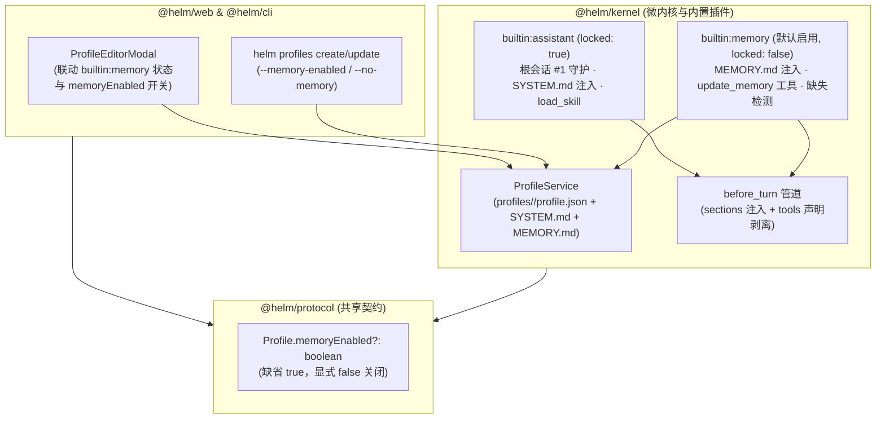

## 背景

Helm 当前将角色的长期记忆能力（`MEMORY.md` 上下文注入与 `update_memory` 写盘工具）直接内嵌在常驻插件 `builtin:assistant`（`packages/kernel/src/builtin-plugins/assistant.ts`，`locked: true`）中。每回合 `before_turn` 钩子无条件读取当前会话绑定 Profile 的 `~/.helm/profiles/<id>/MEMORY.md` 并注入 `<memory>` 段落，同时向所有会话暴露 `update_memory` 工具。

这一耦合结构在实际使用中带来四类问题：

1. **缺乏全局与单 Profile 粒度的记忆开关**：`builtin:assistant` 因守护根会话 `Conversation #1` 与基础技能加载而标记为 `locked: true` 不可停用，`Profile` 契约（`packages/protocol/src/assets.ts`）也未提供记忆开关字段。用户创建无状态工具型或纯执行型 Profile 时，无法关闭长期记忆注入，也无法禁止模型调用 `update_memory` 写盘。
2. **默认系统提示词硬编码工具指令**：`packages/kernel/src/services/profiles-skills.ts`（第 47 行）的 `SYSTEM_DEFAULT` 固定包含 `4. 用 update_memory 保存稳定的用户偏好与约定。`。若未来停用记忆能力而保留该默认提示词，模型会在工具已卸载的情况下继续尝试调用 `update_memory`。
3. **Web 端新建 Profile 触发空白记忆误报**：`packages/web/src/modals/profile-editor-model.ts`（第 150 行）在新建 Profile（`opts.isNew`）且用户未填写初始记忆时，会提交 `memory: ""` 将磁盘 `MEMORY.md` 写为空文件；而 `assistant.ts`（第 126 行）以 `!rawMemory.trim()` 判定资产缺失，导致任何通过 Web 新建且未预填记忆的 Profile 在首轮对话都会被注入 `<profile_assets_missing>` 警告，误导模型向用户报告“资产文件缺失”。
4. **编辑器界面与运行时状态未联动**：`packages/web/src/modals/ProfileEditorModal.tsx` 固定渲染 `MEMORY.md` 选项卡，无法表达“当前全局已停用记忆插件”或“当前 Profile 不启用长期记忆”的状态。

本次设计将长期记忆能力从 `builtin:assistant` 拆分为独立的内置可选插件 `builtin:memory`，并在 `Profile` 契约引入 `memoryEnabled?: boolean` 声明字段，实现以下可观察目标：

- **全局可停用**：`builtin:memory` 默认启用、非 `locked`；停用后全局不再注入 `<memory>` 段落，`update_memory` 工具从工具注册表卸载，Web 端 Profile 编辑器同步隐藏 `MEMORY.md` 选项卡。
- **单 Profile 可按需关闭**：新建或编辑 Profile 时可通过 Web 开关、CLI `--memory-enabled` 或 HTTP 接口将 `memoryEnabled` 设为 `false`；关闭后该 Profile 的会话在 `before_turn` 阶段不注入记忆并剥离 `update_memory` 工具声明，且 `update_memory.execute` 在执行边界显式拒绝调用（`403 memory_disabled_for_profile`）。
- **提示词与资产告警诚实自洽**：从 `SYSTEM_DEFAULT` 移除 `update_memory` 硬编码指引，改由 `builtin:memory` 在实际启用记忆的回合动态附带；区分“初始空白记忆（合法状态，不告警）”与“`MEMORY.md` 文件被外部删除（`FileNotFoundError`，触发告警与 `<profile_assets_missing>`）”。

非目标：不改变 `~/.helm/profiles/<id>/MEMORY.md` 的底层文件存储位置与 64,000 字符上限防线（`ProfileService` 仍作为内核静态资产读写底座）；停用插件或关闭单 Profile 记忆时不删除磁盘已有的 `MEMORY.md` 文件。

建议分支：`refactor/memory-plugin-and-profile-toggle`（建议新开分支名，非既有分支）。

---

## 整体设计

本次改造遵循 `web` / `cli` $\rightarrow$ `protocol` $\leftarrow$ `kernel` 单向依赖边界，将“静态文件存取机制（`ProfileService`）”、“角色记忆启用声明（`Profile.memoryEnabled`）”与“回合注入及工具注册策略（`builtin:memory`）”三层解耦。



### 职责划分与两级开关语义

1. **`ProfileService`（内核资产底座）**：继续负责 `~/.helm/profiles/<id>/` 下 `profile.json`、`SYSTEM.md` 与 `MEMORY.md` 的原子读写、文件锁并发防线与 `MAX_MEMORY_CHARS`（64,000 字符）校验。内核服务层不感知 `builtin:memory` 是否启用，保证 HTTP/CLI 静态资产读写接口语义稳定。
2. **`builtin:assistant`（常驻基础认知底座，`locked: true`）**：收敛为根会话 `Conversation #1` 守护、`SYSTEM.md` 注入、`load_skill` 工具与 `<available_skills>` 目录拼装。不再读取 `MEMORY.md`，也不再注册 `update_memory`。
3. **`builtin:memory`（长期记忆插件，`locked: false`，默认启用）**：承载 `MEMORY.md` 回合注入、`update_memory` 工具注册及 `MEMORY.md` 文件被删告警。

两级开关的组合行为如下表所示：

| `builtin:memory` 插件状态 | `profile.memoryEnabled` 取值 | `before_turn` `<memory>` 注入 | 模型可见 `update_memory` 工具 | 直接调用 `update_memory.execute` | Web `ProfileEditorModal` 表现 |
| :--- | :--- | :--- | :--- | :--- | :--- |
| **已停用** | `undefined` / `true` / `false` | 不注入 | 已从宿主卸载（不可见） | 宿主拒绝（`tool_not_found`） | 隐藏 `MEMORY.md` 选项卡与记忆开关 |
| **已启用** | `undefined` 或 `true`（默认） | 读取并注入非空 `MEMORY.md` 及工具提示 | 可见 | 正常原子写盘（受 64k 上限约束） | 显示「启用长期记忆」开关（开启）与 `MEMORY.md` 选项卡 |
| **已启用** | `false` | 不读取、不注入 | 经 `before_turn` 从本回合 `tools` 剥离 | 拒绝并抛 `403 memory_disabled_for_profile` | 显示「启用长期记忆」开关（关闭），隐藏 `MEMORY.md` 选项卡 |

---

## 详细设计

### 1. 协议与资产校验契约（`@helm/protocol` & `@helm/kernel`）

在 `packages/protocol/src/assets.ts` 的 `Profile` 接口新增可选布尔字段 `memoryEnabled`：

```ts
export interface Profile {
  id: string
  name?: string
  model?: string
  thinkingLevel?: string
  nodeId?: string
  cwd?: string
  runtime?: ProfileRuntime
  tags?: string[]
  skills?: string[]
  /** 是否启用长期记忆（MEMORY.md 注入与 update_memory 工具）；缺省 true，显式 false 关闭。 */
  memoryEnabled?: boolean
  managedByPlugin?: string
  humanSelectable?: boolean
  system?: string
  memory?: string
}
```

并提供纯函数判定辅助（供内核插件与 Web 端共用，消除重复布尔判断）：

```ts
/** 判定 Profile 是否启用长期记忆（缺省 true，仅显式 false 时关闭）。 */
export function isProfileMemoryEnabled(profile: Pick<Profile, 'memoryEnabled'> | undefined): boolean {
  return profile?.memoryEnabled !== false
}
```

边界校验同步更新两处入口：

- **服务层校验（`packages/kernel/src/services/profiles-skills.ts`）**：`validateProfileInput` 校验 `input['memoryEnabled']`；若定义则必须为 `boolean`，非布尔值抛出 `Error("profile '<id>' memoryEnabled 若存在必须是布尔值")`。为保持 `profile.json` 精简或显式可观测，当传入 `boolean` 时原样写入 `profile.memoryEnabled`。
- **HTTP 层校验（`packages/kernel/src/http/validate.ts`）**：`parseProfileBody` 允许白名单键 `'memoryEnabled'`，经 `optionalBoolean(body, 'memoryEnabled')` 解析并透传。
- **新建 Profile 文件初始化（`ProfileService.save`）**：当新建 Profile（`existing === undefined`）且 `profile.memoryEnabled === false` 且未显式传入 `rawMemory` 时，不强制创建默认的 `MEMORY.md` 占位文件；若后续将 `memoryEnabled` 改为 `true` 或调用 `getMemory`，`ProfileService.getMemory` 在遇到 `FileNotFoundError` 且处于详情读取（`routes.ts` 的 `enrichProfile`）时返回空串 `""`，避免禁用记忆的新建 Profile 在磁盘产生多余文件或导致 `GET /api/profiles/:id` 404。

### 2. 默认系统提示词去耦合（`ProfileService`）

修改 `packages/kernel/src/services/profiles-skills.ts` 中的 `SYSTEM_DEFAULT`，移除第 4 条对 `update_memory` 的硬编码引用：

```ts
export const SYSTEM_DEFAULT = [
  '# System Prompt',
  '',
  '你是运行在 Helm 微内核上的个人助理。',
  '',
  '1. 受管 bash 已提供 `helm` CLI 与会话身份 `HELM_CONVERSATION_ID`，可用 `--current` 与 `--json` 调用。',
  '2. 操作 Helm 或回答宿主能力问题前，先 `load_skill({ skillId: "helm-cli" })` 并按需读取 references，通过命令帮助与实际状态核实能力。',
  '3. 普通回复用 Markdown；需要交互展示时再读取 UI 手册。生成文件供用户在 Web 查看时，用 write(..., artifact: true) 或 helm artifacts put <path> --current 登记产物，并在回复中用 [文件名](artifact:<id>) 或  直接渲染。',
  '',
].join('\n')
```

### 3. `builtin:memory` 插件实现（`packages/kernel/src/builtin-plugins/memory.ts`）

新建 `packages/kernel/src/builtin-plugins/memory.ts`，导出 `MEMORY_PLUGIN_ID = 'builtin:memory'` 与 `createMemoryPlugin({ profiles })`：

```ts
export const MEMORY_PLUGIN_ID = 'builtin:memory'

export interface MemoryPluginServices {
  profiles: ProfileService
}
```

#### 3.1 `before_turn` 注入与工具声明剥离

`builtin:memory` 注册 `onBeforeTurn` 钩子，按以下顺序处理：

1. **查询当前会话 Profile 配置**：调用 `await profiles.get(turn.conversation.profileId)`。
2. **单 Profile 关闭分支（`!isProfileMemoryEnabled(profile)`）**：
   - 不读取 `MEMORY.md`，不注入任何记忆段落；
   - 检查 `turn.tools` 是否包含 `update_memory`；若包含则过滤剥离并返回 `{ action: 'transform', value: { ...turn, tools: filteredTools } }`，使模型在本回合请求的工具列表中完全看不到 `update_memory`。
3. **单 Profile 启用分支（`isProfileMemoryEnabled(profile)`）**：
   - 调用 `profiles.getMemory(profileId)` 读取记忆文件：
     - **正常读取（含空文件或仅有 `# Memory` 标题）**：将 `missingNotified.delete(profileId)` 复位。若存在除默认空标题外的有效内容或原文本非空，按 `MAX_MEMORY_CHARS`（64,000 字符）执行截断保护（超限时追加 `MEMORY_TRUNCATION_NOTE`），注入 `{ id: 'memory.content', text: '<memory>\n...\n</memory>\n用 update_memory 保存稳定的用户偏好与约定。' }`；若文件内容为空串 `""`，仅注入轻量工具指引 `{ id: 'memory.guide', text: '用 `update_memory` 保存稳定的用户偏好与约定。' }`，**不触发** `<profile_assets_missing>`。
     - **文件被外部误删（捕获 `FileNotFoundError`）**：按 `profileId` 独立去重发送一次性 `warning` 级别通知（`title: "长期记忆文件缺失：<profileId>/MEMORY.md"`），并向本回合注入 `{ id: 'memory.assets-missing', text: '<profile_assets_missing>...</profile_assets_missing>' }`，明确告知模型长期记忆文件缺失，不要假装拥有既往记忆，后续调用 `update_memory` 可自愈重建。
     - **其他 IO/权限异常**：原样上抛，绝不静默吞掉。

> **去重粒度修正**：现有 `assistant.ts` 使用模块级布尔值 `missingNotified.memory` 全局去重，导致 Profile A 缺失告警后，Profile B 缺失不再告警。新插件改为 `Set<string>` 按 `profileId` 追踪去重，文件恢复后仅清除对应 `profileId` 的标记。

#### 3.2 `update_memory` 工具与执行期边界拦截

`builtin:memory` 注册 `update_memory` 工具（输入 Schema 保持 `{ text: string, mode: 'append' | 'replace' }` 不变）。在 `execute(input, context)` 内部增加 Profile 开关复核：

```ts
async execute(input, context) {
  const conversation = ctx.host.getConversation(context.conversationId)
  const profileId = conversation.profileId
  const profile = await profiles.get(profileId)
  if (!isProfileMemoryEnabled(profile)) {
    throw new HelmError(
      'memory_disabled_for_profile',
      `Profile '${profileId}' 已关闭长期记忆（memoryEnabled: false），禁止调用 update_memory`,
      403,
      { profileId },
    )
  }
  await profiles.updateMemory(profileId, input.text, input.mode, { maxChars: MAX_MEMORY_CHARS })
  return { updated: true, profileId }
}
```

即使会话曾开启过记忆（上下文历史残留 `update_memory` 调用记录）后被用户关闭，模型模仿历史发起的调用也会在执行边界被 `403 memory_disabled_for_profile` 拦截，不会污染磁盘文件。

### 4. `builtin:assistant` 职责收敛（`packages/kernel/src/builtin-plugins/assistant.ts`）

从 `assistant.ts` 中移除所有 `MEMORY.md` 读取、`MEMORY_TRUNCATION_NOTE`、`update_memory` 工具注册与 `memory` 缺失检测：

- `onBeforeTurn` 仅并发读取 `profiles.getSystem(profileId)` 与 `skills.list()`；
- `missingNotified` 按 `profileId` 集合记录 `SYSTEM.md` 缺失通知；当 `!rawSystem.trim()` 时注入 `assistant.assets-missing`（仅报告 `SYSTEM.md（人格/职责定义）` 缺失）；
- `createHelm`（`packages/kernel/src/app.ts`）在注册 `createAssistantPlugin(kernel)` 之后紧接注册 `await kernel.plugins.register(createMemoryPlugin({ profiles: kernel.profiles }))`（默认 `enabled: true`）。因为两者的 `before_turn` 钩子同为默认优先级，按注册顺序依次执行，最终生成的系统提示词段落顺序保持 `assistant.system` $\rightarrow$ `assistant.skills` $\rightarrow$ `memory.content` 稳定可预测。

### 5. CLI 与 Web 界面同步（API 与 CLI 同权）

#### 5.1 CLI（`packages/cli/src/commands/profiles.ts`）

为 `helm profiles create` 与 `helm profiles update` 新增布尔语义化选项：

- `--memory-enabled <true|false>`：显式设置 `profile.memoryEnabled` 为 `true` 或 `false`（在 `semanticFlags` 中声明 `{ name: 'memory-enabled', type: 'boolean', help: '是否启用长期记忆（true/false，缺省 true）' }`）。
- 当用户在 `create` 或 `update` 中同时传入 `--memory-enabled false` 与 `--memory` / `--memory-file` 时，CLI 本地校验直接抛出 `CliError('--memory-enabled false 与 --memory/--memory-file 冲突（已关闭记忆的 Profile 不接受写入初始记忆）', 'conflicting_flags')`，在发起 HTTP 请求前快速失败。
- 同步更新 `packages/kernel/src/builtin-plugins/assistant/skill/SKILL.md` 中的 `helm profiles create` 命令速查说明。

#### 5.2 Web Profile 编辑器（`packages/web/src/modals/ProfileEditorModal.tsx` & `profile-editor-model.ts`）

1. **插件启用态感知**：在 `ProfileEditorModal` 中通过 `enabledPluginIds.has('builtin:memory')` 判断长期记忆插件是否启用（记为 `memoryPluginEnabled`）。
2. **Basic Tab 记忆开关**：当 `memoryPluginEnabled` 为 `true` 时，在 `ProfileBasicTab` 表单底部提供 `Switch` 控件：
   - 标签：`启用长期记忆（MEMORY.md）`
   - 绑定值：`draft.profile.memoryEnabled !== false`
   - 切换行为：调用 `patch({ ...profile, memoryEnabled: checked })`；若当前处于 `memory` Tab 且用户将开关切为 `false`，自动切回 `basic` Tab。
3. **动态选项卡（`tabItems`）**：仅当 `memoryPluginEnabled && draft?.profile.memoryEnabled !== false` 时，在顶部 `TabsList` 渲染 `{ key: 'memory', label: 'MEMORY.md' }` 选项卡。插件全局停用或当前 Profile 关闭记忆时，隐藏 `MEMORY.md` 选项卡。
4. **保存载荷模型（`packages/web/src/modals/profile-editor-model.ts`）**：
   - `buildProfileSavePayload`：当 `draft.profile.memoryEnabled !== undefined` 时，将 `payload.memoryEnabled = draft.profile.memoryEnabled` 写入请求体；
   - 当 `draft.profile.memoryEnabled === false` 时，即使 `opts.isNew` 为 `true`，也**不**向 `payload` 附加 `memory: ""` 字段，避免无记忆 Profile 触发多余的 `MEMORY.md` 写盘。
5. **插件中心卡片文案（`packages/web/src/plugins/PluginCard.tsx`）**：
   - `builtin:assistant` 描述更新为：`常驻根会话与个人助理底座，注入角色系统提示词并提供技能按需加载。`
   - 新增 `builtin:memory` 分支描述：`按 Profile 隔离注入 MEMORY.md 长期记忆，提供 update_memory 原子写回工具。`

---

## 影响分析

- **既有 Profile 与会话**：已有 Profile 的 `profile.json` 不含 `memoryEnabled` 字段，`isProfileMemoryEnabled` 缺省返回 `true`；`builtin:memory` 默认启用注册，升级后既有会话的长期记忆注入与 `update_memory` 行为保持不变。
- **`builtin:superagent`（中枢与巡检看门狗）**：`packages/kernel/src/builtin-plugins/superagent/watchdog.ts` 的 `WATCHDOG_ALLOWED_TOOLS` 白名单包含 `'update_memory'`。该集合仅作为 `turn.tools.filter(...)` 的允许集：当 `builtin:memory` 启用时 Watchdog 可正常更新值班记忆；当用户主动停用 `builtin:memory` 或关闭 `watchdog` Profile 的 `memoryEnabled` 时，`update_memory` 自然不在工具集中，Watchdog 退化为无长期记忆巡检，不会产生异常。
- **HTTP `GET /api/profiles/:id` 详情接口**：`routes.ts` 中的 `enrichProfile` 读取 `kernel.profiles.getMemory(profile.id)`。对于 `memoryEnabled: false` 且磁盘未生成 `MEMORY.md` 的新建 Profile，`getMemory` 捕获 `FileNotFoundError` 并在 `enrichProfile` 兜底为空串 `""`，保证详情接口始终返回合法的 `Profile` 结构；而在 `builtin:memory` 的 `before_turn` 中，仅在 `memoryEnabled !== false` 时才调用 `profiles.getMemory`，因此未启用记忆的 Profile 不会触发缺失告警。

---

## 发布与恢复

本次改动为纯代码与配置契约演进，不涉及 SQLite 表结构变更或存量数据迁移，支持直接常规发布：

- **启用与停用切换**：运行期可通过 Web 插件中心或 `helm plugins disable builtin:memory` / `helm plugins enable builtin:memory` 实时启停长期记忆插件（状态持久化至 `~/.helm/config.json` 的 `pluginEnabled["builtin:memory"]`）。
- **单 Profile 恢复**：将某 Profile 的 `memoryEnabled` 设为 `false` 仅停止注入与工具调用，不会清理磁盘已有的 `~/.helm/profiles/<id>/MEMORY.md`；随时改回 `true` 即可恢复原有记忆内容。
- **版本回退**：若回退代码版本，磁盘 `profile.json` 中已写入的 `memoryEnabled` 字段在旧版本需注意旧版 `validateProfileInput` 与 `parseProfileBody` 的字段校验行为（开发阶段遵循 `AGENTS.md` 不兼容不迁移原则，以最新契约为准）。

---

## 测试

测试案例统一收敛在各包的自动化单测与集成测试中执行（运行命令均须附带超时保护：`timeout 50s pnpm test`）：

| 编号 | 场景 | 前置条件与输入 | 目标路径 | 预期可观察结果 |
| :--- | :--- | :--- | :--- | :--- |
| **T1** | **默认启用路径与段落注入** | 全新数据目录启动 `createHelm()`；在根会话 `#1`（`profileId: 'assistant'`）发起对话并调用 `update_memory({ text: '偏好深色模式', mode: 'append' })` | `builtin:memory` `before_turn` 钩子 + `update_memory` 工具执行 | `GET /api/plugins` 包含 `id: 'builtin:memory', enabled: true, locked: false`；`update_memory` 写盘成功；下一回合请求中包含 `<memory>` 段落与最新记忆内容 |
| **T2** | **全局停用 `builtin:memory` 插件** | 调用 `POST /api/plugins/builtin%3Amemory/disable`（或 CLI `helm plugins disable builtin:memory`），随后在任意会话发起回合 | `PluginHost.disable` + `HookBridge.transformBeforeTurn` | 停用返回 200；回合系统提示词不含 `<memory>` 段落；模型工具列表不含 `update_memory`；`SYSTEM.md` 与 `load_skill` 仍正常工作 |
| **T3** | **新建 `memoryEnabled: false` 的 Profile** | `builtin:memory` 保持启用；通过 `POST /api/profiles` 或 `helm profiles create bot-stateless --memory-enabled false` 创建 Profile，绑定新会话并发起回合 | `parseProfileBody` $\rightarrow$ `ProfileService.save` $\rightarrow$ `builtin:memory.onBeforeTurn` | `profile.json` 持久化 `memoryEnabled: false`，磁盘不生成多余 `MEMORY.md`，`GET /api/profiles/bot-stateless` 返回 `memory: ""`；该会话回合不注入 `<memory>`，且 `turn.tools` 中 `update_memory` 被剥离 |
| **T4** | **单 Profile 关闭记忆时的执行边界拦截** | 会话绑定 `memoryEnabled: false` 的 Profile，`builtin:memory` 全局启用；直接调用 `kernel.plugins.executeTool('update_memory', { text: 'x', mode: 'append' }, { conversationId })` | `builtin:memory` `update_memory.execute` 守卫分支 | 显式抛出 `HelmError`，`status === 403`，`code === 'memory_disabled_for_profile'`，磁盘不产生 `MEMORY.md` 写入 |
| **T5** | **空白记忆正常状态 vs 文件被删告警** | Profile A 新建后 `MEMORY.md` 为空串 `""`；Profile B 的 `MEMORY.md` 从磁盘物理删除（模拟外部误删）；分别在两个会话发起回合 | `builtin:memory.onBeforeTurn` 分支判断 | Profile A 正常完成回合，**不**发送 `notification` 告警，**不**注入 `<profile_assets_missing>`；Profile B 触发一次 warning 通知并注入 `<profile_assets_missing>`，调用 `update_memory` 重建文件后告警恢复 |
| **T6** | **CLI 参数解析与冲突拦截** | 执行 `helm profiles update coder --memory-enabled false` 与 `helm profiles create bad --memory-enabled false --memory "init"` | `packages/cli/src/commands/profiles.ts` | 前者合并既有 Profile 字段并提交 `memoryEnabled: false`；后者在本地参数校验阶段拒绝并报 `conflicting_flags` 错误，不发出 HTTP 请求 |
| **T7** | **Web `ProfileEditorModal` 状态联动** | 在 `profile-binding.test.ts` / 模型单测中分别构造：① `builtin:memory` 停用；② `builtin:memory` 启用且 `draft.profile.memoryEnabled = false`；③ 启用且 `memoryEnabled = true` | `ProfileEditorModal` 选项卡派生与 `buildProfileSavePayload` | 情况①不展示记忆 Switch 与 `MEMORY.md` Tab；情况②展示 Switch（关）且隐藏 `MEMORY.md` Tab，新建保存 payload 不含 `memory` 字段；情况③展示 Switch（开）与 `MEMORY.md` Tab |
